# Mark Schemes — Scatter Graphs & Correlation
**Statistics** · Cambridge (CIE) IGCSE maths (0580 & 0980)

## Exam Questions (17 questions)

### Q1
The vertical scale has 10 squares between 0 and 4

- Each square is 0.4 hours

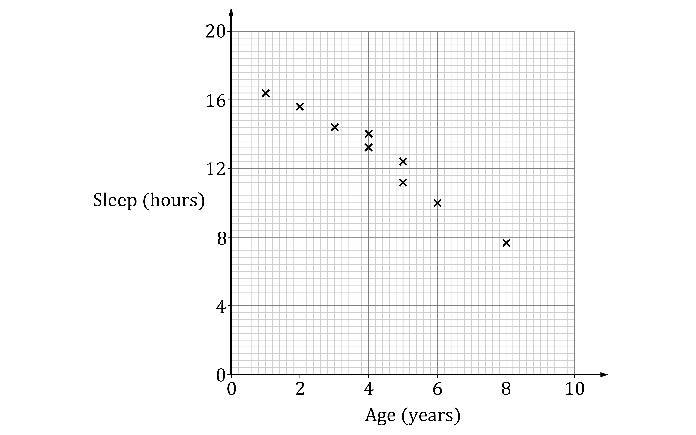

**[B1 B1 B1]**

> **[mark-scheme]**
> **B1**: For at least 3 points plotted correctly.
> 
> **B1**: For at least 6 points plotted correctly.
> 
> **B1**: For all points plotted correctly.
The points tend to go down and to the right

**Final answer:** **Negative**

**[B1]**
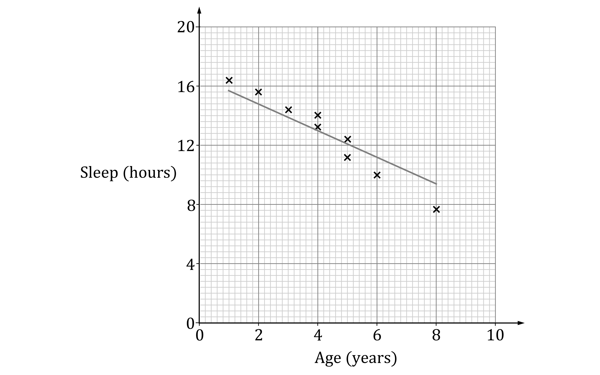

**[B1]**

> **[mark-scheme]**
> **B1**: The line should have a negative gradient and:
> 
> - the sleep should be between 13 and 17 hours when the age is 1
> - the sleep should be between 7 and 11 hours when the age is 8
Draw a vertical line up from 4 to your line

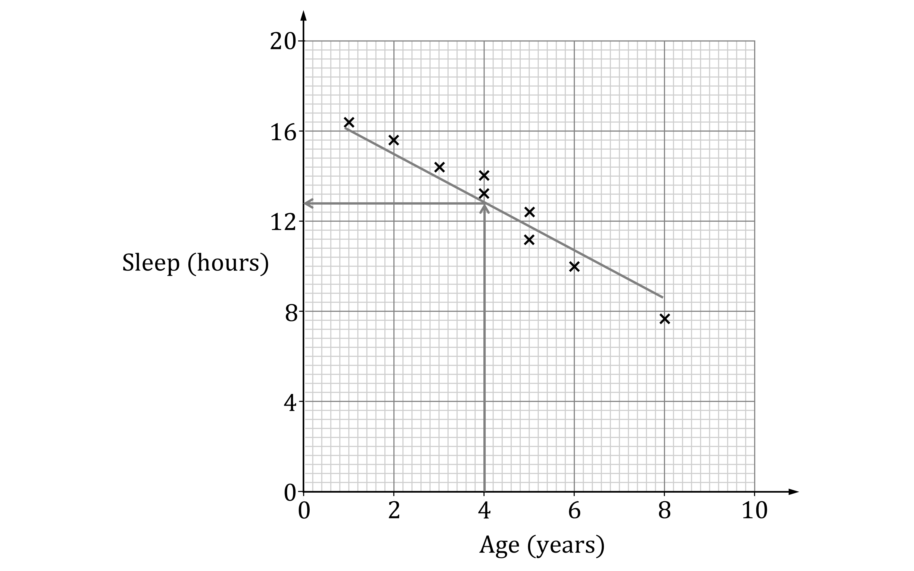

**Final answer:** **12.8 hours**

**[B1]**

> **[mark-scheme]**
> **B1**: You get this mark for correctly using your line. Your value should be in the range 10 to 14.

### Q2
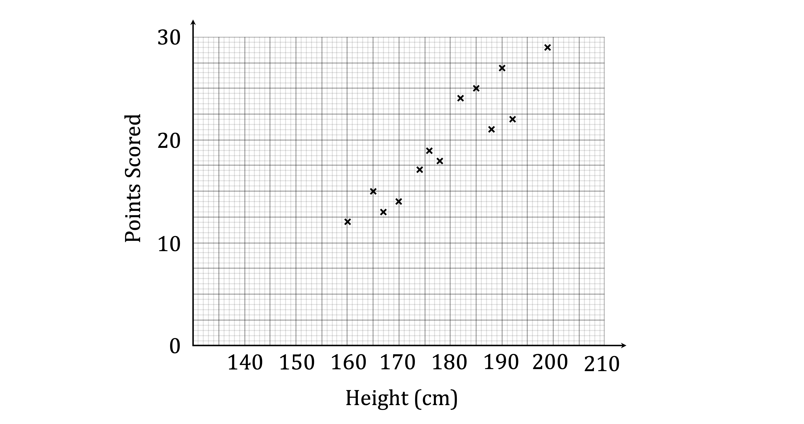

**[B1 B1]**

> **[mark-scheme]**
> **B1**: For at least 2 correct points.
> 
> **B1**: All points plotted correctly.
**Final answer:** **Positive**

**[B1]**
**Final answer:** **Using a ruler to draw a line of best fit going through roughly the same points as below **

**[B1]**

> **[exam-tip]**
> The line of best fit passes through the mean point on a scatter graph. However, this is not required as part of the core Cambridge IGCSE syllabus.

### Q3
> *Plot the coordinates:*

$( 20 , 33 ) , ( 44 , 52 ) , ( 37 , 44 ) , ( 46 , 52 )$

*Minimum 2 points correctly plotted** ***[1]**

*All points plotted correctly** ***[1]**
> *From the graph, as Speaking test score increases, Written test score increases*

**Positive** **[1]**
> *A high score in the Speaking test is further to the right on the grid.*

> *A low score in the Written test would be closer to the bottom of the grid*

**[1]**
> *The line of best fit is a straight line lying within the data set, following the trend of the data*

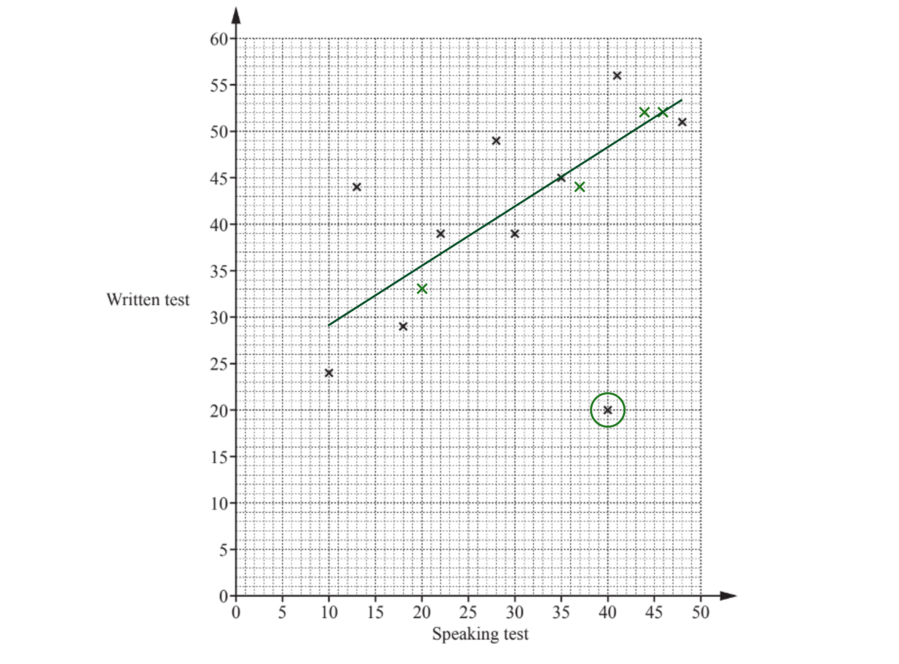

**[1]**
> *Draw a vertical line from *$25$* on the horizontal axis to the line of best fit and read across to determine the Written test score at this point*

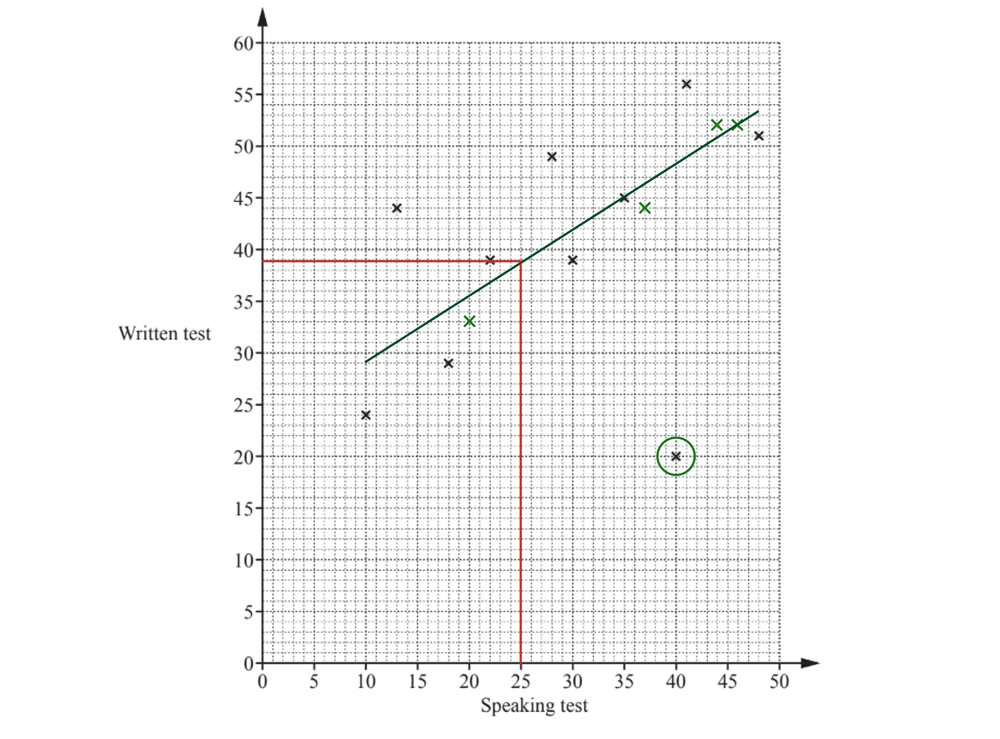

**39**** [1]**

### Q4
> *Plot each point on the scatter graph.*

*Be careful which way round you are plotting them, and read the scale on the axes carefully (each little square is worth 0.2).*

* All points plotted correctly*** ****[2]**

> *1 mark for 2 or 3 points plotted correctly*
> *The graph shows a **negative **correlation (average speed tends to decrease as distance increases).*

**Negative*** ***[1]**
> *Use a ruler to draw a line of best fit onto the scatter graph.*

*There should roughly be as many points on one side of the line as the other and the spaces between the points and the line should roughly be the same on either side.*

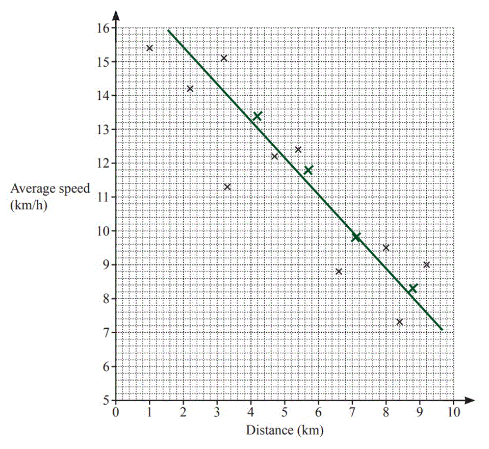

** [1]**
> *Draw a vertical line from 6 on the distance axis until it hits the line of best fit, then draw a horizontal line across to the average speed axis and take a reading.*

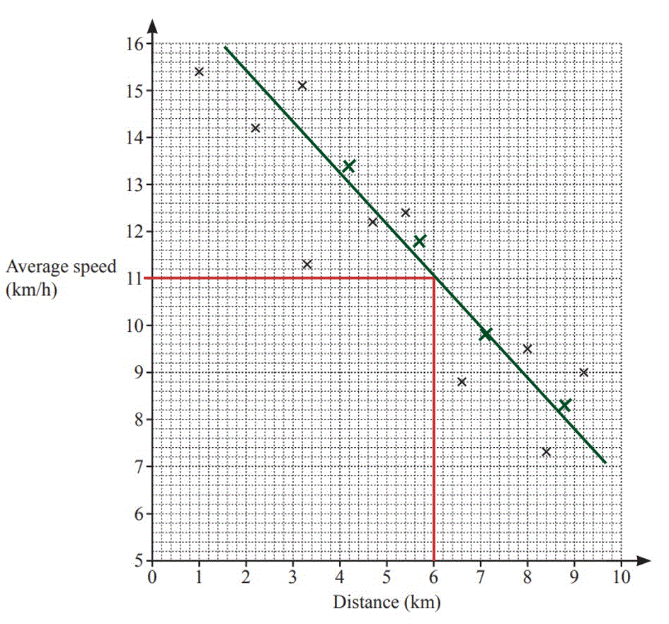

**  ****11**** ****[1]**

> *Any answer in the range 10-12*

### Q5
*Draw a vertical line up from the **x**-axis at \$70 000 until it meets a plotted point*
 *Draw a horizontal line across from the point to the **y**-axis* *Read off the value on the **y**-axis*

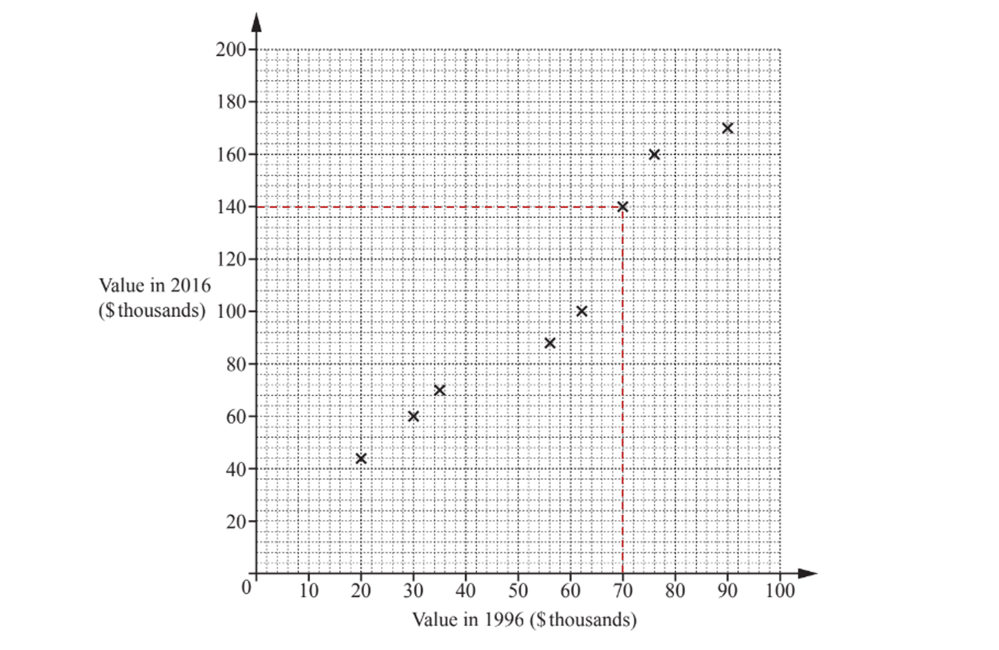

**Final answer:** **\$140 000**
> *Plot the points (40, 80) and (80, 150) on the scatter graph*

**[1]**
> *Draw a straight line with a ruler*

*The line should go from the bottom left part of the graph up towards the top right* 
*There should be an equal number of points either side of the straight line*

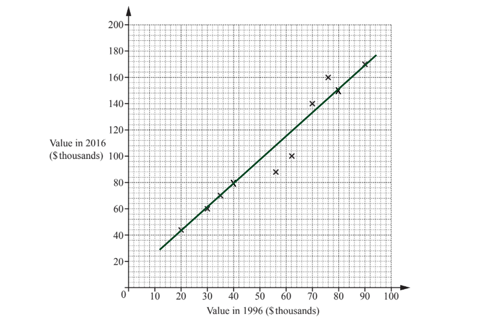

**[1]**
> *Draw a vertical line from the **x**-axis at \$50 000 until it mets the line of best fit *
*Draw a horizontal line across from the point until it meets the **y**-axis Read off the value on the **y**-axis*

**\$98 000**** [1]**

> *Answers in the range \$80 000 to \$110 000 are accepted*

### Q6
i) *The points form a pattern that starts in the top left of the graph and go down towards the bottom right*

**Negative correlation**** ****[1]**

ii) *The probability that a person picked at random had 5 attempts or more to pass can be found by dividing the number of people who took 5 or more attempts by the total number of people*

> *10 people out of the 17 people took 5 or more attempts to pass*

$\frac{10}{17}$ **[1]**

iii) *Draw a straight line starting in the top left and going down towards the bottom right* *There should be the same number of points either side of the line*

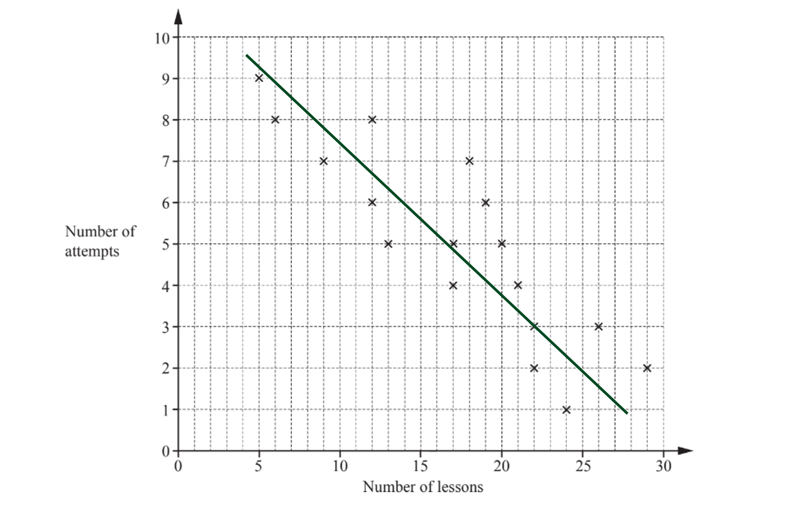

**[1]**

iv) *Draw a vertical line up from 15 on the **x**-axis until it meets the line of best fit* *Draw a horizontal line across from this point until it meets the **y**-axis*

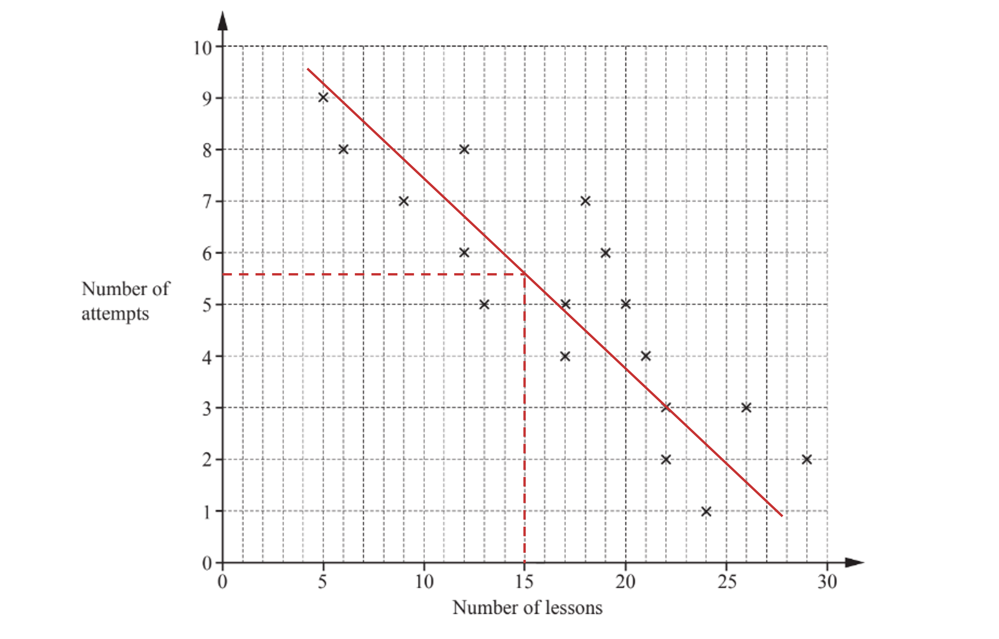

> *Read off the value from the **y**-axis, the line lies between 5 and 6*

> *It must be a whole number of lessons so choose the value it is closest to *

**6**** ****[1]**

> *An answer of 5 will also be accepted*

### Q7
> *Plot the points (40, 8), (65, 15), (50, 11) and (32, 9)*

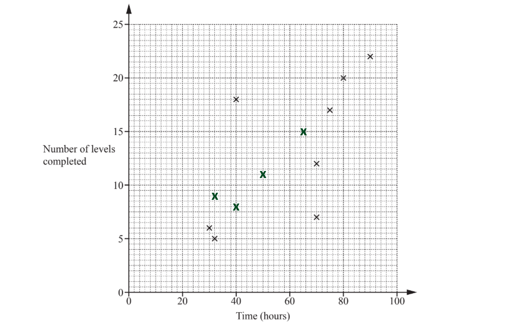

*1 mark for 2 or 3 points, 2 marks for all 4 points plotted correctly** ***[2]**
> *Circle the point that is much higher on the **y**-axis compared to the **x**-axis than the other points (40, 18)*

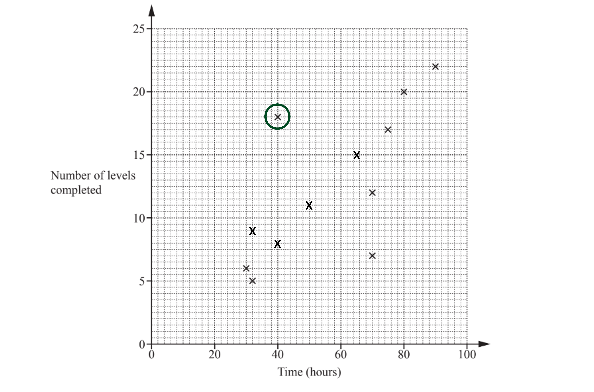

**[1]**
> *The points appear to follow in the direction of a straight line that starts from the bottom left and goes towards the top right*

**Positive correlation** **[1]**
> *Draw a straight line using a ruler *

*The line should start in the bottom left part of the graph and go up towards the top right* *There should be an equal number of points either side of the line*

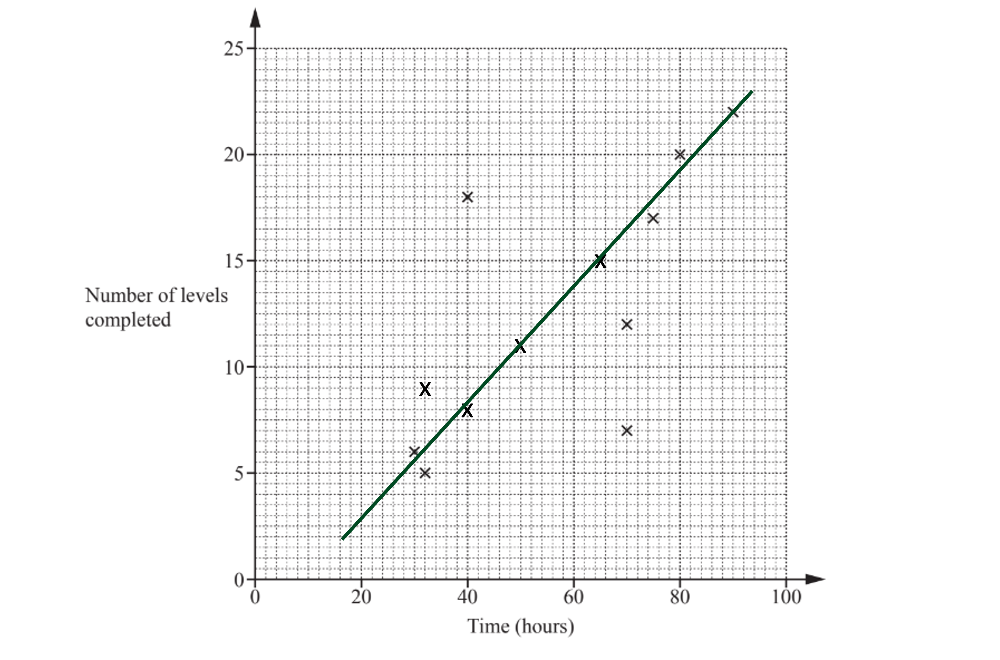

**[1]**
*Draw a horizontal line from 19 on the **y**-axis to the line of best fit* *Draw a vertical line down from the point on the line of best fit to the **x**-axis* *Read off the value on the **x**-axis*

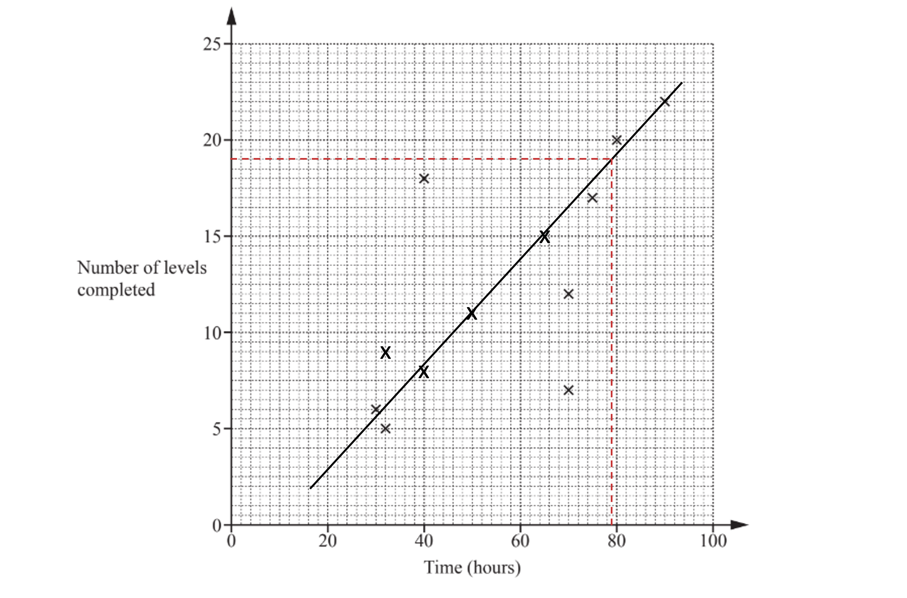

**79**** ****[1]**

> *Answers in the range 76 to 80 are accepted*

### Q8
> *Plot the points on the scatter graph.*

> *Be careful with the scale on the height axis, 2 small squares are worth 1cm. *

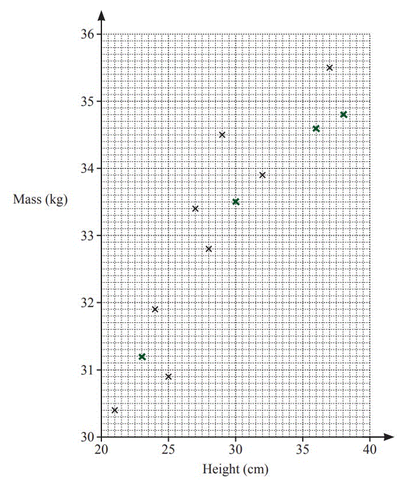

*all plotted correctly ***[2]**

> *or 1 mark for two or three points correctly plotted*
> *The correlation is **positive **(mass tends to increase as height increases).*

> * *

**Positive** **[1]**
(i) *Draw a line of best fit on the scatter graph. There should be roughly as many points on one side of the line as the other and the spaces between the points and the line should be roughly the same on either side.*

> * *

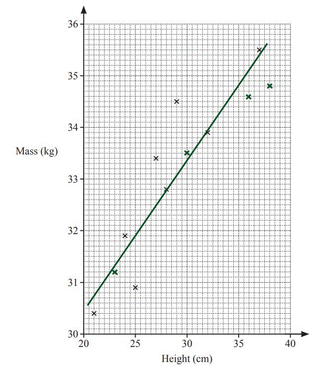

**[1]**

(ii) *Draw a horizontal line from 32.5 kg on the mass axis to the line of best fit, then a vertical line down to the height axis. Read off the value on the height axis (be careful with the scale).*

> * *

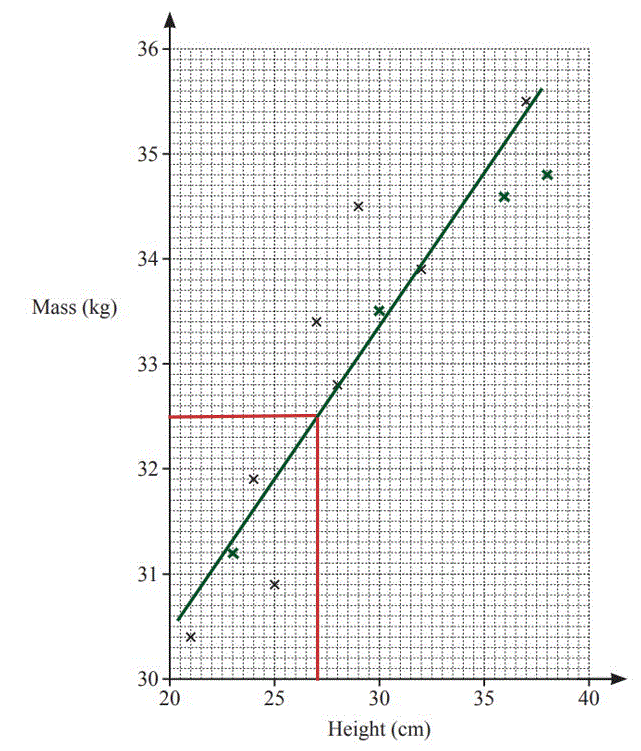

> * *

**27 cm** **[1]**

> *25 - 27 accepted*
> *Count how many points are plotted between 26 cm and 35 cm on the height axis. This is how many goats are between 26 and 35 cm.*

*5 goats*

**[1] **

> *Write 5 as a fraction of the total number of goats, 12, and multiply by 100 to express as a percentage. *

$\frac{5}{12}\times100=41.666...$

* ***[1]**

> *Round to 3 significant figures.*

> * *

**41.7 %** **[1]**

> *41.66 to 41.67 also accepted*

### Q9
(i) *Plot the points on the scatter graph, being careful with the scales on the axes.*

> * *

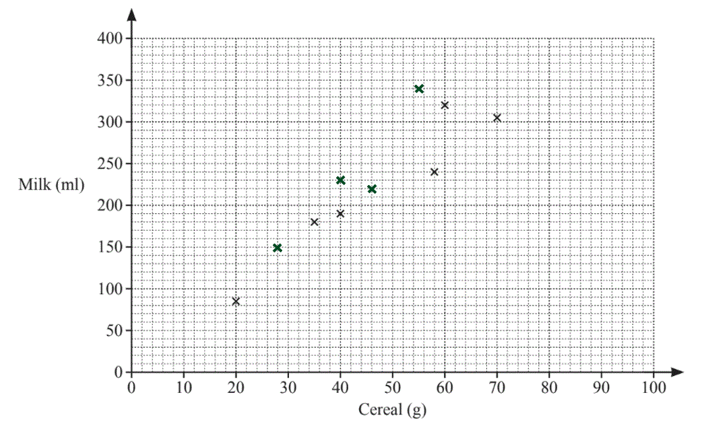

**[2]**

(ii) *Use the graph to describe how the amount of cereal changes as the amount of milk increases. *

**As the amount of cereal increases, the amount of milk increases**** ****[1]**

(iii) *Use a ruler to draw a line of best fit on the scatter graph. *

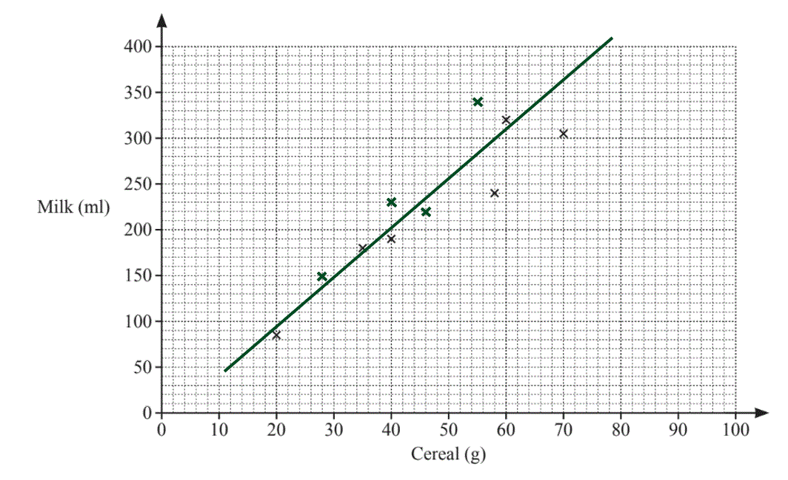

**[1]**

(iv) *Draw a horizontal line from 280 on the milk axis, across to the line of best fit, and then a vertical line down to the cereal axis. Read off the value on the cereal axis. *

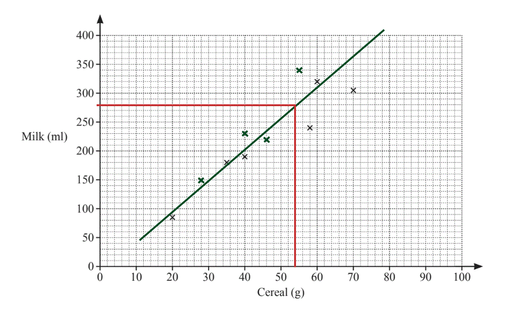

**54 g**** ****[1]**

**52 - 60 accepted**

(v) *There is no data past 70g on the cereal axis. *

**Outside given data** **[1]**

> *or equivalent explanation*

### Q10
> *A line of best fit should be drawn with a ruler and should have approximately the same number of points each side. It does not have to go through the origin. *

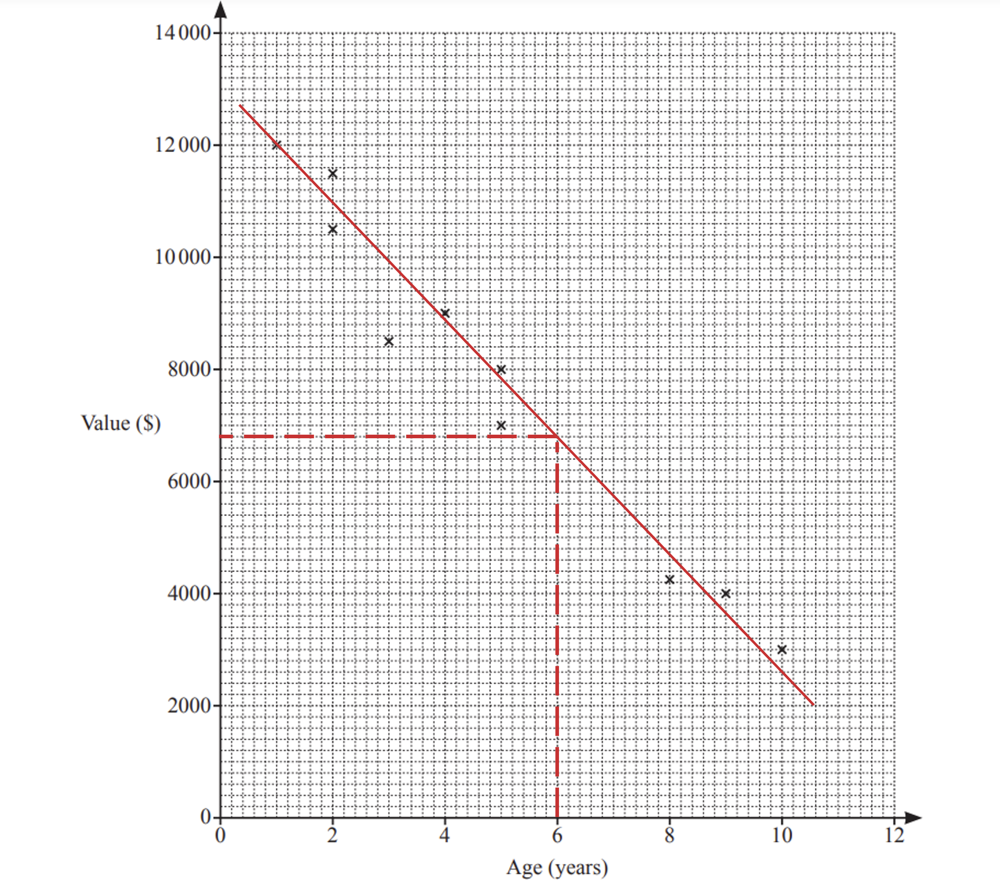

**[1]**

> *To estimate the value of a car that is 6 years old, draw a line up from 6 years on the **x**-axis until you reach your line of best fit. Then draw a line across to the **y**-axis. Each small square on the **y**-axis represents \$200. On the diagram, the line meets 4 squares above \$6000. *

**\$6800** **[1]**

> *answer between 6400 and 7400, must match **your** line of best fit*

### Q11
> *Look across the Test 1 axis to find the furthest cross to the right.*

> *Read off the value from the test 1 axis.  (Note that each small square is equal to 2 marks.)*

> * *

**66**** ****[1]**
> *The scatter graph shows **positive **correlation (Test 2 marks tend to increase as Test 1 marks increase).*

> * *

**Positive** **[1]**
> *Draw a line of best fit **with a ruler**.*

> *There should be roughly as many points on one side of the line as the other, and the spaces between the points and the line should be roughly the same on either side.*

> * *

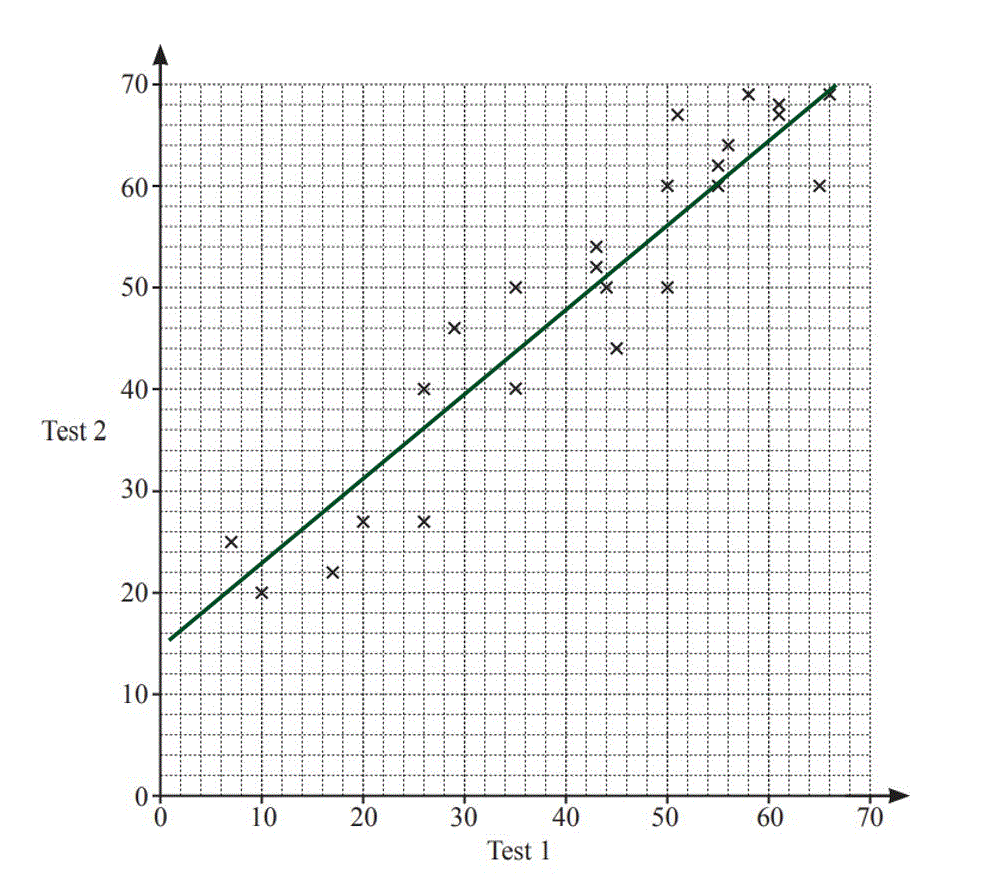

**[1]**
> *Draw a vertical line from 40 on the Test 1 axis up to the line of best fit, then a horizontal line to the Test 2 axis. Read off the value.*

**48**** ****[1]**

> *46 -50 accepted*

### Q12
(i) *Range = highest time (14.9 seconds) - lowest time (7.1 seconds) *

> $14.9-7.1=7.8$* *

**7.8 seconds** **[1]**

(ii) *Order the maximum power values. *

$44,51,52,55,77,85,90,103,110,135$

* ***[1]**

> *Median = middle value. *

$\cancel{44} , \cancel{51} , \cancel{52} , \cancel{55} , 77 , 85 , \cancel{90} , \cancel{103} , \cancel{110} , \cancel{135}$

> *The middle value is halfway between 77 and 85. Add together the two numbers and divide by 2. *

> $( 77 + 85 ) \div 2 = 81$* *

**81 kW ****[1]**
(i) *Plot the two points on the scatter graph. Make sure to plot them the correct way round.                                            *

> * *

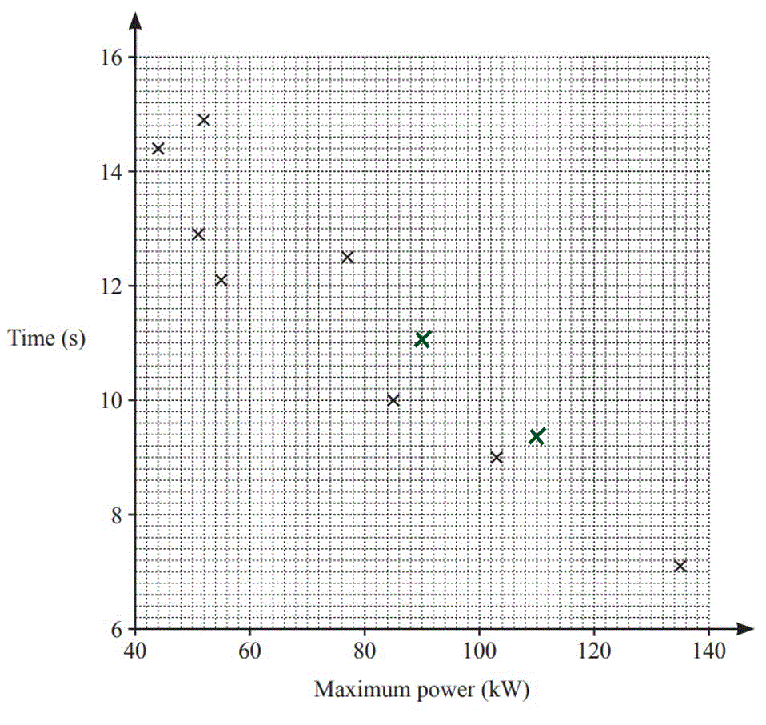

**[1]**

(ii) *The correlation is negative (time tends to decrease as maximum power increases). *

**Negative** **[1]**

(iii) *Describe the link between maximum power and time. *

**The greater the maximum power, the less time is needed**** ****[1]**

(iv)*Draw a line of best fit on the graph.*

> *There should be roughly as many points on one side of the line as the other and the spaces between the points and the line should be roughly the same on either side.*

> * *

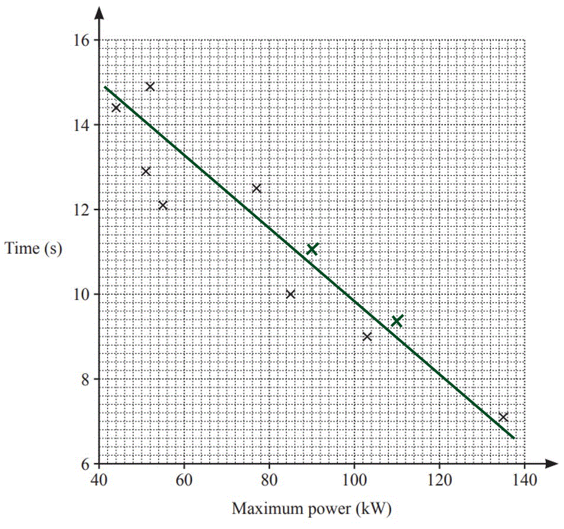

> * *

**[1]**

(v)*Draw a vertical line from 63 on the maximum power axis up to the line of best fit, and then a horizontal line across to the time axis.*

> *Read off the value.*

> * *

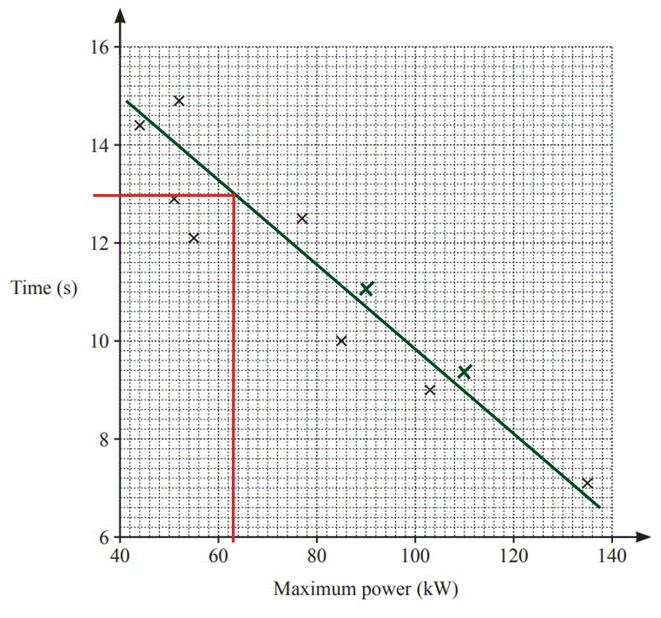

> * *

**13 seconds** **[1]**
**12.5 - 13.5 accepted**

### Q13
> *As speed increases, time decreases*

**Negative**** ****[1]**
> *As distance increases, fuel consumption increases*

**Positive** **[1]**

### Q14
> *Plot the point (28, 30)*

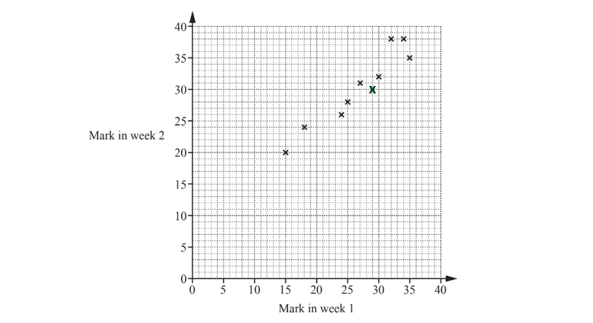

**[1]**
*Draw a straight line with a ruler*

*The line should start in the bottom left part of the graph and go towards the top right*

> *There should be the same number of points either side of the line *

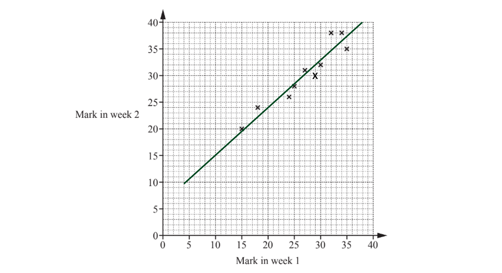

**[1]**
*Draw a vertical line up from the **y**-axis until it meets the line of best fit* *Draw a horizontal line across from that point until it meets the **y**-axis* *Read off the value from the **y**-axis*

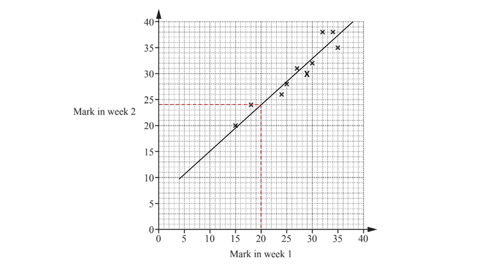

**24**** ****[1]**

**Answers in the range 22 to 26 are accepted**

### Q15
> *Find 15.12 on the **x** axis and find the corresponding point. Each small square represents 0.02 m.*

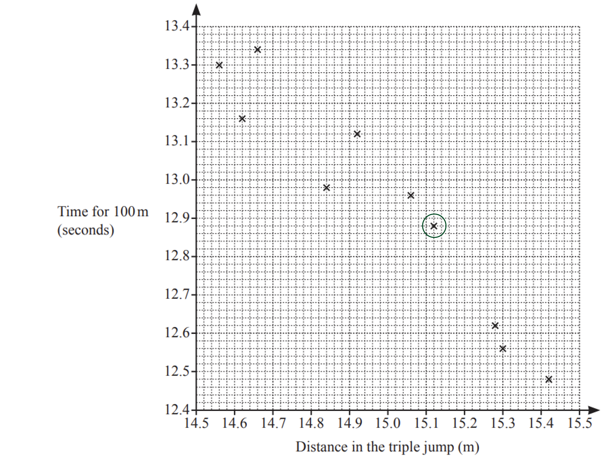

**12.88 m**** ****[1]**
> *Each small square is 0.02 m*

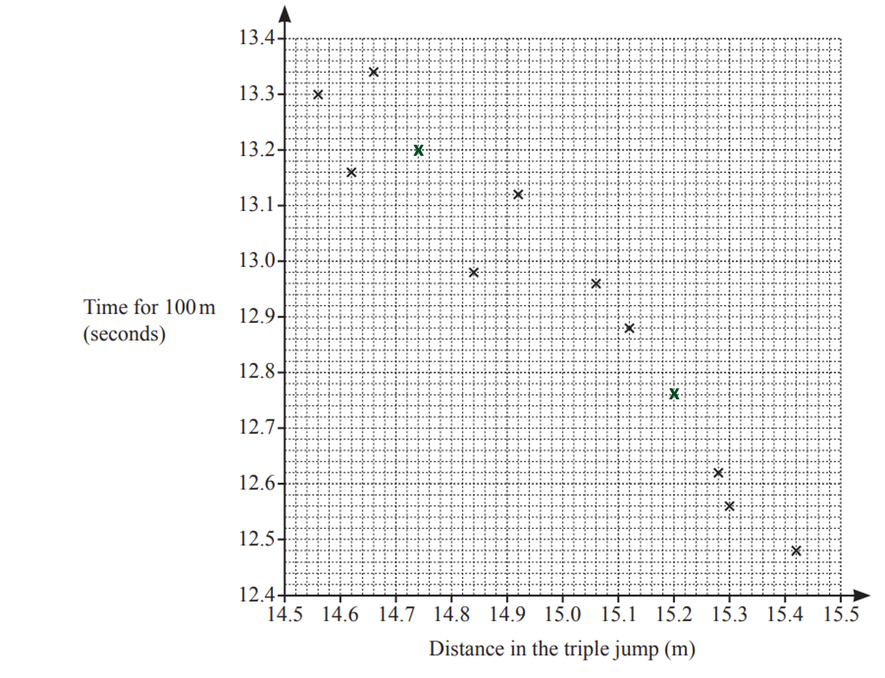

**[1]**
> *A line of best fit should pass as close to as many points as possible.*

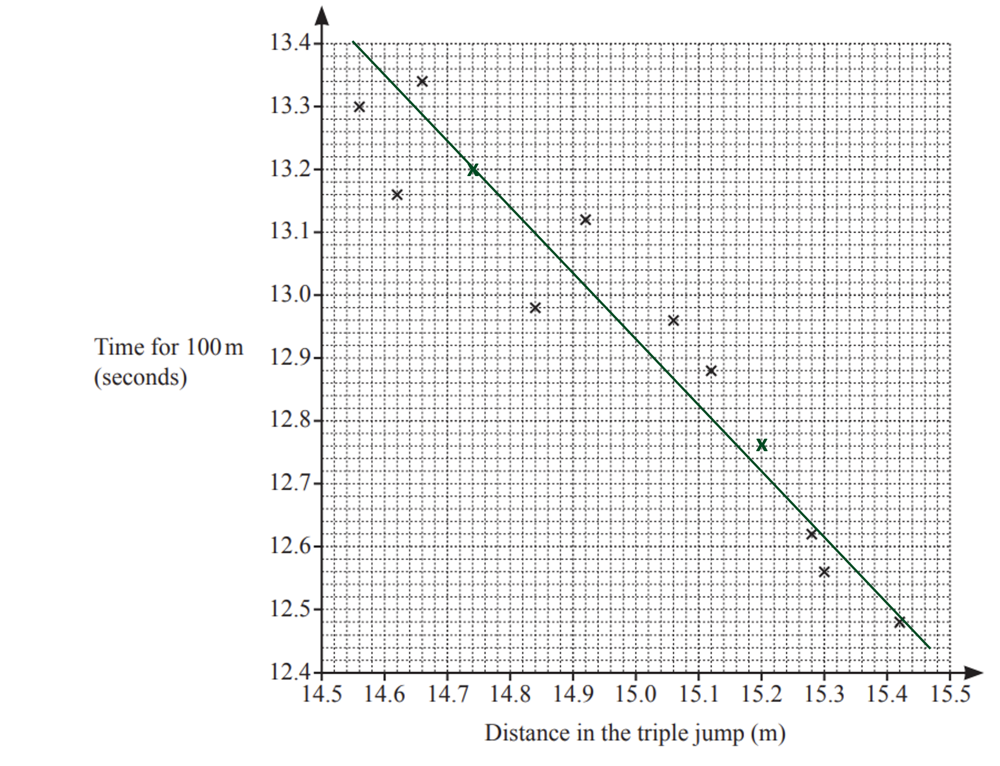

*ruled line of best fit*** ****[1]**
> *The points slope downwards from left to right.*

**negative correlation**** ****[1]**

### Q16
> *As one variable increases, the other variable increases*

**Positive**** ****[1]**

### Q17
> *Find the point which is at 42 on the "number of people" (**x-**) axis Read off from the "number of phones" (**y**-) axis *

> *Be careful with the scale; on this graph one square horizontally is equal to two people and one square vertically is 2 phones*

**32** **[1]**
> *As one variable ("number of people") increases, the other variable ("number of phones") also increases*

**Positive correlation** **[1]**
