# Mark Schemes — Statistical Diagrams
**Statistics** · Cambridge (CIE) IGCSE maths (0580 & 0980)

## Exam Questions (30 questions)

### Q1
The partial circles seem to be given in quarters of a circle

- i.e. $1 \frac{1}{4} , \frac{2}{4} ( = 1 \frac{1}{2} ) , \frac{3}{4}$

It would make sense then if a full circle represented 4 students (with each quarter circle being 1 student)

- It might also be a multiple of 4 students
- But test 4 first, to see if it works

Pineapple has 3 full circles plus one quarter circle

- If each circle is indeed 4 students, then 3 full circles would be

$3\times4=12$

- And one quarter circle would add on another 1 student

$12+1=13$

That is equal to the 13 students who chose pineapple

- This confirms that 4 students per full circle is the correct choice

**[B1]**
Anchovies has 5 full circles plus three quarters of a circle

- Each full circle is 4 students

$5\times4=20$

- And three quarters of a circle adds on another 3 students

$20+3=23$

**Final answer:** **23 students**

**[B1]**

### Q2
> *Add up all the known bars in the cart*

$41+19+25+13=98$

> *Subtract this from the total number of students to get the missing country*

$120-98=22$

**[M1]**

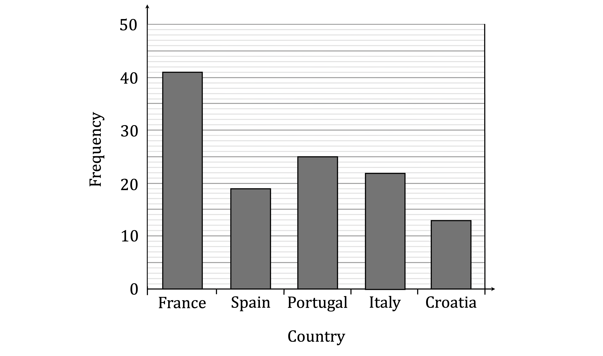

**[A1]**
> *Divide the amount of student who chose Spain by the total number of students*

$\frac{19}{120}$

**[B1]**

### Q3
> *To calculate the angle, use this formula*

$\mathrm{Angle}=\frac{\mathrm{Frequency}}{\mathrm{Total}}\times360$

> *For science*

$\frac{12}{80}\times360=54^{\circ}$

**[B1]**

> *For other*

$\frac{32}{80}\times360=144^{\circ}$

**[B1]**

| Subject | Frequency | Angle (°) |
|---|---|---|
| Maths | 20 | 90 |
| Science | 12 | **Final answer:** **54** |
| English | 16 | 72 |
| Other | 32 | **Final answer:** **144** |
> *Correctly drawn and labelled science (54°) and other (144°) sectors using a protractor*

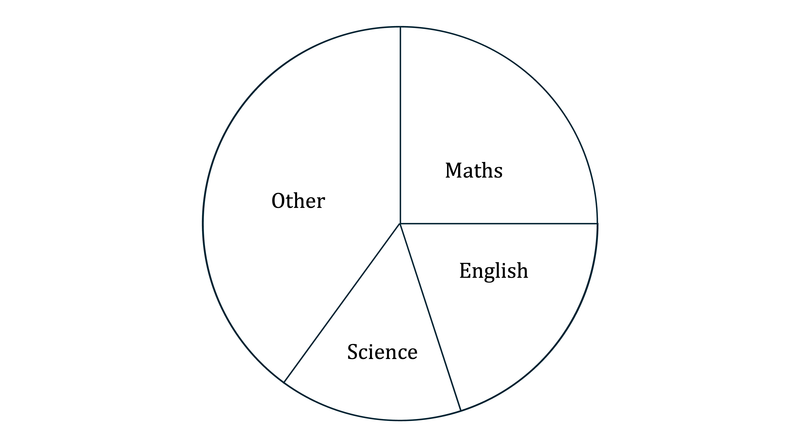

**[B1]**
> *Work out the proportion of people who select "other", using the same method as in part (c)*

$\frac{32}{80}=\frac{2}{5}$

**[M1]**

> *Multiply this proportion by the total number of people *

> **[exam-tip]**
> The reason we do this, is the same as working out the angles in each sector in part (a).

$\frac{2}{5}\times1200=480$

**Final answer:** **Expected number of people **$=480$

**[A1]**

### Q4
> *Make an ordered list *

$16,19,21,24,26,27,27,29,30,35,38,42,43,52$

> **[exam-tip]**
> Any alternative method for ordering the numbers is also valid here. For example grouping the numbers based on their tens digit.

> *Write the ordered numbers into the stem and leaf diagram, including a key*

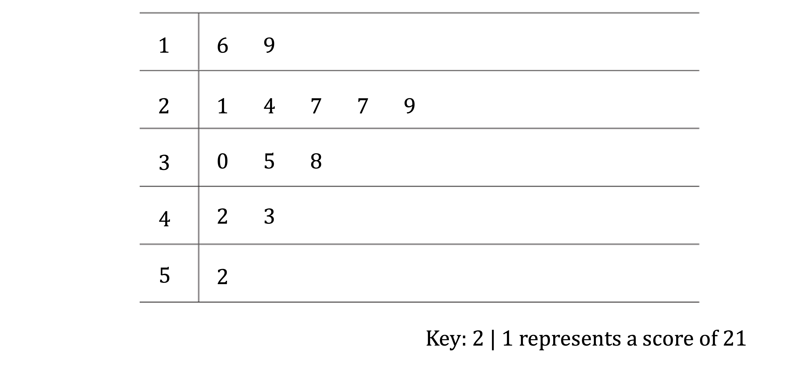

**[B1 B1 B1]**

> **[mark-scheme]**
> **B1**: For at least two rows being correct. Alternatively, it can be awarded for a correct, but unordered, stem and leaf diagram.
> 
> **B1**: For a fully correct stem and leaf diagram.
> 
> **B1**: For a correct key.
> *The total number of scores, *$N$*, is 14*

> *Since it this is even, take the average of the *$\frac{N}{2}$* and *$\frac{N}{2}+1$* scores*

> *In this instance, that would be the 7th and 8th scores*

$7^{th}=\frac{N}{2}=27\,8^{th}=\frac{N}{2}+1=29$

> *Taking the average of these scores*

$\frac{27+29}{2}=28$

**Final answer:** **Median = **$28$

**[B1]**

> **[exam-tip]**
> Any alternative method would have gotten the correct answer. For example, given the low number of elements, a valid approach could be cancelling out the largest number followed by the smallest number until you arrive at one remaining number - which would be the median.
> *Mode means most frequently occurring value in the dataset*

> *27 appears twice, while all other values appear only once*

**Final answer:** **Mode = **$27$

**[B1]**

### Q5
i) *The most popular sport is the sector with the largest angle*

**Swimming** **[1]**

ii) *Divide the angle of the sector by *$360^{\circ}$

$\frac{72}{360}$ **[1]**

iii) *The fraction of boys who chose Judo is*

$\frac{60}{360}=\frac{1}{6}$

> *Multiply the total frequency by the fraction of those who chose Judo*

$30\times\frac{1}{6}=5$

**[1]**

$5$ **[1]**

iv) *The probability of an event is calculated using the formula*

*P(Event) = *$\frac{\mathrm{Number} \mathrm{of} \mathrm{events}}{\mathrm{Total} \mathrm{outcomes}}$ *The probability that a boy's favourite sport is Judo is*

*P(Judo) = *$\frac{5}{60}$

> *The probability that a boy's favourite sport is not Judo is calculated by subtracting the probability of a boy's favourite sport being Judo from 1*

*P(not Judo) = 1 - P(Judo)*

$=1-\frac{5}{60}$

$=\frac{60-5}{60}=\frac{55}{60}$

$\frac{55}{60}$ **[1]**

v) *The sector angle for Tennis is 3 times the sector angle for Judo*

*Three times as many boys choose **Tennis **than choose **Judo*** ****[1]**
> *The angle per person is*

$\frac{360}{60}=6^{\circ}$

> *The angle for 2 people is*

$6\times2=12^{\circ}$

**[1]**

> *The new angle for the Running sector is*

$72-12=60^{\circ}$

> *The new angle for the Swimming sector is*

$120+12=132^{\circ}$

> *Centre a protractor at the centre of the pie chart with *$0^{\circ}$* aligned with the end of the Hockey sector (the start of the Running sector). Measure and draw the angle of *$60^{\circ}$* in the clockwise direction*

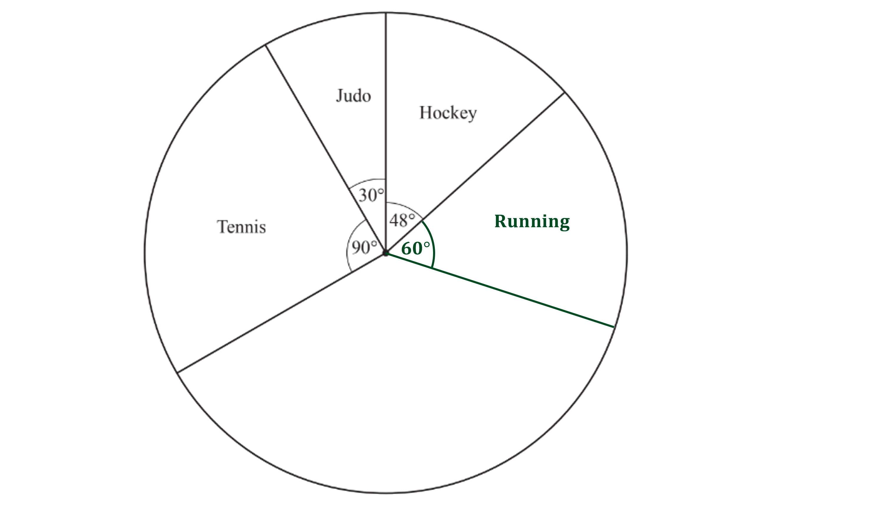

> *Check the angle for the Swimming sector is *$132^{\circ}$* and label this sector*

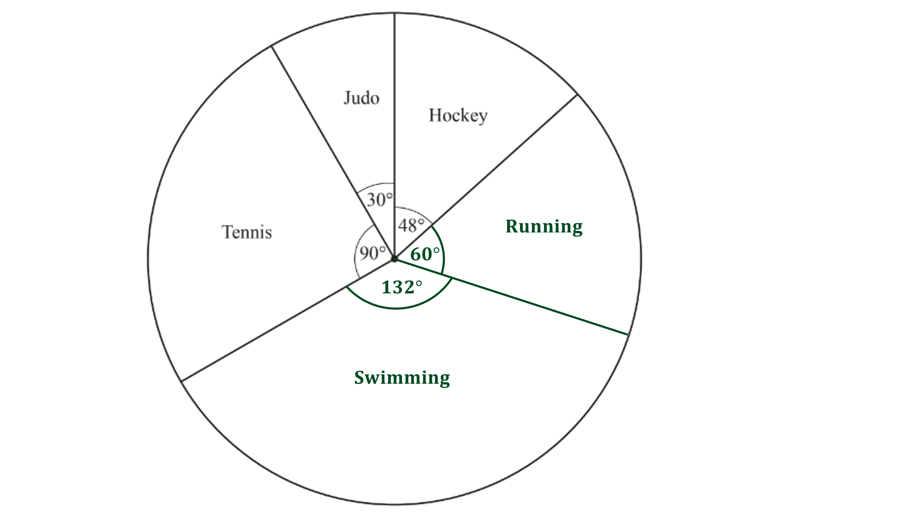

**[1]**
> *The mode of each set of data is Swimming*

*Similarity**: ***The favourite sport of both sets of boys is Swimming****.**** [1]**

> *The favourite sport with the lowest frequency of boys in group 2 is Hockey, whilst it is Judo in group 1*

*Difference**: ***The least favourite sport for group 1 is Judo, whereas for group 2 it is Hockey****.**** ****[1]**

### Q6
i) *Method 1*

> *The proportion of students (*$168^{\circ}$*) out of the total (*$360^{\circ}$*) is written as:*

$\frac{168}{360}$

**[1]**

> *Multiply this by the total frequency to get the frequency*

$\frac{168}{360}\times30$

$14$** [1]**

> *Method 2*

> *Divide *$360^{\circ}$* by the total frequency (*$30$*) to find the angle per person*

`360 divided by 30 equals 12 ˚`

**[1]**

> *Divide the angle of the sector by the angle per person to determine the frequency*

$168\div12$

$14$** [1]**

** **

ii) *Measure the angle for the sectors when the spinner lands on 2, 3, and 4*

$156^{\circ}$

**[1]**

> *To calculate the percentages, divide the angle of students (*$156^{\circ}$*) by the total angle (*$360^{\circ}$*), and multiply by *$100$

$\frac{156}{360}\times100$

**[1]**

`equals 43.3 with dot on top`

> *Round to 1 decimal place and write as a percentage*

*  *`bold 43 bold. bold 3 bold percent sign`* ***[1]**

** **

iii) `10 percent sign`* of the total angle (*$360^{\circ}$*) is  *

$\frac{10}{100}\times360=36^{\circ}$

**[1]**

> *Measure each sector of the pie chart and write down the sector that has an angle of *$36^{\circ}$

$5$ **[1]**

### Q7
i) *The sum of angles in a pie chart must equal *$360^{\circ}$

> *Subtract the known angles from *$360^{\circ}$* to determine the angle for Tuna*

$360 - ( 120 + 72 + 32 )$

**[1]**

$=136^{\circ}$

| Type of fish | Number of fish | Pie chart sector angle |
|---|---|---|
| Cod | 15 | 120° |
| Mackerel | 9 | 72° |
| Herring |   | 32° |
| Tuna |   | *136°* |

*Use the formula: Total frequency = *$360\times$$\frac{\mathrm{frequency}}{\mathrm{angle}}$* to determine the total number of fish caught. (This is a rearrangement of the formula used to find the angle of a sector in a pie chart)*

$360\times\frac{15}{120}=45$

> *The total number of fish caught is 45*

> *Use the formula: Frequency = (Angle*$\times$*Total frequency)*$\div360$* to determine the pie chart sector angle for Herring and Tuna. (This is a rearrangement of the formula used to find the angle of a sector in a pie chart)*

*Herring: *$( 32 \\times 45 ) \div 360 = 4$

> * *

| Type of fish | Number of fish | Pie chart sector angle |
|---|---|---|
| Cod | 15 | 120° |
| Mackerel | 9 | 72° |
| Herring | *4* | 32° |
| Tuna |   | *136°* |

*  Tuna: *$( 136 \\times 45 ) \div 360 = 17$

| Type of fish | Number of fish | Pie chart sector angle |
|---|---|---|
| Cod | 15 | 120° |
| Mackerel | 9 | 72° |
| Herring | **4** | 32° |
| Tuna | **17** | **136°** |

*Any two of *$136$*, *$4$* or *$17$** [1]**
*4, 17 and 136˚ in the correct place of the table*** [1]**

** **

ii) *Centre the protractor at the centre of the circle with *$0^{\circ}$* following the radius drawn to the left of the sector labelled "Mackerel"*

> *Measure *$32^{\circ}$* in the clockwise direction and mark this angle on the circumference of the circle *

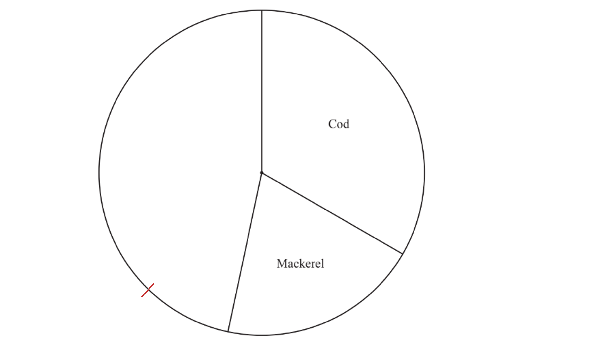

*Draw a straight line to connect the centre of the circle to this point.* *Label the sector Herring*

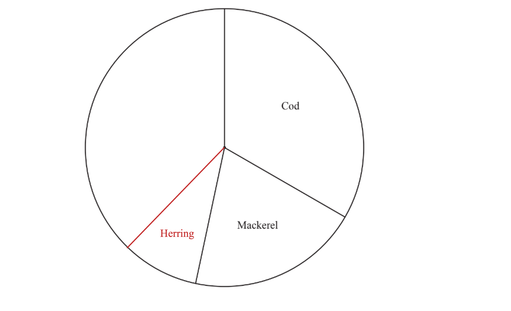

> * *

> *The remaining angle should measure *$136^{\circ}$*  Label this sector Tuna*

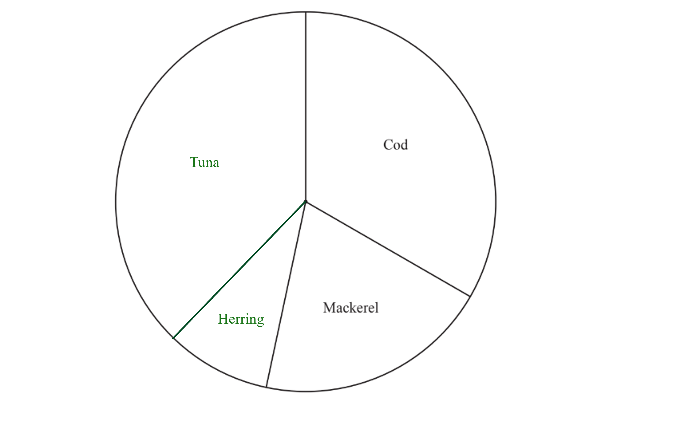

**[1]**

### Q8
> *Using the bar chart*

*Miss Patel: 18*

*Mr House: 14*

*18 - 14 = 4*

**4 ****[1]**
> *The size of the bar for Mr Smith is 3 squares wide with a height of 15*

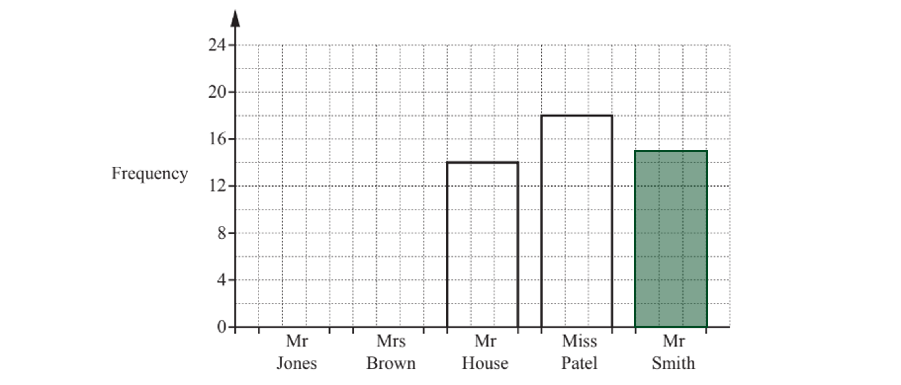

**[1]**

> *Calculate the number of people who were taught by Mr Jones and Mrs Brown*

$80 - ( 14 + 18 + 15 ) = 33$

> *As twice as many students were taught by Mrs Brown than Mr Jones, this can be expressed as the ratio*

$2:1$

> *Share the number of students into this ratio*

$33 \div ( 1 + 2 ) = 11$

**[1]**

*Mrs Brown: *$11\times2=22$* students*

**[1]**

*Mr Jones: *$11\times1=11$* students*

> *Draw these values on the bar chart, keeping the width of each bar and the space between each bar the same*

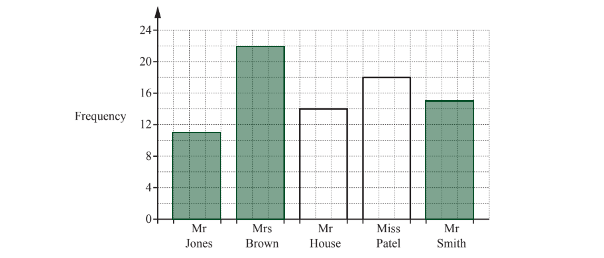

**[1]**
> *The mode is the teacher with the highest frequency*

**Mrs Brown**** ****[1]**
> *The formula to determine the angle of a sector in a pie chart is*

> *Angle = *$\frac{\mathrm{Frequency}}{\mathrm{Total} \mathrm{Frequency}}$$\times360$

> *As the frequency of students taught by Miss Patel is 18, and the total number of students is 80*

*Angle = *$\frac{18}{80}\times360=81^{\circ}$

**[1]**

$81^{\circ}$** [1]**

### Q9
i) *The mode is the value with the highest frequency*

**1** **[1] **

ii) *The range is the difference between the highest value and the lowest value*

*5 - 0 *

**5**** [1]**

** **

iii) *The mean is the sum of all the data points, divided by the total frequency*

> *The sum of all the data points is calculated by multiplying the number of penalties by their frequency, and adding these together*

$( 0 \\times 16 ) + ( 1 \\times 19 ) + ( 2 \\times 14 ) + ( 3 \\times 10 ) + ( 4 \\times 5 ) + ( 5 \\times 2 )$

$=0+19+28+30+20+10$

$=107$

**[1]**

*Dividing the total number of penalties scored by the number of players gives us the average number of penalties scored per player *

$107\div66=1.62121...$

**[1]**

**1.62** **[1]**

> *1.621... is also accepted*

### Q10
> *Find the total number of children*

$12+7+9+4=32$

> *This means that 32 children are represented by 360°. Write this as a ratio*

$\mathrm{children}:\mathrm{degrees}$

$32:360^{\circ}$

> *Divide both sides by 32 to work out how many degrees are needed for each child*

$1:11.25^{\circ}$

**[1]**

> *There are 12 children who walk to school, so multiply the degrees by 12.*

$11.25\times12=135^{\circ}$

**135°**** ****[1]**

### Q11
(i) *Divide the angle in the ocean-view sector, *$90^{\circ}$*, by *$360^{\circ}$* (total degrees in a circle). *

> $\frac{90}{360}$* *

> *Multiply by 480 to work out how many cabins are ocean-view. *

$\frac{90}{360}\times480=120$* ***[1]**

(iia) *Write the number of interior cabins, 68, as a fraction of the total, 480, and multiply by 360 (total degrees in a circle). *

$\frac{68}{480}\times360=51$

* ***[1]**

> *Write the number of suite cabins, 100, as a fraction of the total, 480, and multiply by 360 (total degrees in a circle). *

$\frac{100}{480}\times360=75$

> * Write in the table in the correct places. *

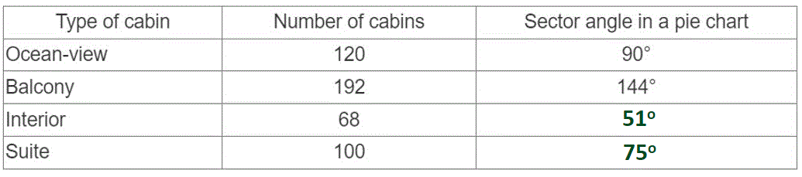

**[1]**

(iib) *Use a protractor to draw one of the angles on the pie chart. Draw a line to separate the two sections, and label them with the correct names.*

> *Use the protractor to check for accuracy of the angles in both sections. *

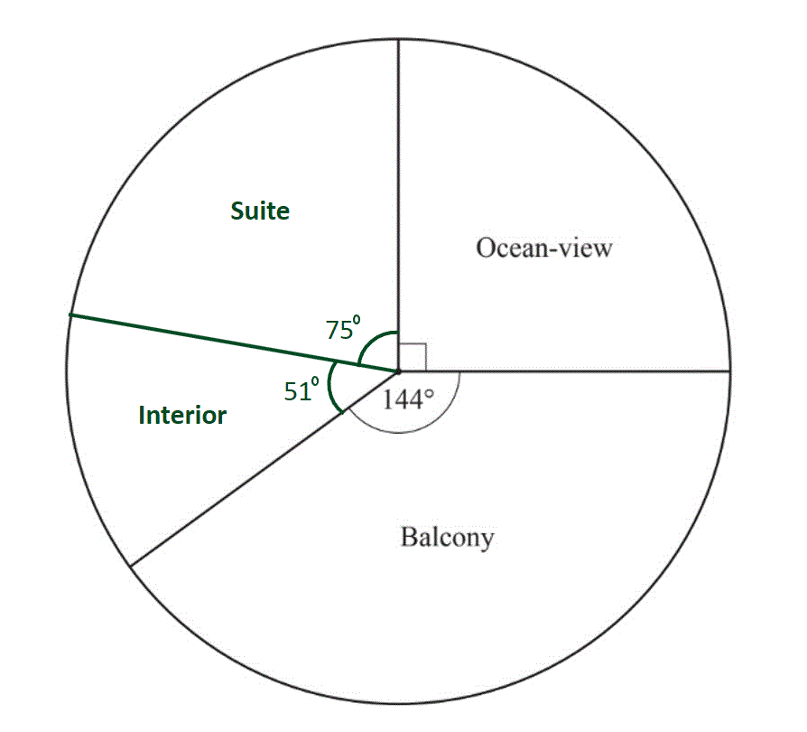

**[1]**

### Q12
> *Sketch an unordered stem-and-leaf diagram, entering each data item in turn*

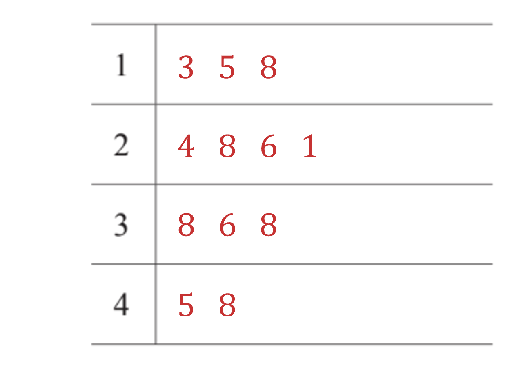

**[1]**

> *Re-write the stem-and-leaf diagram with the entries in each row going from smallest to largest*

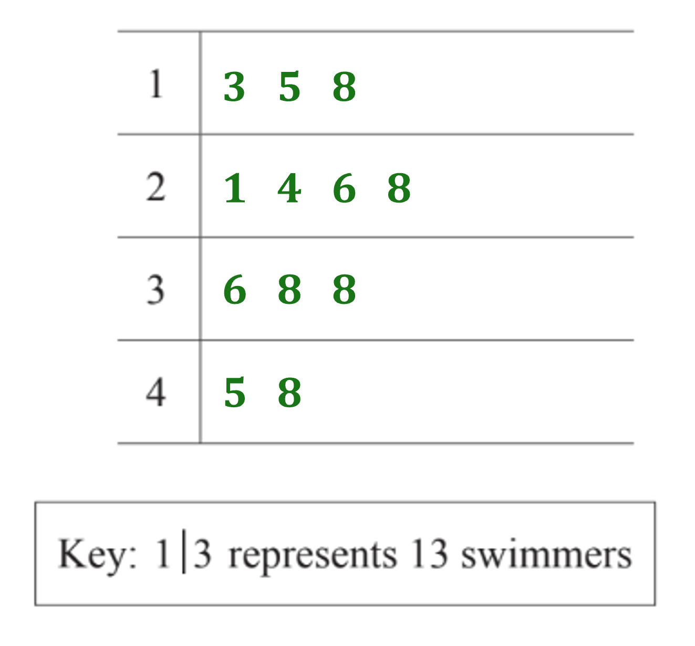

** [1]**
> *Use *$\frac{n+1}{2}$* to determine the position of the median for an even set of data*

$\frac{12+1}{2}=6.5$

> *The 6.5**th** value lies half way between the 6**th** and 7**th** value*

*6**th** value = *$26$

*7**th** value = *$28$

> *Finding the average of these two values, we have*

$\frac{26+28}{2}=27$

$27$** [1]**

### Q13
> *i) First complete the tally column to include the extra 10 students, remembering that once you reach 5, you form a "gate" and begin the next set. Then add up the number of tallies in each row to find the frequency. Check that your frequency column adds up to 50 *

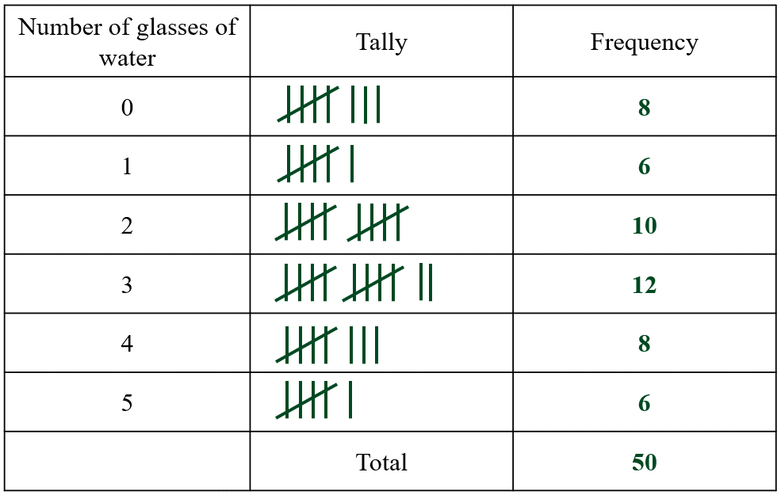

*tally column correct*** ****[1]**
*frequency column correct** ***[1]**

> *ii) The range is the difference between the largest and the smallest value. The smallest number of glasses of water is 0 and the largest number is 5.*

$5-0=5$

**5**** ****[1]**

> *iii) The median is the middle piece of data when the data is in order of size. There are 50 pieces of data so the median would be between the 25th and 26th pieces.*

**[1]**

> *Add up the frequencies as a "running total" *

*8 people had 0 glasses*

*14 people had up to 1 glass*

*24 people had up to 2 glasses*

*36 people had up to 3 glasses*

> *This means that person 25 and person 26 must have had 3 glasses.*

**3** **[1]**

> *iv) There are 8 students out of a total of 50 who drink 4 glasses of water. Write this as an equivalent fraction out of 100 to be able to convert to a percentage*

`8 over 50 space equals 16 over 100 space equals space 16 percent sign`

**16% ****[1]**

> *v) There are 14 students out of a total of 50 who drink fewer than 2 glasses of water.*

$\mathrm{P} ( \text{fewer} \text{than} 2 \text{glasses} ) = \frac{14}{50}$

**[1]**

> *Simplify by dividing both the numerator and denominator by 2.*

$\frac{14}{50}=\frac{7}{25}$

$\frac{7}{25}$** [1]**

### Q14
> *Centre the protractor at the centre of the pie chart and align *$0^{\circ}$* with the line between the sector for English and Science. Measure the angle clockwise and read the value off the scale at the end of the sector*

$84^{\circ}$ **[1]**
> *Use the formula: Frequency = *$\frac{θ}{360}\times$* Total to determine the frequency of minutes for English*

$\frac{45}{360}\times480$

**[1]**

$=\frac{480}{8}=60$

**60 min**** ****[1]**
> *Use the formula: Angle = *$\frac{\mathrm{Frequency}}{\mathrm{Total}}$$\times360$* to determine the angle for Geography*

$\frac{100}{480}\times360=75^{\circ}$

**[1]**

> *Centre the protractor at the centre of the pie chart and align *$0^{\circ}$* with the line at the end of the sector for Science. Measure *$75^{\circ}$* in the clockwise direction and mark the point on the circumference of the pie chart.*

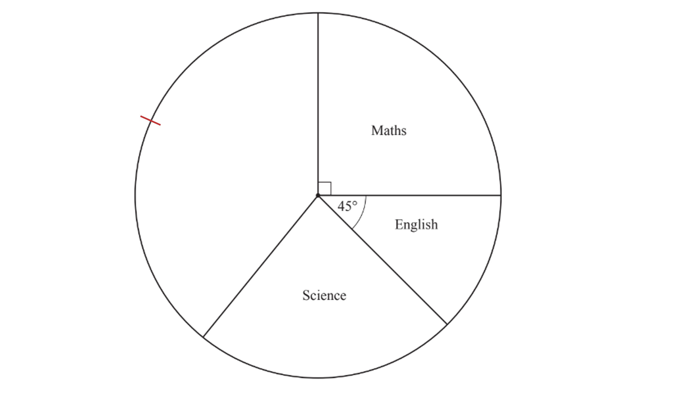

> *Draw a straight line from the centre of the pie chart to this point and label the sector Geography*

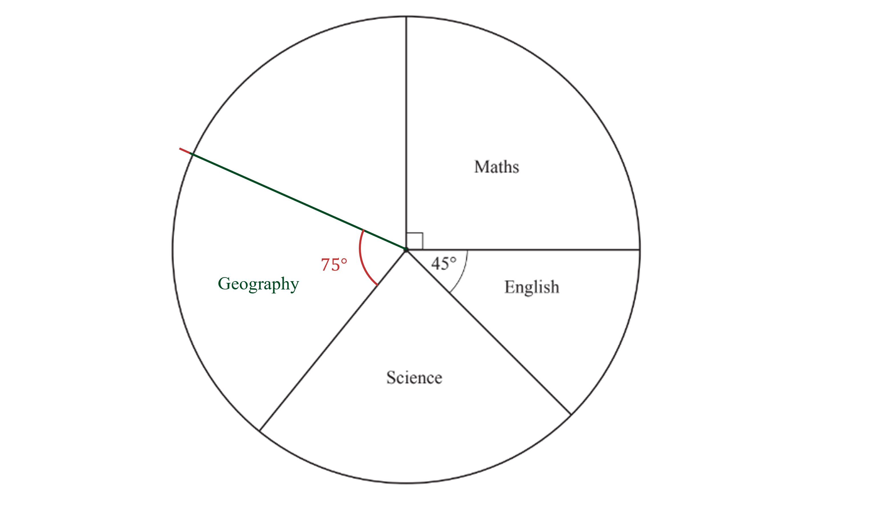

> *Label the remaining sector Free time*

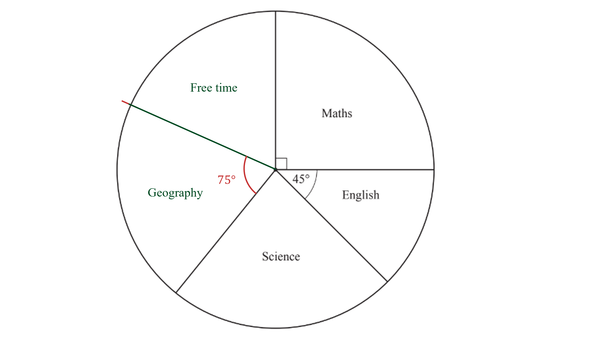

**[1]**

### Q15
> *Complete the tally column of the table. Cross off each piece of data once it is counted.*

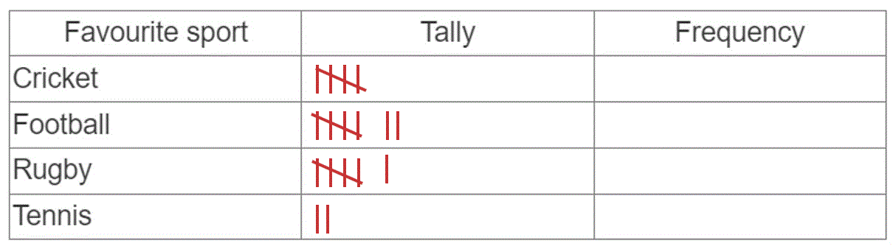

> * *

> *Add up the tally marks for each sport and write the totals in the Frequency column.*

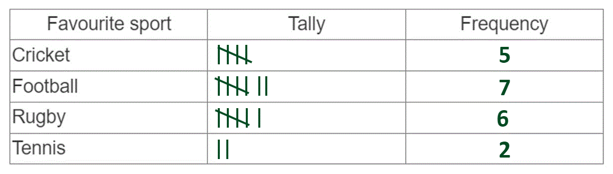

> *   *

* **two or three frequencies correct*** ****[1]**
*all others correct ***[1]**
> *7 people chose football out of a total of 20 people, so the fraction of people that chose football is*

$\frac{7}{20}$

**[1]**

> *A pie chart has a total of *$360^{\circ}$*.*

> *Multiply *$360^{\circ}$* by *$\frac{7}{20}$* to find the size of the angle for the football sector.*

$360^{\circ}\times\frac{7}{20}=126^{\circ}$

$126^{\circ}$* ***[1]**

### Q16
> *Write the number of degrees in the yes sector, *$114^{\circ}$*, as a fraction of a full circle, *$360^{\circ}$*.*

> *Multiply by the total number of students, 840. *

$\frac{114}{360}\times840=266$* ***[1]**

### Q17
i) *Find the number of degrees required for each word.*

*90 words = 360°*

> *Divide by 90.*

*1 word = 4°*

> *Multiply each frequency by 4 to find the angle for each section.*

| Length of word | Frequency | Pie chart angle |
|---|---|---|
| Very short | 6 | 24° |
| Short | 34 | $34\times4=136^{\circ}$ |
| Medium | 41 | $41\times4=164^{\circ}$ |
| Long | 9 | $9\times4=36^{\circ}$ |

*1 angle correct** ***[1] **
*All 3 angles correct** ***[1]**

ii)* Remember to rotate your protractor when you start to measure a new angle.*

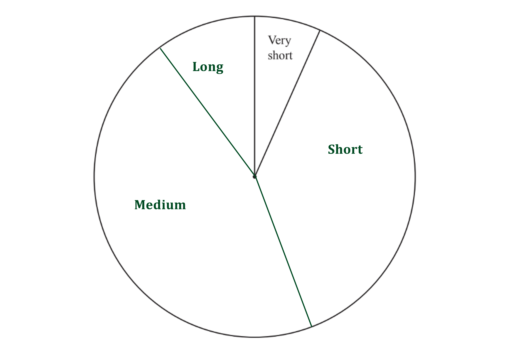

*1 sector correct*** [1] **
*All 3 sectors correct*** [1]**

### Q18
i) *To find the angle of a sector in a pie chart, use the formula:*

> *Angle = *$\frac{\mathrm{Amount}}{\mathrm{Total}}$$\times360$*.*

> *Substitute the percentage amount of each metal and the total percentage (100%) into the formula.*

*Copper: *$\frac{70}{100}\times360=252^{\circ}$

*Zinc: *$\frac{20}{100}\times360=72^{\circ}$

*Tin: *$\frac{10}{100}\times360=36^{\circ}$

**[1]**

> *Minimum one correct angle*

**252˚, 72˚, 36˚**** ****[1]**

** **

ii) *Place the centre of the protractor at the centre of the circle with *$0^{\circ}$* aligned with the radius drawn.*

> *Measure *$252^{\circ}$*, if the angle exceeds the limit of the protractor, mark *$180^{\circ}$* on the circumference of the circle from the original radius, and measure the remaining angle from this point.*

$252-180=72^{\circ}$

> *Mark the angle of *$252^{\circ}$* (or *$72^{\circ}$* if measuring from *$180^{\circ}$*) on the circumference of the circle and draw a straight line to connect the centre of the circle to this point.*

> *Label the sector Copper*

> * *

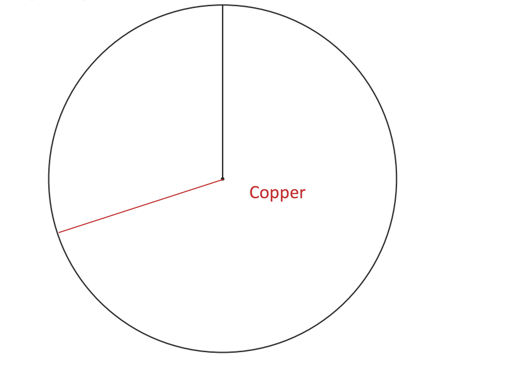

**[1]**

> *Any sector drawn correctly is accepted*

> *Repeat this process for Zinc.*

> *Measure *$72^{\circ}$* from the line just drawn for the sector for Copper and mark this point on the circumference, drawing a line from the centre to this point, and labelling the sector Zinc.*

> * *

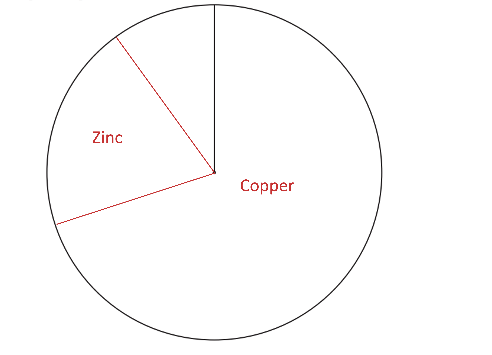

> * *

> *The final sector should already measure *$36^{\circ}$*, label this sector Tin*

> * *

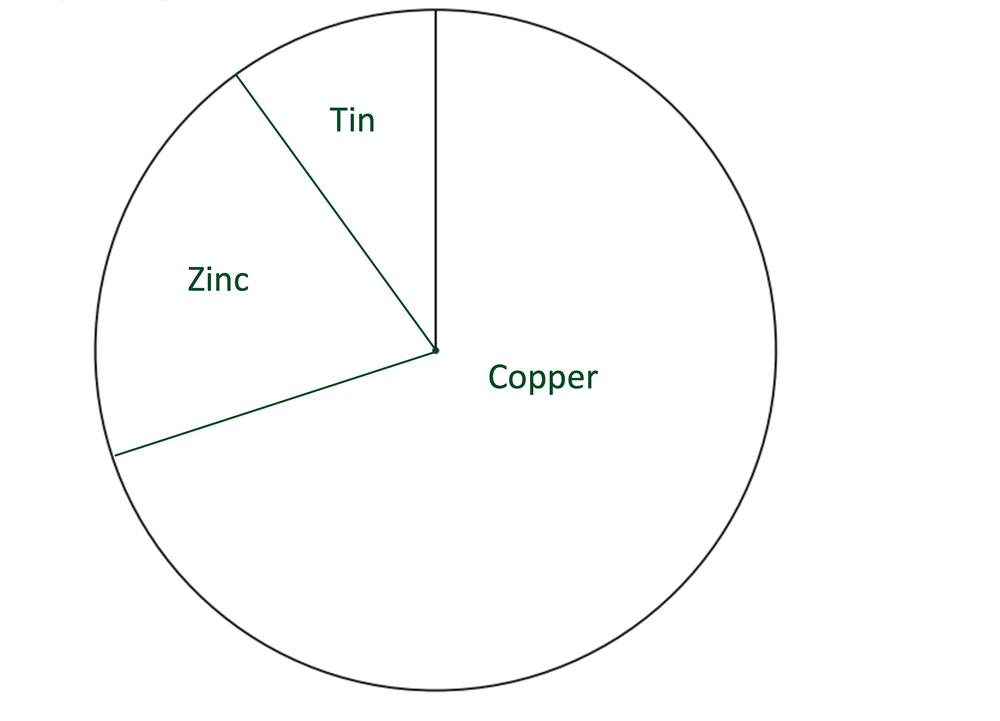

**[1]**

> *Pie chart drawn correctly with an angle sum of *$360^{\circ}$

### Q19
i) *Calculate the frequency of the Senior ticket type by subtracting the known frequencies of the other types from the total frequency*

*The number of Infants is 5*
*The number of Children is 12*
*The number of Adults is 17*

**[1]**

*40 - (5 + 12 + 17) = 6*

**[1]**

> *The bar for Senior tickets has a height in line with 6 on the frequency scale and a width of 2 grid squares to remain consistent with the other bars. The bar should also be 2 grid squares along from the bar for Adult tickets.*

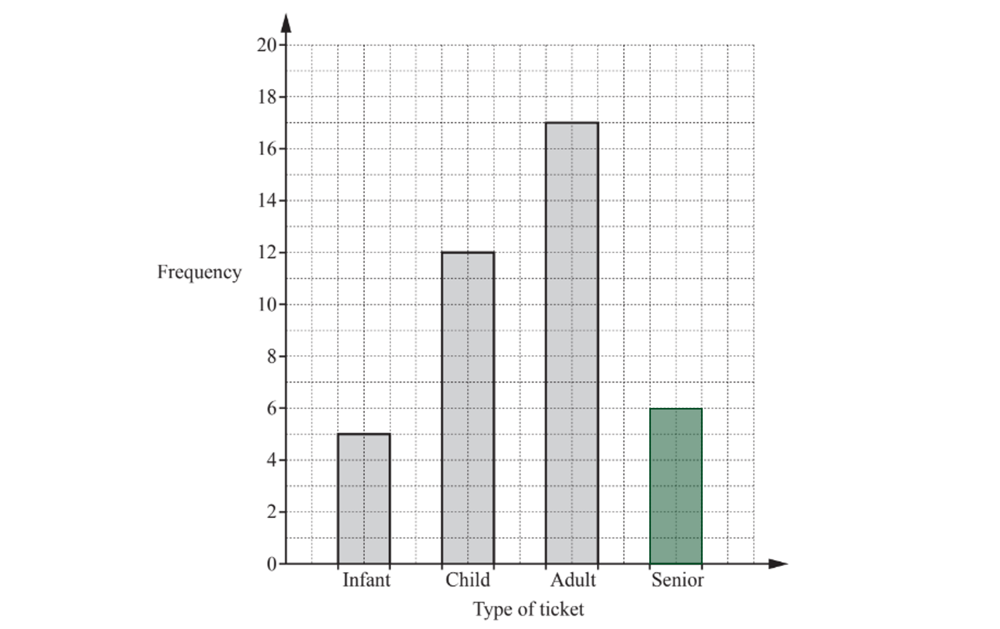

**[1]**

ii) *Read the frequency of adults and children from the graph*

*The number of adults is 17*
*The number of children is 12*

*17 - 12*

**5**** ****[1]**

iii) *The mode is the type of ticket with the highest frequency*

**Adult** **[1]**

iv) *The probability of an event is calculated using the formula:*

*P(event) =* $\frac{\mathrm{Number} \mathrm{of} \mathrm{events}}{\mathrm{Total} \mathrm{outcomes}}$

*The number of children is 12*
*The total number of people is 40*

> * *

$\frac{12}{40}$ **[1]**

### Q20
i) *Write a tally mark for each sport in the correct row, one-by-one, using a 5-bar gate when necessary *

**[1]**

> *Write the frequency by counting the number of tally marks for each row*

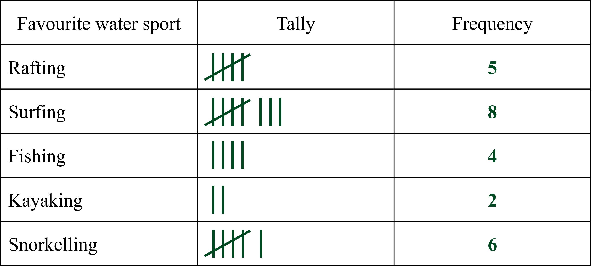

**[1]**

** **

ii) *The mode is the sport with the highest frequency*

**Surfing**** ****[1]**

** **

iii) *The percentage that an amount is of the total frequency is calculated using the formula:*

> *Percentage = *$\frac{\mathrm{Amount}}{\mathrm{Total} \mathrm{Frequency}}$$\times100$

> *Substitute the associated values into the formula*

$\frac{6}{25}\times100$

`bold 24 bold percent sign` **[1]**

### Q21
> *Look for the shortest bar.*

> * *

**Feb** **[1]**
> *The rainfall bar chart shows that September and October had the most rain.*

> *The number of days bar chart shows that June had the most rainy days.*

> * *

**September and October had the most rainfall but June had the most rainy days**** ****[1]**

### Q22
> *Complete the tally column and cross off each car as you go, remembering that once you reach 5, you form a "gate" and begin the next set. Add up the number of tallies in each row to find the frequency.*

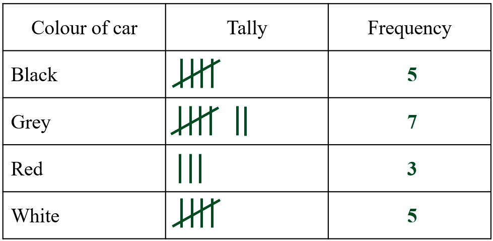

*correct tallies*** ****[1] **
*correct frequencies*** [1]**
> *The mode is the item with the highest frequency*

**grey ****[1]**

### Q23
> *i) Look for the day that has the most circles.*

**Friday**** ****[1]**

> *ii) Each full circle represents 10 skirts, so half a circle represents 5 skirts. There are two full circles and one half circle.*

$10+10+5=25$

**25 ****[1]**

> *iii) Friday has one full circle and one half circle more than Thursday.*

$10+5=15$

**15**** ****[1]**

### Q24
(i) *The data is not in order so the first step is to draw a rough diagram. All values are two digit so split each so that the first (tens) digit is a stem and the second (units) digit is a leaf. *

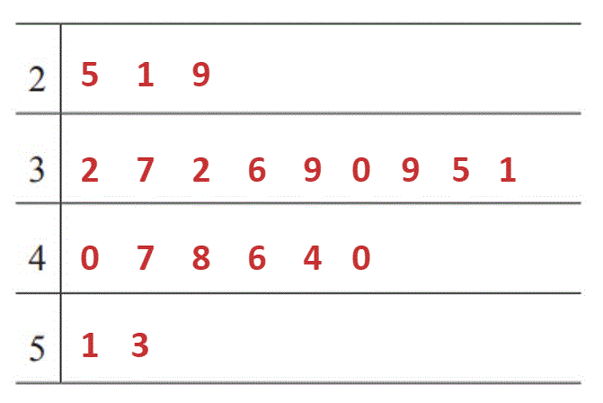

* ***[1]**

> *Put the leaves into ascending order. *

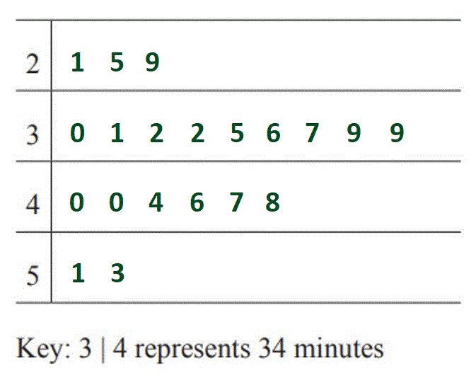

* ***[1]**

(ii) *Range = biggest number (53) *$-$* smallest number (21).*

> * *$53-25=32$

* ***32 ****[1]**

(iii) *Median = middle. *

> *Lightly cross out numbers from the **beginning **and** end **(be careful with the highest number - it will be at the **end** of the last stem). *

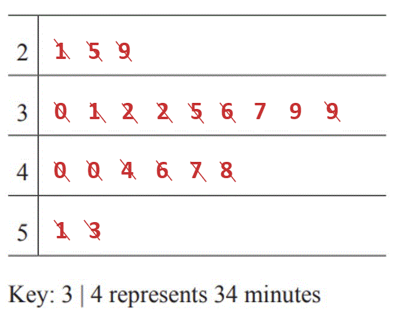

> * *

> *The median lies halfway between 37 and 39. *

**38**** ****[1]**

(iv) *Count how many numbers there are in each row on the stem and leaf diagram, and draw each bar on the bar chart to that height. *

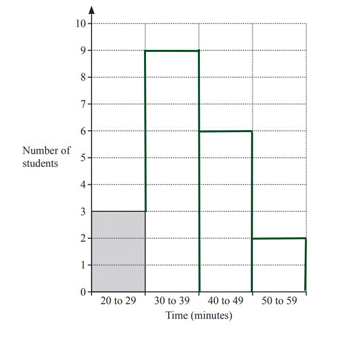

> * *

*two correct heights*** ****[1]**
*fully correct*** [1]**
(i) *Divide 90 (the number of degrees) by 5 (the number of students that the sector represents), to find the number of degrees that corresponds to 1 student. *

$90\div5=18$** **

> *Multiply 8 and 7 by 18 to find the missing angles.*

> * *$8\times18=144\,\,7\times18=126$

> * Write the angles in the correct place in the table. *

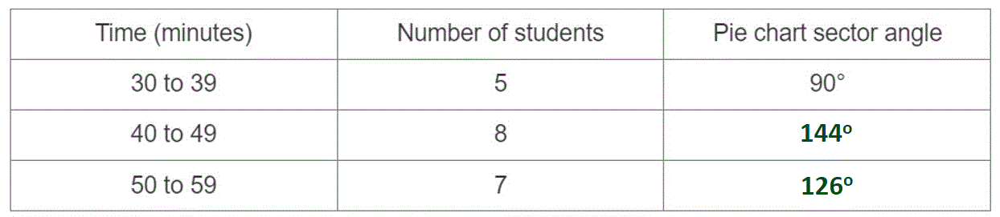

* **one mark for each ***[2]**

(ii) *Use a protractor to draw the angles on the pie chart. Draw lines to separate the sections, and label them with the correct names.*

> *Use the protractor to check for accuracy of the angles in all sections. *

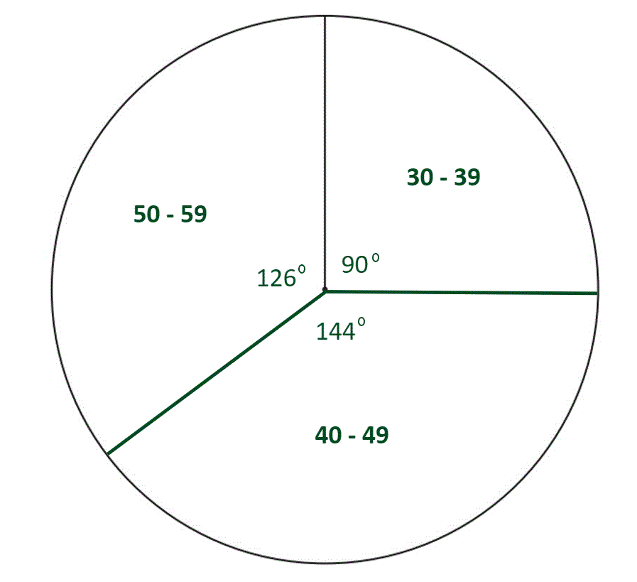

*one correct sector*** ****[1]**
*fully correct pie chart*** ****[1]**
> *Look at the ranges for college A and college B.*

> *For college B, the smallest time*$\geq$*30 minutes, and the largest time*$\leq$*59 minutes.*

> *The biggest the range could be is 29 (59 - 30). *

*Range for college A = 32 minutes*

*Range for college B *$\leq$* 29 minutes*

* *

**College A has a bigger range than college B, so their times are less consistent** **[1]**

> *Look at the medians for college A and college B.*

> *College B has grouped data, the median is found in the 40 - 49 group (this is where the 10th and 11th pieces of data will be found). *

*Median for college A = 38 minutes*

*Median for college B = between 40  and 49 minutes*

* *

**College B has a higher median than college A, so on average students in college B took more time** **[1]**

### Q25
i) *Tally each value into the table and then count the frequency. Use 5-bar gates when necessary*

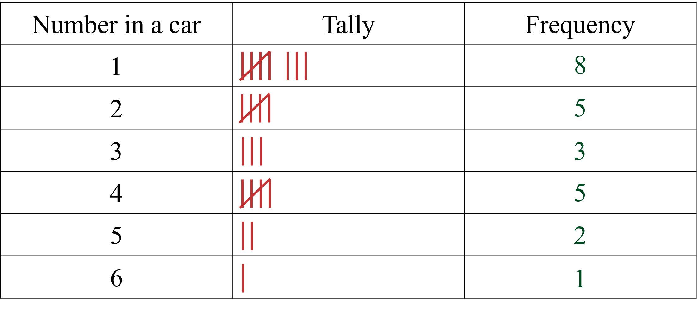

**[2]**

> *1 mark for 1 incorrect frequency, *
*or all correct tallies only*

ii) *The mode is the category with the highest frequency*

**1**** ****[1]**

iii) *The range is the difference between the highest and the lowest number of cars*

*The highest number of cars = 6*

*The lowest number of cars = 1*

*6 - 1 = 5*

**Final answer:** **5 ****[1]**

iv) *The median is the middle value in an ordered set of data.*

> *As there is an even number of data values, determine the middle value by using the formula *$\frac{n+1}{2}$* where *$n=24$

$\frac{24+1}{2}=12.5$*th** data value*

> *Using the cumulative frequencies*

$8,13,16,21,23,24$

> *The *$12.5$*th** value is between *$8$* and *$13$* so it lies in the category*

$2$** [1]**

v) *The mean is the sum of all the data values, divided by the number of data values.*

> *The sum of all the data values is calculated by multiplying the number of people in each car by the frequency, and adding these values together*

$( 1 \\times 8 ) + ( 2 \\times 5 ) + ( 3 \\times 3 ) + ( 4 \\times 5 ) + ( 5 \\times 2 ) + ( 6 \\times 1 ) = 63$

**[1]**

> *The total number of cars is 24, so divide the total frequency by 24*

$\frac{63}{24}=2.625$

**[1]**

$2.625$** [1]**

vi) *The probability of an event is calculated using the formula:*

> *P(event)=*$\frac{\mathrm{Number} \mathrm{of} \mathrm{events}}{\mathrm{Total} \mathrm{Outcomes}}$

*The number of times 4 people were seen in a car is 5 out of 24 cars*

> *Write this as a fraction*

$\frac{5}{24}$** [1]**
> *Each bar must be the same width with the same space between. The height of each bar matches the frequency in the table*

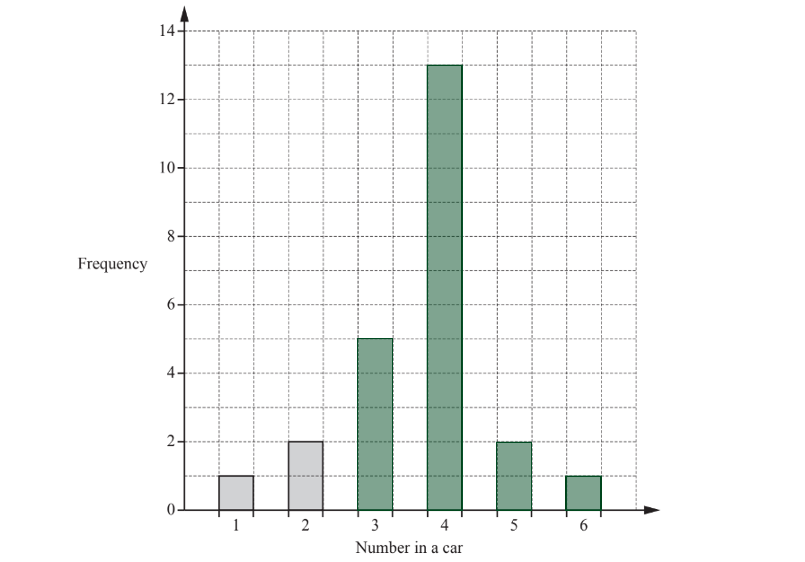

**[2]**

**1 mark for minimum 2 bars correct**
> *Compare the median values. As there are the same number of data, locate the 12.5**th** data value.*

> *Using the cumulative frequencies for Saturday*

$1,3,8,21,23,24$

*the median for Saturday is 4*

**The median number of people in a car is greater on Saturday than Wednesday**** ****[1]**

### Q26
(i) *Look at the key, a rectangle with 8 small squares means 8 meals.*

> *For 6 meals, draw 6 small squares. *

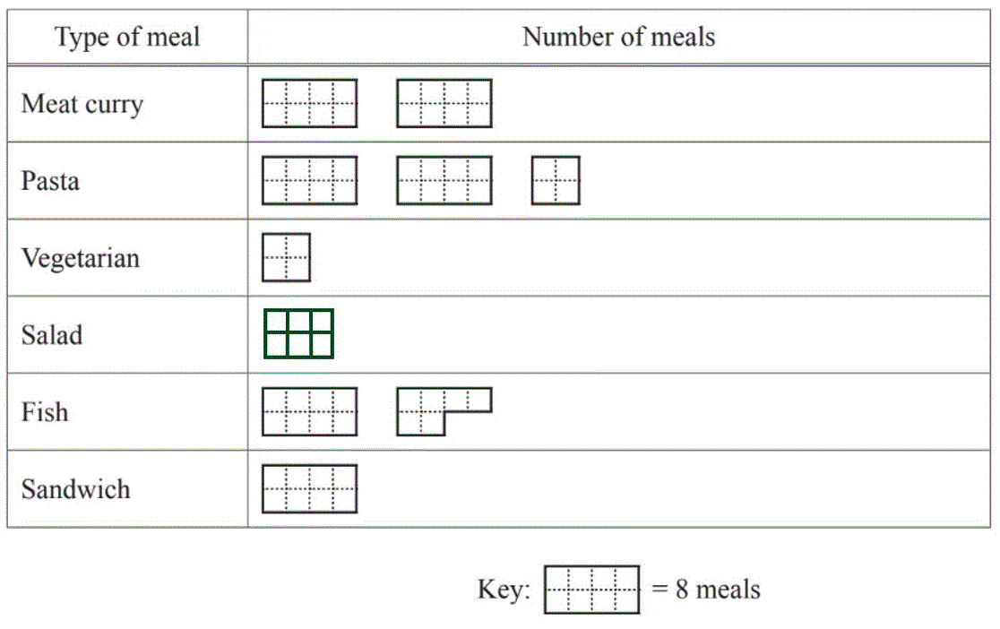

*     ** ***[1]**

(ii) *Pasta** has the most squares. *

**Pasta** **[1]**

(iii) *Work out how many of each type of meal were sold by counting the little squares. Add them together. *

$16+20+4+6+14+8=68$

** ****68** **[1]**

### Q27
> *Draw a sketch of a stem-and-leaf diagram and fill in the leaf values working through the given values from left to right  *

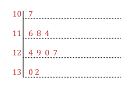

> * *

**[1]**

> *Complete the stem-and-leaf diagram, ordering the values in each row from smallest to largest  *

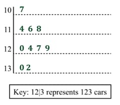

**[1]**

### Q28
> *i) Draw the bar for February at 10.*

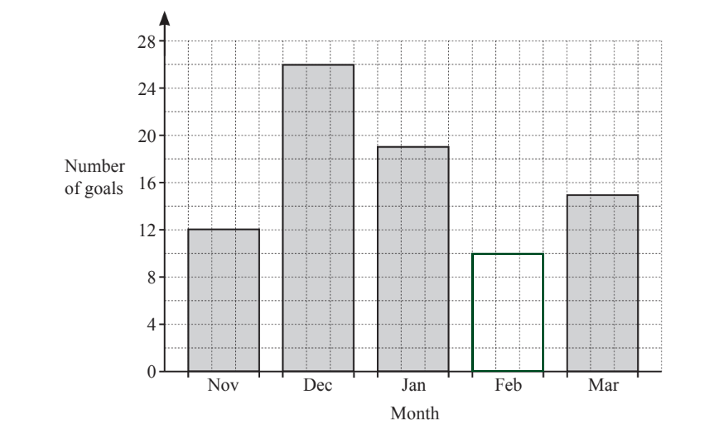

**[1]**

> *ii) The tallest bar is when the most goals were scored.*

**December**** ****[1]**

> *iii) Add together the frequencies of each bar*

$12+26+19+10+15=82$

**82 ****[1]**

> *iv) There are 5 months altogether so divide the total number of goals by the number of months.*

$82\div5=16.4$

** ****16.4**** [1]**

### Q29
(i) *5|6 **appears the most, which means **56**.*

** ****56**** ****[1]**

(ii) *Subtract the lowest piece of data in the stem and leaf diagram (**16**)** **from the highest piece of data in the stem and leaf diagram (**68**).*

$68-16=52$

** ****52**** ****[1]**

### Q30
> *Subtract the number of cars that are not purple from the total number of cars*

$50 - ( 11 + 14 + 9 + 5 + 3 ) = 8$

**[1]**

> *Use a 5 bar gate per 5 tally marks*

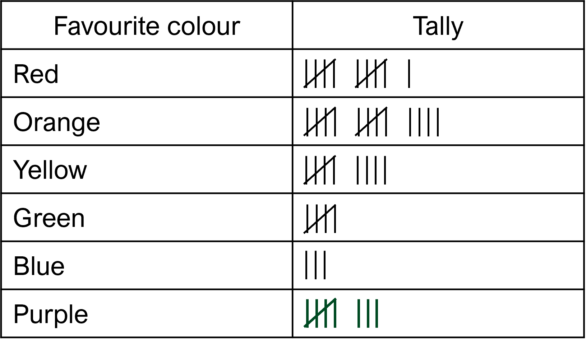

**[1]**
