# Exam Questions — Transformations
**Transformations** · Cambridge (CIE) IGCSE maths (0580 & 0980)
> Source: [https://www.savemyexams.com/igcse/maths/cie/25/core/topic-questions/](https://www.savemyexams.com/igcse/maths/cie/25/core/topic-questions/) · 22 questions across 1 sets

## Exam Questions (22 questions)

### Q1 — hard — 3 marks

**Q1** [3 marks]

Describe fully the single transformation that maps shape A onto shape B.

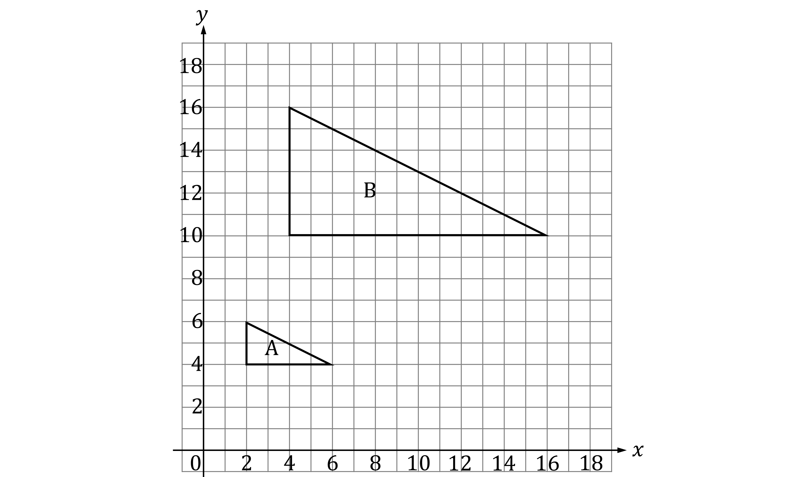

### Q2 — medium — 4 marks

**Q2** [2 marks]

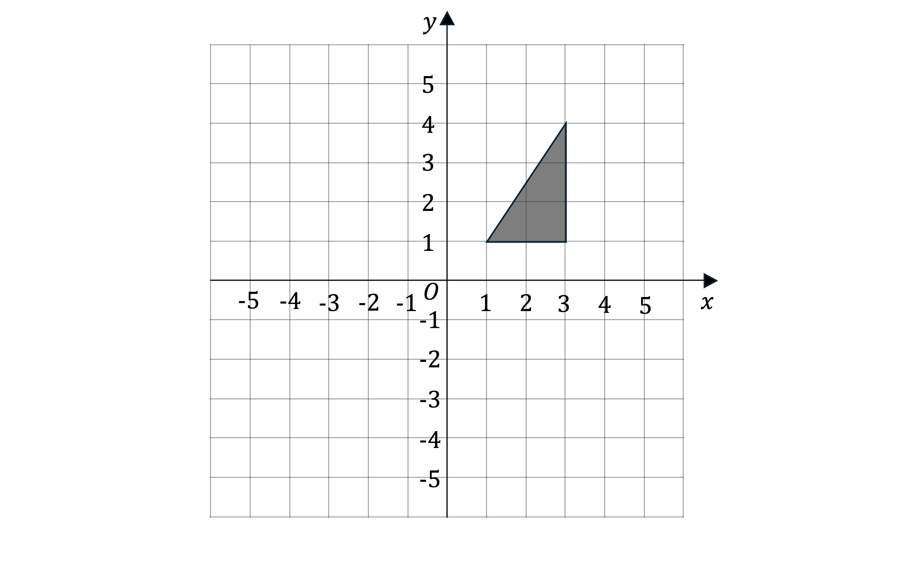

Rotate the triangle above clockwise by 90° about the point $( 0 , 0 )$ and label it A.

**Q2** [2 marks]

Reflect the original shape in the line $x=-1$ and label it B.

### Q3 — hard — 9 marks

**Q3** [7 marks]

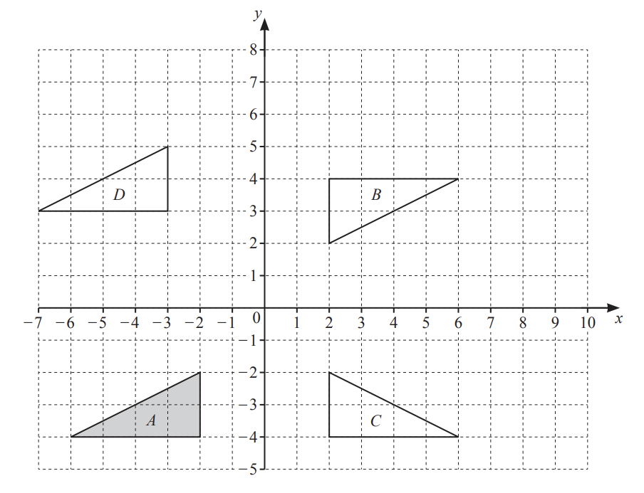

Describe fully the **single **transformation that maps

i) triangle $A$ onto triangle $B$,

[3]

ii) triangle $A$ onto triangle $C$,

[2]

iii) triangle $A$ onto triangle $D$.

[2]

*Source: Nov 2020 0580/32 Q7A*

**Q3** [2 marks]

**Extract:**

On the grid, enlarge triangle $A$ by scale factor 0.5, centre (4, 0).

*Source: Nov 2020 0580/32 Q7B*

### Q4 — hard — 9 marks

**Q4** [5 marks]

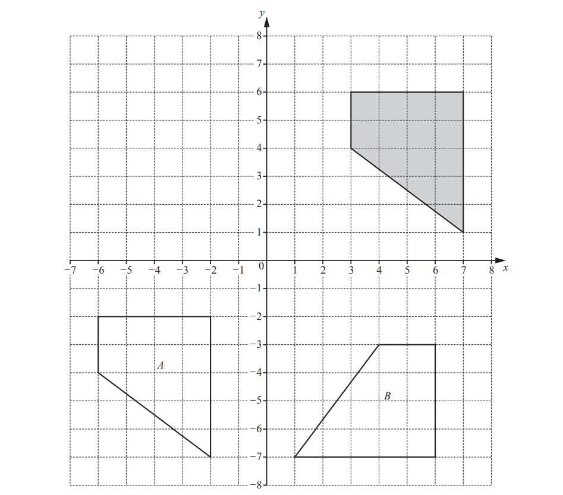

Describe fully the **single** transformation that maps the shaded quadrilateral onto

i) quadrilateral $A$,

[2]

ii) quadrilateral $B$.

[3]

*Source: May/June 2019 0580/33 Q2C*

**Q4** [4 marks]

On the grid,

i) reflect the shaded quadrilateral in the line $x=1,$

[2]

ii) enlarge the shaded quadrilateral by scale factor $\frac{1}{2}$, centre $(-1,0).$

[2]

*Source: May/June 2019 0580/33 Q2D*

### Q5 — hard — 7 marks

**Q5** [7 marks]

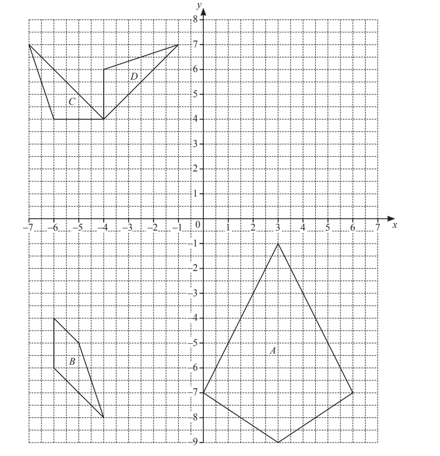

On the grid, draw the image of

ia) shape $A$ after an enlargement with scale factor $\frac{1}{2}$ , centre ( 3 , -5 )

[2]

ib) shape $B$ after a reflection in the line $y=-3$.

[2]

ii) Describe fully the **single **transformation that maps triangle $C$ onto triangle $D$.

[3]

*Source: March 2020 0580/32 Q6A*

### Q6 — hard — 10 marks

**Q6** [10 marks]

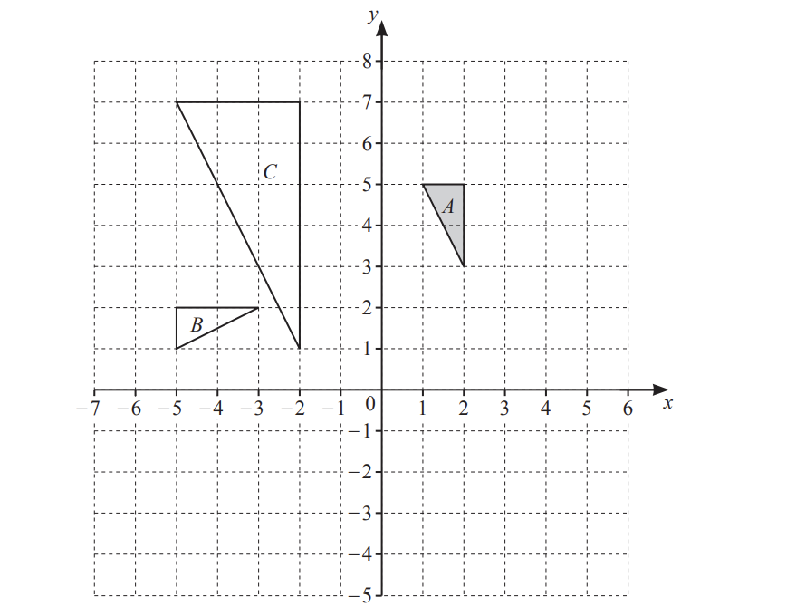

On the grid, draw the image of

ia) triangle $A$ after a translation by the vector $( \begin{gathered} 3 \\ - 7 \end{gathered} )$,

[2]

ib) triangle $A$after a reflection in the line $x$ = 3.

[2]

ii) Describe fully the **single **transformation that maps triangle $A$ onto triangle $B$.

[3]

iii) Describe fully the **single **transformation that maps triangle $A$ onto triangle $C$.

[3]

*Source: Nov 2020 0580/33 Q6A*

### Q7 — hard — 10 marks

**Q7** [6 marks]

Triangles $A,B$ and $C$ are shown on the grid.

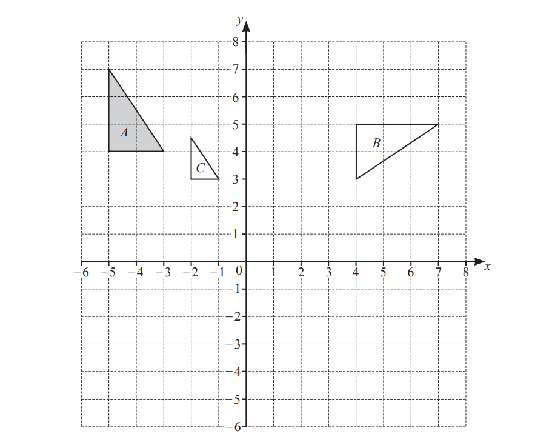

Describe fully the **single **transformation that maps

i) triangle $A$ onto triangle $B$,

[3]

ii) triangle$A$ onto triangle $C$.

[3]

*Source: Nov 2019 0580/31 Q5A*

**Q7** [4 marks]

**Extract:**

Triangles A, B and C are shown on the grid.

On the grid,

i) translate triangle $A$by the vector $( \begin{gathered} 6 \\ - 2 \end{gathered} )$,

[2]

ii) reflect triangle $A$ in the line $y$= 1.

[2]

*Source: Nov 2019 0580/31 Q5B*

### Q8 — hard — 14 marks

**Q8** [2 marks]

The diagram shows four shapes $A,B,C$and $D$ and a point $P$ on a 1cm2 grid.

Find

i) the perimeter of shape $A$,

............................................... cm [1]

ii) the area of shape $A$.

..............................................cm2 [1]

*Source: June 2019 0580/32 Q5A*

**Q8** [6 marks]

**Extract:**

The diagram shows four shapes A, B, C and D and a point P on a 1cm^2 grid.

i) Write down the co-ordinates of point $P$.

[1]

Find the co-ordinates of the image of point $P$ when

iia) $P$ is reflected in the $y$-axis,

[1]

iib) $P$ is reflected in the line $y=6$.

[2]

iii) Find the vector that translates point $P$ to the point ( 49, -12).

[2]

*Source: June 2019 0580/32 Q5B*

**Q8** [6 marks]

**Extract:**

The diagram shows four shapes A, B, C and D and a point P on a 1cm^2 grid.

Describe fully the **single **transformation that maps

i) shape $A$ onto shape $B$,

[3]

ii) shape $C$ onto shape $D$.

[3]

*Source: June 2019 0580/32 Q5C*

### Q9 — hard — 11 marks

**Q9** [3 marks]

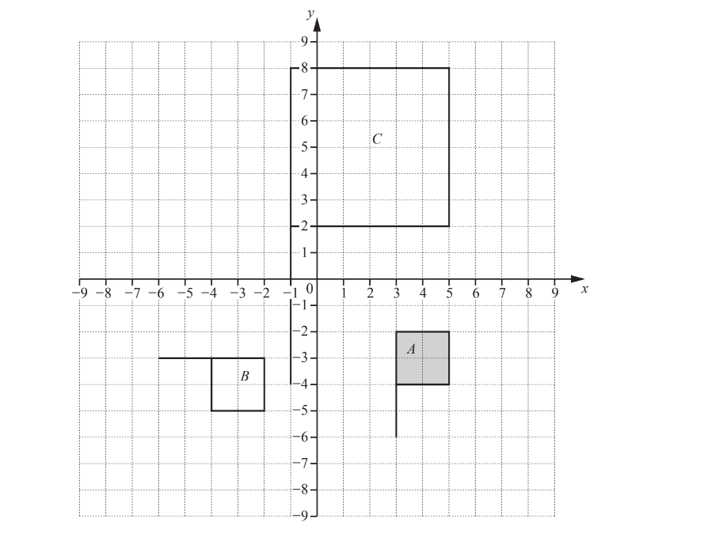

Describe fully the **single **transformation that maps shape $A$ onto shape $B$.

*Source: June 2019 0580/31 Q7A*

**Q9** [3 marks]

**Extract:**

Describe fully the **single **transformation that maps shape $A$ onto shape $C$.

*Source: June 2019 0580/31 Q7B*

**Q9** [3 marks]

**Extract:**

On the grid, draw the image of shape $A$ after a translation by the vector $( \begin{gathered} 3 \\ 1 \end{gathered} )$.

*Source: June 2019 0580/31 Q7C*

**Q9** [2 marks]

On the grid, draw the image of **shape**$B$** **after a reflection in the line $y=1$.

*Source: June 2019 0580/31 Q7D*

### Q10 — medium — 10 marks

**Q10** [8 marks]

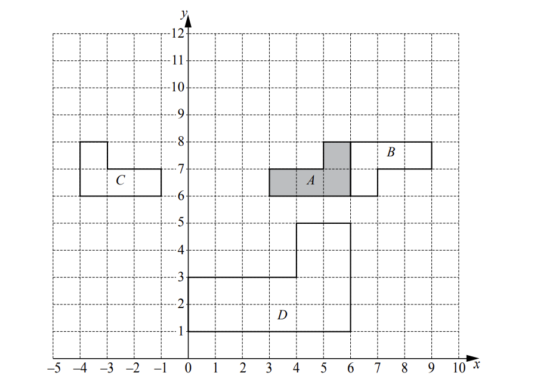

The diagram shows four shapes $A,B,C$and $D$.

Describe fully the **single **transformation that maps shape $A$onto

i) shape $B$,

[3]

ii) shape $C$,

[2]

iii) shape $D$.

[3]

*Source: Specimen 2020 0580/03 Q9A*

**Q10** [2 marks]

**Extract:**

The diagram shows four shapes A, B, C and D.

On the grid, draw the image of shape A after a translation by the vector $( \begin{gathered} - 3 \\ 2 \end{gathered} )$

*Source: Specimen 2020 0580/03 Q9B*

### Q11 — medium — 9 marks

**Q11** [6 marks]

The grid shows a point $E$ and four quadrilaterals, $A,B,C$ and $D$.

Describe fully the **single **transformation that maps

i) shape $A$ onto shape $B$,

[2]

ii) shape $A$ onto shape $C$,

[2]

iii) shape $A$ onto shape $D$.

[3]

*Source: June 2020 0580/31 Q2B*

**Q11** [3 marks]

**Extract:**

The grid shows a point E and four quadrilaterals, A, B, C and D.

i) Write down the coordinates of the point $E$.

[1]

ii) On the grid, draw the image of shape $A$ after an enlargement by scale factor 3, centre $E$.

[2]

*Source: June 2020 0580/31 Q2C*

### Q12 — medium — 7 marks

**Q12** [7 marks]

The diagram shows two triangles, $A$ and $B$, and two points $P$and $Q$.

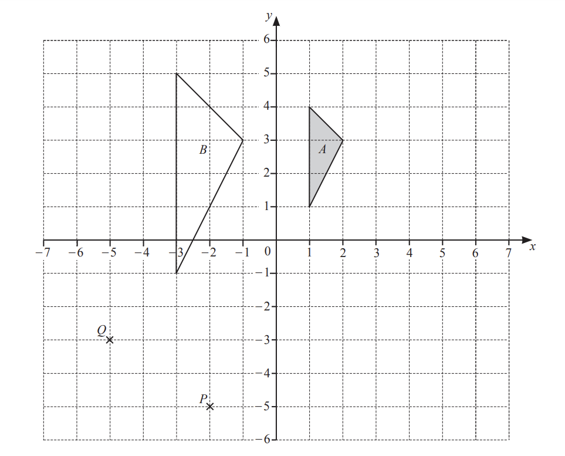

i) Describe fully the **single **transformation that maps triangle $A$ onto triangle$B$.

[3]

ii)On the grid, draw the image of triangle A after a translation by the vector$( \begin{gathered} 4 \\ - 2 \end{gathered} )$

[2]

iii) On the grid, draw the image of triangle $A$after a rotation through 90° clockwise about (0, 0).

[2]

*Source: Nov 2019 0580/32 Q8B*

### Q13 — medium — 9 marks

**Q13** [2 marks]

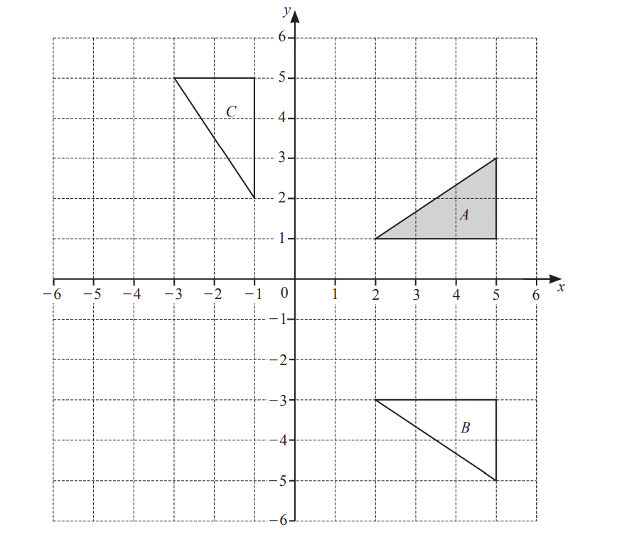

Describe fully the **single **transformation that maps triangle$A$onto triangle $B$.

*Source: Nov 2019 0580/33 Q3A*

**Q13** [3 marks]

Describe fully the **single **transformation that maps triangle $A$ onto triangle $C$.

*Source: Nov 2019 0580/33 Q3B*

**Q13** [2 marks]

**Extract:**

[qp3-0580-33-paper-3-oct-nov-2019-cie-igcse-maths.png] (the diagram showing triangle A)

On the grid, draw the image of triangle $A$ after a translation by the vector $( \begin{gathered} - 2 \\ - 3 \end{gathered} )$

*Source: Nov 2019 0580/33 Q3C*

**Q13** [2 marks]

**Extract:**

[qp3-0580-33-paper-3-oct-nov-2019-cie-igcse-maths](https://cdn.savemyexams.com/uploads/2023/01/qp3-0580-33-paper-3-oct-nov-2019-cie-igcse-maths.png)

On the grid, draw the image of triangle $A$ after a rotation of 180° about (2, 1).

*Source: Nov 2019 0580/33 Q3D*

### Q14 — medium — 3 marks

**Q14** [3 marks]

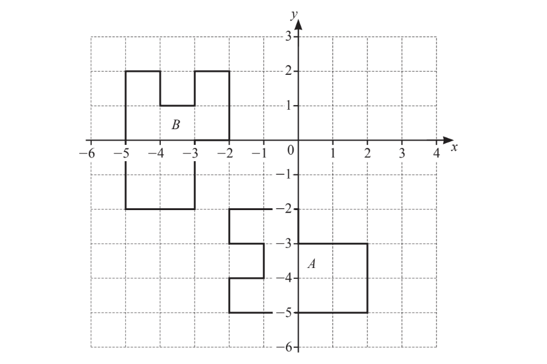

Describe fully the **single **transformation that maps shape $A$ onto shape $B$.

*Source: June 2020 0580/13 Q15*

### Q15 — medium — 10 marks

**Q15** [8 marks]

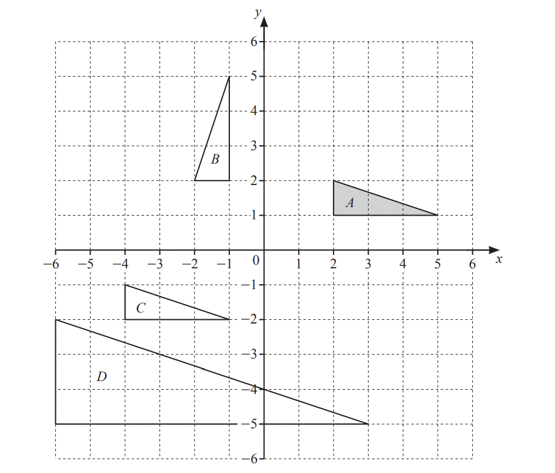

Describe fully the **single **transformation that maps

i) triangle $A$ onto triangle $B$,

[3]

ii) triangle $A$ onto triangle $C$,

[2]

iii) triangle $A$onto triangle $D$.

[3]

*Source: June 2020 0580/32 Q8A*

**Q15** [2 marks]

**Extract:**

[qp8-0580-32-paper-3-may-2020-cie-igcse-maths](https://cdn.savemyexams.com/uploads/2023/01/qp8-0580-32-paper-3-may-2020-cie-igcse-maths.png)

On the grid, draw the image of triangle $A$ after a reflection in the line $y=-1$.

*Source: June 2020 0580/32 Q8B*

### Q16 — medium — 10 marks

**Q16** [8 marks]

Describe fully the **single** transformation that maps

i) shape $A$ onto shape $B$,

[3]

ii) shape $B$ onto shape $C$,

[2]

iii) shape $C$ onto shape $D$.

[3]

*Source: March 2018 0580/32 Q7B*

**Q16** [2 marks]

**Extract:**

[q7-058032-march2018-cie-igcse-maths-core](https://cdn.savemyexams.com/uploads/2023/01/q7-058032-march2018-cie-igcse-maths-core.png)

On the grid, draw the image of shape $D$ after a reflection in the line $x=-1$.

*Source: March 2018 0580/32 Q7C*

### Q17 — medium — 10 marks

**Q17** [8 marks]

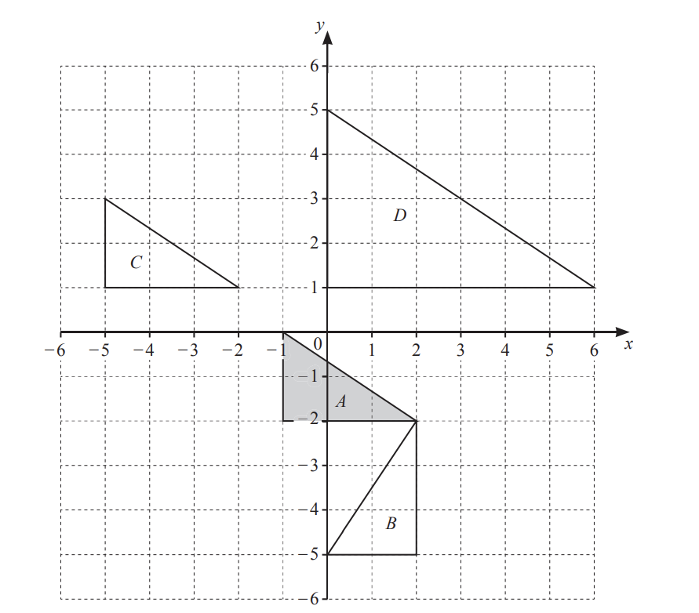

Describe fully the **single **transformation that maps

i) triangle $A$ onto triangle $B$,

[3]

ii) triangle $A$ onto triangle $C$,

[2]

iii) triangle $A$ onto triangle $D$.

[3]

*Source: Nov 2020 0580/31 Q8A*

**Q17** [2 marks]

**Extract:**

[q8-0580-31-paper-3-nov-2020-cie-igcse-maths](https://cdn.savemyexams.com/uploads/2023/01/q8-0580-31-paper-3-nov-2020-cie-igcse-maths.png)

On the grid, draw the image of triangle $A$ after a reflection in the line $x=-2$.

*Source: Nov 2020 0580/31 Q5B*

### Q18 — easy — 2 marks

**Q18** [2 marks]

Enlarge the rectangle using a scale factor of 3 and centre of enlargement $O$.

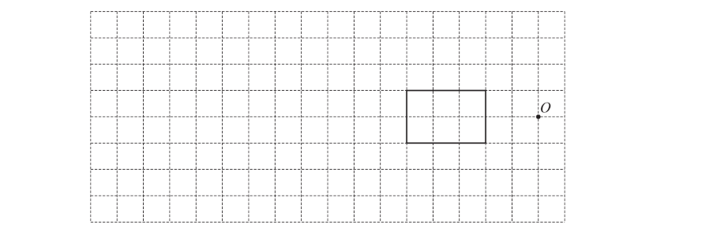

[2]

*Source: May/June 2018 0580/11 Q16*

### Q19 — easy — 2 marks

**Q19** [2 marks]

Shape $A$ is shown on the grid.

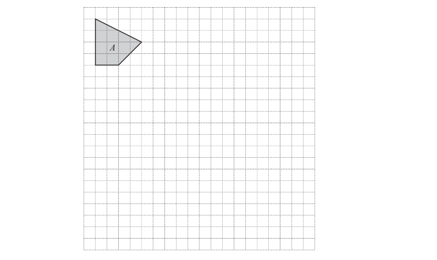

[2]

On the grid, enlarge shape $A$ by scale factor 3.

*Source: Oct/Nov 2018 0580/11 Q10*

### Q20 — easy — 2 marks

**Q20** [2 marks]

Reflect the shape in line $L$.

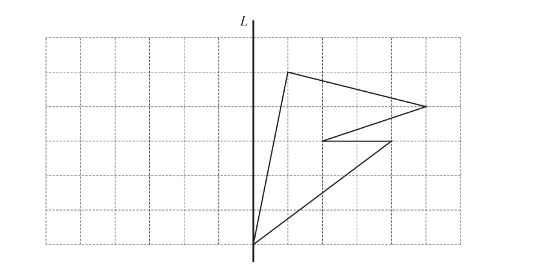

*Source: June 2020 0580/13 Q7B*

### Q21 — easy — 2 marks

**Q21** [2 marks]

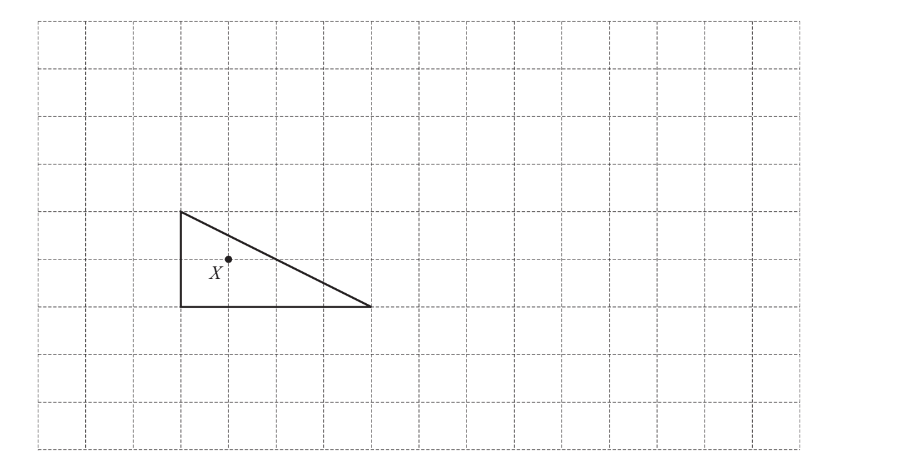

Draw the enlargement of the triangle by scale factor 3, centre $X$.

*Source: March 2019 0580/12 Q17*

### Q22 — easy — 2 marks

**Q22** [2 marks]

Reflect the below shape in the line $AB$.

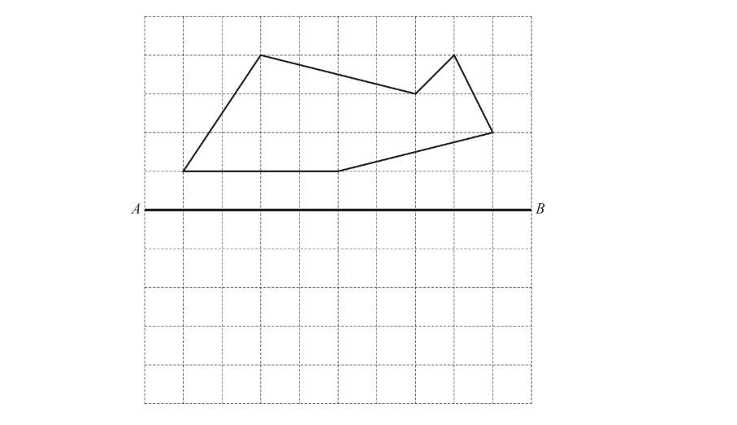

*Source: March 2019 0580/12 Q9*

