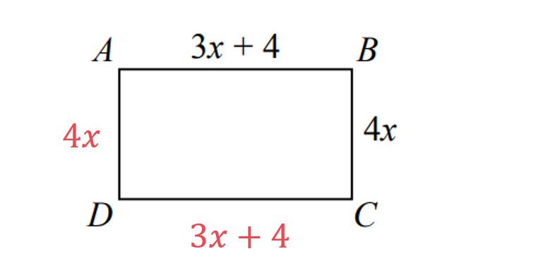
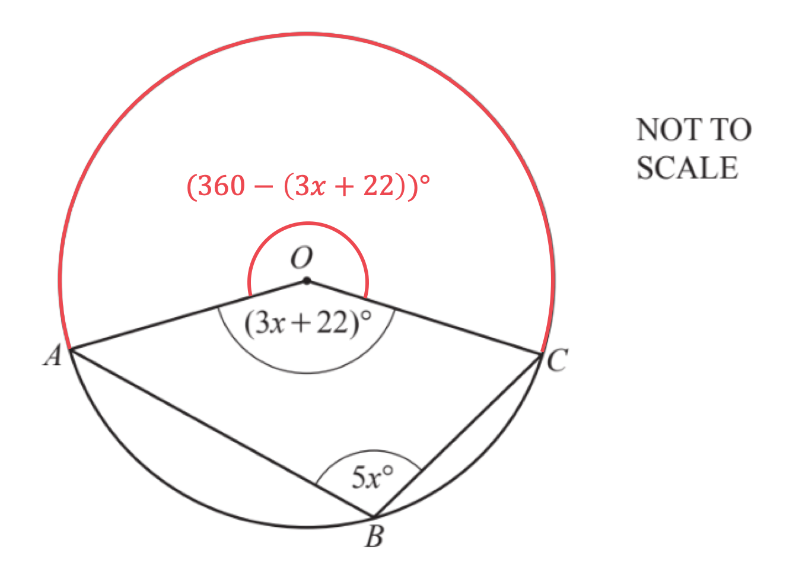
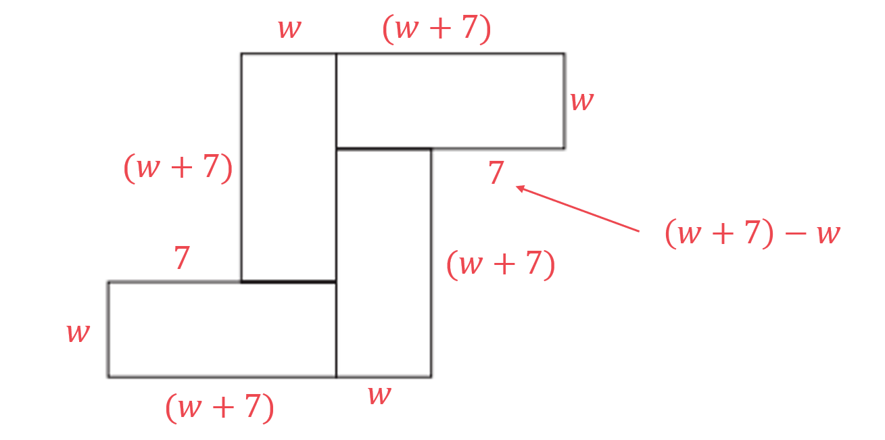
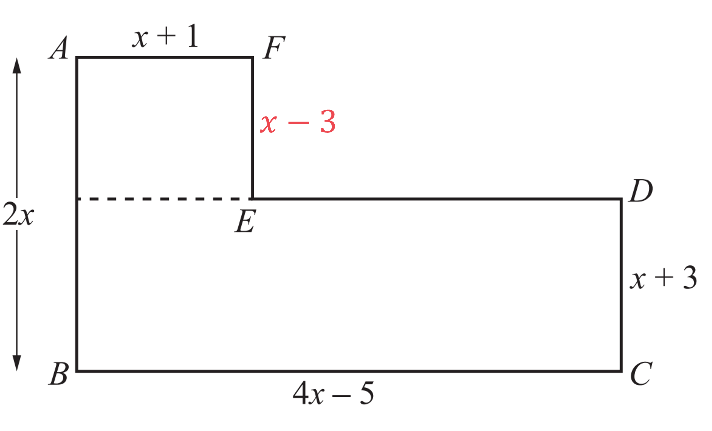
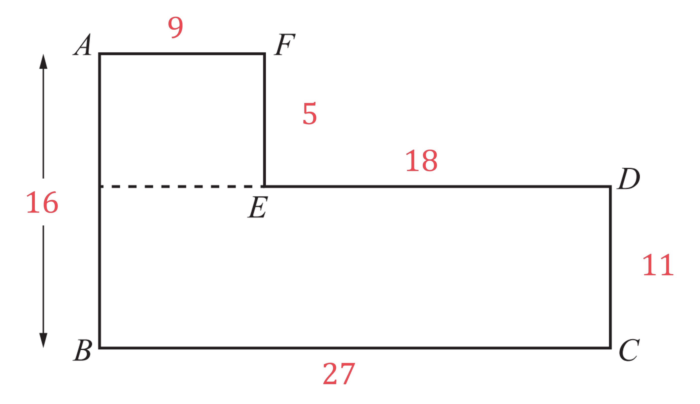
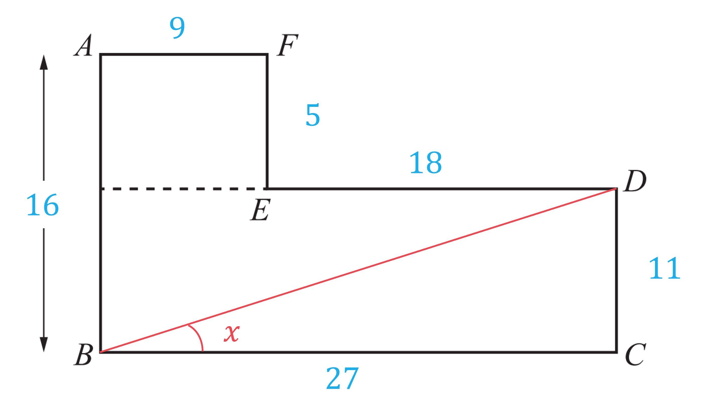
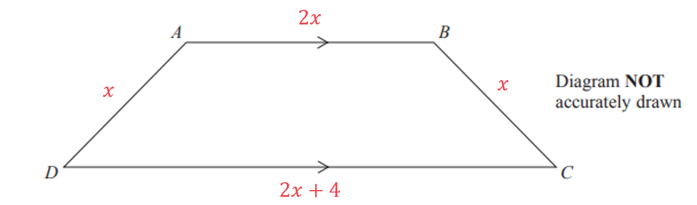

# Mark Schemes — Forming & Solving Equations
**Algebra & Sequences** · Cambridge (CIE) IGCSE maths (0580 & 0980)

## Calculator Questions (33 questions)

### Q1
> *Let Redlands, **R**, be **x **years old and use this to write expressions for the ages of St Samuels, **S**, and Francis Long School, **F. *

$R=x\,S=2x\,F=x-7$

** Either expression for S or F correct**** [1]**

> *Find the number of students by dividing the total amount paid by the amount paid by each student. *

`table attributes columnalign right center left columnspacing 0px end attributes row cell Number space of space students space end cell equals cell space 1155 over 15 space equals space 77 end cell end table`

**[1]**

> *The word total means 'the sum of', so add the expressions together and form an equation for the total number of students by setting this equal to 77.*

`table row cell R space plus space S space plus space F space end cell equals cell space 77 end cell row cell x space plus space 2 x space plus space open parentheses x space minus space 7 close parentheses space end cell equals cell space 77 end cell row cell 4 x space minus space 7 space end cell equals cell space 77 end cell end table`

**[1]**

> *Now solve the equation to find *$x$*.*

`table row cell 4 x space minus space 7 space end cell equals cell space 77 end cell row cell plus 7 space space space space space space space space space space space space space space space space space space end cell equals cell space space space space space space space space space space space space space space space space plus 7 end cell row cell 4 x space end cell equals cell space 84 end cell row cell divided by 4 space space space space space space space space space space space space space space space space space space end cell equals cell space space space space space space space space space space space space space space space space divided by 4 end cell row cell x space end cell equals cell space 84 over 4 space end cell row blank equals cell space 21 end cell end table`

> $x=21$* means that there were 21 students from Redlands School.  *
*Now substitute *$x=21$* into the expressions for **S **and **F.*

`table row cell R space end cell equals cell space x space equals space 21 end cell row cell S space end cell equals cell space 2 x space equals space 2 open parentheses 21 close parentheses end cell row cell F space end cell equals cell space x space minus space 7 space equals space 21 space minus space 7 space end cell end table`

**Redlands: 21 students      **** **
**St Samuels: 42 students      **** **
**Francis Long: 14 students****  ****[2]**

### Q2
> *Let one small coffee cake be *$x$* and one large coffee cake be *$2x+1$*. *
*Let the number of small coffee cakes Petra bought be *$a$* and the number of large coffee cakes be *$b$*.*

> *Form an equation in terms of *$a$* and *$b$* for the total number of coffee cakes that Petra bought.*

`table row cell a space plus space b space end cell equals cell space 45 end cell end table`

> *Form an equation in terms of *$x$* for the number, *$a$*, of small coffee cakes that can be bought for \$20.*

`table row cell a x space end cell equals cell space 20 end cell row cell a space end cell equals cell 20 over x end cell end table`

> *Form an equation in terms of *$x$* for the number, *$b$*, of large coffee cakes that can be bought for \$10.*

`table row cell b open parentheses 2 x space plus space 1 close parentheses space end cell equals cell space 10 end cell row cell b space end cell equals cell fraction numerator 10 over denominator 2 x space plus space 1 end fraction end cell end table`

**Correct expression for a or b ****[1]**

> *Substitute the expressions for *$a$* and *$b$* into the equation for the total number of cakes.*

`table attributes columnalign right center left columnspacing 0px end attributes row cell a space plus space b space end cell equals cell space 45 end cell row cell open parentheses 20 over x close parentheses space plus space open parentheses fraction numerator 10 over denominator 2 x space plus space 1 end fraction close parentheses space end cell equals cell space 45 end cell end table`

**[1]**

> *Remove the fractions by multiplying both sides by *`x open parentheses 2 x space plus space 1 close parentheses`*.*

`table row cell fraction numerator 20 x open parentheses 2 x space plus space 1 close parentheses over denominator x end fraction plus fraction numerator 10 x open parentheses 2 x space plus space 1 close parentheses over denominator 2 x space plus space 1 end fraction space space end cell equals cell space 45 x open parentheses 2 x space plus space 1 close parentheses end cell row cell 20 open parentheses 2 x space plus space 1 close parentheses space plus space 10 x space space end cell equals cell space 45 x open parentheses 2 x space plus space 1 close parentheses end cell end table`

**[1]**

> *Expand the brackets and simplify.*

> `table row cell 40 x space plus space 20 space plus space 10 x space end cell equals cell space 90 x squared space plus space 45 x end cell row cell 50 x space plus space 20 space end cell equals cell space 90 x squared space plus space 45 x end cell end table`* *

> *Rearrange to make a quadratic equation equal to zero.*

`table row cell 90 x squared space plus space 45 x space minus space 50 x space minus space 20 space end cell equals cell space 0 end cell row cell 90 x squared space minus 5 x space minus space 20 space end cell equals cell space 0 end cell end table`

**[1]**

> *Simplify the equation by dividing every term by 5.*

`table row cell 18 x squared space minus x space minus space 4 space end cell equals cell space 0 end cell end table`

> *Use the quadratic equation.*

`table row cell x space end cell equals cell fraction numerator space minus open parentheses negative 1 close parentheses space plus-or-minus space square root of open parentheses negative 1 close parentheses squared space minus space 4 open parentheses 18 close parentheses open parentheses negative 4 close parentheses end root over denominator 2 open parentheses 18 close parentheses end fraction end cell end table`

**[1]**

`table row cell x space end cell equals cell fraction numerator space 1 space plus-or-minus space square root of 1 space plus 288 end root over denominator 36 end fraction space equals space fraction numerator space 1 space plus-or-minus space 17 over denominator 36 end fraction end cell end table`

**[1]**

> *Or the quadratic could be factorised.*

`table row cell open parentheses 9 x space plus space 4 x close parentheses open parentheses 2 x space minus space 1 close parentheses end cell equals 0 end table`

> $x=\frac{1}{2}$* or *$x=-\frac{4}{9}$*, disregard the negative because price must be positive so one small coffee cake = \$0.50 or 50 cents.*

`bold $ bold 0 bold. bold 50` **[1]**

### Q3
> *Let one small lemon cake be *$x$* and one large lemon cake be *$2x+1$*. *
*Form an equation in terms of *$x.$

`3 x space plus space 2 open parentheses 2 x space plus space 1 close parentheses space equals space 12.36`

**[1]**

> *Expand the brackets.*

$3x+4x+2=12.36$

> *Simplify.*

$7x+2=12.36$

**[1]**

> *Solve the equation by subtracting 2 from both sides and then dividing both sides by 7.*

`table row cell 7 x space plus space 2 space minus space 2 space end cell equals cell space 12.36 space minus space 2 end cell row cell 7 x space end cell equals cell space 10.36 end cell row cell x space end cell equals cell fraction numerator space 10.36 over denominator 7 end fraction end cell end table`

> $x=1.48$* so one small lemon cake = \$1.48.*

`bold $ bold 1 bold. bold 48` **[1] **
**Round answers in dollars to 2 d.p.**
> *Let one small chocolate cake be *$x$* and one large chocolate cake be *$2x+1$*. *
*Form an equation in terms of *$x.$

`18 x space equals space 7 open parentheses 2 x space plus space 1 close parentheses`

**[1]**

> *Expand the brackets.*

$18x=14x+7$

> *Bring the *$x$* terms to the same side by subtracting the term with the lower coefficient of *$x.$

`table row cell 18 x space minus space 14 x space end cell equals cell space 7 end cell row cell 4 x space end cell equals cell space 7 end cell end table`

**[1]**

> *Solve the equation by dividing both sides by 4.*

`table row cell x space end cell equals cell 7 over 4 space equals space 1.75 end cell end table`

> $x=1.75$* so one small chocolate cake = \$1.75.*

`bold $ bold 1 bold. bold 75` **[1] **
**Round answers in dollars to 2 d.p.**

### Q4
> *Find the cost of an orange in dollars by dividing by 100.*

$\frac{21}{100}=0.21$

> *Find an expression for the cost of Alex's oranges.*

$0.21x$

> *Find an expression for the cost of Bobbie's oranges.*

`0.21 open parentheses x plus 2 close parentheses`

> *Form an equation in terms of *$x$* for the cost of all the oranges that are bought.*

`0.21 x plus 0.21 open parentheses x plus 2 close parentheses equals 4.20`

**[1]**

> *Simplify the left hand side by expanding the brackets and collecting like terms.*

$0.21x+0.21x+0.42=4.2$

> *Collect like terms.*

$0.42x+0.42=4.2$

**[1]**

> *Subtract 0.42 from both sides.*

$0.42x=3.78$

> *Divide both sides by 0.42.*

$x=9$** [1]**

**You could also solve this by keep the cost of one orange in cents and changing the total cost into cents.**

### Q5
i) *Each sack costs \$*$m$* and Paulo pays \$*$72$ 
*Write down the number of sacks Paulo buys (by dividing 72 by *$m$*)*

$\frac{72}{m}$** ****[1]**

ii) *Each sack costs \$*`open parentheses m plus 0.9 close parentheses`* and Jim pays \$*$72$
 *Write down the number of sacks Jim buys by dividing 72 by *`open parentheses m plus 0.9 close parentheses`

$\frac{72}{m+0.9}$** ****[1]**
*Paulo buys *$\frac{72}{m}$* sacks and Jim buys *$\frac{72}{m+0.9}$* sacks* 
*Paulo's number of sacks is 4 more than Jim's* 
*Form an equation (by setting Paulo's number to equal Jim's number plus 4)* * *

$\frac{72}{m}=\frac{72}{m+0.9}+4$

**[1]**

*Multiply both sides by *`open parentheses m plus 0.9 close parentheses` * *

`fraction numerator 72 open parentheses m plus 0.9 close parentheses over denominator m end fraction equals 72 plus 4 open parentheses m plus 0.9 close parentheses` * *

*Multiply both sides by *$m$ * *

`72 open parentheses m plus 0.9 close parentheses equals 72 m plus 4 m open parentheses m plus 0.9 close parentheses`

**[1]**

*Expand the brackets* * *

`table row cell 72 m plus 72 cross times 0.9 end cell equals cell 72 m plus 4 m squared plus 4 m cross times 0.9 end cell row cell 72 m plus 64.8 end cell equals cell 72 m plus 4 m squared plus 3.6 m end cell end table` * *

*Subtract *$72m$* from both sides* * *

$64.8=4m^{2}+3.6m$

**[1]**

*Change the decimals into whole numbers by multiplying both sides by 10* * *

$648=40m^{2}+36m$ * *

*Divide both sides by 4* * *

$162=10m^{2}+9m$ * *

> *Subtract 162 from both sides*

$10m^{2}+9m-162=0$ **[1]**
i) *The quadratic formula is   *

$x=\frac{-b\pm\sqrt{b^{2}-4ac}}{2a}$* *

*Substitute *$a=10$*, *$b=9$* **and** *$c=-162$* into the formula *
*Write down this line of working, with brackets around negative numbers*

`m equals fraction numerator negative 9 plus-or-minus square root of 9 squared minus 4 cross times 10 cross times open parentheses negative 162 close parentheses end root over denominator 2 cross times 10 end fraction`

**Correct values shown under the square root**** [1]*** * 
**Correct values shown outside of the square root ****[1]**** **

> *The *$\pm$* means two solutions (use + for one and - for the other) Use a calculator to find these two solutions*

$m=3.6$**and **$m=-4.5$** [****1] **
**This question can also be done by factorisation using (2****m ****+ 9)(5****m ****- 18) = 0**

ii) *Choose the correct value for *$m$* (it is a price so cannot be negative)* * *

$m=3.6$ * *

*Substitute *$m=3.6$* into *$\frac{72}{m}$* from part (a)(i)*

$\frac{72}{3.6}$

**20 sacks** **[1]**

### Q6
> *Identify the number of each counters*

| > *Red* | > *Green* | > *Total* |
|---|---|---|
| $r$ | $g$ | $r+g$ |

> *Use the probability  *$\frac{3}{7}$* to form an equation*

$\frac{g}{r+g}=\frac{3}{7}$

**[1]**

> *Identify the number of each counters*

| > *Red* | > *Green* | > *Total* |
|---|---|---|
| $r+2$ | $g+3$ | $r+g+5$ |

> *Use the probability  *$\frac{6}{13}$* to form an equation*

$\frac{g+3}{r+g+5}=\frac{6}{13}$

**[1]**

> *Rewrite both equations without the fractions*

`table row cell fraction numerator g over denominator r plus g end fraction end cell equals cell 3 over 7 end cell row cell 7 g end cell equals cell 3 open parentheses r plus g close parentheses end cell row cell 7 g end cell equals cell 3 r plus 3 g end cell row cell 4 g end cell equals cell 3 r end cell end table`

`table row cell fraction numerator g plus 3 over denominator r plus g plus 5 end fraction end cell equals cell 6 over 13 end cell row cell 13 open parentheses g plus 3 close parentheses end cell equals cell 6 open parentheses r plus g plus 5 close parentheses end cell row cell 13 g plus 39 end cell equals cell 6 r plus 6 g plus 30 end cell row cell 7 g plus 9 end cell equals cell 6 r end cell end table`

**writing both without fractions [1]**

> *Double the first equation*

`table row cell 6 r end cell equals cell 8 g end cell end table`

> *Substitute into the second equation*

`table row cell 8 g end cell equals cell 7 g plus 9 end cell row g equals 9 end table`

**[1]**

> *Substitute *$g=9$* into the first equation to find *$r$

`table row cell 3 r end cell equals cell 4 cross times 9 end cell row cell 3 r end cell equals 36 row r equals 12 end table`

**9 green and 12 red ****[1]**

### Q7
> *Let the cost of a tea be **t** and the cost of a coffee be **c. *

> *Use the information in the question to write two equations.*

> *3 teas = 3**t, **2 coffees = 2**c,** add these and set equal to 7.8 (£7.80). *

$3t+2c=7.8$

> *5 teas = 5**t, **4 coffees = 4**c,** add these and set equal to 14.2 (£14.20). *

$5t+4c=14.2$

**[1]**

> *Number the equations.*

> `table row cell 3 t space plus space 2 c space end cell equals cell space 7.8 space space space space space space space space space space space space space space open parentheses 1 close parentheses end cell row cell space 5 t space plus space 4 c space end cell equals cell space 14.2 space space space space space space space space space space space space open parentheses 2 close parentheses end cell end table`* *

> *Make the **c** terms equal by multiplying all parts of equation (1) by 2.*

`2 open parentheses 1 close parentheses space space space space space space space space space space space space 2 open parentheses 3 t space plus space 2 c space equals 7.8 close parentheses space
space space open parentheses 2 close parentheses space space space space space space space space space space space space space space space table attributes columnalign right center left columnspacing 0px end attributes row blank blank space end table table attributes columnalign right center left columnspacing 0px end attributes row blank blank 5 end table table attributes columnalign right center left columnspacing 0px end attributes row blank blank t end table table attributes columnalign right center left columnspacing 0px end attributes row blank blank space end table table attributes columnalign right center left columnspacing 0px end attributes row blank blank plus end table table attributes columnalign right center left columnspacing 0px end attributes row blank blank space end table table attributes columnalign right center left columnspacing 0px end attributes row blank blank 4 end table table attributes columnalign right center left columnspacing 0px end attributes row blank blank c end table table attributes columnalign right center left columnspacing 0px end attributes row blank blank space end table table attributes columnalign right center left columnspacing 0px end attributes row blank equals blank end table table attributes columnalign right center left columnspacing 0px end attributes row blank blank space end table table attributes columnalign right center left columnspacing 0px end attributes row blank blank 14 end table table attributes columnalign right center left columnspacing 0px end attributes row blank blank. end table table attributes columnalign right center left columnspacing 0px end attributes row blank blank 2 end table space space`*  *

> *This gives two equations with the same coefficient of **c.*

`table row cell 6 t space plus space 4 c space end cell equals cell space 15.6 space space space space space space space space space space space space open parentheses 3 close parentheses end cell row cell space 5 t space plus space 4 c space end cell equals cell space 14.2 space space space space space space space space space space space space open parentheses 2 close parentheses end cell end table`

> *Eliminate the **c** terms by subtracting equation (2) from equation (3).*

`space space space space space space space space space table row blank blank space end table table row blank blank space end table table row blank blank 6 end table table row blank blank t end table table row blank blank space end table table row blank blank plus end table table row blank blank space end table table row blank blank 4 end table table row blank blank c end table table row blank blank space end table table row blank equals blank end table table row blank blank space end table table row blank blank 15 end table table row blank blank. end table table row blank blank 6 end table space space space space space space space space
bottom enclose space minus space space space open parentheses table row cell space 5 t space plus space 4 c space end cell equals cell space 14.2 end cell end table close parentheses space end enclose
space space space space space space space space space space space space space space t space space space space space space space space space space space equals space 1.4`

**[1]**

> *Substitute *$t=1.4$* into either of the two original equations**.*

`table row cell open parentheses 1 close parentheses space space space space space 3 t space plus 2 c space end cell equals cell space 7.8 end cell row cell 3 open parentheses 1.4 close parentheses space plus space 2 c space end cell equals cell space 7.8 space end cell row cell 4.2 space plus space 2 c space end cell equals cell space 7.8 end cell end table`

**[1]**

> *Solve this equation to find** c.*

`table row cell 2 c space end cell equals cell space 7.8 space minus space 4.2 end cell row cell 2 c space end cell equals cell space 3.6 end cell row cell c space end cell equals cell fraction numerator 3.6 over denominator 2 end fraction space equals space 1.8 end cell end table`

> *This means that 1 tea costs £1.40 and 1 coffee costs £1.80. *

**One tea = £1.40       **
**One coffee = £1.80 ****[1]**

### Q8
> *The formula for the area of a triangle is *$A=\frac{1}{2}bh$*, where *$b$* is the base and *$h$* is the height perpendicular to the base.*

`Area space equals space 1 half open parentheses x space minus space 2 close parentheses open parentheses x close parentheses`

> *Use the given information that the area of the triangle is 2.5 cm**2** to write an equation in terms of *$x$*.*

`table row cell 1 half x open parentheses x space minus space 2 close parentheses space end cell equals cell space 2.5 end cell end table`

**[1]**

> *Remove the fraction by multiplying both sides by 2.*

`table row cell x open parentheses x space minus space 2 close parentheses space end cell equals cell space 5 end cell end table`

> *Expand the brackets on the LHS of the equation.*

$x^{2}-2x=5$

> *Rearrange the expression to make a quadratic equation equal to 0.*

`table row cell x squared space minus space 2 x space minus space 5 space end cell equals cell space 0 end cell end table`

**[1]**

> *This cannot be factorised, so solve to find *$x$* by either using the quadratic formula, or by completing the square.*

> *Given an equation of the form *$ax^{2}+bx+c=0$*, the quadratic formula is *$x=\frac{-b\pm\sqrt{b^{2}-4ac}}{2a}$*.*

> *Identify the values of **a, b **and **c.*

$a=1,b=-2,c=-5$

> *Substitute into the quadratic formula.*

`x equals fraction numerator negative open parentheses negative 2 close parentheses space plus-or-minus space square root of open parentheses negative 2 close parentheses squared space minus space 4 space cross times space 1 space cross times space open parentheses negative 5 close parentheses end root over denominator 2 space cross times space 1 end fraction`

> *Simplify.*

`table row x equals cell fraction numerator 2 space plus-or-minus space square root of 24 over denominator 2 end fraction space end cell end table`

> *Find the two possible values of *$x$*.*

$x=1+\sqrt{6}=3.44948...$* **  or  *`x space equals table row blank blank space end table table row blank blank 1 end table table row blank blank minus end table table row blank blank space end table table row blank blank cell square root of 6 end cell end table space equals space minus 1.44948...`

**[1]**

> *Considering the diagram in part (a), the length of the triangle is *$x$*, so *$x$* must be positive. *
*The value *$1-\sqrt{6}$* is negative so this cannot be the length of a triangle. *

> *Substitute *$x=1+\sqrt{6}$* into the expression given for the length and the width of the triangle.*

> `length space equals space x space equals space table row blank blank space end table table row blank blank 1 end table plus table row blank blank space end table table row blank blank cell square root of 6 end cell end table space`* *

`width space equals space x space minus space 2 space equals space table row blank blank space end table table row blank blank cell open parentheses 1 plus space square root of 6 close parentheses end cell end table space minus space 2 space equals space minus 1 space plus space square root of 6`

> *Use Pythagoras' theorem to find the length of the hypotenuse.*

> `table row cell a to the power of 2 space end exponent end cell equals cell space b squared space plus space c squared end cell row blank equals cell space open parentheses 1 space plus space square root of 6 close parentheses squared space plus space open parentheses 11 space plus space square root of 6 close parentheses squared end cell row blank equals cell space 14 end cell end table`* *

**[1]**

> *Square root to find the length of the hypotenuse.*

`table row cell a space end cell equals cell space square root of 14 end cell row blank equals cell space 3.741657... end cell end table`

> *Add the three sides of the triangle together, use either the exact values or values rounded to more than four signigifcant figures in your working.*

`Perimeter space equals open parentheses 1 space plus space square root of 6 close parentheses space plus space space table row blank blank space end table table row blank blank cell open parentheses negative 1 plus space square root of 6 close parentheses end cell end table space plus space square root of 14 space equals space 8.640636...`

**[1]**

> *Round the answer to 3 significant figures.*

** **$P=8.64\mathrm{cm}(3s.f.)$** ****[1]**
** Answers in the range 8.63 to 8.65 accepted.**

### Q9
> *Form an expression for the perimeter of the rectangle, remember that opposite sides are equal and label each of the other two sides. *

> *Use this to form an expression for the perimeter of the rectangle.*

`table row cell P subscript r e c t end subscript space end cell equals cell space 4 x space plus space open parentheses 3 x space plus space 4 close parentheses space plus space 4 x space plus space open parentheses 3 x space plus space 4 close parentheses space end cell end table`

> *Form an expression for the perimeter of the trapezium by adding the expressions given for each of the sides. *

`table row cell P subscript t r a p end subscript space end cell equals cell space 5 x space plus space open parentheses x space minus space 3 close parentheses space plus space 5 x space plus space open parentheses 7 x space minus space 3 close parentheses space end cell end table`

**Either expression formed **** [1]**

> *Form an equation by setting the expressions for the perimeter of the rectangle and the perimeter of the trapezium equal to each other.*

`table row cell 4 x space plus space open parentheses 3 x space plus space 4 close parentheses space plus space 4 x space plus space open parentheses 3 x space plus space 4 close parentheses space space end cell equals cell space 5 x space plus space open parentheses x space minus space 3 close parentheses space plus space 5 x space plus space open parentheses 7 x space minus space 3 close parentheses space end cell end table`

** **** [1]**

> *Simplify both sides by collecting the like terms together.*

`table row cell 4 x space plus space 3 x space plus space 4 space plus space 4 x space plus space 3 x space plus space 4 space space end cell equals cell space 5 x space plus space x space minus space 3 space plus space 5 x space plus space 7 x space minus space 3 space end cell row cell 4 x space plus space 3 x space plus space 4 x space plus space 3 x space plus space 4 space plus space 4 space space end cell equals cell space 5 x space plus space x space plus space 5 x space plus space 7 x space minus space 3 space minus space 3 space end cell row cell 14 x space plus space 8 space end cell equals cell space 18 x space minus space 6 end cell end table`

> *Solve the equation to find *$x$*, begin by subtracting the term with the smallest coefficient of *$x$*.*

`table row cell 14 x space plus space 8 space end cell equals cell space 18 x space minus space 6 end cell row cell negative 14 x space space space space space space space space space space space space space space space space space space end cell equals cell space space space space space space space space space space space space space space space space space minus 14 x end cell row cell space 8 space end cell equals cell space 4 x space minus space 6 end cell row cell plus 6 space space space space space space space space space space space space space space space space space space end cell equals cell space space space space space space space space space space space space space space space space space plus 6 end cell row cell 14 space end cell equals cell space 4 x end cell row cell divided by 4 space space space space space space space space space space space space space space space space space space end cell equals cell space space space space space space space space space space space space space space space space divided by 4 end cell row cell 14 over 4 space end cell equals cell space x space end cell end table`

**[1]**

> *Substitute *$x=3.5$* into the expression for the length and width of the rectangle.*

`w space equals space 4 x space equals space 4 open parentheses 3.5 close parentheses space equals space 14
l space equals space 3 x space plus space 4 space equals space 3 open parentheses 3.5 close parentheses space plus space 4 space equals space 14.5`

> *So  **w**  =  14 cm  and **l**  = 14.5 cm. *
*Use this to find the area of the rectangle.*

`table row cell Area subscript open parentheses r e c t a n g l e close parentheses end subscript space end cell equals cell space 14 space cross times space 14.5 space equals space 203 space cm squared end cell end table`

**[1]**

$203\mathrm{cm}^{2}$* ***[1]**

### Q10
i) *Use the information given to form an equation for the perimeter and an equation for the area of the rectangle. *
*Let the length of the rectangle be *$l$* cm.  *

> *The perimeter of a rectangle is 2(length + width).  *

`table row cell 2 open parentheses x space plus space l close parentheses space end cell equals cell space 80 space end cell row cell x space plus space l space end cell equals cell space 40 space space space space space open parentheses 1 close parentheses end cell end table`

**[1]**

**    ***The area of a rectangle is 2(length × width).  *

> `space space space space space space space space space x l space equals space A space space space space space space space open parentheses 2 close parentheses`*   *

> *Rearrange equation (1) and substitute into equation (2) to eliminate *$l$*.    *

`open parentheses 1 close parentheses space space space space space space space l space equals space 40 space minus space x
open parentheses 2 close parentheses space space space space space space A space equals space x open parentheses 40 space minus space x close parentheses`

**[1]**

> *Expand the brackets and rearrange to set equal to zero.  *

$A=40x-x^{2}$

$x^{2}-40x+A=0$* ***[1]*** *

ii) *Substitute *$A=300$* into the equation from part (i).   *

> `table row cell x to the power of 2 space end exponent minus space 40 x space plus space 300 space end cell equals cell space 0 end cell end table`*   *

> *Factorise by finding the factors of 300 and considering which ones have a sum of -40.  *

> `negative 30 space cross times space minus 10 space equals space 300
minus 30 space plus space open parentheses negative 10 close parentheses space equals space minus 40`*  *

> *So the factors needed are -30 and -10. *

> *Put these into the brackets. *

> `space open parentheses x space minus space 30 close parentheses open parentheses x space minus space 10 close parentheses space equals space 0`* *

**1 mark for factors which either add to - 40 or multiply to 300****  [2]**

** ***Solve by setting each bracket to zero and making **x **the subject.*

`table row cell x space minus space 30 space end cell equals cell space 0 end cell row cell x space end cell equals cell space 30 space end cell end table`

> *Or,*

`table row cell x space minus space 10 space end cell equals cell space 0 end cell row cell x space end cell equals cell space 10 space end cell end table`

> * *

$x=30\mathrm{cm} \mathrm{or}x=10\mathrm{cm}$* ***[1]*** *

iii) *Substitute *$A=200$* into the equation from part (i). *

> `table row cell x to the power of 2 space end exponent minus space 40 x space plus space 200 space end cell equals cell space 0 end cell end table`*     *

> *The quadratic formula for an equation in the form *$ax^{2}+bx+c=0$*  is  *$x=\frac{-b\pm\sqrt{b^{2}-4ac}}{2a}.$

> *Identify the values of *$a,b\mathrm{and}c$*.*

$a=1\,b=-40\,c=200$

> *  Substitute the values of *$a,b\mathrm{and}c$* into the quadratic formula.*

`x space equals space fraction numerator negative open parentheses negative 40 close parentheses space plus-or-minus space square root of open parentheses negative 40 close parentheses to the power of 2 space end exponent minus space 4 open parentheses 1 close parentheses open parentheses 200 close parentheses end root over denominator 2 open parentheses 1 close parentheses end fraction`

*   ***Correct discriminant**** [1]**
**Correct use of the formula****  [1]**

**   ***Simplify.*

`table row cell x space end cell equals cell space space fraction numerator 40 space plus-or-minus space square root of 800 over denominator 2 end fraction end cell row space equals cell space space fraction numerator 40 space plus-or-minus space 20 square root of 2 over denominator 2 end fraction end cell row blank equals cell space space 20 space plus-or-minus space 10 square root of 2 end cell end table`

*Find both answers. *

> *   *`table row cell x space end cell equals cell space 20 space plus space 10 square root of 2 end cell row blank equals cell space 34.142135... end cell end table`*   *

> *or,*

`table row cell x space end cell equals cell space 20 space minus space 10 square root of 2 end cell row space equals cell space 5.857864... end cell end table`

> *     *

$x=34.14\mathrm{cm} \mathrm{or}x=5.86\mathrm{cm}(2d.p.)$
**Answers correct to any number of decimal places**** [1]*** *
**Answers correct to two decimal places**** [1]*** *

### Q11
> *Angles in a triangle add up to 180°. *
*The right angle equals 90°, so the two algebraic expression add up to 180° - 90°.*

> *Use this to form an equation.*

$7x+5x+18=180-90$

**[1]**

> *Simplify.*

$12x+18=90$

> *Solve the equation to find *$x$*.*

`table row cell 12 x space plus space 18 space end cell equals cell space 90 end cell row cell 12 x space end cell equals cell space 90 space minus space 18 space end cell row cell 12 x space end cell equals cell space 72 end cell row cell x space end cell equals cell space 72 over 12 space equals space 6 end cell end table`

** [1]**

> *Now substitute *$x=6$* into the expressions for each of the angles.*

`7 x space equals space 7 open parentheses 6 close parentheses space equals space 42 degree
5 x space plus space 18 space equals space 5 open parentheses 6 close parentheses space plus space 18 space equals space 48 degree`

**The smallest angle = 42°**** [1]**

### Q12
i) *We can start by writing*

`y squared plus 5 y minus 84 equals open parentheses y space box enclose space space space space space space end enclose space close parentheses open parentheses y space box enclose space space space space space space end enclose space close parentheses`

> *To work out the missing numbers in the brackets, we are looking for two numbers that multiply to −84 and add to 5. (The acronym TEAM may help you to remember what to do: **T**imes for the **E**nd, **A**dd for the **M**iddle)*

> *If the two numbers are not obvious, use your calculator to help you write down factor pairs of −84:*

*1 and 84*

*2 and 41*

*3 and 28*

*4 and 21*

*6 and 14*

*7 and 12*

> *7 and 12 is the first pair that can be added or subtracted to make 5. *

*12 − 7 = 5    and    12 × (−7) = −84*

> *So the missing numbers in the brackets are +12 and −7.*

`y squared plus 5 y minus 84 equals open parentheses y plus 12 close parentheses open parentheses y minus 7 close parentheses`

$(y+12)(y-7)$** **
**two numbers in the brackets that multiply to −84 ****[1] **
**two numbers in the brackets that add to 5 ****[1]**

ii) *Area of rectangle = length × width. Substitute into this formula, length = *$y+5$*, width = *$y$*, and area = 84. *

`open parentheses y plus 5 close parentheses cross times y equals 84`

**[1]**

> *Expand*

`y open parentheses y plus 5 close parentheses equals 84
y squared plus 5 y equals 84`

> *Rearrange to a quadratic equation in the form from part (b)(i) and factorise using the answer of part (b)(i)*

`y squared plus 5 y minus 84 equals 0
open parentheses y plus 12 close parentheses open parentheses y minus 7 close parentheses equals 0`

> *We can solve using the rule that if **A**×**B** = 0, then either **A **= 0 or **B** = 0.*

$y+12=0\mathrm{or}y-7=0\,y=-12\mathrm{or}y=7$

**[1]**

> *Clearly the length of a rectangle cannot be a negative number so we should ignore *$y=-12$* and only use *$y=7$*. *
*Be careful to answer the question- which asks for the perimeter of the rectangle, not simply *$y$*! *
*Perimeter = *`2 open parentheses y plus 5 close parentheses plus 2 y`*. Substitute in *$y=7$*.*

*Perimeter *`equals 2 open parentheses 7 plus 5 close parentheses plus 2 open parentheses 7 close parentheses equals 38`

**38  cm*** ***[1]**

### Q13
> *Simple interest is where each year the interest is calculated by finding the percentage of the initial amount invested.*

> *Find 1.25% of \$2000 by dividing 1.25 by 100 to convert to a decimal and then multiplying by the amount.*

$\frac{1.25}{100}\times2000=25$

*For simple interest, \$25 will be the interest for each year.* *Find Paddy's amount after 5 years by adding 5 lots of \$25 to the initial amount.*

$5\times25+2000=2125$

**[1]**

*Compound interest is where each year the interest is calculated by finding the percentage of the current amount.*

*Recall the formula for compound interest *`A equals P open parentheses 1 plus r over 100 close parentheses to the power of n`*.*

*A** is the total final amount.* 
*P **is the initial amount.*
*r** is the interest rate.* 
*n** is the number of years.*

> *Anna's final amount is the same as Paddy's so is also \$2125. Substitute **A** = 2125, **P **= 2000, **n** = 5 to form an equation.*

`2125 equals 2000 open parentheses 1 plus r over 100 close parentheses to the power of 5`

** Correct right hand side expression**** [1] **
**Correct equation**** [1]**

> *Divide both sides by 2000.*

`open parentheses 1 plus r over 100 close parentheses to the power of 5 equals 2125 over 2000 equals 1.0625`

> *Take the 5th root of both sides.*

`1 plus r over 100 equals fifth root of 1.0625 end root equals 1.012198...`

**[1]**

> *Solve the equation by subtracting 1 from both sides and then multiplying both sides by 100. Use the answer button to avoid losing accuracy.*

`table row cell r over 100 end cell equals cell 0.012198... end cell row r equals cell 1.2198... end cell end table`

> *Round to 3 significant figures.*

$r=1.22$* ***[1]**

### Q14
> *Both triangles are right-angled triangles so use SOHCAHTOA. You know the length of the opposite (**O**) and the length of the side adjacent (**A**) to the angle. *
*Therefore the tangent ratio can be used to write expressions for the tangent ratio for both triangles, *$\mathrm{tan}θ=\frac{O}{A}$*.*

$\mathrm{tan}e=\frac{x}{4x-1}$

$\mathrm{tan}f=\frac{6x+5}{12x+31}$

> *Use the given information, *$\mathrm{tan}e=\mathrm{tan}f$*, to write an equation in terms of *$x$*.*

`table row cell tan space e space end cell equals cell space tan space f space end cell row cell fraction numerator x over denominator 4 x space minus space 1 end fraction space end cell equals cell space fraction numerator 6 x space plus space 5 over denominator 12 x space plus space 31 end fraction end cell end table`

**[1]**

> *Remove the fraction on the LHS by multiplying both sides by *`open parentheses 4 x space minus space 1 close parentheses`*.*

`table row cell open parentheses 4 x space minus space 1 close parentheses fraction numerator x over denominator 4 x space minus space 1 end fraction space end cell equals cell space fraction numerator 6 x space plus space 5 over denominator 12 x space plus space 31 end fraction open parentheses 4 x space minus space 1 close parentheses end cell row cell x space end cell equals cell space fraction numerator open parentheses 6 x space plus space 5 close parentheses open parentheses 4 x space minus space 1 close parentheses over denominator 12 x space plus space 31 end fraction end cell end table`

> *Remove the fraction on the RHS by multiplying both sides by *`open parentheses 12 x space plus space 31 close parentheses`*.*

`table row cell x open parentheses 12 x space plus space 31 close parentheses space end cell equals cell space fraction numerator open parentheses 6 x space plus space 5 close parentheses open parentheses 4 x space minus space 1 close parentheses over denominator 12 x space plus space 31 end fraction open parentheses 12 x space plus space 31 close parentheses end cell row cell x open parentheses 12 x space plus space 31 close parentheses space end cell equals cell space open parentheses 6 x space plus space 5 close parentheses open parentheses 4 x space minus space 1 close parentheses end cell end table`

**[1]**

> *Expand the brackets on both sides of the equation.*

`table row cell x open parentheses 12 x space plus space 31 close parentheses space end cell equals cell space open parentheses 6 x space plus space 5 close parentheses open parentheses 4 x space minus space 1 close parentheses end cell row cell 12 x squared space plus space 31 x space end cell equals cell space 24 x squared space minus space 6 x space plus space 20 x space minus space 5 end cell row cell 12 x squared space plus space 31 x space end cell equals cell space 24 x squared space plus 14 x space minus space 5 end cell end table`

> *Rearrange the expression to make a quadratic equation equal to 0.*

`table row 0 equals cell space 24 x squared space plus 14 x space minus space 5 space minus space open parentheses 12 x squared space plus space 31 x close parentheses end cell end table`

> *Simplify.*

`table row cell 24 x squared space plus 14 x space minus space 5 space minus space 12 x squared space minus space 31 x space end cell equals cell space 0 end cell row cell 12 x squared space minus space 17 x space minus space 5 space end cell equals cell space 0 end cell end table`

**[1]**

> *This could be solved by factorising or using the quadratic formula, the formula may be easier.*

> *Substitute the given values into the quadratic formula*

> *Given an equation of the form *$ax^{2}+bx+c=0$*, the quadratic formula is *$x=\frac{-b\pm\sqrt{b^{2}-4ac}}{2a}$*.*

> *Identify the values of **a, b **and **c.*

$a=12,b=-17,c=-5$

> *Substitute into the quadratic formula.*

`x equals fraction numerator negative open parentheses negative 17 close parentheses space plus-or-minus space square root of open parentheses negative 17 close parentheses squared space minus space 4 space cross times space 12 space cross times space open parentheses negative 5 close parentheses end root over denominator 2 space cross times space 12 end fraction`

** [1]**

> *Simplify.*

$x=\frac{17\pm\sqrt{529}}{24}$

> *Work out the two results by doing the calculation twice, once using the positive sign and once using the negative sign in front of the square root.*

$x=\frac{5}{3}$* ** or  *$x=-\frac{1}{4}$

> *Considering the diagram in part (a), the height of the first triangle is *$x$*, so *$x$* must be positive.*

** **$x=\frac{5}{3}$** ****[1]**

### Q15
> *Cross-multiply to clear the fractions*

`4 open parentheses 3 y close parentheses equals 3 open parentheses 2 y minus 1 close parentheses`

**[1]**

> *Expand the brackets*

$12y=6y-3$

**[1]**

> *Subtract *$6y$* from both sides*

$6y=-3$

> *And divide both sides by 6*

$y=\frac{-3}{6}$

> *Simplify*

$y=-\frac{1}{2}$ **[1]**

### Q16
i) *This can be a tricky question to start. Let's say that we knew the cost of one monthly magazine was \$2. In that case, it would be relatively straightforward to see that the number of monthly magazines sold that day was \$168 ÷ \$2, so 81 monthly magazines.*

> *Let's apply the same logic to the cost of one monthly magazine being *$m$*. Therefore the number of monthly magazines sold on that day was*

$\frac{168}{m}$

> *And by the same logic, the number of weekly magazines sold on that day was *

$\frac{207}{m-0.75}$

**one of the two expressions for number of magazines ****[1]**

> *Now add the number of monthly magazines sold on that day to the number of weekly magazines sold on that day, and equate it to 100, the total number of magazines sold on that day.*

$\frac{168}{m}+\frac{207}{m-0.75}=100$

> *Get rid of the fractions by multiplying by the denominators. The two steps below can be combined into one step if you are confident.*

`fraction numerator 168 open parentheses m minus 0.75 close parentheses over denominator m end fraction plus 207 equals 100 open parentheses m minus 0.75 close parentheses
168 open parentheses m minus 0.75 close parentheses plus 207 m equals 100 m open parentheses m minus 0.75 close parentheses`

**[1]**

> *Expand the brackets and collect all terms on one side (with the term in  positive)*

`table row cell 168 m minus 126 plus 207 m end cell equals cell 100 m squared minus 75 m end cell row 0 equals cell 100 m squared minus 450 m plus 126 end cell end table`

**[1]**

> *Divide both sides of the equation by 2*

$0=50m^{2}-225m+63$

**Note that there are no marks for the final line- the marks are for showing how to get there**

ii) *Method 1* 
*The question does not specify a method. So the quadratic formula is appropriate here, particularly as the factorisation looks tricky, with some big numbers!* 
*But you need to know the quadratic formula- *$x=\frac{-b\pm\sqrt{b^{2}-4ac}}{2a}$*. In this case *$a=50,b=-225,c=63$* (and we have *$m$* instead of *$x$*).*

> *Always write down the full substitution, even if you do the rest on your calculator, to guarantee method marks.*

`m equals fraction numerator negative open parentheses negative 225 close parentheses plus-or-minus square root of open parentheses negative 225 close parentheses squared minus 4 cross times 50 cross times 63 end root over denominator 2 cross times 50 end fraction`

**[1]**

> *Simplify and solve*

`table row m equals cell fraction numerator 225 plus-or-minus square root of 38 space 025 end root over denominator 100 end fraction end cell row blank equals cell fraction numerator 225 plus-or-minus 195 over denominator 100 end fraction end cell end table`

> *Find both answers, doing the calculation once with a "+" and again with a "−"*

$m=0.3\mathrm{or}m=4.2$

> *The price of  a weekly magazine is given as *`open parentheses m minus 0.75 close parentheses`*. Therefore *$m$* cannot be 0.3 as *$0.3-4.2=-3.9$* and the price cannot be negative! Therefore *$m=4.2$*, or \$4.20.*

**\$4.20 ****[1]**

ii) *Method 2** *
*Because the answer is a dollar amount, in the context of an exam, it is almost certain to be an exact answer. This is a clue that the equation factorises to the form:*

`50 m squared minus 225 m plus 63 equals 0
open parentheses box enclose blank end enclose m plus box enclose blank end enclose close parentheses open parentheses box enclose blank end enclose m plus box enclose blank end enclose close parentheses equals 0`

> *We can use the "splitting" method. First, because the coefficient of *$x^{2}$* is not 1, we can find *$ac$*. *$a$* is 50 and *$c$* is 63, multiply 50 by 63.*

$50\times63=3150$

> *We are looking for two numbers that multiply to *$ac$* and add to *$b$*; that multiply to 3150 and add to -225. *

> *We can start by examining multiples of 5:*

*5 and 630* *10 and 315* *15 and 210*

> *15 and 210 is the first pair that can be added or subtracted to make 3150 but we need to decide on the +/- signs.*

* −15 − 210 = −225    and    (−15) × (−210) = 3150*

> *So we can "split" the -225 into -10 and -210*

`table attributes columnalign right center left columnspacing 0px end attributes row cell 50 m squared minus 225 m plus 63 end cell equals 0 row cell 50 m squared minus 210 m minus 15 m plus 63 end cell equals 0 end table`

> *Now "split" again into the left two terms and the right two terms, and factorise.*

`10 m open parentheses 5 m minus 21 close parentheses minus 3 open parentheses 5 m minus 21 close parentheses equals 0`

> *Notice that the terms in the brackets are the same so we can factorise to*

`open parentheses 10 m minus 3 close parentheses open parentheses 5 m minus 21 close parentheses equals 0`

**[1]**

> *Now we can solve*

> `table row cell 10 m minus 3 end cell equals cell 0 comma space space space space space space space space space or end cell row m equals cell 0.3 end cell end table`*        *`table attributes columnalign right center left columnspacing 0px end attributes row cell 5 m minus 21 end cell equals cell 0 comma end cell row m equals cell 4.2 end cell end table`

> *The price of  a weekly magazine is given as *`open parentheses m minus 0.75 close parentheses`*. Therefore *$m$* cannot be 0.3 as *$0.3-0.75=-0.45$*. The price cannot be negative! Therefore *$m=4.2$*, or \$4.20.*

**\$4.20 ****[1]**

### Q17
> *Multiply the number of magazines by their cost and the number of cards by their cost and add them together. *

> *Make sure that you are working in dollars and not cents.*

`bold $ bold space bold 2 bold. bold 45 bold italic x bold plus bold 3 bold. bold 15 bold italic y`

** **$2.45x$** correct [1] **
 $3.15y$ **correct [1]**
> *Substitute *$x=8$* into the expression from part a) and equate it to the given total.*

$2.45\times8+3.15y=60.55$

> *Simplify the left hand side.*

$19.6+3.15y=60.55$

> *Subtract 19.6 from both sides.*

$3.15y=40.95$

**[1]**

> *Divide both sides by 3.15.*

$13$* ***[1]**

### Q18
> *We have a right-angle triangle so can use Pythagoras' theorem, *$a^{2}+b^{2}=c^{2}$* where *$a$* and *$b$* are the shorter sides and *$c$* is the hypotenuse.*

> *Substitute the expressions given in terms of *$x$* into Pythagoras' theorem.*

`x squared plus open parentheses 2 x minus 3 close parentheses squared equals 6 squared`

**[1]**

> *Now expand the brackets and the 6**2**, taking care to note that *`open parentheses 2 x minus 3 close parentheses squared equals open parentheses 2 x minus 3 close parentheses open parentheses 2 x minus 3 close parentheses`* not "*$4x^{2}+9$*".*

`table attributes columnalign right center left columnspacing 0px end attributes row cell x squared plus open parentheses 2 x minus 3 close parentheses open parentheses 2 x minus 3 close parentheses end cell equals 36 row cell x squared plus 4 x squared minus 12 x plus 9 end cell equals 36 end table`

**correctly expanding **`open parentheses 2 x minus 3 close parentheses squared`** ****[1]**

> *Now collect like terms and equate to zero by subtracting 36 from both sides.*

`table row cell bold 5 bold italic x to the power of bold 2 bold minus bold 12 bold italic x bold minus bold 27 end cell bold equals bold 0 end table` **[1] **
**Note that you can only be awarded the final mark if you have shown the previous two main steps**
*The phrase "give your answers correct to 2 decimal places" is a hint that the quadratic formula should be used.* 
*The quadratic formula is not given to you in exams, you must learn it!  *$x=\frac{-b\pm\sqrt{b^{2}-4ac}}{2a}$ *In this case, *$a=5$*, *$b=-12$* and *$c=-27$*. Substitute these values into the formula, using brackets around any negative numbers. *
*It's easy to make a silly mistake later so **always** write down this first line of working in full when using the quadratic formula!*

`x equals fraction numerator plus 12 plus-or-minus square root of open parentheses negative 12 close parentheses squared minus 4 cross times 5 cross times open parentheses negative 27 close parentheses end root over denominator 2 cross times 5 end fraction`

**correct substitution inside the square root sign**** [1] **
**correct substitution in the whole formula ****[1]**

> *It's a good idea to work out the number inside the square root first (because if it's negative, you know you've made a mistake).*

$x=\frac{12\pm\sqrt{684}}{10}$

> *Use the calculator to calculate the two different *$x$* values.*

> $\frac{12+\sqrt{684}}{10}=3.815339366...$* *

> * *$\frac{12-\sqrt{684}}{10}=-1.415339366...$

> *Give your final answers to exactly 2 decimal places, as the question requests.*

$x=3.82$ **[1]**

$x=-1.42$** [1]**
> *The perimeter is *

$x+2x-3+6$

*Substitute your value of *$x$* into the above expression.* 
*Note that *$x$* is a length of the triangle, so we can ignore the negative value of *$x$*we obtained in part (b). Instead use *$x=3.82$*.*

$3.82+2\times3.82-3+6$

**[1]**

> *Work out the result.*

**Perimeter = 14.46 m ****[1]**
> *Method 1 *
*The smallest angle is the angle between "*$2x-3$*" and *$6$*. Use your positive answer from part (b) for *$x$*, so *$x=3.82$*. *
*We have a right-angle triangle, *$x$* (or 3.82) is opposite the required angle and *$6$* is the hypotenuse. So we can use the sine ratio, *$\mathrm{sin}θ=\frac{\mathrm{opposite}}{\mathrm{hypotenuse}}$*.*

$\mathrm{sin}θ=\frac{3.82}{6}$

**[1]**

> *Inverse sine to find the angle.*

`table row theta equals cell sin to the power of negative 1 end exponent open parentheses fraction numerator 4.64 over denominator 6 end fraction close parentheses end cell row blank equals cell 39.54370792... degree end cell end table`

> *Give angles in degrees to 1 decimal place.*

**Final answer:** **Angle = 39.5° **

**final answer between 39.3° and 39.5° depending on rounding of x value  ****[1]**

> *Method 2 *
*The smallest angle is the angle between "*$2x-3$*" and *$6$*. Evaluate "*$2x-3$*" by substituting your positive answer from part (b).*

$2\times3.82-3=4.64$

> *We have a right-angle triangle, *$2x-3$* (or 4.64) is adjacent to the angle and *$6$* is the hypotenuse. *
*So we can use the cosine ratio, *$\mathrm{cos}θ=\frac{\mathrm{adjacent}}{\mathrm{hypotenuse}}$*.*

$\mathrm{cos}θ=\frac{4.64}{6}$

**[1]**

> *Inverse cosine to find the angle.*

`table row theta equals cell cos to the power of negative 1 end exponent open parentheses fraction numerator 4.64 over denominator 6 end fraction close parentheses end cell row blank equals cell 39.34582977... degree end cell end table`

> *Give angles in degrees to 1 decimal place.*

**Angle = 39.3°  ****[1]**

**final answer between 39.3° and 39.5° depending on rounding of x value  ****[1]**

### Q19
> *i) Substitute the values in the diagram into the area of a triangle formula, *$A=\frac{1}{2}ab\mathrm{sin}C$*, where *$a$* and *$b$* are the two known sides and *$C$* is the included angle.*

`70 equals 1 half cross times open parentheses x plus 4 close parentheses cross times open parentheses 4 x minus 5 close parentheses cross times sin open parentheses 30 close parentheses`**[1]**

> *Simplify the right hand side.*

`70 equals 1 fourth open parentheses x plus 4 close parentheses open parentheses 4 x minus 5 close parentheses`

> *Multiply both sides by 4.*

`280 equals open parentheses x plus 4 close parentheses open parentheses 4 x minus 5 close parentheses`**[1]**

> *Expand the brackets on the right hand side.*

$280=4x^{2}+16x-5x-20$

**[1]**

> *Simplify by collecting like terms.*

$280=4x^{2}+11x-20$

> *Subtract 280 from both sides.*

$0=4x^{2}+11x-300$

$4x^{2}+11x-300=0$ **[1]**

> *ii) Substitute the given values into the quadratic formula, *$x=\frac{-b\pm\sqrt{b^{2}-4ac}}{2a}$*, given an equation of the form *$ax^{2}+bx+c=0$*.*

$x=\frac{-11\pm\sqrt{11^{2}-4\times4\times-300}}{2\times4}$

**Correct substitution of values into the discriminant (the part inside the square root sign) [1] **
**Correct substitution of values in to the rest of the formula [1]**

> *Simplify the right hand side.*

$x=\frac{-11\pm\sqrt{4921}}{8}$

> *Work out the two results by doing the calculation twice, once using the positive sign and once using the negative sign in front of the square root.*

$x=7.39372...$* or *$x=-10.14372...$

**Final answer:** $x=7.39$** or **$x=-10.14$

**7.39 [1] **
**-10.14 [1]**
**Remember to give your answers to 2 d.p. as the question asks for, otherwise you will drop a mark!**

> *iii) Substitute the (positive) value for *$x$* from part ii) into the expression for the side **DE**.*

$7.39372...+4=11.39372...$

**DE**** = 11.4 m**** [1]**

**Answers of 11.39... will be accepted.**

### Q20
i) *Substitute the values into the formula for compound interest.*

*Formula for compound interest *`A equals P open parentheses 1 plus r over 100 close parentheses to the power of n`*.*

*A** = final amount = 206.46*

*P  =** initial amount = 200*

*r**  =  interest rate = **r*

> *n** = number of years = 2.*

> *Substitute the values into the formula to form an equation.   *

`200 open parentheses 1 plus r over 100 close parentheses squared space equals space 206.46 space`

**[1]**

> *   Divide both sides by 200.  *

`open parentheses 1 plus r over 100 close parentheses squared space equals space fraction numerator 206.46 over denominator 200 end fraction space
open parentheses 1 plus r over 100 close parentheses squared space equals space 1.0323`

> *     Expand the brackets by multiplying every term in the first bracket by every term in the second bracket.   *

`table row cell open parentheses 1 plus r over 100 close parentheses open parentheses 1 plus r over 100 close parentheses space end cell equals cell space 1.0323 end cell row cell 1 open parentheses 1 plus r over 100 close parentheses space plus r over 100 open parentheses 1 plus r over 100 close parentheses space end cell equals cell space 1.0323 end cell row cell 1 space plus space r over 100 space plus space r over 100 plus space open parentheses r over 100 close parentheses squared space end cell equals cell space 1.0323 end cell row cell 1 space plus space space fraction numerator 2 r over denominator 100 end fraction plus space open parentheses r over 100 close parentheses squared space end cell equals cell space 1.0323 end cell end table`

**[1]**

> *    Set equal to zero and rearrange. *

> *      *

`table row cell 1 space plus space space fraction numerator 2 r over denominator 100 end fraction plus space open parentheses r over 100 close parentheses squared space minus space 1.0323 space end cell equals cell space 0 end cell row cell space open parentheses r over 100 close parentheses squared space space plus space fraction numerator 2 r over denominator 100 end fraction space minus space 0.0323 space end cell equals cell space 0 end cell end table`

> *    *

> *     Remove the fractions by multiplying every term by 100**2** .*

> *  *

`table row cell open parentheses r over 100 close parentheses squared space open parentheses 100 close parentheses squared space plus space fraction numerator 2 r over denominator 100 end fraction space open parentheses 100 close parentheses squared space minus space 0.0323 open parentheses 100 close parentheses squared space end cell equals cell space 0 end cell row cell fraction numerator 10000 r squared over denominator 10000 end fraction space plus space fraction numerator 200000 r over denominator 100 end fraction space minus 323 space end cell equals cell space 0 end cell end table`

$r^{2}+200r-323=0$ **[1]**

> *   *

ii) *The question asks for the answers to be given to 2 decimal places. This is a hint that you should use the quadratic formula.*

> *The quadratic formula: If  *$ax^{2}+bx+c=0$*  then  *$x=\frac{-b\pm\sqrt{b^{2}-4ac}}{2a}$*.*

> *Substitute the values *$a=1,b=200,c=-323\mathrm{and}x=r$* into the quadratic formula.      *

`r space equals fraction numerator negative open parentheses 200 close parentheses plus-or-minus square root of open parentheses 200 close parentheses squared minus open parentheses 4 space cross times space 1 space cross times space minus 323 close parentheses end root over denominator 2 space cross times space 1 end fraction`

** [1]**

> *Simplify.*

`table row cell r space end cell equals cell space fraction numerator negative 200 space plus-or-minus space square root of 40000 space minus space open parentheses negative 1292 close parentheses end root over denominator 2 end fraction end cell row blank equals cell fraction numerator negative 200 space plus-or-minus space square root of 41292 over denominator 2 end fraction end cell end table`

> *Consider both solutions.*

$r=\frac{-200+\sqrt{41292}}{2}\mathrm{or}r=\frac{-200-\sqrt{41292}}{2}$

> $r$* **must be positive, so only work out the solution that will lead to a positive value of *$r$*.*

$r=\frac{-200+\sqrt{41292}}{2}=1.6021653....$

**[1]**

> *Round to 2 decimal places as specified in question.*

$r=1.60$ **[1]**

### Q21
> *Careful - this "looks" like a cyclic quadrilateral but it isn't as one of the points is not on the circumference.*

> *Use the circle theorem: "Angle subtended by an arc at the centre is twice the angle at the circumference".*

> *Look very carefully at the diagram to find the correct angle at the centre.*

*angle at the circumference = *$5x$

*angle at the centre =* $360-(3x+22)$

**[1]**

> *Apply the theorem. Angle **AOC** is twice the size of angle **ABC**.*

$360-(3x+22)=2\times5x$

**[1]**

> *Simplify both sides of the equation.*

$338-3x=10x$

**[1]**

> *Add *$3x$* to both sides.*

$338=13x$

> *Divide both sides by 13*

$\frac{338}{13}=x$

$x=26^{\circ}$ **[1]**

### Q22
> *Let adult tickets be **a** and child tickets be **c. *

> *Use the information in the question to write two equations.*

> *3 adult tickets = 3**a, **1 child ticket = **c,** add these and set equal to 30. *

$3a+c=30$

> *1 adult ticket = **a, **3 child tickets = 3**c,** add these and set equal to 22. *

$a+3c=22$

**[1]**

> *Number the equations.*

> `table row cell 3 a space plus space c space end cell equals cell space 30 space space space space space space space space space space space space open parentheses 1 close parentheses end cell row cell a space plus space 3 c space end cell equals cell space 22 space space space space space space space space space space space space open parentheses 2 close parentheses end cell end table`* *

> *Make the **c** terms equal by multiplying all parts of equation (1) by 3.*

`3 open parentheses 1 close parentheses space space space space space space space space space space space space 3 open parentheses 3 a space plus space c space equals space 30 close parentheses space
space space open parentheses 2 close parentheses space space space space space space space space space space space space space space space space a space plus space 3 c space equals space 22 space space space space`*  *

> *This gives the two equation with the same coefficient of **c.*

`table row cell 9 a space plus 3 c space end cell equals cell space 90 space space space space space space space space space space space space space open parentheses 3 close parentheses end cell row cell a space plus space 3 c space end cell equals cell space 22 space space space space space space space space space space space space space open parentheses 2 close parentheses end cell end table`

> *Eliminate the **c** terms by subtracting equation (2) from equation (3).*

`space space space space space space space space space table row blank blank 9 end table table row blank blank a end table table row blank blank space end table table row blank blank plus end table table row blank blank 3 end table table row blank blank c end table table row blank blank space end table table row blank equals blank end table table row blank blank space end table table row blank blank 90 end table space space space space space space space space space space space space
bottom enclose space minus space space space open parentheses table row cell space a space plus 3 c space end cell equals cell space 22 end cell end table close parentheses space end enclose
space space space space space space space space 8 a space space space space space space space space space space space equals space 68 space`

**[1]**

> *Solve the equation to find** a  **by dividing both sides by 8.*

`table row cell a space end cell equals cell space 68 over 8 equals space 8.5 end cell end table`

> *Substitute *$a=8.5$* into either of the two original equations**.*

`table row cell open parentheses 1 close parentheses space space space space space 3 a space plus space c space end cell equals cell space 30 end cell row cell 3 open parentheses 8.5 close parentheses space plus space c space end cell equals cell space 30 space end cell row cell 25.5 space plus space c space end cell equals cell space 30 end cell end table`

**[1]**

> *Solve this equation to find** c.*

`table row cell c space plus space 25.5 space end cell equals cell space 30 end cell row cell c space end cell equals cell space 30 space minus space 25.5 end cell row cell c space end cell equals cell space 4.5 space end cell end table`

> *This means that 1 adult ticket costs £8.50 and 1 child ticket costs £4.50. *

**Adult ticket = £8.50       **
**Child ticket =  £4.50 ****[1]**

### Q23
*The area of a triangle is *$\frac{1}{2}\times$*base*$\times$*height* *Substitute the base as *`open parentheses 2 x plus 5 close parentheses`* and the height as *`4 open parentheses x minus 1 close parentheses`* into the formula* * *

`1 half cross times open parentheses 2 x plus 5 close parentheses cross times 4 open parentheses x minus 1 close parentheses`

**[1]**

*Simplify the expression (using *$\frac{1}{2}\times4=2$* )* * *

`2 open parentheses 2 x plus 5 close parentheses open parentheses x minus 1 close parentheses` * *

*Form an equation in *$x$*(by setting the expression to equal 30)* * *

`2 open parentheses 2 x plus 5 close parentheses open parentheses x minus 1 close parentheses equals 30` * *

*Divide both sides by 2* * *

`open parentheses 2 x plus 5 close parentheses open parentheses x minus 1 close parentheses equals 15` * *

*Expand the brackets * * *

`table row cell 2 x squared minus 2 x plus 5 x minus 5 end cell equals 15 row cell 2 x squared plus 3 x minus 5 end cell equals 15 end table`

**[1] **

*Form a quadratic equation (by subtracting 15 from both sides to get = 0)* * *

`table row cell 2 x squared plus 3 x minus 5 minus 15 end cell equals 0 row cell 2 x squared plus 3 x minus 20 end cell equals 0 end table`

$2x^{2}+3x-20=0$* ***[1]** 
**Answer correctly obtained with no errors or omissions**
*"Use factorisation" means write the quadratic as two brackets multiplied together* 
*Multiply the first and last numbers together* * *

$2\times-20=-40$ * *

*Find two numbers that multiply to give -40 and add to give the middle number, 3* * *

*8 and -5* * *

*Split the middle term of the quadratic into two parts with these numbers* * *

$2x^{2}+8x-5x-20$ * *

*Factorise fully the first pair of terms and factorise fully the second pair of terms* * *

`2 x open parentheses x plus 4 close parentheses minus 5 open parentheses x plus 4 close parentheses`

**[1]**

*Factorise out the common bracket of *`open parentheses x plus 4 close parentheses` * *

`open parentheses x plus 4 close parentheses open parentheses 2 x minus 5 close parentheses`

**[1]**

*Write out the full equation* * *

`open parentheses x plus 4 close parentheses open parentheses 2 x minus 5 close parentheses equals 0` * *

*Solve the first bracket equal to zero and the second bracket equal to zero*

`table row cell x plus 4 end cell equals 0 row x equals cell negative 4 end cell end table`      * or*        `table row cell 2 x minus 5 end cell equals 0 row cell 2 x end cell equals 5 row x equals cell 5 over 2 end cell end table`

$x=-4$** ****or**** **$x=\frac{5}{2}$ **[1]**
*Find the length of side *$AB$* by substituting in *$x$*from part (b)* * *

`A B equals 4 open parentheses x minus 1 close parentheses` *cannot have *$x=-4$* otherwise ***AB*** is negative* *must use *$x=\frac{5}{2}$* *`A B equals 4 open parentheses 5 over 2 minus 1 close parentheses equals 6`

**[1]**

> *Find the length of side *$AC$* (by substituting in *$x=\frac{5}{2}$*)  *

> `A C equals open parentheses 2 cross times 5 over 2 plus 5 close parentheses equals 10`*  *

*Find *$BC$* by Pythagoras' Theorem*

$BC=\sqrt{6^{2}+10^{2}}$

**[1]**

**11.7 cm** **[1]**

### Q24
> *Identify the values of each variable.*

$V=275,h=14.8,r=?$

> *Substitute the values into the formula to form an equation.*

$275=\frac{1}{3}\timesπ\timesr^{2}\times14.8$

**[1]**

*Rearrange to make **r** the subject. Rearrange fully before typing in your calculator. If you decide to type it in your calculator as you go then use the 'answer' button or lots of decimal places to avoid rounding errors.* 
*Multiply both sides by 3.*

$π\timesr^{2}\times14.8=275\times3=825$

> *Divide by sides by 14.8 × π.*

$r^{2}=\frac{275\times3}{14.8\timesπ}=17.7436...$

> *Square root both sides.*

$r=\pm\sqrt{\frac{275\times3}{14.8\timesπ}}=\pm4.2123...$

**[1]**

> *The radius is a length so can not be negative. Round the positive answer to 3 significant figures.*

**4.21 cm** **[1]**

### Q25
> *Substitute the values in the diagram into the formula for the area of a trapezium.*
* The formula is *`A equals 1 half open parentheses a space plus space b close parentheses h`*, where *$a$* and *$b$* are the two parallel sides and *$h$* is the perpendicular height.*

`A space equals space 1 half cross times open parentheses open parentheses x minus 4 close parentheses plus open parentheses x plus 5 close parentheses close parentheses cross times 2 x`

**[1]**

> *The area is given as 351 cm**2**, so set this expression equal to 351.*

`space 1 half cross times open parentheses open parentheses x minus 4 close parentheses plus open parentheses x plus 5 close parentheses close parentheses cross times 2 x space equals space 351`

> *Simplify the expression in the brackets.*

`table row cell space 1 half cross times open parentheses 2 x space plus space 1 close parentheses cross times 2 x space end cell equals cell space 351 end cell end table`

> *Cancel out the 2.*

`table row cell space fraction numerator 1 over denominator up diagonal strike 2 end fraction cross times open parentheses 2 x space plus space 1 close parentheses cross times up diagonal strike 2 x space end cell equals cell space 351 end cell row cell x open parentheses 2 x space plus space 1 close parentheses space end cell equals cell space 351 end cell end table`

> *Expand the brackets on the right hand side.*

`table row cell 2 x squared space plus space x space end cell equals cell space 351 end cell end table`

> *Subtract 351 from both sides.*

`table row cell 2 x squared space plus space x space minus space 351 space end cell equals cell space 0 end cell end table`

$2x^{2}+x-351=0$ **[1]**
> *Substitute the given values into the quadratic formula*

> *Given an equation of the form *$ax^{2}+bx+c=0$*, the quadratic formula is *$x=\frac{-b\pm\sqrt{b^{2}-4ac}}{2a}$*.*

> *Identify the values of **a, b **and **c.*

$a=2,b=1,c=-351$

> *Substitute into the quadratic formula.*

$x=\frac{-1\pm\sqrt{1^{2}-4\times2\times-351}}{2\times2}$

** [1]**

> *Simplify the right hand side.*

$x=\frac{-1\pm\sqrt{2809}}{4}$

** [1]**

> *Work out the two results by doing the calculation twice, once using the positive sign and once using the negative sign in front of the square root.*

$x=13$* or *$x=-13.5$

> *Considering the diagram in part (a), the height of the trapezium is *$2x$*, so *$x$* must be positive.*

** **$x=13$** ****[1]**

### Q26
> *Choose a variable for the width of the rectangle, for example, **w. **Form an expression in terms of **w**, for the length of the rectangle.*

`table row cell l space end cell equals cell space w space plus space 7 end cell end table`

**[1]**

> *Label each part of the diagram that would need to be added to form the perimeter.*

** At least 6 sides shown**** [1]**

> *Use the diagram to find an expression for the perimeter of the 8-sided shape. Make sure you add every part and do not miss any.  Starting at the top and working clockwise gives: *

`table row cell P space end cell equals cell space w space plus space open parentheses w space plus space 7 close parentheses space plus space w space plus space 7 space plus space open parentheses w space plus space 7 close parentheses space plus space w space plus space open parentheses w space plus space 7 close parentheses space plus space w space plus space 7 space plus space open parentheses w space plus space 7 close parentheses end cell end table`

**[1]**

> *Simplify by collecting the like terms.*

`table row cell P space end cell equals cell space w space plus space w space plus space w space plus space w space plus space w space plus space w space plus space w space plus space w space plus space 7 space space plus space 7 space plus space 7 plus space 7 space plus space 7 space plus space 7 end cell row blank equals cell space 8 w space plus space 42 end cell end table`

> *The perimeter is 70 cm, use this to form an equation.*

`table row cell 8 w space plus space 42 space end cell equals cell space 70 end cell end table`

> *Solve the equation to find **w**.*

> `table row cell 8 w space plus space 42 space end cell equals cell space 70 end cell row cell negative 42 space space space space space space space space space space space space space space space space space space space space space end cell equals cell space space space space space space space space space space space space space space space space minus 42 end cell row cell 8 w space end cell equals cell space 28 end cell row cell divided by 8 space space space space space space space space space space space space space space space space space space space space space end cell equals cell space space space space space space space space space space space space space space space space divided by 8 end cell row cell w space end cell equals cell space 28 over 8 space equals space 7 over 2 end cell end table`* *

> *Substitute **w** = 3.5 into the expression for the length of one of the rectangles.*

$l=w+7=3.5+7=10.5$

**[1]**

> *So  **w**  =  3.5  and **l**  = 10.5.*
*Use this to find the area of one rectangle*

`table row cell Area subscript open parentheses o n e space r e c t a n g l e close parentheses end subscript space end cell equals cell space 3.5 space cross times space 10.5 space equals space 36.75 space cm squared end cell end table`

> *The total area of the 8-sided shape will be the area of 4 rectangles.*

`table row cell Area subscript open parentheses s h a p e close parentheses end subscript space end cell equals cell space 4 space cross times space 36.75 space equals space 147 space cm squared end cell end table`

$147\mathrm{cm}^{2}$* ***[1]**

### Q27
> *The amount paid for the adult tickets is the cost of each ticket, *$x$*, multiplied by the number of adults, 18 500.*

*amount paid for adult tickets*$=18500x$

> *The amount paid for the child tickets is the cost of each ticket, *`open parentheses x minus 2.50 close parentheses`*, multiplied by the number of children, 2400.*

*amount paid for child tickets*`equals 2400 open parentheses x minus 2.5 close parentheses`

$18500x$** or****  **`2400 open parentheses x minus 2.5 close parentheses`** ****[1]**

> *The total amount paid for tickets is found by adding the amount paid for adult tickets to the amount paid for child tickets. And it is equal to \$320 040.*

`18 space 500 x plus 2400 open parentheses x minus 2.5 close parentheses equals 320 space 040`

**[1]**

> *Expand the brackets and collect like terms.*

`table row cell 18 space 500 x plus 2400 x minus 6000 end cell equals cell 320 space 040 end cell row cell 20 space 900 x end cell equals cell 326 space 040 end cell end table`

**[1]**

> *Divide both sides by 20 900 to find *$x$*, the cost of an adult ticket. *

**\$15.60**** ****[1]** 
**You will not be penalised for writing "\$15.6" but answers in \$/€/£ are best expressed to 2 decimal places**

### Q28
> *Split the shape into two rectangles by extending the line **ED**..*

> *Find the length **EF** by subtracting the length of **CD **from the length **AB.*

`2 x minus open parentheses x plus 3 close parentheses equals 2 x minus x minus 3 equals x minus 3`

**[1]**

> *Find the area of the top rectangle by multiplying the lengths **AF** and **EF**.*

`open parentheses x plus 1 close parentheses open parentheses x minus 3 close parentheses equals x squared minus 3 x plus x minus 3 equals x squared minus 2 x minus 3`

**[1]**

> *Find the area of the bottom rectangle by multiplying the lengths **BC** and **CD**.*

`open parentheses 4 x minus 5 close parentheses open parentheses x plus 3 close parentheses equals 4 x squared plus 12 x minus 5 x minus 15 equals 4 x squared plus 7 x minus 15`

**[1]**

> *Form an equation by adding the two areas together and making the expression equal to 342.*

`open parentheses x squared minus 2 x minus 3 close parentheses plus open parentheses 4 x squared plus 7 x minus 15 close parentheses equals 342`

**[1]**

> *Simplify the expression by collecting like terms.*

$5x^{2}+5x-18=342$

> *Subtract 342 from both sides.*

$5x^{2}+5x-360=0$

> *Factorise out a 5 from the quadratic.*

`5 open parentheses x squared plus x minus 72 close parentheses equals 0`

> *Divide both sides by 5.*

$x^{2}+x-72=0$ **[1]**
> *The coefficient of **x**2** is 1, this means the quadratic will factorise into the form *`open parentheses x plus p close parentheses open parentheses x plus q close parentheses`* where **p** and **q **are two numbers which add together to give the coefficient of **x **(1) and multiply together to give the constant term (-72).*

> *The product of the two numbers is negative and the sum is positive, therefore the two numbers have different signs. Look for pairs of numbers that multiply to give -72 and add to make 1.*

`table row cell 9 cross times open parentheses negative 8 close parentheses end cell equals 72 row cell 9 plus open parentheses negative 8 close parentheses end cell equals 1 end table`

**[1]**

> *Therefore **p **and **q **are 9 and -8 so you can write in factorised form.*

`open parentheses x plus 9 close parentheses open parentheses x minus 8 close parentheses equals 0`

**[1]**

> *Find the two solutions by making each factor equal to zero and solving for **x**.*

`table row cell x plus 9 end cell equals cell 0 rightwards double arrow x equals negative 9 end cell row cell x minus 8 end cell equals cell 0 rightwards double arrow x equals 8 end cell end table`

$x=-9\mathrm{or}x=8$ **[1]**
> $x=-9$* or *$x=8$*, however substituting *$x=-9$* into the expressions for the lengths will give negative lengths (*$2x=-18$* for example).*

$x=8$

> *Perimeter is the total length around the outside of the shape. Substitute *$x=8$* into the expressions for all the lengths.*

$AB=2\times8=16\,BC=4\times8-5=27\,CD=8+3=11\,EF=8-3=5\,FA=8+1=9\,$

**One correct length**** [1]**

> *Find the length **ED **by subtracting **FA **from **BC.*

$ED=27-9=18$

> *Find the perimeter by adding the lengths together.*

$16+27+11+5+9+18$

**86 cm** **[1]**
> *Label angle **DBC** as **x**. This angle will be the interior angle of the triangle **BCD** at the corner labelled **B**.*

> *This is a right angled triangle. You know the lengths of the sides that are adjacent (**BC**) and opposite (**CD**) to the angle. Therefore use the trig ratio *$\mathrm{tan}x=\frac{\mathrm{Opposite}}{\mathrm{Adjacent}}.$

$\mathrm{tan}x=\frac{11}{27}$

**[1]**

> *Find the angle by using inverse tan on  your calculator.*

`x equals tan to the power of negative 1 end exponent open parentheses 11 over 27 close parentheses equals 22.1663...`

> *Round angles to 1 decimal place.*

**Angle ****DBC**** = 22.2°** **[1]**

### Q29
*Angles in a quadrilateral add up to 360**o**.* 
*Write down an equation adding together all four angles.*

$x+(x+5)+(2x-25)+(x+10)=360$

> *You can re-write the equation without brackets.*

$x+x+5+2x-25+x+10=360$

**[1]**

> *Re-arrange the equation so that like terms are next to each other, remember to keep the sign in front of each term the same as it was when you re-arrange. *

$x+x+2x+x+5-25+10=360$

> *Add/subtract the like terms, being careful with negatives!*

$5x-10=360$

**[1]**

> *Add 10 to both sides.*

$5x=370$

> *Divide both sides by 5.*

$x=\frac{370}{5}$

$x=74^{\circ}$ **[1]**

### Q30
> *Method 1*

*Angles in a quadrilateral add up to 360**o**.* 
*Write down an equation adding together all four angles.*

$2x+2x+(3x-15)+(2x+24)=360$

> *You can rewrite the equation without brackets.*

$2x+2x+3x-15+2x+24=360$

**[1]**

> *Rearrange the equation so that like terms are next to each other, remember to keep the sign in front of each term the same as it was when you re-arrange. *

$2x+2x+3x+2x-15+24=360$

> *Add/subtract the like terms, being careful with negatives!*

$9x+9=360$

**[1]**

> *Solve the equation. It may be easiest to factorise the 9 out first.*

`table row cell 9 x space plus space 9 space end cell equals cell space 360 end cell row cell 9 open parentheses x space plus space 1 close parentheses space end cell equals cell space 360 end cell row cell x space plus space 1 space end cell equals cell fraction numerator space 360 over denominator 9 end fraction space end cell row cell x space plus space 1 end cell equals cell space 40 end cell row cell x space end cell equals cell space 39 end cell end table`

$x=39^{\circ}$ **[1]**

> *Method 2*

> *Opposite angles in a parallelogram are equal.*

> *Write down an equation for the two opposite angles that have **different **expressions.*

$3x-15=2x+24$

**[1]**

> *Solve the equation by first bringing the **x** terms to one side.  *
*The easiest method is to subtract the **x** term with the smallest coefficient.*

`table row cell 3 x space minus space 15 space end cell equals cell space 2 x space plus space 24 space end cell row cell negative 2 x space space space space space space space space space space space space space space space space space space end cell equals cell space space space space space space space space space space space space space space space space minus 2 x end cell row cell x space minus space 15 space end cell equals cell space 24 end cell end table`

> *Add 15 to both sides.*

`table row cell x space minus space 15 space end cell equals cell space 24 end cell row cell plus space 15 space space space space space space space space space space space space space space space space space space end cell equals cell space space space space space space space space space space space space space space space space plus 15 end cell row cell x space end cell equals cell space 39 space end cell end table`

**[1]**

$x=39^{\circ}$ **[1]**

### Q31
> *The perimeter of a shape is the sum of the lengths of its sides.*

> *Write down an expression, in terms of *$x$* for each of the lengths of the trapezium.*

`table row cell A D space end cell equals cell space x end cell row cell B C space end cell equals cell space A D space equals space x end cell row cell A B space end cell equals cell space 2 A D space equals space 2 x end cell row cell D C space end cell equals cell space A B space plus space 4 space equals space 2 x space plus space 4 end cell end table`

**At least AB or DC correct**** [1]**

> *Label the diagram with these expressions.*

> *Use this to form an expression for the perimeter of the trapezium.*

`table row cell P space end cell equals cell x space plus space 2 x space plus space x space plus space open parentheses 2 x space plus space 4 close parentheses space end cell end table`

** **** [1]**

> *Form an equation for the perimeter of the trapezium, setting it equal to 38 cm.*

`table row cell Perimeter space end cell equals cell space 38 end cell row cell x space plus space 2 x space plus space 2 x space plus space 4 space end cell equals cell space 38 end cell row cell 6 x space plus space 4 space end cell equals cell space 38 end cell end table`

** **** [1]**

> *Solve the equation to find *$x$*.*

`table attributes columnalign right center left columnspacing 0px end attributes row cell 6 x space plus space 4 space end cell equals cell space 38 end cell row cell negative 4 space space space space space space space space space space space space space space space space space space end cell equals cell space space space space space space space space space space space space space space space space space minus 4 end cell row cell 6 x space end cell equals cell space 34 end cell row cell divided by 6 space space space space space space space space space space space space space space space space space space end cell equals cell space space space space space space space space space space space space space space space space divided by 6 end cell row cell x space end cell equals cell space 34 over 6 space equals space 17 over 3 end cell end table`

$x=5\frac{2}{3}$**  ****[1]**
** Equivalent fraction or decimal also accepted**

### Q32
> *The perimeter of a semicircle consists of two parts: a straight line and an arc.*

> *Let **r** be the radius of the semicircle.*

> *The straight line is the diameter of the semicircle so is equal to 2**r**.*

> *The arc of a semicircle is half the circumference so halve the expression for the circumference *$C=2πr.$

*Length of the arc =* $\frac{1}{2}\times2πr=πr$

> *Form an expression for the perimeter by adding together the arc length and the length of the diameter.*

*Perimeter = *$πr+2r$

**[1]**

> *Factorise out the **r.*

*Perimeter =* `open parentheses straight pi plus 2 close parentheses r`

> *Make the expression for the perimeter equal to 19.02.*

`open parentheses straight pi plus 2 close parentheses r equals 19.02`

> *Divide both sides by π+2.*

$r=\frac{19.02}{π+2}=3.6992...$

**[1]**

> *Round to 3 significant figures.*

**3.70 cm** **[1]**

### Q33
> *Find the cost of 2.8 kg of leeks at \$2.65 per kg.*

$2.8\times2.65=7.42$* *

**[1]**

> *Let 1kg of potatoes be **p.*

> *Form an equation in terms of **p.*

$3.6p+7.42=13.72$

> *Subtract the cost of the leeks from the total cost of Rangan's shopping.*

$3.6p=13.72-7.42\,3.6p=6.3$* *

> *So the total cost of the potatoes was \$6.30. *
*Find the cost of 1 kg of potatoes by dividing the total cost of the potatoes by the amount of potatoes that Rangan bought (3.6 kg).*

$p=6.3\div3.6\,p=1.75$

**[1]**

> *Remember to write the final answer in \$ correct to 2 decimal places.*

**\$1.75 ****[1]**
