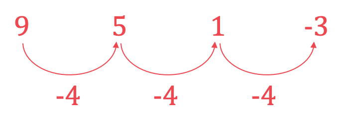
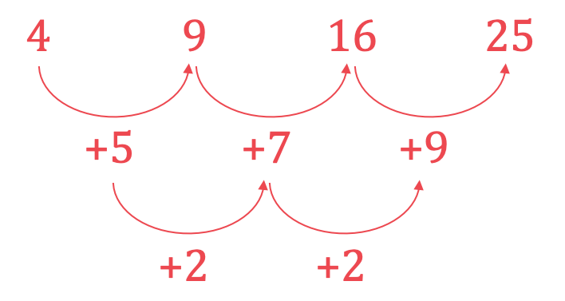
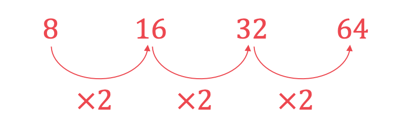
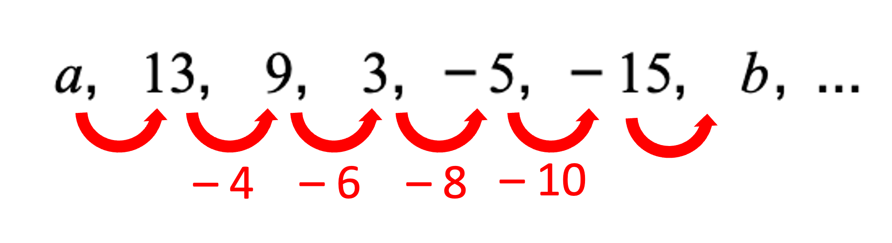
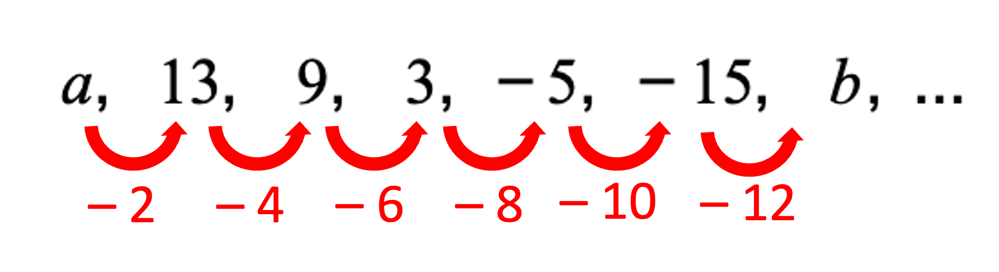

# Mark Schemes — Sequences
**Algebra & Sequences** · Cambridge (CIE) IGCSE maths (0580 & 0980)

## Calculator Questions (16 questions)

### Q1
> *Calculate the difference*

$12-9=3\,17-12=5\,24-17=7\,35-33=9$

> *The difference of the difference is *$2$

> *The next difference will be *$9+2=11$

$33+11=44$

$44$

**[B1]**
**Method 1**

> *Since the difference of the difference is the same, the sequence is quadratic*

> *To find *$n^{th}$* term for a quadratic equation, use*

$an^{2}+bn+c$

**[M1]**

> *The difference of the difference is *$2a$*, therefore *

`table row cell 2 a end cell equals 2 row a equals 1 end table`

**[B1]**

> *Subtract the sequence *$n^{2}$* from the original sequence*

$9,12,17,24,33,...\,1,4,9,16,25,...\,---------\,8,8,8,8,8,...$

> *This means that the original sequence is 8 more than the sequence *$n^{2}$

$n^{2}+8$

**[A1]**

**Method 2**

> *Since the difference of the difference is the same, the sequence is quadratic*

> *To find *$n^{th}$* term for a quadratic equation, use*

$an^{2}+bn+c$

**[M1]**

> *The difference of the difference is *$2a$*, therefore *

`table row cell 2 a end cell equals 2 row a equals 1 end table`

**[B1]**

$n^{2}+bn+c$

> *Use any two terms to form simultaneous equations to find *$b$* and *$c$

- *For *$n=1$* the term is 9*
- *For *$n=2$* the term is 12*

`table row 9 equals cell 1 plus b plus c end cell row 12 equals cell 4 plus 2 b plus c end cell end table`

$8=b+c\,8=2b+c$

> *Subtract the two equations*

`open parentheses 8 minus 8 close parentheses equals open parentheses 2 b minus b close parentheses plus open parentheses c minus c close parentheses
0 equals b`

> *Substitute *$b$* into any equation*

$8=0+c\,8=c$

> *Therefore the *$n^{th}$* term becomes*

$n^{2}+8$

**[A1]**

### Q2
> *Sequence 1:*

*9, 5, 1, -3, ...*

> *Look at the differences between the terms.*

> *The 1st difference between the terms is constant so it is a linear sequence.*

> *Calculate the next term in the sequence by adding the common difference to the last term.*

`negative 3 plus open parentheses negative 4 close parentheses equals negative 7`

**[1]**

> *The common difference means that the sequence is related to the 4 times table and is a decreasing sequence.*

$-4n$

> *Find the 0th term by subtracting the common difference from the first term*

`9 minus open parentheses negative 4 close parentheses equals 13`

> *Put these together to form the nth term rule.*

| 9 | 5 | 1 | -3 | **Final answer:** **-7** |   | $13-4n$ |
|---|---|---|---|---|---|---|

**13 correct [1]**
 $-4n$** correct [1]**

> *Sequence 2:*

*4, 9, 16, 25, ...*

> *Look at the differences between the terms.*

> *The 2nd differences are constant so it is a quadratic sequence.*

> *The 1st difference increases by 2 each time so work out the next term in the sequence by adding 11 to the last term*

$25+11=36$

**[1]**

> *Because it is a quadratic, the nth term rule will have the form: *$an^{2}+bn+c$*.*

> *Method 1:*

> *The 2nd difference is equal to *$2a$*.*

`table row cell 2 a end cell equals 2 row a equals 1 end table`

> *Substitute *$a=1$* and the value of the 1st term of the sequence in to the general form of the quadratic.*

`table attributes columnalign right center left columnspacing 0px end attributes row cell 1 open parentheses 1 close parentheses squared plus b open parentheses 1 close parentheses plus c end cell equals 4 row cell 1 plus b plus c end cell equals 4 end table`

> *Substitute *$a=1$* and the value of the 2nd term of the sequence in to the general form of the quadratic.*

`table attributes columnalign right center left columnspacing 0px end attributes row cell 1 open parentheses 2 close parentheses squared plus b open parentheses 2 close parentheses plus c end cell equals 9 row cell 4 plus 2 b plus c end cell equals 9 end table`

> *Subtract the first equation from the second and solve for *$b$*.*

`stack attributes charalign center stackalign right end attributes row table attributes columnalign right center left columnspacing 0px end attributes row blank blank 4 end table table attributes columnalign right center left columnspacing 0px end attributes row blank blank plus end table table attributes columnalign right center left columnspacing 0px end attributes row blank blank 2 end table table attributes columnalign right center left columnspacing 0px end attributes row blank blank b end table table attributes columnalign right center left columnspacing 0px end attributes row blank blank plus end table table attributes columnalign right center left columnspacing 0px end attributes row blank blank c end table table attributes columnalign right center left columnspacing 0px end attributes row blank equals blank end table table attributes columnalign right center left columnspacing 0px end attributes row blank blank 9 end table end row row minus none none none 1 plus b plus c equals 4 end row horizontal line row 3 plus b equals 5 end row end stack`

> *                           *`table attributes columnalign right center left columnspacing 0px end attributes row b equals 2 end table`

> *Substitute *$a=2$* and *$b=2$* into either of the equations to find *$c$*.*

`table row cell 1 plus 2 plus c end cell equals 4 row c equals 1 end table`

> *Put the values of *$a,b$* and *`table row blank blank c end table`* back into the general form of the quadratic.*

$n^{2}+2n+1$

| 4 | 9 | 16 | 25 | **Final answer:** **36** |   | $n^{2}+2n+1$ |
|---|---|---|---|---|---|---|

**Any quadratic [1]** 
**Correct quadratic [1]**

**Any equivalent quadratic expression will be accepted.**

> *Method 2:*

> *Notice that the sequence is a pattern of square numbers, but each number is the square of the next term's position.*

*1st term: 4 (4 is 2**2**) *
*2nd term: 9 (4 is 3**2**) *
*3rd term: 16 (4 is 4*2*)...*

> *Write down an algebraic expression that is the square of the next term's position.*

`open parentheses n plus 1 close parentheses squared`

| 4 | 9 | 16 | 25 | **Final answer:** **36** |   | $(n+1)^{2}$ |
|---|---|---|---|---|---|---|

**Any quadratic [1] **
**Correct quadratic [1]**

**This expression is the factorised equivalent of the expression for the nth term rule found using method 1.**

> *Sequence 3:*

> *Notice that the sequence is the cubed numbers.*

*1st term: 1 = 1**3** *
*2nd term: 8 = 2**3** *
*3rd term: 27 = 3**3**...*

> *Write down the next cubed number in the sequence.*

*125*

**[1]**

> *Write down an algebraic expression that is a cubed number.*

$n^{3}$

| 1 | 8 | 27 | 64 | **Final answer:** **125** |   | $n^{3}$ |
|---|---|---|---|---|---|---|

**[1]**

> *Sequence 4:*

> *Notice that each term is double that of the term before.*

> *Double the last term in the sequence to find the next term.*

$64\times2=128$

**[1]**

*A sequence that has a common ratio is an exponential sequence.* *This sequence is closely linked to the sequence *$2^{n}$*.*

$2^{1}=2\,2^{2}=4\,2^{3}=8...$

> *The sequence that we want starts from 2 terms later than that sequence so add 2 to the term position.*

$2^{n+2}\,2^{1+2}=2^{3}=8\,2^{2+2}=2^{4}=16\,2^{2+3}=2^{5}=32...$

| 8 | 16 | 32 | 64 | **Final answer:** **128** | **Final answer:** ** ** | $2^{n+2}$ |
|---|---|---|---|---|---|---|

$2^{k}$** for any value of **$k$** ****[1]**
 $2^{n+2}$** [2]**

### Q3
> *1st sequence: Add the two previous terms to work out the next term.*

$2461016$

**[1]**

> *2nd and 3rd sequences: Use trial and improvement to find the missing terms.*

$134711$

**[1]**

$2-1101$

**[1]**

### Q4
> *Each term is multiplied by 5 to get to the next term.*

*This sequence is the powers of *$5$* starting from *$5^{0}$*.*

**[1]**

> *The power of the first term is one less than its position in the sequence.*

*The power will be *$n-1$*.*

$5^{n-1}$ **[1]**

### Q5
> *Number of white dots: These make up a white square each time with the number of dots in each row and column equal to the term of the sequence, so the sequence is made up of the square numbers.*

*5**2** = 25 *
*6**2** = 36*

> *Number of black dots: These make up a black triangle each time with the number of dots increasing by adding a new row with an extra dot each time. *

*6 + 4 = 10 *
*10 + 5 = 15*

> *Total number of dots: Add the number of white dots to the number of black dots for each term.*

*25 + 10 = 35*
*36 + 15 = 51*

| Diagram | 1 | 2 | 3 | 4 | 5 | 6 |
|---|---|---|---|---|---|---|
| Number of white dots | 1 | 4 | 9 | 16 | **Final answer:** **25** | **Final answer:** **36** |
| Number of black dots | 0 | 1 | 3 | 6 | **Final answer:** **10** | **Final answer:** **15** |
| Total number of dots | 1 | 5 | 12 | 22 | **Final answer:** **35** | **Final answer:** **51** |

**3, 4 or 5 correct answers**** [1] **
**All correct ****[1]**
> *Number of white dots: These are the square numbers.*

*1**2** = 1 *
*2**2** = 4 *
*3**2** = 9*

$n^{2}$* ***[1]**
i) *Substitute **n **= 8 into the expression for diagram **n**.*

`1 half open parentheses 3 open parentheses 8 close parentheses to the power of 2 space end exponent minus space 8 close parentheses space equals space 1 half open parentheses 3 open parentheses 64 close parentheses space minus space 8 close parentheses space equals space 1 half open parentheses 184 close parentheses space`

**92**** [1]**

ii) *The number of black dots is the total number of dots minus the number of white dots.*

> * *`1 half open parentheses 3 n to the power of 2 space end exponent minus space n close parentheses space minus space n squared`

**[1]**

> *Expand the brackets and simplify.*

> * *`table row blank blank cell 3 over 2 n to the power of 2 space end exponent minus n over 2 space minus space n squared end cell row blank equals cell 1 half n to the power of 2 space end exponent minus n over 2 end cell end table`

$\frac{1}{2}(n^{2}-n)$* ***[1]**
> *The values of **a **and **b** can be found by substituting terms in from the table and solving the equations.   *
*Substitute the terms in from diagram 1 (**n **= 1, **T **= 1), call this equation (1). *

`table row cell n space end cell equals cell space 1 comma space T space equals space 1 end cell row cell 1 space end cell equals cell space a open parentheses 1 close parentheses to the power of 3 space end exponent plus space b open parentheses 1 close parentheses squared end cell row cell 1 space end cell equals cell space a space plus space b end cell end table`

**[1]**

> *Substitute the terms in from diagram 2 (**n **= 2, **T **= 1 + 5 = 6), call this equation (2). *

`table row cell n space end cell equals cell space 2 comma space T space equals space 6 end cell row cell 6 space end cell equals cell space a open parentheses 2 close parentheses to the power of 3 space end exponent plus space b open parentheses 2 close parentheses squared end cell row cell 6 space end cell equals cell space 8 a space plus space 4 b end cell end table`

**[1]**

> *Simplify the second equation by dividing by the common factor.*

`table row cell 3 space end cell equals cell space 4 a space plus space 2 b end cell end table`

> *Write the two equations out next to each other and number them clearly.*

> `table row cell a space plus space b space end cell equals cell space 1 space space space space space space space space space space open parentheses 1 close parentheses end cell row cell 4 a space plus space 2 b space end cell equals cell space 3 space space space space space space space space space space open parentheses 2 close parentheses end cell end table`*  *

> *Make the *$b$* terms equal by multiplying all parts of equation (1) by 2.*

`table row cell 2 a space plus space 2 b space end cell equals cell space 2 space space space space space space space space space space open parentheses 3 close parentheses end cell row cell 4 a space plus space 2 b space end cell equals cell space 3 space space space space space space space space space space open parentheses 2 close parentheses end cell end table`

> *Eliminate the *$b$* terms by subtracting equation (3) from equation (2). Be careful to subtract every term.*

`4 a space plus space 2 b space equals space 3 space space space space space space space space space space open parentheses 2 close parentheses
bottom enclose negative space space open parentheses 2 a space plus space 2 b space equals space 2 close parentheses end enclose space space space space space space space space space open parentheses 3 close parentheses
2 a space space space space space space space space space space space space equals space 1 space space space space space space space space space space space space space space space space`

**[1]**

> *Solve the equation to find** *$a$*  **by dividing both sides by 2.*

`table row cell a space end cell equals cell 1 half space end cell end table`

**[1]**

> *Substitute *$a=\frac{1}{2}$* into either of the two original equations**.*

`table row cell open parentheses 1 close parentheses space space space space space a space plus space b space end cell equals cell space 1 space end cell row cell open parentheses 1 half close parentheses space plus space b space end cell equals cell space 1 end cell end table`

> *Solve this equation to find** *$b$*.*

`table row cell b space end cell equals cell space 1 space minus space 1 half end cell row blank equals cell 1 half end cell end table`

$a=\frac{1}{2},b=\frac{1}{2}$* ***[1]**

### Q6
*The numerator is always 1.* 
*The denominator is the 2 times table, *$2n$*.*

$\frac{1}{2n}$ **[1]**

### Q7
> *Sequence **A**:*

> *The numbers go up by 5 each time so the rule is add 5.*

*The 5th term is 19 + 5 = 24*

**[1]**

> *The rule is add 5 so the **n**th term is 5**n **+** k**, where **k **is some constant to be found.*

$5n+k$

**[1]**

> *Find **k  **by considering the difference between sequence **A** and the sequence 5**n.*

$5n=5,10,15,20,...$* *
*1st term: 4 - (5) = -1, so ***k ***= -1*

*The ***n***th term for sequence ***A*** is  *$5n-1$

**[1]**

> *Sequence **B**:*

> *The numbers go up by a different amount each time so this is not a linear sequence.*

> *Identify a similar sequence. *
*The first two terms in this sequence could be similar to the **n**2 **pattern, however this does not fit the third term, so consider **n**3**.*

$n^{3}=1,8,27,64,...$

**[1]**

> *Find the **n**th term** **by considering the difference between sequence **B** and the sequence **n**3**. *
*Each term in sequence B is 2 more than the terms in the sequence **n**3**.*

$n^{3}+2=3,10,29,66...$

**[1]**

> *Find the 5th term** **by substituting **n **= 5 into the **n**th term **n**3 **+ 2. *

`open parentheses 5 close parentheses cubed space plus space 2 space equals space 125 space plus space 2 space equals space 127`

**[1]**

> *Sequence **C**:*

$8,16,32,64$

> *Each term is multiplied by 4 to get the next term so the **n**th term is 4**k**.*
* 4**0 **= 1 = 4**1 - 1** *
*4**1 **= 4 = 4**2 - 1** *
*4**2 **= 16 = 4**3 - 1 *
*4**3 **= 64 = 4**4 - 1*

*The ***n***th term is *`4 to the power of open parentheses n minus 1 close parentheses end exponent`

**  ****1 mark for 4****k****, 1 mark for 4****(n - 1)****  ****[2]**

> *Find the 5th term for sequence **C** by substituting 5 into the **n**th term, or by continuing the sequence and multiplying 64 by 4.*

`4 to the power of open parentheses 5 space minus space 1 close parentheses space end exponent equals space 4 to the power of 4 space equals space 256`

** [1]**

| Sequence | 1st term | 2nd term | 3rd term | 4th term | 5th term |   | $n$th term |
|---|---|---|---|---|---|---|---|
| *A* | 4 | 9 | 14 | 19 | **Final answer:** **24** |   | $5n-1$ |
| *B* | 3 | 10 | 29 | 66 | **Final answer:** **127** |   | $n^{3}+2$ |
| *C* | 1 | 4 | 16 | 64 | **Final answer:** **256** |   | $4^{(n-1)}$ |

### Q8
*Method 1 *
*The term-to-term rule is to multiply by 2.* 
*Therefore rewrite the sequence in terms of multiplying by 2. It may help to put the terms into a table*

| $n$ | $1$ | $2$ | $3$ | $4$ |
|---|---|---|---|---|
| *term* | $3$ | $6$ | $12$ | $24$ |
| *term* | $3$ | $3\times2$ | $3\times2\times2$ | $3\times2\times2\times2$ |

* *

> *We can add a row to the table, rewriting multiplications of 2 as powers of 2:*

| $n$ | $1$ | $2$ | $3$ | $4$ |
|---|---|---|---|---|
| *term* | $3$ | $6$ | $12$ | $24$ |
| *term* | $3$ | $3\times2$ | $3\times2\times2$ | $3\times2\times2\times2$ |
| *term* | $3\times2^{0}$ | $3\times2^{1}$ | $3\times2^{2}$ | $3\times2^{3}$ |

**[1]**

> *Now we can add a final column, connecting *$n$* to the term*

| $n$ | $1$ | $2$ | $3$ | $4$ | $n$ |
|---|---|---|---|---|---|
| *term* | $3$ | $6$ | $12$ | $24$ |   |
| *term* | $3$ | $3\times2$ | $3\times2\times2$ | $3\times2\times2\times2$ |   |
| *term* | $3\times2^{0}$ | $3\times2^{1}$ | $3\times2^{2}$ | $3\times2^{3}$ | $3\times2^{n-1}$ |

$3\times2^{n-1}$* ***[1]**

*Method 2 *
*The term-to-term rule is to multiply by 2.* 
*Therefore it is an exponential sequence, *$n$*th term = *$a\timesb^{n}$* where *$b$*is 2*

$n$*th term = *$a\times2^{n}$

**[1]**

> *To find *$a$*, choose a term (usually the first term) and substitute it into the above formula together with *$n$* (if we choose the first term, *$n=1$*)*

$3=a\times2^{1}\,3=2a\,a=1.5$

> *Our *$n$*th term is now *$1.5\times2^{n}$*. We can check this by choosing another term. For example we know that for the third term is 12, when *$n=3$*.*

$1.5\times2^{3}=1.5\times8=12$

> *We can be confident that the *$n$*th term is correct.*

$1.5\times2^{n}$* ***[1]**

**Note that this answer could be rearranged to the answer given from Method 1**

### Q9
i) *This sequence is a linear sequence, because it changes by the same amount each time* *The formula for the **n**th term of a linear sequence is ** *

**an + b***  *

> *a** is the common difference (the amount the sequence goes up by each time) ** *

**a ***= -2** ** *

> *b** is the term before the first term shown (think about going backwards) *

**b ***= -1 - (-2) = 1*

**either ****a = -2**** or ****b = 1 ****[1]** 
**n****th term =**** -****2****n ****+ 1**** ****[1]**

ii) *This sequence is one more than the cube numbers 1, 8, 27, 64, 125, ... (from 1**3**, 2**3**, 3**3**, 4**3**, 5**3**, ...)*

*Write down the **n**th term formula for cube numbers (draw a table if it helps)* * *

| **n** | *1* | *2* | *3* | *...* | **n** |
|---|---|---|---|---|---|
| *term* | *1**3* | *2**3* | *3**3* | *....* | **n***3* |

*nth term = ***n***3*

**[1]**

> *Find the formula for the **n**th term of 1**3**+1, 2**3** +1, 3**3**+1, 4**3**+1, ... (by adding 1 to **n**3**)*

$n^{3}+1$** [1]**

### Q10
> *Each term is two less than the one before so the rule is subtract 2. *

*  *$-1-2=-3$* *

**The next term is -3**** ****[1]**

### Q11
> *The difference between each term is constant so it is a linear sequence of the form *$n^{\mathrm{th}}\mathrm{term}=an+b$*. *
*Be careful, the sequence is **decreasing** so the difference will be **negative.*

*Difference between each term is -2, so *$a=-2$ 
$b$* would be the "*$0^{\mathrm{th}}$* term", so *$b=4+2=6$

**[1]**

*So the *$n^{\mathrm{th}}\mathrm{term}=-2n+6$

$6-2n$** ****[1]**
> *The second difference between each term is constant so it is a quadratic sequence of the form *$n^{\mathrm{th}}\mathrm{term}=an^{2}+bn+c$*.*

*First differences are 6, 10, 14, 18, ...** *
*Second difference is 4*

** [1]**

*Therefore, *$2a=4,a=2$* *
*The first, first difference is 6** *
*so *$3a+b=6,b=0$* *
*The first term is 1** *
*so *$a+b+c=1,c=-1$

$2n^{2}-1$* ***[1]**

### Q12
> *Examine the sequence by writing down the difference between each term as below*

> *We can see that the difference is increased by −2 each time, so complete the pattern as below*

> *To find *$b$*, subtract a further 12 from −15*

$b=-15-12$

$b=-27$* ***[1]**

> *To find *$a$* we need to "undo" the −2. So add 2 to 13*

`table row cell a minus 2 end cell equals 13 row a equals cell 13 plus 2 end cell end table`

$a=15$** [1]**

### Q13
i) *Substitute *$n=2$* into the formula for the **n**th term.*

`4 open parentheses 2 close parentheses squared plus 2 plus 3`

**The 2nd term is 21** **[1]**

ii) *Make the formula for the **n**th term equal to 498.*

$4n^{2}+n+3=498$

**[1]**

> *Subtract 498 from both sides to make a quadratic equation that equals zero.*

$4n^{2}+n-495=0$

> *The quadratic formula for *$an^{2}+bn+c=0$* is *$n=\frac{-b\pm\sqrt{b^{2}-4ac}}{2a}.$

> *Identify the values for **a, b, c**.*

$a=4,b=1,c=-495$

> *Substitute the values into the formula. Put brackets around negative values.*

`n equals fraction numerator negative left parenthesis 1 right parenthesis plus-or-minus square root of open parentheses 1 close parentheses squared minus 4 left parenthesis 4 right parenthesis left parenthesis negative 495 right parenthesis end root over denominator 2 left parenthesis 4 right parenthesis end fraction`

**[1]**

> *Use calculator to find the values.*

$n=11\mathrm{or}n=-11.25$

> *As **n** represents the position of a term in a sequence, it needs to be a positive integer.*

$n=11$ **[1]**
** Any correct method for solving a quadratic equation is acceptable**

### Q14
> *For sequence **A**, spot that the terms are just square numbers. The next square number after 16 is 25.*

> *For sequence **B**, the terms are increasing by 1 each time. Add 1 on to 5th term to get the 6th term.*

> *For sequence **C**, look at the differences between the terms: 0, 2, 4, 6. The differences are going up in 2s. So the next difference will be 8. Add 8 on to the 5th term to get the 6th term.*

| Sequence | 1st term | 2nd term | 3rd term | 4th term | 5th term | 6th term |
|---|---|---|---|---|---|---|
| *A* | 0 | 1 | 4 | 9 | 16 | **Final answer:** **25** |
| *B* | 4 | *4 + 1 =* 5 | *5 + 1 =* 6 | *6 + 1 =* 7 | *7 + 1 =*8 | *8 + 1 =* **9** |
| *C* | -4 | *-4 + 0 =* -4 | *-4 + 2 =* -2 | *-2 + 4 =* 2 | *2 + 6 =* 8 | *8 + 8 =* **16** |

**1 mark for each**** [1]**
i) *Write each square number as a power.*

| Sequence | 1st term | 2nd term | 3rd term | 4th term | 5th term | 6th term |
|---|---|---|---|---|---|---|
| $n$ | *1* | *2* | *3* | *4* | *5* | *6* |
| *A* | *0**2* | *1**2* | *2**2* | *3**2* | *4**2* | *5**2* |

> *Compare the value of **n** with the base number of the power. The base number is one less than the value of **n**. So the **n**th term will have a base number of **n** - 1.*

$(n-1)^{2}$** **
**Writing a quadratic expression**** [1] **
**Correct expression**** [1] **
**Expanding is acceptable: **$n^{2}-2n+1$

ii) *Write the value of **n** for each term.*

| Sequence | 1st term | 2nd term | 3rd term | 4th term | 5th term | 6th term |
|---|---|---|---|---|---|---|
| $n$ | *1* | *2* | *3* | *4* | *5* | *6* |
| *B* | 4 | 5 | 6 | 7 | 8 | 9 |

> *Compare the value of **n** with the term. Each term is 3 more than the value of **n**.*

$n+3$** [1]**
> *Set the expression for the **n**th term equal to 576.*

`open parentheses n minus 1 close parentheses squared equals 576`

**[1]**

> *Square root both sides. Ignore the negative root as **n** can only be a positive integer as it represents the position of a term in a sequence.*

$n-1=\sqrt{576}\,n-1=24$

> *Add 1 to both sides.*

$n=24+1$

$n=25$ **[1]**
i) *Compare the terms between the 3 sequences. Notice that the terms in sequence **C **are found by subtracting the terms in sequence **B **from the terms in sequence **A**.*

| Sequence | 1st term | 2nd term | 3rd term | 4th term | 5th term | 6th term |
|---|---|---|---|---|---|---|
| *A* | 0 | 1 | 4 | 9 | 16 | 25 |
| *B* | 4 | 5 | 6 | 7 | 8 | 9 |
| *C* | *0 - 4 =* -4 | *1 - 5 =* -4 | *4 - 6 =* -2 | *9 - 7 =* 2 | *16 - 8 =* 8 | *25 - 9 =* 16 |

> *Therefore the **n**th term for sequence **C** can be found by subtracting the **n**th term for sequence **B **from the **n**th term for sequence **A**.*

`open parentheses n minus 1 close parentheses squared minus open parentheses n plus 3 close parentheses`

**[1]**

> *Expand by using *`open parentheses n minus 1 close parentheses open parentheses n minus 1 close parentheses`*.*

$n^{2}-n-n+1-n-3$

**[1]**

> *Simplify by collecting like terms.*

$n^{2}-3n-2$** ****[1]**

ii) *n** = 30 for the 30th term. Substitute this into the expression for the **n**th term.*

`open parentheses 30 close parentheses squared minus 3 open parentheses 30 close parentheses minus 2`

**[1]**

**30th term is 808** **[1]**

### Q15
> *i) In this sequence, each term is the sum of the previous two terms, e.g. 1+1=2, and 1+2=3, and 2+3=5*

*5 + 8 = 13*

**13** **[1]**

> *ii) In this sequence, each term is twice the term before it*

*64 × 2 = 128*

**128** **[1]**

### Q16
> *i) *$n$* represents the term number, e.g. the first term is when *$n = 1$* and the second term is when *$n = 2$* and so on*

*First term: *`\left(1\right)^{2} - \left(1\right) + 11 = 11`

*Second term: *`\left(2\right)^{2} - \left(2\right) + 11 = 13`

*Third term: *`\left(3\right)^{2} - \left(3\right) + 11 = 17`

**2 correct**** [1]**

**11, 13, 17** **[1]**

> *ii) So far, 11, 13, 17 are all prime numbers, so keep finding terms and checking each one*

*Fourth term: *`\left(4\right)^{2} - \left(4\right) + 11 = 23`*, prime*

*Fifth term: *`\left(5\right)^{2} - \left(5\right) + 11 = 31`*, prime*

**At least 2 more terms correctly found** **[1]**

> *The terms after this, 41, 53, 67, 83 and 101, are also prime, so testing one term at a time is slow. Instead, look for a term number that makes the whole expression a multiple of 11*

> *The number added at the end is 11, so if the term number *$n$* is also a multiple of 11, then *$n^{2}$* and *$n$* are multiples of 11 too. That makes every part of the expression a multiple of 11*

*Eleventh term: *`\left(11\right)^{2} - \left(11\right) + 11 = 121`

$121 = 11 \times 11$*, so 121 has a factor other than 1 and itself*

**The eleventh term is 121, which is not prime** **[1]**

**Any term number which is a multiple of 11, i.e. **$n = 11 ,  22 ,  33 ,  \dots$** will also not produce a prime number**
