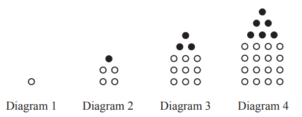

# Exam Questions — Sequences
**Algebra & Sequences** · Cambridge (CIE) IGCSE maths (0580 & 0980)
> Source: [https://www.savemyexams.com/igcse/maths/cie/25/extended/topic-questions/](https://www.savemyexams.com/igcse/maths/cie/25/extended/topic-questions/) · 16 questions across 1 sets

## Calculator Questions (16 questions)

### Q1 — medium — 4 marks

**Q1** [1 mark]

$912172433$

Write down the next term in the sequence.

**Q1** [3 marks]

Find the $n^{\mathrm{th}}$ term of the sequence.

### Q2 — hard — 11 marks

**Q2** [11 marks]

Complete the table for the 5th term and the nth term of each sequence.

| 1st term | 2nd term | 3rd term | 4th term | 5th term |   | $n$th term |
|---|---|---|---|---|---|---|
| 9 | 5 | 1 | -3 |   |   |   |
| 4 | 9 | 16 | 25 |   |   |   |
| 1 | 8 | 27 | 64 |   |   |   |
| 8 | 16 | 32 | 64 |   |   |   |

*Source: 2019	Oct/Nov 0580/41 Q10A*

### Q3 — hard — 3 marks

**Q3** [3 marks]

0,   1,   1,   2,   3,   5,   8,   13,   21  ,   ...

This sequence is a Fibonacci sequence. After the first two terms, the rule to find the next term is “add the two previous terms”. For example, 5 + 8 = 13.

Use this rule to complete each of the following Fibonacci sequences.

$24........................\,\,1........................11\,\,........-1................1$

*Source: 2019	Oct/Nov 0580/41 Q10B*

### Q4 — hard — 2 marks

**Q4** [2 marks]

Find the $n$th term of the sequence below.

$1,5,25,125,625,...$

*Source: 2019	Oct/Nov 0580/23 Q14B*

### Q5 — very_hard — 11 marks

**Q5** [2 marks]

These are the first four diagrams of a sequence. 
The diagrams are made from white dots and black dots.

Complete the table for Diagram 5 and Diagram 6.

| Diagram | 1 | 2 | 3 | 4 | 5 | 6 |
|---|---|---|---|---|---|---|
| Number of white dots | 1 | 4 | 9 | 16 |   |   |
| Number of black dots | 0 | 1 | 3 | 6 |   |   |
| Total number of dots | 1 | 5 | 12 | 22 |   |   |

*Source: 2020 Oct/Nov 0580/41 Q7A*

**Q5** [1 mark]

**Extract:**

| Diagram | 1 | 2 | 3 | 4 | 5 | 6 |
| Number of white dots | 1 | 4 | 9 | 16 |   |   |

Write an expression, in terms of $n$, for the number of white dots in Diagram $n.$

*Source: 2020 Oct/Nov 0580/41 Q7B*

**Q5** [3 marks]

**Extract:**

| Diagram | 1 | 2 | 3 | 4 | 5 | 6 |
| Number of white dots | 1 | 4 | 9 | 16 |   |   |
| Number of black dots | 0 | 1 | 3 | 6 |   |   |
| Total number of dots | 1 | 5 | 12 | 22 |   |   |

Write an expression, in terms of n, for the number of white dots in Diagram n.

The expression for the total number of dots in Diagram $n$ is  $1 \frac{1}{2} ( 3 n^{2} - n )$.

i) Find the total number of dots in Diagram 8.

[1]

ii) Find an expression for the number of black dots in Diagram $n.$ Give your answer in its simplest form.

[2]

*Source: 2020 Oct/Nov 0580/41 Q7C*

**Q5** [5 marks]

**Extract:**

| Diagram | 1 | 2 | 3 | 4 | 5 | 6 |
| Number of white dots | 1 | 4 | 9 | 16 |   |   |
| Number of black dots | 0 | 1 | 3 | 6 |   |   |
| Total number of dots | 1 | 5 | 12 | 22 |   |   |

The expression for the total number of dots in Diagram n is 1/2 (3n^2 − n).

$T$is the total number of dots used to make **all** of the first  $n$ diagrams.

$T=an^{3}+bn^{2}$

Find the value of $a$ and the value of $b$. You must show all your working.

$a=$ ................................................

$b=$................................................

*Source: 2020 Oct/Nov 0580/41 Q7D*

### Q6 — medium — 1 marks

**Q6** [1 mark]

Find the $n$th term of the sequence below.

$\frac{1}{2},\frac{1}{4},\frac{1}{6},\frac{1}{8},\frac{1}{10},...$

*Source: 2019	Oct/Nov 0580/23 Q14A*

### Q7 — very_hard — 9 marks

**Q7** [9 marks]

The table shows the first four terms in sequences *A*, *B*, and *C*.

| Sequence | 1st term | 2nd term | 3rd term | 4th term | 5th term |   | $n$th term |
|---|---|---|---|---|---|---|---|
| *A* | 4 | 9 | 14 | 19 |   |   |   |
| *B* | 3 | 10 | 29 | 66 |   |   |   |
| *C* | 1 | 4 | 16 | 64 |   |   |   |

Complete the table.

*Source: 2020 Oct/Nov 0580/43 Q11*

### Q8 — hard — 2 marks

**Q8** [2 marks]

Find the $n$th term of the sequence below.

$3,6,12,24,...$

*Source: 2018	May/June 0580/23 Q22B*

### Q9 — hard — 4 marks

**Q9** [4 marks]

Find the $n$th term of each sequence.

i)$-1,-3,-5,-7,-9,...$

[2]

ii) $2,9,28,65,126,...$

[2]

*Source: 2018	Oct/Nov 0580/43 Q10B*

### Q10 — easy — 1 marks

**Q10** [1 mark]

Here is a sequence of numbers.

7,   5,   3,   1,   – 1, …

Find the next term in this sequence.

*Source: 2020 Specimen 0580/02 Q15A*

### Q11 — hard — 4 marks

**Q11** [2 marks]

Find the $n$th term of each sequence.

4        2        0        -2        -4        ...

*Source: 2020 March 0580/42 Q7C*

**Q11** [2 marks]

1        7        17        31        49        ...

*Source: 2020 March 0580/42 Q7C*

### Q12 — medium — 2 marks

**Q12** [2 marks]

Here is a sequence.

$a,13,9,3,-5,-15,b,...$

Find the value of $a$ and the value of $b$.

$a=$...........................................  
$b=$...........................................

*Source: 2018	May/June 0580/22 Q3*

### Q13 — medium — 4 marks

**Q13** [4 marks]

The $n$th term of a sequence is $4n^{2}+n+3.$

i) Find the 2nd term.

[1]

ii) Find the value of $n$ when the $n$th term is 498.

$n=$.................................................. [3]

*Source: 2019 March 0580/42 Q11B*

### Q14 — very_hard — 13 marks

**Q14** [3 marks]

The table shows the first five terms of sequences *A*, *B* and *C*.

| Sequence | 1st term | 2nd term | 3rd term | 4th term | 5th term | 6th term |
|---|---|---|---|---|---|---|
| *A* | 0 | 1 | 4 | 9 | 16 |   |
| *B* | 4 | 5 | 6 | 7 | 8 |   |
| *C* | -4 | -4 | -2 | 2 | 8 |   |

Complete the table.

*Source: 2018	Feb/Mar 0580/42 Q11A*

**Q14** [3 marks]

**Extract:**

| Sequence | 1st term | 2nd term | 3rd term | 4th term | 5th term | 6th term |
| *A* | 0 | 1 | 4 | 9 | 16 |   |
| *B* | 4 | 5 | 6 | 7 | 8 |   |

Find an expression for the $n$th term of

i) sequence *A*,

[2]

ii) sequence *B*.

[1]

*Source: 2018	Feb/Mar 0580/42 Q11B*

**Q14** [2 marks]

**Extract:**

Find an expression for the nth term of i) sequence A.

Find the value of $n$ when the $n$th term of sequence *A* is 576.

$n=$...............................................

*Source: 2018	Feb/Mar 0580/42 Q11C*

**Q14** [5 marks]

**Extract:**

| Sequence | 1st term | 2nd term | 3rd term | 4th term | 5th term | 6th term |
| *C* | -4 | -4 | -2 | 2 | 8 |   |

i) Find an expression for the $n$th term of sequence *C*. Give your answer in its simplest form.

[3]

ii) Find the value of the 30th term of sequence *C*.

[2]

*Source: 2018	Feb/Mar 0580/42 Q11D*

### Q15 — easy — 2 marks

**Q15** [2 marks]

Write the next term in each of these sequences.

i) 1    1    2    3    5    8

[1]

ii) 2    4    8    16    32    64

[1]

*Source: Nov 2017 J560/05 Q2A*

### Q16 — easy — 4 marks

**Q16** [4 marks]

This expression can be used to generate a sequence of numbers.

$n^{2}-n+11$

i) Work out the first three terms of this sequence.

[2]

ii) Show that this expression does not only generate prime numbers.

[2]

*Source: Specimen 2015 J560/06 Q3A*

