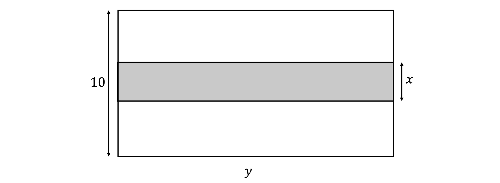
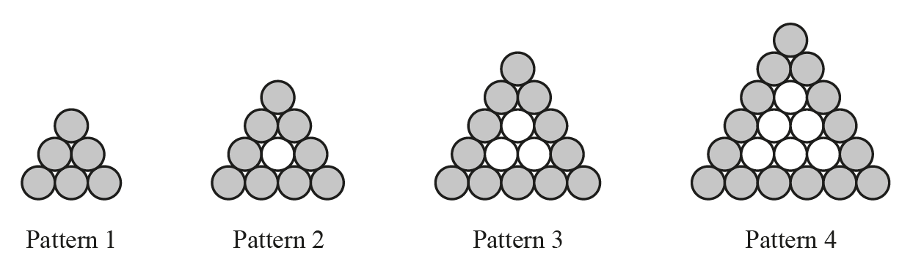

# Exam Questions — Simultaneous Equations
**Algebra & Sequences** · Cambridge (CIE) IGCSE maths (0580 & 0980)
> Source: [https://www.savemyexams.com/igcse/maths/cie/25/extended/topic-questions/](https://www.savemyexams.com/igcse/maths/cie/25/extended/topic-questions/) · 15 questions across 1 sets

## Calculator Questions (15 questions)

### Q1 — very_hard — 6 marks

**Q1** [6 marks]

The straight line $y=3x-1$ intersects the curve $y=x^{2}+x-5$ at the points $P$ and $Q$.

Find the coordinates of $P$ and $Q$.
Give your answers correct to 2 decimal places.

$P$ ( .................... , .................... )

$Q$ ( .................... , .................... )

### Q2 — hard — 6 marks

**Q2** [6 marks]

The diagram above represents a courtyard with a length of $y$ metres and a width of $10$ metres.

Mark is designing a rectangular path from one side to another, with a width of $x$metres.

The total area of the courtyard, excluding the path, is $116.30m^{2}$.

A wall is built around the courtyard, along both longer sides and both shorter sides except where the path cuts through. The total length of the wall is $45.52$ metres.

Set up and solve a pair of simultaneous equations to find the value of $x$ and the value of $y$.

Leave your answers to 2 decimal places.

### Q3 — hard — 6 marks

**Q3** [6 marks]

Solve the simultaneous equations. 
You must show all your working.

`table attributes columnalign right center left columnspacing 0px end attributes row x equals cell 7 minus 3 y end cell row cell x squared minus y squared end cell equals 39 end table`

$x=$ .................... $y=$ .................... 
$x=$ .................... $y=$ ....................

*Source: 2020 March 0580/22 Q16*

### Q4 — hard — 6 marks

**Q4** [6 marks]

Solve the simultaneous equations       $x^{2}+y^{2}=9\,x+y=2$

Give your answers correct to 2 decimal places.

*Source: June 2013 1MA0/2H Q25*

### Q5 — very_hard — 6 marks

**Q5** [6 marks]

The straight line $y=2x+1$ intersects the curve $y=x^{2}+3x--4$ at the points *A *and *B*.

Find the coordinates of *A* and *B*. 
Give your answers correct to 2 decimal places.

*A* ( .................... , .................... ) 
*B* ( .................... , .................... )

*Source: Specimen 2025 0580/04 Q24*

### Q6 — medium — 3 marks

**Q6** [3 marks]

Solve the simultaneous equations. You must show all your working.

$\frac{1}{2}x-3y=9\,5x+y=28$

*Source: 2018	May/June 0580/41 Q5C*

### Q7 — medium — 4 marks

**Q7** [4 marks]

Solve the simultaneous equations

`table row cell 7 x space – space 2 y space end cell equals cell space 34 space end cell row cell 3 x space plus space 5 y space end cell equals cell space minus 3 end cell end table`

Show clear algebraic working.

$x=$.............................................

$y=$.............................................

*Source: Nov 2020 4MA1/1H Q15*

### Q8 — very_hard — 7 marks

**Q8** [7 marks]

The graphs of `space y equals open parentheses x minus 1 close parentheses squared space` and $y=\frac{1}{2}x+1$ intersect at *A* and *B*.   Find the length of *AB*.

*AB* = ................................................

*Source: 2020 May/June 0580/42 Q9C*

### Q9 — very_hard — 6 marks

**Q9** [6 marks]

Solve the simultaneous equations. 
You must show all your working.

`table row y equals cell 4 minus x end cell row cell x squared plus 2 y squared end cell equals 67 end table`

$x=$.................... , $y=$....................  
$x=$.................... , $y=$....................

*Source: 2020 May/June 0580/43 Q4C*

### Q10 — very_hard — 6 marks

**Q10** [6 marks]

The straight line $y=3x+2$ intersects the curve $y=2x^{2}+7x-11$ at two points. 
Find the coordinates of these two points. 
Give your answers correct to 2 decimal places.

(....................... , .......................)

(....................... , .......................)

*Source: 2020 Oct/Nov 0580/43 Q9D*

### Q11 — hard — 4 marks

**Q11** [4 marks]

Solve the simultaneous equations. 
You must show all your working.

$2x+3y=-12\,5x+2y=14$

$x$ = ................................................  
$y$ = ................................................

*Source: 2018	Oct/Nov 0580/21 Q18*

### Q12 — hard — 5 marks

**Q12** [5 marks]

Solve the equations

$x^{2}+y^{2}=36$

$x=2y+6$

*Source: June 2014 1MA0/2H Q26*

### Q13 — very_hard — 6 marks

**Q13** [6 marks]

Marco is making patterns with grey and white circular mats.

The patterns form a sequence. Marco makes a table to show some information about the patterns.

| Pattern number | 1 | 2 | 3 | 4 |
|---|---|---|---|---|
| Number of grey mats | 6 | 9 | 12 | 15 |
| Total number of mats | 6 | 10 | 15 | 21 |

Marco needs a total of 6 mats to make the first pattern. 
He needs a total of 16 mats to make the first two patterns. 
He needs a total of $\frac{1}{6}n^{3}+an^{2}+bn$ mats to make the first $n$ patterns.

Find the value of $a$ and the value of $b$.

$a=$......................................... 
 $b=$.........................................

*Source: 2018	May/June 0580/41 Q12D*

### Q14 — medium — 3 marks

**Q14** [3 marks]

Solve the simultaneous equations

`table row cell 5 a space plus space 2 c space end cell equals cell space 10 space end cell row cell 2 a space – space 4 c space end cell equals cell space 7 end cell end table`

Show clear algebraic working.

$a=$ .......................................................      
  $c=$ .......................................................

*Source: June 2021 4MA1/2H Q8*

### Q15 — medium — 4 marks

**Q15** [4 marks]

Solve the simultaneous equations

`table row cell 2 x space plus space 7 y space end cell equals cell space 17 space end cell row cell 5 x space plus space 3 y space end cell equals cell space – 1 end cell end table`

Show clear algebraic working.

`table row cell x space end cell equals cell space.................................. end cell row cell y space end cell equals cell space.................................. space end cell end table`

*Source: Jan 2021 4MA1/2HR Q12*

