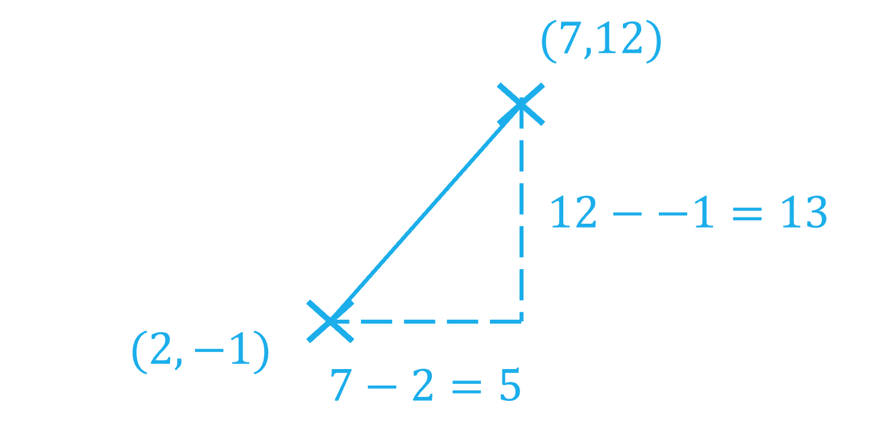
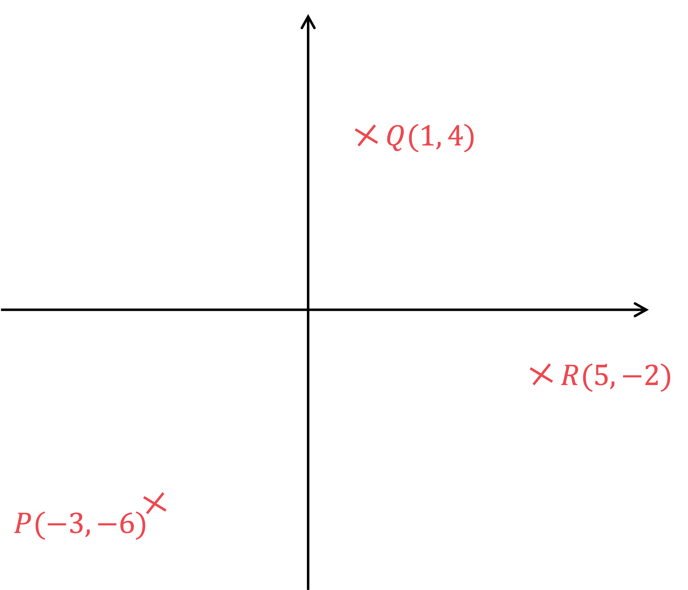
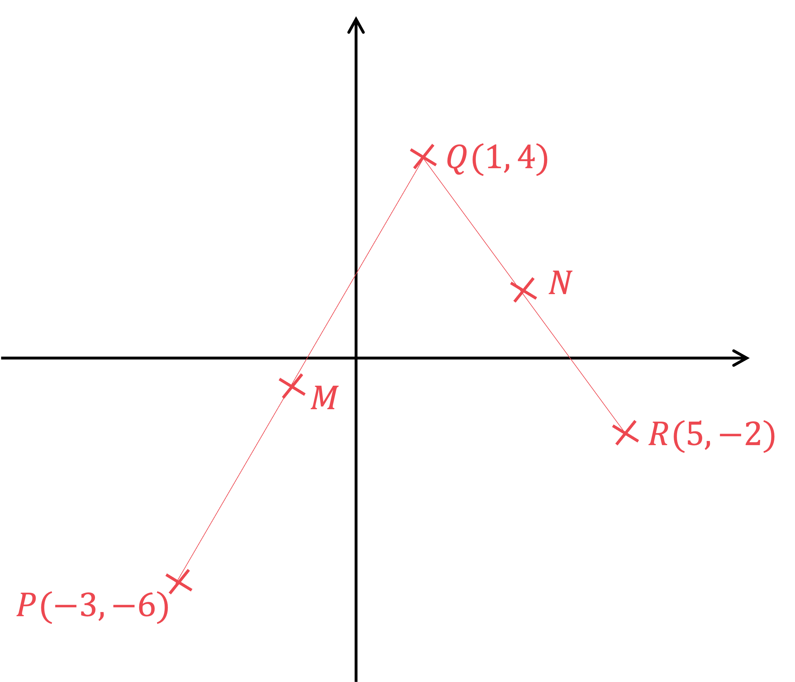
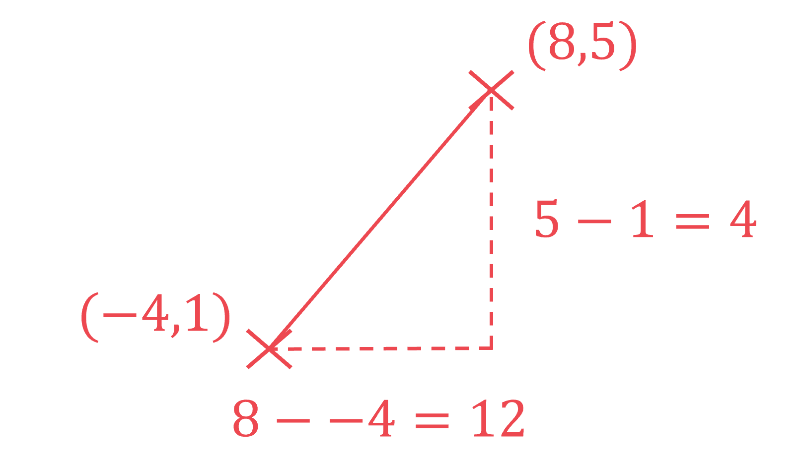

# Mark Schemes — Coordinate Geometry
**Coordinate Geometry & Graphs** · Cambridge (CIE) IGCSE maths (0580 & 0980)

## Calculator Questions (19 questions)

### Q1
> **[exam-tip]**
> The length of the line segment between two points $( x_{1} , y_{1} )$ and $( x_{2} , y_{2} )$ is given by
> 
> $\sqrt{( x_{2} - x_{1} )^{2} + ( y_{2} - y_{1} )^{2}}$
> 
> - This formula is not given to you in the exam
> 
>   - but it comes from Pythagoras' theorem

Use the formula with the coordinates of points $P$ and $Q$

$\sqrt{( - 1 - 3 )^{2} + ( 2 - 14 )^{2}}$

**[M1 M1]**

$=12.649110...$

Round to a sensible degree of accuracy

- In general you should round to 3 significant figures, unless a question says otherwise

**Final answer:** **12.6 (3 s.f.)**

**[A1]**

> **[mark-scheme]**
> **M1**: For $( - 1 - 3 )^{2} + ( 2 - 14 )^{2}$ or equivalent.
> 
> **M1**: For $\sqrt{( - 1 - 3 )^{2} + ( 2 - 14 )^{2}}$ or equivalent.
> 
> **A1**: For 12.6, or 12.64 to 12.65.
> **[exam-tip]**
> The gradient of the line segment between two points $( x_{1} , y_{1} )$ and $( x_{2} , y_{2} )$ is given by
> 
> $\mathrm{gradient}=\frac{\mathrm{rise}}{\mathrm{run}}=\frac{y_{2}-y_{1}}{x_{2}-x_{1}}$

Find the gradient of the line through $P$ and $Q$

- Use the gradient formula with the coordinates of points $P$ and $Q$

$\frac{2-14}{-1-3}=\frac{-12}{-4}=3$

**[M1]**

The gradients of perpendicular lines multiply together to give $-1$

- So if $m$ is the gradient of the line you are looking for, then

$m\times3=-1$

- Divide both sides by 3 to solve for $m$

$m=-\frac{1}{3}$

**[M1]**

You want the equation in the form $y=mx+c$

- Use $m=-\frac{1}{3}$, and the coordinates of the point $( - 6 , 7 )$

  - i.e. let $( x , y ) = ( - 6 , 7 )$

$7 = - 1 \frac{1}{3} ( - 6 ) + c$

**[M1]**

- Solve for $c$

$\begin{gathered} 7 = 2 + c \\ 7 - 2 & = c \\ 5 = c \end{gathered}$

Give the answer in the required form

$y=-\frac{1}{3}x+5$

**[A1]**

### Q2
> *Since the midpoint can be viewed as the average of two points*

> *For the **x**-values*

$\frac{-3+9}{2}\,\frac{6}{2}=3$

> *For the **y**-values*

$\frac{5+10}{2}\,\frac{15}{2}=7.5$

> *The coordinate of the midpoint are therefore*

$( 3 , 7.5 )$

**[B1 B1]**

> **[mark-scheme]**
> **B1**: For 3 as the $x$ coordinate.
> 
> **B1**: For 7.5 (or equivalent) as the $y$ coordinate.
> *Find the **x**-distance between the two points*

$9 - ( - 3 ) = 12$

> *Find the **y**-distance between the two points*

$10-5=5$

> *To find the distance between the two points, use Pythagoras' theorem*

$l^{2}=12^{2}+5^{2}\,l=\sqrt{144+25}$* *

**[M1]**

$13$

**[A1]**

### Q3
> *Find the points where the graphs intersect by forming an equation by making the expressions equal.*

$( x - 1 )^{2} = 1 \frac{1}{2} x + 1$

**[1]**

> *Expand and simplify the left hand side by expanding *$( x - 1 ) ( x - 1 ).$

$x^{2}-x-x+1=\frac{1}{2}x+1\,x^{2}-2x+1=\frac{1}{2}x+1$

**[1]**

> *Subtract 1 from both sides.*

$x^{2}-2x=\frac{1}{2}x$

> *Subtract *$\frac{1}{2}x$* from both sides.*

$\begin{array}{rcl} x^{2} - 2 x - 1 \frac{1}{2} x & = 0 \\ x^{2} - \frac{5}{2} x & = 0 \end{array}$

**[1]**

> *Factorise out the **x**.*

$x ( x - \frac{5}{2} ) = 0$

> *Make each factor equal to zero and solve for **x**.*

$\begin{gathered} x = 0 \\ x - \frac{5}{2} & = 0 \Leftrightarrow x = \frac{5}{2} \end{gathered}$

**[1]**

> *Find the corresponding **y**-values by substitute the **x**-values into an equation for one of the graphs.*

$\begin{gathered} x = 0 \Leftrightarrow y = ( 0 - 1 )^{2} = 1 \\ x = \frac{5}{2} \Leftrightarrow y = ( \frac{5}{2} - 1 )^{2} = \frac{9}{4} \end{gathered}$

**[1]**

> *Write down the coordinates for the two points of intersection.*

`A ( 0 , 1 ) and B ( 5 / 2 , ( 9)/(4) )`

> *Find the distance between the two points using the formula *$d = \sqrt{( x_{2} - x_{1} )^{2} + ( y_{2} - y_{1} )^{2}} .$

`| d = sqrt( ( 5 / 2 - 0 ) ^2 + ( 9 / 4 - 1 ) ^2 ) | | _ = sqrt( 125 / 16 ) | | _ = (5 sqrt( 5)/(4) | | _ = 2.795084... | |`

**[1]**

> *Round to 3 significant figures.*

**AB**** = 2.80** **[1]**

### Q4
*The length of a line between the points *$( x_{1} , y_{1} )$* and *$( x_{2} , y_{2} )$* is *$\sqrt{( x_{2} - x_{1} )^{2} + ( y_{2} - y_{1} )^{2}}$ 
*A** has coordinates (5,6) and **C** has coordinates (8,14)* 
*Substitute these numbers into the formula* * *

$A C = \sqrt{( 8 - 5 )^{2} + ( 14 - 6 )^{2}}$

*(8-5) and (14-6) seen*** [1]**
* *$(8-5)^{2}+(14-6)^{2}$* seen*** ****[1]**

> *Use a calculator to find this value and give your answer to 3 significant figures*

**8.54**** [1]**
*The mid-point of the points *$( x_{1} , y_{1} )$* and *$( x_{2} , y_{2} )$* has coordinates *$( \frac{ x_{1} + x_{2} }{2} , \frac{ y_{1} + y_{2} }{2} )$

*B** has coordinates (0,-2) and **C** has coordinates (8,14)* *Substitute these numbers into the formula*

$( \frac{0 + 8}{2} , \frac{- 2 + 14}{2} )$

*One coordinate correct*** ****[1]** 
**The mid-point of ****BC**** is (4,6)** **[1]**

### Q5
*To find the length *$AB$*, consider a right-angled triangle joining the two points*

> *Find the difference in **y** coordinates, and the difference in **x** coordinates, and then use Pythagoras to find the longest side*

$\sqrt{( 7 - 2 )^{2} + ( 12 - - 1 )^{2}}$

**[2]**

$\sqrt{( 5 )^{2} + ( 13 )^{2}} = \sqrt{194} = 13.92838828...$

$13.9$ **[1] **
**Round to 3 significant figures**

### Q6
> *Method 1*

> *Use the formula distance = *$\sqrt{( x_{1} - x_{2} )^{2} + ( y_{1} - y_{2} )}$*. This formula is not on the formula sheet, but it's worth knowing- and is really just an application of Pythagoras' Theorem (see Method 2 below)*

*distance = *$\sqrt{( 7 - ( - 5 ) )^{2} + ( 2 - 8 )^{2}}$

*for correct numbers inside the square root sign** ***[1]** 
*for square root of** ***[1]**

$= \sqrt{12^{2} + ( - 6 )^{2}} 
= \sqrt{144 + 36} 
= \sqrt{180} 
= 13.4164079...$

> *Round to at least 3 significant figures*

**13.4 ****or**** 13.41 to 13.42** [**1]**

> *Method 2*

> *Sketch a diagram of the points and work out the horizontal and vertical distances between them, as below*

> *As the lines in the diagram form a right-angle triangle, we can use Pythagoras' Theorem to calculate the distance between the points*

*distance = *$\sqrt{12^{2}+6^{2}}$

*for correct numbers inside the square root sign** ***[1]**
* **for square root of*** [1]**

$=\sqrt{144+36}\,=\sqrt{180}\,=13.4164079...$

> *Round to at least 3 significant figures*

**13.4 ****or**** 13.41 to 13.42** [**1]**

### Q7
> *The formula for the length between the points (**x**1**, **y**1**) and (**x**2**, **y**2**) is *$\sqrt{( x_{2} - x_{1} )^{2} + ( y_{2} - y_{1} )^{2}}$*. Use this formula with the points (-3, 8) and (9, -2). Use brackets around negatives.*

$\sqrt{( 9 - ( - 3 ) )^{2} + ( ( - 2 ) - 8 )^{2}}$

* One correct bracket*** [1]*** *
*Correct expression*** [1]**

> *You could simplify before typing it into your calculator or just type it straight in.*

$\begin{array}{rcl} \sqrt{( 12 )^{2} + ( - 10 )^{2}} \\ = \sqrt{144 + 100} \\ = \sqrt{244} \\ = 2 \sqrt{61} \\ = 15.6204... \end{array}$

> *Round to 3 significant figures.*

**15.6**** ****[1]**

### Q8
> *If *$r=p+2$* and *$s=q+4$* then we can rewrite *$( r , s )$* in terms of *$p$* and *$q$*.*

$( r , s ) = ( p + 2 , q + 4 )$

> *Now we can substitute into the gradient formula *$\frac{y_{1}-y_{2}}{x_{1}-x_{2}}$*, taking *$( p + 2 , q + 4 )$* **as *$( x_{1} , y_{1} )$* and *$( p , q )$* as *$( x_{2} , y_{2} )$*.*

$m=\frac{q+4-q}{p+2-p}$

**[1]**

> *Collecting like terms cancels out the *$p$*s and *$q$*s in the denominator and numerator so that;*

$m=\frac{4}{2}$

**[1]**

> *Simplify *$\frac{4}{2}$* to 2.*

**The gradient of the line is 2 ****[1]**

### Q9
> *Start with a sketch of the points P, Q, and **R**: remember it does not need to be to scale, though it may help to draw some axes and put the points in the correct quadrants*

> *Now add in **M **and **N**, using the information regarding midpoints*

> *First we can find **M** and **N** using the midpoint formula, *$( \frac{x_{1} + x_{2} }{2} , \frac{y_{1} + y_{2} }{2} )$

$\begin{gathered} M = ( \frac{- 3 + 1}{2} , \frac{- 6 + 4}{2} ) \\ M = ( - 1 , - 1 ) \end{gathered}$           $\begin{gathered} N = ( \frac{1 + 5}{2} , \frac{4 + ( - 2 )}{2} ) \\ N = ( 3 , 1 ) \end{gathered}$

* **attempting to find either midpoint using a correct method*** ****[1]**

> *We need to show that the gradient of **MN** is the same as the gradient of **PR **Starting with **MN**, find the gradient using *$\frac{y_{1}-y_{2}}{x_{1}-x_{2}}$*, taking **M **as *$( x_{1} , y_{1} )$* and **N** as *$( x_{2} , y_{2} )$

$m_{MN}=\frac{-1-1}{-1-3}=\frac{-2}{-4}=\frac{1}{2}$

> *Now **PR**, find the gradient using *$\frac{y_{1}-y_{2}}{x_{1}-x_{2}}$*, taking **P **as *$( x_{1} , y_{1} )$* and **R** as *$( x_{2} , y_{2} )$

$m_{P R} = \frac{- 6 - ( - 2 )}{- 3 - 5} = \frac{- 4}{- 8} = 1 \frac{1}{2}$

* **attempting to find either gradient using a correct method*** ****[1]**
*c**orrectly obtaining both gradients*** ****[1]**

> *Conclude with a final statement*

$m_{MN}=m_{PR}=\frac{1}{2}$** ****therefore ****MN**** and ****PR**** are parallel ****[1]**

### Q10
*Sketch the two points, and draw a right-angled triangle between them*

*Find the difference in their x-coordinates and y-coordinates to find the length and height of the triangle*

> *We can then use Pythagoras to find the distance between the two points*

**[1]**

> *Using Pythagoras to find longest side*

$\sqrt{12^{2}+4^{2}}=12.64911064...$

**[1]**

$12.6$ **[1]** 
**Round to 3 significant figures**
*The midpoint of two coordinates can be thought of as the average (mean) of the two points*

> *We can find the mean of the x-coordinates using *$\frac{x_{1}+x_{2}}{2}$* and find the mean of the y-coordinates using *$\frac{y_{1}+y_{2}}{2}$

*Midpoint =* $( \frac{8 + - 4}{2} , \frac{5 + 1}{2} )$

**Final answer:** **Midpoint = **$(2,3)$** **

> *Mark for each of 2 and 3** [2]*

### Q11
> *Sketching a diagram can help. You can form a right angled triangle between points **A** and **B**.*

> *Work out the horizontal and vertical distances between the two points and substitute them into Pythagoras' theorem, *$a^{2}+b^{2}=c^{2}$*, to find the length **AB**.*

$( 9 - 2 )^{2} + ( 4 - 1 )^{2} = A B^{2}$

**[1]**

> *Simplify the left hand side.*

$7^{2}+3^{2}=AB^{2}$

> *Simplify the left hand side further.*

$58=AB^{2}$

> *Take the square root of both sides.*

$7.61577...=AB$

**[1]**

$7.62$** ****[1]**
**Answers between 7.615 and 7.616 will be accepted.**

### Q12
> *Use the distance between two points, *$( x_{1} , y_{1} )$* and *$( x_{2} , y_{2} )$* formula, *$" d = \sqrt{( x_{2} - x_{1} )^{2} + ( y_{2} - y_{1} )^{2}} "$*.*

$A B = \sqrt{( 6 - - 3 )^{2} + ( - 2 - 4 )^{2}}$

*Correct subtraction of coordinates ***[1]**** **
*Square root ***[1]**

$AB=\sqrt{81+36}=3\sqrt{13}=10.816653...$

**10.8 units*** ***[1]**

### Q13
> *Using the distance of a line formula, *$" d = \sqrt{( x_{2} - x_{1} )^{2} + ( y_{2} - y_{1} )^{2}} "$*to find the length **AC**.*

$A C = \sqrt{( 4 - - 3 )^{2} + ( - 4 - 10 )^{2}}$

*Part under the square root*** ****[1] **
*Including the square root*** [1]**

$A C = \sqrt{( 7 )^{2} + ( - 14 )^{2}} 
A C = \sqrt{245} 
A C = 15.652 475 ...$

**The length ****AC**** is 15.7 units**** [1]**

### Q14
> *Let **P ** have the coordinates **x **and **y.*

> *Form an equation in terms of **x **and **y **for the gradient of **P, **using the formula for the gradient, *$\text{gradient}=\frac{\text{change in}y}{\text{change in}x}=\frac{y_{2}-y_{1}}{x_{2}-x_{1}}$*.*

$2=\frac{y-(0)}{x-0}=\frac{y}{x}$

> *Rearrange to find an expression for **y **in terms of **x.*

$y=2x$

** [1]**

> *Substitute into the formula for the length of a line segment, *$d = \sqrt{( x_{2} - x_{1} )^{2} + ( y_{2} - y_{1} )^{2}} .$

$\begin{gathered} \sqrt{( x - 0 )^{2} + ( 2 x - 0 )^{2}} & = \sqrt{2645} \\ ( x )^{2} + ( 2 x )^{2} & = 2645 \end{gathered}$

**[1]**

> *Simplify.*

$\begin{gathered} x^{2} + 4 x^{2} & = 2645 \\ 5 x^{2} & = 2645 \end{gathered}$

> *Divide both sides by 5.*

$\begin{gathered} x^{2} & = \frac{2645}{5} = 529 \end{gathered}$

**[1]**

> *Square root both sides to find **x**.*

$\begin{gathered} x & = 23 \end{gathered}$

> *Substitute in to the original equation to find **y.*

$\begin{gathered} y & = 2 x = 2 ( 23 ) = 46 \end{gathered}$

$P(23,46)$ **[1]**

### Q15
> *Calculate the gradient of the line from those two points by dividing the rise by the run, *$m=\frac{y_{2}-y_{1}}{x_{2}-x_{1}}$

$m=\frac{-4-8}{9-5}$

$m=\frac{-12}{4}$

**[1]**

$m=-3$* ***[1]**

### Q16
> *When in the form **y** = **mx** + **c**, we know that **L** has gradient **m.*

*Rearrange the equation given for **L **to the form **y** = **mx** + **c  **to determine its gradient. * *Start by subtracting *$7x$* to both sides.*

$2y=-7x+10$

**[1]**

> *Divide both sides by 2.*

$y=\frac{-7}{2}x+\frac{10}{2}$

> *The gradient is the coefficient of **x.*

**m = -3.5 ****[****1]**

### Q17
> *Use the midpoint formula, *$( \frac{x_{1} + x_{2} }{2} , \frac{y_{1} + y_{2} }{2} )$

$M = ( \frac{2 + 6}{2} , \frac{3 + 8}{2} )$

**[1]**

> *Simplify by hand, or work out the **x** and then the **y** coordinate using your calculator*

$= ( \frac{8}{2} , \frac{11}{2} )$

$M=(4,5.5)$**[1]**
**You're not asked to plot the midpoint- but check against the diagram that your answer looks right**

### Q18
*The midpoint of two coordinates can be thought of as the average (mean) of the two points.*

> *We can find the mean of the x-coordinates using *$\frac{x_{1}+x_{2}}{2}$* and find the mean of the y-coordinates using *$\frac{y_{1}+y_{2}}{2}$*.*

*Midpoint = *$( \frac{5 + 13}{2} , \frac{- 4 + 1}{2} )$

**[1]**

**Midpoint = **$(9,-1.5)$** ****[1]**
> *When in the form **y** = **mx** + **c**,  **L** has gradient **m. *

> *Rearrange the equation given for **L **to the form **y** = **mx** + **c  **to determine its gradient. *

$y=-3x+2$

**m = -3**** [1]**

### Q19
> *When in the form **y** = **mx** + **c**, a straight line has gradient **m.*

> *Rearrange the equation given for the line to the form **y** = **mx** + **c  **to determine its gradient.*
*Start by subtracting *$5x$* from both sides.*

$2y=-5x+7$

**[1]**

> *Divide both sides by 2.*

$y=\frac{-5}{2}x+\frac{7}{2}$

> *The gradient is the coefficient of **x.*

**m = -2.5 [****1]**
