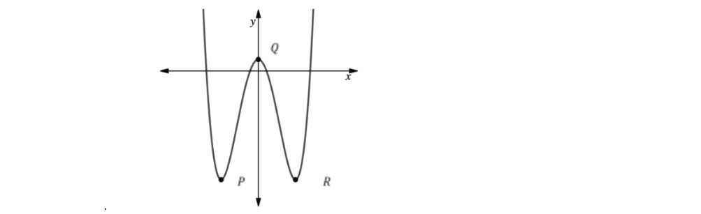

# Exam Questions — Differentiation
**Coordinate Geometry & Graphs** · Cambridge (CIE) IGCSE maths (0580 & 0980)
> Source: [https://www.savemyexams.com/igcse/maths/cie/25/extended/topic-questions/](https://www.savemyexams.com/igcse/maths/cie/25/extended/topic-questions/) · 11 questions across 1 sets

## Calculator Questions (11 questions)

### Q1 — hard — 2 marks

**Q1** [2 marks]

$y=5x^{m}+px^{12}$ and $\frac{dy}{dx}=30x^{m-1}+6x^{11}$

Find the value of $m$ and the value of $p$.

$m=$ ....................................................

$p=$ ....................................................

### Q2 — hard — 6 marks

**Q2** [4 marks]

The diagram above shows a sketch of a curve with equation $y=2x^{3}-2x^{2}-3x+5$.

The point $P$ is the turning point of the curve. The $x$-coordinate of $P$ is positive.

Find the $x$-coordinate of the point $P$.

**Q2** [2 marks]

Using the second derivative, show that the point $P$ is a local minimum.

### Q3 — hard — 9 marks

**Q3** [6 marks]

A curve has equation $y=x^{3}--6x^{2}+16$.

Find the coordinates of the two turning points.

(............ , ............) and (............ , ............)

*Source: 2020 Specimen 0580/04 Q11A*

**Q3** [3 marks]

**Extract:**

A curve has equation y = x cubed – 6 x squared + 16. Find the coordinates of the two turning points. (............ , ............) and (............ , ............)

Determine whether each of the turning points is a maximum or a minimum.

Give reasons for your answers.

*Source: specimen 2020 0580/04 Q11B*

### Q4 — very_hard — 6 marks

**Q4** [2 marks]

The curve $C$ has equation $y=5x^{3}--x^{2}--6x+4$.

Find  $\frac{dy}{dx}$.

$\frac{dy}{dx}$ = ..............................................

*Source: Nov 2020 4MA1/1HR Q17A*

**Q4** [4 marks]

**Extract:**

The curve C has equation y = 5x^3 – x^2 – 6x + 4.
Find dy/dx.
   dy/dx = ..............................................

There are two points on the curve $C$ at which the gradient of the curve is $2$.

Find the $x$ coordinate of each of these two points. Show clear algebraic working.

*Source: Nov 2020 4MA1/1HR Q17B*

### Q5 — hard — 8 marks

**Q5** [8 marks]

A curve has equation $y=4x^{3}-3x+3$.

i) Find the coordinates of the two stationary points.

( .................... , .................... ) and ( .................... , .................... ) [5]

ii) Determine whether each of the stationary points is a maximum or a minimum. Give reasons for your answers.

[3]

*Source: 2020 May/June 0580/43 Q12A*

### Q6 — very_hard — 7 marks

**Q6** [7 marks]

Part of the graph with equation $y=2x^{4}-16x^{2}+3$ is shown below.

The graph has three stationary points, indicated on the graph by points P , Q and R. Find the area of the triangle *PQR*.

### Q7 — medium — 3 marks

**Q7** [3 marks]

Calculate the gradient of  $y=24+5x-x^{2}$ at $x=-1.5$.

*Source: 2020 Oct/Nov 0580/43 Q7A*

### Q8 — very_hard — 6 marks

**Q8** [6 marks]

The curve $C$ has equation $y=ax^{3}+bx^{2}--12x+6$ where $a$ and $b$ are constants.

The point $A$ with coordinates (2, –6) lies on $C$.

The gradient of the curve at $A$ is 16.

Find the $y$ coordinate of the point on the curve whose $x$ coordinate is 3.

Show clear algebraic working.

*Source: Jan 2022 4MA1/1H Q24*

### Q9 — medium — 7 marks

**Q9** [2 marks]

A curve has equation $y=x^{3}+\frac{7}{2}x^{2}-2x+9$ 
Find  $\frac{dy}{dx}$.

**Q9** [4 marks]

**Extract:**

A curve has equation y = x^3 + (7/2)x^2 - 2x + 9
Find dy/dx.

Find the gradient of the curve at the point where:

(i)     $x=-3$

[2]

(ii)    $x=\frac{2}{3}$

[2]

**Q9** [1 mark]

**Extract:**

Find the gradient of the curve at the point where:

(i)     x = -3

(ii)    x = 2/3

What can you say about the tangents to the curves at these two points?

### Q10 — hard — 12 marks

**Q10** [9 marks]

A curve has the equation  $y=x^{3}+8x^{2}+5x.$

Work out the coordinates of the two turning points.

(.................... , ....................) and (.................... , ....................)

*Source: 2020	May/June 0580/41 Q10B*

**Q10** [3 marks]

**Extract:**

A curve has the equation  y = x^3 + 8x^2 + 5x.

Work out the coordinates of the two turning points.

(.................... , ....................) and (.................... , ....................)

Determine whether each of the turning points is a maximum or a minimum. Give reasons for your answers.

*Source: 2020	May/June 0580/41 Q10B*

### Q11 — medium — 2 marks

**Q11** [2 marks]

$y=2x^{k}+ux^{7}\mathrm{and}\frac{dy}{dx}=18x^{k--1}+21x^{6}$

Find the value of $k$ and the value of $u$.

$k$ = ....................................................

$u$ = ....................................................

*Source: Specimen 2025 0580/04 Q20*

