# Mark Schemes — Further Graphs & Tangents
**Coordinate Geometry & Graphs** · Cambridge (CIE) IGCSE maths (0580 & 0980)

## Calculator Questions (17 questions)

### Q1
> *Use the TABLE function on your calculator for *`f open parentheses x close parentheses equals x squared minus 2 x`*, starting at -2, ending at 4 and with steps of 1*

> *If your calculator does not have a TABLE function then substitute the values of *$x$* into the function one by one for the missing values, being careful to put negative numbers in brackets, e.g.*

`x equals negative 2 comma space y equals open parentheses negative 2 close parentheses squared minus 2 open parentheses negative 2 close parentheses equals 8`

| $x$ | $-2$ | $-1$ | $0$ | $1$ | $2$ | $3$ | $4$ |
|---|---|---|---|---|---|---|---|
| $y$ | $8$ | $3$ | $0$ | $-1$ | $0$ | $3$ | $8$ |

**at least 2 correct values**** [1]**

**all values correct**** ****[1]**

**Before writing your answers in the table, double check that the **$y$**-values the calculator gives you match the values that are already in the table**
> *Carefully plot the points from your table of values in (a) on the grid, noting the different scales on the *$x$* and *$y$* axes*

*For example, the first column represents the point *`open parentheses negative 2 comma space 8 close parentheses`

> *After plotting the points, join them with a smooth curve- do not use a ruler!*

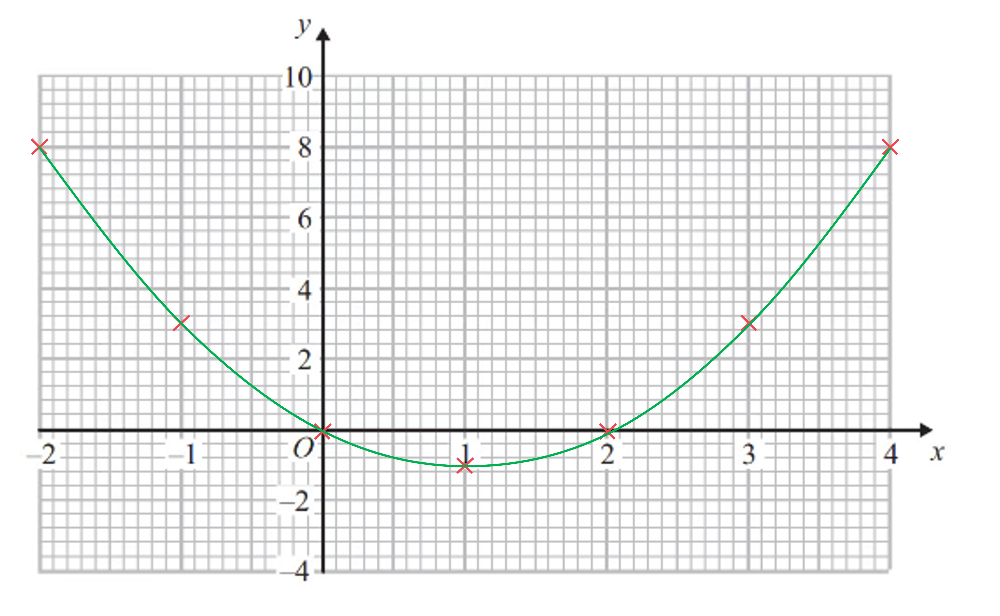

**at least 4 points plotted correctly**** [1]** 
**smooth curve with correct shape through all points**** [1] **
**It is a quadratic function so its graph should be symmetrical about the turning point**
> *Method 1** *

> *Solving using the graph*

> *We have the graph of *$y=x^{2}-2x$* (from part (b)). We need to rearrange *$x^{2}-2x-2=1$* so that "*$x^{2}-2x$*" appears on its own on one side of the equation*

> *In this case, add 2 to both sides*

`table attributes columnalign right center left columnspacing 0px end attributes row cell x squared minus 2 x minus 2 end cell equals 1 row cell x squared minus 2 x end cell equals 3 end table`

> *Now draw the line *$y=3$* on the graph and read the *$x$* values where this line and *$y=x^{2}-2x$* intersect*

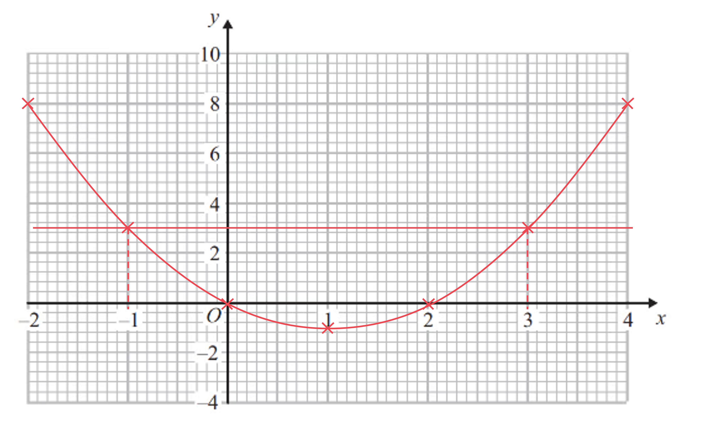

*y = 3 drawn correctly on the grid*** [1]**
**x**** = −1, ****x ****= 3 ****[1] **
**Both possible ****x**** values must be stated to achieve full marks**

> *Method 2*

> *Solving by factorisation*

> *Rearrange *$x^{2}-2x-2=1$* to a quadratic equaling 0*

$x^{2}-2x-3=0$

> *Factorise*

`open parentheses x minus 3 close parentheses open parentheses x plus 1 close parentheses equals 0`

**[1]**

> *If A × B = 0, either A = 0 or B = 0 therefore*

`table row cell x minus 3 end cell equals cell 0 space space space space space or space space space space x plus 1 equals 0 end cell end table`

**x**** = −1, ****x ****= 3 ****[1]**
**Both possible ****x**** values must be stated to achieve full marks**

### Q2
> *Use the TABLE function on your calculator for *`f open parentheses x close parentheses equals x squared minus x minus 6`*, starting at -3, ending at 3 and with steps of 1*

> *If your calculator does not have a TABLE function then substitute the values of *$x$* into the function one by one for the missing values, being careful to put negative numbers in brackets, e.g.*

`x equals negative 2 comma space y equals open parentheses negative 2 close parentheses squared minus open parentheses negative 2 close parentheses minus 6 equals 0`

| $x$ | $-3$ | $-2$ | $-1$ | $0$ | $1$ | $2$ | $3$ |
|---|---|---|---|---|---|---|---|
| $y$ | $6$ | $0$ | $-4$ | $-6$ | $-6$ | $-4$ | $0$ |

**at least 2 correct values**** ****[1]**

**all values correct*** ***[1]**

**Before writing your answers in the table, double check that the **$y$**-values the calculator gives you match the values that are already in the table**
> *Carefully plot the points from your table of values in (a) on the grid, noting the different scales on the *$x$* and *$y$* axes*

*For example, the first column represents the point *`open parentheses negative 3 comma space minus 6 close parentheses`

> *After plotting the points, join them with a smooth curve- do not use a ruler!*

**at least 5 points plotted correctly*** ***[1]** 
**smooth curve through points*** ***[1] **
**It is a quadratic function so its graph should be symmetrical**
> *Draw the graph of *$y=-2$* and read off the graph the *$x$*-values where *$y=-2$* intersects with *$y=x^{2}-x-6$

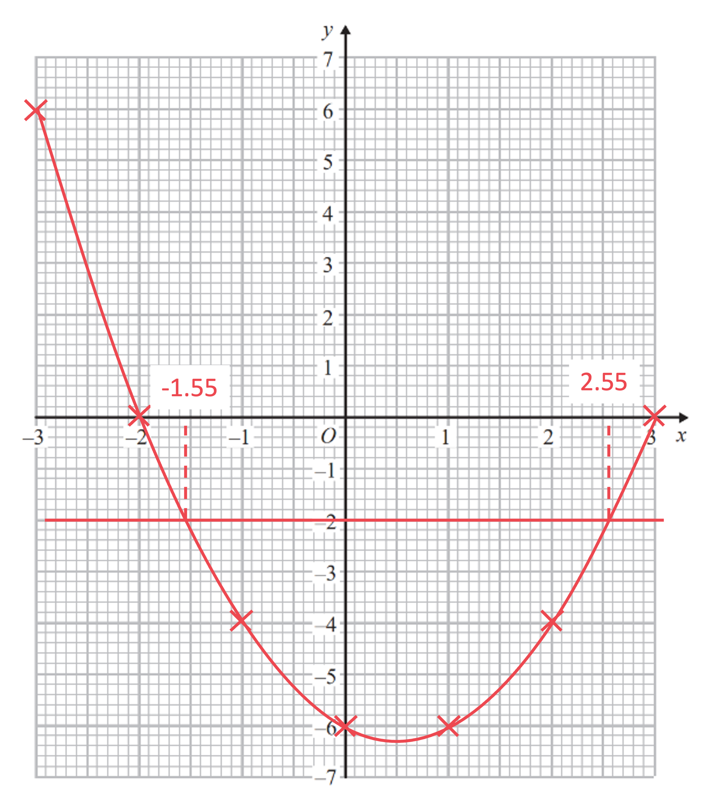

> *There is some margin of error due to the drawing of the curve by hand. However your answers must be consistent with your graph. In this case the answers would be:*

**Final answer:** **−1.55 and 2.55**

* **any answer between −1.5 and −1.7*** ****[1]**

*any answer between 2.5 and 2.7*** ****[1]**

### Q3
*We have the graph of *$y=x^{2}-2x+3$* so we need to rearrange *$x^{2}-3x-1=0$* so that "*$x^{2}-2x+3$*" appears on its own on one side of the equation*

> *Add 4 to both sides*

$x^{2}-3x-1=0\,x^{2}-3x+3=4$

> *Add *$x$* to both sides*

$x^{2}-2x+3=x+4$

> *Draw the line *$y=x+4$* on the graph using your knowledge of linear graphs **y** = **mx** + **c**. Draw a line through 4 on the **y**-axis with gradient 1*

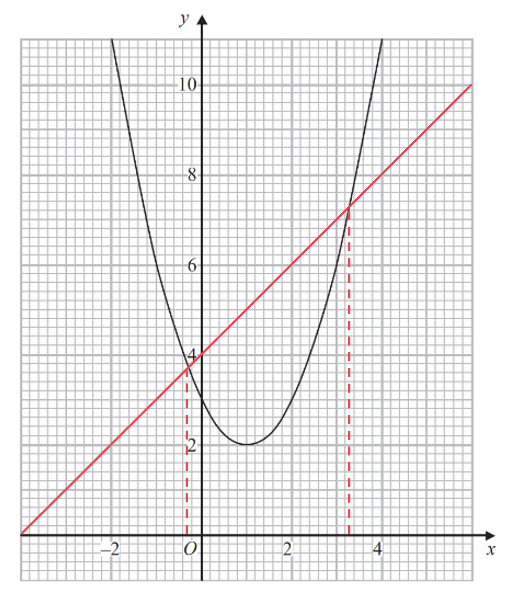

*y = x + 4 drawn correctly on the grid*** [1]**

> *Read the *$x$* values where *$y=x+4$* and *$y=x^{2}-2x+3$* intersect. There is some margin of error permitted (see below)*

**x ****= 3.3, ****x**** = −0.3**
*x value from −0.2 to −0.4 and x value from 3.2 to 3.4 ***[1]**
> *We can estimate the gradient at *$x=2$* by drawing a tangent at *$x=2$* and calculating its gradient*

> *First draw a tangent at *$x=2$*. This should be a straight line (use a ruler or straight edge) touching the curve at *$x=2$*, but not crossing the curve*

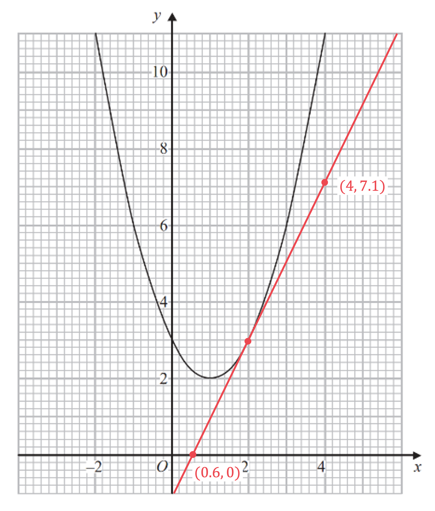

**suitable tangent line drawn**** [1]**

> *Pick two points on the tangent, not too close to each other. Try to pick points that can be clearly read off the grid. E.g. in the diagram above, we have picked (4, 7.1) and (0.6, 0) *

> *Find the gradient between these two points using *$\frac{\mathrm{rise}}{\mathrm{run}}$* or *$\frac{y_{1}-y_{2}}{x_{1}-x_{2}}$* *

> *Your gradient will depend on your tangent so there is some margin of error permitted in exam questions. For the tangent drawn above, the calculation and answer would be as follows*

*gradient = *$\frac{7.1-0}{4-0.6}$

$\frac{rise}{run}$* or gradient formula used with tangent line*** [1]**

$=\frac{7.1}{3.4}=2.088235294...$

> *If your calculation does not result in an exact answer, write the answer to at least 3 significant figures*

**Answer = 2.09**
* **Any answer from 1.6 to 2.5 so long as it is consistent with the drawn tangent line*** ****[1]**

### Q4
> *By inspecting the graph*

$x=0$ **[1]**
> *The tangent must be a straight line touching the curve at *$x=0.5$*. There should be no gap between the tangent and the curve, and equally the tangent line should not cross the curve. See diagram below.*

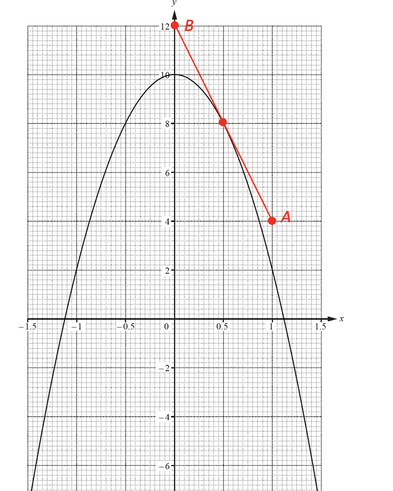

*tangent line drawn with a straight edge, touching but not crossing the curve at (0.5, 8)*** ****[1]**

> *There is some margin of error allowed in drawing the tangent so the calculations below may vary slightly depending on the angle the tangent line is drawn at (see note underneath final answer).*

*Gradient = *$\frac{y_{1}-y_{2}}{x_{1}-x_{2}}=\frac{rise}{run}$

*Whichever version of the gradient formula we use, we need to pick two points, such as **A **and **B** marked on the diagram.*

*In the diagram **A** = (1, 4) and **B** = (0.5, 8).* *Using the gradient formula,*

*Gradient** **=** *$\frac{4-8}{1-0.5}=\frac{-4}{0.5}$

**[1]**

**Gradient = **$-8$** ****[1]**
**Any final answer between −9 and −6.5 is permitted, so long as the tangent is drawn and a version of the gradient formula is seen in the working **

### Q5
*Find the *$y$* coordinate when *$x=0$* (by substituting *$x=0$* into the equation)* * *

$y=0^{3}-3\times0^{2}+0$

$y=0$* ***[1]**

*Find the *$y$* coordinate when *$x=2$* (by substituting *$x=2$* into the equation)* * *

`table row y equals cell 2 cubed minus 3 cross times 2 squared plus 2 end cell row blank equals cell 8 minus 12 plus 2 end cell end table`

$y=-2$* ***[1]**

*Find the *$y$* coordinate when *$x=2.75$* (by substituting *$x=2.75$* into the equation)* * *

`table row y equals cell 2.75 cubed minus 3 cross times 2.75 squared plus 2.75 end cell row blank equals cell 0.859365 end cell end table` * *

> *Round this value of *$y$* to 1 decimal place (as this is used in the table)*

$y=0.9$ **[1]**

**You could also use your calculator's TABLE function to get the missing values if your calculator has it**
|   | **A** | **B** | **C** | **D** | **E** | **F** | **G** | **H** | **I** | **J** |
|---|---|---|---|---|---|---|---|---|---|---|
| $x$ | -0.75 | -0.5 | -0.25 | 0 | 0.5 | 1 | 1.5 | 2 | 2.5 | 2.75 |
| $y$ | -2.9 | -1.4 | -0.5 | *0* | -0.1 | -1 | -1.9 | *-2* | -0.6 | *0.9* |

> *Plot the points on the grid and draw a smooth curve between them*

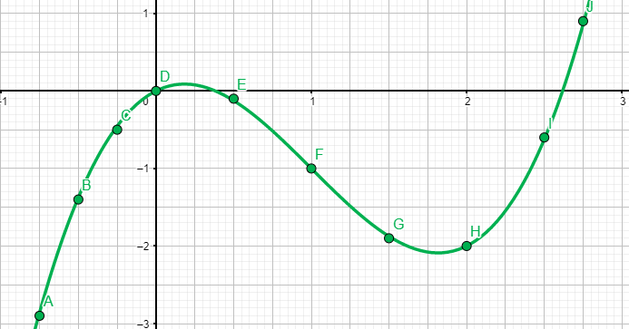

**5 or 6 points plotted correctly**** [1]**
**7 or 8 points plotted correctly**** ****[1]** 
**9 or 10 points plotted correctly**** ****[1]**
** ****correct curve**** ****[1]**
*Draw the line *$y=-1$* on to the graph*

*Find the range of values on the *$x$*-axis for which the curve is above the line *$y=-1$

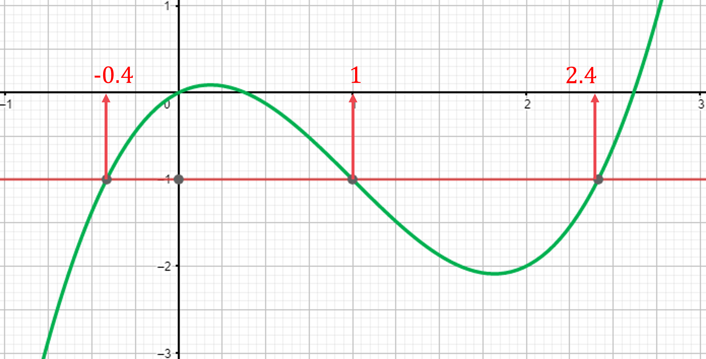

$-0.4<x<1$** [2]** 
**and**** **$x>2.4$ **[1]**

**Values between -0.45 to -0.35 are accepted for the lower point and 2.35 to 2.45 for the upper point**
i) *The equation *$x^{3}-3x^{2}+2x-1=0$* must be changed into the form *$x^{3}-3x^{2}+x=...$* (making the graph the subject) Form the correct *$x$* term (by subtracting *$x$*from both sides)  *

> `table attributes columnalign right center left columnspacing 0px end attributes row cell x cubed minus 3 x squared plus 2 x minus 1 minus x end cell equals cell 0 minus x end cell row cell x cubed minus 3 x squared plus x minus 1 end cell equals cell negative x end cell end table`*  *

> *Form the correct number term (by adding 1 to both sides)  *

> `table row cell x cubed minus 3 x squared plus x minus 1 plus 1 end cell equals cell negative x plus 1 end cell row cell x cubed minus 3 x squared plus x end cell equals cell negative x plus 1 end cell end table`*  *

> *The straight-line graph to draw is *$y=$*"right-hand side" Write down the equation of this line*

**Either  **$y=1-kx$** or  **$y=k-x$**[1]**

$y=-x+1$** [1]**

ii) *Make a small tables of values for the line  *$y=-x+1$* * * *

| $x$ | *-1* | *1* | *2* |
|---|---|---|---|
| $y=-x+1$ | *2* | *0* | *-1* |

> *Draw this straight line on to the graph and read off the *$x$*-intercept value where the lines cross*

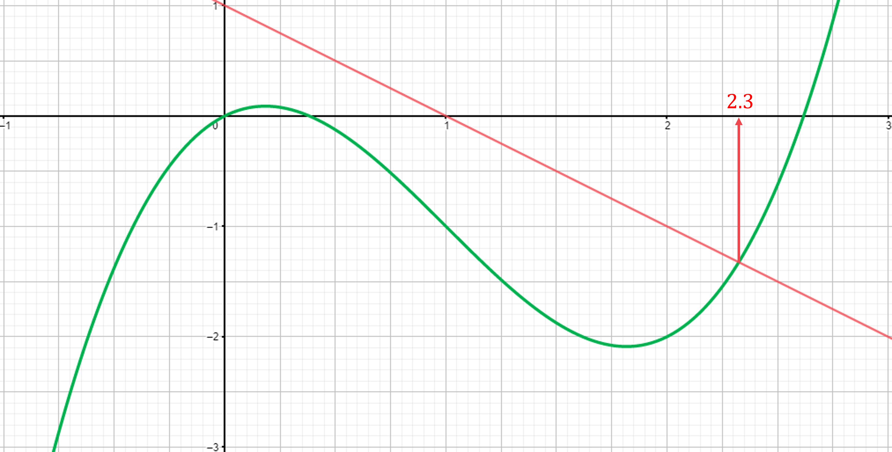

*straight line through (0,1) ***[1] **
*correct straight line*** ****[1]**
**2.3** **[1]**

**Values between 2.25 and 2.4 are accepted**
> *A tangent at *$x=-0.25$* touches the curve and has the same slope as the curve at that point*

*Draw the tangent on to the graph*

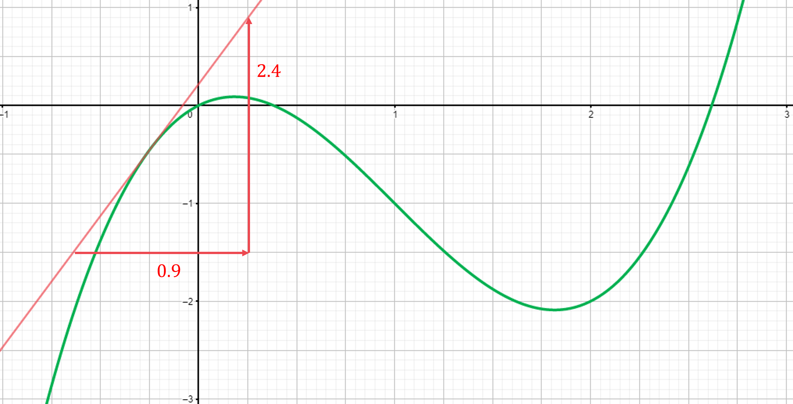

*attempt at tangent*** [1]**

> *The gradient is "rise over run", being careful to read axes units Estimate the gradient of the tangent, by creating a triangle using two points that are the same distance either side of *$x=-0.25$

$\frac{2.4}{0.9}=2.666...$

*choosing two suitable points either side of x = -0.25*** [1]**
**2.7** **[1]**

**Any gradient between 1.7 and 3.7 is accepted**

### Q6
> *Substitute *$x=1$* and *$x=2$* into the equation given for *$y$*. Use your calculator to make sure you get the correct answers. *

`x space equals space 1 comma space space space y space equals space open parentheses 1 close parentheses to the power of 2 space end exponent plus space 1 over 1 space equals space 2`

`x space equals space 2 comma space space space y space equals space open parentheses 2 close parentheses to the power of 2 space end exponent plus space 1 half space equals space 4.5`

> *You could also use your calculator's TABLE function to get the missing values if your calculator has this*

| $x$ | 0.2 | 0.3 | 0.5 | 1 | 1.5 | 2 | 2.5 |
|---|---|---|---|---|---|---|---|
| $y$ | 5.0 | 3.4 | 2.3 | **Final answer:** **2** | 2.9 | **Final answer:** **4.5** | 6.7 |

**1 mark for each correct answer**** ****[2]**
> *Plot each coordinate accurately on the grid and join up with a smooth curve.*

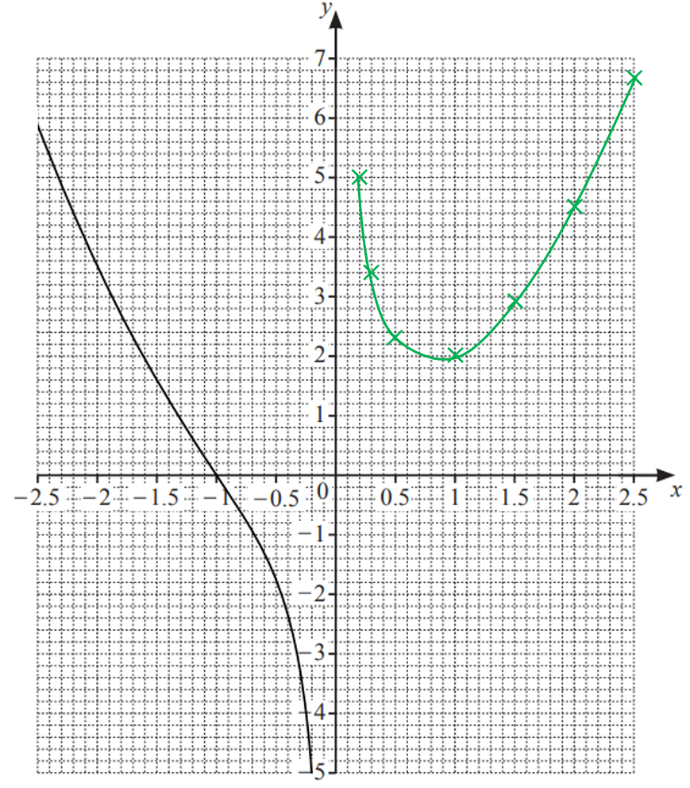

**All coordinates plotted correctly**** ****[3] **
**Curve drawn smoothly**** ****[1]**
i) *Draw the line *$y=-2$* onto your graph and find the point of intersection by reading the **x** coordinate of the point where the two graphs meet.*

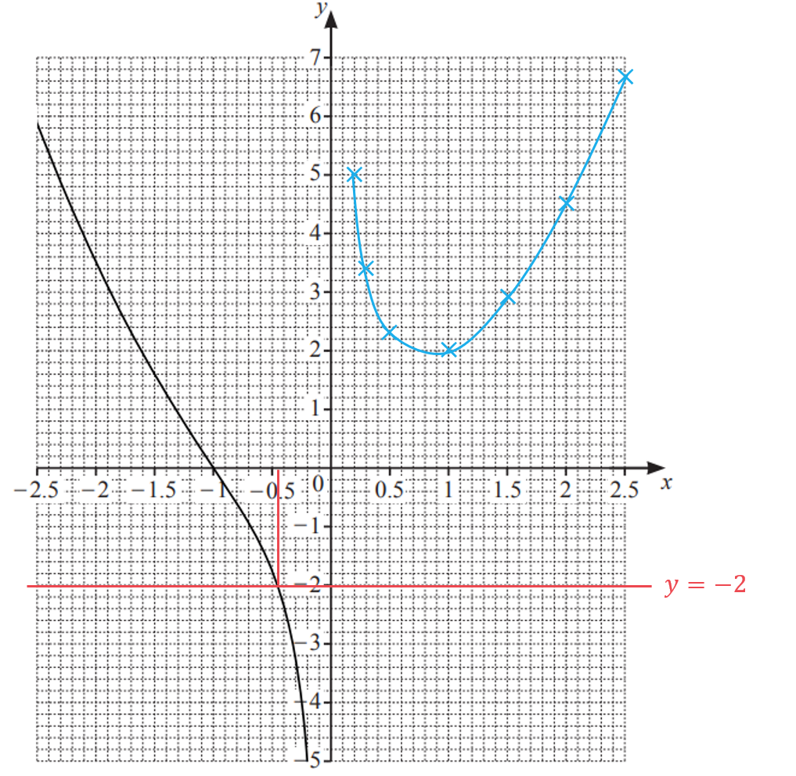

$x=-0.46$** ****[1]**

**Answers can be in the range -0.5 to -0.4**

ii) *Rearrange the equation to get the equation of the curve on one side.*

`table row cell space x to the power of 2 space end exponent plus space 1 over x space plus space x space minus space 1 space end cell equals cell space 0 end cell row cell negative open parentheses x space minus space 1 close parentheses space space space space space space space space space space space space space space space space space space space space space space space space space space space space space space space space space space space space space space space space end cell equals cell space space space space space space space space space space space space space space space space space space space space space space space minus open parentheses x space minus space 1 close parentheses space space space end cell row cell space x to the power of 2 space end exponent plus space 1 over x space space end cell equals cell space minus open parentheses x space minus 1 close parentheses end cell row cell space x to the power of 2 space end exponent plus space 1 over x space space end cell equals cell space minus x space plus space 1 end cell end table`

**[1]**

> *Draw the line *$y=-x+1$* onto your graph and find the point of intersection by reading the coordinates of the point where the two graphs meet.*

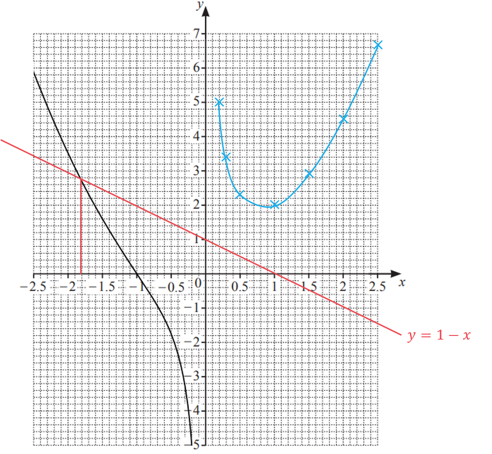

$x=-1.8$** ****[1] **

**Answers can be in the range -1.9 to -1.75**
> *The **y**-axis is an asymptote so the graph will continue towards positive infinity as it approaches the **y-**axis.  *

> *There is a turning point at, or very close to, the point (1, 2) so any point above this turning point will have three solutions.*

> *Any integer greater than or equal to 2 can be given here.*

**2 ****[1] **

**Any whole number bigger than 2 also correct**

### Q7
> *Substitute "*$x=-0.5$*, *$x=1$* and *$x=2$* into the equation using your calculator, taking care to put brackets around the negative values.*

> * *`space x equals negative 0.5 comma space space space y equals open parentheses negative 0.5 close parentheses cubed over 3 minus fraction numerator 1 over denominator 2 open parentheses negative 0.5 close parentheses squared end fraction equals negative 2.041 6 with dot on top`

`space x equals 1 comma space space space y equals 1 cubed over 3 minus fraction numerator 1 over denominator 2 cross times 1 squared end fraction equals minus 0.1 6 with dot on top`

`space x equals 2 comma space space space y equals 2 cubed over 3 minus fraction numerator 1 over denominator 2 cross times 2 squared end fraction equals 2.541 6 with dot on top`

> *You could also use your calculator's TABLE function to get the missing values if your calculator has it *

> *As you can only accurately plot *$y$* to the nearest 0.1 on the grid, you can give your answers to 1 decimal place in the table:*

| $x$ | $-3$ | $-2$ | $-1$ | $-0.5$ | $-0.3$ |   | $0.3$ | $0.5$ | $1$ | $2$ | $3$ |
|---|---|---|---|---|---|---|---|---|---|---|---|
| $y$ | $-9.1$ | $-2.8$ | $-0.8$ | $-2.0$ | $-5.6$ |   | $-5.5$ | $-2.0$ | $-0.2$ | $2.5$ | $8.9$ |

** ****1 for each correct value**** ****[3]**

**Answers to more than 1 decimal place are accepted**
> *Plot the points and join with a smooth curve by hand*

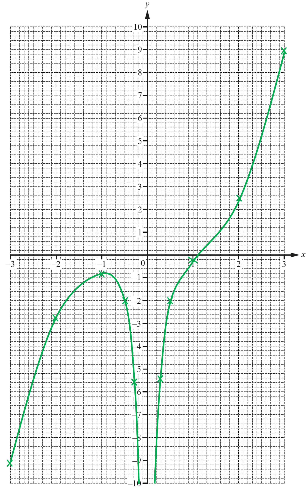

**points plotted correctly (each 2 incorrect points lose 1 mark)*** ***[3] **
**smooth curves connecting the points**** ****[1] **
*t***he two curves either side of y-axis are separate and not joined by a line**** ****[1]**
i) *The tangent must be a straight line touching the curve at *$x=-2$*. There should be no gap between the tangent and the curve, and equally the tangent line should not cross the curve. See diagram below.*

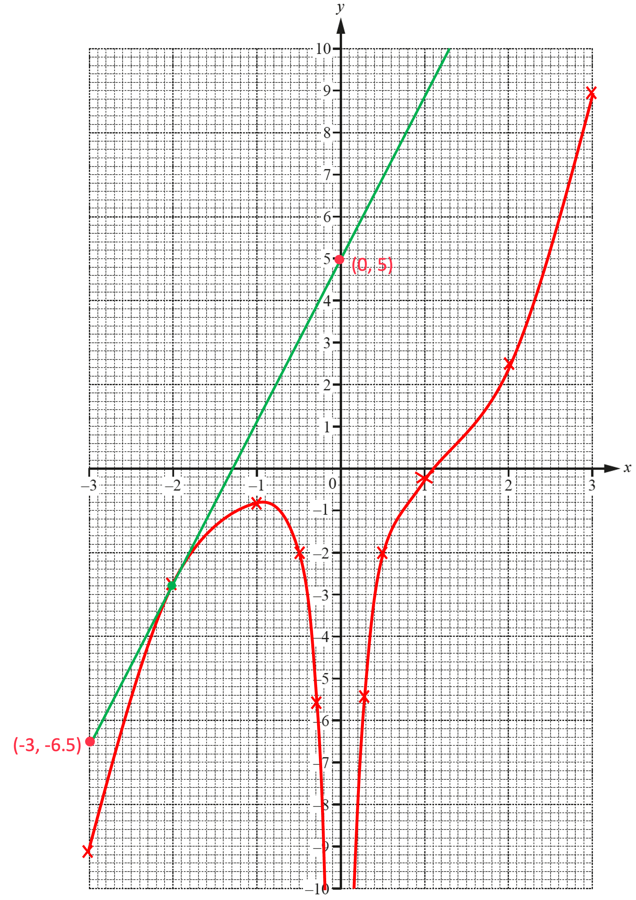

**tangent line drawn with a straight edge, touching but not crossing the curve where **$x=-2$** ****[1]**

> *There is some margin of error allowed in drawing the tangent so the calculations below may vary slightly depending on the angle the tangent line is drawn at (see note underneath final answer).*

*Gradient = *$\frac{y_{1}-y_{2}}{x_{1}-x_{2}}=\frac{\mathrm{rise}}{\mathrm{run}}$*.*

> *Whichever version of the gradient formula we use, we need to pick two points, such as the two** **marked on the diagram, (-3, -6.5) and (0, 5).*

*Gradient** **=** *`fraction numerator 5 minus open parentheses negative 6.5 close parentheses over denominator 0 minus open parentheses negative 3 close parentheses end fraction equals fraction numerator 11.5 over denominator 3 end fraction equals 3.8 3 with dot on top`

*using the gradient formula with two points from the tangent line ***[1]**

> *Round your answer to at least 3 significant figures*

**Gradient = 3.83 (3 sig figs) ****[1]**

**Any final answer between 3 and 5 is permitted, so long as the tangent is drawn and a version of the gradient formula is seen in the working **

ii) $y=mx+c$*,* *where* $m$* is the gradient and *$c$* is the *$y$*-intercept.*

> *We already have *$m$*, it is the answer from part (b)(i). In this example, 3.83, but any answer between 3 and 5 is permitted depending on your tangent line. *

> $c$* can be found simply by examining where your tangent line crosses the *$y$*-axis. In the case above, (0, 5) so *$c=5$*.*

> *From these two values we can write the equation of the line.*

$y=3.83x+5$** **
**the answer to (b)(i) for **$m$** [1] **
**the y-intercept from the tangent line drawn in (b)(i) for **$c$** ****[****1]**
i)$\frac{x^{3}}{3}-\frac{1}{2x^{2}}=0$* where *$y=\frac{x^{3}}{3}-\frac{1}{2x^{2}}$*and *$y=0$*. So, where the curve plotted in part (b) intercepts the *$x$*-axis.*

> *Read off the graph the *$x$*-value where this happens.*

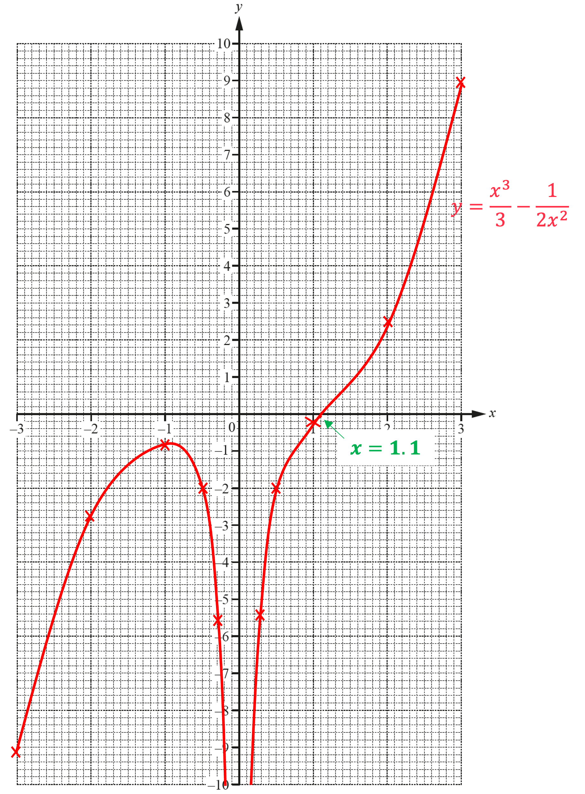

> *In the answer above, the answer would be "1.1" but your answer will depend on the curve drawn in part (b).*

**1.05 to 1.25 ****[1]**** **

**Your answer can be anywhere between these values, so long as it is consistent with your curve**

ii)*Rearrange *$\frac{x^{3}}{3}-\frac{1}{2x^{2}}+4=0$* by subtracting 4 from both sides so the equation is in the form  *$\frac{x^{3}}{3}-\frac{1}{2x^{2}}=k$

$\frac{x^{3}}{3}-\frac{1}{2x^{2}}=-4$

> *So the answer is where the curve plotted in part (b) intercepts the line *$y=-4$*. Draw the line *$y=-4$* on the grid.*

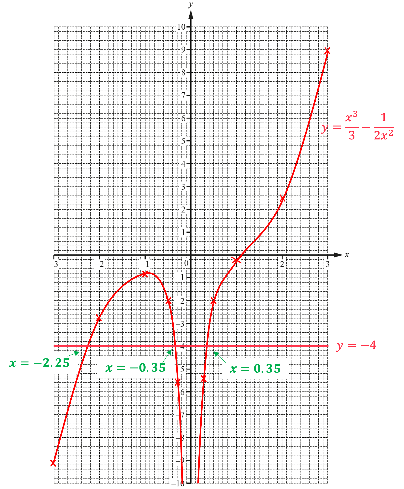

> *Read off the graph the *$x$*-values where *$y=\frac{x^{3}}{3}-\frac{1}{2x^{2}}$* and *$y=-4$* intersect. The answers will depend on the curve drawn in part (b) but the answers according to the above graph would be as shown on the diagram.*

**-2.3 to -2.2,  -0.4 to -0.3  and  0.3 to 0.4 ****[1]**** **

**Your answers can be anywhere between these values so long as they are consistent with your graph**

### Q8
> *Draw a straight line that goes through **P** and is a tangent to the curve.*

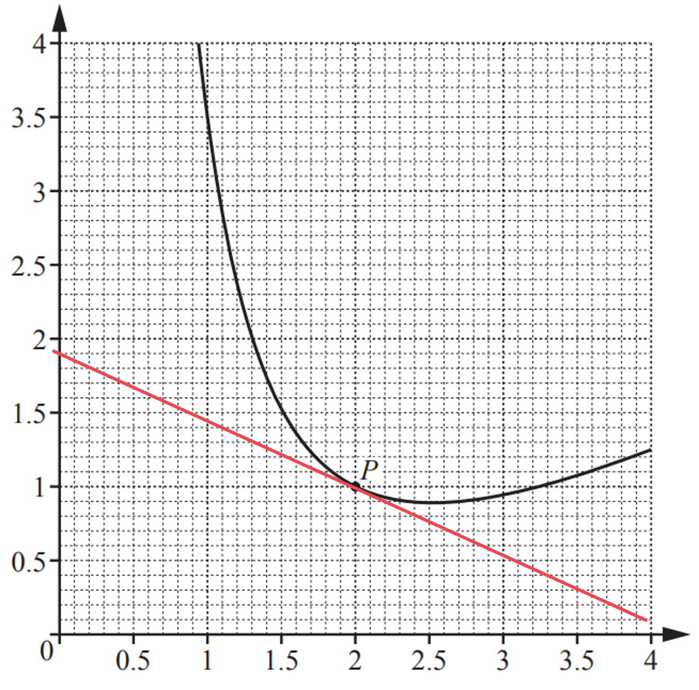

**[1]**

> *Pick two points on the straight line to help you find the gradient. It is easiest to choose the point **P **and the **y**-intercept of the line. Drawing a right angled triangle using the two points can help you to visualise the gradient.*

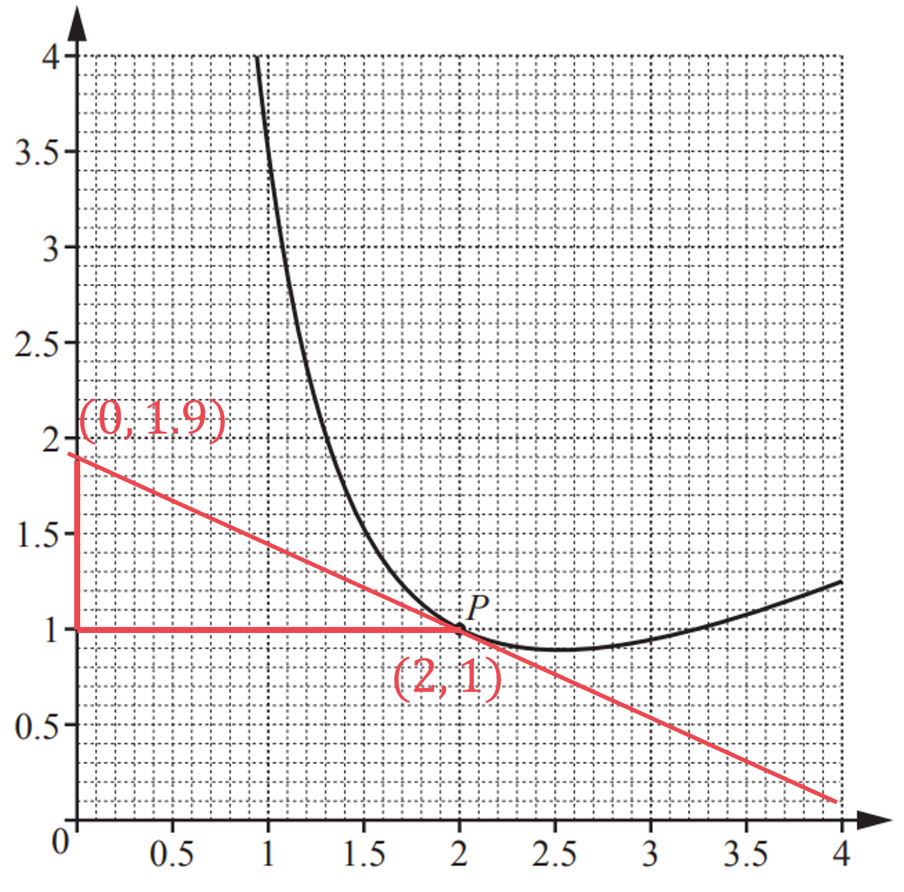

`open parentheses x subscript 1 comma space y subscript 1 close parentheses equals open parentheses 0 comma space 1.9 close parentheses` *and* `open parentheses x subscript 2 comma space y subscript 2 close parentheses equals open parentheses 2 comma space 1 close parentheses`

> *Find the gradient between the two points using the formula *$m=\frac{y_{2}-y_{1}}{x_{2}-x_{1}}.$* *

> *You can see from the graph that the gradient is negative so check your working if you end up with a positive value.*

$m=\frac{1-1.9}{2-0}$

**[1]**

**The gradient is -0.45** **[1]**

**Your answer can be in the range -0.7 to -0.3**

### Q9
> *Substitute the given *$x$* values into the equation to work out the *$y$* values. *
*Be especially careful with the substitution *$x=-1$*, not to get caught out by the negative sign.*

$x=-1:$

`y equals open parentheses negative 1 close parentheses squared over 2 plus 1 over open parentheses negative 1 close parentheses squared minus fraction numerator 2 over denominator open parentheses negative 1 close parentheses end fraction
y equals 1 half plus 1 plus 2
y equals 3.5`

$x=0.2:$

`y equals open parentheses 0.2 close parentheses squared over 2 plus 1 over open parentheses 0.2 close parentheses squared minus fraction numerator 2 over denominator open parentheses 0.2 close parentheses end fraction
y equals fraction numerator 0.04 over denominator 2 end fraction plus fraction numerator 1 over denominator 0.04 end fraction minus 10
y equals 15.02`

$x=3:$

`y equals open parentheses 3 close parentheses squared over 2 plus 1 over open parentheses 3 close parentheses squared minus fraction numerator 2 over denominator open parentheses 3 close parentheses end fraction
y equals 9 over 2 plus 1 over 9 minus 2 over 3
y equals 3.94444...`

> *You could also use your calculator's TABLE function to get the missing values if your calculator has it *

| $x$ | $-3$ | $-2$ | $-1$ | $-0.5$ | $-0.3$ |   | $0.2$ | $0.3$ | $0.5$ | $1$ | $2$ | $3$ |
|---|---|---|---|---|---|---|---|---|---|---|---|---|
| $y$ | $5.3$ | $3.3$ | $3.5$ | $8.1$ | $17.8$ |   | $15.0$ | $4.5$ | $0.1$ | $-0.5$ | $1.3$ | $3.9$ |

* *** Correct 3.5 ****[1] **

**Correct 15.0*** ***[1]**

**Correct 3.9**** [1]**

**Give your answers rounded to 1 d.p. to match the other values already given in the table.**
> *Plot the *$x$* and *$y$* coordinates from the table on to the grid.*

> * Draw a smooth curve through the points. *

> *Make sure that you look at the scale very carefully, one small square is 0.1 on the *$x$* axis but 0.2 on the *$y$* axis. *

> *The two parts of the curve should not be connected across the *$y$* axis.*

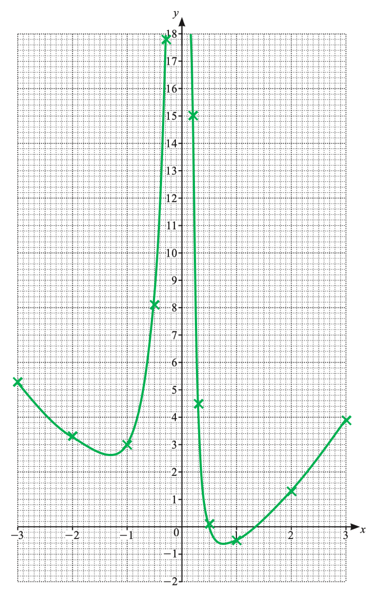

**Two separate curves not touching or crossing the y axis**** [1] **

**6 or 7 points plotted correctly ****[1] **

**8 or 9 point plotted correctly**** [1] **

**10 or 11 points plotted correctly**** [1]**
> *Draw the line *$y=0$* by drawing a line through the *$x$* axis. Identify where the curve and the line *$y=0$* intersect.*

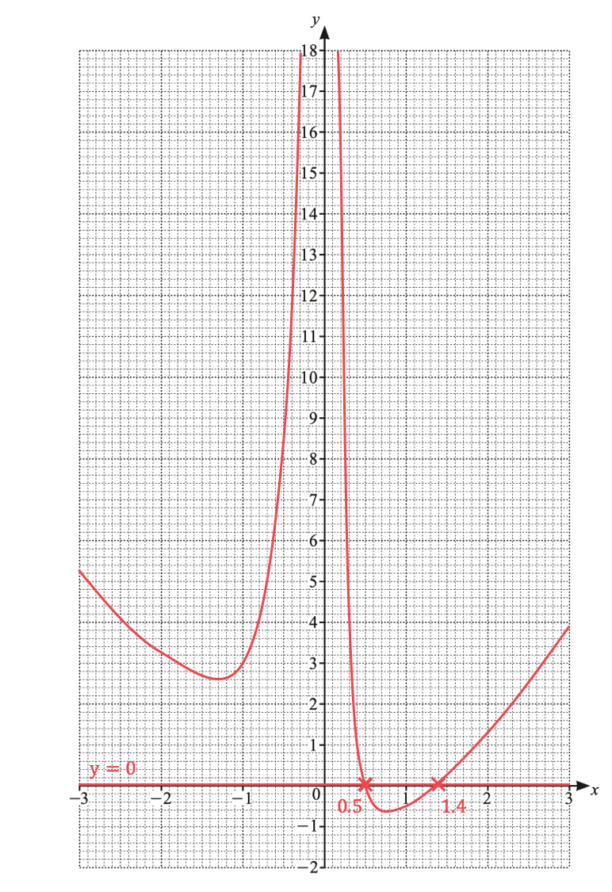

> *Write down the interval where the *$y$* values are less than or equal to zero.*

$0.5\leqx\leq1.4$

*Correct lower limit*** [1] **

*Correct upper limit*** [1]**

**For the lower limit, answers between 0.5 and 0.6 will be accepted. **

**For the upper limit, answers between 1.3 and 1.6 will be accepted.**
> *You can use a ruler on top of the graph to model a horizontal line *$y=k$*. *

> *Start at the top of the graph and move it down until you find a position where it intersects the y axis at a positive whole number (positive integer) and intersects the curve exactly twice.*

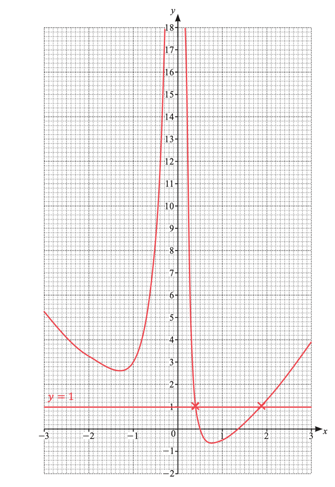

*The straight line *$y=1$* intersects the graph exactly twice and is the smallest whole number value at which this happens. So, *$y=k=1$*.*

**1 ****[1]**
> *Draw the line *$y=3x+1$* on the grid.  It will cross the y axis at (0, 1) and will have a gradient of 3.*

> *Mark on the point of intersection between the line and the curve.*

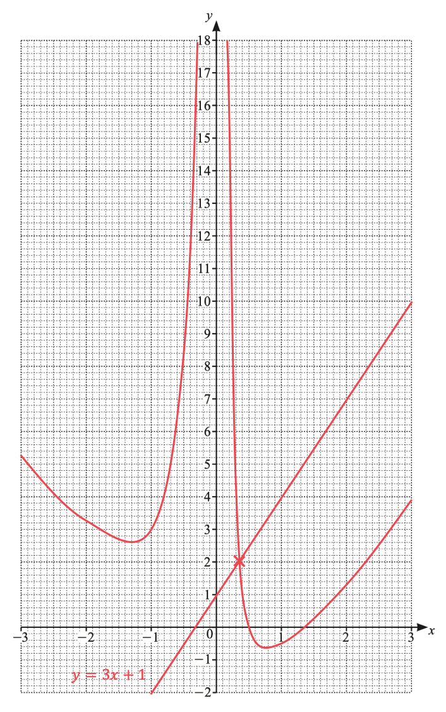

*Correct line stated OR correct line drawn without a ruler OR ruled line drawn with either correct gradient or correct y intercept ***[1] **

*Completely correct line sketched using a ruler*** [1]**

> *The solution to the equation is the x coordinate of the point of intersection.*

$x=0.35$** [1]**

**Any answer between 0.3 and 0.49 will be accepted.**

### Q10
*Substitute the given values for *$x$* into the equation* $y=x^{3}+x^{2}-5x$*. *
*Be especially careful with the substitution *$x=-1$*, not to get caught out by the negative sign.*

$x=-1:$

`y equals open parentheses negative 1 close parentheses cubed plus open parentheses negative 1 close parentheses squared minus 5 open parentheses negative 1 close parentheses
y equals negative 1 plus 1 plus 5
y equals 5`

$x=1:$

`y equals open parentheses 1 close parentheses cubed plus open parentheses 1 close parentheses squared minus 5 open parentheses 1 close parentheses
y equals 1 plus 1 minus 5
y equals negative 3`

$x=3:$

`y equals open parentheses 3 close parentheses cubed plus open parentheses 3 close parentheses squared minus 5 open parentheses 3 close parentheses
y equals 27 plus 9 minus 15
y equals 21`

> *You could also use your calculator's TABLE function to get the missing values if your calculator has it *

| $x$ | $-3$ | $-2$ | $-1.5$ | $-1$ | $0$ | $1$ | $1.5$ | $2$ | $2.5$ | $3$ |
|---|---|---|---|---|---|---|---|---|---|---|
| $y$ | $-3$ | $6$ | $6.4$ | $5$ | $0$ | $-3$ | $-1.9$ | $2$ | $9.4$ | $21$ |

**Correct 5**** [1] **
**Correct -3**** [1]** 
**Correct 21**** [1]**
> *Plot the *$x$* and *$y$* coordinates from the table on to the grid. *

> *Draw a smooth curve through the points. *

> *Make sure that you look at the scale very carefully, one small square is 0.1 on the *$x$* axis but 0.05 on the *$y$* axis.*

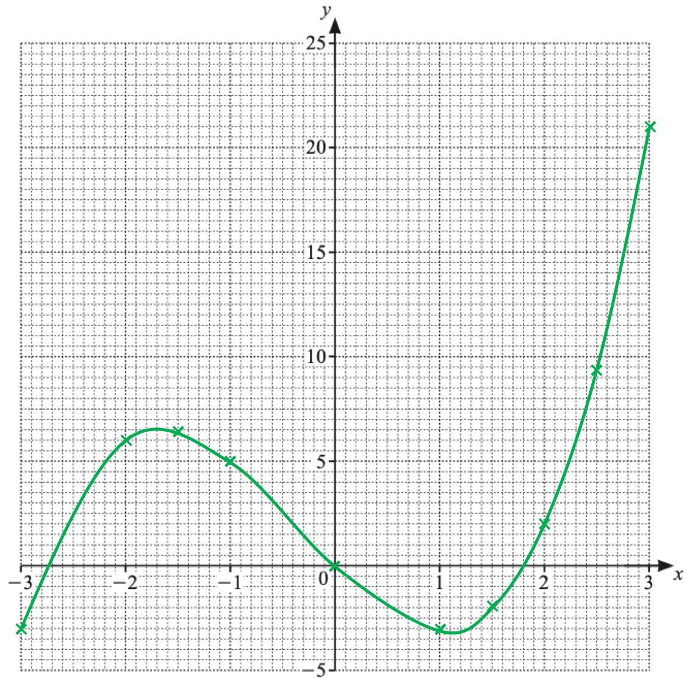

**5 or 6 points plotted correctly**** [1] **

**7 or 8 points plotted correctly*** ***[1]**

** 9 or 10 points plotted correctly*** ***[1] **

**Fully correct curve**** [1]**

> * *
> *Draw the line *$y=0$* by drawing a line through the axis. *

> *Identify where the curve and the line intersect.*

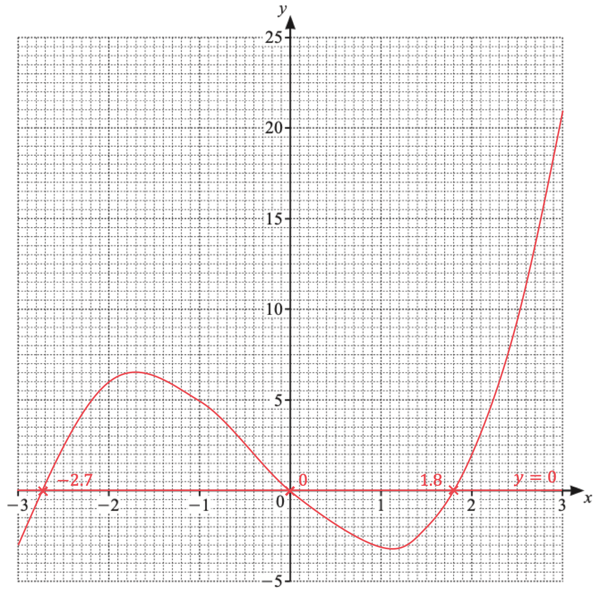

$x=-2.7\mathrm{or}x=0\mathrm{or}x=1.8$

*Two correct values*** [1] **
*All three values correct ***[1]**
**For the lower value, answers between -2.9 and -2.7 will be accepted. For the upper value, answers between 1.7 to 1.9 will be accepted.**
> *Draw a tangent on the curve at *$x=2$* and mark on two points that lie on the tangent, writing down their coordinates.*

> *Work out the gradient of the tangent by dividing the rise by the run or using the formula, *$m=\frac{y_{2}-y_{1}}{x_{2}-x_{1}}$*.*

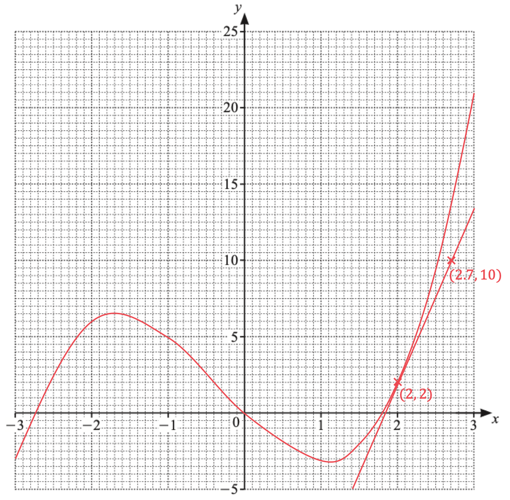

**[1]**

$m=\frac{10-2}{2.7-2}$

**[1]**

$m=\frac{8}{0.7}$

$m=11.42857...$

**11.4**** [1]**

**Answers between 10 and 14 will be accepted.**
> *You can use a ruler on top of the graph to model a horizontal line *$y=k$*. Start at the top of the graph and move it down until you find the first position where it intersects the y axis at a whole number (integer) value and intersects the curve exactly three times.*

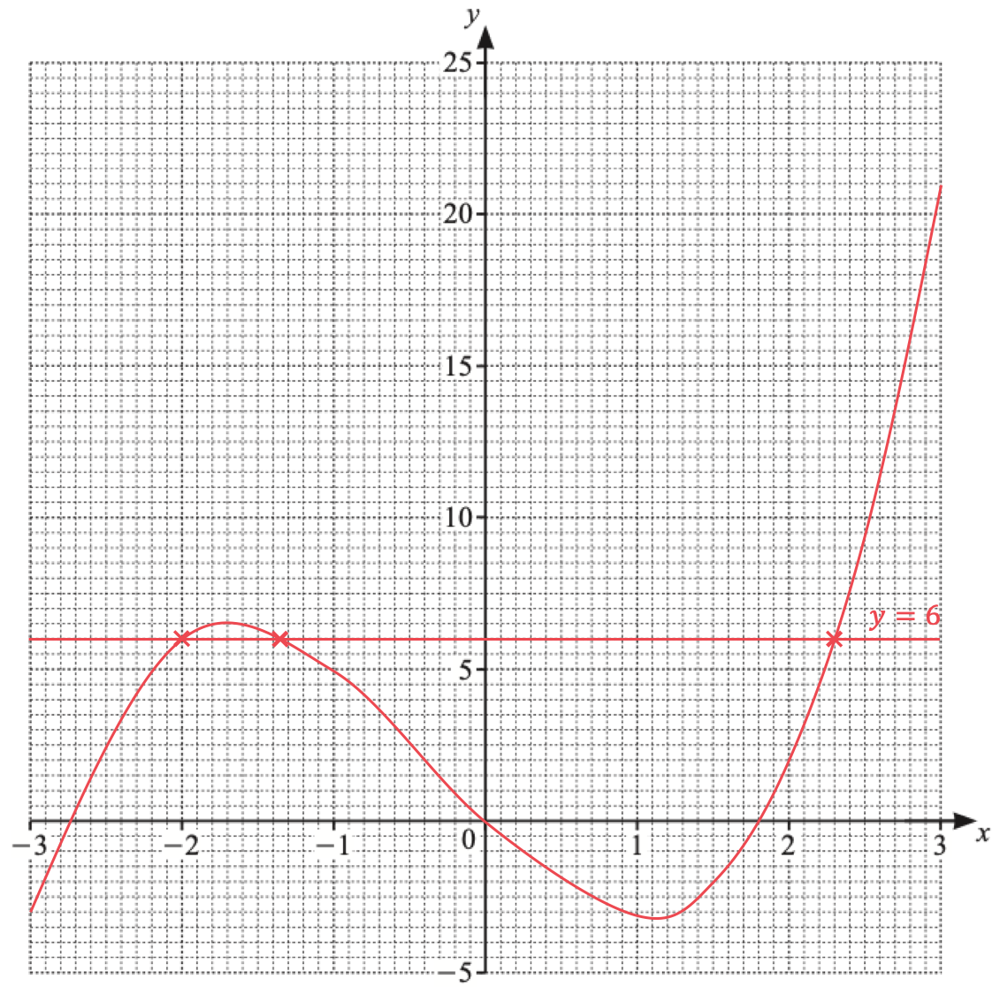

*The straight line *$y=6$* intersects the graph exactly three times and is the greatest whole number value at which this happens. So, *$y=k=6$*.*

**6 ****[1]**

### Q11
i) *Substitute each *$x$*-value into the equation *$y=x^{3}+3x+4$

`table row x equals cell negative 1 comma space space space space space y equals open parentheses negative 1 close parentheses cubed plus 3 left parenthesis negative 1 right parenthesis plus 4 space space space space space space equals negative 1 minus 3 plus 4 space space space space space space space space space space space space space equals 0 end cell row x equals cell negative 0.5 comma space y equals open parentheses negative 0.5 close parentheses cubed plus 3 left parenthesis negative 0.5 right parenthesis plus 4 equals negative 0.125 minus 1.5 plus 4 space equals 2.375 end cell row x equals cell 0 comma space space space space space space space space space y equals open parentheses 0 close parentheses cubed plus 3 left parenthesis 0 right parenthesis plus 4 space space space space space space space space space space space space space equals 0 plus 0 plus 4 space space space space space space space space space space space space space space space space space equals 4 end cell row blank blank blank end table`

> *You could also use your calculator's TABLE function to get the missing values if your calculator has it  *

| $x$ | $-1.5$ | $-1$ | $-0.5$ | $0$ | $0.5$ | $1$ | $1.5$ |
|---|---|---|---|---|---|---|---|
| $y$ | $-3.9$ | $0$ | $2.375$ | $4$ | $5.6$ | $8$ | $11.9$ |

**1 mark for each correct value in the table**** ****[3]**

ii) *Plot the points on the graph and join them with a smooth curve, paying attention to the different scales on the axes.*

> * On the **x-**axis, one small square = 0.05 units. On the **y-**axis, one small square = 0.2 units.*

> *For the point (-0.5, 2.375), round the *$y$*-coordinate to 1 decimal place and plot (-0.5, 2.4)*

> *Join the points with a smooth curve after they have been plotted*

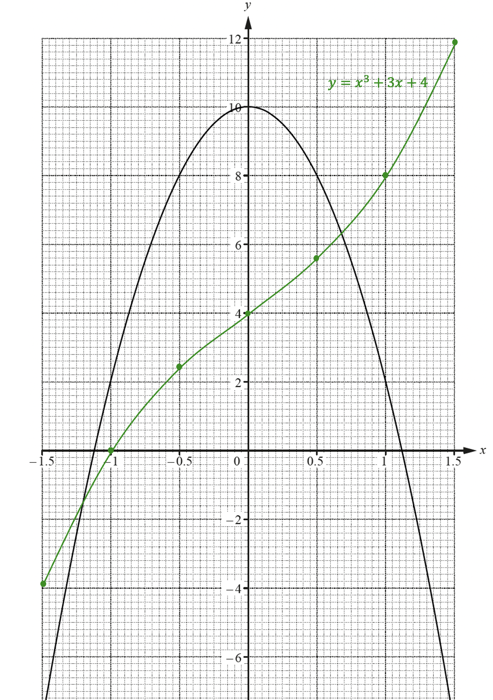

** all points plotted correctly**** ****[3]**
* ***smooth curve joining all the points**** ****[1]**
> *The points where the two curves intersect are where *$y=x^{3}+3x+4$* **and** *$y=10-8x^{2}$*. Thus we can write*

$x^{3}+3x+4=10-8x^{2}$

> *We need to complete the question, by collecting all terms on the left hand side*

$x^{3}+8x^{2}+3x-6=0$

**[1]**

**You must write both of the above lines to achieve this mark**
*We already have the graph of *$y=x^{3}+3x+4$*. Notice that the terms look similar to those in *$x^{3}+5x+2=0$*.* *We can manipulate "*$x^{3}+5x+2=0$*" to get "*$x^{3}+3x+4$*" on the LHS.*

> *First by subtracting *$2x$* from both sides*

`table attributes columnalign right center left columnspacing 0px end attributes row cell x cubed plus 5 x plus 2 end cell equals 0 row cell x cubed plus 3 x plus 2 end cell equals cell negative 2 x end cell end table`

> *Next we add 2 to both sides*

`table attributes columnalign right center left columnspacing 0px end attributes row cell x cubed plus 3 x plus 4 end cell equals cell negative 2 x plus 2 end cell end table`

**"**$y=-2x+2$**" ****seen ****[1]**

> *Plot *$y=-2x+2$* on the grid using facts that the *$y$*-intercept is (0, 2) and gradient is -2*

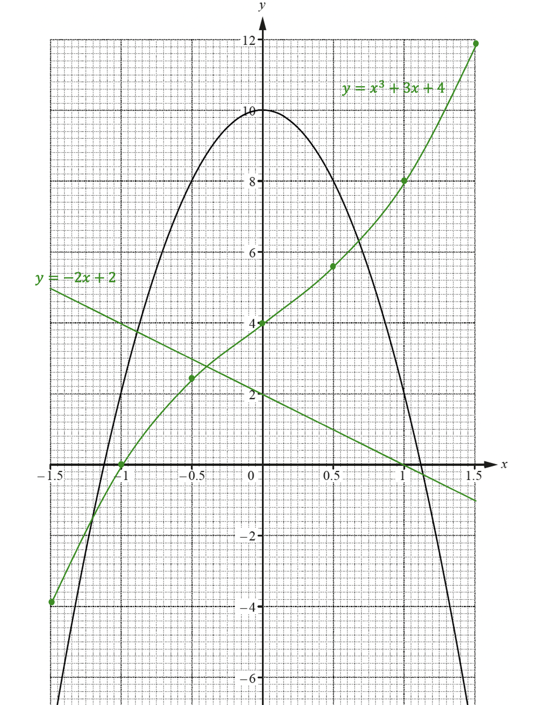

**correctly plotted line**** ****[1]**

> *Now read off the graph the *$x$*-value where  *$y=-2x+2$*  intersects  *$y=x^{3}+3x+4$

**-0.45 to -0.35 ****[1]**

**You are allowed any value within this range**

### Q12
> *Using your calculator, substitute the values of *$x$* into the equation *$y=2x+\frac{1}{x}-3$*.*

`x equals 0.5 comma space space y equals 2 cross times 0.5 plus fraction numerator 1 over denominator 0.5 end fraction minus 3 equals 0
x equals 0.75 comma space space y equals 2 cross times 0.75 plus fraction numerator 1 over denominator 0.75 end fraction minus 3 equals negative 0.1 6 with dot on top
x equals 2.5 comma space space y equals 2 cross times 2.5 plus fraction numerator 1 over denominator 2.5 end fraction minus 3 equals 2.4`

> *You could also use your calculator's TABLE function to get the missing values if your calculator has it *

| $x$ | 0.125 | 0.25 | 0.375 | 0.5 | 0.75 | 1 | 1.5 | 2 | 2.5 | 3 |
|---|---|---|---|---|---|---|---|---|---|---|
| $y$ | 5.25 | 1.5 | 0.42 | **Final answer:** **0** | **Final answer:** **-0.17** | 0 | 0.67 | 1.5 | **Final answer:** **2.4** | 3.33 |

** ****1 for each correct value*** ***[3]**
> *Plot the points and join with a smooth curve by hand.*

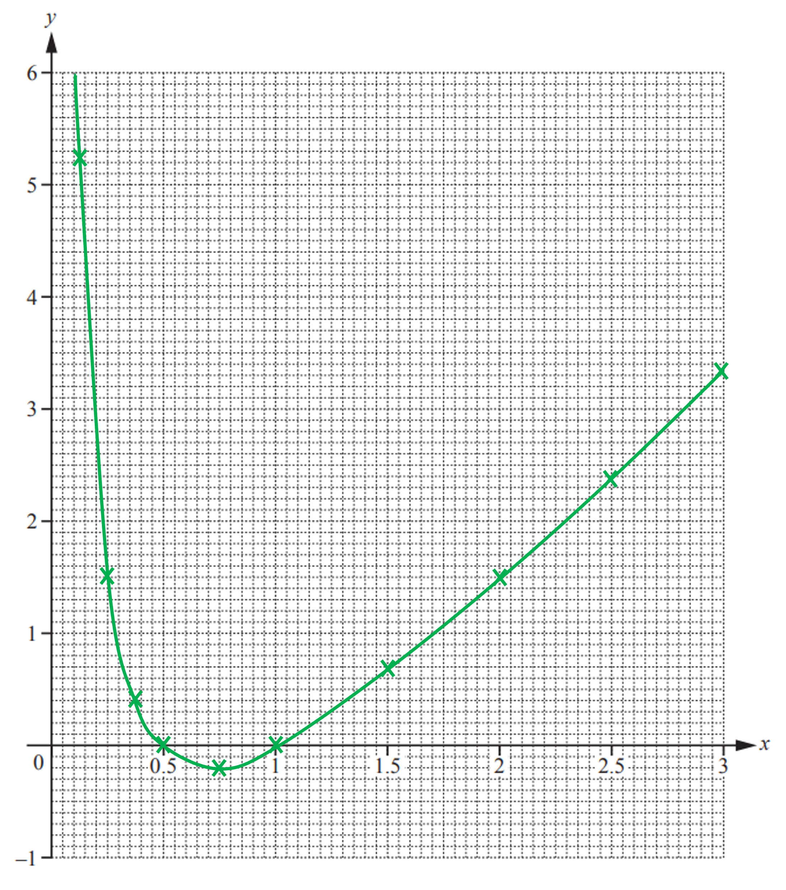

**5 points correctly plotted**** ****[1] **

**7 points correctly plotted**** ****[1]**

* ***9 points correctly plotted**** ****[1] **

**smooth curve connecting the points**** ****[1]**
> *Draw the line *$y=2$* (a horizontal line through 2 on the *$y$*-axis) on the grid as below.*

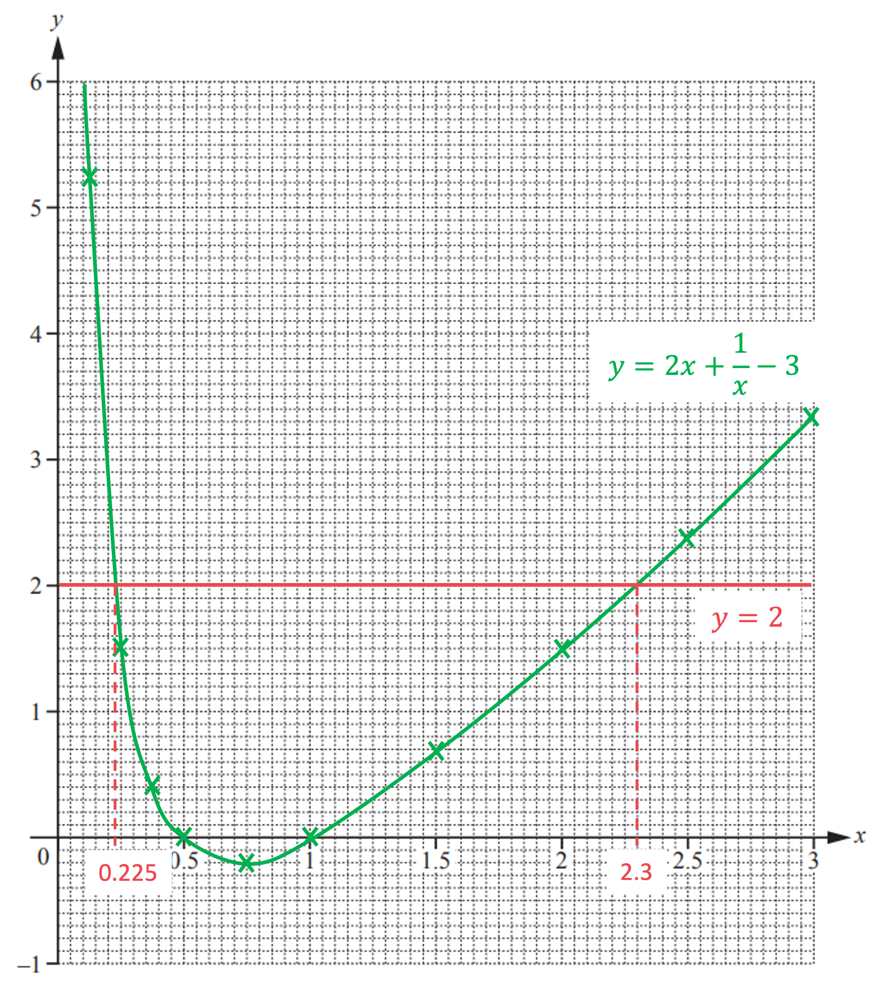

> *The points where the line *$y=2x+\frac{1}{x}-3$* and the line *$y=2$* intersect are where *$2x+\frac{1}{x}-3=2$*. *
*There is some margin of error here depending on your curve drawn in part (b). However for the curve above, these critical values are;*

$x=0.225$* **and** *$x=2.3$

*a value between 0.17 and 0.25, and a value between 2.25 and 2.3*** ****[1]**

> *But we want the values for which *$2x+\frac{1}{x}-3\geq2$*; so where the curve *$y=2x+\frac{1}{x}-3$* is **on or above** the line *$y=2$*. *

> *This occurs on or to the right of *$x=2.3$* and on or to the left of *$x=0.225$*. Write these regions using inequality signs *$\leq$* or *$\geq$*.*

> *The answer according to the above grid would be *$x\leq0.225,x\geq2.3$*.*

** **$x\leq0.17\mathrm{to}0.25$** ****[1]**

** **$x\geq2.25\mathrm{to}2.3$** ****[1] **

**Any values within these ranges permitted, consistent with your curve from part (b), and with correct inequality signs**
i)*We have the graph of *$y=2x+\frac{1}{x}-3$*. So we need to rearrange the equation *$\frac{1}{x}=7-3x$* so that "*$2x+\frac{1}{x}-3$*" appears on the left hand side.*

> *Start by adding *$2x$* to both sides*

`table row cell 1 over x end cell equals cell 7 minus 3 x end cell row cell 2 x plus 1 over x end cell equals cell 7 minus x space end cell end table`

> *Next subtract 3 from both sides*

`table row cell 2 x plus 1 over x minus 3 end cell equals cell 4 minus x space end cell end table`

**Final answer:** **Answer: **** **$y=4-x\mathrm{or}y=-x+4$** **

** "**$y=-x+...$**"**** [1]**

** "**$y=...+4$**" ****[1]**

ii)*Plot *$y=-x+4$* on the grid using the fact that the *$y$*-intercept is (0, 4) and the gradient is −1 (or *$\frac{\mathrm{rise}}{\mathrm{run}}=\frac{-1}{1}$* so go down 1 unit for every 1 unit right). *
*Be careful to note that the *$y$*-axis and the *$x$*-axis have different scales.*

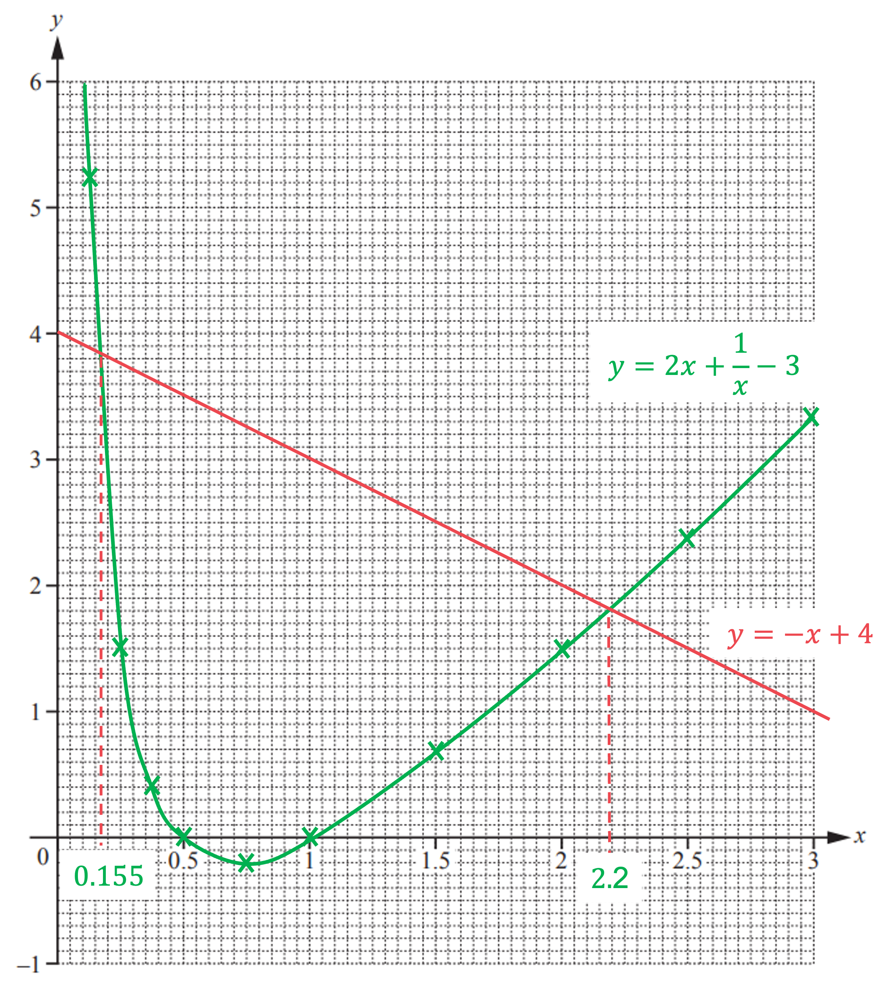

**correct line drawn**** [1]**

> *Read off the grid the *$x$*-values where the line and the curve intersect. There is some margin of error allowed due to your curve from part (b). *

> *The correct answers according to the grid above are 0.155 and 2.2.*

**0.125 to 0.2** **[1]**

**2.15 to 2.2**** ****[1]**

**Any two values within these ranges, consistent with your curve from part (b), is allowed**

### Q13
> *Substitute the **x** values into the expression. Remember to use brackets around negatives.*

`table row x equals cell negative 3 comma space y equals 3 over 10 left parenthesis negative 3 right parenthesis cubed minus 2 left parenthesis negative 3 right parenthesis space end cell row x equals cell negative 2 comma space y equals 3 over 10 left parenthesis negative 2 right parenthesis cubed minus 2 left parenthesis negative 2 right parenthesis space end cell row x equals cell 1 comma space y equals 3 over 10 left parenthesis 1 right parenthesis cubed minus 2 left parenthesis 1 right parenthesis space end cell row x equals cell 3 comma space y equals 3 over 10 left parenthesis 3 right parenthesis cubed minus 2 left parenthesis 3 right parenthesis space end cell end table`

> *You could also use your calculator's TABLE function to get the missing values if your calculator has it *

| $x$ | -3 | -2 | -1.5 | -1 | 0 | 1 | 1.5 | 2 | 3 |
|---|---|---|---|---|---|---|---|---|---|
| $y$ | **Final answer:** **-2.1** | **Final answer:** **1.6** | 2.0 | 1.7 | 0 | **Final answer:** **-1.7** | -2.0 | -1.6 | **Final answer:** **2.1** |

** ****2 correct values**** [1]**

**3 correct values**** [1]**

**4 correct values*** ***[1]**
> *Plot the 9 points from the table and join together with a smooth curve. Use a pencil to draw the curve and make sure the curve is not too thick otherwise it will make the following parts inaccurate.*

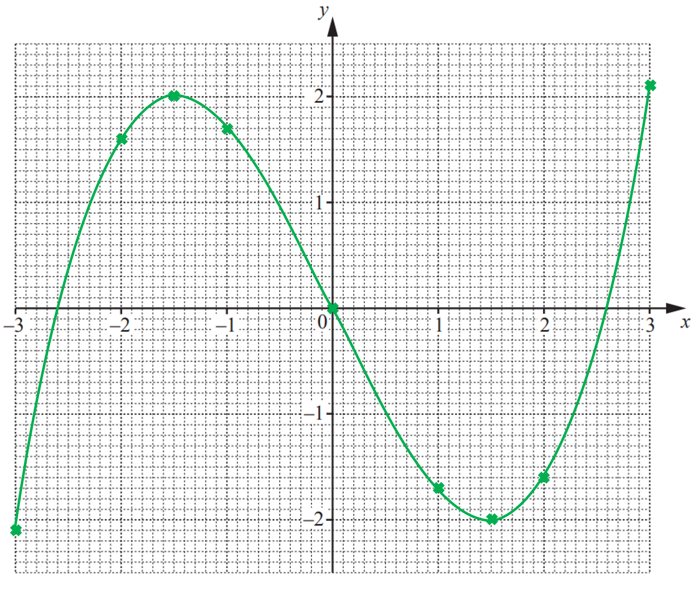

**At least 4 points plotted correctly**** [1]*** *
**At least 6 points plotted correctly*** ***[1]*** *
**At least 8 points plotted correctly**** [1]*** *
**All points and curve correct**** [****1]**** **
*You have already drawn the graph of *$y=\frac{3}{10}x^{3}-2x$*. To find the solutions of  *$\frac{3}{10}x^{3}-2x=\frac{1}{2}(1-x)$* draw the curve*$y=\frac{1}{2}(1-x).$ *This is the equation of a straight line. To draw the straight line, plot two points and draw a straight line going through them.*

`table row x equals cell negative 3 rightwards double arrow space y equals 1 half left parenthesis 1 minus left parenthesis negative 3 right parenthesis right parenthesis equals 2 end cell row x equals cell 3 rightwards double arrow y equals 1 half left parenthesis 1 minus 3 right parenthesis equals negative 1 end cell end table`

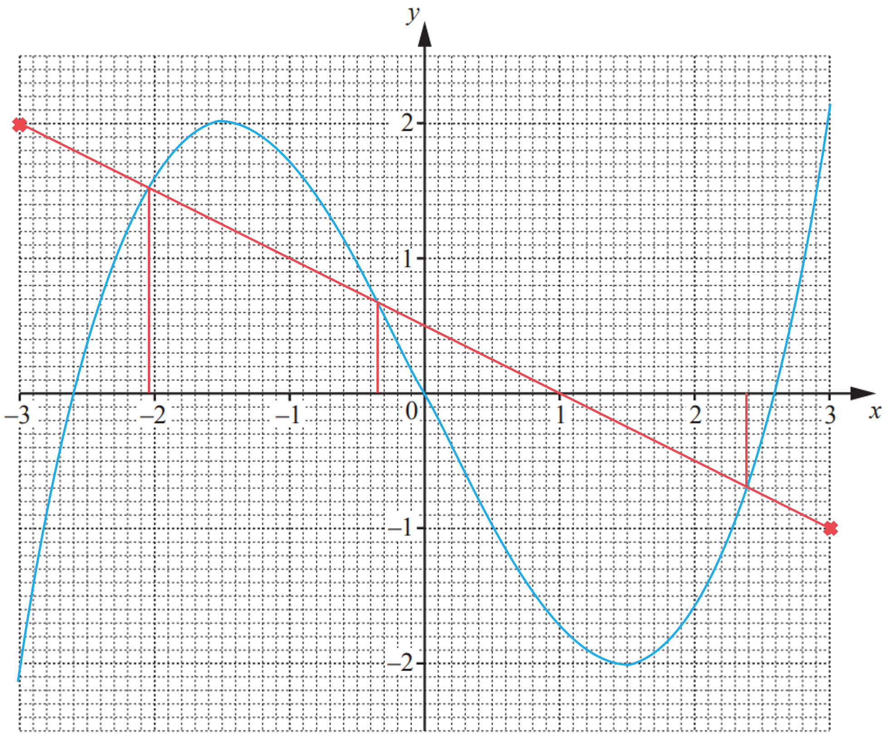

*Straight line passes through (0, 0.5)*** [1]** 
*Straight line has gradient -0.5** ***[1]**

> *At each point where the two graphs intersect, draw a vertical line from this point to the **x**-axis. And write down the **x**-values.*

$x=-2.04\mathrm{or}x=-0.35\mathrm{or}x=2.39$

**2 correct values**** [1]**
** ****3 correct values**** ****[1]** 
**Range of answers are accepted: -2.15 to -2.01, -0.45 to -0.20, 2.25 to 2.45**
> *The number of solutions to the equation *$\frac{3}{10}x^{3}-2x=1$* is equal to the number of intersections between the graphs of *$y=\frac{3}{10}x^{3}-2x$* and *$y=1.$

> *Imagine drawing the horizontal line *$y=1$* and count how many times it would intersect with the curve.*

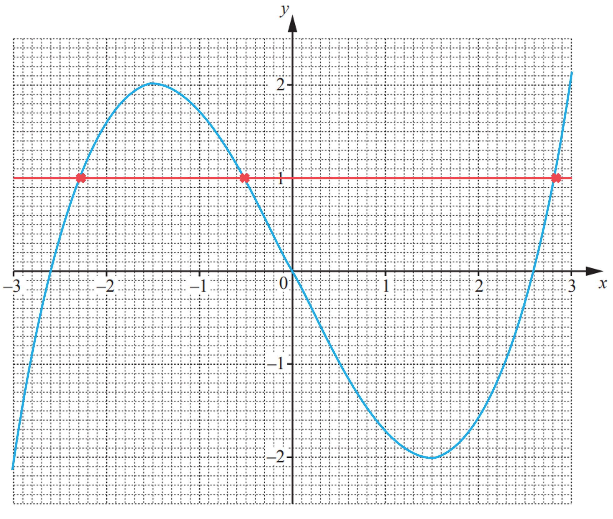

> *There are 3 intersections between the graphs so there are 3 solutions to the equation. *

$n=3$** ****[1]**

### Q14
*The solutions to the equation are the points of intersection of *$y=x^{2}-\frac{2}{x}-7$* and *$y=-3x$ *However the graph that is already shown is *$y=x^{2}-\frac{2}{x}-2$*, so we will add 5 to both sides*

$x^{2}-\frac{2}{x}-2=-3x+5$

> *This is still equivalent to the equation we are trying to solve, but we can now use the graph that is already drawn, and plot *$y=-3x+5$* ourselves, and find the intersections to solve the equation*

$y=-3x+5$* passes through (0,5) and has a gradient of -3; for every 1 unit right it moves down by 3 units* 
*You can also plot it by choosing two points on the line; e.g. when *$x=3,y=-4$* and when *$x=-2,y=11$

$y=-3x+5$** ****drawn*** ***[2]**

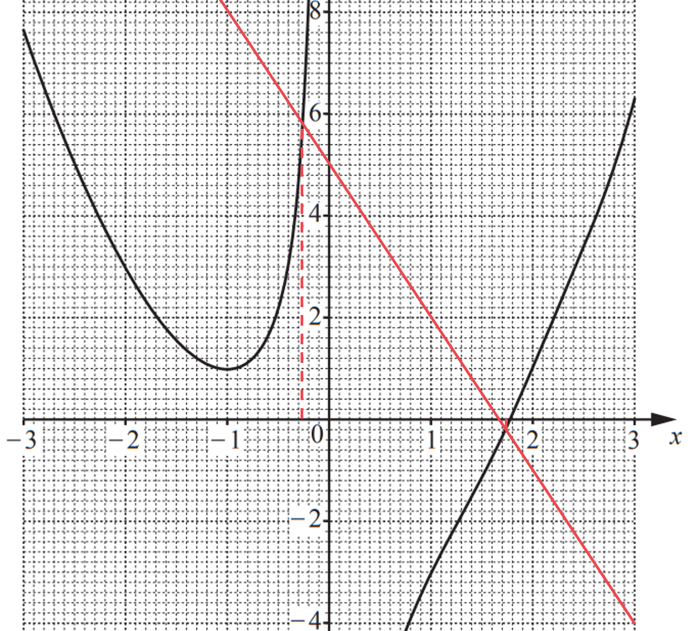

> *Reading off the **x**-values of the points of intersection*

$x=-0.28\mathrm{or}x=1.73$ **[2]** 
**-0.3 to -0.2 and 1.65 to 1.8 allowed**
*A tangent is a straight line which "just touches" the curve at a given point* *A tangent will have the same gradient as the curve at the point where they touch*

> *Drawing the tangent at *$x=-2$

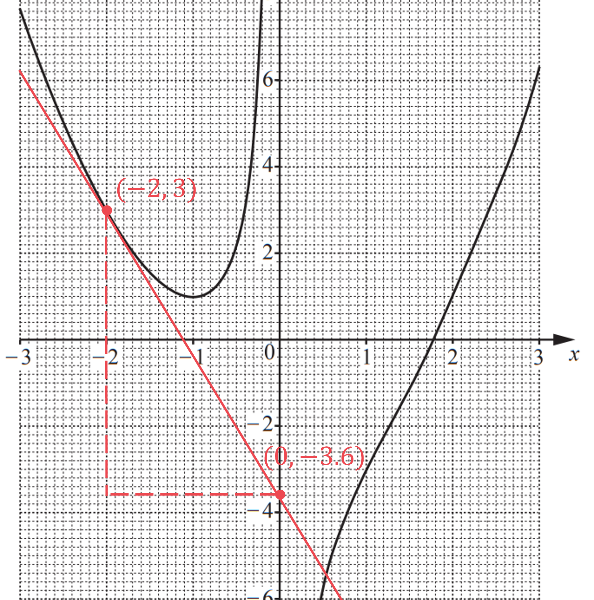

**Tangent drawn at**** **$x=-2$** [1]**

*To find the gradient, choose two points on the line, choosing points that are on a gridline will make it easier*

> *In this example we are using the points (-2,3) and (0,-3.6)*

$\mathrm{Gradient}=\frac{\mathrm{change} \mathrm{in}y}{\mathrm{change} \mathrm{in}x}$

$\mathrm{Gradient}=\frac{-3.6-3}{0--2}$

**[1]**

$\mathrm{Gradient}=\frac{-6.6}{2}=-3.3$

**-3.3** **[1]** 
**-4.5 to -2.5 allowed**
i) *Substitute each value of **x** into *$y=2^{-x}$* using your calculator, taking care to put negative **x** values in brackets*

*e.g. *`x equals negative 3 comma space y equals 2 to the power of negative open parentheses negative 3 close parentheses end exponent equals 8`

> *You could also use your calculator's TABLE function to get the missing values if your calculator has it *

| $x$ | -3 | -2 | -1 | 0 | 1 | 2 | 3 |
|---|---|---|---|---|---|---|---|
| $y$ | **Final answer:** **8** | **Final answer:** **4** | 2 | 1 | 0.5 | **Final answer:** **0.25** | 0.125 |

**Mark for each**** [3]**

ii)

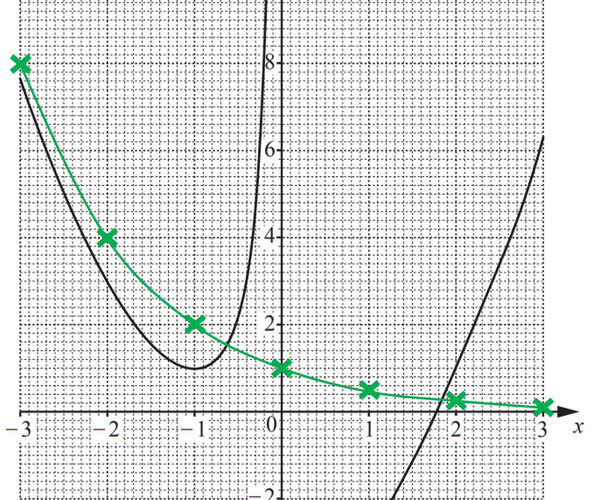

**4 or 5 correct points**** ****[1] **
**6 or 7 correct points**** [1]**
** ****All correct points**** ****[1]**

iii) *The solutions to *`text f end text open parentheses x close parentheses equals text g end text open parentheses x close parentheses`* are the intersections of the graphs*

> *Only one of these has a positive **x**-value*

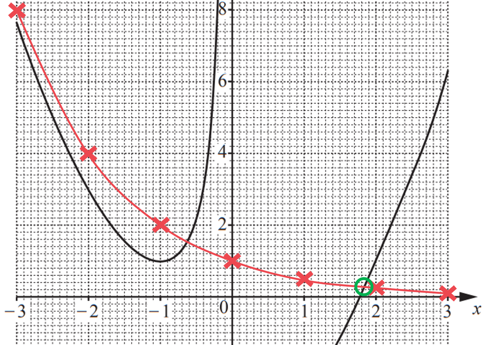

$x=1.85$ **[1]**

**1.8 to 1.9 allowed**

### Q15
> *Using *$y=\frac{1}{2x}-\frac{x}{4}$* to fill in the missing values of the table, by substituting in the **x**-values e.g.*

$x=0.2,y=\frac{1}{2\times0.2}-\frac{0.2}{4}=2.45$

> *You could also use your calculator's TABLE function to get the missing values if your calculator has it *

| $x$ | 0.15 | 0.2 | 0.5 | 1 | 1.5 | 2 | 2.5 | 3 | 3.5 |
|---|---|---|---|---|---|---|---|---|---|
| $y$ | 3.30 | **Final answer:** **2.45** | 0.88 | **Final answer:** **0.25** | -0.04 | **Final answer:** **-0.25** | -0.43 | -0.58 | -0.73 |

**Mark for each**** ****[3]**
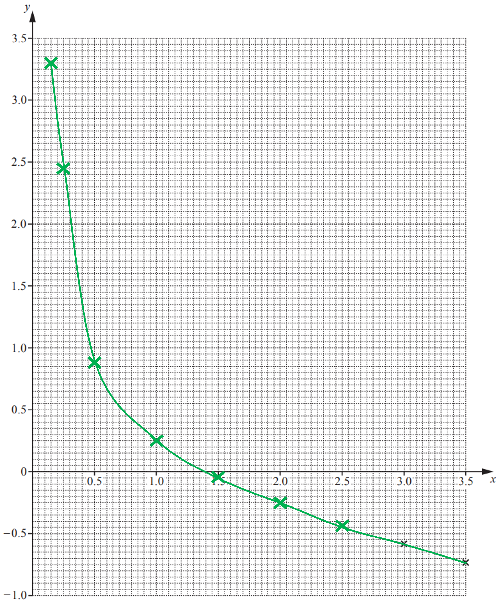

**2 or 3 points*** ***[1]** 
**4 or 5 points*** ***[1]** 
**6 or 7 points**** [1]** 
**Fully correct smooth curve**** ****[1]**
> $\frac{1}{2x}-\frac{x}{4}=\frac{1}{2}$* is where the graphs of *$y=\frac{1}{2x}-\frac{x}{4}$* and *$y=\frac{1}{2}$* intersect*

> *Sketch *$y=\frac{1}{2}$* on the graph, and read-off the point of intersection*

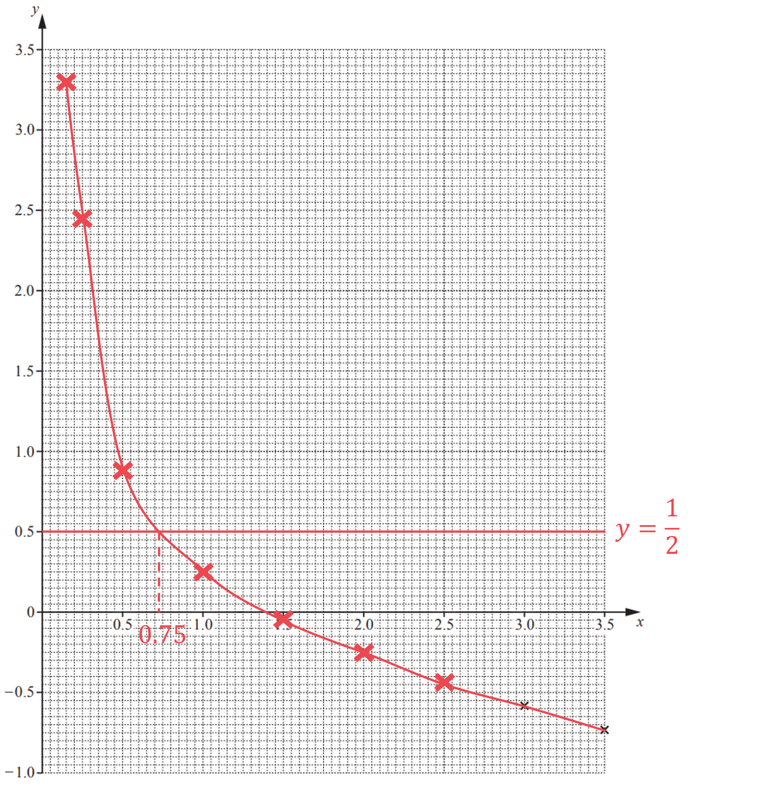

$(0.75,\frac{1}{2})$ **[1] **

**Marks awarded for ****x****-coordinate between 0.7 and 0.8**
i) *The line *$y=2-x$* has a gradient of -1, and a y-intercept of 2* *It may be easier to spot this by rearranging to *$y=-x+2$

*When drawing the line, start with the y-intercept* *Then, as the gradient is -1, the line must go 1 unit down, and 1 unit across*

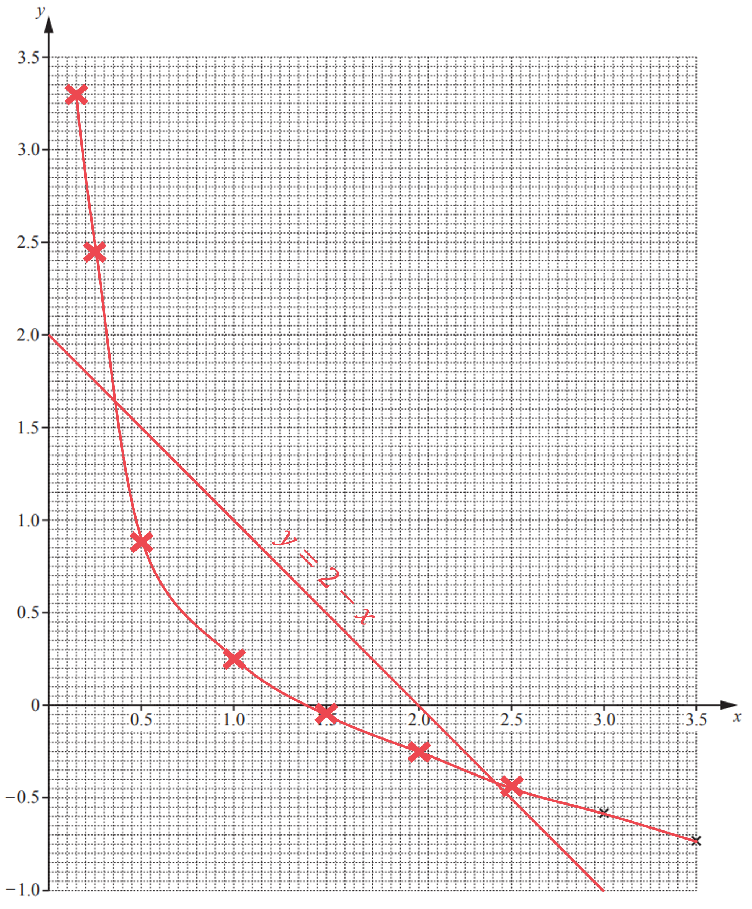

*Either through (0,2) or correct gradient*** [1]**
* **Fully correct*** [1]**

ii) *Using the drawn graph, read-off the x-coordinates of the points of intersection*

$x=0.28\mathrm{and}x=2.39$ **[2] **

**0.27 to 0.28 and 2.38 to 2.39 allowed, or can still be awarded full marks as long as accurately reading-off intersection of previously drawn graphs (follow-through marks)**
> *We can find what the y-value should be when *$x=\sqrt{2}$*, and then read-off the graph at this y-value to find the x-value which should be an approximation for *$\sqrt{2}$

> *Substituting *$x=\sqrt{2}$* into *$y=\frac{1}{2x}-\frac{x}{4}$

$y=\frac{1}{2\sqrt{2}}-\frac{\sqrt{2}}{4}$

**[1]**

> *You can use your calculator to evaluate this*

$y=0$

**So the x-value when y=0 (the x-intercept) will be an approximation for **$\sqrt{2}$** ****[1]**

### Q16
i) *A tangent touches the curve at one point - so in this case at the point where *$x=1$*.*

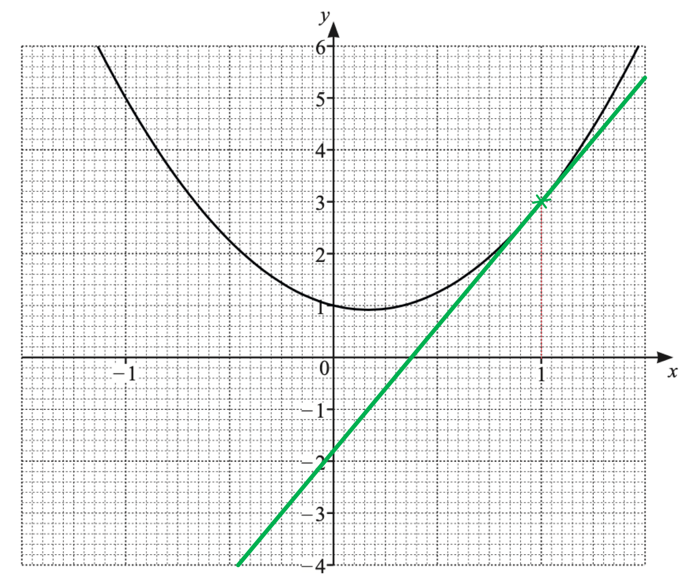

**[1]**

ii) *Draw a right-angled triangle from your tangent in part i) and calculate *$\frac{\mathrm{Rise}}{\mathrm{Run}}$*. Make your triangle big enough so you can clearly read values from the graph.*

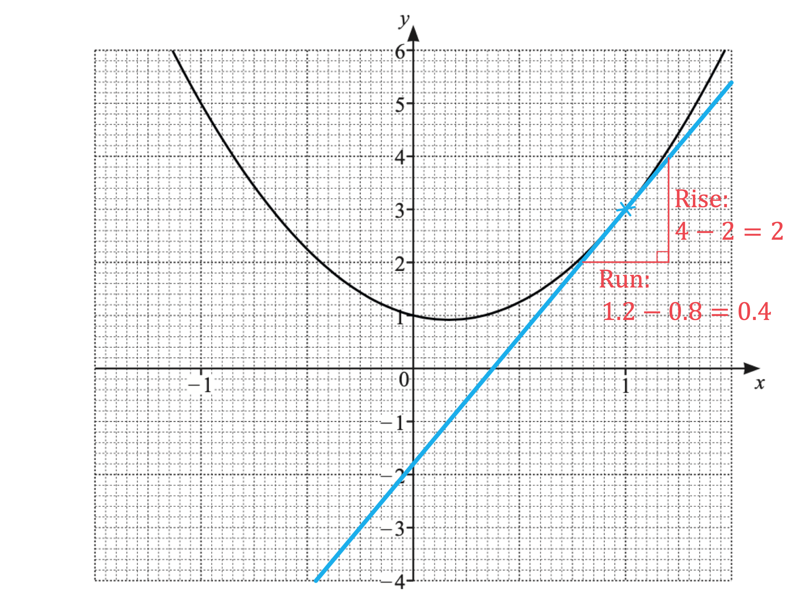

*Gradient *$=\frac{2}{0.4}=5$

**[1]**

**Gradient is 5 ****[1]**
**Any answer from 4.4 to 5.6 is allowed.**
> *In *$y=mx+c$*, we have the gradient (*$m=5$*), so we just need to read off the *$y$*-axis intercept (*$c$*).*

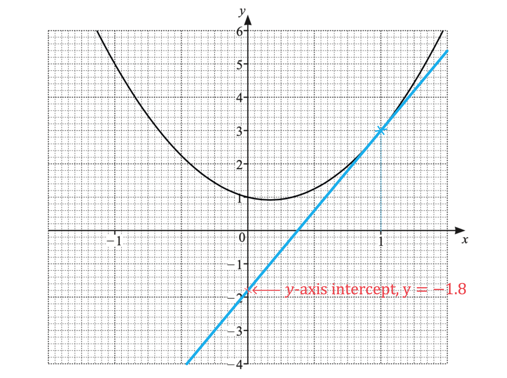

$y=5x-1.8$

*Correct gradient or intercept*** [1]*** *
*Both correct*** [1]**
**Gradient can be from 4.4 to 5.6. **
$y$**-axis intercept can be from -2.2 to -1.8.**

### Q17
> *Draw a straight line that goes through **P** and is a tangent to the curve.*

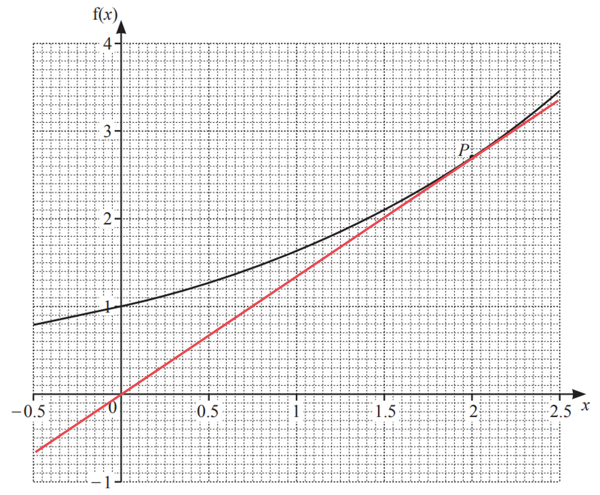

**[1]**

> *Pick two points on the straight line to help you find the gradient. It is easiest to choose the point **P **and the **y**-intercept of the line. Drawing a right angled triangle using the two points can help you to visualise the gradient.*

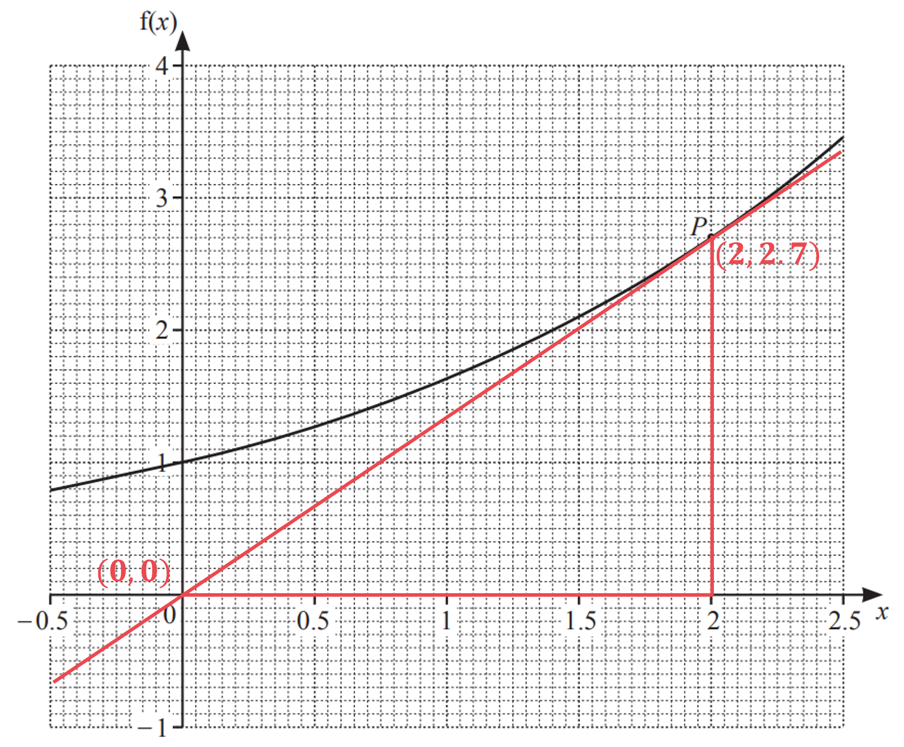

`open parentheses x subscript 1 comma space y subscript 1 close parentheses equals open parentheses 0 comma space 0 close parentheses` *and* `open parentheses x subscript 2 comma space y subscript 2 close parentheses equals open parentheses 2 comma space 2.7 close parentheses`

> *Find the gradient between the two points using the formula *$m=\frac{y_{2}-y_{1}}{x_{2}-x_{1}}.$* *

> *You can see from the graph that the gradient is positive so check your working if you end up with a negative value.*

$m=\frac{2.7-0}{2-0}$

**[1]**

**The gradient is 1.35** **[1]** 
**Your answer can be in the range 1.3 to 1.4**
