# Exam Questions — Further Graphs & Tangents
**Coordinate Geometry & Graphs** · Cambridge (CIE) IGCSE maths (0580 & 0980)
> Source: [https://www.savemyexams.com/igcse/maths/cie/25/extended/topic-questions/](https://www.savemyexams.com/igcse/maths/cie/25/extended/topic-questions/) · 17 questions across 1 sets

## Calculator Questions (17 questions)

### Q1 — medium — 6 marks

**Q1** [2 marks]

Complete the table of values for $y=x^{2}-2x$

| *x* | -2 | -1 | 0 | 1 | 2 | 3 | 4 |
|---|---|---|---|---|---|---|---|
| *y* |   | 3 | 0 |   |   | 3 |   |

*Source: 2013	June 1MA0/2H Q15A*

**Q1** [2 marks]

On the grid, draw the graph of *y* = *x*2 – 2*x* for values of *x* from –2 to 4

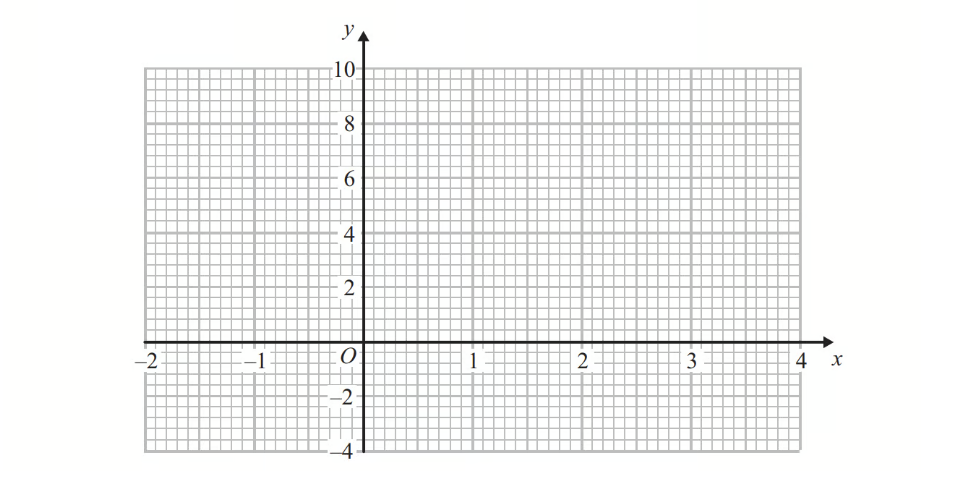

*Source: 2013	June 1MA0/2H Q15B*

**Q1** [2 marks]

Solve $x^{2}-2x-2=1$

*Source: 2013	June 1MA0/2H Q15C*

### Q2 — medium — 6 marks

**Q2** [2 marks]

Complete the table of values for $y=x^{2}-x-6$

| *x* | -3 | -2 | -1 | 0 | 1 | 2 | 3 |
|---|---|---|---|---|---|---|---|
| *y* | 6 |   |   | -6 |   |   |   |

*Source: 2018	June 1MA1/2H Q5A*

**Q2** [2 marks]

On the grid, draw the graph of $y=x^{2}-x-6$ for values of $x$ from $-3$ to $3$

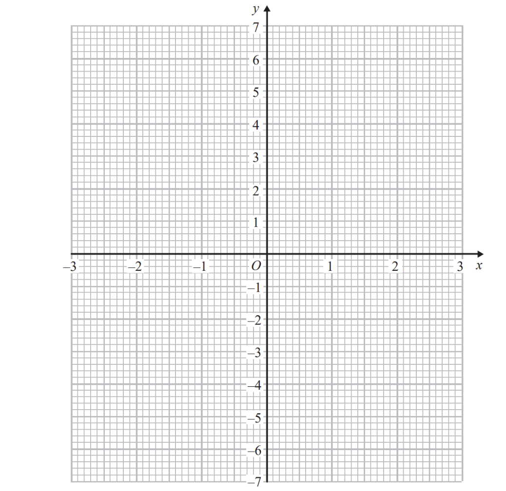

*Source: 2018	June 1MA1/2H Q5B*

**Q2** [2 marks]

Use your graph to find estimates of the solutions to the equation $x^{2}-x-6=-2$

*Source: 2018	June 1MA1/2H Q5C*

### Q3 — medium — 5 marks

**Q3** [2 marks]

The diagram shows part of the graph of  $y=x^{2}-2x+3$

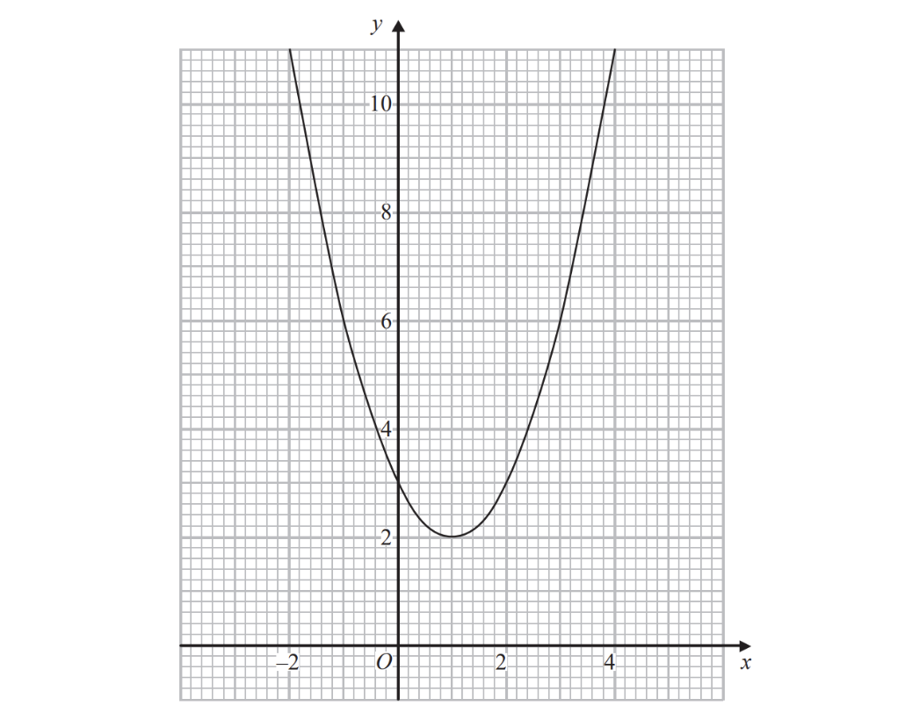

By drawing a suitable straight line, use your graph to find estimates for the solutions of $x^{2}-3x-1=0$

*Source: 2017	June 1MA1/2H Q20A*

**Q3** [3 marks]

*P* is the point on the graph of $y=x^{2}-2x+3$ where $x=2$

Calculate an estimate for the gradient of the graph at the point *P*.

*Source: 2017	June 1MA1/2H Q20B*

### Q4 — medium — 4 marks

**Q4** [1 mark]

The graph of $y=10-8x^{2}$ for  $-1.5\leqx\leq1.5$  is drawn on the grid.

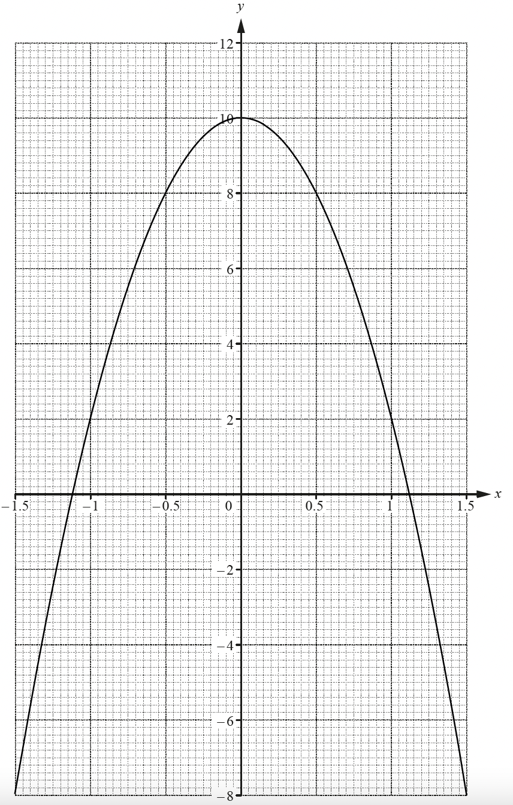

Write down the equation of the line of symmetry of the graph.

*Source: 2018	May/June 0580/41 Q7A*

**Q4** [3 marks]

On the grid, draw the tangent to the curve at the point where $x=0.5$.

Find the gradient of this tangent.

### Q5 — hard — 17 marks

**Q5** [3 marks]

The table shows some values of  $y=x^{3}-3x^{2}+x$.

| $x$ | -0.75 | -0.5 | -0.25 | 0 | 0.5 | 1 | 1.5 | 2 | 2.5 | 2.75 |
|---|---|---|---|---|---|---|---|---|---|---|
| $y$ | -2.9 | -1.4 | -0.5 |   | -0.1 | -1 | -1.9 |   | -0.6 |   |

Complete the table.

*Source: 2018	Oct/Nov 0580/41 Q3A*

**Q5** [3 marks]

**Extract:**

The table shows some values of  y = x^3 - 3x^2 + x.

| x    | -0.75 | -0.5 | -0.25 | 0 | 0.5 | 1 | 1.5 | 2 | 2.5 | 2.75 |
| y    | -2.9  | -1.4 | -0.5  |   | -0.1 | -1 | -1.9 |   | -0.6 |   |

On the grid, draw the graph of  $y=x^{3}-3x^{2}+x$  for  $-0.75\leqx\leq2.75$.

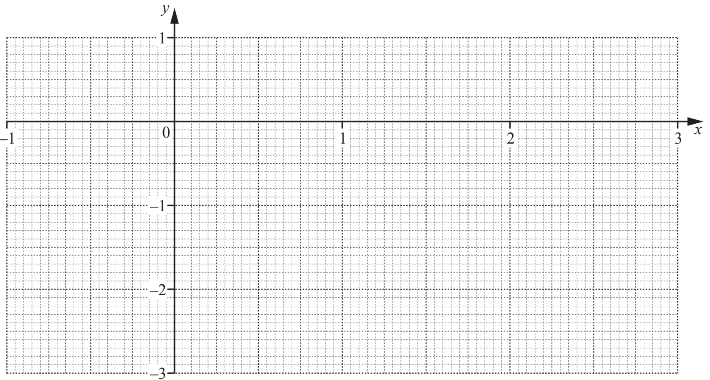

*Source: 2018	Oct/Nov 0580/41 Q3B*

**Q5** [3 marks]

**Extract:**

On the grid, draw the graph of  y = x^3 - 3x^2 + x  for  -0.75 ≤ x ≤ 2.75.

Use your graph to complete the inequalities in $x$ for which $y>-1$.

.................... $<x<$ .................... and  $x>$ ....................

*Source: 2018	Oct/Nov 0580/41 Q3C*

**Q5** [5 marks]

**Extract:**

On the grid, draw the graph of  y = x cubed minus 3 x squared plus x  for  -0.75 ≤ x ≤ 2.75.

The equation  $x^{3}-3x^{2}+2x-1=0$ can be solved by drawing a straight line on the grid.

i) Write down the equation of this line.

[2]

ii)On the grid, draw this line and use it to solve the equation  $x^{3}-3x^{2}+2x-1=0$.

$x$ = ............................................... [3]

*Source: 2018	Oct/Nov 0580/41 Q3D*

**Q5** [3 marks]

By drawing a suitable tangent, find an estimate for the gradient of the graph of  $y=x^{3}-3x^{2}+x$  at  $x=-0.25$.

*Source: 2018	Oct/Nov 0580/41 Q3E*

### Q6 — hard — 10 marks

**Q6** [2 marks]

$y=x^{2}+\frac{1}{x},x\neq0$

Complete the table.

| $x$ | 0.2 | 0.3 | 0.5 | 1 | 1.5 | 2 | 2.5 |
|---|---|---|---|---|---|---|---|
| $y$ | 5.0 | 3.4 | 2.3 |   | 2.9 |   | 6.7 |

*Source: 2020 Oct/Nov 0580/42 Q7A*

**Q6** [4 marks]

**Extract:**

| x | 0.2 | 0.3 | 0.5 | 1 | 1.5 | 2 | 2.5 |
| y | 5.0 | 3.4 | 2.3 |   | 2.9 |   | 6.7 |

On the grid, draw the graph of $y=x^{2}+\frac{1}{x}$ for $0.2\leqx\leq2.5.$ 
The graph of $y=x^{2}+\frac{1}{x}$ for $-2.5\leqx\leq-0.2$ has been drawn for you.

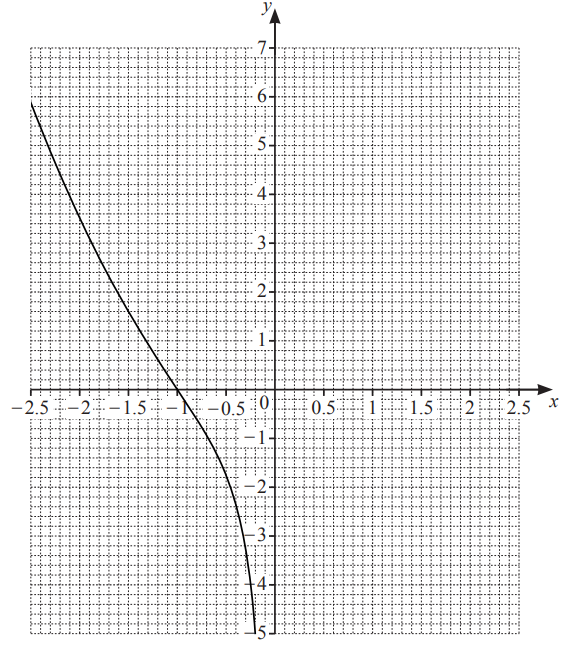

*Source: 2020 Oct/Nov 0580/42 Q7B*

**Q6** [3 marks]

**Extract:**

On the grid, draw the graph of y = x^2 + 1/x for 0.2 ≤ x ≤ 2.5. The graph of y = x^2 + 1/x for −2.5 ≤ x ≤ −0.2 has been drawn for you.

By drawing suitable straight lines on the grid, solve the following equations.

$\,$i) $x^{2}+\frac{1}{x}=-2$

$x=$ ................................................ [1]

$\,$ii)$x^{2}+\frac{1}{x}+x-1=0$

$x=$ ................................................ [2]

*Source: 2020 Oct/Nov 0580/42 Q7C*

**Q6** [1 mark]

$k$ is an integer and the equation $x^{2}+\frac{1}{x}=k$ has three solutions. Write down a possible value of $k$.

$k=$ ................................................

*Source: 2020 Oct/Nov 0580/42 Q7D*

### Q7 — hard — 17 marks

**Q7** [3 marks]

Complete the table of values for $y=\frac{x^{3}}{3}-\frac{1}{2x^{2}},x\neq0$.

| $x$ | $-3$ | $-2$ | $-1$ | $-0.5$ | $-0.3$ |   | $0.3$ | $0.5$ | $1$ | $2$ | $3$ |
|---|---|---|---|---|---|---|---|---|---|---|---|
| $y$ | $-9.1$ | $-2.8$ | $-0.8$ |   | $-5.6$ |   | $-5.5$ | $-2.0$ |   |   | $8.9$ |

*Source: 2018	May/June 0580/42 Q6A*

**Q7** [5 marks]

**Extract:**

Complete the table of values for y = x^3/3 - 1/(2x^2), x ≠ 0.

| x | -3 | -2 | -1 | -0.5 | -0.3 |   | 0.3 | 0.5 | 1 | 2 | 3 |
| y | -9.1 | -2.8 | -0.8 |   | -5.6 |   | -5.5 | -2.0 |   |   | 8.9 |

On the grid, draw the graph of $y=\frac{x^{3}}{3}-\frac{1}{2x^{2}}$ for $-3\leqx\leq-0.3$ and $0.3\leqx\leq3$.

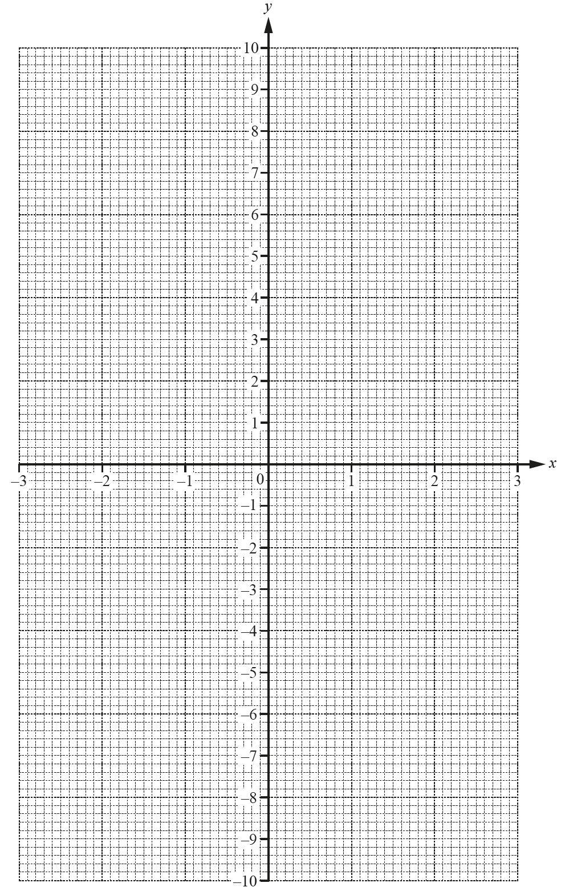

*Source: 2018	May/June 0580/42 Q6B*

**Q7** [5 marks]

**Extract:**

y equals x cubed over 3 minus 1 over 2 x squared, x not equal to 0.
On the grid, draw the graph of y equals x cubed over 3 minus 1 over 2 x squared for negative 3 less or equal than x less or equal than negative 0.3 and 0.3 less or equal than x less or equal than 3.

i) By drawing a suitable tangent, find an estimate of the gradient of the curve at $x=-2$.

[3]

ii) Write down the equation of the tangent to the curve at $x=-2$. Give your answer in the form $y=mx+c$.

$y=$ ................................................ [2]

*Source: 2018	May/June 0580/42 Q6C*

**Q7** [4 marks]

**Extract:**

Complete the table of values for y = x^3/3 - (1/2)x^2, x ≠ 0.
On the grid, draw the graph of y = x^3/3 - (1/2)x^2 for -3 ≤ x ≤ -0.3 and 0.3 ≤ x ≤ 3.

Use your graph to solve the equations.

i)$\frac{x^{3}}{3}-\frac{1}{2x^{2}}=0$

$x=$* *................................................ [1]

ii)$\frac{x^{3}}{3}-\frac{1}{2x^{2}}+4=0$

$x=$ .................... or $x=$ .................... or $x=$ .................... [3]

*Source: 2018	May/June 0580/42 Q6D*

### Q8 — medium — 3 marks

**Q8** [3 marks]

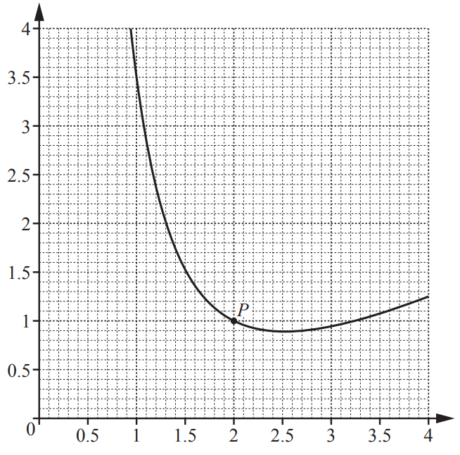

By drawing a suitable tangent, estimate the gradient of the curve at the point *P*.

*Source: 2019 March 0580/22 Q16*

### Q9 — hard — 14 marks

**Q9** [3 marks]

The table shows some values of  $y=\frac{x^{2}}{2}+\frac{1}{x^{2}}-\frac{2}{x}$, $x\neq0$.

| $x$ | $-3$ | $-2$ | $-1$ | $-0.5$ | $-0.3$ |   | $0.2$ | $0.3$ | $0.5$ | $1$ | $2$ | $3$ |
|---|---|---|---|---|---|---|---|---|---|---|---|---|
| $y$ | $5.3$ | $3.3$ |   | $8.1$ | $17.8$ |   |   | $4.5$ | $0.1$ | $-0.5$ | $1.3$ |   |

Complete the table.

*Source: 2019	Oct/Nov 0580/42 Q5A*

**Q9** [5 marks]

**Extract:**

The table shows some values of  y = x^2/2 + 1/x^2 - 2/x, x ≠ 0.

| x | -3 | -2 | -1 | -0.5 | -0.3 |   | 0.2 | 0.3 | 0.5 | 1 | 2 | 3 |
| y | 5.3 | 3.3 |   | 8.1 | 17.8 |   |   | 4.5 | 0.1 | -0.5 | 1.3 |   |
 Complete the table.

On the grid, draw the graph of  $y=\frac{x^{2}}{2}+\frac{1}{x^{2}}-\frac{2}{x}$  for  $-3\leqx\leq-0.3$  and  $0.2\leqx\leq3$.

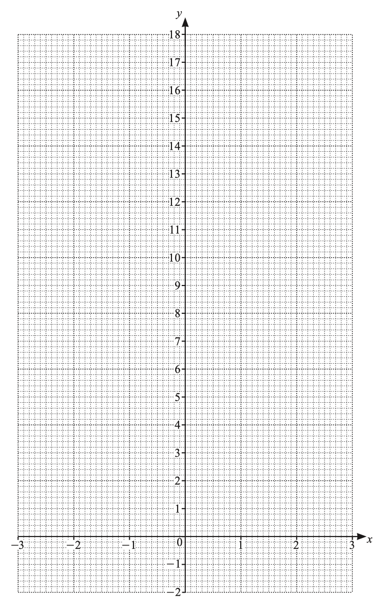

*Source: 2019	Oct/Nov 0580/42 Q5B*

**Q9** [2 marks]

**Extract:**

On the grid, draw the graph of  y = x^2/2 + 1/x^2 - 2/x  for  -3 ≤ x ≤ -0.3  and  0.2 ≤ x ≤ 3.

Use your graph to solve  $\frac{x^{2}}{2}+\frac{1}{x^{2}}-\frac{2}{x}\leq0$.

..................... $\leqx\leq$ ....................

*Source: 2019	Oct/Nov 0580/42 Q5C*

**Q9** [1 mark]

Find the smallest positive integer value of $k$ for which  $\frac{x^{2}}{2}+\frac{1}{x^{2}}-\frac{2}{x}=k$ has two solutions for  $-3\leqx\leq-0.3$  and  $0.2\leqx\leq3$.

*Source: 2019	Oct/Nov 0580/42 Q5D*

**Q9** [3 marks]

**Extract:**

The table shows some values of  y = x^2/2 + 1/x^2 - 2/x, x ≠ 0.
| x | -3 | -2 | -1 | -0.5 | -0.3 |   | 0.2 | 0.3 | 0.5 | 1 | 2 | 3 |
| y | 5.3 | 3.3 |   | 8.1 | 17.8 |   |   | 4.5 | 0.1 | -0.5 | 1.3 |   |

By drawing a suitable straight line, solve  $\frac{x^{2}}{2}+\frac{1}{x^{2}}-\frac{2}{x}=3x+1$  for  $-3\leqx\leq-0.3$  and  $0.2\leqx\leq3$.

$x$ = ...................................................

*Source: 2019	Oct/Nov 0580/42 Q5E*

### Q10 — hard — 13 marks

**Q10** [3 marks]

The table shows some values for $y=x^{3}+x^{2}-5x$.

| $x$ | $-3$ | $-2$ | $-1.5$ | $-1$ | $0$ | $1$ | $1.5$ | $2$ | $2.5$ | $3$ |
|---|---|---|---|---|---|---|---|---|---|---|
| $y$ | $-3$ | $6$ | $6.4$ |   | $0$ |   | $-1.9$ | $2$ | $9.4$ |   |

Complete the table.

*Source: 2019	Oct/Nov 0580/43 Q3A*

**Q10** [4 marks]

**Extract:**

The table shows some values for y = x^3 + x^2 - 5x.

| x  | -3 | -2 | -1.5 | -1 | 0 | 1 | 1.5 | 2 | 2.5 | 3 |
| y  | -3 | 6  | 6.4  |   | 0 |   | -1.9 | 2 | 9.4 |   |

On the grid, draw the graph of  $y=x^{3}+x^{2}-5x$  for  $-3\leqx\leq3$.

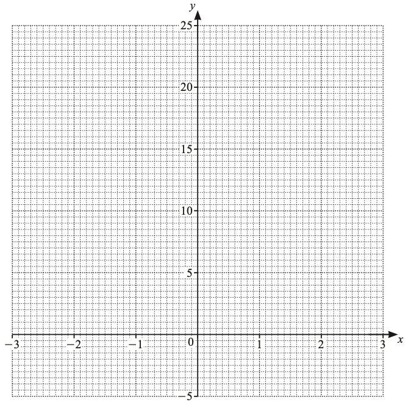

*Source: 2019	Oct/Nov 0580/43 Q3B*

**Q10** [2 marks]

**Extract:**

On the grid, draw the graph of  y = x cubed plus x squared minus 5 x  for  -3 ≤ x ≤ 3.

Use your graph to solve the equation  $x^{3}+x^{2}-5x=0$.

$x$ = ..................... or $x$ = ..................... or $x$ = .....................

*Source: 2019	Oct/Nov 0580/43 Q3C*

**Q10** [3 marks]

**Extract:**

On the grid, draw the graph of  y = x cubed plus x squared minus 5 x  for  -3 ≤ x ≤ 3.

By drawing a suitable tangent, find an estimate of the gradient of the curve at $x=2$.

*Source: 2019	Oct/Nov 0580/43 Q3D*

**Q10** [1 mark]

**Extract:**

The table shows some values for y = x^3 + x^2 - 5x.

| x  | -3 | -2 | -1.5 | -1 | 0 | 1 | 1.5 | 2 | 2.5 | 3 |
| y  | -3 | 6  | 6.4  |   | 0 |   | -1.9 | 2 | 9.4 |   |

Write down the largest value of the integer, $k$, so that the equation  $x^{3}+x^{2}-5x=k$  has three solutions for  $-3\leqx\leq3$.

$k$ = ..................................................

*Source: 2019	Oct/Nov 0580/43 Q3E*

### Q11 — very_hard — 11 marks

**Q11** [7 marks]

The graph of $y=10-8x^{2}$ for  $-1.5\leqx\leq1.5$  is drawn on the grid.

And the table shows some values for $y=x^{3}+3x+4$.

| $x$ | $-1.5$ | $-1$ | $-0.5$ | $0$ | $0.5$ | $1$ | $1.5$ |
|---|---|---|---|---|---|---|---|
| $y$ | $-3.9$ |   |   |   | $5.6$ | $8$ | $11.9$ |

i) Complete the table.

[3]

ii) On the grid, draw the graph of $y=x^{3}+3x+4$ for $-1.5\leqx\leqx1.5$.

[4]

*Source: 2018	May/June 0580/41 Q7C*

**Q11** [1 mark]

**Extract:**

The graph of y = 10 - 8x^2 for -1.5 ≤ x ≤ 1.5 is drawn on the grid.
And the table shows some values for y = x^3 + 3x + 4.

Show that the values of $x$ where the two curves intersect are the solutions to the equation $x^{3}+8x^{2}+3x-6=0$.

*Source: 2018	May/June 0580/41 Q7D*

**Q11** [3 marks]

By drawing a suitable straight line, solve the equation $x^{3}+5x+2=0$  for  $-1.5\leqx\leq1.5$.

$x=$*..............................................*

*Source: 2018	May/June 0580/41 Q7E*

### Q12 — very_hard — 15 marks

**Q12** [3 marks]

The table shows some values for $y=2x+\frac{1}{x}-3$ for  $0.125\leqx\leq3.$

| $x$ | 0.125 | 0.25 | 0.375 | 0.5 | 0.75 | 1 | 1.5 | 2 | 2.5 | 3 |
|---|---|---|---|---|---|---|---|---|---|---|
| $y$ | 5.25 | 1.5 | 0.42 |   |   | 0 | 0.67 | 1.5 |   | 3.33 |

Complete the table.

*Source: 2018	Feb/Mar 0580/42 Q3A*

**Q12** [4 marks]

**Extract:**

The table shows some values for y = 2x + 1/(x - 3) for 0.125 ≤ x ≤ 3.

| x | 0.125 | 0.25 | 0.375 | 0.5 | 0.75 | 1 | 1.5 | 2 | 2.5 | 3 |
| y | 5.25 | 1.5 | 0.42 |   |   | 0 | 0.67 | 1.5 |   | 3.33 |
Complete the table.

On the grid, draw the graph of $y=2x+\frac{1}{x}-3$ for $0.125\leqx\leq3.$

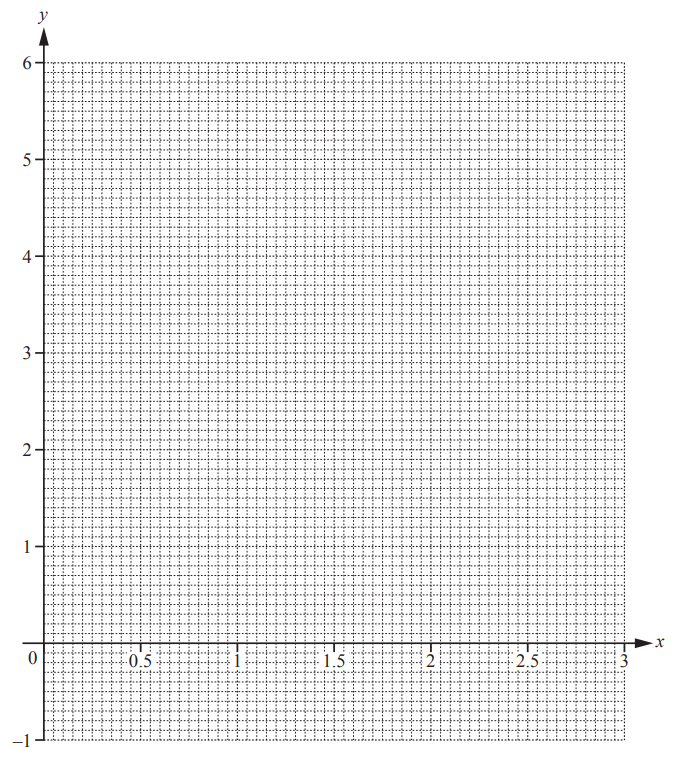

*Source: 2018	Feb/Mar 0580/42 Q3B*

**Q12** [3 marks]

**Extract:**

On the grid, draw the graph of y = (2x + 1)/(x - 3) for 0.125 ≤ x ≤ 3.

Use your graph to solve $2x+\frac{1}{x}-3\geq2.$

.................................................   .................................................

*Source: 2018	Feb/Mar 0580/42 Q3C*

**Q12** [5 marks]

**Extract:**

On the grid, draw the graph of y = (2x + 1)/(x - 3) for 0.125 ≤ x ≤ 3.

The equation $\frac{1}{x}=7-3x$ can be solved using your graph in **part (b)** and a straight line.

i) Write down the equation of this straight line.

[2]

ii) Draw this straight line and solve the equation $\frac{1}{x}=7-3x.$

$x=$.................... or $x=$.................... [3]

*Source: 2018	Feb/Mar 0580/42 Q3D*

### Q13 — hard — 12 marks

**Q13** [3 marks]

The table shows some values for $y=\frac{3}{10}x^{3}-2x$ for $-3\leqx\leq3$.

| $x$ | -3 | -2 | -1.5 | -1 | 0 | 1 | 1.5 | 2 | 3 |
|---|---|---|---|---|---|---|---|---|---|
| $y$ |   |   | 2.0 | 1.7 | 0 |   | -2.0 | -1.6 |   |

Complete the table.

*Source: 2019 March 0580/42 Q5A*

**Q13** [4 marks]

On the grid, draw the graph of $y=\frac{3}{10}x^{3}-2x$ for $-3\leqx\leq3$.

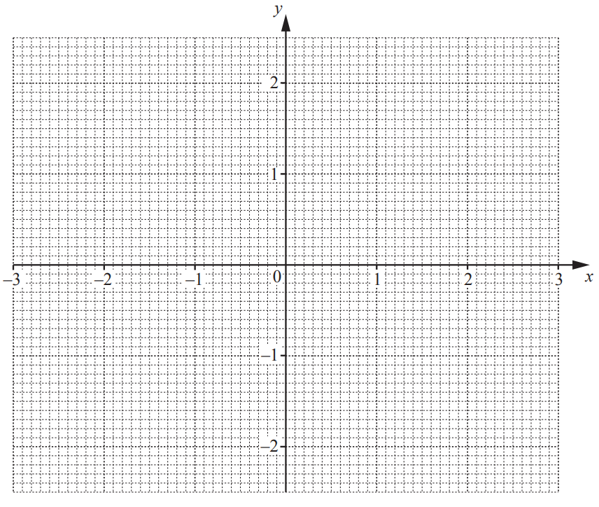

*Source: 2019 March 0580/42 Q5B*

**Q13** [4 marks]

**Extract:**

On the grid, draw the graph of y = 3/10 x^3 - 2x for -3 <= x <= 3.
On the grid, draw a suitable straight line to solve the equation 3/10 x^3 - 2x = 1/2 (1 - x) for -3 <= x <= 3.

On the grid, draw a suitable straight line to solve the equation $\frac{3}{10} x^{3} - 2 x = 1 \frac{1}{2} ( 1 - x )$ for $-3\leqx\leq3.$

$x=$....................... or $x=$....................... or $x=$......................

*Source: 2019 March 0580/42 Q5C*

**Q13** [1 mark]

**Extract:**

The table shows some values for y = 3/10 x^3 - 2x for -3 ≤ x ≤ 3.

| x | -3 | -2 | -1.5 | -1 | 0 | 1 | 1.5 | 2 | 3 |
| y |   |   | 2.0 | 1.7 | 0 |   | -2.0 | -1.6 |   |
Complete the table.

For $-3\leqx\leq3$, the equation $\frac{3}{10}x^{3}-2x=1$ has $n$ solutions.   Write down the value of $n$.

$n=$..................................................

*Source: 2019 March 0580/42 Q5D*

### Q14 — very_hard — 14 marks

**Q14** [4 marks]

The diagram shows the graph of $y = f ( x )$ where $f ( x ) = x^{2} - \frac{2}{x} - 2 , x \ne 0$.

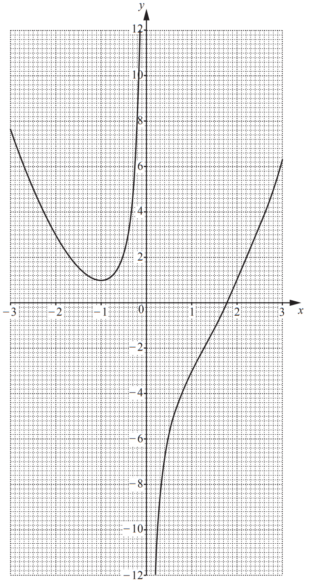

On the grid, draw a suitable straight line to solve the equation $x^{2}-\frac{2}{x}-7=-3x$ for $-3\leqx\leq3$.

$x$ = ...................... or $x$ = ..........................

*Source: 2019	May/June 0580/43 Q5B*

**Q14** [3 marks]

**Extract:**

The diagram shows the graph of y = f(x) where f(x) = (x^2 - 2)/(x - 2), x ≠ 0.

By drawing a suitable tangent, find an estimate of the gradient of the curve at $x=-2$.

*Source: 2019	May/June 0580/43 Q5C*

**Q14** [7 marks]

**Extract:**

The diagram shows the graph of y = f(x) where f(x) = (x^2 - 2)/(x - 2), x ≠ 0.

i) Complete the table for $y=\text{g}(x)$ where $\text{g}(x)=2^{-x}$ for $-3\leqx\leq3$.

| $x$ | -3 | -2 | -1 | 0 | 1 | 2 | 3 |
|---|---|---|---|---|---|---|---|
| $y$ |   |   | 2 | 1 | 0.5 |   | 0.125 |

[3]

ii) On the grid, draw the graph of $y=\text{g}(x)$.

[3]

iii) Use your graph to find the **positive **solution to the equation $\text{f}(x)=\text{g}(x)$.

$x$ = .............................................. [1]

*Source: 2019	May/June 0580/43 Q5D*

### Q15 — very_hard — 14 marks

**Q15** [3 marks]

The table shows some values of $y=\frac{1}{2x}-\frac{x}{4}$ for $0.15\leqx\leq3.5.$

| $x$ | 0.15 | 0.2 | 0.5 | 1 | 1.5 | 2 | 2.5 | 3 | 3.5 |
|---|---|---|---|---|---|---|---|---|---|
| $y$ | 3.30 |   | 0.88 |   | -0.04 |   | -0.43 | -0.58 | -0.73 |

Complete the table.

*Source: 2019	May/June 0580/42 Q5A*

**Q15** [4 marks]

**Extract:**

The table shows some values of y = 1/(2x) - x/4 for 0.15 <= x <= 3.5.

| x   | 0.15 | 0.2 | 0.5 | 1 | 1.5 | 2 | 2.5 | 3 | 3.5 |
| y   | 3.30 |     | 0.88 |   | -0.04 |   | -0.43 | -0.58 | -0.73 |

On the grid, draw the graph of $y=\frac{1}{2x}-\frac{x}{4}$ for $0.15\leqx\leq3.5.$ The last two points have been plotted for you.

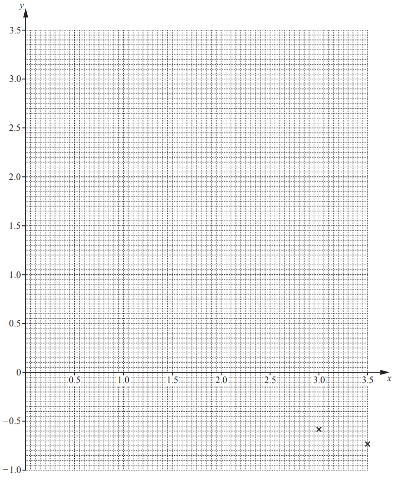

*Source: 2019	May/June 0580/42 Q5B*

**Q15** [1 mark]

**Extract:**

The table shows some values of y = (1/(2x)) - (x/4) for 0.15 ≤ x ≤ 3.5.

Use your graph to solve the equation $\frac{1}{2x}-\frac{x}{4}=\frac{1}{2}$ for $0.15\leqx\leq3.5.$

$x$= ..............................................

*Source: 2019	May/June 0580/42 Q5C*

**Q15** [4 marks]

**Extract:**

The table shows some values of y = 1/(2x) - x/4 for 0.15 ≤ x ≤ 3.5.

| x | 0.15 | 0.2 | 0.5 | 1 | 1.5 | 2 | 2.5 | 3 | 3.5 |
| y | 3.30 |   | 0.88 |   | -0.04 |   | -0.43 | -0.58 | -0.73 |

i) On the grid, draw the line $y=2-x.$

[2]

ii) Write down the x co-ordinates of the points where the line $y=2-x$ crosses the graph of $y=\frac{1}{2x}-\frac{x}{4}$ for $0.15\leqx\leq3.5$.

$x$ = .................... and $x$ = .................... [2]

*Source: 2019	May/June 0580/42 Q5D*

**Q15** [2 marks]

**Extract:**

The table shows some values of y = 1/(2x) - x/4 for 0.15 ≤ x ≤ 3.5.

Show that the graph of $y=\frac{1}{2x}-\frac{x}{4}$ can be used to find the value of $\sqrt{2}$ for $0.15\leqx\leq3.5.$

*Source: 2019	May/June 0580/42 Q5E*

### Q16 — medium — 5 marks

**Q16** [3 marks]

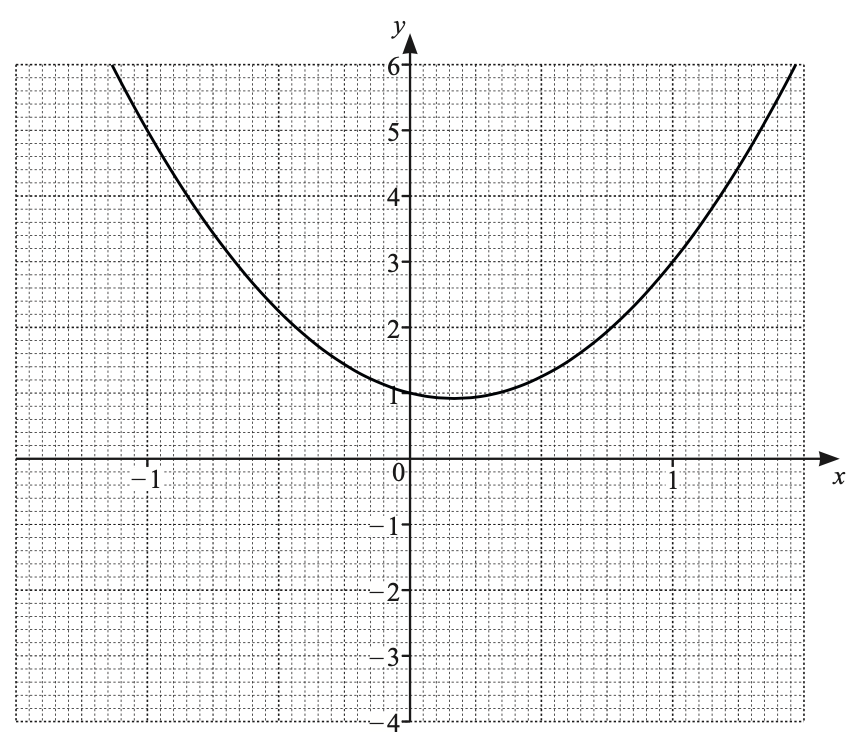

i) Draw the tangent to the curve at $x=1$.

[1]

ii) Use your tangent to estimate the gradient of the curve at $x=1$.

[2]

*Source: 2020 March 0580/42 Q2B*

**Q16** [2 marks]

Write down the equation of your tangent in the form $y=mx+c$.

$y=$ .................................................

*Source: 2020 March 0580/42 Q2B*

### Q17 — medium — 3 marks

**Q17** [3 marks]

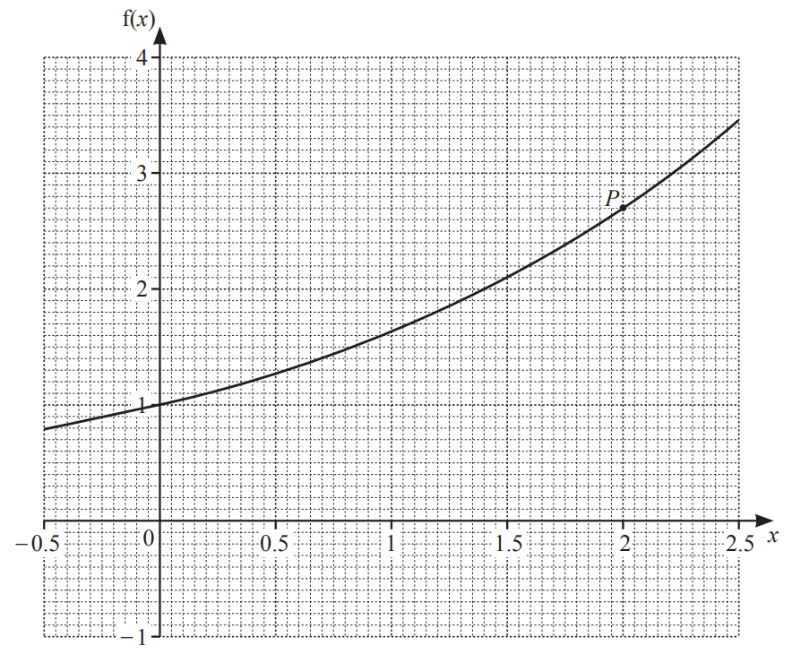

The diagram shows the graph of a function.

By drawing a suitable tangent, find an estimate for the gradient of the function at the point *P*.

*Source: 2020 May/June 0580/43 Q10B*

