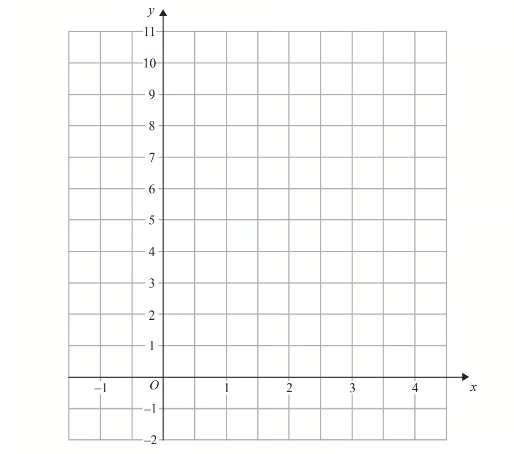
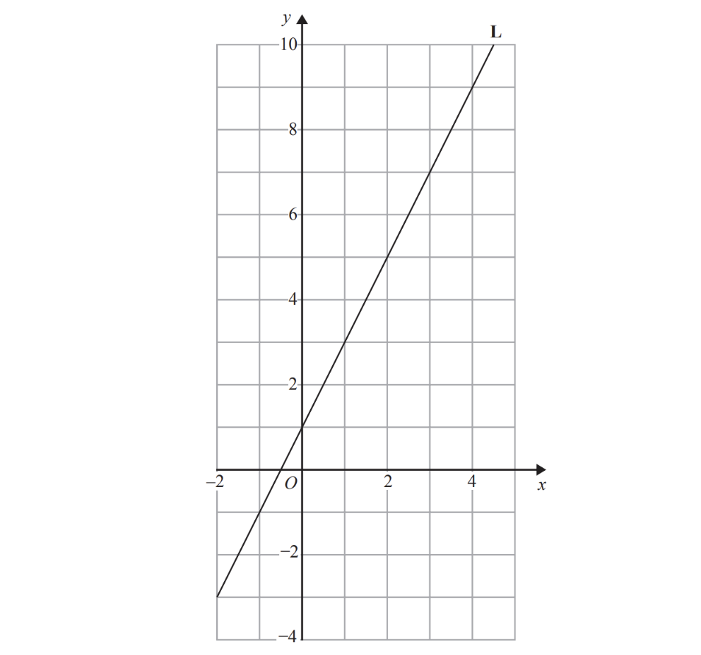
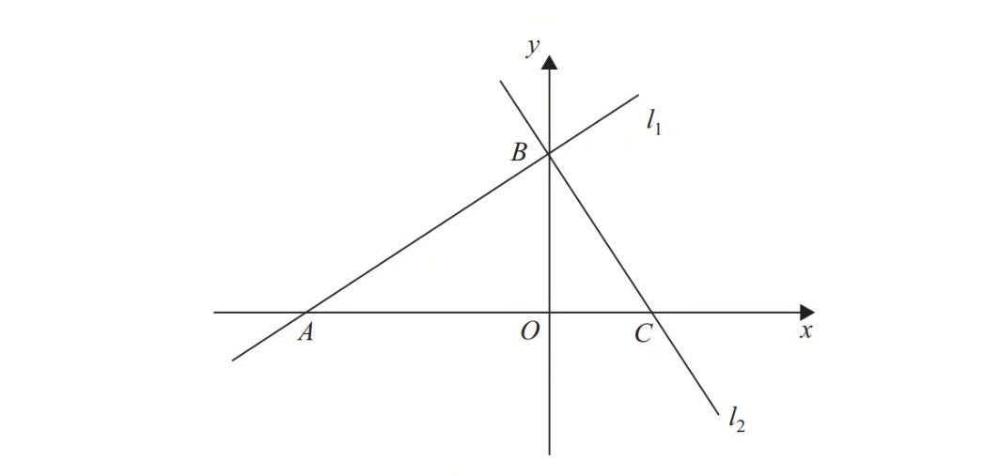

# Exam Questions — Linear Graphs
**Coordinate Geometry & Graphs** · Cambridge (CIE) IGCSE maths (0580 & 0980)
> Source: [https://www.savemyexams.com/igcse/maths/cie/25/extended/topic-questions/](https://www.savemyexams.com/igcse/maths/cie/25/extended/topic-questions/) · 15 questions across 1 sets

## Calculator Questions (15 questions)

### Q1 — medium — 3 marks

**Q1** [3 marks]

On the grid, draw the lines $y=x$ and $x+y=8$.

### Q2 — hard — 4 marks

**Q2** [4 marks]

*P* is the point (16, 9) and *Q* is the point (22, 24).

Find the equation of the line perpendicular to *PQ* that passes through the point (5, 1). 
Give your answer in the form $y=mx+c$.

$y=$................................................

*Source: 2018	May/June 0580/22 Q25A*

### Q3 — medium — 3 marks

**Q3** [3 marks]

A line joins $A(1,3)$ to $B(5,8)$.

Find the equation of the line $AB$.

Give your answer in the form $y=mx+c$.

$y$ = ...................................................

*Source: 2019	Oct/Nov 0580/42 Q3A*

### Q4 — medium — 2 marks

**Q4** [2 marks]

On the diagram,

Sketch the graph of $y=\frac{1}{2}x+1$.

*Source: 2020 May/June 0580/42 Q9C*

### Q5 — easy — 3 marks

**Q5** [3 marks]

On the grid, draw the graph of $y=8-2x$ for values of *x* from $-1$ to $4$

*Source: 2016	November 1MA0/2H Q7*

### Q6 — hard — 7 marks

**Q6** [4 marks]

The coordinates of *P* are $(-3,8)$ and the coordinates of *Q* are $(9,-2)$.

Find the equation of the perpendicular bisector of *PQ*.

*Source: 2020 May/June 0580/43 Q9B*

**Q6** [3 marks]

The coordinates of *P* are $(-3,8)$ and the coordinates of *Q* are $(9,-2)$.

Find the equation of the line parallel to *PQ* that passes through the point $(6,-1)$.

*Source: 2020 May/June 0580/43 Q9B*

### Q7 — hard — 8 marks

**Q7** [3 marks]

A straight line joins the points $A$ (-2, -3) and $C$ (1, 9).

Find the equation of the line $AC$ in the form $y=mx+c$.

$y$ = ..............................................

*Source: 2019	May/June 0580/43 Q7A*

**Q7** [5 marks]

$ABCD$ is a kite, where $AC$ is the longer diagonal of the kite. $B$ is the point (3.5, 2).

i) Find the equation of the line $BD$ in the form $y=mx+c$.

$y$ = .............................................. [3]

ii) The diagonals $AC$ and $BD$ intersect at (-0.5, 3).

Work out the co-ordinates of $D$.

(...................... , ....................) [2]

*Source: 2019	May/June 0580/43 Q7C*

### Q8 — hard — 4 marks

**Q8** [4 marks]

*A* is the point (7, 2) and *B* is the point (−5, 8).

Find the equation of the line that is perpendicular to *AB* and that passes through the point (−1, 3).

Give your answer in the form $y=mx+c$.

$y$ = ..............................................

*Source: Specimen 2025 0580/04 Q16B*

### Q9 — hard — 9 marks

**Q9** [5 marks]

A rhombus $ABCD$ has a diagonal $AC$ where $A$ is the point $(-3,10)$ and C is the point $(4,-4).$

i) Calculate the length $AC.$

[3]

ii) Show that the equation of the line $AC$ is  $y=-2x+4.$

[2]

*Source: 2020	May/June 0580/41 Q10A*

**Q9** [4 marks]

Find the equation of the line $BD.$

*Source: 2020	May/June 0580/41 Q10A*

### Q10 — medium — 3 marks

**Q10** [2 marks]

A straight line, $l$, has equation $y=5x+12$.

Find the coordinates of the point where line $l$ crosses the $x$-axis.

( ....................... , ......................)

*Source: 2020 Oct/Nov 0580/23 Q12B*

**Q10** [1 mark]

**Extract:**

A straight line, l, has equation y = 5x + 12.

A line perpendicular to line $l$ has gradient $k$.   Find the value of $k$.

$k=$................................................

*Source: 2020 Oct/Nov 0580/23 Q12C*

### Q11 — hard — 4 marks

**Q11** [4 marks]

*A* is the point $(2,3)$ and *B* is the point $(7,-5)$.

Find the equation of the line through *A* that is perpendicular to *AB*. 
Give your answer in the form $y=mx+c$.

$y=$....................................................

*Source: 2019 March 0580/22 Q23B*

### Q12 — hard — 5 marks

**Q12** [5 marks]

A line from the point (2, 3) is perpendicular to the line $y=\frac{1}{3}x+1$. The two lines meet at the point $P$.

Find the coordinates of $P$.

( ...................... , ...................... )

*Source: 2020 Oct/Nov 0580/22 Q24*

### Q13 — easy — 2 marks

**Q13** [2 marks]

The equation of a straight line is $2y=3x+4.$

i) Find the gradient of this line.

[1]

ii) Find the co-ordinates of the point where the line crosses the y-axis.

( ..................... , ..................... ) [1]

*Source: 2019	May/June 0580/42 Q4A*

### Q14 — easy — 3 marks

**Q14** [3 marks]

Line **L** is drawn on the grid below.

Find the equation for the straight line **L**.

Give your answer in the form $y=mx+c$

*Source: 2015	Spec1 1MA1/3H Q3*

### Q15 — hard — 7 marks

**Q15** [1 mark]

**Figure 1**

The line $l_{1}$ has equation $2x-3y+12=0$

Find the gradient of $l_{1}$.

*Source: SME Topic Papers 6663/Straight Lines Core 1 QP4 Q4A*

**Q15** [3 marks]

**Extract:**

The line l1 has equation 2x - 3y + 12 = 0

The line $l_{1}$ crosses the *x*-axis at the point *A* and the *y*-axis at the point *B*, as shown in Figure 1.

The line $l_{2}$ is perpendicular to $l_{1}$ and passes through *B*.

Find an equation of $l_{2}$.

*Source: SME Topic Papers 6663/Straight Lines Core 1 QP4 Q4B*

**Q15** [3 marks]

**Extract:**

The line l1 crosses the x-axis at the point A and the y-axis at the point B, as shown in Figure 1. The line l2 is perpendicular to l1 and passes through B.

The line $l_{2}$ crosses the $x$-axis at the point *C*.

Find the area of triangle *ABC*.

*Source: SME Topic Papers 6663/Straight Lines Core 1 QP4 Q4C*

