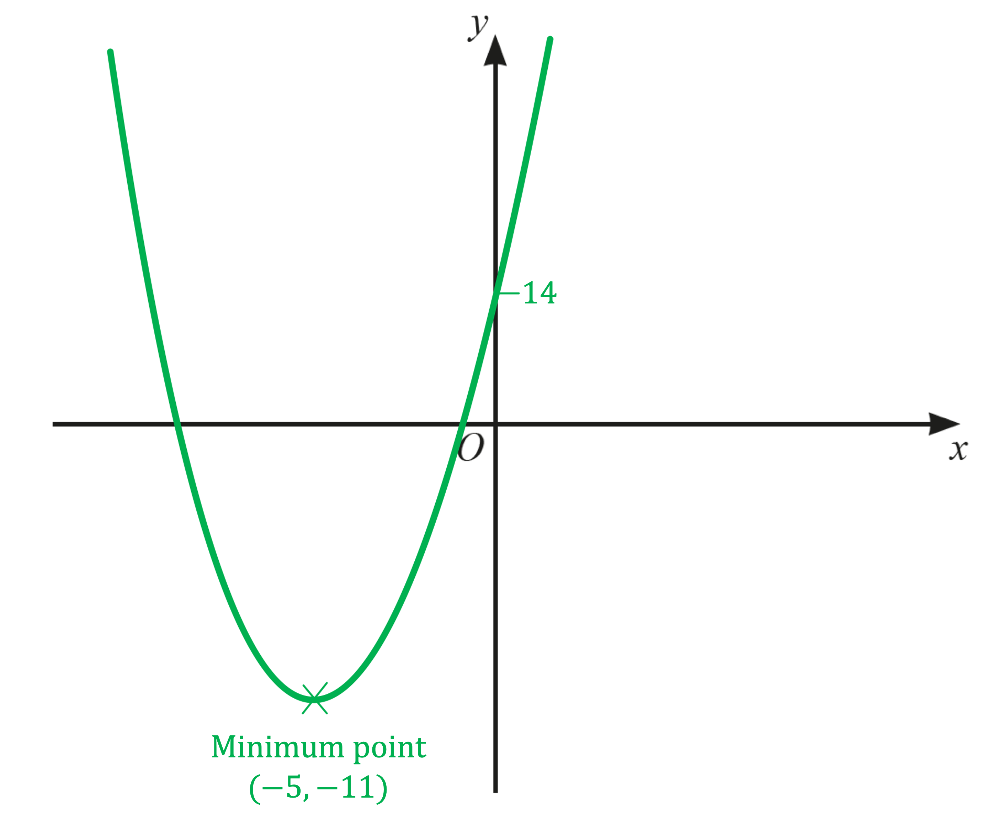
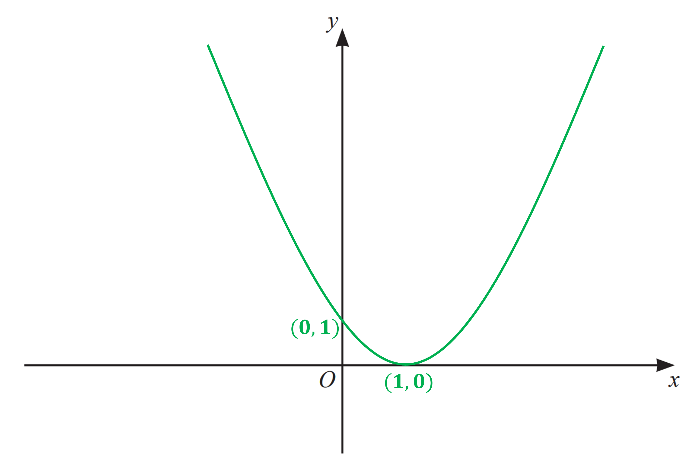
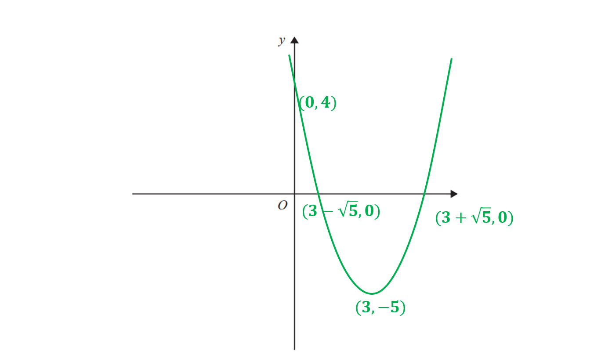

# Mark Schemes — Quadratic Graphs
**Coordinate Geometry & Graphs** · Cambridge (CIE) IGCSE maths (0580 & 0980)

## Exam Questions (8 questions)

### Q1
(i)

> *Factor out *$-0.5$

`negative 0.5 open square brackets x squared minus 12 x plus 14 close square brackets`

**[M1]**

> *Complete the square to find the turning point*

`negative 0.5 open square brackets open parentheses x minus 6 close parentheses squared minus 36 plus 14 close square brackets`

**[M1]**

`negative 0.5 open square brackets open parentheses x minus 6 close parentheses squared minus 22 close square brackets`

> *Multiply out by *$-0.5$

`negative 0.5 open parentheses x minus 6 close parentheses squared plus 11`

**[A1]**

(ii)

> *The turning point of the quadratic *`y equals a open parentheses x minus p close parentheses squared plus q`* is *`open parentheses p comma space q close parentheses`

`open parentheses 6 comma space 11 close parentheses`

**[B1]**
**Final answer:** **Since the coefficient of **$x^{2}$** is negative, the turning point of the quadratic is a maximum **

**[B1]**
> *The axis of symmetry passes through the turning point of the quadratic*

`open parentheses 6 comma space 11 close parentheses`

> *Since the axis of symmetry is vertical, it has equation*

$x=6$

**[B1]**

### Q2
> *The points **A** and **B **are the **x- **intercepts. *
*The point **C **is the **y- **intercept.*

> *Find the **x- **intercepts by letting **y** equal zero.  *

$x^{2}+3x-4=0$

> *  *

> *Factorise.*

`open parentheses x space plus space 4 close parentheses open parentheses x space minus space 1 close parentheses space equals space 0`

**[1]**

> *Solve by letting each bracket equal zero.*

> *  *

`table row cell open parentheses x space plus space 4 close parentheses space end cell equals cell space 0 end cell row cell x space end cell equals cell space minus 4 space end cell end table`*       **and        *`table row cell open parentheses x space minus space 1 close parentheses space end cell equals cell space 0 end cell row cell x space end cell equals cell space 1 space end cell end table`

* *

> *So the **x** intercepts are -4 and 1. *

> *A** is negative so it must have the coordinate (-4, 0). **B** is positive so it must have the coordinate (1, 0)*

> *Find the **y- **intercept by letting **x** equal zero.*

`table row cell open parentheses 0 close parentheses to the power of 2 space end exponent plus space 3 open parentheses 0 close parentheses space minus space 4 space end cell equals cell space y end cell row cell y space end cell equals cell space minus 4 end cell end table`

> *  *

> *So **C** must have the coordinate (0, -4).*

** **$A(-4,0)$** **
$B(1,0)$
** **$C(0,-4)$** **
*1 mark for each correct*** [3]**

### Q3
*The result required is in completed square form.*

> *To complete the square, set up a squared bracket with two terms; *$x$* and half of the coefficient of the *$x$* term - in this case 5. The squared brackets would then produce an extra, unwanted constant term, so we need to subtract this; in this case the unwanted constant would be 5**2** = 25.*

`table row cell x squared plus 10 x plus 14 end cell equals cell open parentheses x plus 5 close parentheses squared minus 25 plus 14 end cell end table`

**[1]**

`table row blank equals cell open parentheses x plus 5 close parentheses squared minus 11 end cell end table`

`equation` **[1]**
*This is a positive quadratic (U-shape) so the turning point will be a minimum point.*

> *Using the answer to part i)*

*the minimum point has coordinates (-5, -11)*

> *(*`open parentheses x plus 5 close parentheses squared greater or equal than 0`* for all values of *$x$* and is minimum when *`open parentheses x plus 5 close parentheses equals 0`*, *$x=-5$*.) *

> *No other points are required but to get the graph in the correct location we do need to know the *$y$*-axis intercept - which is when *$x=0$* - which is 14.*

**U-shape graph**** ****[1]*** *
**Turning point*** ***[1]*** *
**Graph in correct place*** ***[1]**

### Q4
i) *"Factorise" means to write as brackets to be expanded.* *Rearrange the quadratic such that it is in the form. *

> $-x^{2}+5x+24$* *

> *Multiply the first and the last terms (-1 and 24).*

$-1\times24=-24$

> *Look for two values that both multiply to make -24 and add to make the middle term, +5.*

$-3\times8=-24\,-3+8=5$

*Use these factors to split the middle term, *$5x$ *into the sum of *$8x$* **and *$-3x$*.*

$-x^{2}+8x-3x+24$

> *Factorise the first two terms by taking the common factor of *$x$* outside of the brackets.*

`x open parentheses negative x space plus space 8 close parentheses space minus 3 x space plus space 24`

> *Factorise the last two terms by taking the common factor of 3 outside of the brackets.*

`x open parentheses negative x space plus space 8 close parentheses plus space 3 open parentheses negative x space plus space 8 close parentheses`

**[1]**

> *Both the *$x$* and the +3 are multiplied by *`open parentheses negative x space plus space 8 close parentheses`*. Factorise the whole *`open parentheses negative x space plus space 8 close parentheses`* bracket out, leaving *$x$* and +3 together in their own bracket*

$(x+3)(-x+8)$ **[1] **
**(8 - x)(3 + x) also correct**

ii) *The points **a** and **b **are the **x- **intercepts. *
*The point **c **is the **y- **intercept.*

> *Find the **x- **intercepts by letting **y** equal zero.  *

$24+5x-x^{2}=0$

> *Rewrite using the factorised form found in part (i).*

`open parentheses 8 space minus space x close parentheses open parentheses x space plus space 3 close parentheses space equals space 0`

**[1]**

> *Solve by letting each bracket equal zero.*

*  *`table attributes columnalign right center left columnspacing 0px end attributes row cell open parentheses 8 space minus space x close parentheses space end cell equals cell space 0 end cell row cell x space end cell equals cell space 8 space end cell end table`*       **and        *`table row cell open parentheses x space plus space 3 close parentheses space end cell equals cell space 0 end cell row cell x space end cell equals cell space minus 3 space end cell end table`

* *

> *So the **x** intercepts are -3 and 8. *

> *a** is negative so it must have the coordinate (-3, 0). *
*b** is positive so it must have the coordinate (8, 0).*

> *Find the **y- **intercept by letting **x** equal zero.     *

`table row cell 24 space plus space 5 open parentheses 0 close parentheses space minus open parentheses 0 close parentheses squared end cell equals cell space y end cell row cell y space end cell equals cell space 24 end cell end table`

> *  So **c **must have the coordinate (0, 24)**.*

** **$a=-3$** **
$b=8$
$c=24$** **
*1 mark for each correct** ***[1]**

### Q5
> *This is a quadratic function so will be the shape of a parabola (∪).*

> *You need to find where the graph crosses the coordinate axes.*

> *The graph crosses the **y**-axis when **x **= 0.*

`x equals 0 space rightwards double arrow space y equals 4 open parentheses 0 minus 1 close parentheses squared space minus space a space equals space 4 space minus space a`

> *We know that **a  **> 4, so the graph crosses the **y **axis **below **zero. *

> *The graph crosses the **x**-axis when **y **= 0.*

`y equals 0 space rightwards double arrow space 0 space equals space 4 open parentheses x minus 1 close parentheses squared space minus space a`

> *Add **a** to both sides and divide by 4.*

`4 open parentheses x minus 1 close parentheses squared space equals space a
open parentheses x space minus space 1 close parentheses squared space equals space a over 4`

> *Square root both sides and then add 1 to both sides.*

`table attributes columnalign right center left columnspacing 0px end attributes row cell x minus 1 space end cell equals cell plus-or-minus square root of a over 4 end root end cell row x equals cell 1 space plus-or-minus space square root of a over 4 end root end cell end table`

> *We know that **a  **> 4, so both answers are possible and the graph goes through the **x **axis twice.*

> *The turning point of *`a open parentheses x space plus space b close parentheses to the power of 2 space end exponent plus space c space`*is at the point *$(-b,c).$

`b space equals space minus 1 space comma space space c space equals space minus a space rightwards double arrow space space Minimum space point colon space open parentheses 1 space comma space minus a close parentheses`

> *We know that **a  **> 4, so -**a **< -4 and the minimum point must be in the fourth quadrant.*

> *Draw the parabola by drawing a symmetrical ∪ shape which goes through *$(0,4-a)$*, crosses through *$(1-\sqrt{\frac{a}{4}},0)$* and *$(1+\sqrt{\frac{a}{4}},0)$* and has a minimum point at *$(1,-a)$*.*

**Drawing a ****∪**** shaped-parabola**** [1] **
**Finding the correct minimum point*** ***[1] **
**Finding any correct intercept with the axes**** ****[1] **
**Fully correct graph*** ***[1]**

### Q6
> *This is a quadratic function so will be the shape of a parabola (∪).*

> *You need to find where the graph crosses the coordinate axes.*

> *The graph crosses the **y**-axis when **x **= 0.*

`x equals 0 rightwards double arrow y equals open parentheses 0 minus 1 close parentheses squared equals 1`

> *The graph crosses the **x**-axis when **y **= 0.*

`y equals 0 rightwards double arrow 0 equals open parentheses x minus 1 close parentheses squared`

> *Square root both sides and then add 1 to both sides.*

`table attributes columnalign right center left columnspacing 0px end attributes row cell x minus 1 end cell equals 0 row x equals 1 end table`

> *There is only one answer so that means the graph only touches the **x**-axis and goes not go through it.*

> *Draw the parabola by drawing a symmetrical ∪ shape which goes through (0, 1) and touches (1, 0). (1, 0) is therefore the minimum.*

**Drawing a ∪ shaped-parabola*** [***1] **
**Drawing the correct graph*** *** [1]**

### Q7
> *This is a quadratic function so will be the shape of a parabola (∪).*

> *You need to find where the graph crosses the coordinate axes.*

> *The graph crosses the **y**-axis when **x **= 0.*

`x equals 0 space rightwards double arrow space y equals open parentheses 0 close parentheses squared space minus space 6 open parentheses 0 close parentheses space plus space 4 space equals space 4 space`

> *So the graph crosses the **y **axis at the point (0, 4). *

> *The graph crosses the **x**-axis when **y **= 0.*

$y=0\Rightarrow0=x^{2}-6x+4$

> *This cannot be factorised so complete the square.*

`table row cell open parentheses x space minus space 3 close parentheses squared space minus 9 space plus space 4 space end cell equals cell space 0 end cell row cell open parentheses x space minus space 3 close parentheses squared space minus 5 space end cell equals cell space 0 end cell end table`

**[1]**

> *Add 5 to both sides.*

`table attributes columnalign right center left columnspacing 0px end attributes row cell open parentheses x space minus space 3 close parentheses squared space space end cell equals cell space 5 end cell end table`

**[1]**

> *Square root both sides and then add 3 to both sides.*

`table row cell x minus 3 space end cell equals cell plus-or-minus square root of 5 end cell row cell x space end cell equals cell space 3 space plus-or-minus space square root of 5 end cell end table`

**[1]**

> *The graph goes through the **x **axis twice, at the points *$(3+\sqrt{5},0)$* and *$(3-\sqrt{5},0)$*.*

> *The turning point of *`a open parentheses x space plus space b close parentheses to the power of 2 space end exponent plus space c space`*is at the point *$(-b,c).$

`b space equals space minus 3 space comma space space c space equals space minus 5 space rightwards double arrow space space Minimum space point colon space open parentheses 3 space comma space minus 5 close parentheses`

**[1]**

> *Draw the parabola by drawing a symmetrical ∪ shape which goes through *$(0,4)$*, crosses through *$(3+\sqrt{5},0)$* and *$(3-\sqrt{5},0)$* and has a minimum point at *$(3,-5)$*.*

> * *

**Drawing a ****∪**** shaped-parabola through (0,4)**** [1] **
**Fully correct graph**** ****[1]**

### Q8
> *The formula for completing the square for a quadratic in the form*$x^{2}+bx+c$*is*`space space open parentheses x space plus space b over 2 close parentheses squared space space minus space open parentheses b over 2 close parentheses squared space plus space c`*.*

> *Complete the square.*

`open parentheses x space plus space 2 close parentheses to the power of 2 space end exponent minus 4 space minus space 3 space`

*Correct expression in the brackets*** [1] **
*Correct values outside of the brackets (may be simplified)*** ****[1]**

> *Simplify.*

`open parentheses x space plus space 2 close parentheses to the power of 2 space end exponent minus 7`

**[1]**

> *The turning point of *`open parentheses x space plus space a close parentheses to the power of 2 space end exponent minus b space`*is at the point *$(-a,b)$

$(-2,-7)$* ***[1]**
