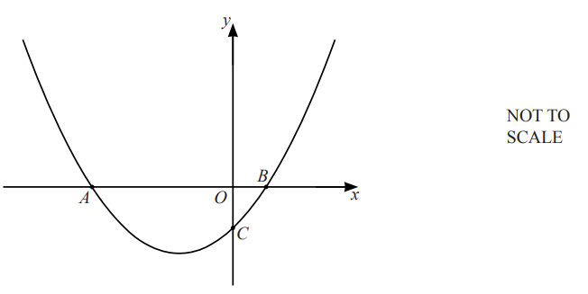
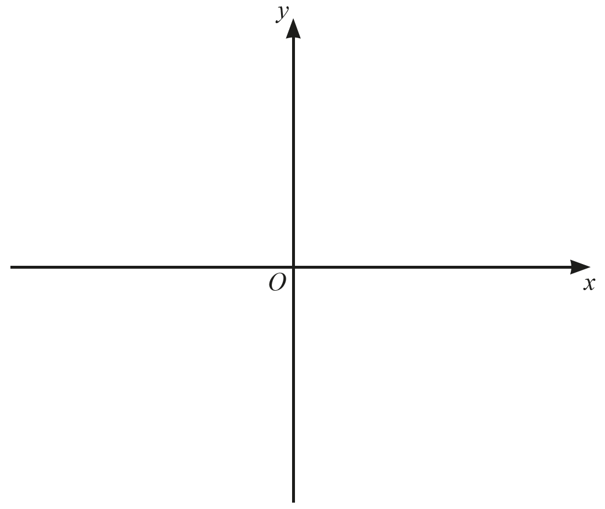
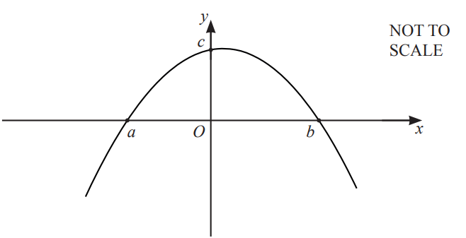
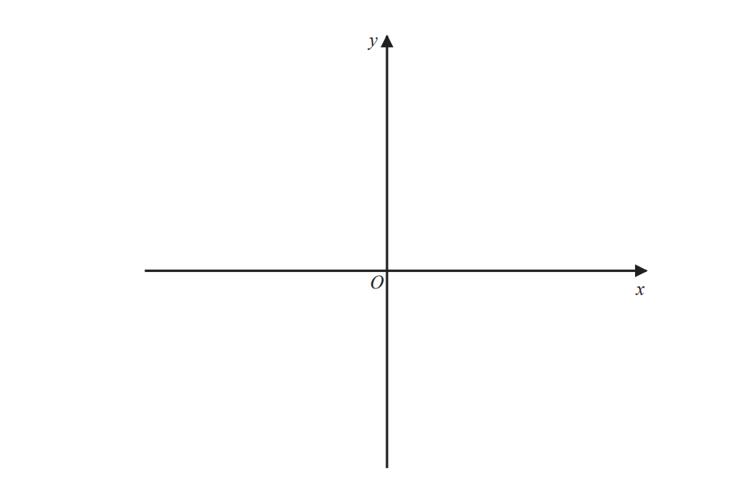
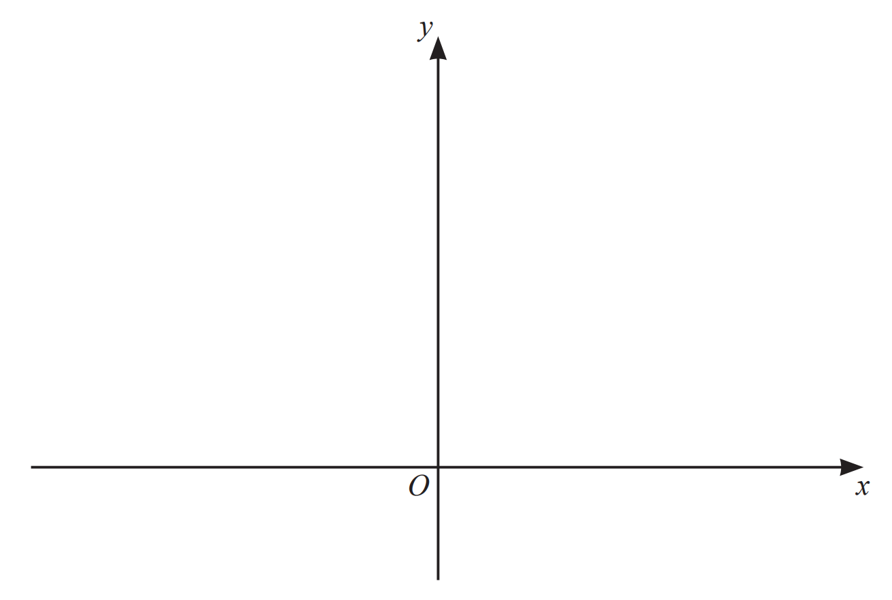

# Exam Questions — Quadratic Graphs
**Coordinate Geometry & Graphs** · Cambridge (CIE) IGCSE maths (0580 & 0980)
> Source: [https://www.savemyexams.com/igcse/maths/cie/25/extended/topic-questions/](https://www.savemyexams.com/igcse/maths/cie/25/extended/topic-questions/) · 8 questions across 1 sets

## Exam Questions (8 questions)

### Q1 — hard — 6 marks

**Q1** [4 marks]

(i) Write $6x-0.5x^{2}-7$ in the form $y = a ( x - p )^{2} + q$

(ii) Hence, write down the coordinates of the turning point on the curve with equation $y=6x-0.5x^{2}-7$

**Q1** [1 mark]

State the nature of this turning point.

**Q1** [1 mark]

State the equation of the axis of symmetry.

### Q2 — medium — 4 marks

**Q2** [4 marks]

The diagram shows a sketch of the curve  $y=x^{2}+3x-4$.

Find the coordinates of the points *A*, *B* and *C*.

A (.............. , ..............)

B (.............. , ..............)

C (.............. , ..............)

*Source: 2020 Oct/Nov 0580/41 Q10A*

### Q3 — medium — 5 marks

**Q3** [2 marks]

Write  $x^{2}+10x+14$  in the form  $( x + a )^{2} + b.$

*Source: 2020	May/June 0580/41 Q8C*

**Q3** [3 marks]

**Extract:**

Write  x squared plus 10 x plus 14  in the form  open parentheses x plus a close parentheses squared space plus b.

Sketch the graph of  $y=x^{2}+10x+14$,  indicating the coordinates of the turning point.

*Source: 2020	May/June 0580/41 Q8C*

### Q4 — hard — 5 marks

**Q4** [5 marks]

i) Factorise  $24+5x-x^{2}$.

[2]

ii) The diagram shows a sketch of  $y=24+5x-x^{2}$.

Work out the values of $a$, $b$ and $c$.

$a=$ ................................................

$b=$ ................................................

$c=$................................................ [3]

*Source: 2020 Oct/Nov 0580/43 Q7A*

### Q5 — very_hard — 4 marks

**Q5** [4 marks]

The curve $C$has equation $y=4(x-1)^{2}-a$   where $a>4$

Using the axes below, sketch the curve $C$. 
On your sketch show clearly, in terms of $a$,

i) the coordinates of any points of intersection of $C$ with the coordinate axes,

ii) the coordinates of the turning point.

*Source: Jan 2020 4MA1/1H Q20*

### Q6 — hard — 2 marks

**Q6** [2 marks]

On the diagram,

Sketch the graph of $y = ( x - 1 )^{2}$.

*Source: 2020 May/June 0580/42 Q9C*

### Q7 — very_hard — 6 marks

**Q7** [6 marks]

The curve $C$ has equation $y=x^{2}--6x+4$

Using the axes below, sketch the curve $C$. On your sketch show clearly

i) the exact coordinates of any points of intersection of $C$ with the coordinate axes,

ii) the coordinates of the turning point.

*Source: Specimen 2016 4MA1/1H Q21*

### Q8 — medium — 4 marks

**Q8** [4 marks]

Find the turning point of  $y=x^{2}+4x-3$  by completing the square.

( ...................... , .....................)

*Source: 2020 Specimen 0580/02 Q25*

