# Mark Schemes — Real-Life Graphs
**Coordinate Geometry & Graphs** · Cambridge (CIE) IGCSE maths (0580 & 0980)

## Calculator Questions (14 questions)

### Q1
> **[exam-tip]**
> Acceleration is given by the gradient of a speed-time graph.
> 
> - I.e. $\mathrm{acceleration}=\frac{\mathrm{change} \mathrm{in} \mathrm{speed}}{\mathrm{time}}$

In the first 4 seconds

- the speed changes from 0 to 17 m/s
- as time goes from 0 to 4 seconds

$\begin{gathered} \text{acceleration} = \frac{17 - 0}{4 - 0} \\ = \frac{17}{4} \\ = 4.25 \end{gathered}$

**Final answer:** **4.25 m/s****2**

**[B1]**

> **[mark-scheme]**
> **B1**: For $\frac{17}{4}$, 4.25 or equivalent. You don't need to include units to get this mark.
Distance travelled is equal to the area under a speed-time graph

The area can be broken up into

- a triangle of base 4 and height 17

  - use $\mathrm{Area}=\frac{1}{2}\times\mathrm{base}\times\mathrm{height}$

$\frac{1}{2}\times4\times17=34$

**[M1]**

- and a rectangle of length 12-4=8 and height 17

  - use $\mathrm{Area}=\mathrm{length}\times\mathrm{height}$

$8\times17=136$

Add those together to get the total distance

$34+136=170$

**Final answer:** **170 metres**

**[A1]**

> **[mark-scheme]**
> **M1**: For correct calculation of any one area.
> 
> **A1**: For correct answer. You don't need to include units to get this mark.

> **[exam-tip]**
> You could also calculate this as a single area using the trapezium formula $\text{Area} = 1 \frac{1}{2} ( a + b ) h$
> 
> - with $a=12$, $b=8$ and $h=17$
> 
> $\text{Area} = 1 \frac{1}{2} ( 8 + 12 ) 17 = 1 \frac{1}{2} \times 20 \times 17 = 170$

### Q2
> *The distance is the area under the speed-time graph*

> *Distance of the first *$2t$* seconds is found by working out the area of the triangle*

$\frac{1}{2}\times2t\times8=8t$

> *Distance travelled during *$2t$* to *$5t$* is the area of the rectangle *

$5t\times8=40t$

> *Adding the areas together to get the total distance*

$8t+40t=200$

**[M1]**

$48t=200\,t=\frac{200}{48}$

$t=\frac{25}{6}$

**[A1]**

> **[mark-scheme]**
> **M1**: For setting up an equation using the area.
> 
> **A1**: Correct answer.

> **[exam-tip]**
> The area of trapezium formula
> 
> $1 \frac{1}{2} ( a + b ) h$
> 
> could also be used to quickly calculate the total area.
> *Acceleration for speed-time graph is the slope of the line*

$a=\frac{8}{2t}\,a=\frac{8}{2\times\frac{25}{6}}$

**[M1]**

$a=\frac{24}{25}\mathrm{ms}^{-2}$

**[A1]**

> **[mark-scheme]**
> **M1**: For attempting to find the gradient.
> 
> **A1**: Correct answer. You do not need the units.
$\mathrm{average} \mathrm{speed}=\frac{\mathrm{total} \mathrm{distance}}{\mathrm{total} \mathrm{time}}$

$\frac{200}{7\times\frac{25}{6}}$

**[M1]**

$\frac{48}{7}\mathrm{ms}^{-1}$

**[A1]**

> **[mark-scheme]**
> **M1**: For some indication of understanding how to find average speed.
> 
> **A1**: Correct answer. You do not need the units.

### Q3
> *1 kilometre = 1000 metres so multiply distances in km by 1000 to convert to m*

*90 km = (90 × 1000) m = 90,000 m*

> *1 minute = 60 minutes = 60 lots of 60 seconds. *

*1 h = (1 × 60 × 60) s = 3600 s*

> *90 km in one hour is equivalent to 90,000 metres in 3600 seconds*

*speed = *$\frac{90,000m}{3600s}$

> *Dividing 90,000 by 3600 gives the final answer*

**[1]**

**25 m/s  ****[1]**
> *The car is decelerating where the gradient of the line is negative. In this section of the journey, the car loses 90km/h of speed in 20 seconds. *$\mathrm{deceleration}=\frac{\mathrm{reduction} \mathrm{in} \mathrm{speed}}{\mathrm{time}}$

> *Note that the question asks for the answer in m/s**2**. So we need to convert the loss of speed from km/h to m/s. In part (a), we calculated that the 90km/h is 25 m/s.*

$\mathrm{deceleration}=\frac{25m/s}{20s}$

$=1.25m/s^{2}$

**1.25 m/s****2**** **** ****[1]**
> *In a speed-time graph, distance (speed × time) is equivalent to the area under the line *

> *The question asks for the answer in m, and the time axis in in seconds so instead of the speed 90 km/h, use the 25 m/s calculated in part (a)*

> * **Method 1 *

> *The shape of the graph is a trapezium. Area of trapezium = *$\frac{1}{2}(a+b)\timesh$* where *$a$* and *$b$* are the parallel lengths and *$h$* is the height *

> *The values of *$a$*, *$b$* and *$h$*corresponding to the speed-time graph are shown below*

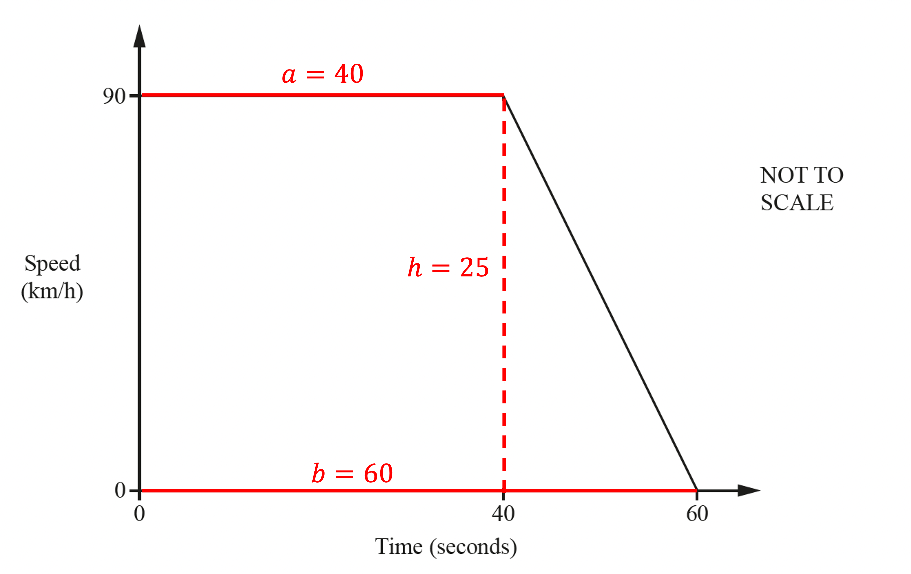

$\mathrm{Distance}=\frac{1}{2}(40+60)\times25$

**[1]**

$\mathrm{Distance}=1250m$** [1]**

> *Method 2 *

> *Break the graph into a rectangle and a triangle and find the area of each*

$\mathrm{rectangle}=40\times25,\mathrm{triangle}=\frac{1}{2}\times20\times25$

*any one correct area ***[1]**

$40\times25+\frac{1}{2}\times20\times25$

**[1]**

$\mathrm{Distance}=1250m$** [1]**

### Q4
> *On a **distance-time graph**, the **gradient **of the line shows the **speed.*

> *The gradients of the lines before and after Jalina stops look similar, however they could be compared by carefully sliding a ruler from one to the other, or by calculating the gradients of both lines. *

> *Before stopping: *

$\mathrm{Gradient}=\frac{15}{1}=15\mathrm{km}/h$

> *After stopping: *

$\mathrm{Gradient}=\frac{9}{0.75}=12\mathrm{km}/h$

**Jalina cycled faster before stopping as this line has the greater gradient ****[1]**
> *Draw a horizontal line at a distance from home of 24 km from 12 00 to 12 45 to show that Jalina did not travel any distance whilst at the park.*

> *From the graph, it can be seen that the distance from the park to Jalina's home is 24 km.*

> *Use the distance and the speed to find the amount of time it took Jalina to cycle home.*

$\mathrm{time}=\frac{\mathrm{distance}}{\mathrm{speed}}=\frac{24\mathrm{km}}{16\mathrm{km}/h}=1.5h$

** [1]**

> *Adding 1.5 hrs to the time of 12 45 gives the time 14 15.*

> *Draw a straight line from the end of your horizontal line (at 12 45, 24) to the x axis at 14 15.*

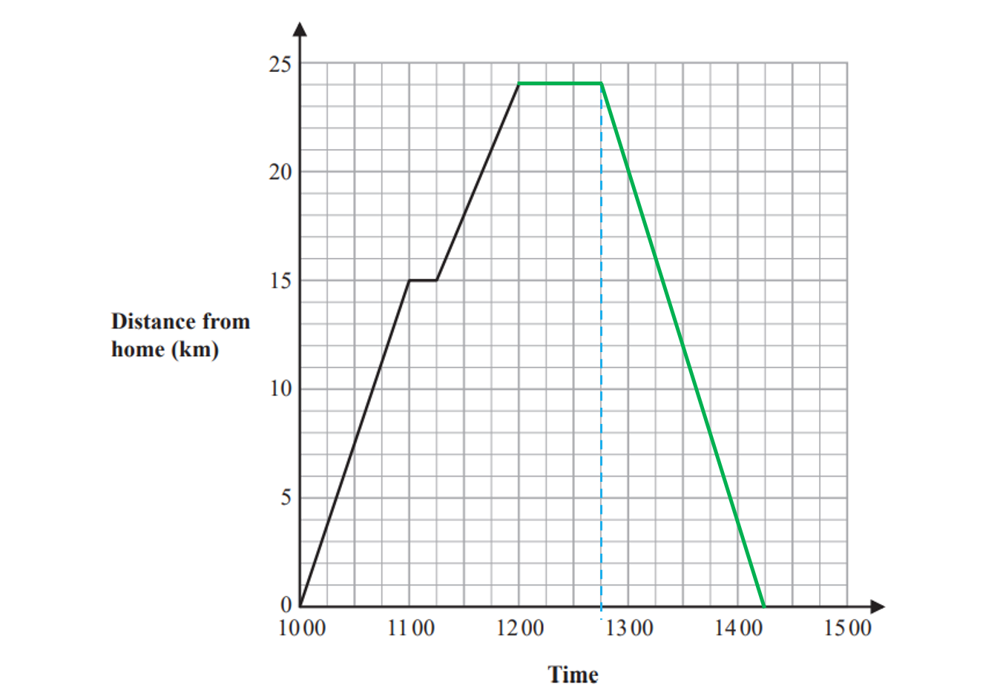

**[1]**
> *The times Jalina was cycling were from 10 00 - 11 00 (1 hr), from 11 15 - 12 00 (45 mins) and from 12 45 - 14 15 (1.5 hrs).*

> *Find the total time that Jalina was cycling for.*

$1\mathrm{hr}+45\mathrm{min}+1.5\mathrm{hr}=3\mathrm{hr}15\mathrm{mins}=3.25\mathrm{hrs}$

**[1]**

> *Find the total distance that Jalina cycled.*

$2\times24\mathrm{km}=48\mathrm{km}$

> *Find the average speed by dividing distance by time.*

$\mathrm{speed}=\frac{\mathrm{distance}}{\mathrm{time}}=\frac{48\mathrm{km}}{3.25\mathrm{hrs}}=14.768...\mathrm{km}/h$

**[1]**

> *Round your answer to 1 decimal place.*

$14.8\mathrm{km}/h$* ***[1]**

### Q5
> *The acceleration is the gradient of the speed-time graph.*

> *Find the gradient of the line between the points (0, 0) and (15, 25) using the formula *$m=\frac{y_{2}-y_{1}}{x_{2}-x_{1}}.$

$m=\frac{25-0}{15-0}=\frac{25}{15}$

> *Simplify your answer.*

$1\frac{2}{3}$ **m/s****2** **[1]**

**Rounding to 3sf is acceptable: 1.67 m/s****2**
> *Method 1*

> *The distance is the area under the speed-time graph.*

> *Find the whole area under the graph is a trapezium so use the formula *$A = 1 \frac{1}{2} ( a + b ) h.$* **a** and **b **are the lengths of the parallel sides and **h** is the perpendicular height between them.*

**a*** = 50, ***b*** = 50 - 15 = 35, ***h ***=25*
 $\frac{1}{2}(50+35)(25)$

**[2]**

**1062.5 m** **[1]**

> *Method 2*

> *The distance is the area under the speed-time graph.*

> *Find the area under the graph between 0 to 15 seconds. This is a triangle so use the formula *$A=\frac{1}{2}bh.$

*Height = 25 and Base = 15* 
$\frac{1}{2}(15)(25)=187.5$

> *Find the area under the graph between 15 to 50 seconds. This is a rectangle so use the formula *$A=bh.$

*Height = 25 and Base = 50 - 15 = 35 *
$(25)(35)=875$

**Finding one area**** [1]**

> *Add the two areas together.*

$187.5+875$

**[1]**

**1062.5 m** **[1]**

### Q6
> *The acceleration is the gradient of the speed-time graph.*

> *Find the gradient of the line between the points (0, 0) and (40, 12) using the formula *$m=\frac{y_{2}-y_{1}}{x_{2}-x_{1}}.$

$m=\frac{12-0}{40-0}=\frac{12}{40}$

> *Simplify your answer.*

**0.3** **m/s****2** **[1]**
> *Method 1*

> *The distance is the area under the speed-time graph.*

> *Find the whole area under the graph is a trapezium so use the formula *$A = 1 \frac{1}{2} ( a + b ) h.$* **a** and **b **are the lengths of the parallel sides and **h** is the perpendicular height between them.*

**a*** = 300, ***b*** = 250 - 40 = 210, ***h ***=12* $\frac{1}{2}(300+210)(12)$

**[2]**

**3060 m** **[1]**

> *Method 2*

> *The distance is the area under the speed-time graph.*

> *Find the area under the graph between 0 to 40 seconds. This is a triangle so use the formula *$A=\frac{1}{2}bh.$

*Height = 12 and Base = 40*
 $\frac{1}{2}(40)(12)=240$

> *Find the area under the graph between 40 to 250 seconds. This is a rectangle so use the formula *$A=bh.$

*Height = 12 and Base = 250 - 40 = 210 *$(210)(12)=2520$

> *Find the area under the graph between 250 to 300 seconds. This is a triangle so use the formula *$A=\frac{1}{2}bh.$

*Height = 12 and Base = 300 - 250 = 50* $\frac{1}{2}(50)(12)=300$

**Finding one area**** [1]**

> *Add the three areas together.*

$240+2520+300$

**[1]**

**3060 m** **[1]**

### Q7
> *Distance travelled is equal to the area under the graph.*

> *Find the total distance travelled by splitting the area under the graph into two or more shapes whose area can be calculated.*

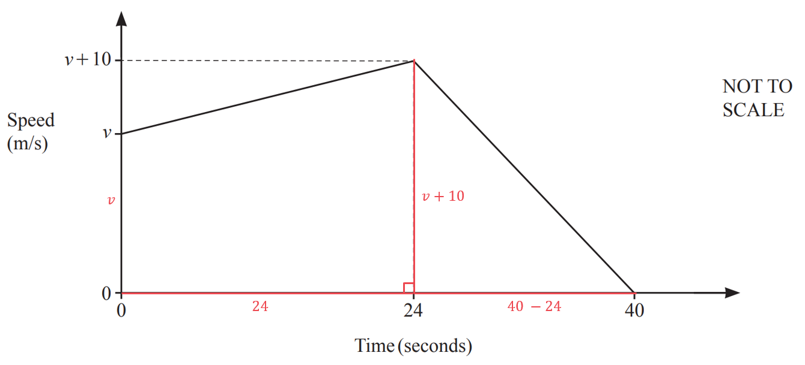

*Area under graph = area of trapezium + area of triangle*

*Area of trapezium*$\begin{gathered} \begin{gathered} = \frac{v + ( v + 10 )}{2} \times 24 \end{gathered} & = 12 ( 2 v + 10 ) \end{gathered}$

*Area of triangle *$\begin{gathered} \begin{gathered} = 1 \frac{1}{2} \times ( v + 10 ) \times ( 40 - 24 ) \end{gathered} \begin{gathered} = 8 ( v + 10 ) \end{gathered} \end{gathered}$

*Area under the graph *$\begin{gathered} = 12 ( 2 v + 10 ) + 8 ( v + 10 ) \end{gathered}$

*Correct expression for one area*** ****[1] **
*Correct expression for both areas*** ****[1]**

> *Note that the units on the graph are in metres, so you will need to convert 1.24 km to metres first.*

$1.24\mathrm{km}=1.24\times100m=1240m$

> *Form an equation using the distance of 1240 m. *

$12 ( 2 v + 10 ) + 8 ( v + 10 ) = 1240$

*Correct equation*** ****[1]**

> *Simplify. *

$\begin{gathered} 24 v + 120 + 8 v + 80 & = 1240 \\ 32 v + 200 & = 1240 \end{gathered}$

> *Solve by subtracting 200 and dividing by 32. *

$\begin{gathered} 32 v + 200 & = 1240 \\ 32 v & = 1240 - 200 \\ 32 v & = 1040 \\ v & = \frac{ 1040}{32} \\ v & = 32.5 \end{gathered}$

$v=32.5$** ****m/s**** ****[1]**

### Q8
*The gradient of a speed-time graph gives the acceleration* *If the gradient is negative (downwards slope) this would be a negative acceleration; a deceleration*

> *Using *$\text{gradient}=\frac{\text{change in}y}{\text{change in}x}$

$\text{gradient}=\frac{-20\text{m/s}}{10\text{s}}=-2\text{m/s}^{2}$

> *-2 m/s**2** acceleration, so the **deceleration **is 2 m/s**2*

$2\text{m/s}^{2}$ **[1]**
*The area underneath a speed-time graph gives the distance travelled* 
*This graph is the shape of a trapezium, the formula for the area of a trapezium is: *$\text{Area}=\frac{1}{2}(a+b)h$* where *$a$* and *$b$* are the lengths of the parallel sides, and *$h$* is the height*

$\text{Area}=\frac{1}{2}(70+60)\times20$

**[2]**

$\text{Area}=1300$

$1300\text{m}$ **[1]**

### Q9
> *Acceleration is equal to the gradient of the line.*

> *The gradient of a line can be found using the formula *$m=\frac{y_{2}-y_{1}}{x_{2}-x_{1}}.$* *

> *Draw a triangle onto the graph and use it to find the gradient.*

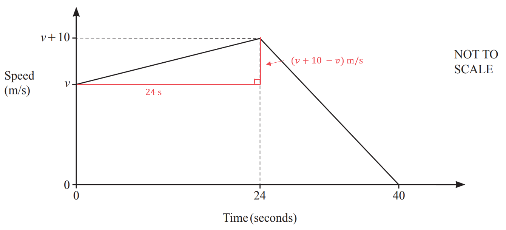

$\begin{gathered} m & = \frac{v + 10 - v}{24} \\ m & = \frac{10}{24} \\ = \frac{5}{12} \end{gathered}$

**Acceleration = **$\frac{5}{12}$**m/s****2 **** [1] **

**If changing to a decimal you must give at least 3 s.f.**

### Q10
*On a speed-time graph, the gradient represents the acceleration/deceleration.* *Look at the first 20 seconds of the journey and find the coordinates at the start and the end of that section.*

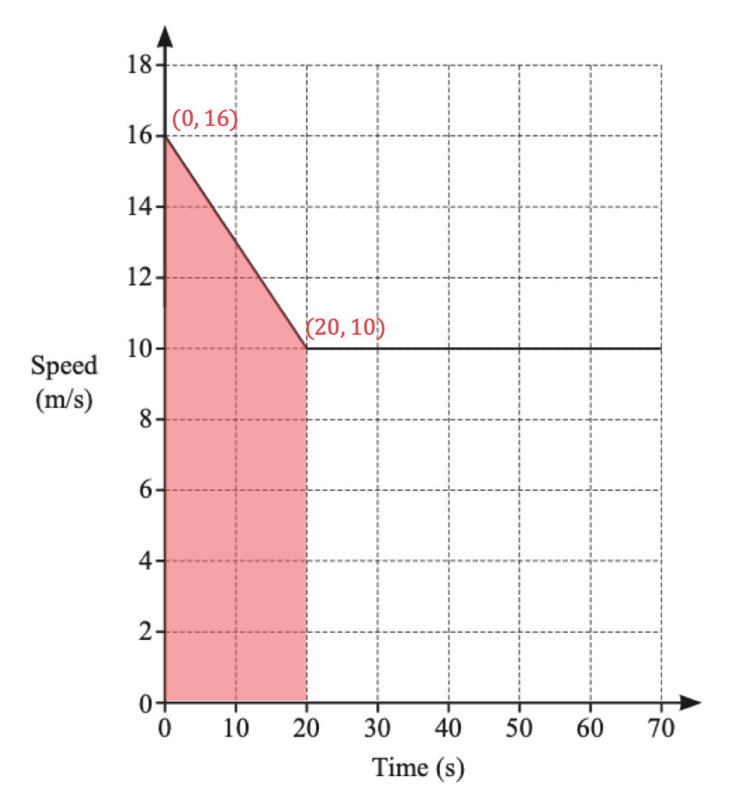

> *Calculate the gradient of the section by dividing finding the rise over the run or *$m=\frac{y_{2}-y_{1}}{x_{2}-x_{1}}$*.*

$m=\frac{10-16}{20-0}$

$m=\frac{-6}{20}$

> *The acceleration is negative, therefore the deceleration is positive*

$\frac{3}{10}$* ***m/s****2**** ****[1]**

**The decimal equivalent of 0.3 will also be accepted.**
> *The distance travelled on a speed-time graph is the area under the line.*

> *Find the area under the line for the first 20 seconds using the area of a trapezium rule, *$A = 1 \frac{1}{2} ( a + b ) h$*, where *$a$* and *$b$* are the lengths of the parallel edges of the trapezium and *$h$* is the perpendicular height between them.*

$A_{1} = 1 \frac{1}{2} ( 16 + 10 ) \times 20
A_{1} = 260$

> *Find the distance travelled between 20 seconds and 70 seconds by calculating the area of the rectangle.*

$A_{2} = ( 70 - 20 ) \times 10
A_{2} = 500$

**One correct area statement**** [1]**

> *Find the total distance travelled by adding the areas together.*

$260+500$

**[1]**

$760$** ****m ****[1]**

### Q11
> *The deceleration is the difference in speed divided by the difference in time. "Deceleration" assumes slowing down, so as the car is slowing down here, the answer should be given as a positive number*

*deceleration = *$\frac{8-0}{13-10}$

$\frac{8}{3}$ **or 2.67 m/s****2****  ****[1]**
> *In a speed-time graph, the distance travelled is the area under the graph (because distance = speed x time and area of a rectangle = height x width)*

*We can divide this area into a rectangle and a triangle, or a trapezium as shown below*

> *You are expected to know that the area of trapezium = *$1 \frac{1}{2} ( a + b ) \times h$

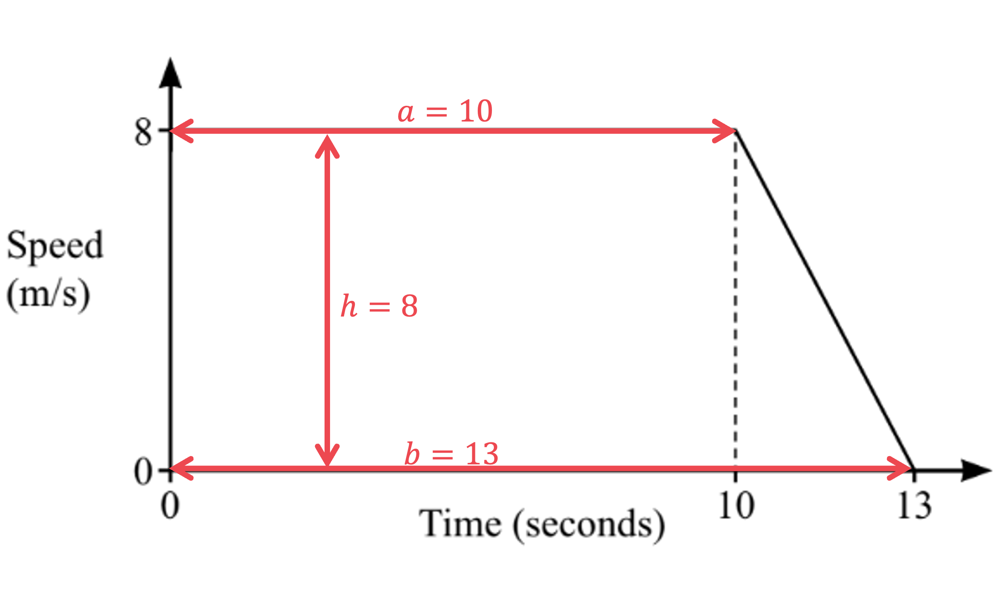

*distance = area = *$1 \frac{1}{2} ( 10 + 13 ) \times 8$

**the calculation above, or '10×8 + 0.5×3×8'*** ***[1]**
**Answer = 92 m**** [1]**

### Q12
*Method 1*

*acceleration = *$\frac{\mathrm{change} \mathrm{in} \mathrm{speed}}{\mathrm{time}}$ *Substitute (3.0 - 1.2) m/s as the change in speed and 3 seconds as the time into the formula* * *

*acceleration = *$\frac{( 3.0 - 1.2 )}{3} = 0.6$* m/s**2*

**0.6 m/s****2**** [1]**

> *Method 2** *

*Acceleration is the gradient of the line on a speed-time graph* 
*Find the gradient of the line during the first 3 seconds (for example, by calculating "rise" over "run")* * *

*acceleration = *$\frac{\mathrm{rise}}{\mathrm{run}}=\frac{3.0-1.2}{3}=0.6$* m/s**2*

**0.6 m/s****2**** ****[1]**
*The distance travelled is the total area under the graph (to the *$t$*-axis)* *Draw lengths on to the diagram*

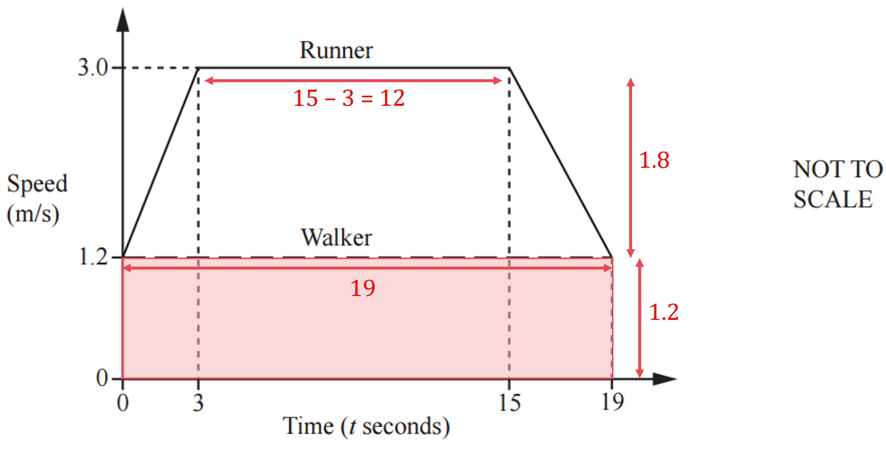

*Find the area of the lower rectangle (by multiplying base by height)* * *

> $19\times1.2$* *

**[1]**

> *The area of a trapezium is given below *

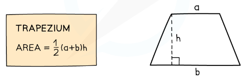

* Find the area of the upper trapezium on the graph (by substituting in **a** = 12, **b** = 19 and **h** =1.8)* * *

$1 \frac{1}{2} \times ( 12 + 19 ) \times 1.8$ * *

*Add both areas together* * *

$19 \times 1.2 + 1 \frac{1}{2} \times ( 12 + 19 ) \times 1.8$

**[1]**

> *Use a calculator to find this value*

**50.7 m** **[1]**
*Find how far the walker walks in 19 seconds (using the area under the graph of the walker)* * *

*walker walks *$19\times1.2=22.8$* m*

**[1]**

*Find how far the runner runs in 19 seconds, using part (b)* * *

*runner runs 50.7 m* * *

*If it helps, draw a diagram to show the runner starting 10 metres behind the walker* * *

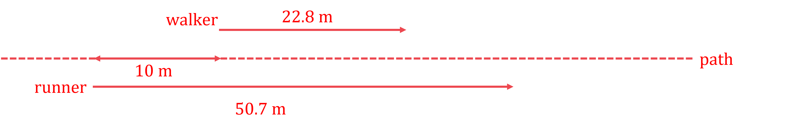

> * *

*Calculate how far ahead the runner is (by subtracting 22.8 and 10 from 50.7)*

*50.7 - 22.8 - 10*

**[1]**

**17.9 m** **[1]**

### Q13
*Draw a vertical line from (24, 0) until it touches the curve.* 
*Draw a tangent, a straight line that just touches the curve, at that point.*

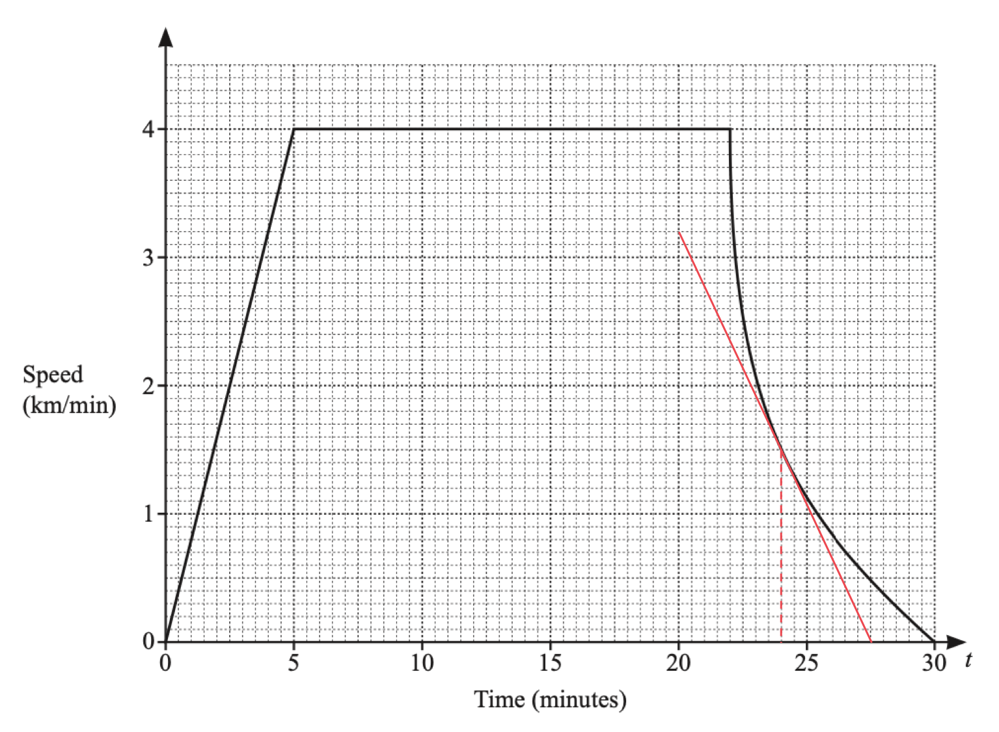

**[1]**

> *Identify the coordinates of two points that lie on the tangent.*

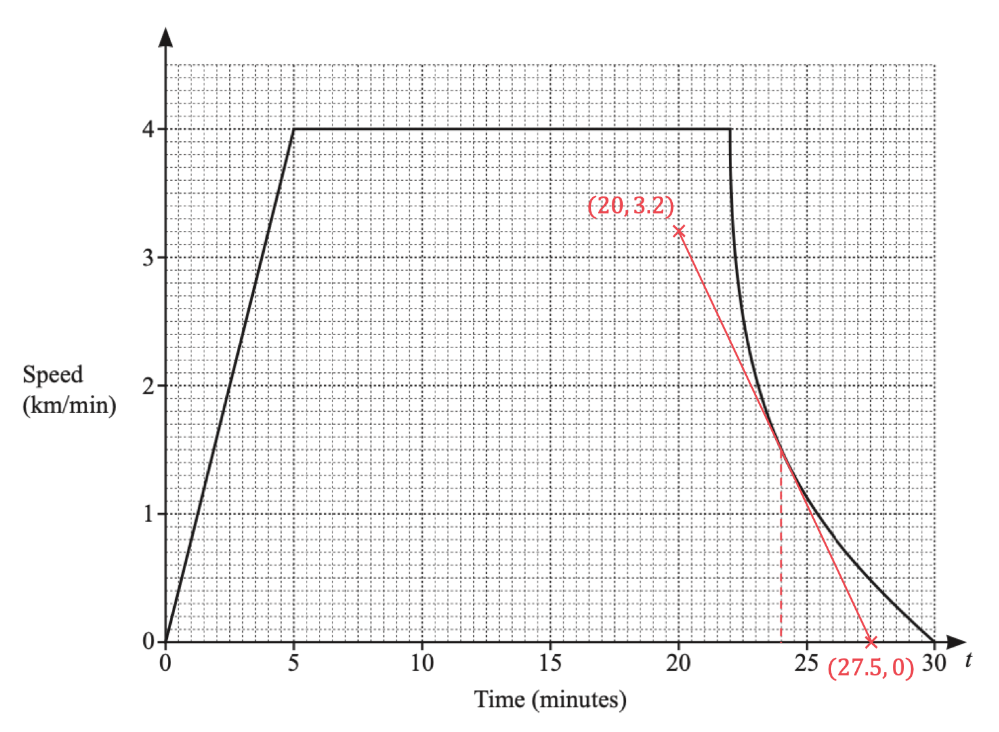

> *Calculate the gradient of the line from those two points by dividing the rise by the run, *$m=\frac{y_{2}-y_{1}}{x_{2}-x_{1}}$*. Make sure you get the values the correct way round, the gradient should be negative.*

$m=\frac{0-3.2}{27.5-20}$

**[1]**

$m=-0.43333...$

$-0.433$* ***[1]**

> *Answers between -0.7 and -0.3 will be accepted.*
**Acceleration/deceleration** **[1]**
> *The train is travelling at a constant speed when the line on the graph is horizontal. *

> *Find the length of time for which the train is travelling at a constant speed and find the constant speed.*

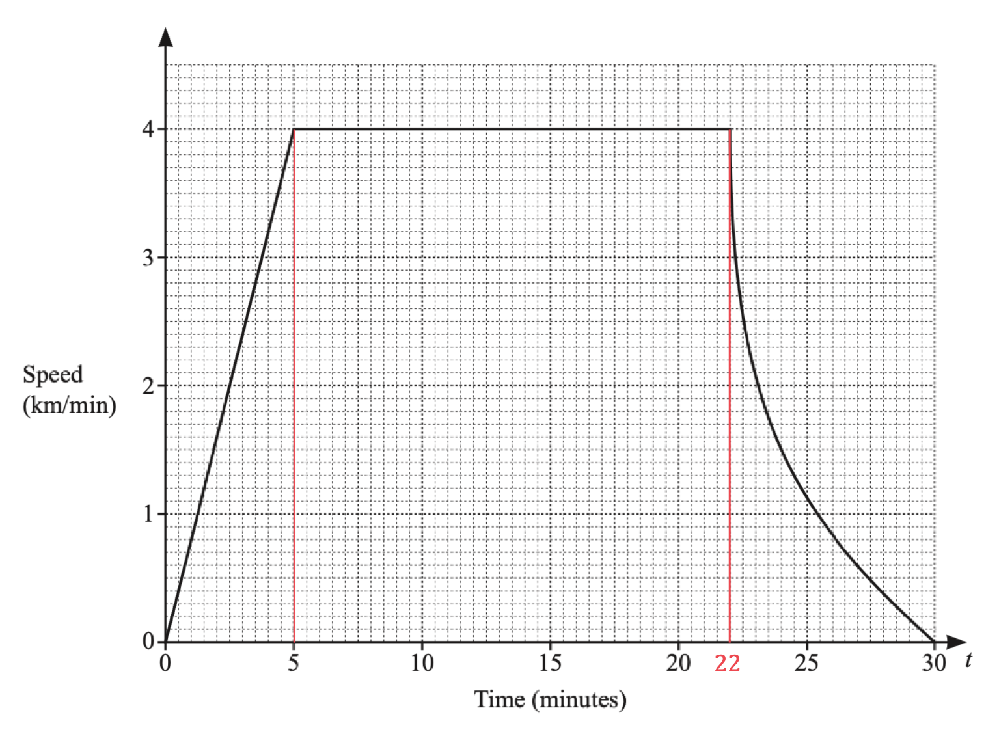

*Constant speed: *$4$* km/min*

*Length of time the train is at a constant speed: *$22-5=17$* minutes*

> *Calculate the distance travelled by multiplying the constant speed by the time it was travelling at this speed for.*

$4\times17$

**[1]**

$68$* ***km**** ****[1]**

### Q14
> *In a speed-time graph, distance (speed × time) is equivalent to the area under the line *

> *Method 1 *

> *The shape of the graph is a trapezium. Area of trapezium = *$\frac{1}{2}(a+b)\timesh$* where *$a$* and *$b$* are the parallel lengths and *$h$* is the height*

$\mathrm{Distance}=\frac{1}{2}(90+130)\times20$

**[2]**

$\mathrm{Distance}=2200m$** [1]**

> *Method 2 *

> *Break the graph into two triangles and a rectangle and find the areas of each*

$\mathrm{triangle}_{1}=\frac{1}{2}\times10\times20,\mathrm{rectangle}=90\times20,\mathrm{triangle}_{2}=\frac{1}{2}\times30\times20$

**any one correct area**** [1]**

$\frac{1}{2}\times10\times20+90\times20+\frac{1}{2}\times30\times20$

**[1]**

$\mathrm{Distance}=2200m$** [1]**
> *Average speed = *$\frac{\mathrm{total} \mathrm{distance}}{\mathrm{total} \mathrm{time}}$* *

> *From part (a), total distance = 2200 m and from the diagram, total time = 130 s*

$\begin{gathered} \text{Average} \text{speed} & = \frac{2200 \mathrm{m} }{130 \mathrm{s} } \\ = 16.92307692... \mathrm{m} \div \mathrm{s} \end{gathered}$

> *Round your answer to at least 3 significant figures*

**16.9 m/s**** [1]**
