# Exam Questions — Real-Life Graphs
**Coordinate Geometry & Graphs** · Cambridge (CIE) IGCSE maths (0580 & 0980)
> Source: [https://www.savemyexams.com/igcse/maths/cie/25/extended/topic-questions/](https://www.savemyexams.com/igcse/maths/cie/25/extended/topic-questions/) · 14 questions across 1 sets

## Calculator Questions (14 questions)

### Q1 — medium — 3 marks

**Q1** [1 mark]

The diagram shows the speed–time graph of part of a car journey.

Find the acceleration of the car between 0 and 4 seconds.

........................................m/s2

**Q1** [2 marks]

**Extract:**

The diagram shows the speed–time graph of part of a car journey.

Graph showing speed in m/s over time in seconds. Speed increases from 0 to 17 m/s in 4 seconds, then stays constant up to 12 seconds. Not to scale.

Calculate the total distance travelled during the 12 seconds.

............................................ m

### Q2 — medium — 6 marks

**Q2** [2 marks]

A cyclist starts from rest and accelerates at a constant rate for $2t$ seconds until they reach $8m/s$.

They then travel at a constant speed for $5t$ seconds.

The diagram shows a speed-time graph of their journey.

The distance travelled by the cyclist in the first $7t$ seconds is $200m$.

Work out the exact value of $t$.

**Q2** [2 marks]

Find the acceleration during the first $2t\mathrm{seconds}$ of the journey.

**Q2** [2 marks]

Work out the average speed for their journey.

### Q3 — hard — 5 marks

**Q3** [2 marks]

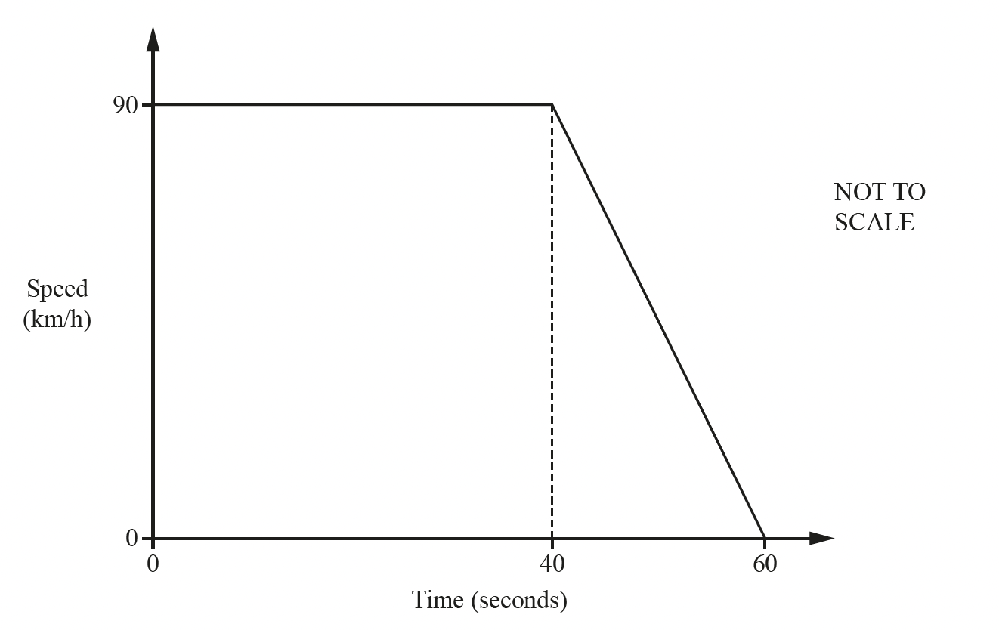

The diagram shows the speed–time graph for 60 seconds of a car journey.

Change 90 km/h to m/s.

.......................................... m/s

*Source: 2018	May/June 0580/23 Q24A*

**Q3** [1 mark]

**Extract:**

The diagram shows the speed–time graph for 60 seconds of a car journey.

Find the deceleration of the car in m/s2.

.........................................m/s2

*Source: 2018	May/June 0580/23 Q24B*

**Q3** [2 marks]

**Extract:**

The diagram shows the speed–time graph for 60 seconds of a car journey.

Find the distance travelled, in metres, in the 60 seconds.

.............................................m

*Source: 2018	May/June 0580/23 Q24C*

### Q4 — very_hard — 6 marks

**Q4** [1 mark]

Jalina left her home at 10 00 to cycle to a park.

On her way to the park, she stopped at a friend’s house and then continued her journey to the park.

Here is the distance-time graph for her journey to the park.

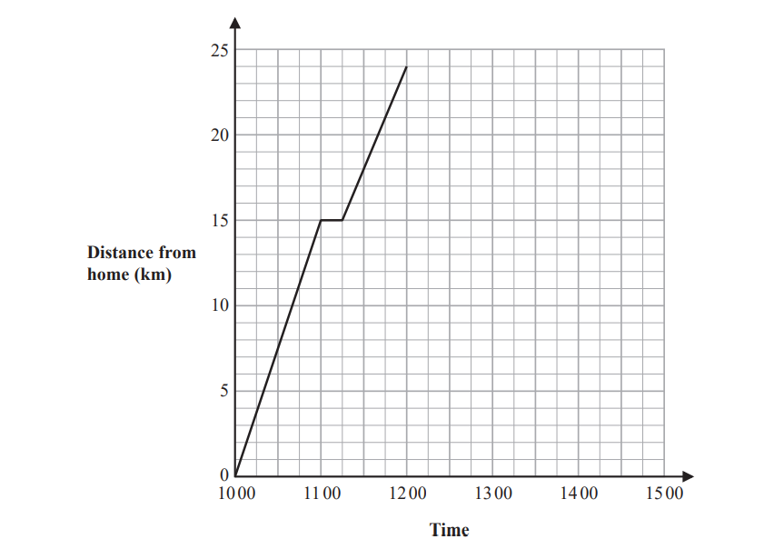

On her journey to the park, did Jalina cycle at a faster speed before or after she stopped at her friend’s house?

Give a reason for your answer.

*Source: June 2019 4MA1/1H Q2A*

**Q4** [2 marks]

Jalina stayed at the park for 45 minutes.

She then cycled, without stopping, at a constant speed of 16 km/h from the park back to her home.

Show all this information on the distance-time graph.

*Source: June 2019 4MA1/1H Q2B*

**Q4** [3 marks]

**Extract:**

Jalina left her home at 10 00 to cycle to a park. On her way to the park, she stopped at a friend's house and then continued her journey to the park. Here is the distance-time graph for her journey to the park.
Jalina stayed at the park for 45 minutes. She then cycled, without stopping, at a constant speed of 16 km/h from the park back to her home.

Work out Jalina’s average cycling speed, in kilometres per hour, for the complete journey to the park and back.

Do **not** include the times when she was not cycling in your calculation.

Give your answer correct to 1 decimal place.

.........................km/h

*Source: June 2019 4MA1/1H Q2C*

### Q5 — hard — 4 marks

**Q5** [1 mark]

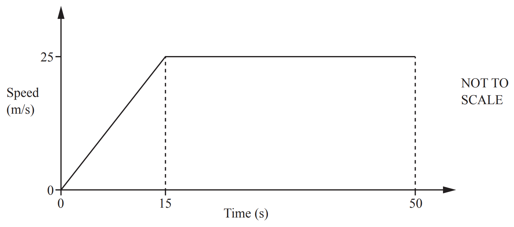

The speed–time graph shows the first 50 seconds of a journey.

Calculate the acceleration during the first 15 seconds.

.............................................m/s2

*Source: 2019 March 0580/22 Q22A*

**Q5** [3 marks]

**Extract:**

The speed–time graph shows the first 50 seconds of a journey.

Calculate the distance travelled in the 50 seconds.

.................................................m

*Source: 2019 March 0580/22 Q22B*

### Q6 — hard — 4 marks

**Q6** [1 mark]

The diagram shows the speed–time graph of a train journey between two stations.

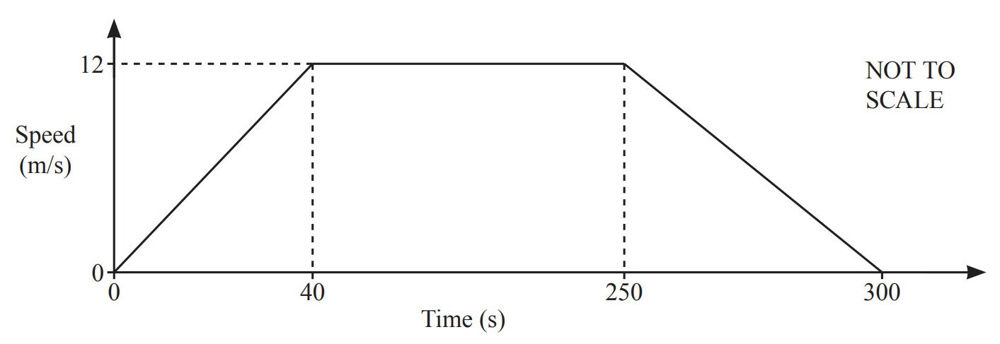

Find the acceleration of the train during the first 40 seconds.

................................................ m/s2

*Source: 2020 May/June 0580/23 Q14A*

**Q6** [3 marks]

Calculate the distance between the two stations.

................................................ m

*Source: 2020 May/June 0580/23 Q14B*

### Q7 — very_hard — 4 marks

**Q7** [4 marks]

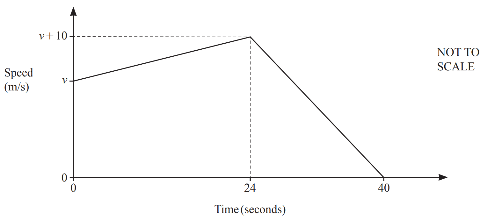

The diagram shows the speed–time graph for the final 40 seconds of a car journey.

At the start of the 40 seconds the speed is $v$ m/s.

The total distance travelled during the 40 seconds is 1.24 **kilometres**.

Find the value of $v$.

$v=$................................................

*Source: 2020 Oct/Nov 0580/23 Q19B*

### Q8 — medium — 4 marks

**Q8** [1 mark]

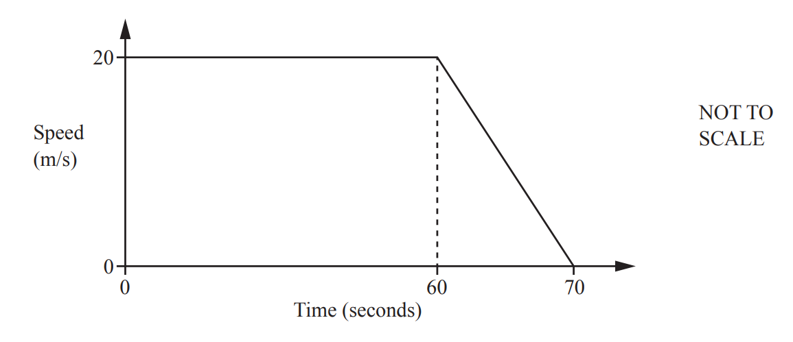

The diagram shows information about the final 70 seconds of a car journey.

Find the deceleration of the car between 60 and 70 seconds.

.....................................m/s2

*Source: 2019	May/June 0580/21 Q24A*

**Q8** [3 marks]

**Extract:**

The diagram shows information about the final 70 seconds of a car journey.

Find the distance travelled by the car during the 70 seconds.

.........................................m

*Source: 2019	May/June 0580/21 Q24B*

### Q9 — hard — 1 marks

**Q9** [1 mark]

The diagram shows the speed–time graph for the final 40 seconds of a car journey.

At the start of the 40 seconds the speed is $v$ m/s.

Find the acceleration of the car during the first 24 seconds.

......................................... m/s2

*Source: 2020 Oct/Nov 0580/23 Q19A*

### Q10 — medium — 4 marks

**Q10** [1 mark]

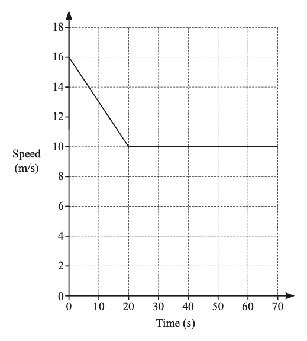

The diagram shows the speed–time graph for 70 seconds of a car journey.

Calculate the deceleration of the car during the first 20 seconds.

............................................ m/s2

*Source: 2019	Oct/Nov 0580/23 Q19A*

**Q10** [3 marks]

**Extract:**

The diagram shows the speed–time graph for 70 seconds of a car journey.

Calculate the total distance travelled by the car during the 70 seconds.

................................................ m

*Source: 2019	Oct/Nov 0580/23 Q19B*

### Q11 — medium — 3 marks

**Q11** [1 mark]

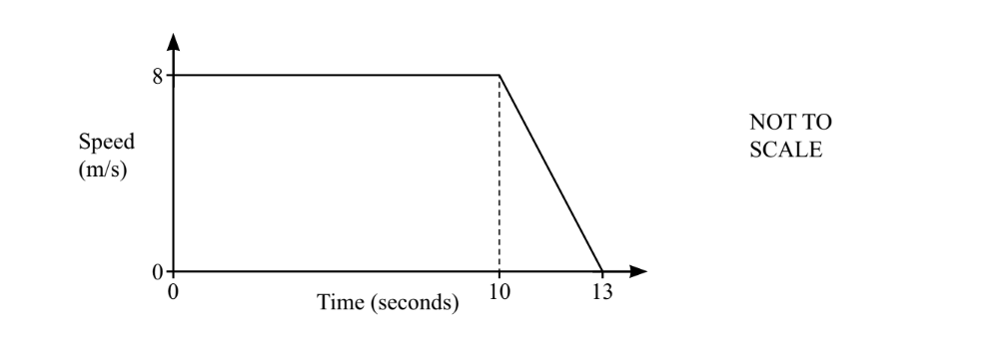

The diagram shows the speed–time graph of part of a car journey.

Find the deceleration of the car between 10 and 13 seconds.

........................................m/s2

*Source: Specimen 2025 0580/04 Q9A*

**Q11** [2 marks]

Calculate the total distance travelled during the 13 seconds.

............................................ m

*Source: Specimen 2025 0580/04 Q9B*

### Q12 — hard — 7 marks

**Q12** [1 mark]

The diagram shows the speed−time graph for part of a journey for two people, a runner and a walker.

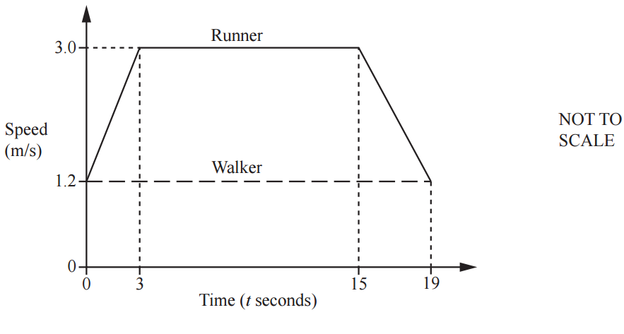

Calculate the acceleration of the runner for the first 3 seconds.

........................................ m/s2

*Source: 2018	Oct/Nov 0580/42 Q6A*

**Q12** [3 marks]

**Extract:**

The diagram shows the speed−time graph for part of a journey for two people, a runner and a walker.

Calculate the total distance travelled by the runner in the 19 seconds.

............................................ m

*Source: 2018	Oct/Nov 0580/42 Q6B*

**Q12** [3 marks]

**Extract:**

Calculate the total distance travelled by the runner in the 19 seconds.   ............................................ m

The runner and the walker are travelling in the same direction along the same path.

When $t$ = 0, the runner is 10 metres behind the walker.

Find how far the runner is ahead of the walker when $t$ = 19.

............................................ m

*Source: 2018	Oct/Nov 0580/42 Q6C*

### Q13 — very_hard — 6 marks

**Q13** [3 marks]

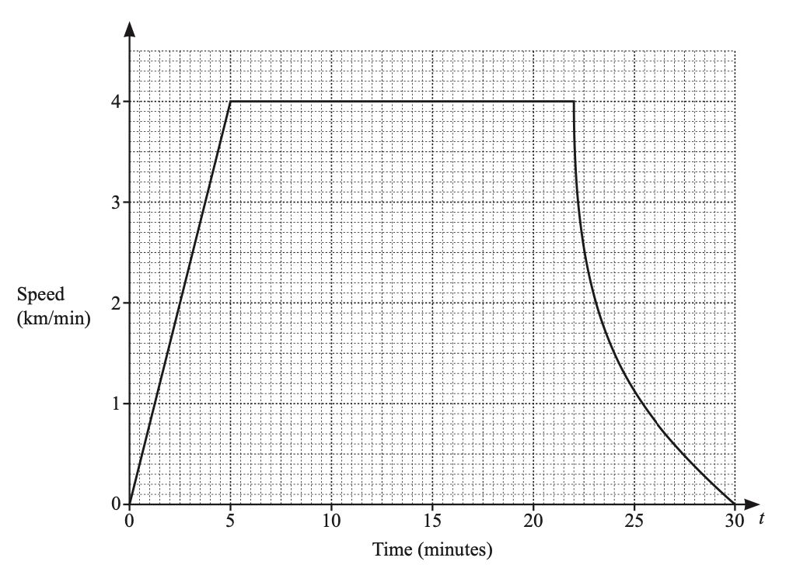

The speed–time graph shows information about a train journey.

By drawing a suitable tangent to the graph, estimate the gradient of the curve at $t=24$.

*Source: 2019	Oct/Nov 0580/22 Q23A*

**Q13** [1 mark]

**Extract:**

The speed–time graph shows information about a train journey. By drawing a suitable tangent to the graph, estimate the gradient of the curve at t equals 24.

What does this gradient represent?

*Source: 2019	Oct/Nov 0580/22 Q23B*

**Q13** [2 marks]

**Extract:**

The speed–time graph shows information about a train journey.

Work out the distance travelled by the train when it is travelling at constant speed.

.............................................. km

*Source: 2019	Oct/Nov 0580/22 Q23C*

### Q14 — medium — 4 marks

**Q14** [3 marks]

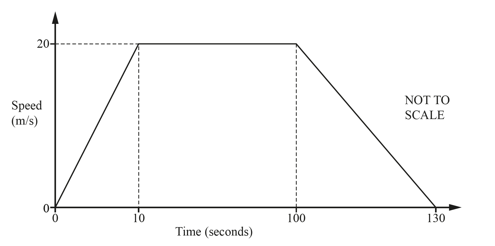

The speed-time graph shows information about the journey of a tram between two stations.

Calculate the distance between the two stations.

.........................................m

*Source: 2018	May/June 0580/21 Q17A*

**Q14** [1 mark]

**Extract:**

The speed-time graph shows information about the journey of a tram between two stations.

Calculate the average speed of the tram for the whole journey.

...................................... m/s

*Source: 2018	May/June 0580/21 Q17B*

