# Mark Schemes — Solving & Graphing Inequalities
**Coordinate Geometry & Graphs** · Cambridge (CIE) IGCSE maths (0580 & 0980)

## Exam Questions (22 questions)

### Q1
It can be convenient to shade in the sides of lines that you DON'T want for the inequalities

- Then the unshaded bit remaining is the required region

$x\geq0$ is the $y$-axis and everything to the right of it

- So that includes the entire grid given in the question

$y\geqx$ is the line $y=x$ and everything above it

- So the bit you DON'T want is the region below that line

$x+y\leq8$ is the line $x+y=8$ and everything below it

- Test a point like $( 0 , 0 )$ if you are unsure

  - $\begin{array}{cc}0 + 0 & \le 8 \\ 0 \le & 8 ✔\end{array}$
- So the bit you DON'T want is the region above that line

Shade in the regions you don't want, and label the remaining region $R$

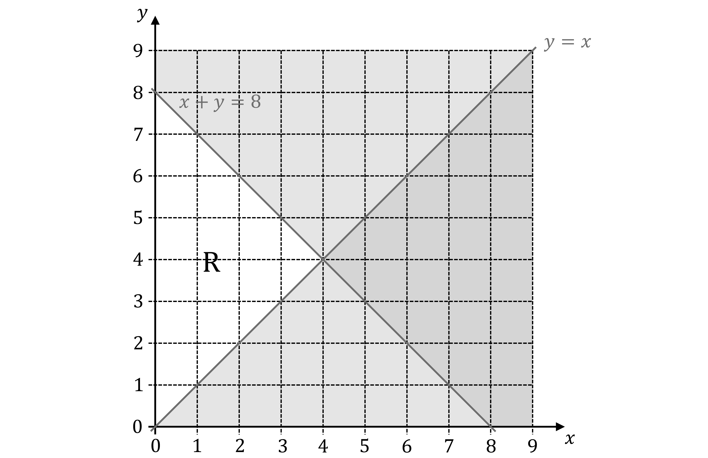

**[B1]**

### Q2
$y=x$ is the diagonal line through the origin $( 0 , 0 )$

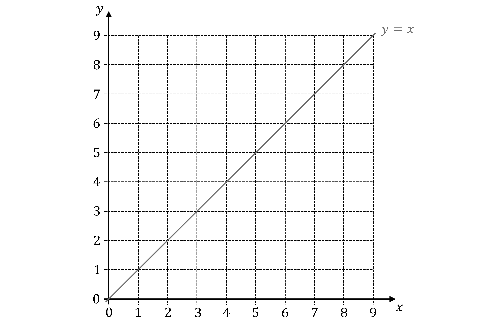

**[B1]**

$x+y=8$ can be rearranged into $y=mx+c$ form by subtracting $x$ from both sides

$\begin{gathered} x + y & = 8 \\ y = - x + 8 \end{gathered}$

- That is a line with gradient $-1$ (so it is perpendicular to $y=x$)
- and with $y$-intercept $( 0 , 8 )$

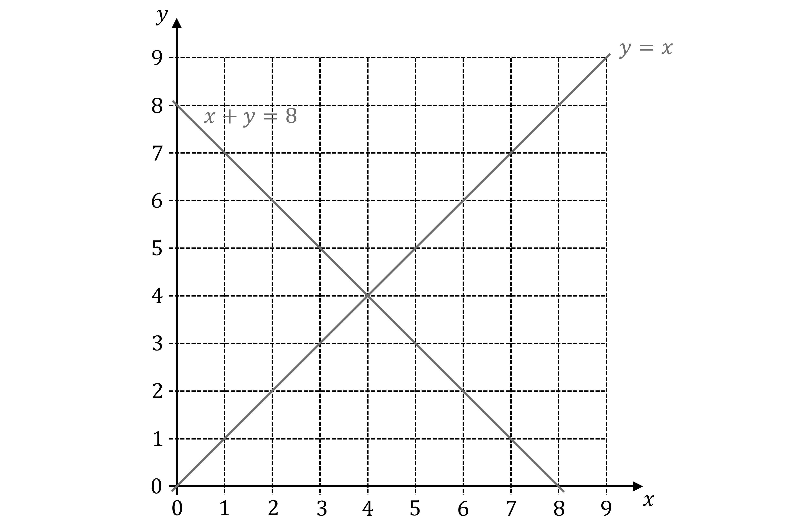

**[B1 B1]**

> **[mark-scheme]**
> **B1**: For ruled line $y=x$ correctly drawn.
> 
> **B1**: For ruled line drawn with gradient $-1$ or going through $( 0 , 8 )$, as long as that line is not $y=8$ or $x=8$.
> 
> **B1**: For fully correct ruled line drawn for $x+y=8$.
It can be convenient to shade in the sides of lines that you DON'T want for the inequalities

- Then the unshaded bit remaining is the required region

$x\geq0$ is the $y$-axis and everything to the right of it

- So that includes the entire grid given in the question

$y\geqx$ is the line $y=x$ and everything above it

- So the bit you DON'T want is the region below that line

$x+y\leq8$ is the line $x+y=8$ and everything below it

- Test a point like $( 0 , 0 )$ if you are unsure

  - $\begin{array}{cc}0 + 0 & \le 8 \\ 0 \le & 8 ✔\end{array}$
- So the bit you DON'T want is the region above that line

Shade in the regions you don't want, and label the remaining region $R$

**[B1]**

### Q3
> *List the integer values of **x **and** y*

**x ***:  4, 5, 6*

**y ***: 5, 6, 7, 8*

**correctly listing**** ****x or y values*** ***[1]**

> *There is no way to make 13 by adding 4 to one of the **y **values; the highest number that can be made from** **4 + **y** is 4 + 8 = 12*

> *However 13 can be made from **x** + **y **when **x** is 5 (5 + 7) or when **x** is 6 (6 + 7)*

**5 and 6 ****[1]**
> *First we need to draw the lines for the 3 inequalities. To draw the lines, treat them as equations and use your knowledge of **linear graphs **y** = **mx** + **c**.** All three inequalities are *$\leq$* or *$\geq$* so should be drawn with solid lines*

> *For *$y\geq-1$*, draw *$y=-1$*, a horizontal line through −1 on the **y**-axis*

> *For *$y\geq4-x$*, draw *$y=-x+4$*, a line through (0, 4) with a gradient of −1*

> *For *$y\leq3x-1$*, draw *$y=3x-1$*, a line through (0, −1) with a gradient of 3*

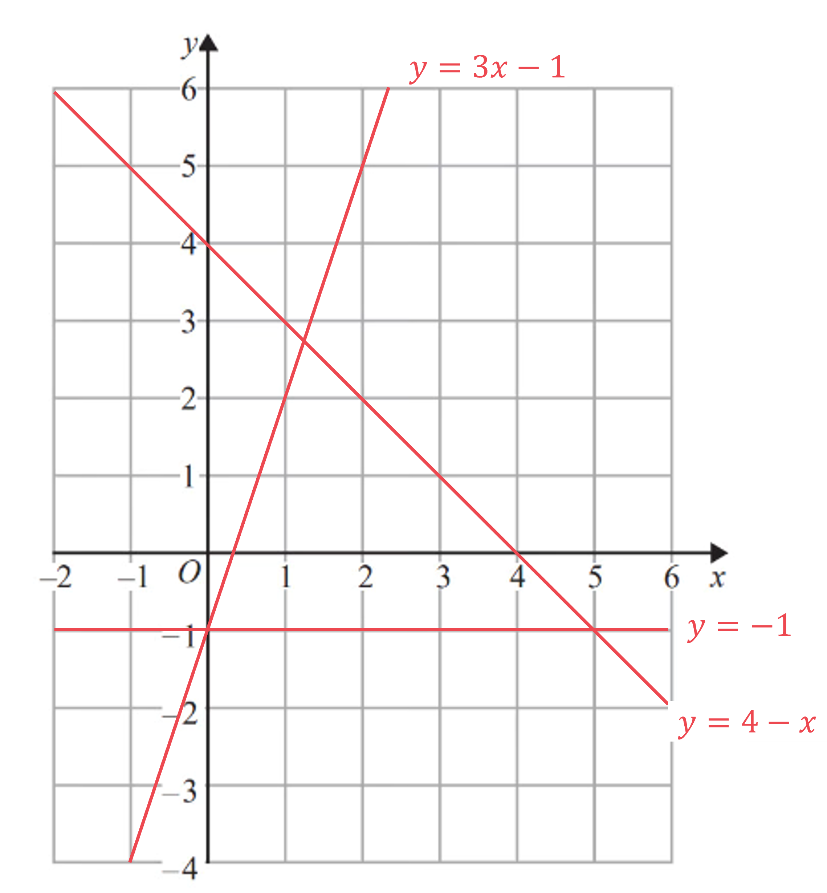

**one mark for each correctly drawn line**** ****[3]**

> *Shade the **unwanted **regions for each line*

> *For *$y\geq-1$*, the **unwanted** region is below the line, so simply shade below the line *$y=-1$

> *For *$y\leq4-x$*, the **unwanted** region is above the line, so shade above. To check, pick a point such as (0, 0) and substitute into the inequality:*

$\begin{gathered} 0 \text{less} \text{or} \text{equal} \text{than} 4 - 0 , \text{true} \end{gathered}$

> *(0, 0) is in the wanted region so shade everything on the **other** side of the line *$y=4-x$

> *For *$y\leq3x-1$*, the **unwanted** region is above the line, so shade above. To check substitute (0, 0) again:*

$\begin{array}{cc}0 \le & 3 \times 0 - 1 \\ 0 \le & - 1 , \text{false} \end{array}$

> *(0, 0) is in the **unwanted** region, so shade the (0, 0) side of the line *$y=3x-1$

> *Finally, don't forget to label the wanted region "R"!*

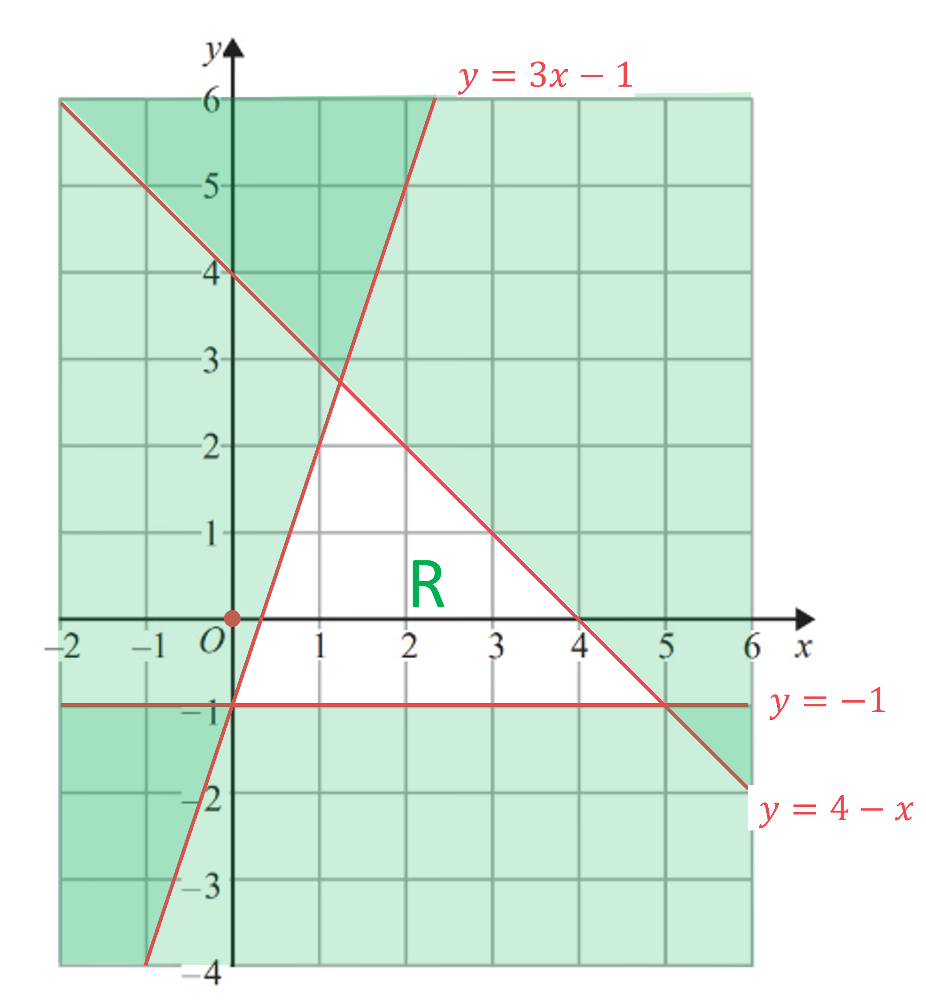

**correct region clearly indicated**** ****[1]**

### Q4
> *Method 1*

> *The equation of a straight line is *$y=mx+c$* where *$m$* is the gradient and (0, *$c$*) is the *$y$*-intercept*

> *For *$y=x$* the gradient is 1 and the *$y$*-intercept is (0, 0). Draw this line and label it with its equation*

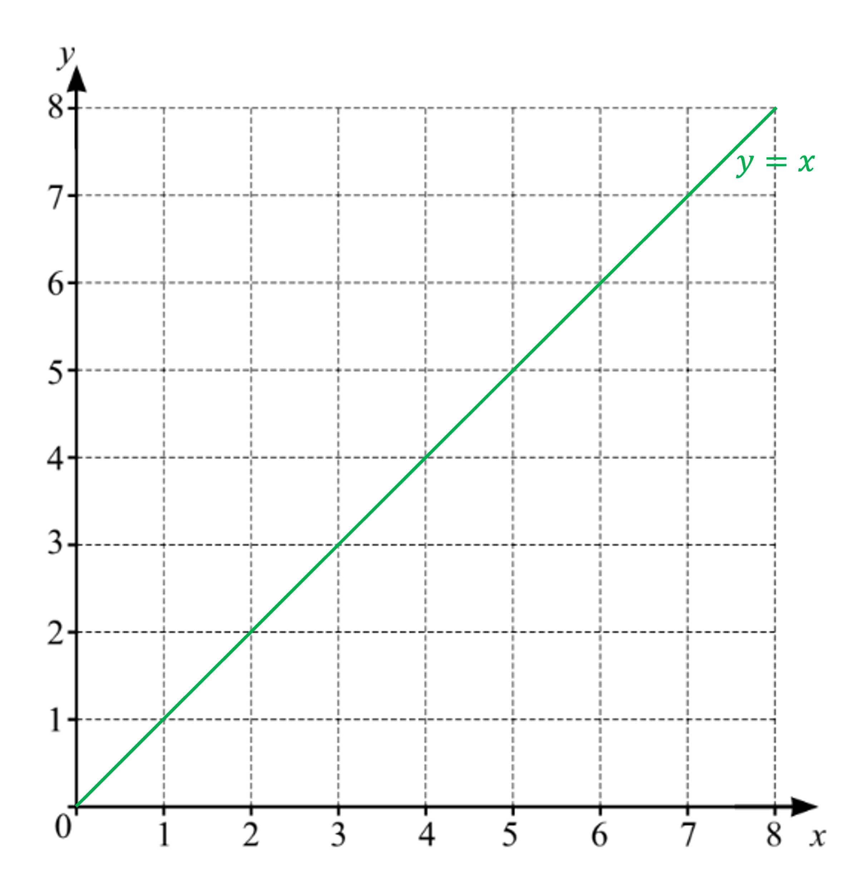

**correct line drawn with a ruler**** [1]**

> *Rearrange *$x+y=7$* to the form *$y=mx+c$

$y=-x+7$

> *Therefore the gradient is −1 and the *$y$*-intercept is (0, 7). Draw this line and label it with its equation*

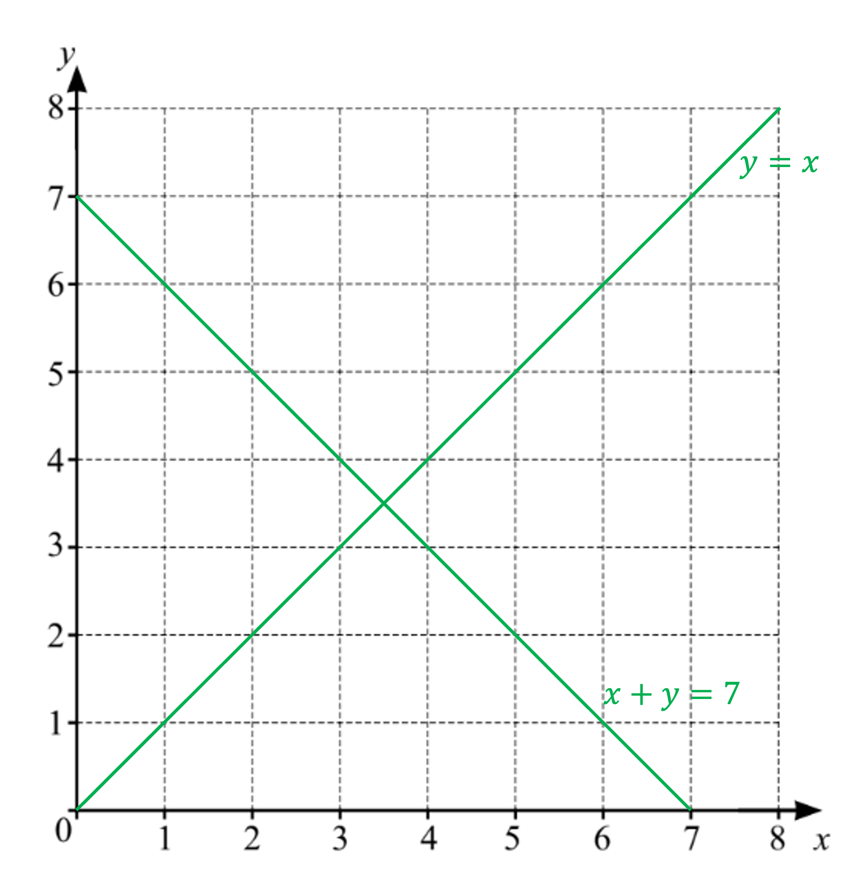

**ruled line with a gradient of −1 ****or**** through (0, 7)**** [1]** 
**fully correct line**** ****[1]**

> *Method 2*

> *The equation of a straight line is *$y=mx+c$* where *$m$* is the gradient and (0, *$c$*) is the *$y$*-intercept*

> *For *$y=x$* the gradient is 1 and the *$y$*-intercept is (0, 0). Draw this line and label it with its equation*

**correct line drawn with a ruler**** [1]**

> *For *$x+y=7$* the *$y$*-intersect is where *$x=0$

$\begin{array}{rcl} 0 + y & = 7 \\ y = 7 \end{array}$

> *Mark the point (0, 7) on the grid*

> *For *$x+y=7$*, the *$x$*-intersect is where *$y=0$

$\begin{array}{rcl} x + 0 & = 7 \\ x = 7 \end{array}$

> *Mark the point (7, 0) on the grid, and join the points with a straight line*

**ruled line with a gradient of −1 ****or**** through (0, 7)**** [1]**

**fully correct line**** ****[1]**
> *All of the inequalities are ≤ or ≥ so the solid lines drawn in part (a) are fine*

> $y \text{greater} - \text{than} or \text{slanted} \text{equal} to 0$* signifies the area above *$y=0$

> $y\leqx$* the inequality opens away from *$y$* so shade the area below the line *$y=x$

> $x+y\geq7$*, the inequality opens towards *$y$*so shade above *$x+y=7$

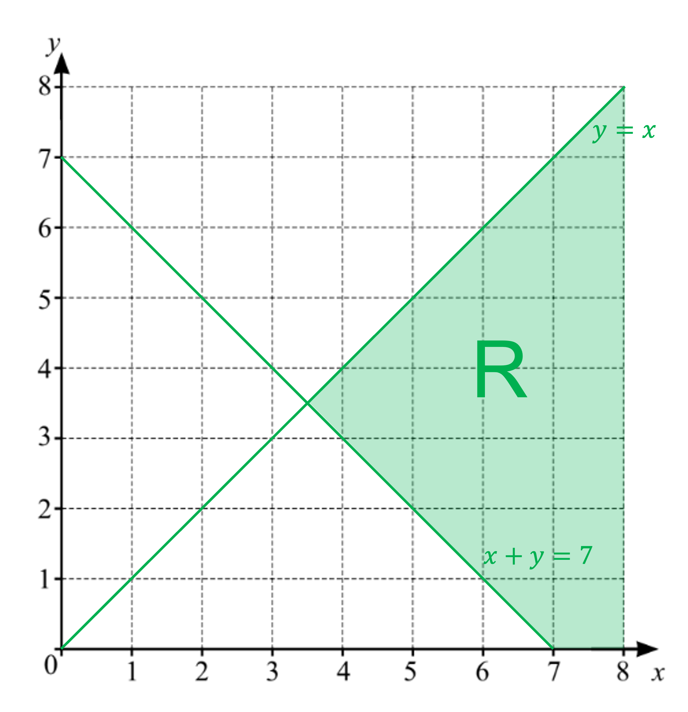

> *Don't forget to label the region "R" as requested!*

** ****correct region, and labelled "R" ****[1]**

### Q5
> $2x+y\geq6$*:*

> *The line *$2x+y=6$* is already drawn for you so shade out the left hand side, where if you pick a coordinate and substitute the *$x$* and *$y$* values into it, it does not satisfy the inequality. *

> *E.g. Point *$( 0 , 0 ) \rightarrow 2 ( 0 ) + ( 0 ) \text{neither} greater-than \text{nor} \text{equal} \text{to} 6$

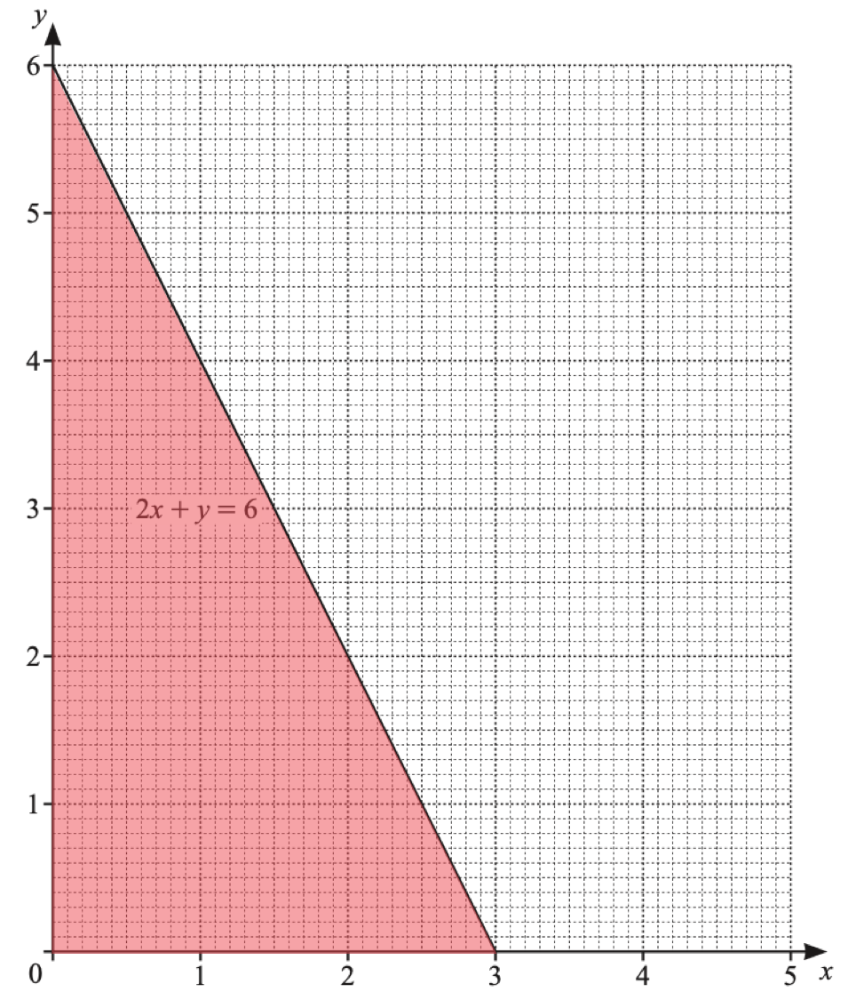

**[1]**

> $y\leq5$*:*

> *Draw a horizontal line going through (0, 5). *

> *Shade the area above the line where the *$y$* values are greater than 5.*

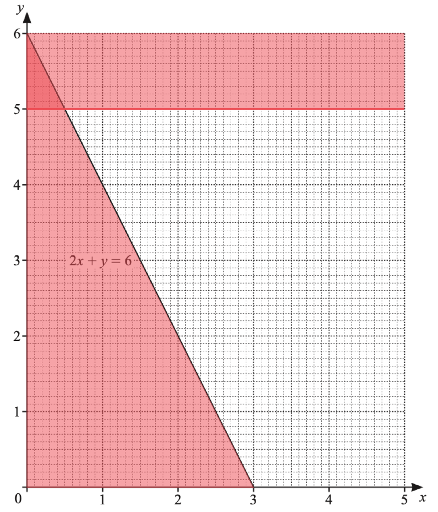

**[1]**

> $y\geqx+1$*:*

> *Draw a diagonal line going through (0, 1) and (5, 6). *

> *Shade the area below the line where the *$y$* values of the coordinates are less than the *$x+1$* values. *

> *Label the unshaded area in the middle **R**.*

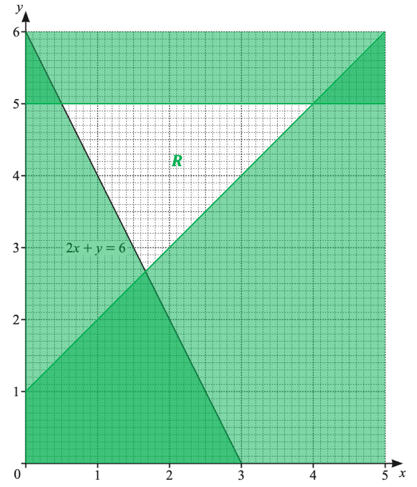

**Correct shading for two of the inequalities ****[1] **
**Correct region labelled with ****R**** [1]**

### Q6
> *All the inequalities in the question contain the equals sign so you will draw all lines as solid lines. Change the inequalities into equations by replacing the inequality signs with an equal sign.*

> *The line *$x=2$* is a vertical line that passes through 2 on the **x**-axis.*

> *The line *$y=x$* is a diagonal line that passes through the points (0,0), (1,1), (2,2), etc.*

> *Find where the line *$2x+y=8$* crosses the coordinate axes by substituting **x** = 0 and **y** = 0.*

`| x | = 0 <-> y = 8 | | _ _ therefore ( 0 , 8 ) is on the line | | y | = 0 <-> 2 x = 8 <-> x = 4 | | _ _ therefore ( 4 , 0 ) is on the line | |`

> *Plot these two points and then join together with a straight line. *

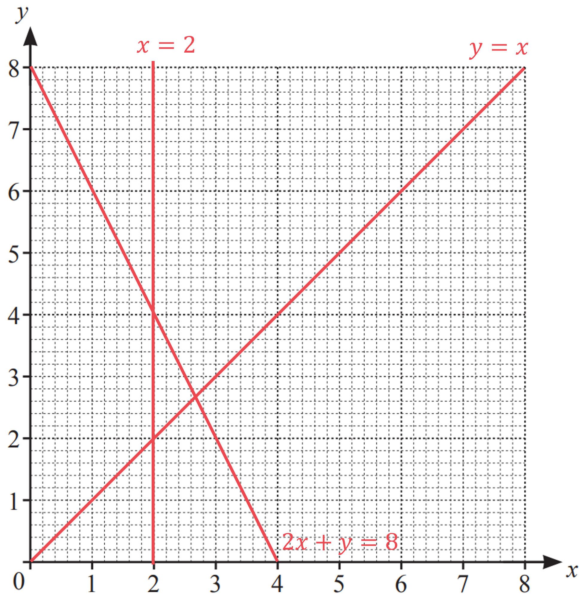

$x=2$** ****drawn correctly*** ***[1]**
** **$y=x$** ****drawn correctly**** [1]*** *
$2x+y=8$** ****drawn correctly*** ***[2]**

> *Pick a point that does not lie on any of the lines, using (0, 1) is easy, and substitute its **x** and **y** values (**x** = 0 and **y** = 1) into the inequalities. *

*If the inequality is satisfied then (0, 1) is in the region **R** **so shade the side of the line which does not have (0, 1) in it**. *

> *If the inequality is not satisfied then shade the side of the line which has (0, 1) in it.*

> $0\geq2$* is not true so (0, 1) does not satisfy *$x\geq2$*, shade the region to the left of the line *$x=2.$

$1\geq0$* is true so (0, 1) satisfies *$y\geqx$*, shade the region below the line *$y=x.$

> $2 ( 0 ) + 1 \le 8$* is true so (0, 1) satisfies *$2x+y\leq8$*, shade the region above the line *$2x+y=8.$

> *Label the unshaded region **R**.*

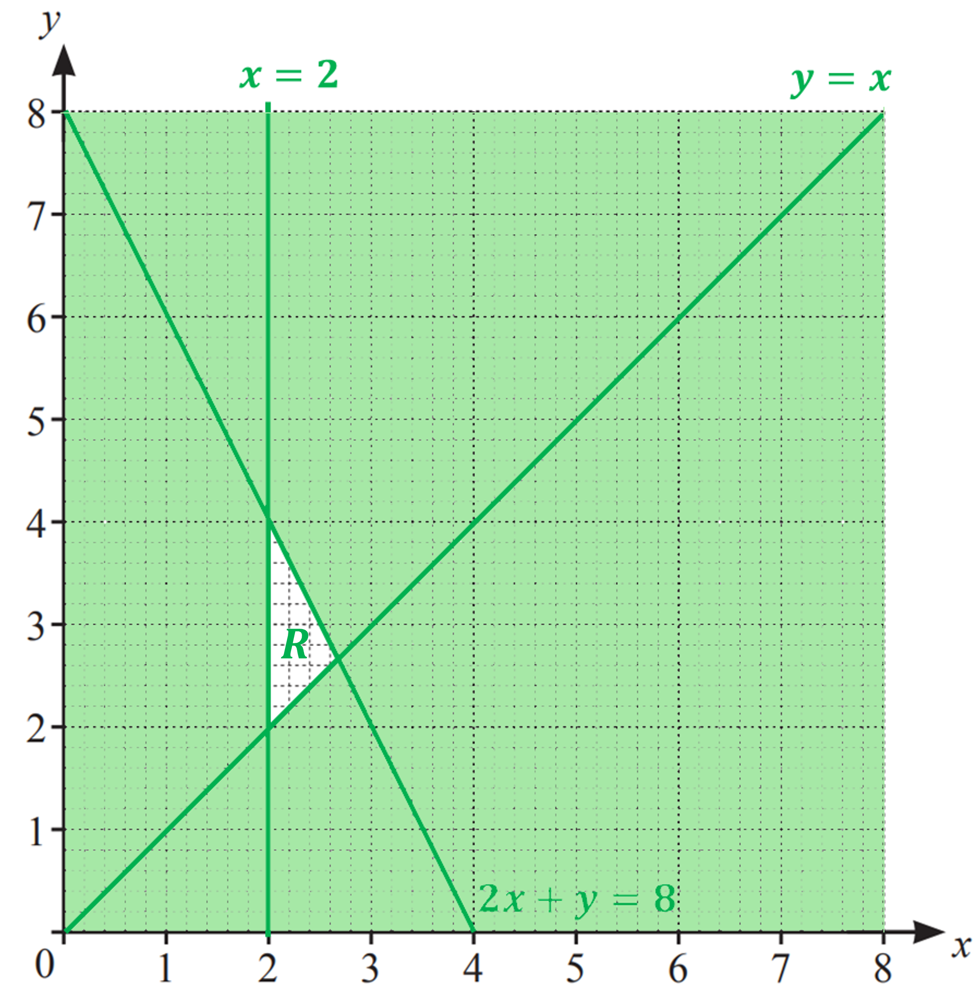

**[1]**

### Q7
*The inequality given, *$y<10$*, comes from "... fewer than 10 mats.".*

> *So the other inequality must come from "... number of mats ... is greater than or equal to the number of baskets ..."*

$y\geqx$

$y\geqx$ **[1]**
> *Work in decimals so *$2\frac{1}{4}=2.25$* hours and *$1\frac{1}{2}=1.5$* hours.*

$\therefore2.25x+1.5y\leq22.5$

**[1]**

> *Multiply by 4 to make all values integers.*

$9x+6y\leq90$

> *Divide through by 3.*

$3x+2y\leq30$

$3x+2y\leq30$* ***[1]**
> *The three inequalities are*

$\begin{array}{cc}y < 10 \\ y \ge x \\ 3 x + 2 y & \le 30\end{array}$

> *You may find it easier to rearrange the last one before plotting it.*

$\begin{array}{ccc}2 y & \le & 30 - 3 x \\ y \le & 15 - 1.5 x \\ y \le & - 1.5 x + 15\end{array}$

> *So we can now plot the three lines*

> * *$y=10$*; a horizontal line passing through 10 on the *$y$*-axis (dotted, <, as 10 is **not** included).*

> * *$y=x$*; a line with a gradient of 1 passing through the origin (solid line, ≥).*

> * *$y=-1.5x+15$*; a line with negative gradient of 1.5 and passes through 15 on the *$y$*-axis (solid line, ≤).*

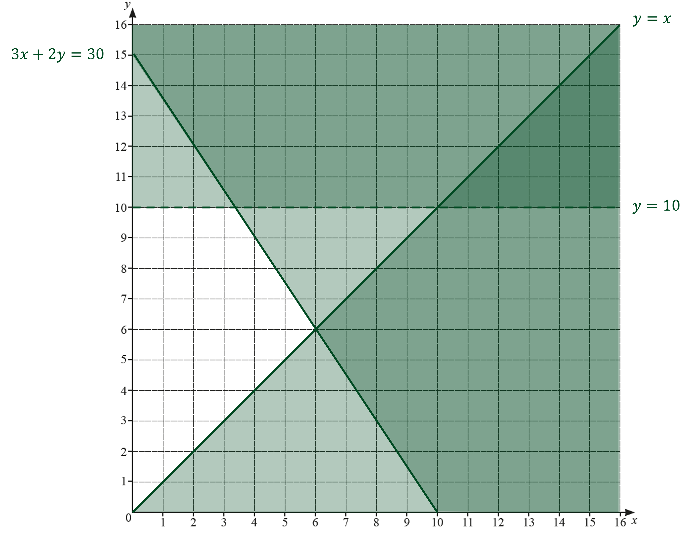

$y=10$** ****ruled and dotted**** [1]**
** **$3x+2y=30$** ruled and solid**** [1]**
** **$3x+2y=30$** passing through either (0, 15) or (10, 0)**** [1]**
** **$y=x$** ruled and solid*** ***[1]*** *
**Correct region**** [1]**

### Q8
> *There are two lines we need to identify. For demonstration purposes, the lines are labelled Line 1 and Line 2 below*

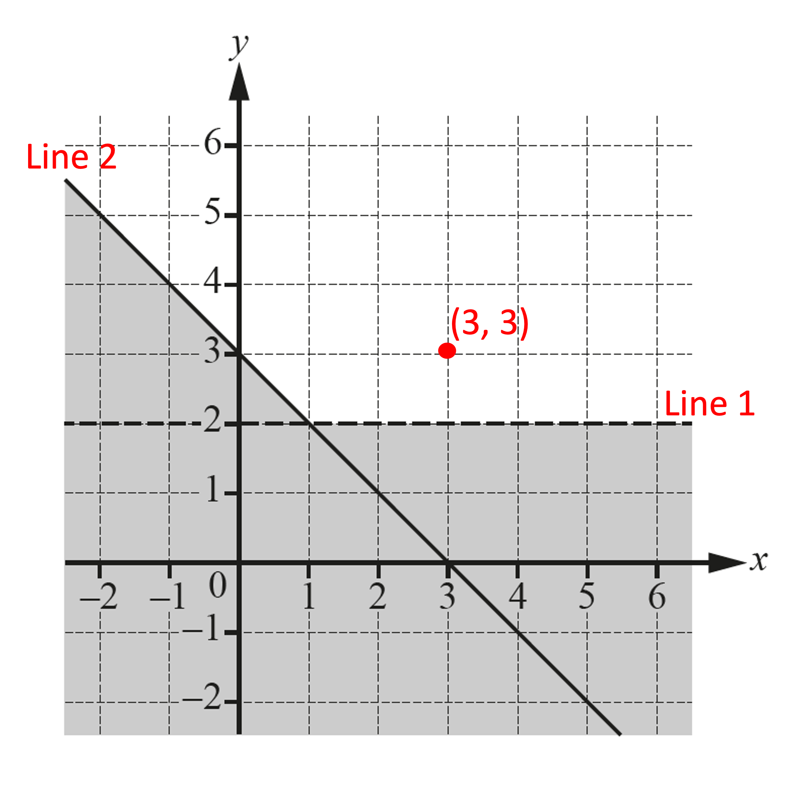

> *First let's consider Line 1. It is a horizontal line through 2 on the *$y$*-axis so*

*equation of Line 1 is *$y=2$

> *Now we need to consider the inequality sign. Remember that a solid line represents *$\leq$* or *$\geq$* but a broken line represents < or >.*

> *The unshaded area is above Line 1, and Line 1 is a broken line so*

** **$y>2$** ****[1]**

> *Now let's consider Line 2. The first step is to get its equation in the form *$y=mx+c$*:*

*Line 2: gradient =*$\frac{\mathrm{rise}}{\mathrm{run}}=\frac{-1}{1}=-1$*      and      y-intercept at (0, 3)*

*equation of Line 2 is *$y=-x+3$

**[1]**

> *The unshaded region is above this line so *$y\geq-x+3$* If unsure, pick a point, for example, (3, 3) as marked on the diagram above, substitute *$x=3$* and *$y=3$* into the equation of the line, and decide which way the inequality sign should go:*

*     ** *$\begin{gathered} y = - x + 3 \\ 3 \text{greater} \text{or} \text{equal} \text{than} - 3 + 3 ( 3 \text{is} \ge 0 ) \end{gathered}$

> *Therefore*

** **$\begin{gathered} y \text{greater} \text{or} \text{equal} \text{than} - x + 3 \end{gathered}$* ***[1]**** **

### Q9
> *Draw the lines *$x=-2$* and *$x=3$*. Make sure that the line for the *$x=-2$* line is dashed (because the inequality is *$<$*) and the line for *$x=3$* is solid (because the inequality is *$\leq$*).*

> *Shade the areas where the *$x$* values of the coordinates are less than 2 and more than 3.*

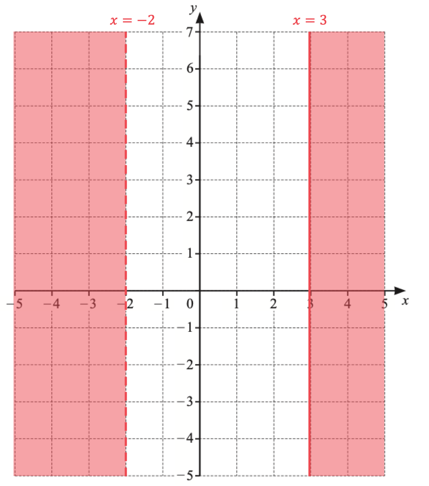

**Correct dashed line for **$-2<x$** and solid line for **$x\leq3$** [1]**

> *Draw the line *$y=x+3$*.*

> * It will pass through the point (0, 3) and have a gradient of 3. Use a solid line because the inequality is *$\leq$*.*

> *Shade the area where the *$y$* values of the coordinates are greater than the *$x$* value plus 3.*

> *Mark the unshaded region **R**.*

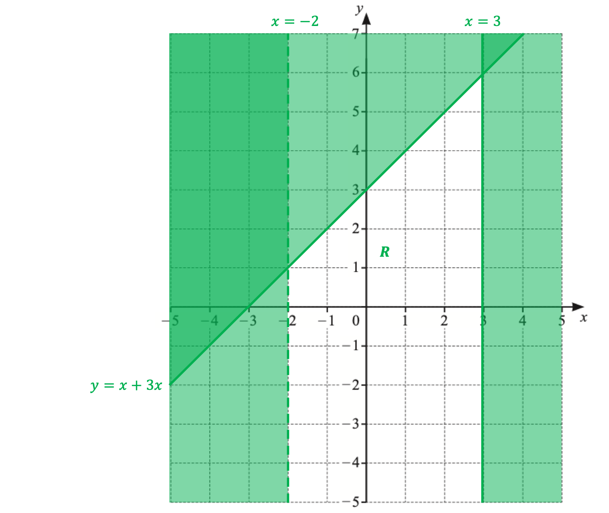

**Correct solid line for **$y\leqx+3$** [1] **
**Correct shading for two of the inequalities*** ***[1] **
**Correct region identified**** [1]**

### Q10
> *More gold than silver means **y** has to be greater than **x**.*

> *At least 15 silver means **x** is greater than or equal to 15.*

> *Less than 50 gold means **y** is less than 50.*

> *Total of no more than 70 means **x** + **y **is less than or equal to 70.*

**Final answer:** $\begin{array}{cc} y > x \\ x \ge 15 \\ y < 50 \\ x + y & \le 70\end{array}$** **

*1 mark for each*** [4]**
> *Change the inequalities into equations by replacing the inequality signs with an equal sign. *

> *If the inequality is weak (≤ or ≥) then you draw the line using a solid line. *

> *If the inequality is strict (< or >) then you draw the line using a dashed line.*

> *The line *$y=x$* is a diagonal line that goes through (0, 0), (10, 10), (20, 20), etc. The inequality is strict so use a dashed line.*

> *The line *$x=15$* is a vertical line that passes through 15 on the **x**-axis. The inequality is weak so use a solid line.*

> *The line *$y=50$* is a horizontal line that passes through 50 on the **y**-axis. The inequality is strict so use a dashed line.*

> *Find where the line *$x+y=70$* crosses the coordinate axes by substituting **x** = 0 and **y** = 0.*

`| x | = 0 <-> y = 70 | | _ _ therefore ( 0 , 70 ) is on the line | | y | = 0 <-> x = 70 | | _ _ therefore ( 70 , 0 ) is on the line | |`

> *Plot these two points and then join together with a straight line. *

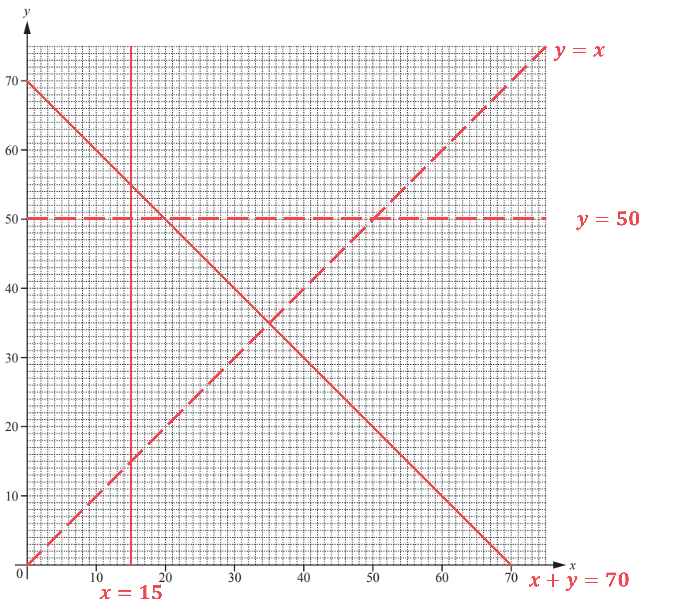

** ****1 mark for each line**** [4]**

> *Pick a point that does not lie on any of the lines, using (0, 10) is easy, and substitute its **x** and **y** values (**x** = 0 and **y** = 10) into the inequalities. *

*If the inequality is satisfied then (0, 10) is in the region** **so shade the side of the line which does not have (0, 10) in it**. *

> *If the inequality is not satisfied then shade the side of the line which has (0, 10) in it.*

> $10>0$* is true so (0, 10) satisfies *$y>x$*, shade the region below the line *$y=x.$* *

$10\geq15$* is not true so (0, 10) does not satisfy *$x\geq15$* so shade the region to the left of the line *$x=15.$

$0<50$* is true so (0, 10) satisfies *$y<50$*, shade the region above the line *$y=50.$

> $0+10\leq70$* is true so (0, 10) satisfies *$x+y\leq70$*, shade the region above the line *$x+y=70.$

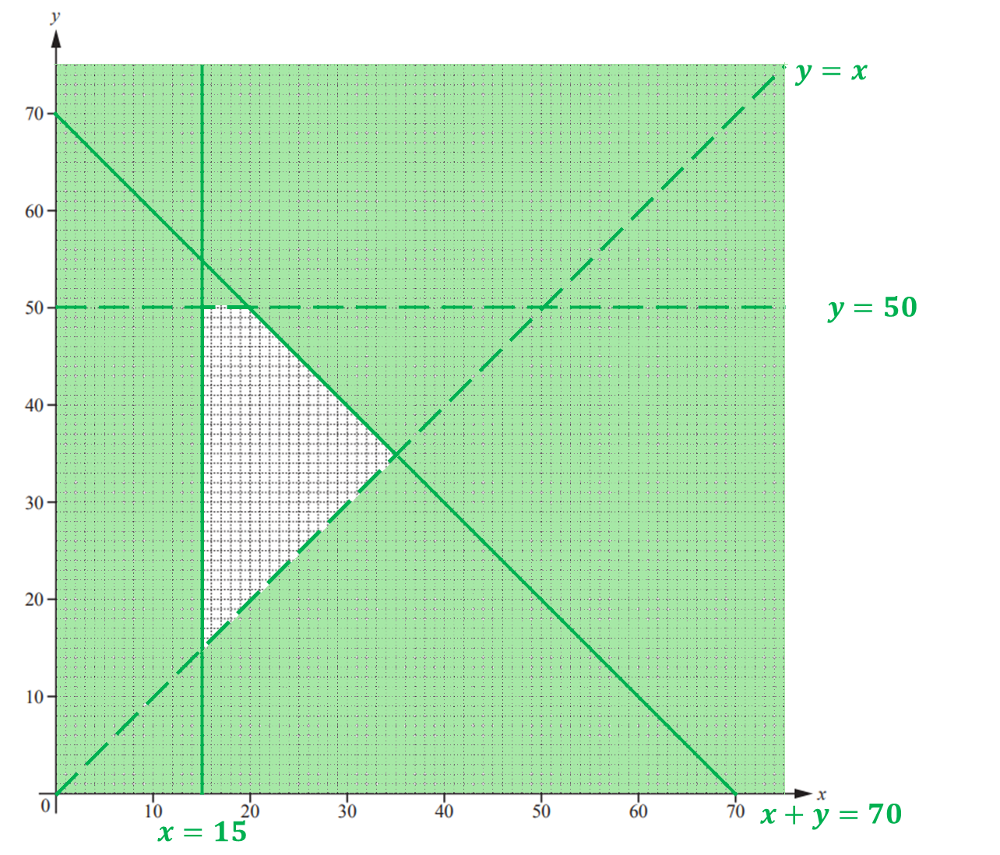

**[1]**

### Q11
> *For the first inequality, *$y\leq-\frac{1}{2}x+6$*, we will shade above the line as the "unwanted" region. *

> *We can check this by picking a co-ordinate in the unwanted region, e.g. (2, 6) and confirming that it does not satisfy the inequality when substituted in*

$6 \text{less} \text{or} \text{equal} \text{than} - 1 \frac{1}{2} ( 2 ) + 6
6 \text{less} \text{or} \text{equal} \text{than} 5$

> *Statement is false, so (2,6) lies in the "unwanted" region*

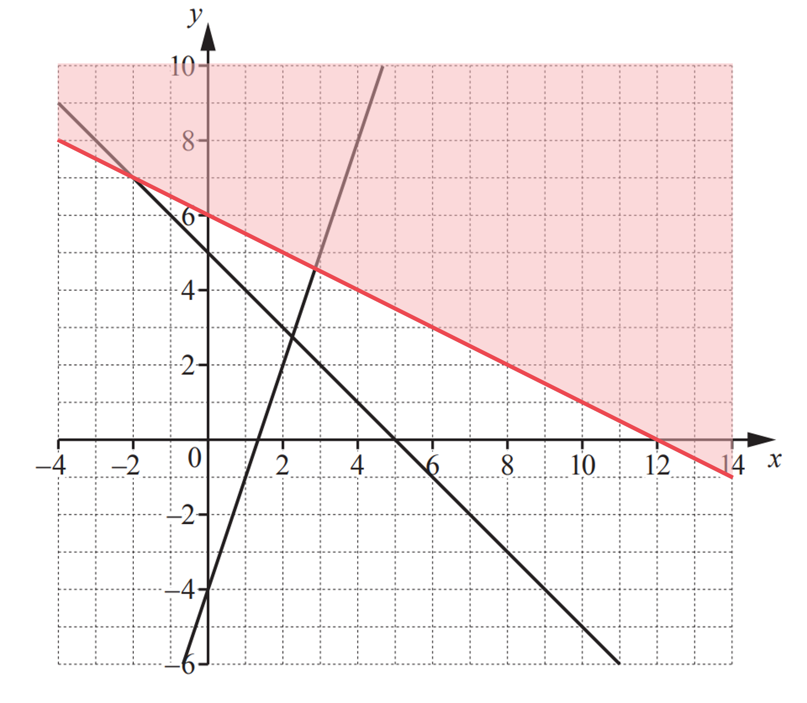

> *For the second inequality, *$y\geq3x-4$*, we will shade below the line as the "unwanted" region. *
*We can check this by picking a co-ordinate in the unwanted region, e.g. (3, 0) and confirming that it does not satisfy the inequality when substituted in*

$0 \ge 3 ( 3 ) - 4 0 \ge 5$

> *Statement is false, so (3,0) lies in the "unwanted" region*

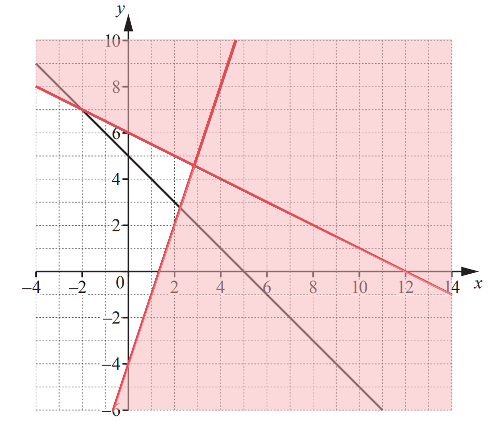

*For the third inequality, *$x+y\geq5$*, we will shade below the line as the "unwanted" region.*

*You may want to rearrange this inequality by subtracting *$x$* from both sides to give *$y\geq-x+5$*, which may make this clearer*

> *We can check this by picking a co-ordinate in the unwanted region, e.g. (0, 0) and confirming that it does not satisfy the inequality when substituted in*

$0+0\geq5\,0\geq5$

> *Statement is false, so (0,0) lies in the "unwanted" region*

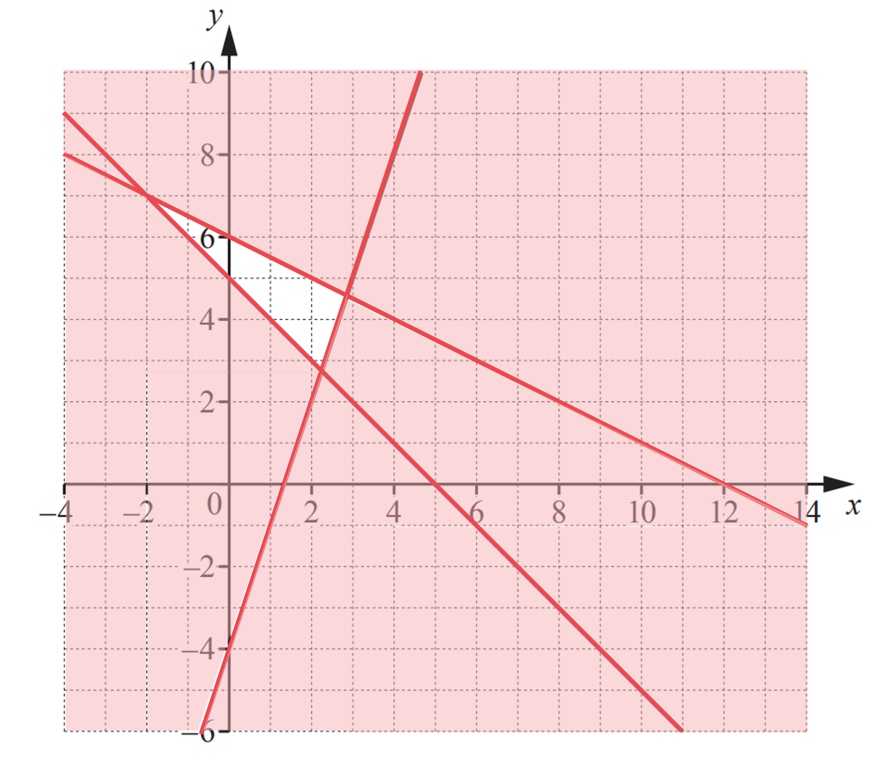

> *The leftover unshaded region, **R**, is the region which satisfies all three inequalities*

*Any coordinate in this region would satisfy all three inequalities*

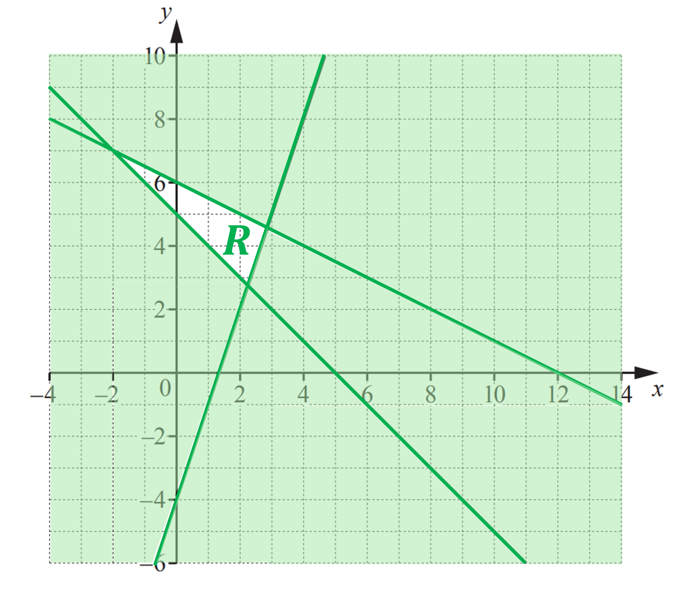

**Two regions correctly shaded**** [1]** 
**All three regions correctly shaded and R identified**** [1] **

**Note that because all of these equations used **$\leq\mathrm{or}\geq$**, they are represented by solid lines. If < or > were used, we would use dashed lines**

### Q12
> *Write down an inequality that describes the total number of cars that the company has in terms of *$x$* and *$y$*.*

$x+y\geq6$ **[1]**

> *Write down an inequality that describes the number of large cars the company has compared to the number of small cars*

$y\leqx$ **[1]**

> *Write down an inequality that describes the number of small cars that the company has.*

$x\leq8$ **[1]**
> *Write down an inequality for the total number of people that can be carried on a day.*

$4x+6y\leq60$

> *Simplify the inequality by dividing both sides by 2.*

$2x+3y\leq30$* ***[1]*** *
> *Draw on each inequality one at a time and decide which side of the line to shade.*

> $x+y\geq6$*:*

*When** *$x=0,y=6$* **and** **when *$y=0,x=6$*.*

> *Draw a straight line through (0,6), (6,0) and shade below the line where the *$x$* and *$y$* values add up to less than 6.*

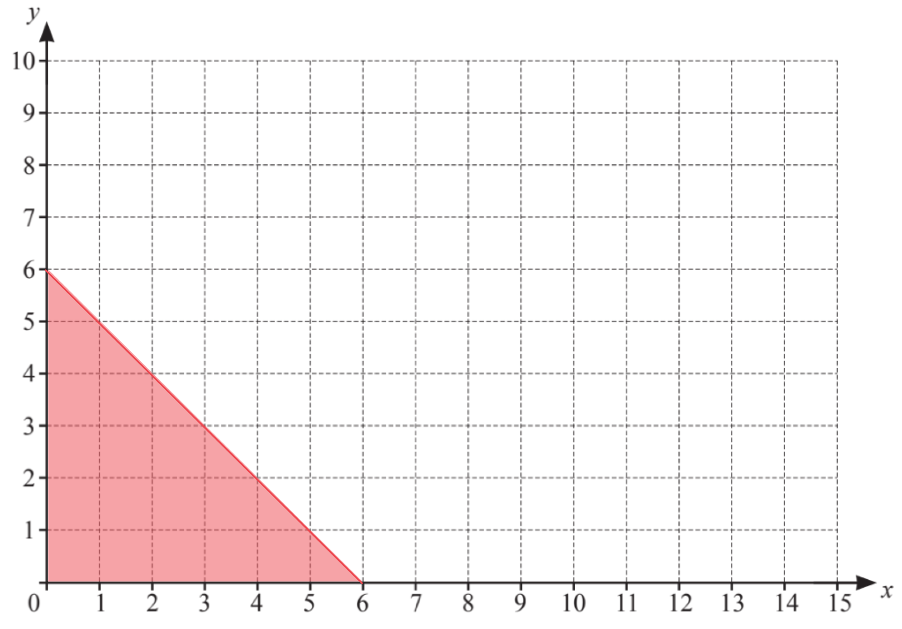

**[1]**

> $y\leqx$*:*

> *Draw the line *$y=x$* and shade on the left hand side of the line where the *$y$* values are greater than the *$x$* values.*

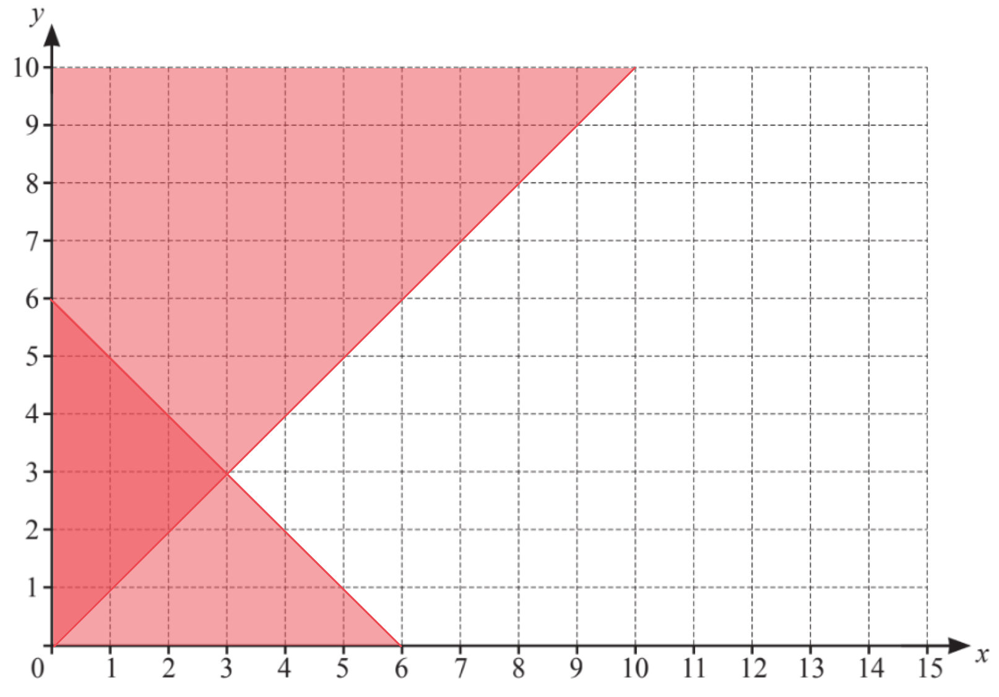

**[1]**

> $x\leq8$*:*

> *Draw a vertical line going through (8, 0) and shade on the right hand side of the line where the *$x$* values are greater than 8.*

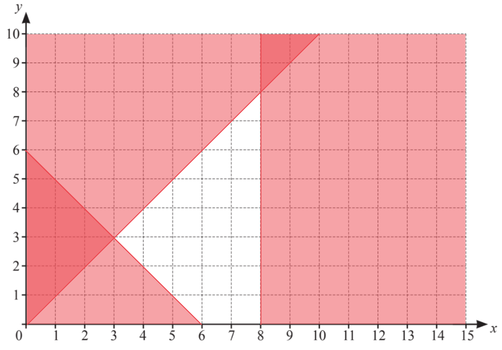

**[1]**

> $2x+3y\leq30$*:*

*When** *$x=0,y=10$* **and** **when *$y=0,x=15$*.*

> *Draw a straight line through (0,10), (15,0) and shade above the line where the sum of *$2x+3y$* for each point is greater than 30. *

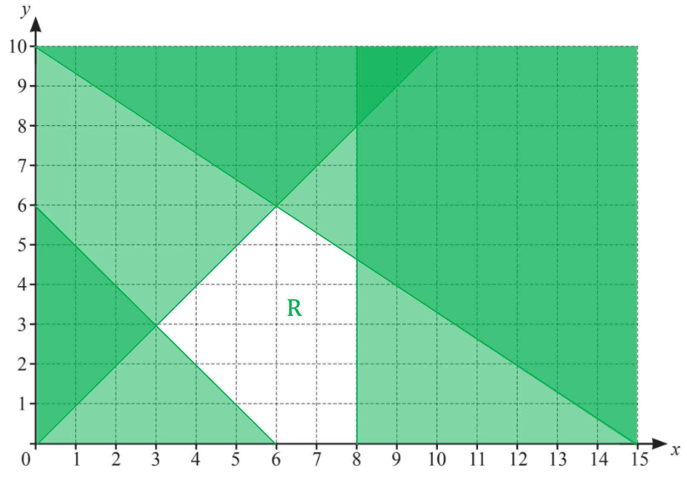

**Straight line going through (0,15) OR (10, 0***) ***[1] **
**Straight line going through (0, 15) and (10, 0)*** ***[1]**

**Make sure that the unshaded region is marked with an R.**

### Q13
> *Solve the inequality in the same way that you would an equation.*

> *Multiply both sides by 2.*

$x-26>24+6x$

> *Subtract *$x$* from both sides.*

$-26>24+5x$

> *Subtract 24 from both sides.*

$-50>5x$

**[1]**

> *Divide both sides by 5.*

$-10>x$

$x<-10$ **[1]**

### Q14
> *Use trial and error. Pick a point, and substitute the *$x$*- and *$y$*-coordinates into the equation *$3x+5y=35$*. For example;*

*Pick (3, 3):  *$3\times3+5\times5=9+25=34,3x+5y\neq35$*,  fail*

*Pick (4,4): *$3\times4+5\times4=12+20=32,3x+5y\neq35$*,  fail*

*a trial of at least one coordinate point seen** ***[1]**

*Pick (5, 4): *$3\times5+5\times4=15+20=35,3x+5y=35$*, success!*

**(5, 4)**** [2]**
> *There are two lines we need to identify. For demonstration purposes, the lines are labelled Line 1, Line 2 and Line 3 below*

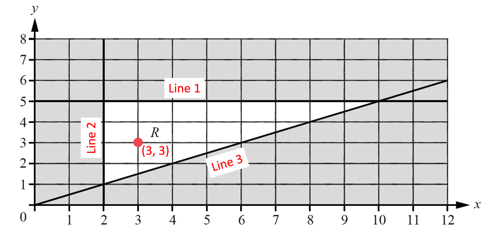

> *First let's consider Line 1. It is a horizontal line through 5 on the *$y$*-axis so*

*equation of Line 1 is *$y=5$

> *Now we need to consider the inequality sign.*

> *Remember that a solid line represents *$\leq$* or *$\geq$* but a broken line represents < or >.*

> *The unshaded area is below Line 1, and Line 1 is a solid line so*

$y\leq5$** ****[1]**

> *Now let's consider Line 2. It is a vertical line through 2 on the *$x$*-axis so*

*equation of Line 2 is *$x=2$

> *Now we need to consider the inequality sign. The unshaded area is to the right of Line 2, and Line 2 is another solid line so*

$x\geq2$** ****[1]**

> *Now let's consider Line 3. The first step is to get its equation in the form *$y=mx+c$*:*

*Line 3: gradient =*$\frac{\mathrm{rise}}{\mathrm{run}}=\frac{1}{2}$*      and      y-intercept at (0, 0)*

*equation of Line 2 is *$y=\frac{1}{2}x$

**[1]**

> *Now we need to determine the inequality sign. The unshaded region is above the line so *$y\geq\frac{1}{2}x$* *

*If unsure, pick a point inside the unshaded region. For example pick (3, 3), substitute *$x=3$* and *$y=3$* into the equation of the line, and decide which way the inequality sign should go:**     ** *

$\begin{gathered} y = 1 \frac{1}{2} x \\ 3 \text{greater} \text{or} \text{equal} \text{than} 1 \frac{1}{2} \times 3 ( 3 \text{is} \text{greater} \text{than} \text{or} \text{equal} \text{to} 1 1 \frac{1}{2} ) \end{gathered}$

> *Therefore*

$\begin{array}{cc} y \ge & \frac{1}{ } 2 x\end{array}$* ***[1]**** **

### Q15
$x\leq3$* means all points to the left of the vertical line *$x=3$ 
*Shade away the area to the right of *$x=3$

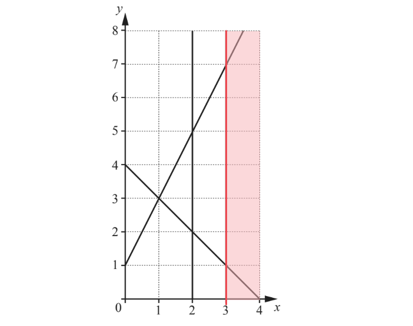

$x\geq2$* means all points to the right of the vertical line *$x=2$ 
*Shade away the area to the left of *$x=2$

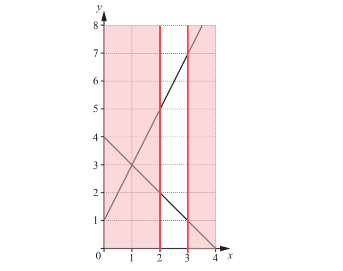

**[1]**

$y\leq2x+1$* means all points below the line *$y=2x+1$ 
*Shade away the area above the straight line *$y=2x+1$* (*$y$*-intercept 1 and positive "upward" gradient)*

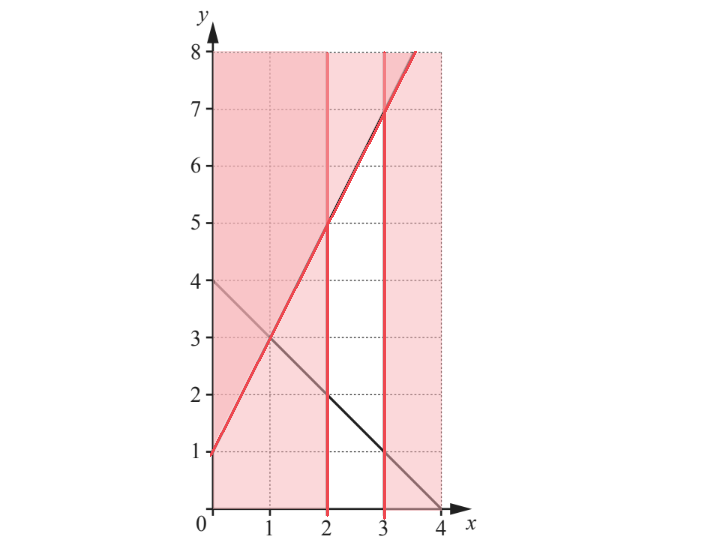

$y\geq4-x$* means all points above the line *$y=4-x$ 
*Shade away the area below the straight line *$y=4-x$* (*$y$*-intercept 4 and negative "downward" gradient)*

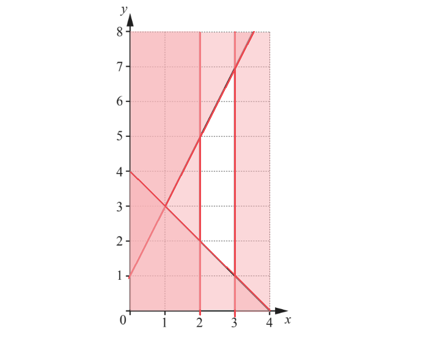

**[1]**

*Write *$R$* in the empty region with no shading (this region satisfies all four inequalities)*

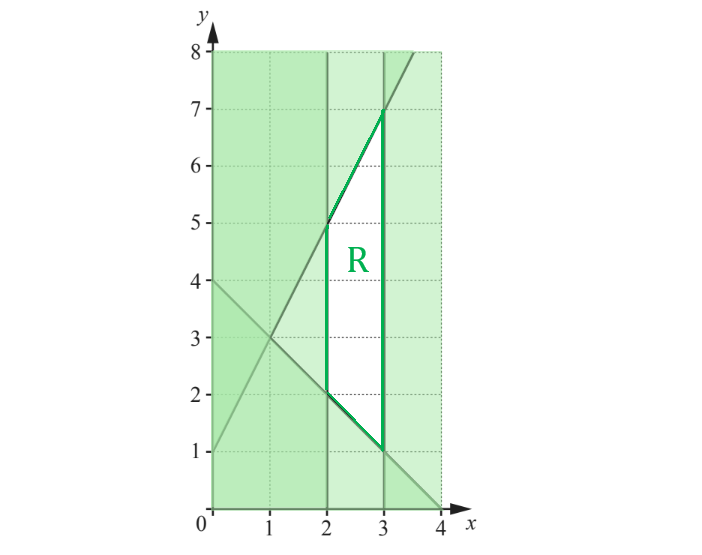

**R shown clearly**** ****[1]**

### Q16
> *Method 1 *

> *Start by subtracting *$3n$* from both sides. This has the advantage that the term in *$n$* remains positive*

$\begin{gathered} - 5 & > 17 + 5 n \\ - 22 & > 5 n \end{gathered}$

**[1]**

$\begin{gathered} - \frac{22}{5} & > n \end{gathered}$

$n<-\frac{22}{5}$** or  **$n<-4.4$** or  **$n<-4\frac{2}{5}$** ****[1]**

> *Method 2 *

> *Start by adding *$5$* to both sides. *

$\begin{gathered} 3 n & > 22 + 8 n \\ - 5 n & > 22 \end{gathered}$

**[1]**

> *Now you need to multiply by -1 to make the left hand side positive. *

> *But remember that  if you multiply/ divide by a negative, you need to reverse the inequality sign!*

$\begin{gathered} 5 n & < - 22 \end{gathered}$

$n<-\frac{22}{5}$** or  **$n<-4.4$** or  **$n<-4\frac{2}{5}$** ****[1]**

### Q17
> *For the first inequality, *$y\leq2$*, we will shade above the line as the "unwanted" region. We can check this by picking a co-ordinate in the unwanted region, e.g. (0,3) and confirming that it does not satisfy the inequality when substituted in*

$y\leq2\,3\leq2$

> *Statement is false, so (0,3) lies in the "unwanted" region*

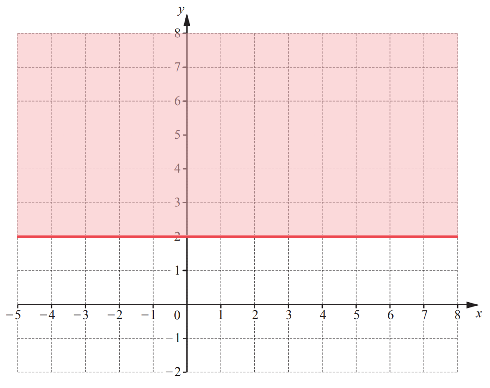

**[1]**

> *For the second inequality, *$x<3$*, we will shade to the right of the line as the "unwanted" region. *
*We can check this by picking a co-ordinate in the unwanted region, e.g. (4,0) and confirming that it does not satisfy the inequality when substituted in*

$x<3\,4<3$

> *Statement is false, so (4,0) lies in the "unwanted" region *

> *As this line uses *$<$* rather than *$\leq$*, we can use a dashed line to represent it*

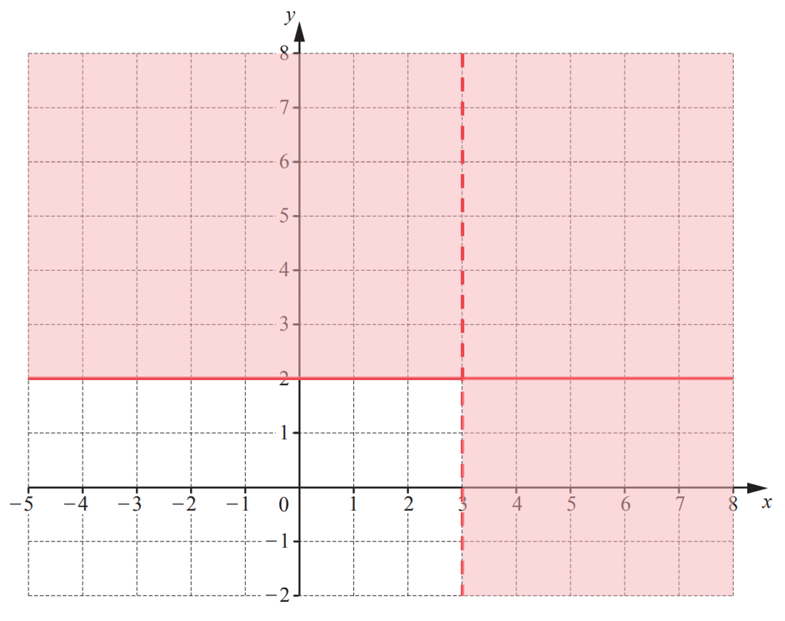

**Must be dashed**** [1]**

> *For the second inequality, *$y\leqx+4$*, we will shade above the line as the "unwanted" region. *

> *We can check this by picking a co-ordinate in the unwanted region, e.g. (-4,1) and confirming that it does not satisfy the inequality when substituted in*

$y\leqx+4\,1\leq-4+4\,1\leq0$

> *Statement is false, so (-4,1) lies in the "unwanted" region*

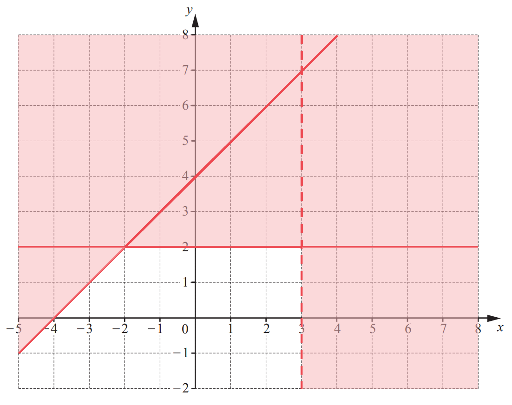

**[1]**

*The leftover unshaded region, **R**, is the region which satisfies all three inequalities*

> *Any coordinate in this region would satisfy all three inequalities*

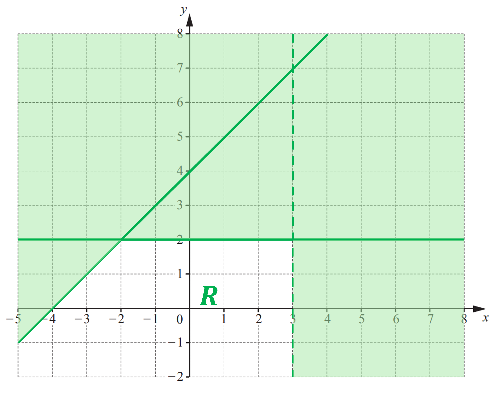

**Correctly selecting region*** ***[2]**

### Q18
> *First we need to draw the lines for the 3 inequalities. To draw the lines, treat them as equations and use your knowledge of **linear graphs **y** = **mx** + **c**. **However all three inequalities are < or > so should be drawn with dotted lines*

> *For *$x+y<4$*, draw *$x+y=4$*. Rearrange to *$y=mx+c$*...*

$\begin{gathered} y & = - x + 4 \end{gathered}$

> *... and plot a **dotted** **line** through (0, 4) with a gradient of −1*

> *For *$y>x-1$*, draw *$y=x-1$*, draw a **dotted** **line **through (0, −1) with a gradient of 1*

> *For *$y<3x$*, using *$y=3x$*, draw a **dotted** **line** through (0, 0) with a gradient of 3*

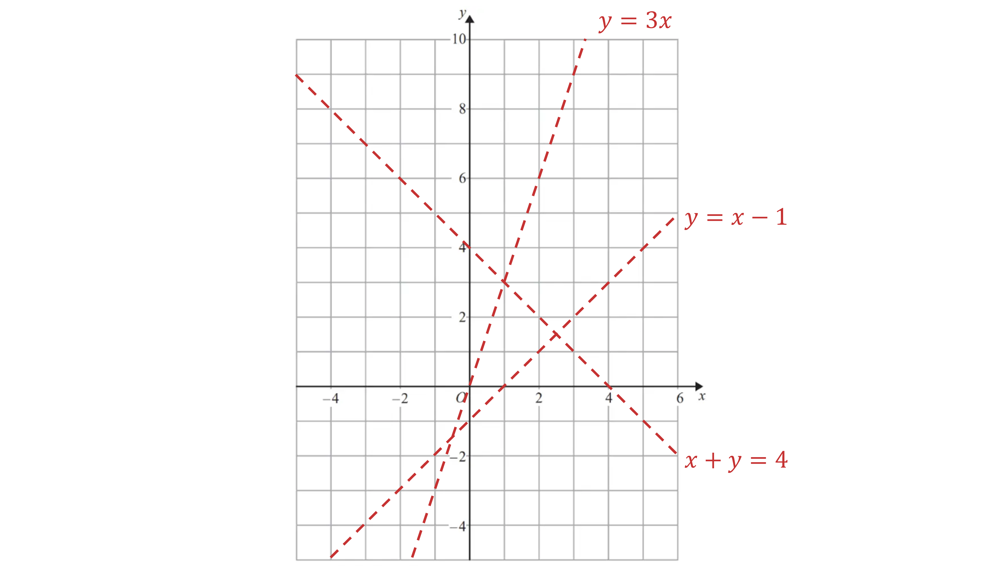

**one mark for each correctly drawn line*** ***[3]**

> *Shade the **unwanted **regions for each line*

> *For *$x+y<4$*, rearrange to*

$y<-x+4$

> *therefore the **unwanted** region is above the line, shade above the line. *

> *To check, pick an integer point that's not on the lines to test which side of each line should be shaded. For example, picking (0, 2);*

$\begin{gathered} 0 + 2 & < 4 , \text{true} \end{gathered}$

> *(0, 2) is in the wanted region so shade everything on the **other** side of the line *$x+y=4$

> *For *$y>x-1$*, the **unwanted** region is below the line, shade below the line. To check, repeat the process of substituting (0, 2) into the inequality*

$\begin{gathered} 2 > 0 - 1 , \text{true} \end{gathered}$

> *(0, 2) is in the wanted region so shade everything on the **other** side of the line *$y=x-1$

> *For *$y<3x$*, the **unwanted **region is above the line. To check,*

$\begin{gathered} 2 < 3 \times 0 \\ 2 < 0 , \text{false} \end{gathered}$

> *(0, 2) is in the **unwanted** region, so shade this side of the line *$y=3x$

> *Finally, don't forget to label the wanted region "R"!*

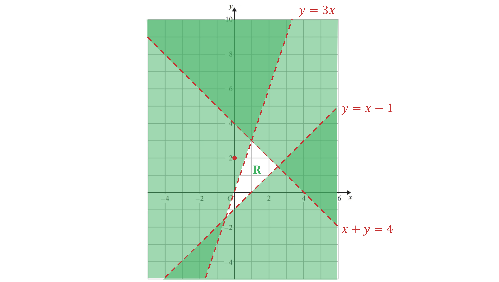

**correct region clearly indicated**** ****[1]**

### Q19
> *First you need to identify the equations of the lines *
*For demonstration purposes, the lines are labelled Line 1, Line 2 and Line 3 below*

> * *

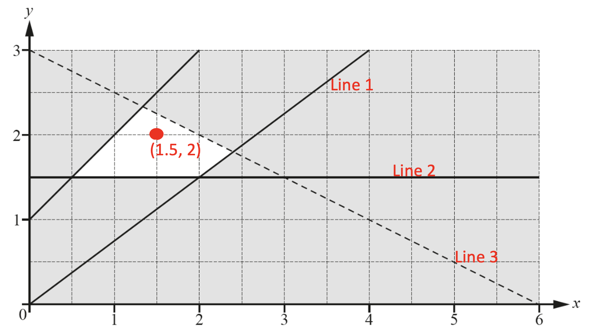

*Line 1:     gradient =*$\frac{\mathrm{rise}}{\mathrm{run}}=\frac{3}{4}$*      and      y-intercept at (0, 0)*

*equation of Line 1 is *$y=\frac{3}{4}x$

*Line 2:     gradient = 0       and      y-intercept at (0, 1.5)*

*equation of Line 2 is *$y=1.5$

*Line 3: gradient =*$\frac{\mathrm{rise}}{\mathrm{run}}=\frac{-1}{2}$*      and      y-intercept at (0, 3)*

*equation of Line 3 is *$y=-\frac{1}{2}x+3$

**two or three correct equations**** [2]**

> *Now we need to consider the inequality signs.*

> *The unshaded region is above Line 1, which is a solid line, so*

$y\geq\frac{3}{4}x$

> *The unshaded region is above Line 2, which is a solid line, so*

$y\geq1.5$

> *The unshaded region is below Line 3, which is a dotted line, so*

> * *$y<-\frac{2}{3}x+3$

**any two of the above inequalities correct**** ****[1]**

> *To check, pick a point inside **R**. For example, pick (1.5, 2) as marked on the diagram above. *

> *Substitute *$x=1.5$* and *$y=2$* into each of the two equations you found, and decide which way the inequality sign should go Remember that a solid line represents *$\leq$* or *$\geq$* but a broken line represents < or >*

> *For example, for Line 1:*

> * *$\begin{gathered} y = \frac{3}{4} x \\ 2 & \text{greater} \text{or} \text{equal} \text{than} \frac{3}{4} \times 1.5 \end{gathered}$

*so *$\begin{gathered} y \text{greater} \text{or} \text{equal} \text{than} \frac{3}{4} x \end{gathered}$

> *Write out the final answer- the three inequalities can be given in any order*

$y\geq\frac{3}{4}x,y\geq1.5,y<-\frac{1}{2}x+3$** ****[1]**

### Q20
> *Use the coordinates given to help you find the equations of the straight lines that the shape is enclosed by. *

*The vertical line connecting the coordinates (-1, 1) and (-1, 4) must be the line *$x=-1$*.*

*The horizontal line through the coordinate (-1, 1)  must be the line *$y=1$*.*

*The horizontal line through the coordinate (-1, 4)  must be the line *$y=4$*.*

> *The line of symmetry is *$x=2$* so the midpoint of the lower horizontal line is (2,1) and therefore the lower right coordinate of the rectangle is (5, 1). *

> *The vertical line bounding the rectangle of the right must be the line *$x=5$*.*

*The four coordinates of the rectangle are (-1, 1), (-1, 4), (5, 1) and (5, 4) *

*The rectangle is bounded by the lines with equations *$x=-1,x=5,y=1,y=4$

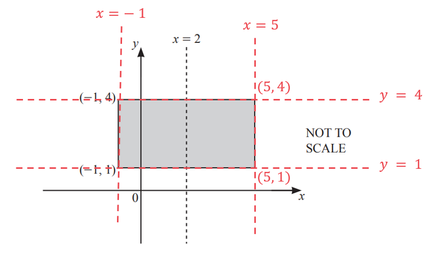

*The shaded region is defined by the inequalities *$-1\leqx\leq5$* and *$1\leqy\leq4$*.*

$a=-1\,b=5\,c=1\,d=4$

*Two or three correct answers ***[1] **
*All four correct answers*** ****[1] **

**Use the notation given in the question to make sure your answers are given in the correct form.**

### Q21
> *Solve linear inequalities in the same way as solving linear equations but remember to keep the inequality sign the same throughout.*

*Get all the **x** terms on one side.* 
*Subtract the smaller x** **term (3x) from both sides.*

> $\begin{gathered} 12 & < 5 x - 3 - 3 x \\ 12 & \text{less} \text{or} \text{equal} \text{than} 2 x - 3 \end{gathered}$* *

*Get the **x ** terms by themselves on one side.*
 *Add 3 to both sides.*

$\begin{gathered} 12 + 3 & < 2 x \\ 15 & < 2 x \end{gathered}$

**[1]**

> *Isolate **x** by dividing both sides by 2.*

$\begin{gathered} \frac{15}{2} & < x \end{gathered}$

> *It is standard to write the unknown first so switch the sides of the inequality and reverse the sign.*

$x>7.5$ **[1] **

**It is also acceptable to write the answer as a fraction.**

### Q22
> *For each line you need to find its equation, determine the type of inequality (with equals or without) and determine the direction of the inequality. *

> *For demonstration purposes, the lines are labelled Line 1, Line 2 and Line 3 below*

> * *

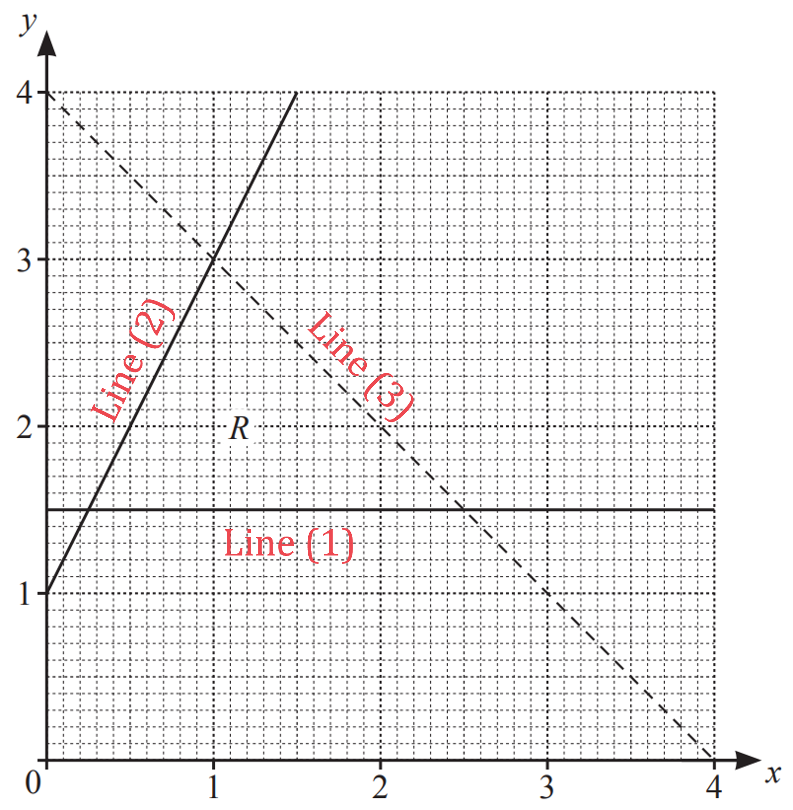

> *Line (1) is a straight horizontal line where all the **y **coordinates are equal to 1.5.*

*The equation of Line (1) is *$y=1.5$

> *The equation of a straight line is **y** = **mx** + **c** where **m **is the gradient and (0, **c**) is the **y**-intercept.*

> *Line (2) goes up 2 units for every 1 unit to the right so the gradient is 2. It crosses the **y**-axis at (0, 1).*

*The equation of Line (2) is *$y=2x+1$

**[1]**

> *Line (3) goes down 1 unit for every 1 unit to the right so the gradient is -1. It crosses the **y**-axis at (0, 4).*

*The equation of Line (3) is *$y=-x+4\mathrm{or}y=4-x$

**[1]**

> *Now decide which inequality sign Solid lines will include the equals in the inequality. Dashed lines won't include the equals in the inequality.*

> *The wanted region is above Line 1 so *$y\geq1.5$

> *The wanted region is below Line 2 so *$y\leq2x+1$

> *The wanted region is below line 3 so *$y<4-x$

**Final answer:** $y\geq1.5\,y\leq2x+1\,y<4-x$** **

*Any 2 of the 3 correct** ***[1]** 
*All 3 correct** ***[1]**
