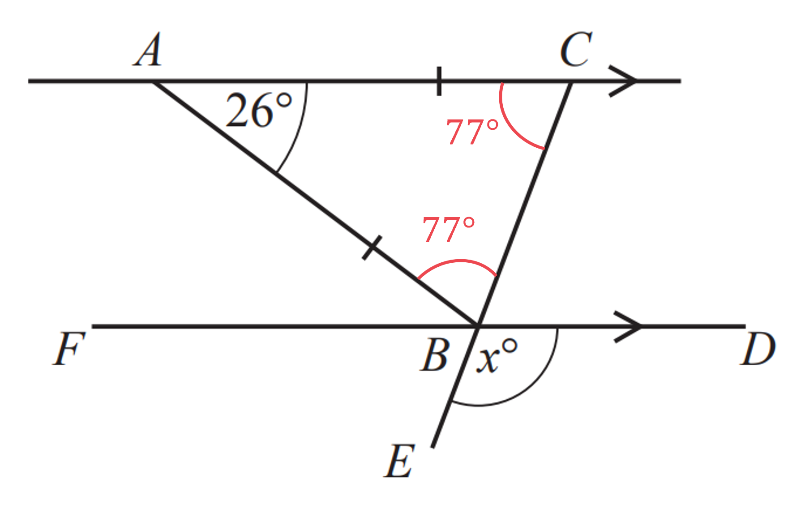
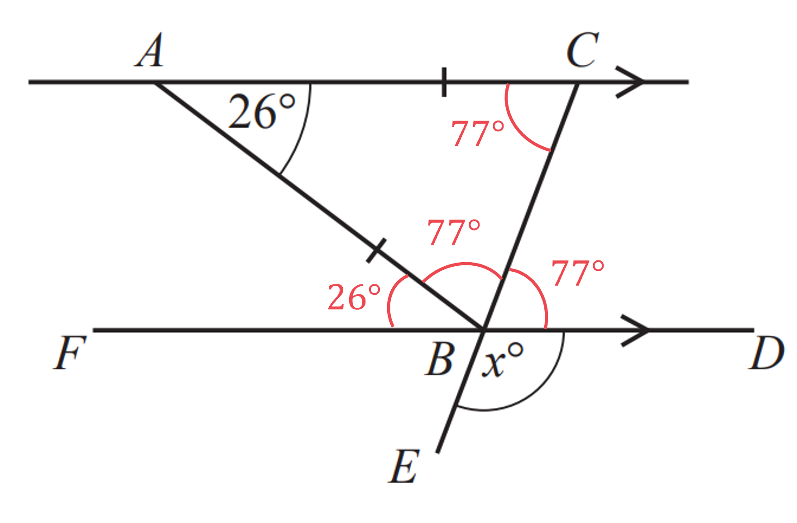
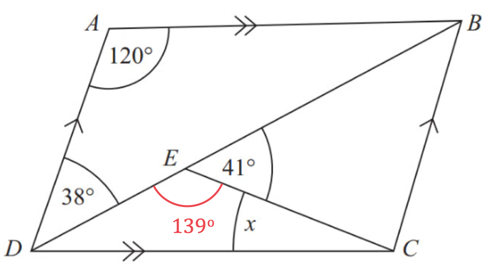
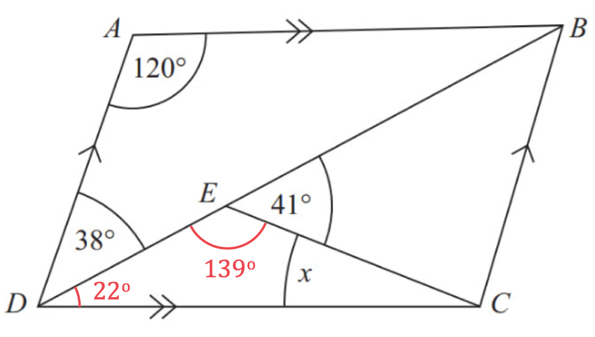
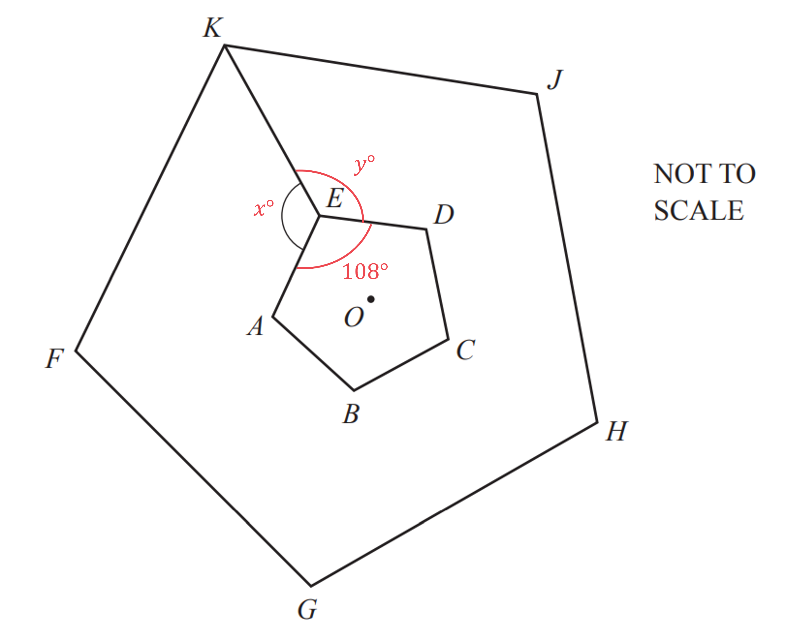
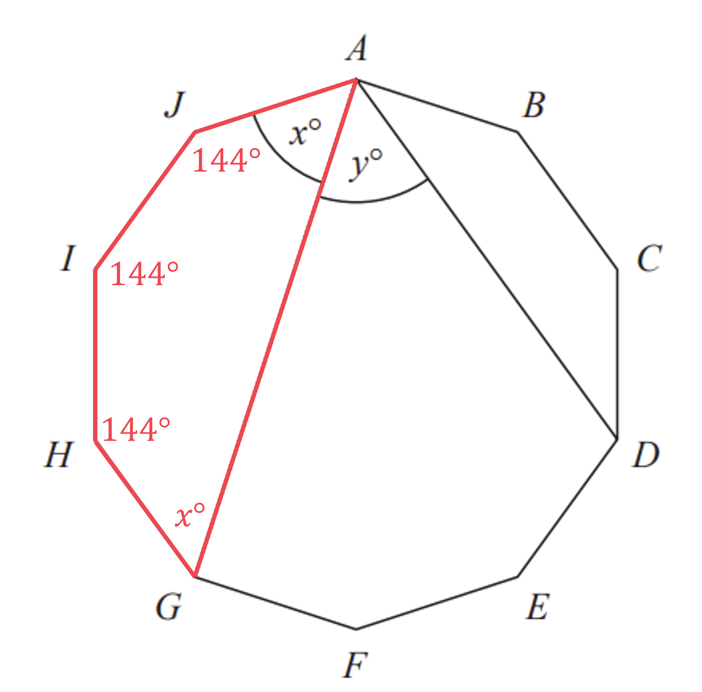
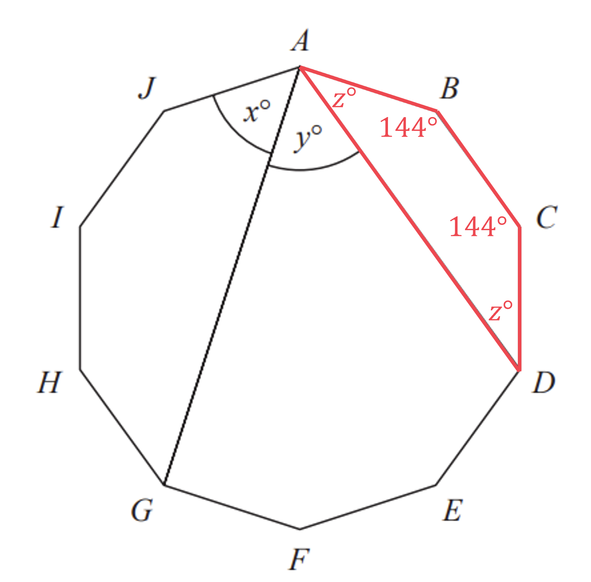
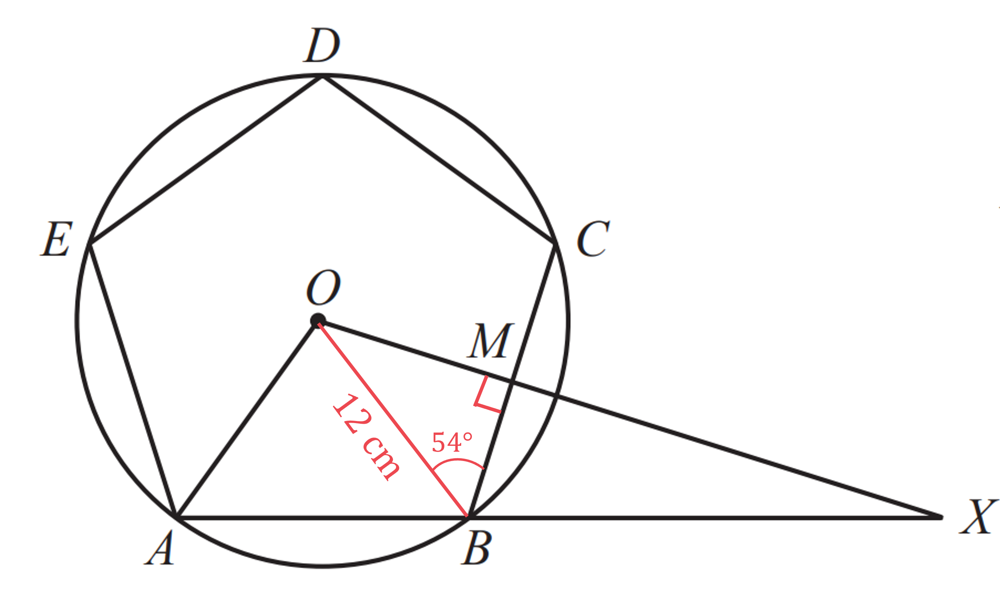
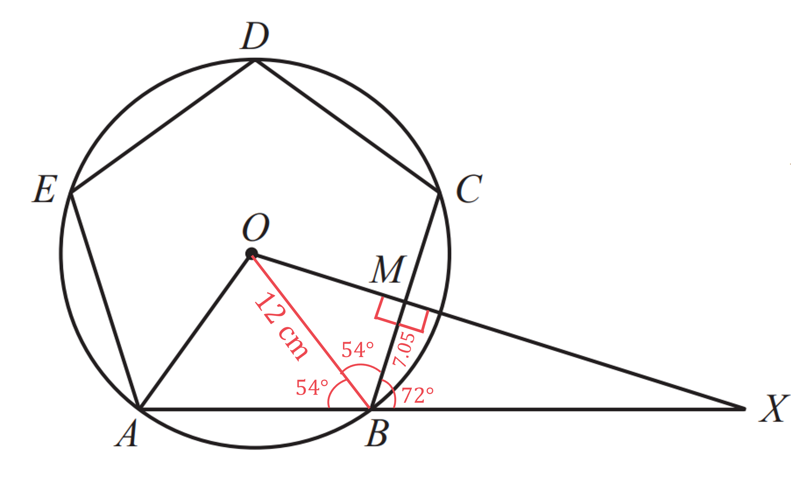
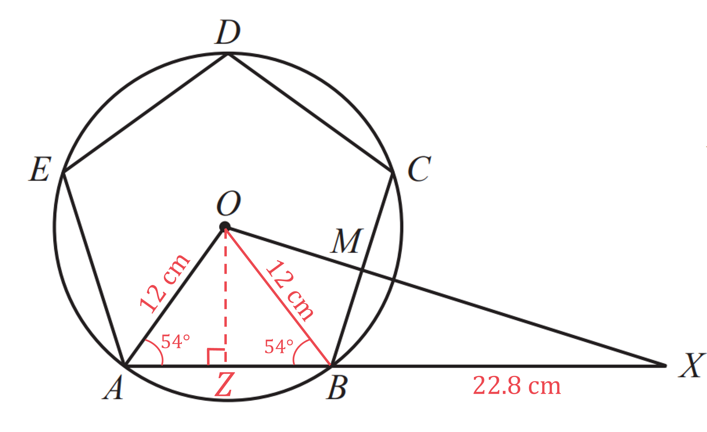

# Mark Schemes — Angles in Polygons & Parallel Lines
**Geometry** · Cambridge (CIE) IGCSE maths (0580 & 0980)

## Calculator Questions (14 questions)

### Q1
> $BDC$* is on a straight line with the *$54^{\circ}$* angle and angles on a straight line sum to *$180^{\circ}$

$BDC+54=180\,BDC=180-54\,BDC=126^{\circ}$

**[B1]**

> *Angle *$DBC$* is alternate to *$FGC$* and so *

$DBC=FGC=31^{\circ}$

**[B1]**

> *Angles in a triangle sum to *$180^{\circ}$

$BCD+126+31=180\,BCD=180-31-126\,BCD=23^{\circ}$

**[B1]**

> $BCD$* and *$DCG$* lie on a straight line and so also sum to *$180^{\circ}$

$DCG+23=180\,DCG=180-23\,DCG=157$

$DCG=157^{\circ}$

**[B1]**

> **[exam-tip]**
> Any alternative method to finding the correct value of $DCG$, for example working with triangle $CFG$ rather than $BCD$, is also valid.

### Q2
> *The interior angles of a triangle sum to 180°, and triangle *$ABC$* is isosceles, so angles *$ABC$* and *$ACB$* will be the same*

*180° - 26° = 154°*

> *The remaining 154° must be split evenly between the two equal angles *$ABC$* and *$ACB$

$154^{\circ}\div2=77^{\circ}$

**[1]**

> *Using alternate angles, *$\mathrm{angle}CAB=\mathrm{angle}ABF$* and *$\mathrm{angle}ACB=\mathrm{angle}CBD$

**[1]**

> *Using vertically opposite angles, *$\mathrm{angle}CBD=\mathrm{angle}FBE$*, so they are both 77°*

> *Angles around a point sum to 360°, so considering the point *$B$

$x=360-77-26-77-77=103^{\circ}$

$x=103^{\circ}$ **[1]**

### Q3
> *Method 1*

> *The sum of the angles in a polygon with *$n$* sides is given by the  formula *$180(n-2)$*.*

> *Substitute *$n=40$* into the formula to find the sum of the angles in the polygon.*

$180(40-2)=180\times38=6840$

> *Every angle in a regular polygon is equal.*

> *Divide the sum of the angles by the number of sides to find an individual angle.*

$\frac{6840}{40}$

**[1]**

$171^{\circ}$** ****[1]**

> *Method 2*

*Exterior angles of a polygon with any number of sides always add up to 360**°**.* 
*Exterior angles of a regular polygon are equal.*

> *Find the size of one exterior angle of the polygon by dividing 360° by 40.*

$\frac{360}{40}=9$

> *An interior and exterior angle will add up to 180°**  **because they lie on a straight line.*

> *Find the size of an interior angle by subtracting the exterior angle from 180°.*

$180-9$

** [1]**

$171^{\circ}$ **[1]**

### Q4
> *BD **is a straight line. *
*Angles on a straight line add up to 180**o**.*

$\begin{array}{rcl} p + 48 & = 180 \\ p = 180 - 48 \end{array}$

$p=132^{\circ}$** [1]**

> *AC** is a straight line. *
*Angles on a straight line add up to 180**o**.*
*Find the unlabelled angle inside the triangle by subtracting your answer for *$p$* from 180**o**.*

$\begin{array}{rcl} 180 - 132 & = 48 \end{array}$

**[1]**

> *Angles in a triangle add up to 180**o**.*

$\begin{array}{rcl} q + 55 + 48 & = 180 \\ q = 180 - 55 - 48 \end{array}$

$77^{\circ}$** [1]**

### Q5
> *Angle **ACB** is an alternate angle with angle **QAC**, so angle **ACB **= angle **QAC =** 43° *
*And the triangle is isosceles, so angle **ABC **=** **angle **ACB **= 43°*

$x=180-2\times43$

**[1]**

**= 94° ****[****1]**

### Q6
> *Find angle **DEC**.*

*Angle ***DEC*** + Angle ***CEB  ***= 180**o*  *(Angles on a straight line)*

$\begin{gathered} \text{Angle} D E C & = 180 - 41 \\ = 139^{\circ} \end{gathered}$

**[1]**

> *Find angle **EDC**.*

*Angle ***DAB ***+ Angle ***CDA*** = 180**o** (Co-interior angles)*

$\begin{gathered} 120 + 38 + \text{Angle} E D C & = 180 \\ \text{Angle} E D C & = 180 - 120 - 38 \\ \text{Angle} E D C & = 22^{\circ} \end{gathered}$

**[1]**

> *Form an equation for the interior angles of triangle **CDE** and solve to find *$x$*.*

*Angle ***CDE*** + Angle ***DEC*** + Angle ***DCE ***= 180**o**   (Angles in a triangle)*

$\begin{gathered} 22 + 139 + x & = 180 \\ x = 180 - 22 - 139 \end{gathered}$

$x=19^{\circ}$ **[1]**
*Fully correct reasons** ***[1]**

### Q7
i) *The interior and exterior angle always sum to 180°.*
*If we let the exterior angle be *$x$* then the interior angle would be *$11x$*.*

$x+11x=180$

**[1]**

> *Solve the equation.*

$\begin{gathered} 12 x & = 180 \\ x = 15 \end{gathered}$

**[1]**

> *Therefore the exterior angle is 15°. *

*But be careful to answer the question! The question asks for the number of sides, not the exterior angle.* 
*The sum of the exterior angles of a polygon is always 360°. And in a regular polygon, the exterior angles are equal, therefore if *$n$* is the number of sides,*

$\begin{array}{rcl} 15 n & = 360 \\ n = 24 \end{array}$

**24 sides**** ****[1]**

ii) *Method 1  *
*The sum of the interior angles in any polygon is given by the formula *$180 ( n - 2 )$*where *$n$*is the number of sides.*
*We know from part (b)(i) that there are 24 sides, therefore,*

*Sum of interior angles *$\begin{array}{rcl} = 180 ( 24 - 2 ) \end{array}$

**[1]**

$\begin{gathered} = 180 \times 22 = 3960 \end{gathered}$

**3960°**** ****[1]**

*Method 2 *
*The sum of the interior angles in a regular polygon is the interior angle multiplied by the number of sides.* 
*We know from part (b)(i) that the exterior angle is 15°. The interior angle is *

$180-15=165$

> *(we could also use 11 × 15, from part (b)(i)) *

> *Now multiply the interior angle, 165°, by the number of sides, 24, to find the answer.*

*Sum of interior angles *$\begin{gathered} = 165 \times 24 \end{gathered}$

**[1]**

**3960°**** ****[1]**

### Q8
> *The sum of the interior angles of a polygon can be calculated using *$( n - 2 ) \times 180$* so for a pentagon*

*Sum of interior angles = *$( 5 - 2 ) \times 180 = 540^{\circ}$

**[1]**

> *In this question it is a regular pentagon (all angles are the same) so the each of the interior angles can be found by*

$540\div5=108^{\circ}$

**[1]**

> *Using the fact that angles around a point sum to 360°, the angles *$AEK$*, *$AED$*, and *$KED$* (have been labelled *$x,108,y$* respectively) we can say that*

$x+y+108=360$

> *As the larger pentagon is an enlargement of the smaller one, with centre *$O$*, the line *$KE$* is a line of symmetry for both pentagons. So angles *$x$* and *$y$* must be equal, so we can rewrite the previous equation as*

$x+x+108=360$

**[1]**

> *Simplifying*

$2x+108=360$

> *Subtracting 108 from both sides*

$2x=252$

> *Dividing both sides by 2*

$x=126$

$\mathrm{Angle}AEK=126^{\circ}$ **[1]**
> *When a shape is enlarged by a scale factor, the lengths are multiplied by the scale factor, and the area is multiplied by the (scale factor)**2**, also known as the area scale factor*

> *Finding the area scale factor*

$\begin{gathered} 6 cm^{2} \times \text{Area} \text{Scale} \text{Factor} & = 73.5 cm^{2} \\ \text{Area} \text{Scale} \text{Factor} & = \frac{73.5}{6} = \frac{49}{4} = 12.25 \end{gathered}$

> *Therefore the scale factor for the lengths is*

$\mathrm{Length} \mathrm{scale} \mathrm{factor}=\sqrt{\frac{49}{4}}=\frac{7}{2}=3.5$

**[1]**

> *As all the lengths have been multiplied by 3.5, this means the overall perimeter will also be 3.5 times larger for the bigger pentagon*

> *Expressing this as a ratio of the larger pentagon : smaller pentagon*

$3.5:1$

> *Rewriting with integers*

$7:2$ **[1]**

### Q9
> *i)Angles in a triangle add up to 180**o**.*

> *Add together all of the angles and make it equal to 180**o**.*

$2 a + ( a + 2 b ) + ( 3 b + 10 ) = 180$

> *Remove the brackets.*

$2a+a+2b+3b+10=180$

> *Simplify the left hand side by collecting like terms.*

$3a+5b+10=180$

> *Subtract 10 from both sides.*

$3a+5b=170$* ***[1]**

> *ii) Angles in a quadrilateral add up to 360**o**.*

> *Add together all of the angles and make it equal to 360**o**.*

$8 a + ( b + 50 ) + ( 4 b - 2 a ) + ( 3 a + 2 b ) = 360$

> *Remove the brackets.*

$8a+b+50+4b-2a+3a+2b=360$

> *Simplify the left hand side by collecting like terms. *
*Be careful with negative terms.*

$9a+7b+50=360$

> *Subtract 50 from both sides.*

$9a+7b=310$* ***[1]**

> *iii) **Method 1: Elimination*

> *Multiply the equation for the triangle by 3.*

$\begin{gathered} 3 a + 5 b & = 170 \times 3 \\ 9 a + 15 b & = 510 \end{gathered}$

> *Subtract the equation for the quadrilateral from the adapted triangle equation.*

`charalign center stackalign right end | 9 a + 15 b = 510 end | | - none none 9 a + 7 b = 310 end | horizontal line | 8 b = 200 end | end`

> *Divide both sides by 8.*

$b=25$

> *Substitute *$b=25$* into either equation and solve for *$a$*.*

$\begin{gathered} 3 a + 5 \times 25 & = 170 \\ 3 a + 125 & = 170 \end{gathered}$

> *Subtract 125 from both sides.*

$3a=45$

> *Divide both sides by 3.*

$a=15$

*Correct method of elimination shown*** [1]**

$\begin{array}{rcl} a = 15 \end{array}$** [1]**

** **$\begin{array}{rcl} b = 25 \end{array}$* ***[1]**

> *Method 2: Substitution*

> *Rearrange the equation for the triangle to make *$a$* the subject.*

$\begin{gathered} 3 a + 5 b & = 170 \end{gathered}$

> *Subtract *$5b$* from both sides.*

$3a=170-5b$

> *Divide both sides by 3.*

$a=\frac{170-5b}{3}$

> *Substitute the rearranged equation into the quadrilateral equation in place of *$a$*.*

$9 ( \frac{170 - 5 b}{3} ) + 7 b = 310$

> *Multiply both sides by 3.*

$9 ( 170 - 5 b ) + 21 b = 930$

> *Expand the brackets on the left hand side.*

$\begin{gathered} 1530 - 45 b + 21 b & = 930 \end{gathered}$

> *Simplify the left hand side by collecting like terms.*

$1530-24b=930$

> *Add *$24b$* to both sides.*

$1530=930+24b$

> *Subtract 930 from both sides.*

$\begin{gathered} 600 = 24 b \end{gathered}$

> *Divide both sides by 24.*

$25=b$

> *Substitute *$b=25$* into either equation and solve for *$a$*.*

$\begin{gathered} 3 a + 5 \times 25 & = 170 \\ 3 a + 125 & = 170 \end{gathered}$

> *Subtract 125 from both sides.*

$3a=45$

> *Divide both sides by 3.*

$a=15$

*Correct method of substitution shown ***[1]**

$\begin{array}{rcl} a = 15 \end{array}$** [1]*** *

$\begin{array}{rcl} b = 25 \end{array}$** ****[1]**

> *iv) Substitute the values for *$a$* and *$b$* into the expressions for the angles of the triangle and write down the smallest angle.*

$2a=2\times15=30\,a+2b=15+2\times25=65\,3b+10=3\times25+10=85$

$30^{\circ}$* ***[1]**

### Q10
> *Method 1*

> *It is a regular polygon so all the interior angles are equal and all the exterior angles are equal.*

> *An interior angle and an exterior angle add up to 180°. Use this to find the size of an exterior angle.*

$\begin{gathered} 150^{\circ} + \text{Exterior} \text{angle} & = 180^{\circ} \\ \text{Exterior} \text{angle} & = 180^{\circ} - 150^{\circ} \\ \text{Exterior} \text{angle} & = 30^{\circ} \end{gathered}$

> *The formula for the exterior angle of a regular **n**-sided polygon is *$\mathrm{Exterior} \mathrm{angle}=\frac{360}{n}.$* Use this to form an equation.*

$30=\frac{360}{n}$

**[1]**

> *Multiply both sides by **n**.*

$30n=360$

> *Divide both sides by 30.*

$n=\frac{360}{30}$

$n=12$ **[1]**

> *Method 2*

> *The formula for the interior angle of a regular **n**-sided polygon is *$\text{Interior} \text{angle} = \frac{( n - 2 ) \times 180}{n} .$* Use this to form an equation.*

$150 = \frac{( n - 2 ) \times 180}{n}$

**[1]**

> *Multiply both sides by **n**.*

$150 n = ( n - 2 ) \times 180$

> *Expand the bracket.*

$150n=180n-360$

> *Subtract 180**n** from both sides.*

$\begin{array}{rcl} 150 n - 180 n & = - 360 \\ - 30 n & = - 360 \end{array}$

> *Divide both sides by -30.*

$n=\frac{-360}{-30}$

$n=12$* ***[1]**

### Q11
> *Method 1*

> *Use the formula for finding the interior angle of a regular polygon, *

> $\mathrm{Interior} \mathrm{angle}=\frac{180(n-2)}{n}$*,*

> *where *$n$* is the number of sides of the polygon.*

$\frac{180(72-2)}{72}$

*Correct numerator*** [1] **
*Complete correct equation*** [1]**
$175^{\circ}$** [1]**

> *Method 2*

*Exterior angles add up to 360**o**.* 
*Exterior angles of a regular polygon are equal.* 
*Divide the total exterior angle by the number of angles there are to find out the size of each exterior angle.*

$360\div72=5$

**[1]**

*An interior angle and its adjacent exterior angle add up to 180**o** because they lie on a straight line.* 
*Subtract the exterior angle you found above from 180**o** to find the interior angle.*

$180-5$

**[1]**

$175^{\circ}$ **[1]**

### Q12
> *Method 1*

> *The formula for the interior angle of an *$n$*-sided **regular** polygon is *$\frac{(n-2)\times180}{n}$*.*

$\frac{(24-2)\times180}{24}=\frac{22\times180}{24}=\frac{3960}{24}=165$

**[1]**

**165°** **[1]**

> *Method 2*

> *In any polygon, the total of all the exterior angles is 360°. *
*In a **regular** polygon, all exterior angles are equal.*

*Exterior angle** *$=\frac{360}{24}=15$

> *Now use the fact that an interior and exterior angle add up to 180°.*

$180-15=165$

**[1]**

**Final answer:** **165°**** [1]**

### Q13
> *Find the size of an interior angle of the regular 10-sided polygon using the formula: *$\text{Interior} \text{Angle} = \frac{( n - 2 ) \times 180^{\circ}}{n} .$

$\frac{( 10 - 2 ) \times 180^{\circ}}{10} = 144^{\circ}$

**[1]**

> *Consider the 5-sided polygon **AGHIJ**. Find the sum of the angles using the formula: *$Sum of Interior Angle = ( n - 2 ) \times 180 ^{\circ} .$

$( 5 - 2 ) \times 180^{\circ} = 540^{\circ}$

> *The angle at **A** is the same as the angle at **G** by symmetry. The other three angles are 144°. Form an equation and solve it to find **x**.*

$\begin{array}{rcl} x + x + 144 + 144 + 144 & = 540 \\ 2 x + 432 & = 540 \\ 2 x & = 108 \\ x = 54 \end{array}$

**[1]**

> *Consider the quadrilateral **ABCD**. The angles should add up to 360°. The angle at **A** is the same as the angle at **D** by symmetry. The other three angles are 144°. Form an equation and solve it to find **t**he missing angles.*

$\begin{array}{rcl} z + z + 144 + 144 & = 360 \\ 2 z + 288 & = 360 \\ 2 z & = 72 \\ z = 36 \end{array}$

**[1]**

> *The three angles in the 10-sdied polygon at A add up to 144°. Form an equation and solve it to find **y**.*

$\begin{array}{rcl} 54 + y + 36 & = 144 \\ y + 90 & = 144 \\ y = 54 \end{array}$

$x=y=54$* ***[1]**

### Q14
> *The sum of the angles of a polygon of *$n$* sides is given by the formula *$180 \times ( n - 2 )$

$180\times(5-2)=540$

**[1]**

> *In a regular pentagon, there are 5 angles and they are all the same size*

$540\div5=108^{\circ}$

**[1] **

**Note that this is a "show that" question so full working must be shown**
i) *As the line *$OMR$* is a radius of the circle, and the line *$BC$* is a chord, we can use the following circle theorem*

> *"The perpendicular bisector of a chord is a radius"*

> *This means that angle *$OMB$* is 90°*

> *Drawing a line from *$O$* to *$B$* also forms a radius, of length 12 cm*

*The internal angles of a pentagon are 108° (as found in part a), and the line *$OB$* would bisect this angle (cut it in half), due to the symmetry of the regular pentagon* 
*This means angle *$OBM$* is 54°*

**[1]**

> *Considering the right-angled triangle *$OMB$*, we can use the cosine ratio, *$\mathrm{cos}θ=\frac{\mathrm{adjacent}}{\mathrm{hypotenuse}}$*, to find *$BM$

$\begin{gathered} \cos ( 54 ) & = \frac{B M}{12} \\ 12 \cos ( 54 ) & = B M \end{gathered}$

**[1]**

$BM=7.053423028...$

$BM=7.05\mathrm{cm}$ **[1]**
* Rounded to 3 significant figures*

iia) *For the same reasons as for angle *$OMB$* in part i, angle *$BMX$* is also 90°*

> *As the line *$ABX$* is a straight line, we can use the fact that angles on a straight line sum to 180° at point B*

$180-54-54=72$

> *So angle *$MBX$* is 72°*

> *Considering the right-angled triangle *$BMX$*, we can use the cosine ratio, *$\mathrm{cos}θ=\frac{\mathrm{adjacent}}{\mathrm{hypotenuse}}$*, to find length *$BX$

$\cos ( 72 ) = \frac{7.05}{B X}$

> *Multiply both sides by *$BX$*, and then divide both sides by *$\cos ( 72 )$

$B X = \frac{7.05}{\cos ( 72 )}$

**[2]**

$BX=22.81427924...$

$BX=22.8\mathrm{cm}$ **[1]** 
*Rounded to 3 significant figures*

iib) *To find the area of a non-right-angled triangle, we can use the formula:* $\mathrm{Area}=\frac{1}{2}ab\mathrm{sin}C$* where side lengths *$a$* and *$b$* are either side of angle *$C$

> *Considering triangle *$AOX$*, side length *$OA$* is 12 cm as it is the radius of the circle, and angle *$OAB$* is 54° as it is half the internal angle of the pentagon*

> *To be able to use the above formula, we still need to find the length *$AX$

> *To find *$AX$*, we will find *$AB$*, and then add it on to *$BX$* (which was found to be 22.8 cm in the previous part)*

> *To find *$AB$*, we can find half its length (*$AZ$*) by considering the right-angled triangle *$AZO$* and using the cosine ratio; *$\mathrm{cosθ}=\frac{\mathrm{adjacent}}{\mathrm{hypotenuse}}$

$\cos ( 54 ) = \frac{A Z}{12}$

> *Multiply both sides by 12*

$12 \cos ( 54 ) = A Z$

$AZ=7.05...$

*Finding length *$AX$* (and noting that *$ZB$* is the same length as *$AZ$*)* *Use the unrounded forms of the lengths where you can to maintain accuracy*

$AX=7.05...+7.05...+22.8=36.9...$

> *Now we can find the area of the triangle *$AOX$* using the formula *$\frac{1}{2}ab\mathrm{sin}C$

$1 \frac{1}{2} \times 12 \times 36.9... \times \sin ( 54 ) = 179.1...$

* 1 mark for correct strategy to find overall area*** [2]**
$179\mathrm{cm}^{2}$ **[1]** 
**Rounded to 3 significant figures** 
**An alternate method is to find the area of triangles **$OBX$** and **$OAB$** and sum them. Or alternatively finding the areas of triangles **$AZO$** and **$OZX$** and summing them.**
