# Mark Schemes — Bearings, Constructions & Scale Drawings
**Geometry** · Cambridge (CIE) IGCSE maths (0580 & 0980)

## Calculator Questions (20 questions)

### Q1
Use your ruler to measure line $AB$

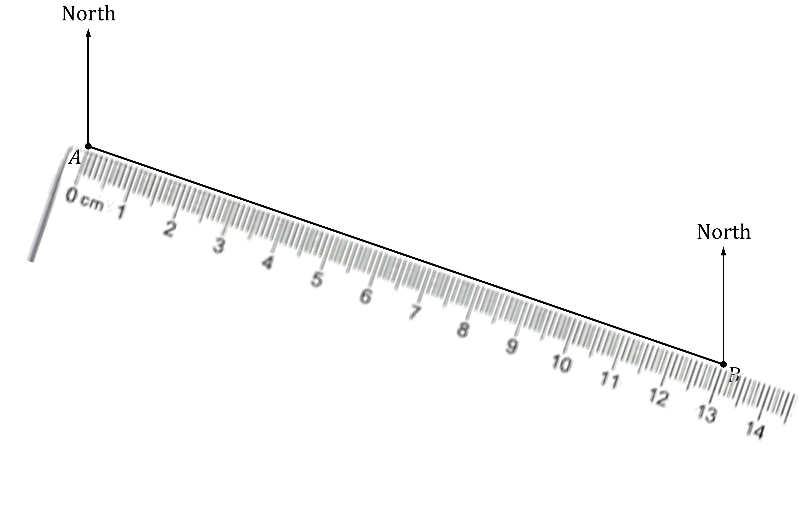

*13 cm*

Each cm on the map is equal to 5 km in real life

- So multiply 13 by 5 to find the distance in km

$5\times13=65$

**Final answer:** **65 km**

**[B1]**

> **[mark-scheme]**
> **B1**: For answers from 64.5 to 65.5.

> **[exam-tip]**
> If you print this out or view it on a screen, the length of AB might not be exactly 13 cm. On the real exam any such diagrams will be printed at the correct size.
> **[exam-tip]**
> Remember that bearings are measured clockwise from north.

Use your protractor to measure the bearing of $B$ from $A$

- Put the 'bullseye' at point A
- Line up the 0° line with the North arrow
- Read the angle going clockwise from North (in the image below this is the bold angle numbers)

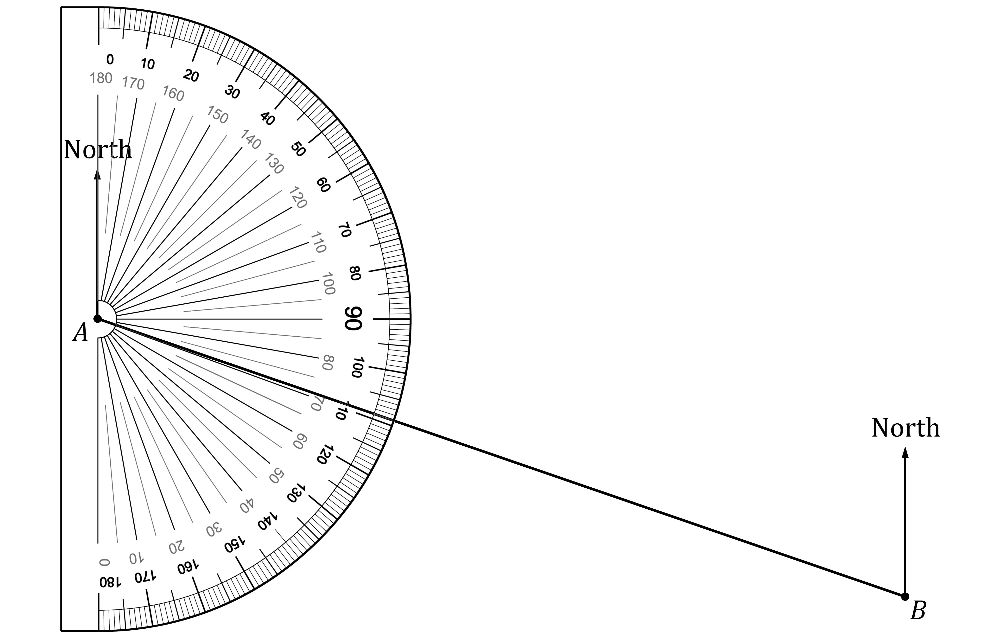

**Final answer:** **109°**

**[B1]**

> **[mark-scheme]**
> **B1**: For answers from 108 to 110.
The two North lines in the diagram are parallel

This means that the two angles above $AB$ and between the North lines are co-interior (supplementary) angles

- Therefore they sum up to 180°
- So if the one at $A$ is 109°, then the one at $B$ must be

$180-109=71^{\circ}$

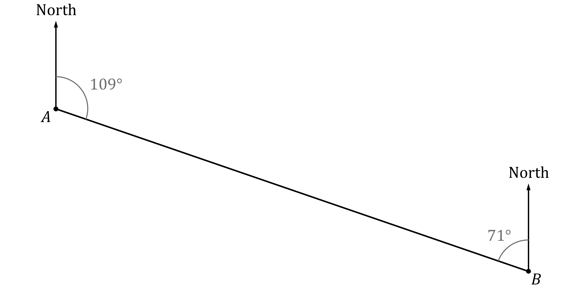

However the bearing of $A$ from $B$ is the reflex angle at $B$, going around clockwise from north

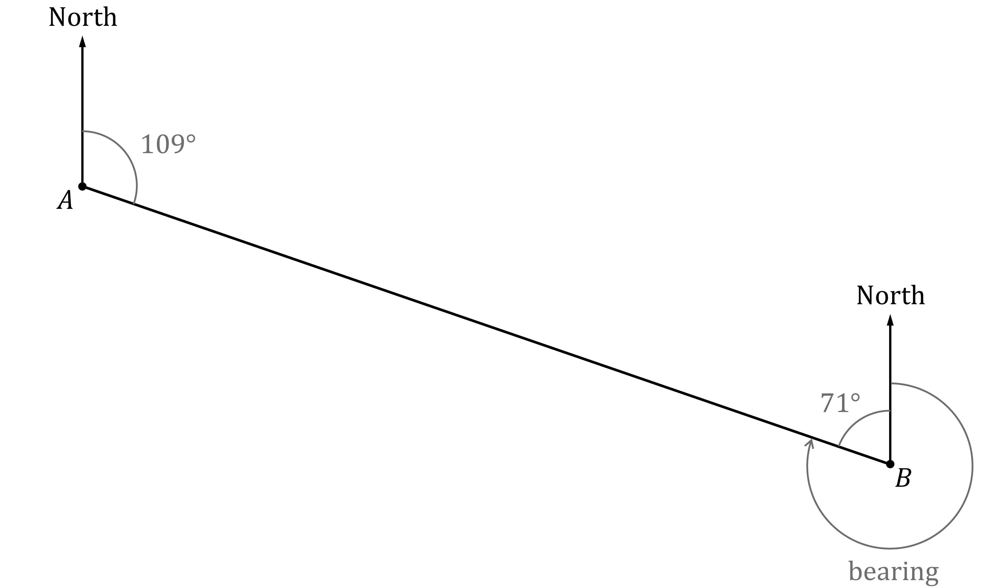

Angles around a point sum to 360°

- So subtract 71° from 360° to find the bearing

$360-71=289^{\circ}$

**[M1]**

**Final answer:** **289°**

**[A1]**

> **[mark-scheme]**
> **M1**: For $360 - ( 180 - \text{your} \text{answer} \text{from} \text{part} ( \mathrm{b} ) )$ or equivalent.
> 
> **A1**: For correct bearing in the range 288 to 290.

### Q2
Draw an arc to mark the length of $AB$

- Set your compass to a distance of 7 cm
- Put the sharp point of the compass on point $A$ on the line

  - and draw an arc above the line $AB$

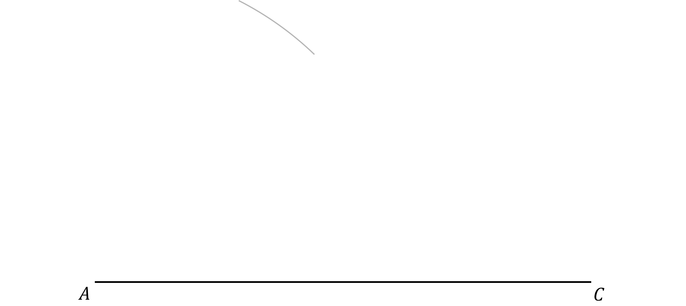

Draw an arc to mark the length of $BC$

- Set your compass to a distance of 9 cm
- Put the sharp point of the compass on point $C$ on the line

  - and draw an arc above the line $AB$

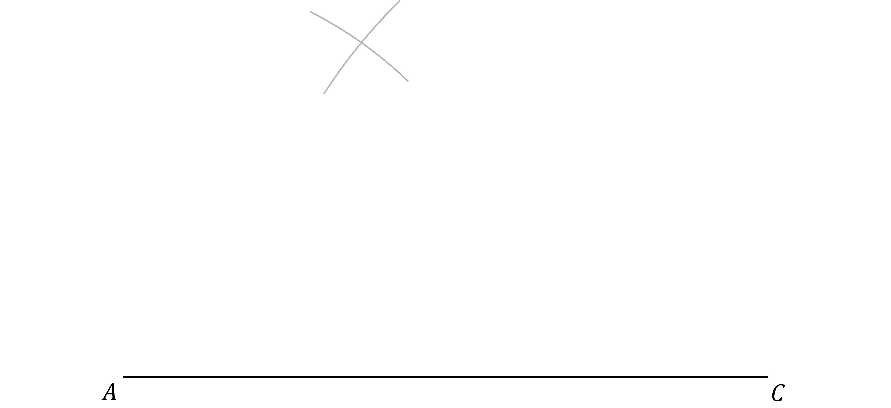

The place where the two arcs intersect is the location of point $B$

- Mark and label the point
- Then use your ruler to draw $AB$ and $BC$ as straight lines

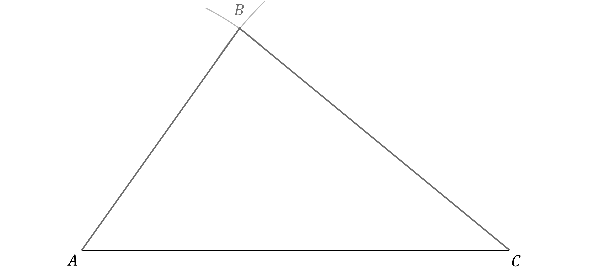

**[B1 B1]**

> **[mark-scheme]**
> **B1**: For correct triangle.
> 
> **B1**: For construction arcs seen on correct triangle.

### Q3
> *To find the bearing of **C** from **B**, you first need to work out the angle **ABC**. *
*However you currently do not have enough information to work that out.*

> *You know the lengths of two sides and the angle between them. Therefore you can use the cosine rule to find the length of the third side.*

> *The formula for the cosine rule is *$a^{2}=b^{2}+c^{2}-2bc\mathrm{cos}A$*, where **b** and **c** are the lengths of the two sides that form angle **A** and **a** is the length of the side opposite **A**. *
*Substitute **a** = **z**, **b** = 275, **c** = 150 and **A** = 120 into the formula.*

$z^{2} = 275^{2} + 150^{2} - 2 ( 275 ) ( 150 ) \cos ( 120 )$

**[1]**

> *Type the expression into your calculator altogether as one line. If you do it separately you need to remember the order of operations (multiplication before addition). Take the positive square root and leave as an exact answer or store in your calculator.*

$\begin{array}{rcl} z^{2} & = 139375 \\ z = \sqrt{139375} \\ = 373.329613... \end{array}$

**[1]**

> *You can now find the angle at **B** by using either the sine rule or the cosine rule.*

> *Method 1 - Using the sine rule*

> *The formula for the sine rule is *$\frac{\mathrm{sin}A}{a}=\frac{\mathrm{sin}B}{b}$*, where **a** and **b** are the lengths of the two sides that are opposite the angles **A **and **B **respectively. *
*Substitute **A** = **y**, **B** = 120, **a** = 275 and **b** = √139375 into the formula.*

$\frac{\sin y}{275} = \frac{\sin ( 120 )}{ \sqrt{139375} }$

**[1]**

> *Multiply both sides by 275 and then use the inverse sin function on your calculator.*

$\begin{gathered} y = \sin ^{- 1} ( \frac{\sin ( 120 )}{ \sqrt{139375} } \times 275 ) \\ = 39.637403... \end{gathered}$

**[1]**

> *Find the bearing by subtracting from 180.*

$\begin{array}{rcl} x = 180 - 39.637403... \\ = 140.362596... \end{array}$

> *Round to the nearest degree.140*

$140^{\circ}(\mathrm{nearest} \mathrm{degree})$** [1]**

> *Method 2 - Using the cosine rule*

> *The formula for the cosine rule is *$\mathrm{cos}A=\frac{b^{2}+c^{2}-a^{2}}{2bc}$*, where **a** and **b** are the lengths of the two sides that form the angle **A **and **a** is the length of the side opposite **A**. *
*Substitute **A** = **y**, **a** = 275, **b** = 150 and **c** = √139375 into the formula.*

$\cos y = \frac{150^{2} + ( \sqrt{139375} )^{2} - 275^{2}}{2 \times 150 \times \sqrt{139375} }$

**[1]**

> *Use the inverse cos function on your calculator.*

$\begin{gathered} y = \cos ^{- 1} ( \frac{150^{2} + ( \sqrt{139375} )^{2} - 275^{2}}{2 \times 150 \times \sqrt{139375} } ) \\ = 39.637403... \end{gathered}$

**[1]**

> *Find the bearing by subtracting from 180.*

$\begin{array}{rcl} x = 180 - 39.637403... \\ = 140.362596... \end{array}$

> *Round to the nearest degree.140*

$140^{\circ}(\mathrm{nearest} \mathrm{degree})$** [1]**

### Q4
> *The north lines are parallel*

> *Find one of the angles at *$B$* by subtracting 37° from 180°*

> *Draw a line between Acton and Chorlton and label the required bearing*

> *Find the interior angle of the triangle at *$B$* by subtracting the other angles around the point from 360°*

$w=360-150-143=67$

**[1]**

> *You have the lengths of two sides and the angle between them*

> *You can use the cosine rule *$b^{2}=a^{2}+c^{2}-2ac\mathrm{cos}B$* to find *$x$

$\begin{gathered} x^{2} & = 9^{2} + 8^{2} + 2 \times 9 \times 8 \times \cos ( 67 ) \\ x^{2} & = 88.734... \\ x = 9.419... \end{gathered}$

**[1]**

> *You now have the length of a side and the angle opposite it*

> *You can use the sine rule *$\frac{\mathrm{sin}A}{a}=\frac{\mathrm{sin}B}{b}$* to find *$y$

$\begin{gathered} \frac{\sin y}{9} & = \frac{\sin ( 67 )}{9.419...} \\ \sin y & = 9 \times \frac{\sin ( 67 )}{9.419...} \\ \sin y & = 0.8794... \\ y = \sin ^{- 1} ( 0.8794... ) \\ y = 61.57... \end{gathered}$

**Correct use of the sine rule [1]**

**Correct angle [1]**

> *Add this to 37 to get the bearing*

$z=37+61.57...=98.57...$

> *Round to 1 decimal place and write as a bearing*

**098.6° (1dp)** **[1]**

### Q5
> *Draw a triangle using A, B and C. As B is East of A and C is North of A, the triangle will be a right angled triangle. The distance from A to C is equal to the distance from A to B. Therefore it is an isosceles triangles. The missing two angles must be equal and add up to 90 so therefore must be 45°.*

*Identifying an angle as 45°** ***[1]**

> *To finding the bearing of B from C you need to subtract 45° from half a turn.*

$180-45=135$

**Bearing of B from C is 135°** **[1]**
> *Draw a right angle triangle using the points A, B and D. Label the known lengths. To find the bearing of D from B it would be helpful to first find the interior angle of the triangle at B.*

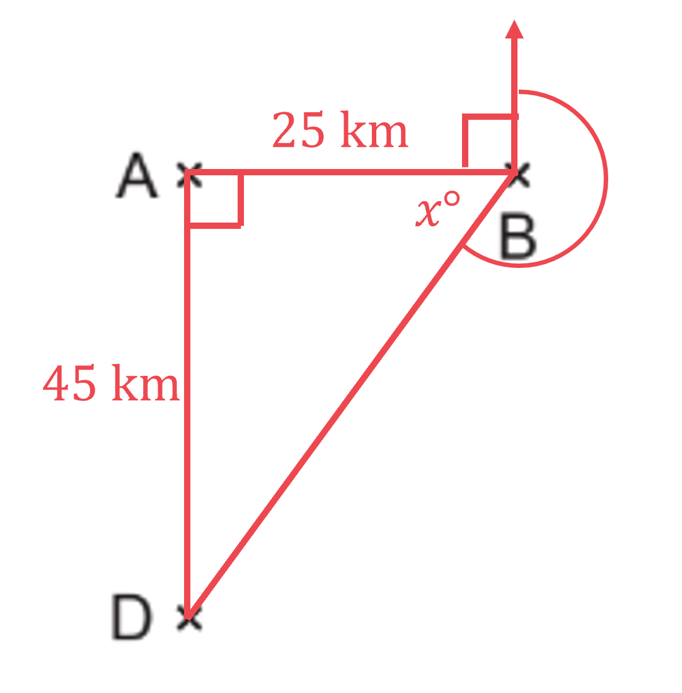

> *You know the lengths of the sides that are opposite and adjacent to the required angle. *

> *Therefore you can use the formula *$\mathrm{tan}θ=\frac{\mathrm{Opposite}}{\mathrm{Adjacent}}.$

$\mathrm{tan}x=\frac{45}{25}$

**[1]**

> *Use the inverse tan function on your calculator.*

$\begin{array}{rcl} x = \tan ^{- 1} ( \frac{45}{25} ) \\ = 60.9453... \end{array}$

**[1]**

> *To find the bearing subtract this from a three quarter turn.*

$270-60.9453...=209.0546...$

**[1]**

> *Round appropriately. 3 significant figures or nearest whole number would be appropriate.*

**Bearing of D from B is 209° (3sf)** **[1]**

### Q6
> *Pay attention to the words **of** and **from**. You are looking for the bearing **from **A ** **to **B *
*Measure the angle from the North line at A, to the line **AB**, as marked below*

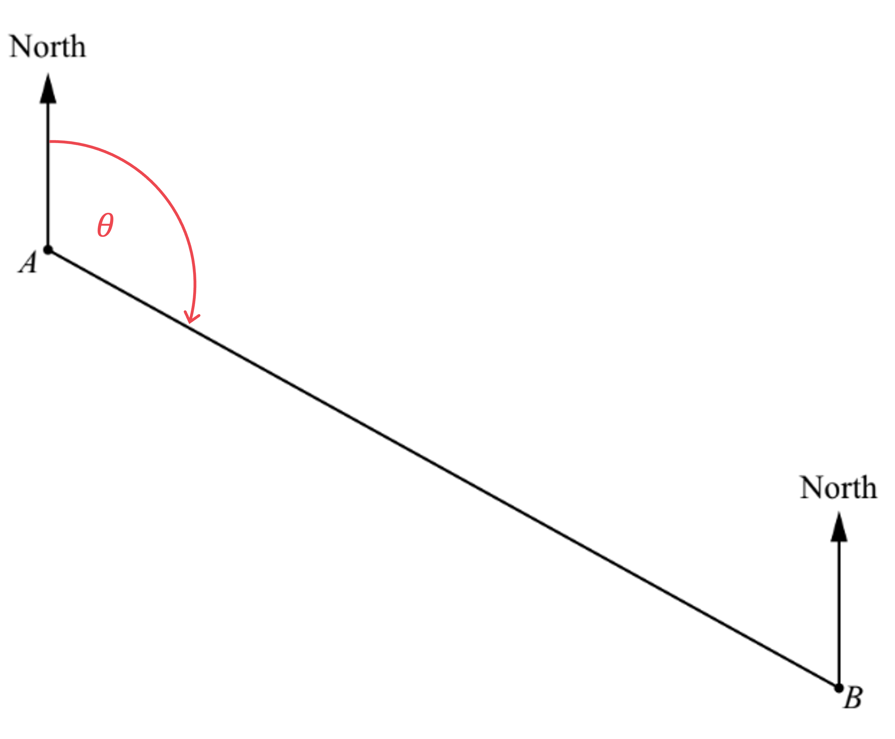

**119°**** **
**119 ± 1 ****[****1]**
> *Pay attention to the wording. **Calculate** and **show your working** mean you can't do this my measuring; you **must **show the process of using your answer from part (b) to get the answer here*

> *First identify the angle that is the bearing of **A** **from **B**, which is the angle from the North line at **B**, clockwise to the line **AB**, marked as "*$β$*" below*

> *We can find the angle marked as *$α$* is co-interior with your answer from part (b). Therefore*

> $α=180-119=61^{\circ}$* *

> *Now find *$β$* which by subtracting *$α$* from 360°*

$β=360-61$

**the above method or "180 + [answer to (b)]"**** [1]**
**299°**** ****[1]**
** ****Both marks follow through from your answer to part (b)**

### Q7
*Bearings are angles measured clockwise from a north arrow, written as three digits* 
*Draw the bearing of **B** from **H** (133°) on the diagram at **H** and again at **B  *

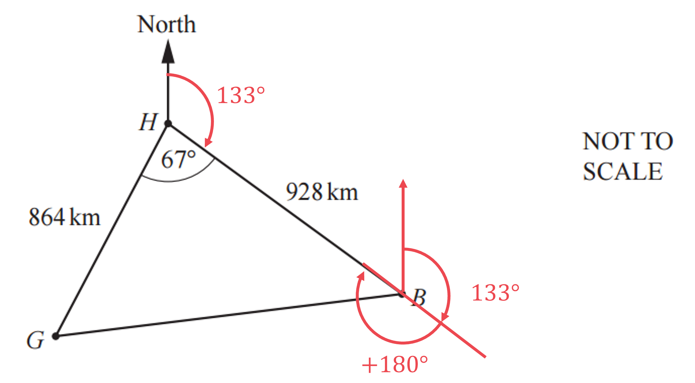

> * *

*Find the bearing of **H** from **B** (by adding 180°)*

*133° + 180°*

**[1]**

**313°**** ****[1]**

### Q8
> *The scale factor 10 000 000 is a length scale factor, to find the area scale factor you must square it.*

> *Multiply the area of Solvakia on the map by the area scale factor.*

$4.9\times10000000^{2}=4.9\times10^{14}$

**[1]**

> *This is the real life area of Slovakia in cm**2**.*

> *Convert the area from cm**2** to km**2**.*
*Remember, cm : km = 1 : 100 000, so cm**2** : km**2** = 1 : 100 000**2**.*

$( 4.9 \times 10^{14} ) \div ( 100 000 )^{2}$

**[1]**

$49000$** ****km****2*** ***[1]**

### Q9
> *Find the bearing of **P** from **Q** by adding 180° to the reverse bearing (**Q** from **P**).*

$80+180=260$

> *Form a triangle by joining **P** to **R**. Find the angle **PQR** by subtracting the two bearings that start at **Q**.*

$260-155=105$

**[1]**

> *You have the lengths of two sides and the angle between them, therefore you can use the cosine rule to find the third side. The formula for the cosine rule is *$a^{2}=b^{2}+c^{2}-2bc\mathrm{cos}A$*where **a, b **and **c **are the lengths of the three sides and **A** is the angle between the the sides **b** and **c**.*

> *Substitute **a** = **x**, **b **= 12, **c** = 28 and **A** = 105 into the formula.*

$\begin{gathered} x^{2} & = 12^{2} + 28^{2} - 2 ( 12 ) ( 28 ) \cos ( 105 ) \\ = 1101.926... \end{gathered}$

**[1]**

> *Take the positive square root. Use the answer button on your calculator.*

$\begin{gathered} x = \sqrt{1101.926...} \\ = 33.1952... \end{gathered}$

**[1]**

> *Round your answer appropriately. 2 or 3 significant figures is appropriate.*

$33.2\mathrm{miles}(3\mathrm{sf})$ **[1]** 
**An answer of 33 or answers in the range 33.19 to 33.2 are accepted**

### Q10
*When lengths are multiplied by a scale factor, the associated area is multiplied by the (scale factor)**2* 
*e.g. If the lengths are doubled, the area will be multiplied by 4*

*Using the scale 1:25 000, the lengths on the map must be multiplied by 25 000 to find the lengths in real-life* 
*Therefore the areas will be multiplied by (25 000)**2*

$33.6 cm^{2} \times ( 25000 )^{2} = 2.1 \times 10^{10} cm^{2}$

**[1]**

*We then need to convert this to km**2*

*1 km**2** is a square of dimensions 1 km × 1 km, or this could instead be 1000 m × 1000 m, or 100 000 cm × 100 000 cm, which would be 1×10**10** cm**2*
 *So we need to divide our answer by *$1\times10^{10}$

$2.1\mathrm{km}^{2}$ **[1]**

### Q11
> *Draw a sketch, it should form a triangle.*

> *Find the bearing of **A** from **B** by adding 180° to the bearing of **B** from **A**.*

$105+180=285$

> *Find the angle in the triangle at **B** by subtracting the two bearings.*

$285-230=55$

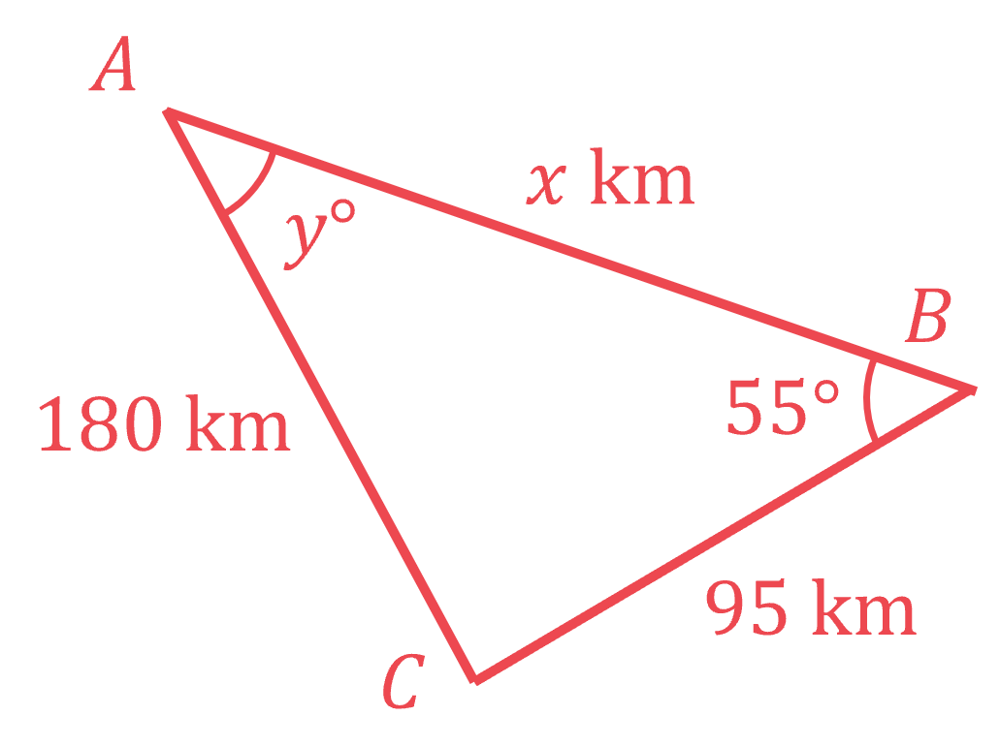

**[1]**

> *To find the distance between **A **and **C **you need to know the angle opposite it in the triangle. You know an angle and the length of the side opposite to it, you also know another length so you can therefore find the angle opposite it by using the sine rule.*

> *The formula for the sine rule is *$\frac{\mathrm{sin}A}{a}=\frac{\mathrm{sin}B}{b}$*, where **a** and **b** are the lengths of the two sides that are opposite the angles **A **and **B **respectively. *

> *Substitute **a** = 95, **b** = 180, **A** = **y** and **B** = 55 into the formula.*

$\frac{\sin ( y )}{95} = \frac{\sin ( 55 )}{180}$

**[1]**

> *Multiply both sides by 95 and then find the angle by using the inverse sin function.*

$\begin{gathered} \sin ( y ) & = \frac{\sin ( 55 )}{180} \times 95 \\ y = \sin ^{- 1} ( \frac{\sin ( 55 )}{180} \times 95 ) \\ y = 25.615534... \end{gathered}$

**[1]**

> *The interior angles of the triangle should add up to 180°. Use the answer button on your calculator to find the third angle.*

$\begin{gathered} \text{Angle} A C B & = 180 - 55 - 25.615534... \\ = 99.384465... \end{gathered}$

> *You now have enough information to find the side **LN** using either the sine rule or the cosine rule.*

> *Method 1 - Using the sine rule*

> *The formula for the sine rule is *$\frac{a}{\mathrm{sin}A}=\frac{b}{\mathrm{sin}B}$*, where **a** and **b** are the lengths of the two sides that are opposite the angles **A **and **B **respectively. *
*Substitute **a** = **x**, **b** = 180, **A** = 99.384465... (using the answer button) and **B** = 55 into the formula.*

$\begin{gathered} \frac{x}{\sin ( 99.384465... )} & = \frac{180}{\sin ( 55 )} \\ x = \frac{180}{\sin ( 55 )} \times \sin ( 99.384465... ) \\ x = 216.798523... \end{gathered}$

**[1]**

> *Round to 3 significant figures.*

$217\mathrm{km}(3\mathrm{sf})$** [1]**

> *Method 2 - Using the cosine rule*

> *The formula for the cosine rule is *$a^{2}=b^{2}+c^{2}-2bc\mathrm{cos}A$*, where **b** and **c** are the lengths of the two sides that form angle **A** and **a** is the length of the side opposite **A**. *
*Substitute **a** = **x**, **b** = 95, **c** = 180 and **A** = 99.384465... (using the answer button) into the formula.*

$x^{2} = 95^{2} + 180^{2} - 2 ( 95 ) ( 180 ) \cos ( 99.384465... )
x = \sqrt{95^{2} + 180^{2} - 2 ( 95 ) ( 180 ) \cos ( 99.384465... )} 
x = 216.798523...$

**[1]**

> *Round to 3 significant figures. *

$217\mathrm{km}(3\mathrm{sf})$** [1]**

### Q12
i) *Bearings are always taken from the north in the clockwise direction.*

> * *

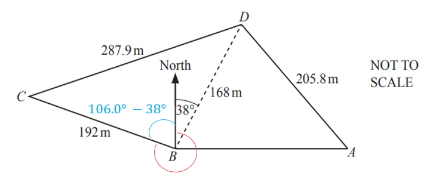

> * *

> *The bearing of **C**  from **B ** is a full turn minus (106 - 38)°.*

* **360° - (106 - 38)° = 292°  *

**292° ****[1]**

ii) *Due east means at a bearing of 090°.*

* **Angle ***ABD *** =  90° - 38° = 52°*

> *Add the information you have to the diagram.*

> * *

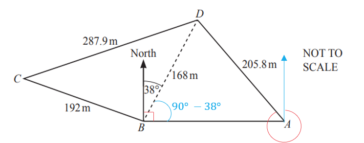

**[1]**

> * *

> *Angle **ABD ** is opposite a known side and one other side is known so the sine rule can be used to find the other angles.*

> *Sine Rule:  *$\frac{\mathrm{sin}A}{a}=\frac{\mathrm{sin}B}{b}=\frac{\mathrm{sin}C}{c}$*.*

$\begin{gathered} \frac{ \sin A B D}{A D} & = \frac{ \sin B A D}{B D} \\ \frac{ \sin 52}{205.8} & = \frac{\sin B A D}{168} \end{gathered}$

**[1]**

> *Rearrange the equation to make sin**BAD **the subject.*

$\begin{gathered} \frac{ 168 \sin 52}{205.8} & = \sin B A D \end{gathered}$

** ****[1]**

> *Use the *$\mathrm{sin}^{-1}$* button on your calculator to find angle **BAD**.*

$\begin{gathered} B A D^{\circ} & = \sin ^{- 1} ( \frac{ 168 \sin 52}{205.8} ) \\ = 40.03639...^{\circ} \end{gathered}$

** ****[1]**

> *The bearing of **D **from **A **is 270° + angle **BAD.*

*270 + 40.03639... = 310.0363....*

**The bearing of ****D ****from ****A ****= 310.0° (1 d.p.) ****[1] **
**Unrounded answers in the range 310.03 to 210.04 accepted.**

### Q13
> *Measure the line **AB** with a ruler. On the original exam paper, this line measures 11 cm*

> *The scale is 1 cm to 3 km so multiply by 3 and convert the units from cm to km*

**33 km**
* **32.7 to 33.3** ***[1]**

### Q14
> *Place the point of the compasses at **A** and draw an arc with radius 6.2 cm above the horizontal line. *
*Place the point of the compasses at **B** and draw an arc with radius 7.6 cm so that it crosses over the first arc. *
*The point **C ** is the point at which the two arcs intersect.*
*Use a ruler to join up point **A **to point **C** and point **B **to point **C**. *

> *Use your ruler to measure each side and check for accuracy. Remember to clearly label the sides of the triangle and the point **C**. *

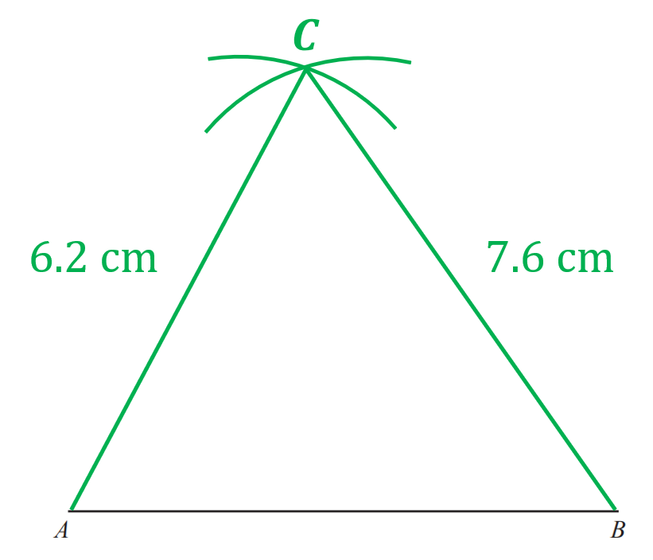

**Both sides correct length*** ***[1]**
**Arcs shown and triangle drawn accurately**** [1]***   *

### Q15
> *Identify the angle that will make the bearing of **D** from **B**. Draw a north line at **B** and a line from **B** to **D**. The required angle is the angle that is formed by starting at the north line and measuring clockwise. This angle is equal to angle **BDC** as they are alternate angles since the north line is parallel to the line **CD**.*

> *The triangle formed by the points **BCD** is right angled. You know the lengths of the sides opposite and adjacent to the required angle so you can use the trig ratio: *$\text{tan} ( B C D ) = \frac{Opposite}{Adjacent}.$

$\tan ( B C D ) = \frac{350}{450}$

**[1]**

> *Use inverse tan on your calculate to find the angle.*

$B C D = \tan ^{- 1} ( \frac{350}{450} ) = 37.8749...$

> *Bearings are written as 3 digit numbers so round to the nearest integer and put a zero at the front.*

**Bearing of ****D**** from B is 038** **[1]**

### Q16
> *Place the point of the compasses at **A** and draw an arc with radius 6.2 cm above the horizontal line. *
*Place the point of the compasses at **B** and draw an arc with radius 7.6 cm so that it crosses over the first arc.*
*The point **C ** is the point at which the two arcs intersect. *
*Use a ruler to join up point **A **to point **C** and point **B **to point **C**. *

> *Use your ruler to measure each side and check for accuracy. Remember to clearly label the sides of the triangle and the point **C**. *

**Both sides correct length**** ****[1] **
**Arcs shown and triangle drawn accurately**** ****[1]***   *

### Q17
*We have two sides, the angle between them and are asked to show the length of the third side.* 
*This is cosine rule, *$"a^{2}=b^{2}+c^{2}-2bc\mathrm{cos}A"$ 
*It may help to label the diagram.*

$( B C )^{2} = 115^{2} + 80^{2} - 2 \times 115 \times 80 \times \cos 72^{\circ}$

**[1]**

> *Avoid rounding before your final answer - store the exact value in your calculator's memory.*

$( B C )^{2} = 13 939.087 ...$ 
$BC=118.063911...$

> *Final answer is to be shown to **one decimal place.*

$BC=118.1$** cm (1 d.p.)** **[1]**
> *We now know side **BC**.*

*For angle **ABC**, we know it's opposite side and a another side-angle pair. This is sine rule, * $"\frac{sinA}{a}=\frac{sinB}{b}"$*.*

$\frac{\mathrm{sin}72^{\circ}}{118.063...}=\frac{\mathrm{sin}ABC}{115}$

**[1]**

> *Do not work out or round any values until your final answer. *
*Use the exact answer for side **BC** stored in your calculator from part a. Rearrange the equation.*

$\mathrm{sin}ABC=\frac{115\mathrm{sin}72^{\circ}}{118.063...}$

**[1]**

> *Use inverse sine (sin**-1**) to find angle **ABC**.*

$\begin{gathered} A B C & = \sin ^{- 1} ( \frac{115 \sin 72^{\circ}}{118.063 ...} ) \\ A B C & = 67.876 670 ... \end{gathered}$

**Angle ****ABC**** = 67.9° (1 d.p.)*** ***[1]**
> *Add the information to the diagram and mark the bearings required for both parts of the question.*

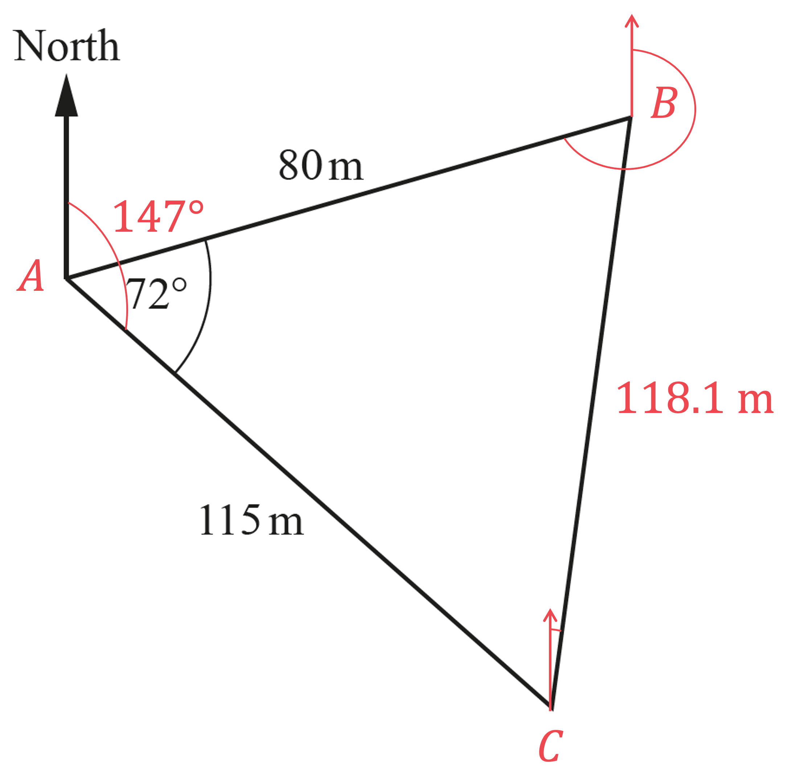

i) *First find the bearing of **B** from **A**.*

$147^{\circ}-72^{\circ}=75^{\circ}$

**[1]**

> *We can now work out the bearing of **A** from **B** using alternate angles.*

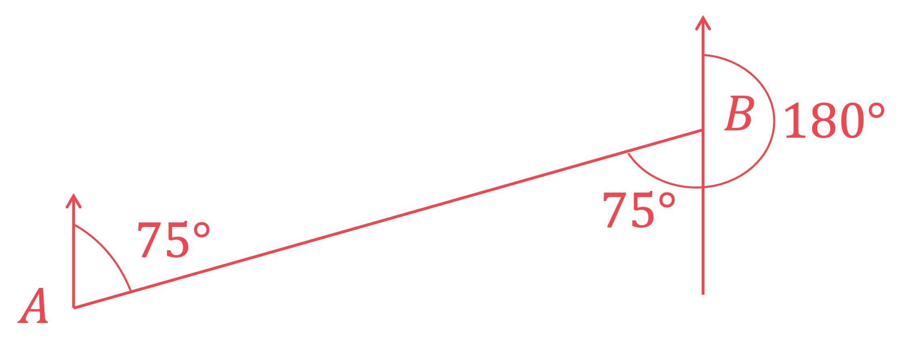

$180^{\circ}+75^{\circ}=255^{\circ}$

**[1]**

**The bearing of ****A**** from ****B**** is 255°** **[1]**

ii) *We can work out the bearing of **B** from **C** using alternate angles and the result from part b.*

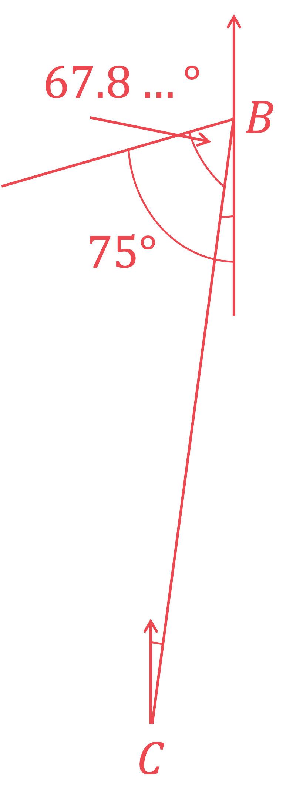

> *For angle **ABC** use the value stored in your calculator's memory.*

$75-67.876670...=7.123329...$

**[1]**

**The bearing of ****B**** from ****C**** is 7.1° (1 d.p.)**** [1]**
**If three-figure bearings are used the answer can be expressed as 007° or 007.1°.**

### Q18
> *Sketching a diagram may help you to see what's going on.*

> *Work out the bearing of **C** from **A** by subtracting the angle **CAD** from the bearing of **D** from **A**.*

$70-35.8=34.2$

> *Work out the bearing of **A** from **C** by adding the 180**o** to the bearing of **C** from **A**.*

$180+34.2=214.2$

**[1]**

**214.2****o**** ****[1]**

### Q19
> *i) Find the bearing of **B** from **A** by subtracting the angle **BAC** from the bearing of **C** from **A**.*

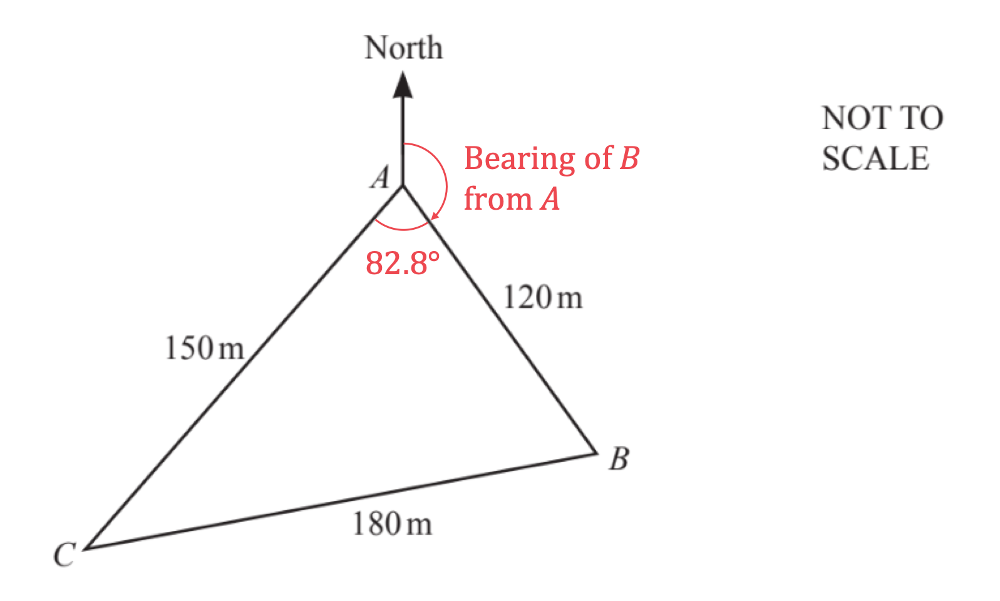

$210-82.8=127.2$

$127.2^{\circ}$ **[1]**

> *ii) The bearing of **A** from **B** is 180**o** more than the bearing of **B** from **A**.*

$127.2+180$

* ***Adding 180****o**** to your value from part i)**** [1]**
**307.2****o** **[1]**
**Answers of 307 and between 307.1 to 307.2 will be accepted.**

### Q20
> *Set your compass to the same length as the line *$PQ$*, and then draw an arc with centre *$P$* or *$Q$* as below*

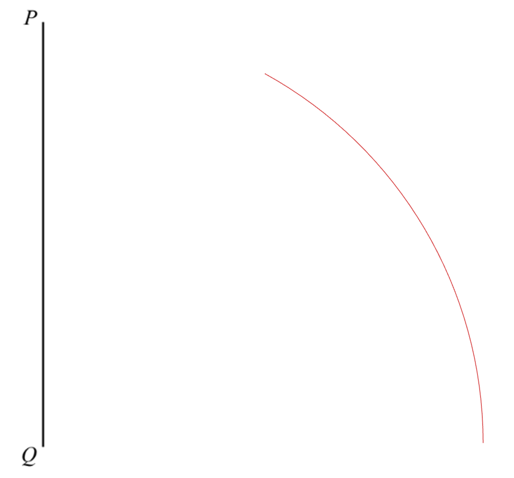

> *Move your compass so the centre is on the other point *$P$* or *$Q$*and, **keeping the compass length the same** draw another arc that crosses your first arc*

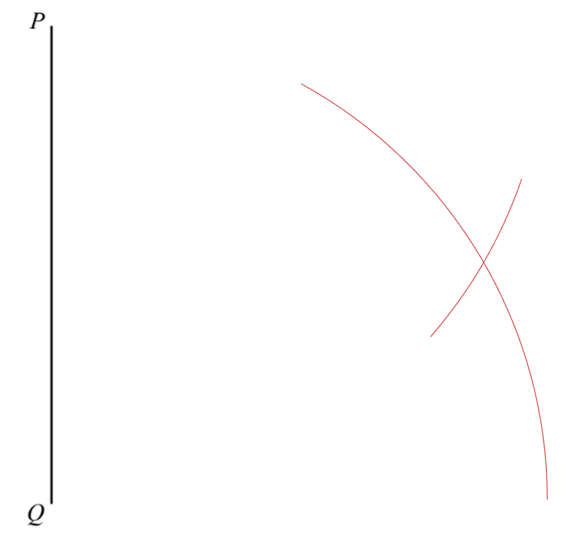

> *Use a ruler to draw two straight lines from the point where the two arcs cross, to *$P$* and to *$Q$

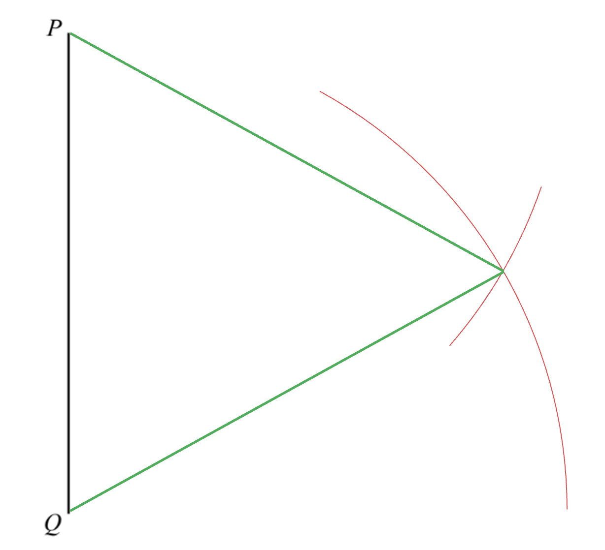

**correct triangle**** [1] **
**arcs**** ****shown ****[1]**
**Note that if the construction arcs are not shown then you won't score full marks- so don't erase them!**
