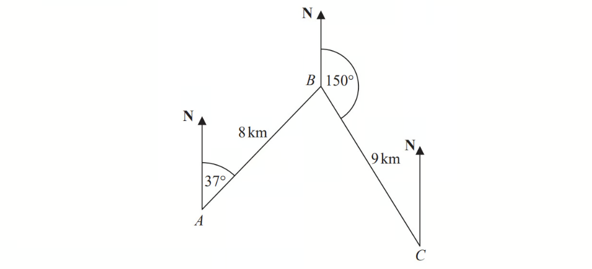
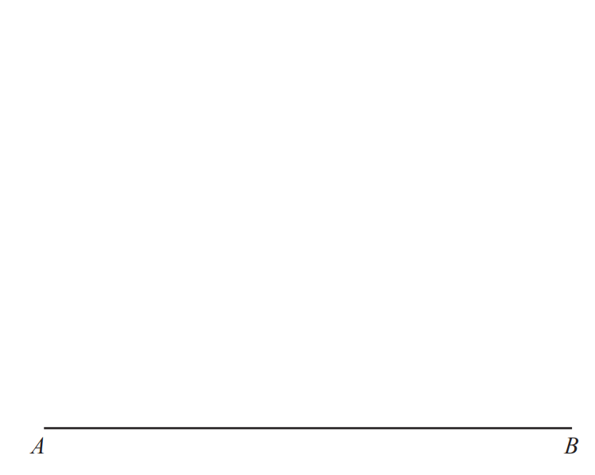
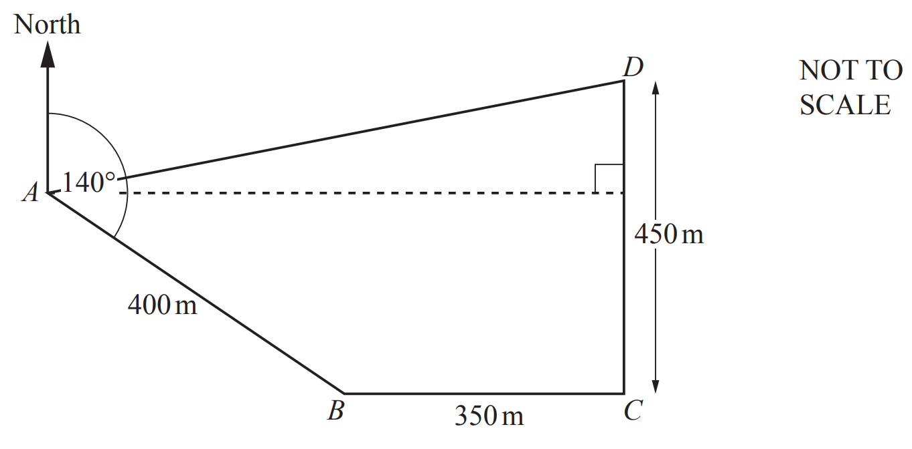
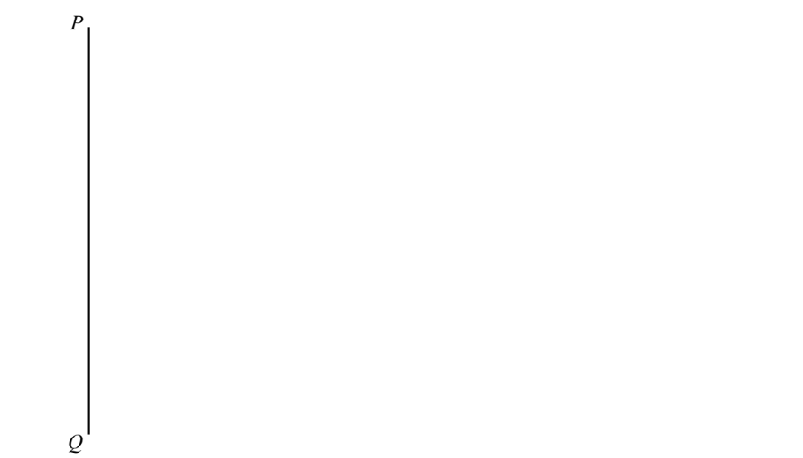

# Exam Questions — Bearings, Constructions & Scale Drawings
**Geometry** · Cambridge (CIE) IGCSE maths (0580 & 0980)
> Source: [https://www.savemyexams.com/igcse/maths/cie/25/extended/topic-questions/](https://www.savemyexams.com/igcse/maths/cie/25/extended/topic-questions/) · 20 questions across 1 sets

## Calculator Questions (20 questions)

### Q1 — medium — 4 marks

**Q1** [1 mark]

Two towns, $A$ and $B$, are shown on a map.
The scale of the map is 1 cm to 5 km.

Find the actual distance between $A$ and $B$.

.......................................... km

**Q1** [1 mark]

**Extract:**

Two towns, [A] and [B], are shown on a map.

The scale of the map is 1 cm to 5 km.

Measure the bearing of $B$ from $A$.

**Q1** [2 marks]

**Extract:**

Measure the bearing of [B] from [A].

109°

Calculate the bearing of $A$ from $B$.

You must show all your working.

### Q2 — medium — 2 marks

**Q2** [2 marks]

In triangle $ABC$, $AB=7\mathrm{cm}$ and $BC=9\mathrm{cm}$.

**Using a ruler and compass only**, construct triangle $ABC$.
The line $AB$ has been drawn for you.

### Q3 — hard — 5 marks

**Q3** [5 marks]

The diagram shows the positions of three ships, $A,B$ and $C$.

Ship $B$ is due north of ship $A$.

The bearing of ship $C$from ship $A$ is 120°

Calculate the bearing of ship $C$ from ship $B$. 
Give your answer correct to the nearest degree.

*Source: Jan 2021 4MA1/1H Q16*

### Q4 — hard — 5 marks

**Q4** [5 marks]

The diagram shows the positions of three towns, Acton ($A$), Barston ($B$) and Chorlton ($C$).

Barston is 8 km from Acton on a bearing of $037^{\circ}$. Chorlton is 9km from Barston on a bearing of $150^{\circ}$.

Find the bearing of Chorlton from Acton. 
Give your answer correct to 1 decimal place. 
You must show all your working.

*Source: June 2019 1MA1/3H Q23*

### Q5 — hard — 6 marks

**Q5** [2 marks]

A, B, C and D are four towns.

B is 25 kilometres due East of A.
C is 25 kilometres due North of A. 
D is 45 kilometres due South of A.

Work out the bearing of B from C.

*Source: June 2017 J560/04 Q7*

**Q5** [4 marks]

**Extract:**

B is 25 kilometres due East of A.
C is 25 kilometres due North of A. 
D is 45 kilometres due South of A.

Calculate the bearing of D from B.

*Source: June 2017 J560/04 Q7B*

### Q6 — medium — 3 marks

**Q6** [1 mark]

Two towns, *A* and *B*, are shown on a map.

Measure the bearing of *B* from *A*.

*Source: Specimen 2025 0580/04 Q5B*

**Q6** [2 marks]

**Extract:**

Two towns, A and B, are shown on a map.

Calculate the bearing of *A* from *B*. 
You must show all your working.

*Source: Specimen 2025 0580/04 Q5C*

### Q7 — easy — 2 marks

**Q7** [2 marks]

The diagram shows the positions of three cities, Geneva (*G*), Budapest (*B*) and Hamburg (*H*).

The bearing of Budapest from Hamburg is 133°.

Find the bearing of Hamburg from Budapest.

*Source: 2018	Oct/Nov 0580/42 Q8C*

### Q8 — hard — 3 marks

**Q8** [3 marks]

The scale of a map is 1 : 10 000 000. 
On the map, the area of Slovakia is 4.9 cm2.

Calculate the actual area of Slovakia. 
Give your answer in square kilometres.

............................................. km2

*Source: 2019	Oct/Nov 0580/21 Q14-*

### Q9 — hard — 4 marks

**Q9** [4 marks]

A ship sails from $P$ to $Q$ and then from $Q$ to $R$.

$Q$ is 12 miles from $P$, on a bearing of 080°

$R$ is 28 miles from $Q$, on a bearing of 155°

Work out the direct distance from $P$ to $R$.

*Source: Nov 2021 8300/2H Q23*

### Q10 — hard — 2 marks

**Q10** [2 marks]

On a map with scale 1 : 25000, the area of a lake is 33.6 square centimetres.

Calculate the actual area of the lake, giving your answer in square kilometres.

........................................ km2

*Source: 2019	May/June 0580/22 Q10*

### Q11 — hard — 5 marks

**Q11** [5 marks]

$A$ , $B$ and $C$ are three towns.

The bearing of $B$ from $A$ is 105° 
The bearing of $C$ from B is 230°

The distance of $C$ from $A$ is 180 km. 
The distance of $C$ from $B$ is 95 km.

Calculate the distance of $B$ from $A$. 
Give your answer correct to 3 significant figures.

........................km

*Source: Specimen 2016 4MA1/1H Q23*

### Q12 — hard — 6 marks

**Q12** [6 marks]

The diagram shows a field, *ABCD*, on horizontal ground. *BC *= 192 m, *CD *= 287.9 m, *BD *= 168 m and *AD *= 205.8 m.

Angle *CBD *= 106°.

i) The bearing of *D* from* B* is 038°.

Find the bearing of *C  *from *B*.

[1]

ii) *A* is **due east** of *B*.

Calculate the bearing of *D  *from *A*.

[5]

*Source: 2020 Oct/Nov 0580/41 Q6A*

### Q13 — easy — 1 marks

**Q13** [1 mark]

Two towns, *A* and *B*, are shown on a map.
The scale of the map is 1 cm to 3 km.

Find the actual distance between *A* and *B*.

.......................................... km

*Source: Specimen 2025 0580/04 Q5A*

### Q14 — medium — 2 marks

**Q14** [2 marks]

In triangle *ABC*, *BC* = 7.6 cm and *AC* = 6.2 cm.

**Using a ruler and compasses only**, construct triangle *ABC*. Leave in your construction arcs. 
The side *AB* has been drawn for you.

*Source: 2020 Oct/Nov 0580/23 Q3*

### Q15 — hard — 2 marks

**Q15** [2 marks]

The diagram shows a field *ABCD*. 
The bearing of *B* from *A* is 140°.  
*C* is due east of *B* and *D* is due north of *C*.
 *AB* = 400m, *BC* = 350m and *CD* = 450m.

Find the bearing of *D* from *B*.

*Source: 2020 May/June 0580/42 Q5A*

### Q16 — easy — 2 marks

**Q16** [2 marks]

In triangle *ABC*, *BC* = 7.6 cm and *AC* = 6.2 cm.

**Using a ruler and compasses only**, construct triangle *ABC*. Leave in your construction arcs. 
The side *AB* has been drawn for you.

*Source: 2020 Oct/Nov 0580/23 Q3*

### Q17 — hard — 11 marks

**Q17** [3 marks]

The diagram shows the positions of three points $A$, $B$ and $C$ in a field.

Show that $BC$ is 118.1 m, correct to 1 decimal place.

*Source: 2020	May/June 0580/41 Q7A*

**Q17** [3 marks]

Calculate angle $ABC$.

Angle $ABC=$ ...............................................

*Source: 2020	May/June 0580/41 Q7B*

**Q17** [5 marks]

The bearing of $C$ from $A$ is 147°. Find the bearing of

i) $A$ from $B$,

[3]

ii) $B$ from $C$.

[2]

*Source: 2020	May/June 0580/41 Q7C*

### Q18 — medium — 2 marks

**Q18** [2 marks]

The diagram shows a field, *ABCD*, on horizontal ground.

The angle *CAD *is 35.8° and the bearing of *D* from *A* is 070°.

Find the bearing of *A* from *C*.

*Source: 2019	Oct/Nov 0580/43 Q4E*

### Q19 — medium — 3 marks

**Q19** [3 marks]

The diagram shows a triangular field, *ABC*, on horizontal ground.

The angle *BAC *is equal to 82.8°.

The bearing of *C* from *A* is 210°.

i) Find the bearing of *B* from *A*.

[1]

ii) Find the bearing of *A* from *B*.

[2]

*Source: 2019	Oct/Nov 0580/41 Q5C*

### Q20 — medium — 2 marks

**Q20** [2 marks]

In triangle $PQR,QR$ = 10 cm and $PR$ = 11 cm.

**Using a ruler and compasses only,** construct triangle $PQR$. The line $PQ$ has been drawn for you.

*Source: Specimen 2025 0580/04 Q2*

