# Mark Schemes — Circle Theorems
**Geometry** · Cambridge (CIE) IGCSE maths (0580 & 0980)

## Calculator Questions (18 questions)

### Q1
> *Label missing angles in the triangle which already has the angle 27° labelled. *

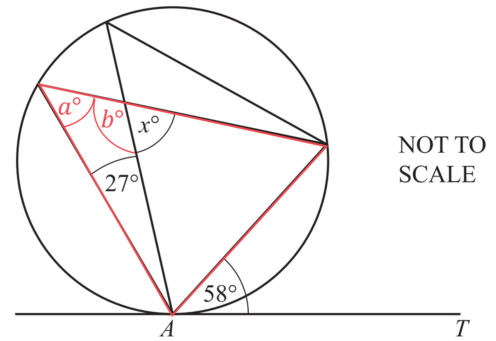

> * The alternate segment theorem states that an angle inside a triangle (with corners on the circumference) is equal to the angle between the opposite side and a tangent. The angle 58° is between a tangent and the side of a triangle. So the angle in the triangle that is opposite that side is also 58°. *

$a=58$
**[1]**

> *Find the value of **b **by using the fact that interior angles in a triangle add up to 180°. *

`table row cell b plus 58 plus 27 end cell equals 180 row b equals cell 180 minus 58 minus 27 end cell row b equals 95 end table`

> * Angles that form a straight line add up to 180°. Therefore **b **and **x** add up to 180°.*

> * *`table row cell x plus 95 end cell equals 180 row x equals cell 180 minus 95 end cell end table`

$x=85$ **[1]**

### Q2
> *Careful - this "looks" like a cyclic quadrilateral but it isn't as one of the points is not on the circumference.*

> *Use the circle theorem: "Angle subtended by an arc at the centre is twice the angle at the circumference".*

> *Look very carefully at the diagram to find the correct angle at the centre.*

*angle at the circumference = *$5x$

*angle at the centre =* $360-(3x+22)$

**[1]**

> *Apply the theorem. *
*Angle **AOC** is twice the size of angle **ABC**.*

$360-(3x+22)=2\times5x$

**[1]**

> *Simplify both sides of the equation.*

$338-3x=10x$

**[1]**

> *Add *$3x$* to both sides.*

$338=13x$

> *Divide both sides by 13*

$\frac{338}{13}=x$

$x=26^{\circ}$ **[1]**

### Q3
*A radius meets a tangent at right-angles, so angle **EAO** is 90°* *Find angle **BAO **(by subtracting 61° from 90°)*

*90° - 61°*

**29°** **[1]**
*Triangle **AOC** is isosceles (as **OA** and **OC** are the same length - both radii)* *Find angle **OAC** (by subtracting 29° from 55°)  *

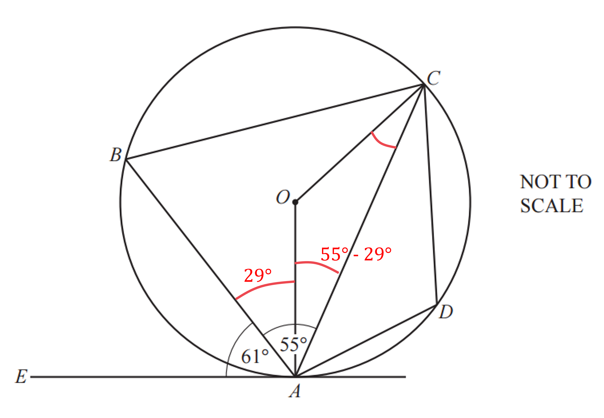

* **angle ***OAC*** = 55° - 29° = 26°*

**[1] **

> *Angles in a triangle add to 180° and angle **OCA** = angle **OAC** = 26° *

*Find angle **AOC** (by subtracting two 26° angles from 180°)*

*180° - 26° - 26° *

**128° ****[1]**
> *The angle at the centre is twice the angle at the circumference*

> *Find angle **ABC **by halving angle** AOC** from part (b)*

$\frac{1}{2}\times128$

**64°** **[1]**
> *Opposite angles in a cyclic quadrilateral add to 180°*

*Find angle **CDA** (by subtracting angle **ABC **in part (c) from 180°)*

*180° - 64°*

**116° ****[1]**

### Q4
i) *Angle *$EBD$* is the angle on the circumference and is half of angle *$EOD$*. So we need to calculate angle *$EOD$* first.*
$OD$*and *$OE$* are radii, so of equal length. Hence Triangle *$ODE$*is isosceles.*

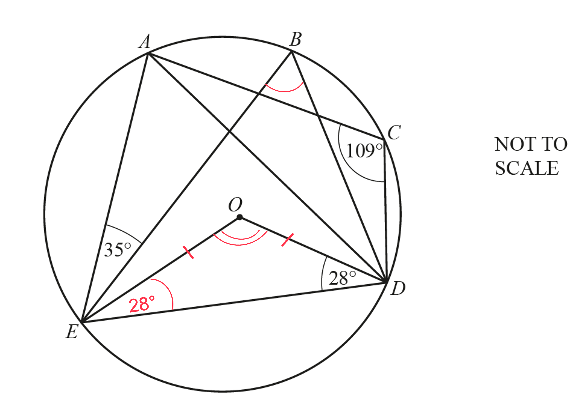

> *(And angles in a triangle sum to 180°, so:)*

*Angle* $EOD=180-2\times28=124$

> *The question asks for reasons for your answer. The isosceles triangle is the first key reason we need to write down.*

**Angle**** **$EOD=124^{\circ}$**, isosceles triangle**
**"isosceles triangle"**** [1]**

> *Now we can use the rule that the angle at the centre is twice the angle at the circumference to calculate angle *$EBD$*.*

*Angle *$EBD=124\div2=62$

**Angle **$EBD=62^{\circ}$ **[1]**
**(because)*** ***the angle at the centre is twice the angle at the circumference ****[1]**

ii) *Method 1  *
*Angle *$EAD$* is subtended by the same arc as angle *$EBD$*. Therefore angles *$EAD$* and *$EBD$*are angles in the same segment and are equal.*

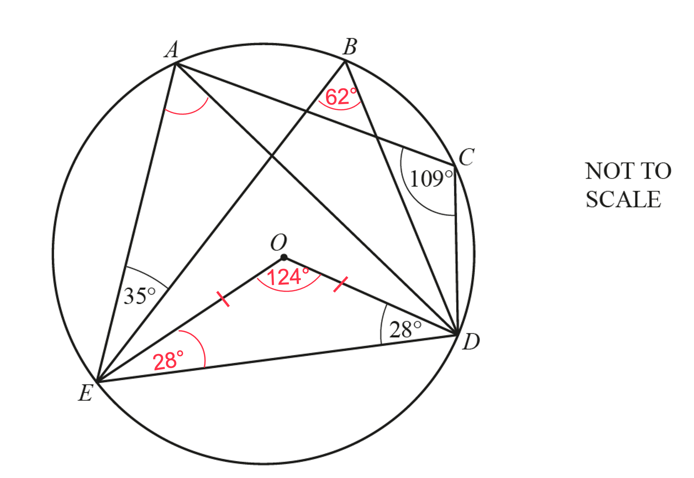

**Angle **$EAD=62^{\circ}$ **[1]**
**angles in same segment/ angles subtended by same arc (are equal) ****[1]**

> *Method 2 *
*Angle *$EAD$* is subtended by the same arc as angle *$EOD$*. Therefore angles *$EAD$* is half as big as angle *$EOD$*, because the angle at the centre is twice the angle at the circumference.*

**Angle **$EAD=62^{\circ}$ **[1]**
**angle at the centre is twice the angle at the circumference ****[1]**
> *Angles *$AED$* and angle *$ACD$* are the opposite angles of a cyclic quadrilateral, as shown below. Opposite angles of a cyclic quadrilateral sum to 180°.*

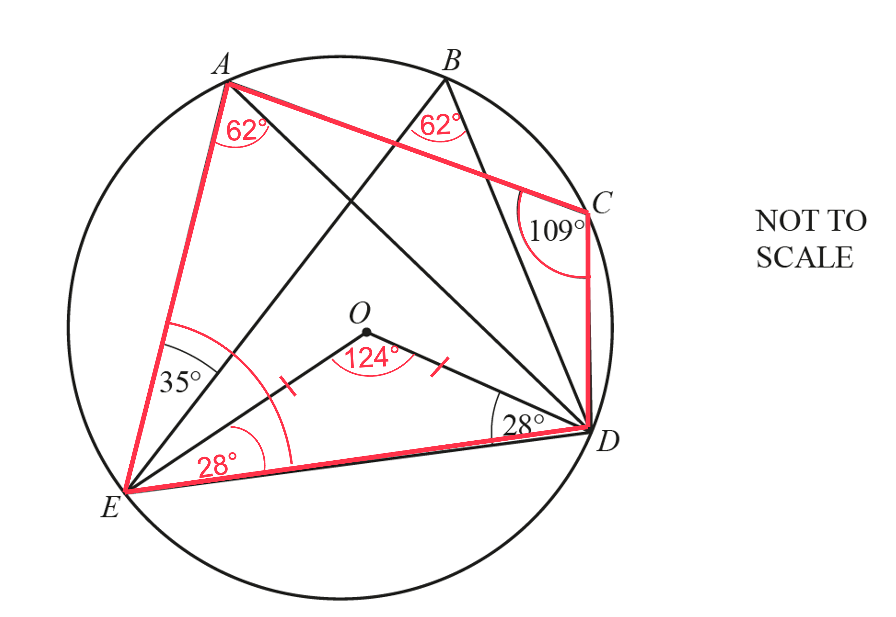

*Angle *$AED=180-109=71$

**[1]**

> *Now subtract given angles *$AEB$* and  *$OED$* from angle *$AED$*.*

*Angle *$BEO=71-35-28$

**[1]**

**Angle **$BEO=8^{\circ}$ **[1]**

### Q5
> *The alternate segment theorem states that an angle inside a triangle with all three vertices on the circumference of a circle is equal to the angle between the opposite side and a tangent.*

> *The angle *$v$* is between a tangent and a side of two triangles which both have all three vertices on the circumference. So it is equal to both of the angles in the triangles opposite that side.*

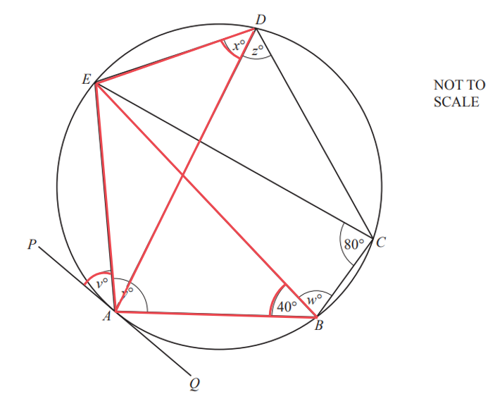

> $v^{\circ}=x^{\circ}=40^{\circ}$*  *

> *EC **= **EB  **so triangle** BCE **is isosceles and angle **CBE** = angle **BCE**. *

`table row cell w degree end cell equals cell space 80 degree end cell end table`

> *ABCE **is a cyclic quadrilateral. This theorem states that opposite angles in a cyclic quadrilateral add up to 180°.*

`table row cell y space plus space 80 space end cell equals cell space 180 end cell row cell y space end cell equals cell space 180 space minus space 80 end cell row cell y degree end cell equals cell space 100 degree end cell end table`

> *BCDE **is also a cyclic quadrilateral. *

`table row cell x space plus space z space plus space w space end cell equals cell space 180 end cell row cell space 40 space plus space z space plus space 80 space end cell equals cell space 180 end cell row cell z space end cell equals cell space 180 space minus space 120 end cell row cell z degree end cell equals cell space 60 degree end cell end table`

$v=40^{\circ}w=80^{\circ}x=40^{\circ}y=100^{\circ}z=60^{\circ}$ **[5] **
*1 mark for each correct answer*

### Q6
> *To prove that **ST  **is equal to** UT ** you will need to **prove **that the triangle **STU **is **isosceles**. This can be done by finding the angles. *

> *PQRST **is a regular pentagon, so the angle **TSU** is the exterior angle of a regular pentagon. *
*Exterior angles in any polygon add up to 360°.*
*A regular pentagon has 5 equal exterior angles.*

> * *`T S with hat on top U space equals 360 over 5 equals space 72 degree`

**[1]**

> *To find the size of angle **SUT**, you will need to consider circle theorems.*

> *Begin by joining the point **O** to the points **T** and **R,** marking all the radiuses of the circle as equal lengths on the diagram.*

> *TP** and **TR **are also tangents to the circle, so by the circle theorem 'A tangent always meets a radius at 90°', angles **ORQ **and **OTP **are both 90°. *

`O R with hat on top Q space equals space O T with hat on top P space equals 90 degree`* **(angle between tangent and radius)*

**[1]**

> *Mark these onto the diagram.*

> *The sum of the interior angles in any polygon can be found using the formula 180°(n - 2). *
*A regular pentagon has 5 equal interior angles, therefore these can be found using the formula *`fraction numerator 180 open parentheses 5 space minus space 2 close parentheses over denominator 5 end fraction`*.*

> * *`T P with hat on top Q space equals P Q with hat on top R space equals space fraction numerator 3 open parentheses 180 close parentheses over denominator 5 end fraction equals space 108 degree`

> *Add these angles to the diagram.*

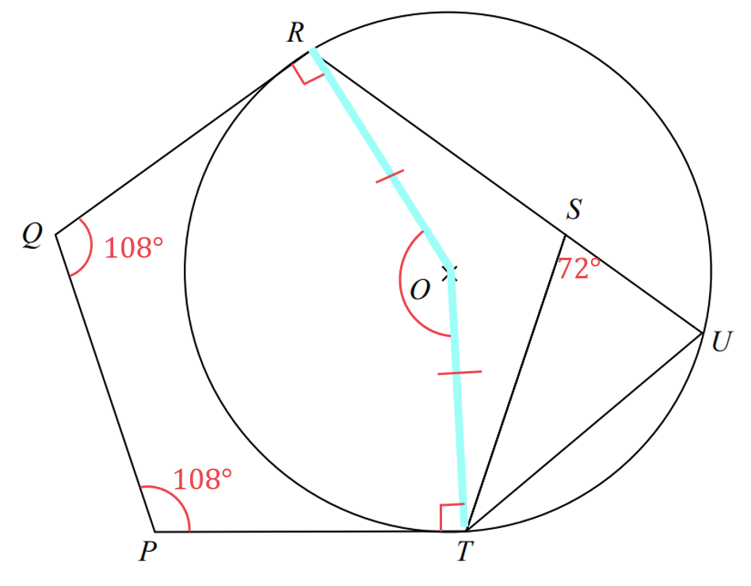

> *PQROT  **is a pentagon, so the angle **ROT**  can be found by subtracting the other four angles from the sun of the angles in a pentagon.*

> *The sum of the interior angles in any polygon can be found using the formula 180°(n - 2).*

`R O with hat on top T space plus O T with hat on top P space plus space T P with hat on top Q space plus space P Q with hat on top R space plus space Q R with hat on top O space equals space 180 open parentheses 5 space minus space 2 close parentheses degree space equals space 540 degree`

> *Substitute in the angles you know to find angle **ROT**.*

`table row cell R O with hat on top T space plus space 90 degree space plus space 90 degree space plus space 108 degree space plus space 108 degree space end cell equals cell space 540 degree end cell row cell R O with hat on top T space plus space 396 degree space end cell equals cell space 540 degree end cell row cell R O with hat on top T space space end cell equals cell space 144 degree end cell end table`

**[1]**

> *By the circle theorem, the angle at the centre is twice the angle at the circumference, angle **ROT **is twice angle **RUT.*

`R O with hat on top T space equals 2 open parentheses R U with hat on top T close parentheses space equals space 2 open parentheses S U with hat on top T close parentheses`

`S U with hat on top T space equals fraction numerator R O with hat on top T over denominator 2 end fraction equals space 144 over 2 space equals space 72 degree`

**[1]**

> *This proves that angle **TSU **is equal to angle **SUT **and so triangle **STU **is isosceles.*

**Therefore ****ST ****= ****UT **
**All reasons given clearly**** [1]**

### Q7
*The angle at the centre, angle **TOP**, is twice the angle at the circumference, angle **TSP* 
*Find **v** (by doubling 75)*

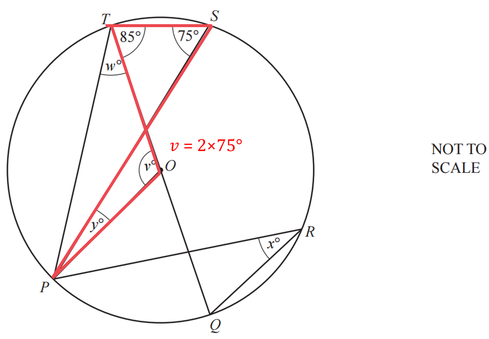

**v*** = 2 *$\times$*75 = 150*

**[1]**

*Two radii, **OP** and** OT**, form an isosceles triangle, **POT* 
*Angles in a triangle add to 180°* 
*Find **w** (by subtracting 150 from 180 and halving the answer)*

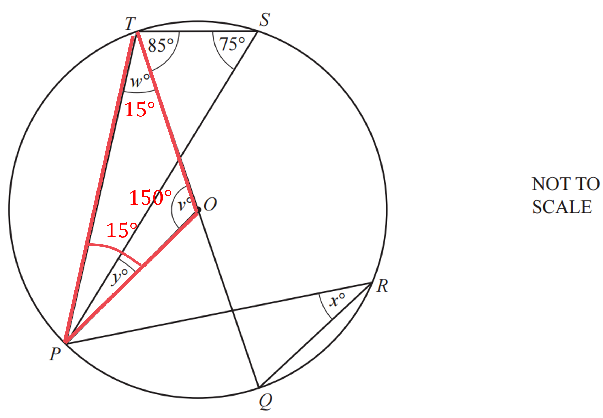

`w equals fraction numerator open parentheses 180 minus 150 close parentheses over denominator 2 end fraction`

**[1]**

**w*** = 15*

**[1]**

> *Angles in the same segment are equal *
*Find **x** (as it is equal to **w**)*

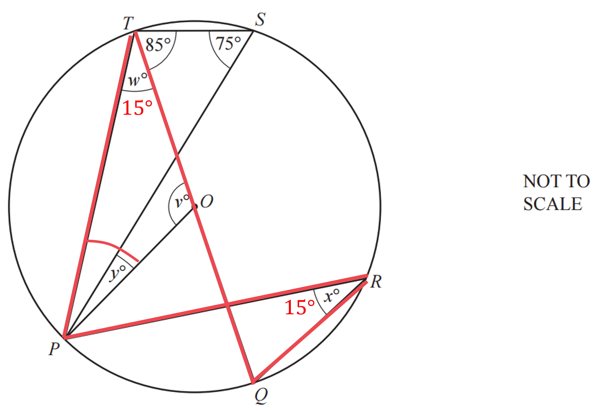

**x*** = ***w*** = 15*

**[1]**

> *Angles in triangle **PTS** add to 180° and angle **PTS **is 15° + 85° = 100° *
*Write angle **TPS** as **z*

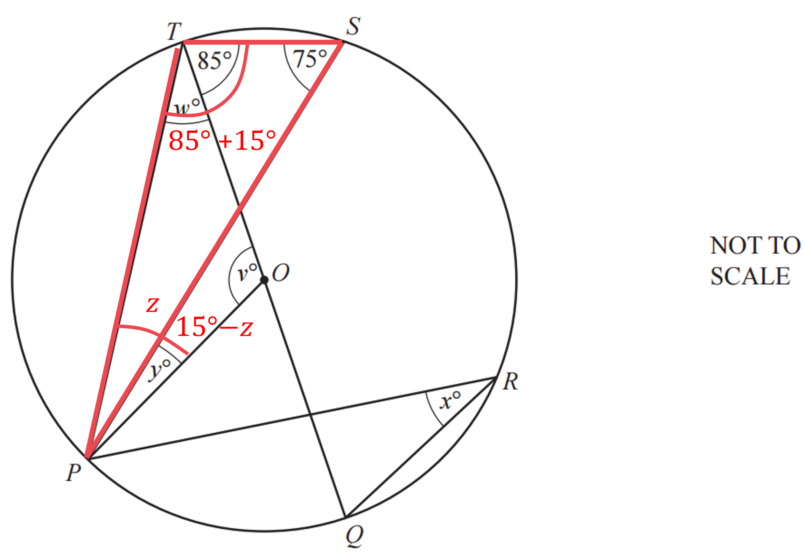

*Find **z** (by subtracting 75 and 100 from 180)* * *

**z*** = 180 - 75 - 100 = 5*

**[1]**

*Find **y** (by subtracting **z** from 15, found earlier)* * *

**y*** = 15 - ***z*** = 15 - 5 = 10*

> *Give all final answers together*

**v**** = 150, ****w**** = 15, ****x**** = 15, ****y**** = 10 ****[1]**

### Q8
> *Angle at the centre is twice the angle at the circumference subtended by the same arc*

*Angle *$PRQ=24^{\circ}$

**[1]**

> *Angle *$OPR$*= Angle *$PRQ$* because they are alternate angles in parallel lines*

**Angle**** **$OPR=24^{\circ}$** [1]**

### Q9
> *Method 1:*

> *Use the circle theorem: "Opposite sides in a cyclic quadrilateral add up to 180**o**".*

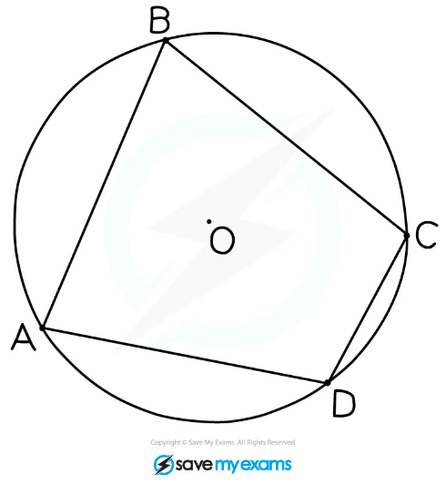

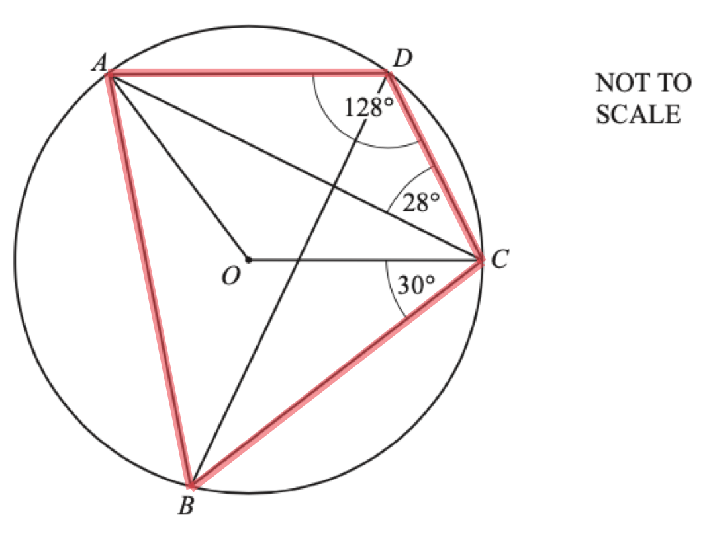

*Angle ***ADC*** and angle ***ABC*** are opposite angles in a cyclic quadrilateral so they add up to 180**o**.*

**[1]**

*Angle ***ABC*** *$+128=180$

*Angle ***ABC*** = *$52^{\circ}$

**[1]**

> *Use the circle theorem: "Angle subtended by an arc at the centre is twice the angle at the circumference".*

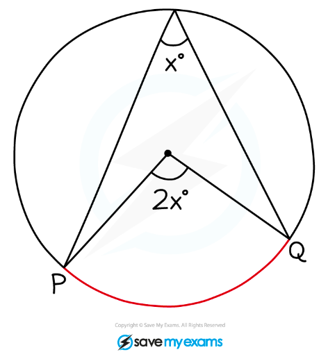

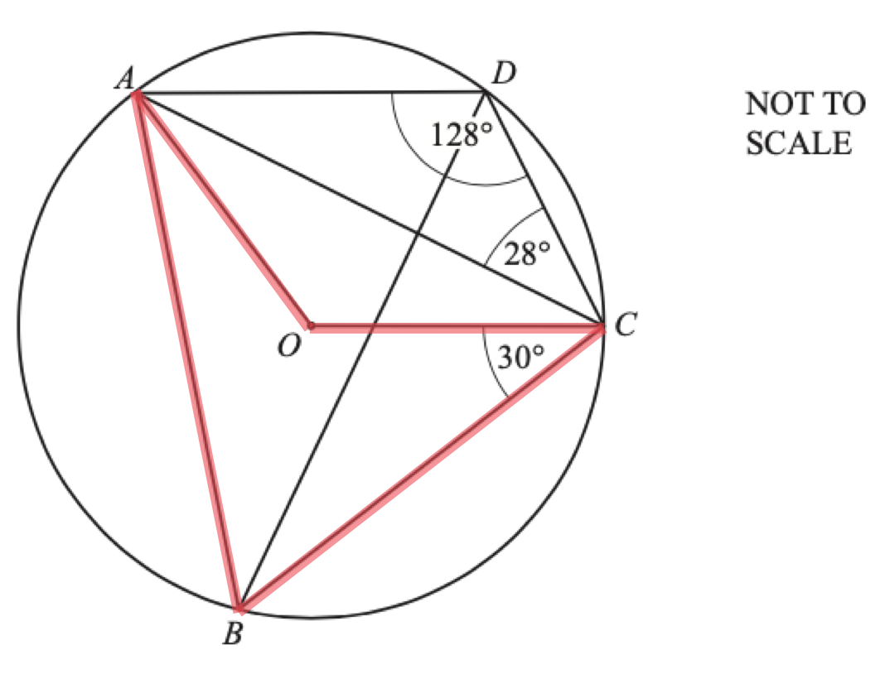

*Angle ***AOC*** is at the centre and angle ***ABC ***is at the circumference,*** ***so angle*** AOC*** is twice the size of angle*** ABC***.*

*Angle ***AOC*** =** *$2\times52$

**Angle ****AOC**** = 104****o ****[1]**

> *Method 2:*

> *Use the circle theorem: "Angle subtended by an arc at the centre is twice the angle at the circumference".*

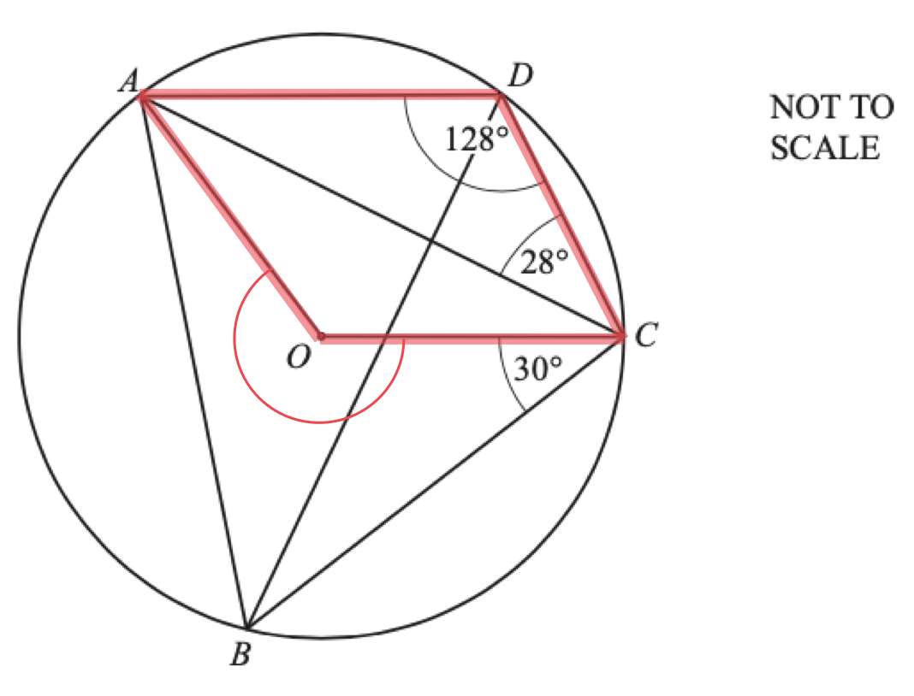

*The reflex angle ***AOC ***is at the centre and the angle*** ADC *** is at the circumference, so angle ***AOC*** is twice the size of angle ***ADC***.*

**[1]**

*Angle ***AOC*** = *$2\times128$

*Angle ***AOC*** = *$256^{\circ}$

**[1]**

> *Work out the obtuse angle **AOC** by subtracting the reflex angle **AOC** from 360**o**.*

*Angles around a point add up to 360**o**.*

*Obtuse angle ***AOC = **$360-256$

**Angle ****AOC**** = 104****o ****[1]**
> *i) Angles in a triangle add up to 180**o**.*

> *Work out the size of angle **CAD**.*

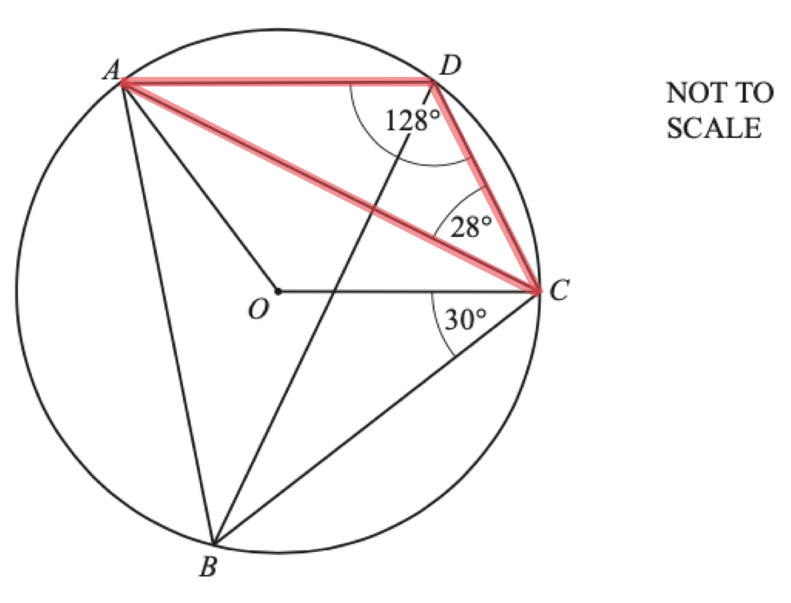

*Angle ***CAD*** *`table row blank equals cell 180 minus open parentheses 128 plus 28 close parentheses end cell end table``table row blank equals 24 end table`

**[1]**

> *Triangle **AOC** is an isosceles triangle as **OA** and **OC** are both radii, angle **OAC** = angle **OCA**.*

> *Work out the size of angle **OAC** by subtracting angle **AOC** from 180 and dividing it by 2.*

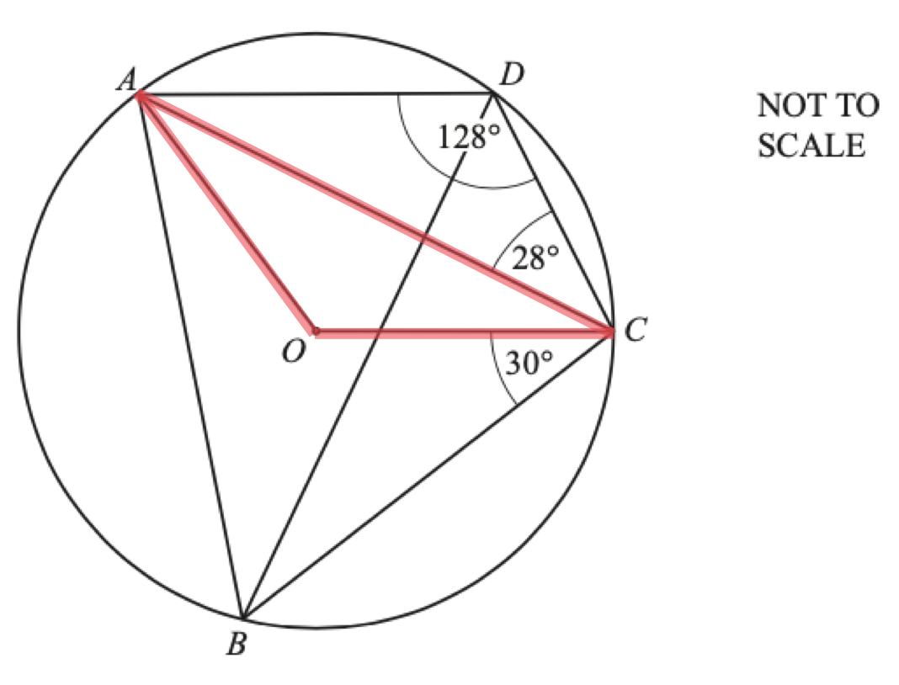

*Angle ***OAC **$=\frac{180-104}{2}=38$

> *Use the circle theorem: "Opposite sides in a cyclic quadrilateral add up to 180**o**".*

$\mathrm{Angle}BAD+\mathrm{Angle}BCD=180$

`open parentheses Angle space B A O plus 38 plus 24 close parentheses plus open parentheses 28 plus 38 plus 30 close parentheses equals 180`

> *Simplify.*

$\mathrm{Angle}BAO+158=180$

> *Subtract 158 from both sides.*

**Angle ****BAO**** = 22****o**** [1]**

> *ii) Use the circle theorem: "Angles at the circumference subtended by the same arc are equal".*

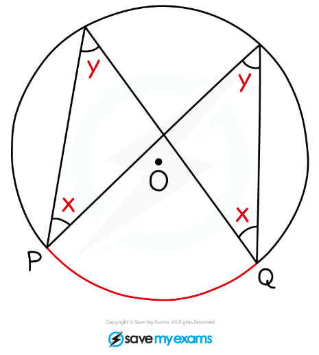

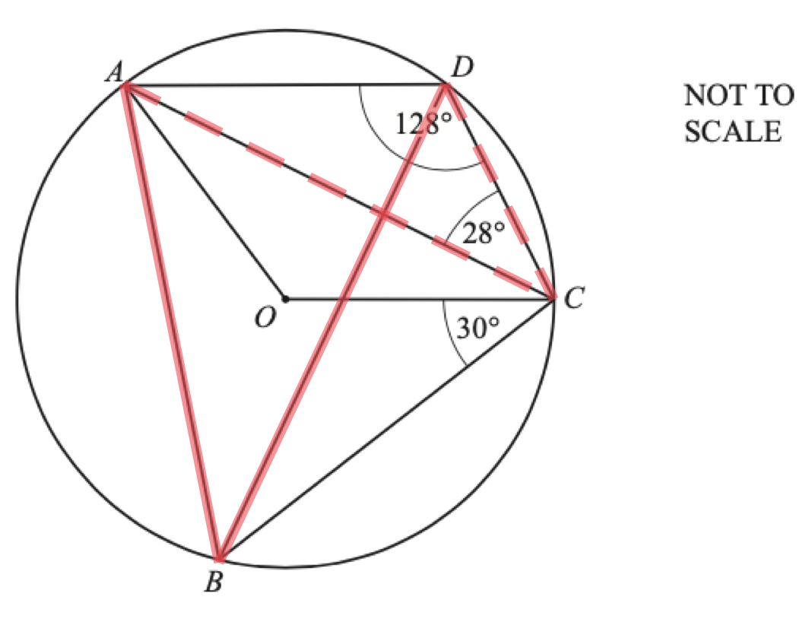

*Angle ***ABC*** = Angle ***ACD**

**Angle ****ABD ****= 28****o**** ****[1]**

### Q10
> *The area of a circle is π**r**2**, so the radius of the circle is needed.*

> *AC **is a diameter** **of the circle and so triangle** ACD **is a triangle formed by a semicircle with all three vertices at the circumference. The circle theorem 'the angle in a semicircle is always a right angle' states that the angle **ADC **must be a right angle.*

*Angle ***ADC  ***= 90°*

** ****[1]**

> *ABD **and **ACD **are both angles subtended from the same arc, so by the circle theorem 'the angles in the same segment are equal',*

*Angle ***ACD  ***= angle ***ABD ***= 21°.*

** ****[1]**

> *ACD ** is a right-angled triangle so right-angled trigonometry (SOHCAHTOA) can be used to find the diameter of the circle, **AC**.*
*AC **is the hypotenuse, the angle and the side adjacent to it are known, so use the cos ratio.  *

$\mathrm{cos}θ=\frac{\mathrm{Adj}}{\mathrm{Hyp}}\,\mathrm{cos}21^{\circ}=\frac{12}{AC}$

**[1]**

> *Solve by multiplying both sides by **AC **and dividing both sides by 12.   *

`table row cell A C space cos space 21 degree space end cell equals cell space 12 end cell row cell A C space space end cell equals cell fraction numerator 12 over denominator cos space 21 degree end fraction end cell row blank equals cell space 12.85373... end cell end table`

*   ***[1]**

> *The radius is half the diameter.*

`table attributes columnalign right center left columnspacing 0px end attributes row cell r space end cell equals cell space fraction numerator 12.85373... over denominator 2 end fraction space equals space 6.42686... end cell end table`

> *Substitute into the formula for the area of a circle.*

`table row cell straight pi open parentheses space 6.42686... close parentheses squared space end cell equals cell space 129.7624.... end cell end table`

* ***Area = 130 cm****2**** (3 s.f.) ****[1]**
**If not rounded to 3 s.f., answers in the range 129.6 to 129.8 accepted.*** *

### Q11
> *Find Angle **BDE**.*

*Angle ***BAD*** = Angle ***BDE*** = *$y^{\circ}$*   (Alternate segment theorem)*

**[1]**

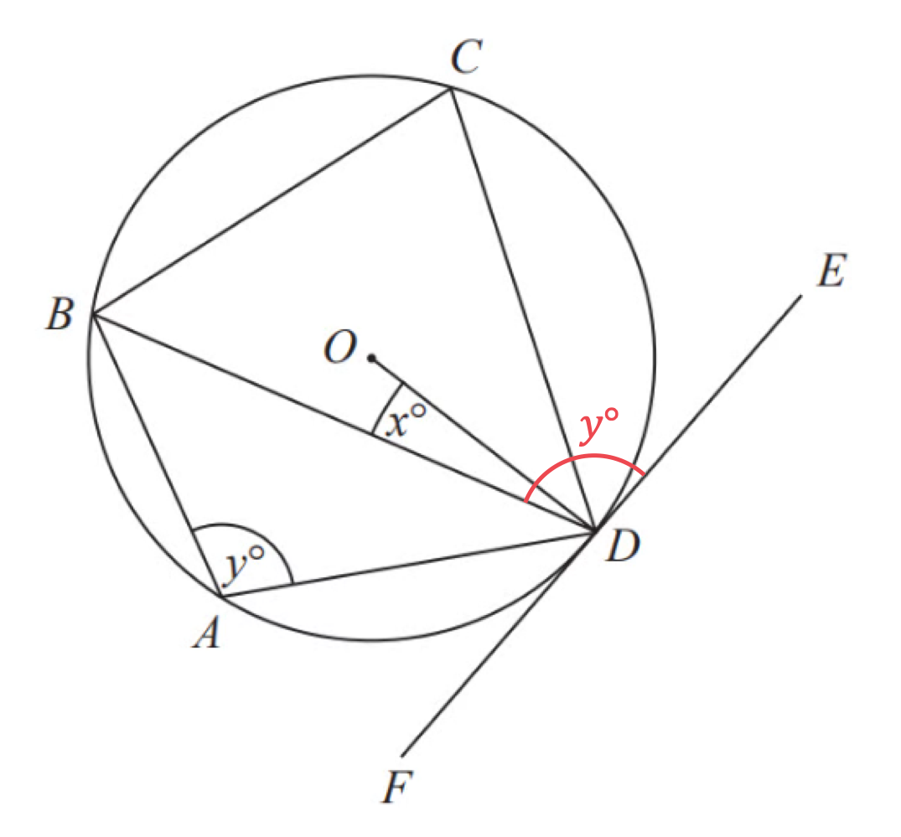

> *Find angle **ODE**.*

*Angle ***ODE*** = 90**o**   (Angle between a tangent and a radius = 90**o**)*

> *Write down an expression for angle **ODE** in terms of angles **BDE** and **BDO**.*

*Angle ***BDE*** - Angle ***BDO*** = Angle ***ODE**

$y-x=90$

**Correct circles theorems stated for the working**** shown**** [1] ****Completely correct method leading to given answer**** [1]**
**Final answer:** **Dylan is incorrect because **$x$** must be less than 90****o**** as it is part of an angle between a tangent and a radius**

**or**

**Final answer:** **Dylan is incorrect because **$y$** must be less than 180****o**** as it is an angle within a triangle**

**One correct answer and explanation given**** [1]**

### Q12
i) *By the circle theorem, the angle at the centre of a circle is twice the angle at the circumference, angle **COD = **2 × angle **CAD.*

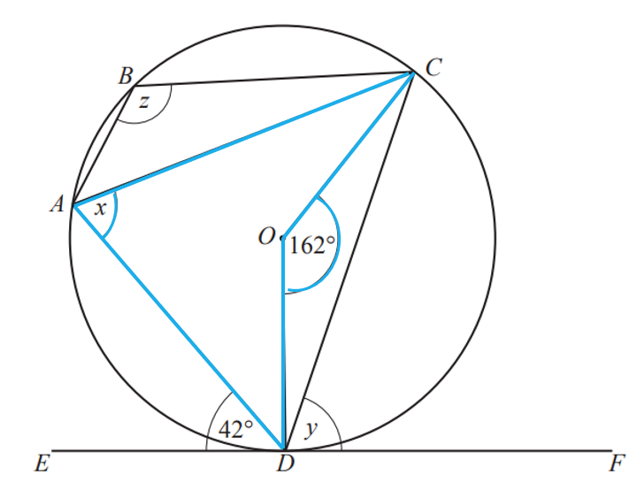

`table row cell 2 C A D space end cell equals cell space C O D end cell row cell 2 x space end cell equals cell space 162 end cell row cell x space end cell equals cell space 162 over 2 end cell end table`

$x=81^{\circ}$ **[1] **
**The angle at the centre is twice the angle at the circumference**** [1]**

ii) *The alternate segment theorem states that an angle inside a triangle with all three vertices on the circumference of a circle is equal to the angle between the opposite side and a tangent.*

> *The angle **y**° is between a tangent and the side of a triangle. So it is equal to the angle in the triangle that is opposite that side.*

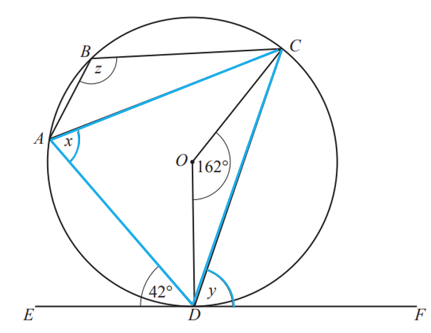

`table row cell y space end cell equals cell space x end cell row space equals cell space 81 degree end cell end table`

$y=81^{\circ}$ **[1] **
**The alternate segment theorem**** [1]**

iii) *ABCD **is a cyclic quadrilateral as it has all four vertices on the circumference.*

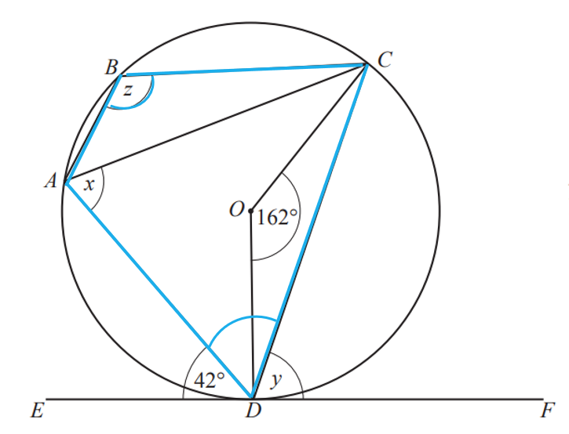

> *Find angle **ADC. **Angles on a straight line add up to 180°**.*

*Angle ***ADC ***+ 42 + *$y$* = 180*

*Angle ***ADC *** = 180 - 42 - 81  = 57°*

**[1]**

> *Opposite angles in a cyclic quadrilateral add up to 180°**.*

`table row cell z space plus space 57 space end cell equals cell space 180 end cell row cell z space end cell equals cell space 180 space minus space 57 end cell end table`

$z=123^{\circ}$ **[1] **
**Angles on a straight line and opposite angles in a cyclic quadrilateral add up to 180° **** ****[1]**

### Q13
> *Similar triangles have three equal angles. *
*Use circle theorems to identify any corresponding angles that are equal between triangles **ADX**  and **BCX**.*

> *The same segment circle theorem states that angles at the circumference subtended by the same arc are equal.*

> *Vertically opposite angles at a point are equal.*

> *The statement that if three corresponding angles between two triangles are equal then the two triangles are similar must be made.*

**Angle ****ADX****  = angle ****BCX****  as they are subtended from the same arc. **
**Angle ****DAX****  = angle ****CBX****  as they are subtended from the same arc****. **
**Angle ****AXD****  = angle ****BXC****  as they are vertically opposite angles. **** A****t least two of the three statements given, with reasons ****[2]**
** All three angles are the same so the triangles are similar. **** ****Explanation of similar triangles**** ****[1]**

### Q14
> *The angles **FJH** and **JFE** are alternate angles, therefore they are equal.*

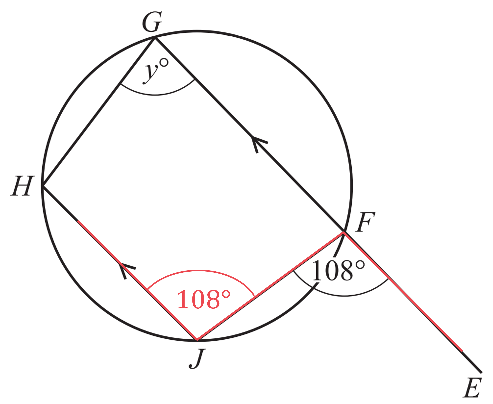

**[1]**

> *FGHJ** is a cyclic quadrilateral (all the corners lie on the circle). The circle theorem states that opposite angles in a cyclic quadrilateral add up to 180°. Angles **FJH** and **FGH** are opposite so add up to 180°.*

`table row cell y plus 108 end cell equals 180 row y equals cell 180 minus 108 end cell end table`

$y=72$ **[1]**

### Q15
> *Note that the below diagram has extra points *$Q,U,W$* labelled*

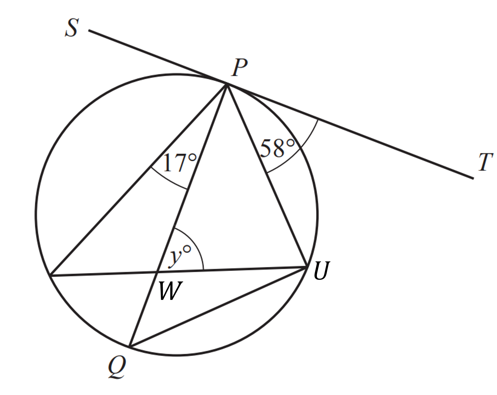

*As *$SPT$* is a tangent to the circle at *$P$*, and *$QP$* is the diameter, angle *$QPT$* is a right angle* 
*This means that angle *$QPU$* must be*

*90 - 58 = 32°*

> *As *$QP$* is the diameter, the angle *$PUQ$* is a right angle*

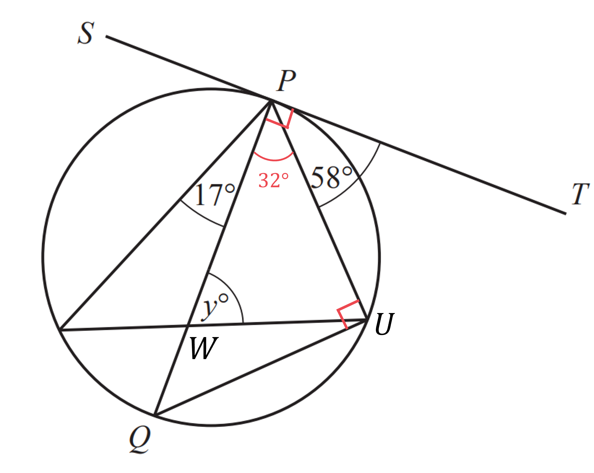

**[2]**

> *Using the circle theorem "Angles at the circumference subtended by the same arc are equal"*

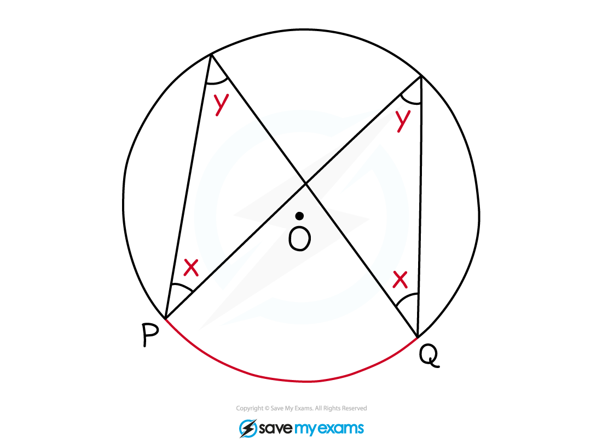

> *Angle *$QUW$* must be the same as the angle marked 17° at *$P$

> *This also means that angle *$PUW$* can be found, as *$QUW+PUW=90^{\circ}$

*90 - 17 = 73°*

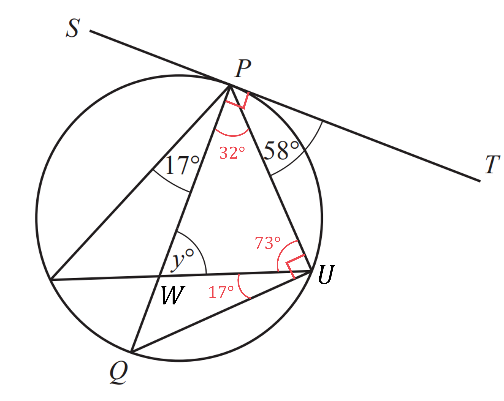

**[2]**

> *Lastly, by using the fact that the internal angles in a triangle sum to 180°, and considering the triangle *$PUW$*, we can find *$y$

$y=180-73-32=75^{\circ}$

$y=75^{\circ}$ **[1]** 
**Note that there are many ways to solve this question, using different applications of circle theorems and angle facts **
**Below is a diagram containing all the correct angles that you may have found instead**

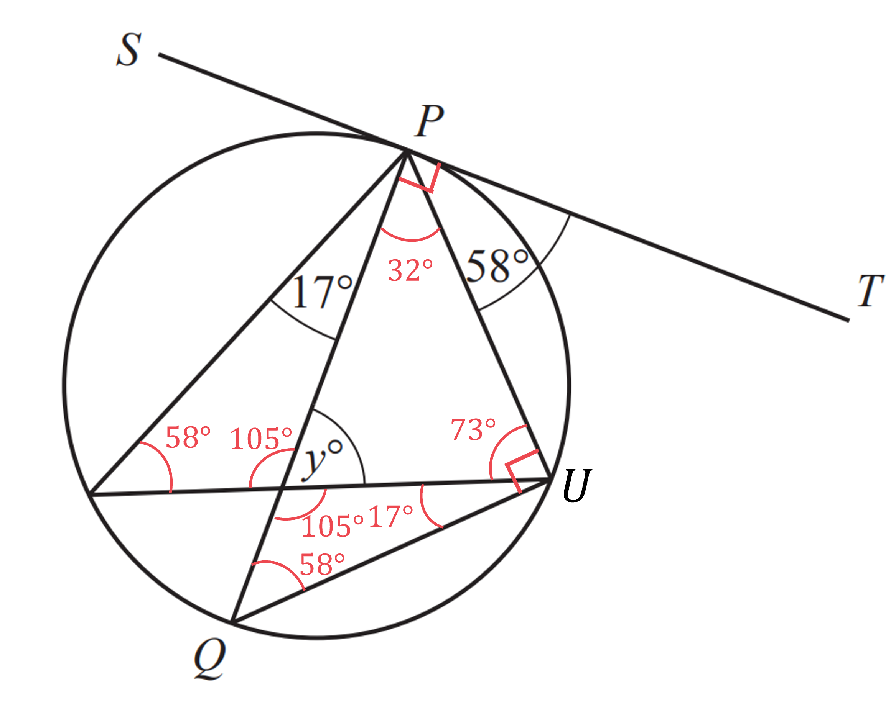

### Q16
> *The circle theorem states that if the corners of a triangle lie on the circle and one of its sides is the diameter then the triangle is right-angled.*

*Angle ***KLM ***= 90°*

**[1]**

> *Interior angles in a triangle add up to 180°.*

*Angle ***MKL*** + Angle ***KML ***+ 90° = 180°*

*Angle ***MKL*** + Angle ***KML ***= 90°*

> *Triangle **KLM **is isosceles so the other two angles (**MKL **and **KML**) are equal. Therefore they are each half of 90°.*

*Angle ***MKL ***= Angle ***KML ***= 90° ÷ 2 = 45°*

> *The circle theorem states that the angle between a radius (or diameter) and a tangent is 90°.  Therefore angle MKS is 90° which means angles MKL and LKS add up to 90°.*

`table row cell 45 plus z end cell equals 90 row z equals cell 90 minus 45 end cell end table`

$z=45$ **[1]**

### Q17
> *Use the circle theorem: "A radius and a tangent are perpendicular".*

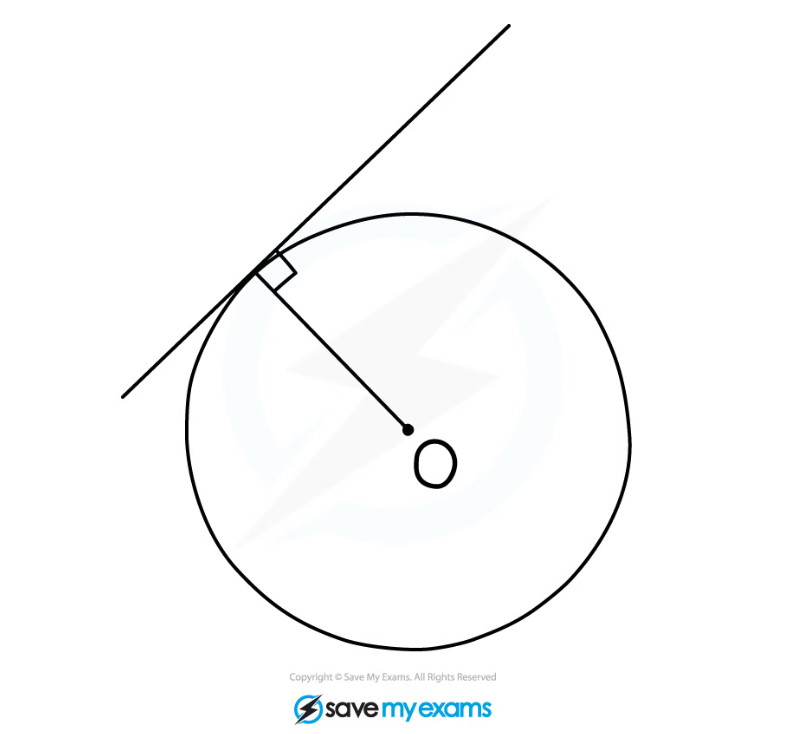

> *Angle **PAO** is a right angle.*

$60+u=90$

$u=30^{\circ}$ **[1]**

> *Use the circle theorem: "The angle at the circumference in a semicircle is a right angle".*

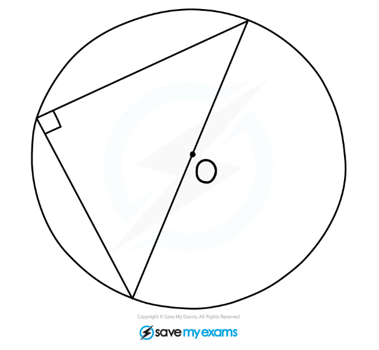

*Angle **ADC** is a right angle.* 
*Angles in a triangle add up to 180**o**.*

*Subtract angle *$u$* and 90**o** from 180**o** to find angle *$v$*.*

$180-30-90=v$

$v=60^{\circ}$ **[1]**

> *Use the circle theorem: "Alternate angle theorem".*

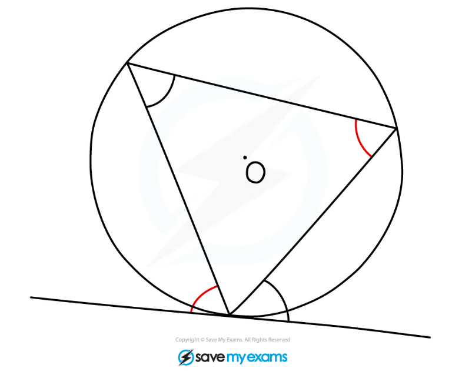

> *The angle **PAD** is equal to the angle in the alternate segment, angle **DBA.*

$w=60^{\circ}$** ****[1]**

*Lengths **OA** =**OD** as they are both radii.* 
*So, triangle **ADO** is an isosceles triangle.* 
*This means that angle **DAO** = angle **ADO = *$u$*. *
*Angles in a triangle add up to 180**o**.*

> *Find angle *$x$* by subtracting two lots of *$u$* from 180**o**.*

$180-2\times30=x$

$x=120^{\circ}$** [1]**

> *Angles in a triangle add up to 180**o**.*

> *Add up all of the known angles inside triangle **ADB**, (remember that angle **ADO** is also *$u$*), and subtract from 180**o** to find angle *$y$*.*

$180-(2\times30+20+60)=y$

**[1]**

$y=40^{\circ}$ **[1]**

### Q18
> *Angle *$CBD$* = Angle *$CAD$* because they are angles in the same segment/ angles subtended by the same arc*

*Angle *$CBD=58^{\circ}$

**[1]**

> *Angle *$DCB$* is the angle in a semicircle/ angle at the centre (180°) is twice the angle at the circumference therefore*

*Angle *$DCB=90^{\circ}$

**[1]**

> *And angles in a triangle sum to 180° so*

*Angle** *`C D B equals open parentheses 180 minus 90 minus 58 close parentheses degree`

**Angle **$CDB=32^{\circ}$** [1]**
