# Exam Questions — Circle Theorems
**Geometry** · Cambridge (CIE) IGCSE maths (0580 & 0980)
> Source: [https://www.savemyexams.com/igcse/maths/cie/25/extended/topic-questions/](https://www.savemyexams.com/igcse/maths/cie/25/extended/topic-questions/) · 18 questions across 1 sets

## Calculator Questions (18 questions)

### Q1 — hard — 2 marks

**Q1** [2 marks]

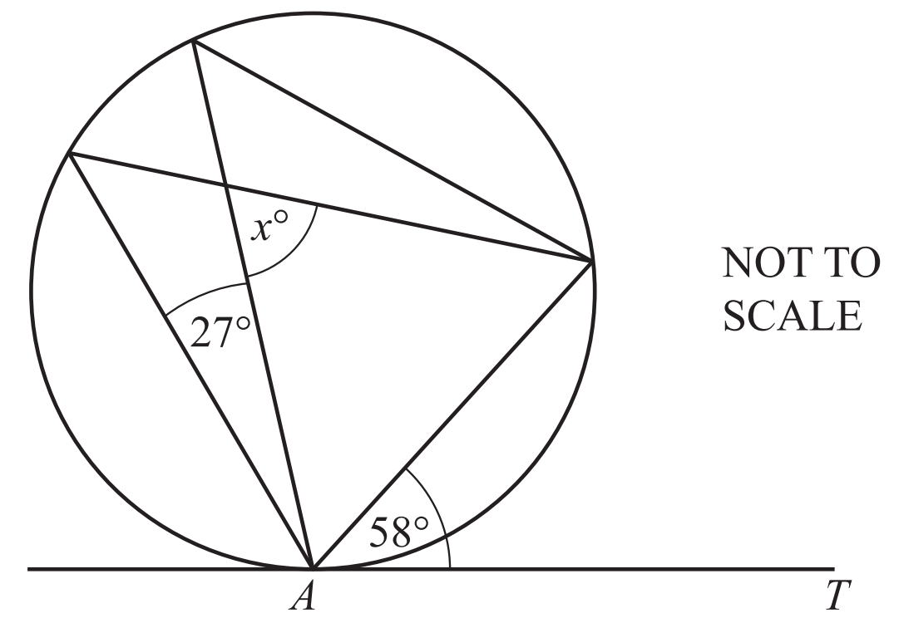

*AT* is a tangent to the circle at *A*.

Find the value of $x$.

$x=$................................................

*Source: 2020 May/June 0580/43 Q8B*

### Q2 — very_hard — 4 marks

**Q2** [4 marks]

*A*, *B* and *C* lie on the circle, centre *O*. 
Angle *AOC =* $(3x+22)^{\circ}$ and angle *ABC* = $5x^{\circ}$.

Find the value of $x$.

$x$ = ...................................................

*Source: 2019	Oct/Nov 0580/41 Q1E*

### Q3 — medium — 5 marks

**Q3** [1 mark]

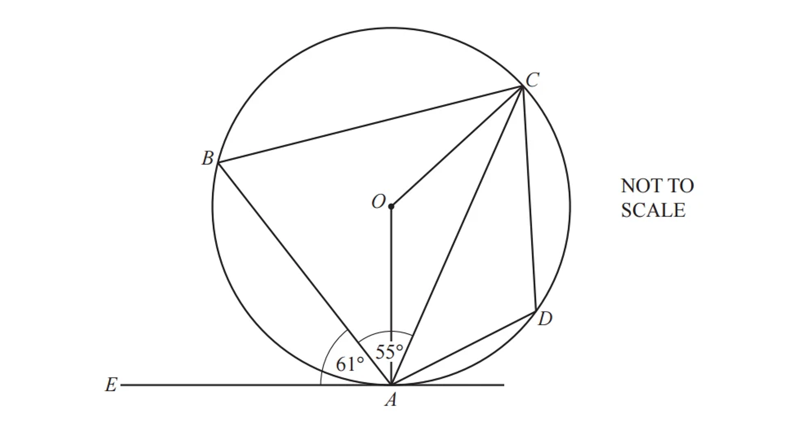

In the diagram, *A*, *B*, *C* and *D* lie on the circle, centre *O*. 
*EA* is a tangent to the circle at *A*. 
Angle *EAB* = 61° and angle* BAC* = 55°.

Find angle *BAO*.

Angle *BAO* = ................................................

*Source: 2018	Oct/Nov 0580/42 Q7A*

**Q3** [2 marks]

**Extract:**

In the diagram, A, B, C and D lie on the circle, centre O. 
EA is a tangent to the circle at A. 
Angle EAB = 61° and angle BAC = 55°.

Find angle *AOC*.

Angle *AOC* = ................................................

*Source: 2018	Oct/Nov 0580/42 Q7B*

**Q3** [1 mark]

**Extract:**

In the diagram, A, B, C and D lie on the circle, centre O. 
EA is a tangent to the circle at A. 
Angle EAB = 61° and angle BAC = 55°.

Find angle *ABC*.

Angle *ABC* = ................................................

*Source: 2018	Oct/Nov 0580/42 Q7C*

**Q3** [1 mark]

**Extract:**

In the diagram, A, B, C and D lie on the circle, centre O. 
EA is a tangent to the circle at A. 
Angle EAB = 61° and angle BAC = 55°.

Find angle *CDA*.

Angle *CDA* = ................................................

*Source: 2018	Oct/Nov 0580/42 Q7D*

### Q4 — medium — 8 marks

**Q4** [5 marks]

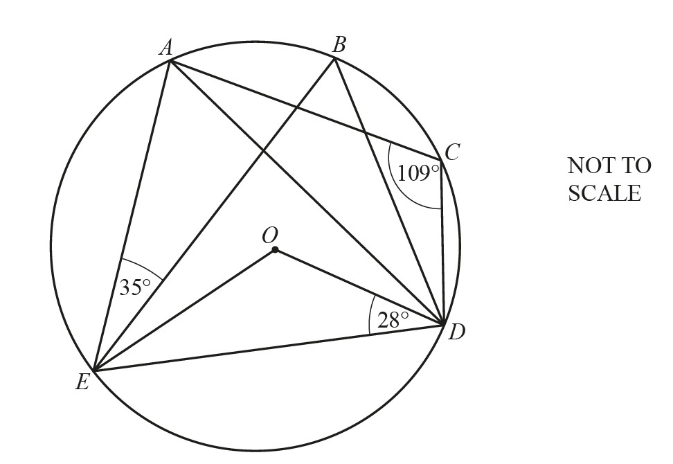

*A*, *B*, *C*, *D* and *E* lie on the circle, centre *O*. 
Angle *AEB* = 35°, angle *ODE* = 28° and angle *ACD* = 109°.

Work out the following angles, giving reasons for your answers.

i) Angle *EBD* = ............................. because .............................

[3]

ii) Angle EAD = ............................. because .............................

[2]

*Source: 2018	May/June 0580/42 Q9A*

**Q4** [3 marks]

**Extract:**

A, B, C, D and E lie on the circle, centre O. Angle AEB = 35°, angle ODE = 28° and angle ACD = 109°.

Work out angle *BEO*.

Angle *BEO* = ................................................

*Source: 2018	May/June 0580/42 Q9A*

### Q5 — hard — 5 marks

**Q5** [5 marks]

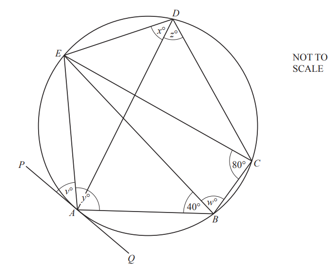

The points *A*, *B*, *C*, *D* and *E* lie on the circle. 
*PAQ* is a tangent to the circle at *A *and *EC* = *EB*. 
Angle *ECB* = 80° and angle *ABE* = 40°.

Find the values of $v,w,x,y$ and $z$.

$v=$ ...................  $w=$...................  $x=$...................  $y=$...................  $z=$ ..................

*Source: 2020 Oct/Nov 0580/42 Q8A*

### Q6 — very_hard — 5 marks

**Q6** [5 marks]

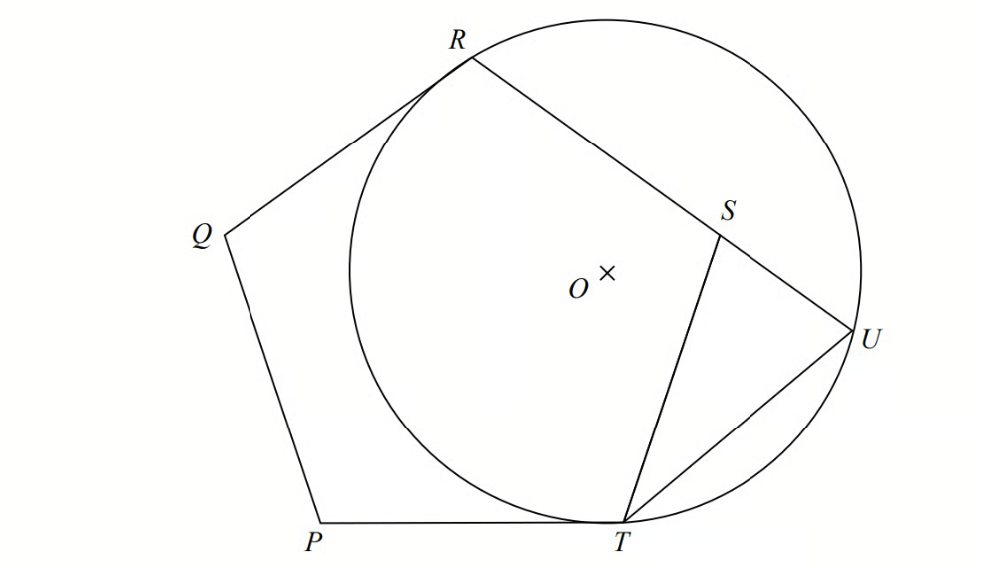

$PQRST$ is a regular pentagon.
$R,U$ and $T$ are points on a circle, centre $O$.
$QR$ and $PT$ are tangents to the circle.
$RSU$ is a straight line.

Prove that $ST=UT$.

*Source: 2015 Spec2 1MA1/2H Q20*

### Q7 — hard — 6 marks

**Q7** [6 marks]

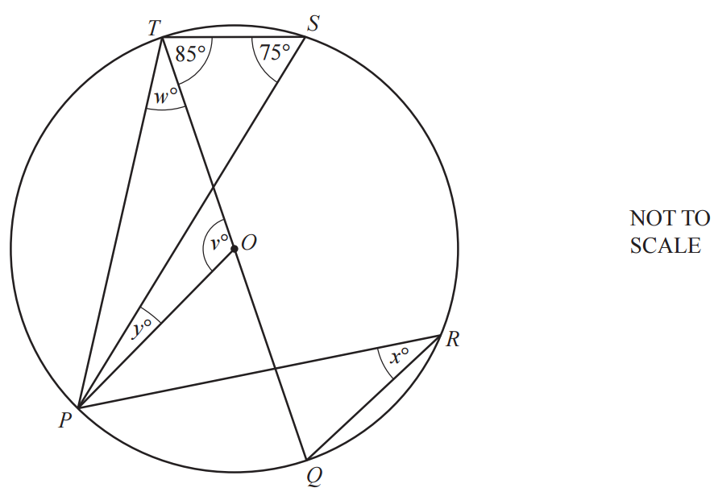

*P*, *Q*, *R*, *S* and *T* lie on the circle, centre *O*.
Angle *PST* = 75° and angle *QTS* = 85°.

Find the values of $v$, $w$, $x$ and $y$.

$v$ = .................................................    
  $w$ = .................................................    
 $x$ = .................................................     
 $y$ = .................................................

*Source: 2018	Oct/Nov 0580/43 Q8B*

### Q8 — medium — 2 marks

**Q8** [2 marks]

*P*, *Q* and *R* are points on the circumference of the circle, centre *O*. 
*PO* is parallel to *QR* and angle *POQ *= 48°.

Find angle *OPR*.

Angle *OPR* = ..............................................

*Source: 2018	May/June 0580/41 Q8C*

### Q9 — hard — 6 marks

**Q9** [3 marks]

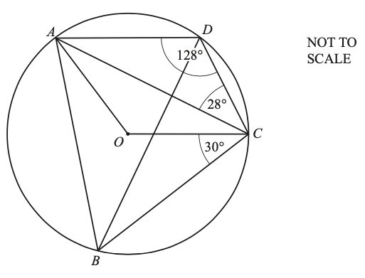

In the diagram, *A*, *B*, *C* and *D* lie on the circle, centre *O*.
Angle *ADC* = 128°, angle *ACD* = 28° and angle *BCO* = 30°.

Show that obtuse angle *AOC* = 104°.

Give a reason for each step of your working.

*Source: 2019	Oct/Nov 0580/43 Q6A*

**Q9** [3 marks]

**Extract:**

In the diagram, A, B, C and D lie on the circle, centre O.

Angle ADC = 128°, angle ACD = 28° and angle BCO = 30°.

i) Find angle *BAO*.

Angle *BAO* = ................................................... [2]

ii) Find angle *ABD*.

Angle *ABD* = ................................................... [1]

*Source: 2019	Oct/Nov 0580/43 Q6A*

### Q10 — very_hard — 5 marks

**Q10** [5 marks]

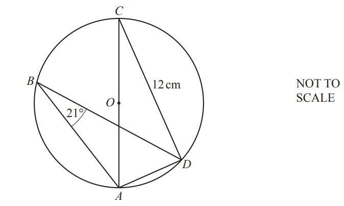

*A*, *B*, *C* and *D* are points on the circle, centre *O*. 
Angle *ABD* = 21° and *CD* = 12 cm.

Calculate the area of the circle.

.......................................... cm2

*Source: 2020 Oct/Nov 0580/41 Q4C*

### Q11 — very_hard — 4 marks

**Q11** [3 marks]

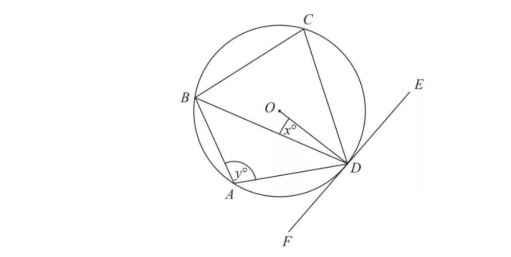

$A,B,C$ and $D$ are points on the circumference of a circle, centre $O$.
$FDE$ is a tangent to the circle.

Show that $y-x=90$ 
You must give a reason for each stage of your working.

*Source: June 2018 1MA1/2H Q13A*

**Q11** [1 mark]

**Extract:**

Show that y - x = 90

Dylan was asked to give some possible values for $x$ and $y$.

He said, "$y$ could be 200 and $x$ could be 110, because 200 − 110 = 90"

Is Dylan correct? 
You must give a reason for your answer.

*Source: June 2018 1MA1/2H Q13B*

### Q12 — hard — 7 marks

**Q12** [7 marks]

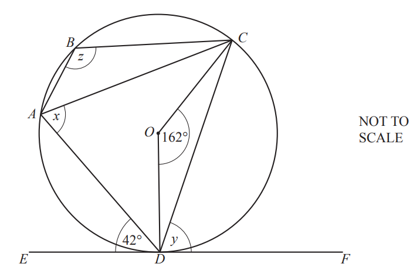

*A*, *B*, *C *and *D* are points on the circle, centre *O*. 
*EF *is a tangent to the circle at *D*. 
Angle *ADE *= 42° and angle* COD* = 162°.

Find the following angles, giving reasons for each of your answers.

i) Angle $x$

$x=$ ............................ because ............................ [2]

ii) Angle $y$

$y=$ ............................ because ........................... [2]

iii) Angle $z$

$z=$ ............................ because ........................... [3]

*Source: 2020 Oct/Nov 0580/43 Q5A*

### Q13 — very_hard — 3 marks

**Q13** [3 marks]

The diagonals of the cyclic quadrilateral *ABCD* intersect at *X*.

Explain why triangle *ADX* is similar to triangle *BCX*. 
Give a reason for each statement you make.

*Source: 2020 Oct/Nov 0580/42 Q8C*

### Q14 — medium — 6 marks

**Q14** [6 marks]

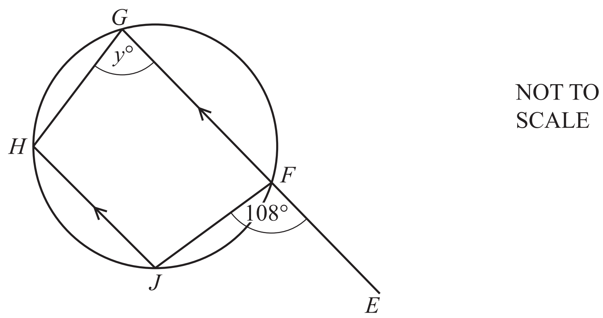

*F*, *G*, *H* and *J* are points on the circle. 
*EFG* is a straight line parallel to* JH*.

Find the value of $y$.

$y=$................................................

*Source: 2020 May/June 0580/43 Q8B*

### Q15 — hard — 5 marks

**Q15** [5 marks]

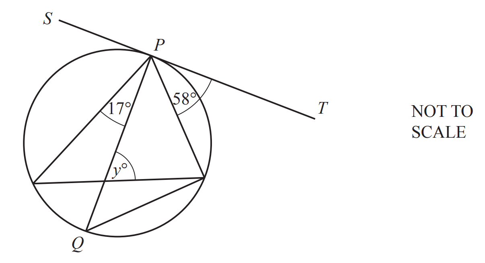

The diagram shows a circle with diameter $PQ$. 
$SPT$ is a tangent to the circle at $P$.

Find the value of $y$.

$y$ = ..............................................

*Source: 2019	May/June 0580/42 Q2B*

### Q16 — medium — 2 marks

**Q16** [2 marks]

*K*, *L* and *M* are points on the circle. 
*KS* is a tangent to the circle at *K*. 
*KM* is a diameter and triangle *KLM* is isosceles.

Find the value of $z$.

$z=$...............................................

*Source: 2020 May/June 0580/43 Q8B*

### Q17 — hard — 6 marks

**Q17** [6 marks]

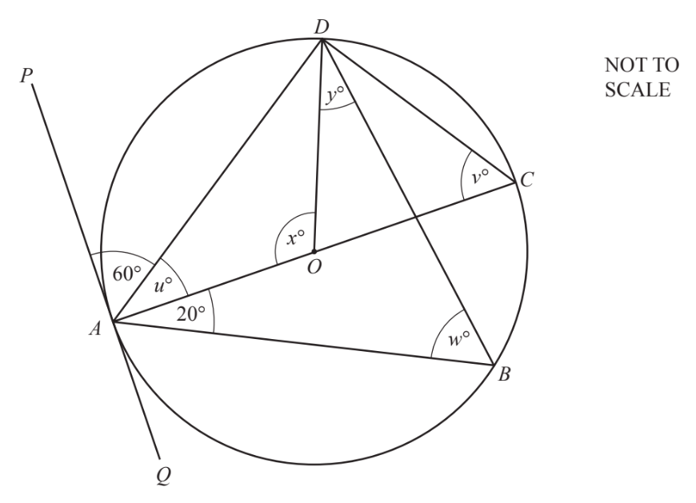

*A*, *B*, *C* and *D* lie on the circle, centre *O*, with diameter *AC*. 
*PQ* is a tangent to the circle at *A*.
 Angle *PAD* = 60° and angle *BAC* = 20°.

Find the values of $u$, $v$, $w$, $x$ and $y$.

$u$ = ..................... , $v$ = ....................., $w$ = ..................... ,    $x$ = ..................... , $y$ = .....................

*Source: 2019	Oct/Nov 0580/41 Q1D*

### Q18 — medium — 3 marks

**Q18** [3 marks]

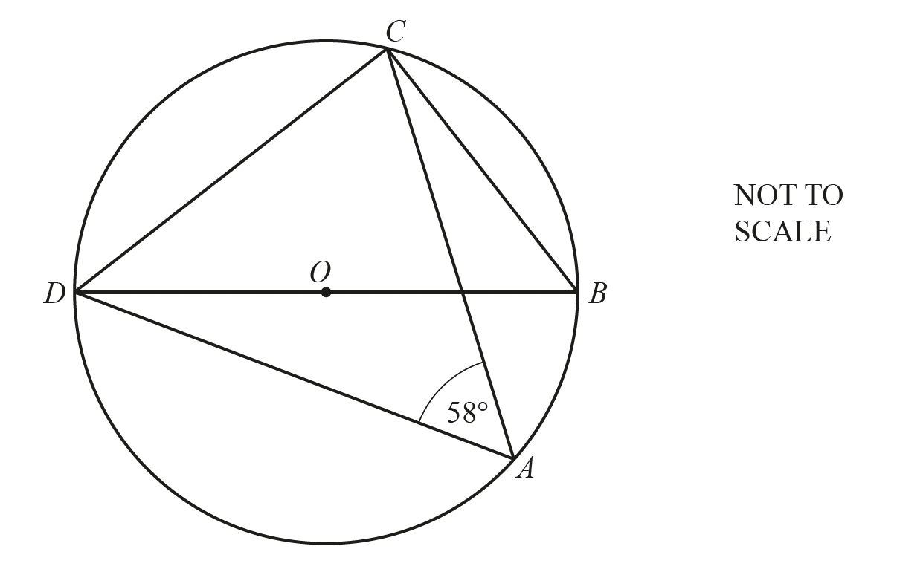

*A*, *B*, *C* and *D* are points on the circumference of the circle, centre *O*. *DOB* is a straight line and angle *DAC* = 58°.

Find angle *CDB*.

Angle *CDB* = ...............................................

*Source: 2018	May/June 0580/41 Q8B*

