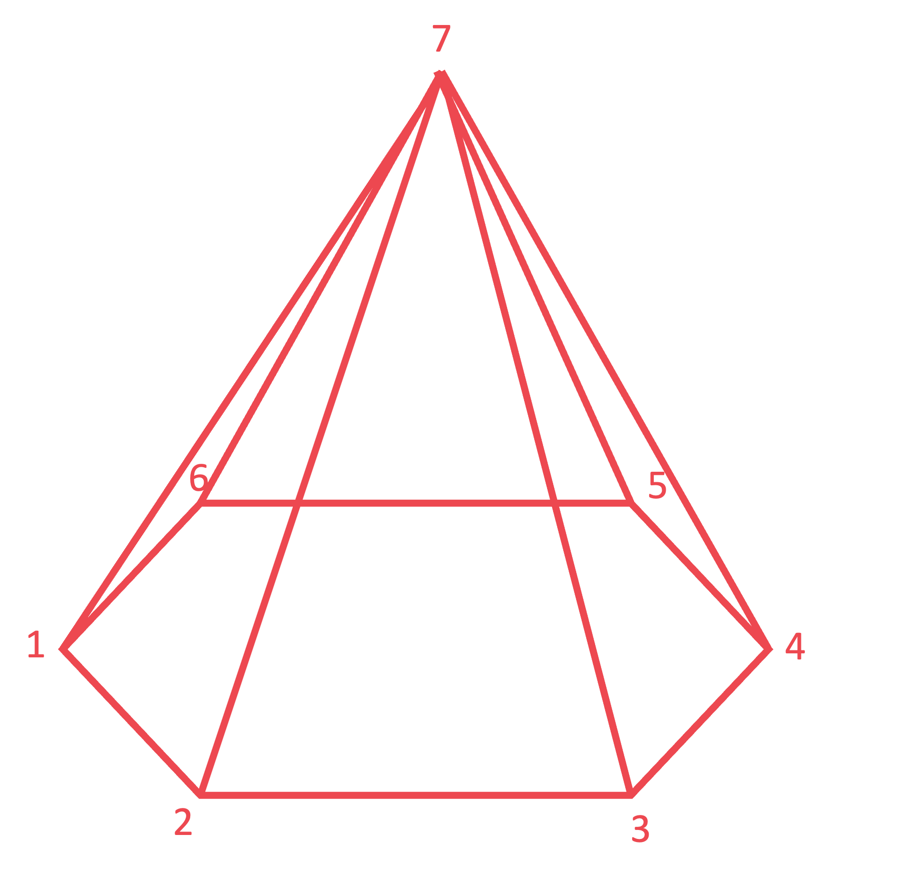

# Mark Schemes — Geometry Toolkit
**Geometry** · Cambridge (CIE) IGCSE maths (0580 & 0980)

## Calculator Questions (9 questions)

### Q1
> *1 kilometre = 1000 metres so multiply distances in km by 1000 to convert to m*

*90 km = (90 × 1000) m = 90,000 m*

> *1 minute = 60 minutes = 60 lots of 60 seconds. *

*1 h = (1 × 60 × 60) s = 3600 s*

> *90 km in one hour is equivalent to 90,000 metres in 3600 seconds*

*speed = *$\frac{90,000m}{3600s}$

> *Dividing 90,000 by 3600 gives the final answer*

**[1]**

**25 m/s  ****[1]**

### Q2
i) *Change 20 minutes into seconds (by multiplying by 60)* * *

*20 *$\times$*60 = 1200* * *

> *75 000 litres of water flows out every 1 second*

*Find the amount of water flowing out over 1200 seconds (by multiplying 75 000 by 1200)* * *

*75 000 *$\times$*1200 = 90 000 000 litres* * *

> *Write 90 000 000 litres in millions*

**90 million litres** **[1]**

ii) *The volume of water that leaves the lake, **V,** formed a prism of height **h** m and cross-sectional area **A **m**2* * *

*V** = 90 000 000 litres from part (a)(i)* 
*Change **V** into m**3** (by dividing by 1000)* * *

**V*** = 90 000 m**3**  *

*A** = 55 hectares*
 *Change **A** into m**2** (by multiplying by 10**4** = 10 000)* * *

**A*** = 55 *$\times$*10 000 = 550 000 m**2* * *

*The volume of a prism is** V** = **A** *$\times$* **h *
*Make **h** the subject of the formula (by dividing both sides by **A**)* * *

$\frac{V}{A}=h$* * * *

*Substitute **V** = 90 000 and **A** = 550 000 into the formula* * *

$h=\frac{90000}{550000}=0.1636...$* metres*

*the figures 164 or 1636 seen*** [1]** 
*0.164 or 0.1636...*** ****[1]**

> *Give **h** in cm (by multiplying by 100)*

**16.4 cm** **[1] **

### Q3
> *"The quadrilateral is a rectangle". This is only true if the interior angles are right-angles. We don't know if they are or not, so this **may be true**.*

> *"The quadrilateral is a parallelogram". This is **true** not matter what the interior angles are, as opposite sides are equal.*

> *"The quadrilateral is a rhombus". This can only be true if the sides are all the same length. We know that two sides are twice the length of the other two, so it is **not true**.*

> *"The quadrilateral is a kite". This can only be true if the equal length sides are adjacent to each other. But here the equal length sides are opposite each other. So this statement is **not true**.*

|   | **True** | **May be true** | **Not true** |
|---|---|---|---|
| The quadrilateral is a rectangle |   | **Final answer:** **✓** |   |
| The quadrilateral is a parallelogram | **Final answer:** **✓** |   |   |
| The quadrilateral is a rhombus |   |   | **Final answer:** **✓** |
| The quadrilateral is a kite |   |   | **Final answer:** **✓** |

**one or two correct*** ***[1]**
**three correct*** ***[1]** 
**all correct**** ****[1]**

### Q4

> *As triangles AFE and CEF are both equilateral (stated in the question), and they both share the side EF, this means that all the highlighted lengths must be the same length*

**AFCE is a ****rhombus** **[1]**

**A rhombus is a parallelogram with all sides the same length** 
**The mark scheme also accepts kite, parallelogram, or trapezium, as a rhombus is a special case of these shapes**

### Q5
> *i) The line A touches the circle at a single point*

**Line A is a ****tangent ****[1]**

> *ii) Shaded region B is formed by a line joining two points on the circumference, which does not pass through the centre; a chord*

**Shaded region B is a ****segment** **[1]**

### Q6
> *Vertices are the "corners". A hexagonal pyramid has 6 vertices at the base and one vertex at its tip. 6 + 1 = 7*

> *If unsure, sketch the shape:*

**The second option is correct, hexagon-based pyramid*** ***[1]**

*A hexagonal prism has two lots of six vertices, six at either end. 6 + 6 = 12*

*A pentagonal prism has two lots of five vertices, five at either end. 5 + 5 = 10*

> *A pentagon-based pyramid has 5 vertices on its base and one at its tip. 5 + 1 = 6*

### Q7
> *First find the length of the side in metres by taking the positive square root of the area.*

$\sqrt{0.25}=0.5m$

> *1 m = 100 cm. Convert the into centimetres by multiplying by 100.*

*0.5 × 100 = 50*

**50 cm** **[1]**

### Q8
*Convert each unit separately.*

> *There are 60 seconds in a minute. Multiply by 60 to find how many metres are travelled in a minute.*

`table row cell 50 space metres space per space second space end cell equals cell space 50 space cross times 60 space metres space per space minute end cell row blank equals cell 3000 space metres space per space minute end cell end table`

**[1]**

> *There are 60 minutes in an hour. Multiply by 60 to find how many metres are travelled in an hour.*

`table row cell 3000 space metres space per space minute end cell equals cell space 3000 space cross times 60 space metres space per space hour end cell row blank equals cell 180000 space metres space per space hour end cell end table`

> *There are 1000 metres in a kilometre. Divide by 1000 to find how many kilometres are travelled in an hour.*

`table row cell 18000 space metres space per space hour end cell equals cell 180000 over 1000 space kilometres space per space hour end cell end table`

**[1]**

$180\mathrm{kilometres} \mathrm{per} \mathrm{hour}$ **[1]**

### Q9
> *Count the edges. *
*There are 12 edges, which are equal in length*

> *Some multiples of 18 are divisible by 12; for example, 36, 72, 108, ... . In these cases, **x** would be a whole number. *

> *And some multiples of 18 are not divisible by 12; 18, 54, 90, ... . In these cases, **x** would not be a whole number.*

**C is correct,**** **$x$** ****might be a whole number**** ****[1]**
