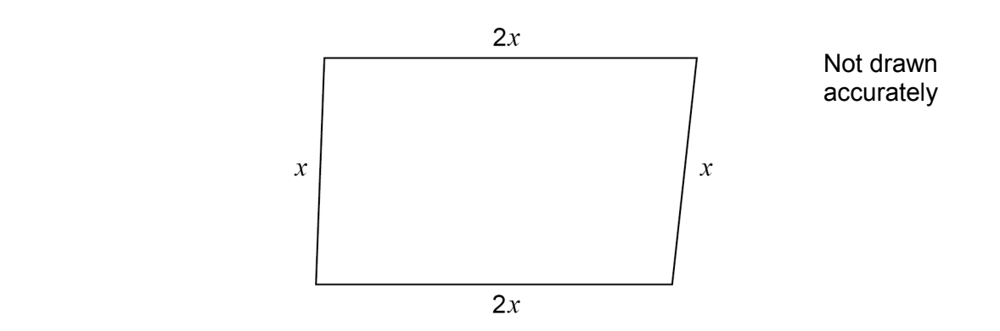

# Exam Questions — Geometry Toolkit
**Geometry** · Cambridge (CIE) IGCSE maths (0580 & 0980)
> Source: [https://www.savemyexams.com/igcse/maths/cie/25/extended/topic-questions/](https://www.savemyexams.com/igcse/maths/cie/25/extended/topic-questions/) · 9 questions across 1 sets

## Calculator Questions (9 questions)

### Q1 — medium — 2 marks

**Q1** [2 marks]

Change 90 km/h to m/s.

.......................................... m/s

*Source: 2018	May/June 0580/23 Q24A*

### Q2 — hard — 4 marks

**Q2** [4 marks]

The lake behind a dam has an area of 55 hectares.

When the gates in the dam are open, water flows out at a rate of 75 000 litres per second.

i) Show that 90 million litres of water flows out in 20 minutes.

[1]

ii) Beneath the surface, the lake has vertical sides.

Calculate the drop in the water level of the lake when the gates are open for 20 minutes. 
Give your answer in centimetres.

[1 hectare = 104 m2, 1000 litres = 1 m3]

.......................................... cm [3]

*Source: 2018	Oct/Nov 0580/42 Q10A*

### Q3 — medium — 3 marks

**Q3** [3 marks]

Here is a **sketch **of a quadrilateral.

All lengths are in centimetres.

Tick **one **box for each statement.

|   | **True** | **May be true** | **Not true** |
|---|---|---|---|
| The quadrilateral is a rectangle |   |   |   |
| The quadrilateral is a parallelogram |   |   |   |
| The quadrilateral is a rhombus |   |   |   |
| The quadrilateral is a kite |   |   |   |

*Source: Nov 2019 8300/1H Q15*

### Q4 — easy — 1 marks

**Q4** [1 mark]

The diagram shows a kite, ABCD.

AFE and CEF are equilateral triangles.

Write down a mathematical name for quadrilateral AFCE.

*Source: Nov 2019 J560/05 Q8A*

### Q5 — easy — 2 marks

**Q5** [2 marks]

The diagram shows a circle, centre O.

Write down the mathematical name of

i) line **A**,

[1]

ii) shaded region **B**.

[1]

*Source: Nov 2017 J560/05 Q1A AND B*

### Q6 — easy — 1 marks

**Q6** [1 mark]

Circle the solid that has 7 vertices.

| hexagonal prism | hexagon-based pyramid | pentagonal prism | pentagon-based pyramid |
|---|---|---|---|

*Source: Nov 2021 8300/1H Q3*

### Q7 — hard — 1 marks

**Q7** [1 mark]

A square has an area of 0.25 square metres.

What is the length, in **centimetres**, of one side of the square?

*Source: Nov 2021 8300/2H Q20*

### Q8 — medium — 3 marks

**Q8** [3 marks]

Change a speed of 50 metres per second to a speed in kilometres per hour.

.......................... kilometres per hour

*Source: Jan 2020 4MA1/2H Q10*

### Q9 — hard — 1 marks

**Q9** [1 mark]

Here is a cube with edge length $x$cm

One diagonal is shown.

The total length, in centimetres, of the edges of the cube is a multiple of 18

Which statement is correct?

*Source: Nov 2021 8300/2H Q16B*

