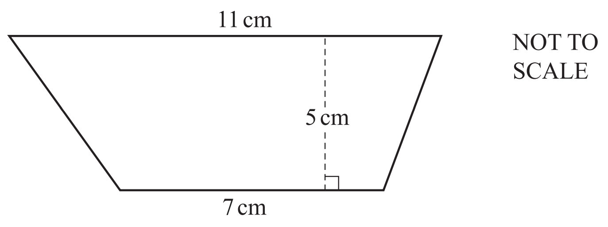
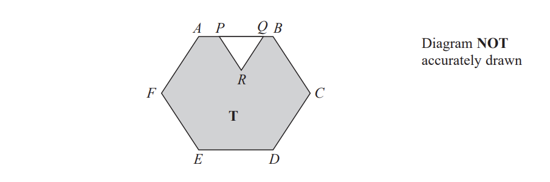
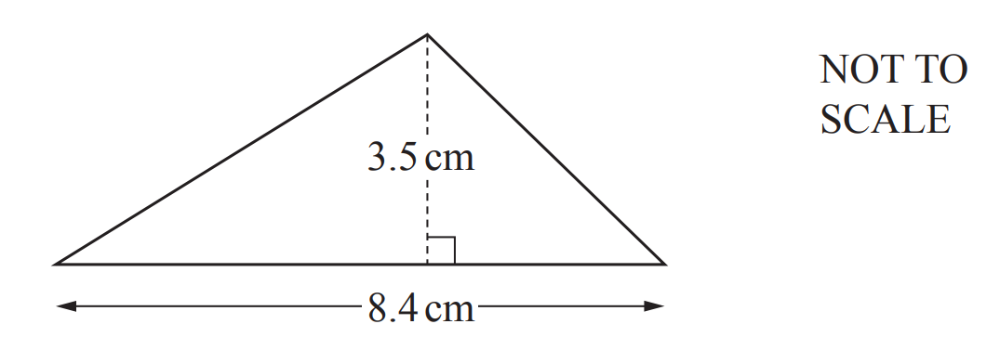
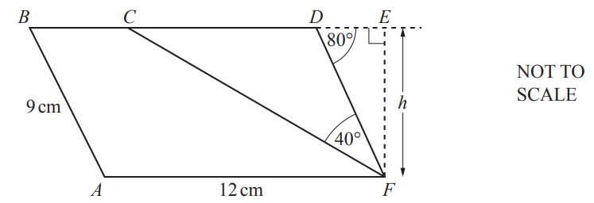

# Exam Questions — Area & Perimeter
**Lengths, Areas & Volumes** · Cambridge (CIE) IGCSE maths (0580 & 0980)
> Source: [https://www.savemyexams.com/igcse/maths/cie/25/extended/topic-questions/](https://www.savemyexams.com/igcse/maths/cie/25/extended/topic-questions/) · 12 questions across 1 sets

## Calculator Questions (12 questions)

### Q1 — medium — 1 marks

**Q1** [1 mark]

Tom is tiling a floor.

The floor is a rectangle with length 600 cm and width 240 cm
Each tile is a square with side 40 cm

Tom uses this method to work out the number of tiles he needs.

| Number of tiles that will fit along the length = 600 ÷ 40                                                                               = 15 Number of tiles that will fit along the width = 240 ÷ 40                                                                              = 6 Total number of tiles needed = 15 + 6                                                    = 21 |
|---|

Give a reason why Tom’s method is wrong.

*Source: Nov 2019 8300/3H Q6B*

### Q2 — medium — 2 marks

**Q2** [2 marks]

The diagram shows a right-angled triangle.

Calculate the area.

.......................................... cm2

*Source: 2020 March 0580/22 Q7A*

### Q3 — medium — 2 marks

**Q3** [2 marks]

Calculate the area of the trapezium.

.......................................... cm2

*Source: 2020 May/June 0580/22 Q6*

### Q4 — very_hard — 3 marks

**Q4** [3 marks]

Find the area of a regular hexagon with side length 7.4 cm.

.......................................... cm2

*Source: 2020	May/June 0580/21 Q22*

### Q5 — very_hard — 3 marks

**Q5** [3 marks]

The sides of an isosceles triangle are measured correct to the nearest millimetre. 
One side has a length of 8.2 cm and another has a length of 9.4 cm.

Find the largest possible value of the perimeter of this triangle.

............................................ cm

*Source: 2020 Oct/Nov 0580/22 Q18*

### Q6 — very_hard — 4 marks

**Q6** [4 marks]

The diagram shows a shaded region $T$ formed by removing an equilateral triangle$PQR$from a regular hexagon $ABCDEF$.

The points $P$ and $Q$ lie on $AB$ such that $AB=1.5\timesPQ$.

Given that the area of region $T$ is $72\sqrt{3}\mathrm{cm}^{2}$ work out the length of $PQ$.

......................................................$\mathrm{cm}$

*Source: Jan 2021 4MA1/2H Q20*

### Q7 — hard — 3 marks

**Q7** [3 marks]

A rectangle measures 8.5 cm by 10.7 cm, both correct to 1 decimal place.

Calculate the upper bound of the perimeter of the rectangle.

............................................ cm

*Source: 2020 Oct/Nov 0580/41 Q4A*

### Q8 — hard — 3 marks

**Q8** [3 marks]

The diagram shows a right-angled triangle.

Calculate the perimeter.

............................................ cm

*Source: 2020 0580/22 Q7B*

### Q9 — hard — 2 marks

**Q9** [2 marks]

The area of a square is 42.5 cm2, correct to the nearest 0.5 cm2.

Calculate the lower bound of the length of the side of the square.

.......................................... cm

*Source: 2018	Oct/Nov 0580/23 Q12*

### Q10 — medium — 2 marks

**Q10** [2 marks]

Calculate the area of this triangle.

........................................ cm2

*Source: 2019	May/June 0580/22 Q7*

### Q11 — very_hard — 5 marks

**Q11** [5 marks]

*ABDF *is a parallelogram and *BCDE  *is a straight line. *AF* = 12cm, *AB *= 9 cm, angle *CFD *= 40° and angle *FDE* = 80°.

i) Calculate the height, $h$, of the parallelogram.

$h=$ ........................................... cm [2]

ii) Calculate the area of the **trapezium ***ABCF*.

.......................................... cm2 [3]

*Source: 2020 Oct/Nov 0580/41 Q4B*

### Q12 — hard — 2 marks

**Q12** [2 marks]

The sides of a square are 15.1 cm, correct to 1 decimal place.

Find the upper bound of the area of the square.

............................................. cm2

*Source: 2019	Oct/Nov 0580/21 Q12-*

