# Exam Questions — Circles, Arcs & Sectors
**Lengths, Areas & Volumes** · Cambridge (CIE) IGCSE maths (0580 & 0980)
> Source: [https://www.savemyexams.com/igcse/maths/cie/25/extended/topic-questions/](https://www.savemyexams.com/igcse/maths/cie/25/extended/topic-questions/) · 31 questions across 1 sets

## Calculator Questions (31 questions)

### Q1 — hard — 5 marks

**Q1** [5 marks]

The image above shows the sector of a circle centre $O$, with radius $r$ and central angle $270^{\circ}$.

The sector is joined to the triangle $ABO$.

The perimeter of the compound shape is $21\mathrm{cm}$.

Work out the value of $r$.

Leave your answer to one decimal place.

### Q2 — medium — 2 marks

**Q2** [2 marks]

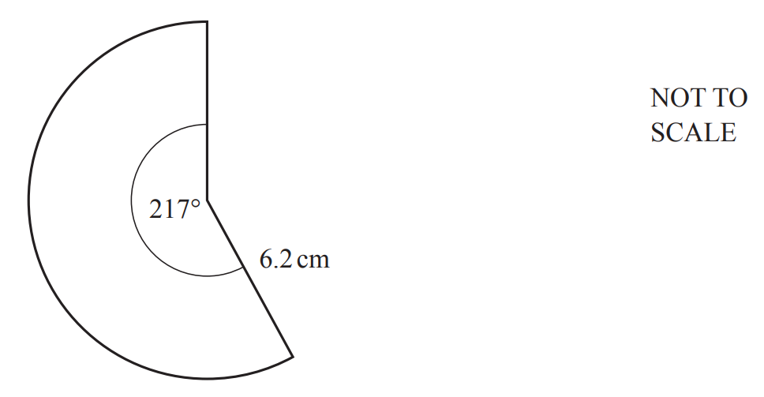

The diagram shows a sector of a circle with radius 6.2 cm and sector angle 217°.

Calculate the area of this sector.

............................................. cm2

*Source: 2019	May/June 0580/23 Q12*

### Q3 — medium — 4 marks

**Q3** [4 marks]

The diagram shows a circle with centre $O$

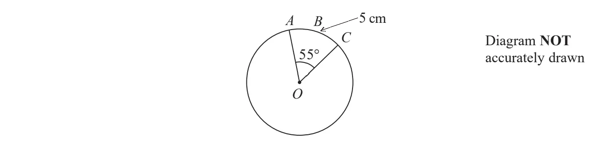

$A,B$ and $C$are points on the circle so that the length of the arc $ABC$ is 5 cm.

Given that angle $AOC$ = 55°

work out the area of the circle. 
Give your answer correct to one decimal place.

*Source: Jan 2022 4MA1/1H Q16*

### Q4 — medium — 2 marks

**Q4** [2 marks]

The diagram shows sector $OPQ$of a circle, centre $O$

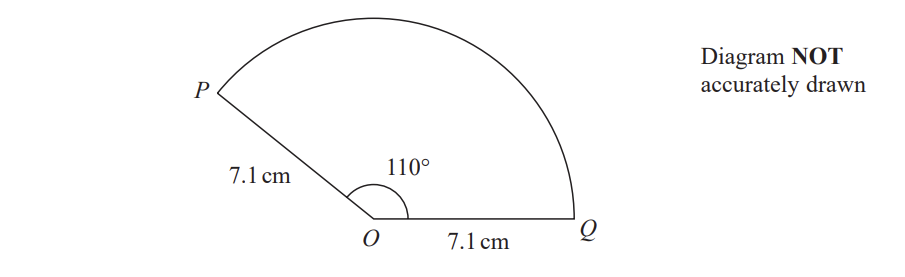

$OP=OQ=7.1\mathrm{cm}$ 
Angle $POQ=110^{\circ}$

Calculate the area of sector $OPQ$
Give your answer correct to one decimal place.

*Source: Jan 2022 4MA1/1HR Q11*

### Q5 — hard — 5 marks

**Q5** [5 marks]

The diagram shows a shaded shape $ABCD$made from a semicircle $ABC$and a right-angled triangle $ACD$.

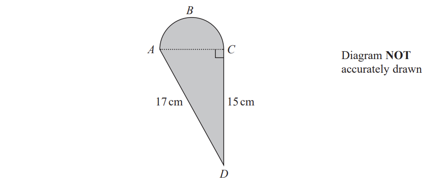

$AC$is the diameter of the semicircle $ABC$.

Work out the perimeter of the shaded shape.
Give your answer correct to 3 significant figures.

....................$\mathrm{cm}$

*Source: Jan 2020 4MA1/2H Q11*

### Q6 — hard — 3 marks

**Q6** [3 marks]

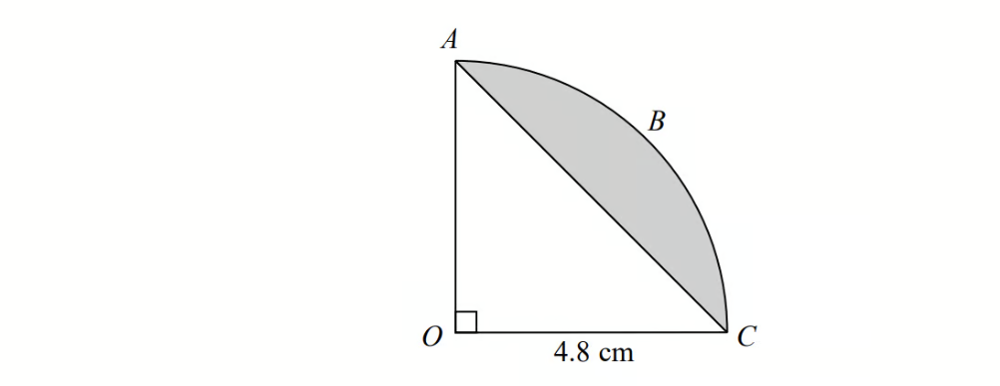

The arc $ABC$ is a quarter of a circle with centre $O$ and radius 4.8 cm.
 $AC$ is a chord of the circle.

Work out the area of the shaded segment. 
Give your answer correct to 3 significant figures.

*Source: Spec2 2015 1MA1/2H Q7*

### Q7 — very_hard — 8 marks

**Q7** [8 marks]

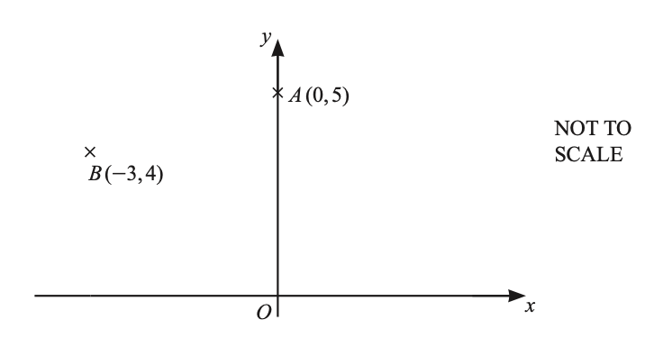

$A$ and $B$ lie on a circle, centre $O$.

Calculate the length of the arc $AB$.

*Source: 2019	Oct/Nov 0580/42 Q8B*

### Q8 — medium — 4 marks

**Q8** [4 marks]

The diagram shows the top of Levi's birthday cake.

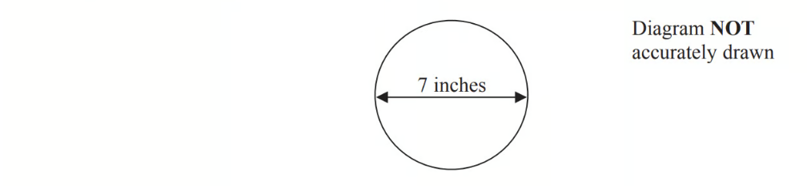

The top of the cake is in the shape of a circle. 
The diameter of the circle is 7 inches.

A ribbon is going to be put around the side of the cake. Ribbons are sold in 50 cm lengths.

1 inch is 2.54 cm.

Work out if one length of ribbon is long enough to go all the way around the cake. 
You must show your working.

*Source: June 2015 1MA0/2H Q11*

### Q9 — hard — 5 marks

**Q9** [5 marks]

The diagram shows a plan of Brian's lawn.

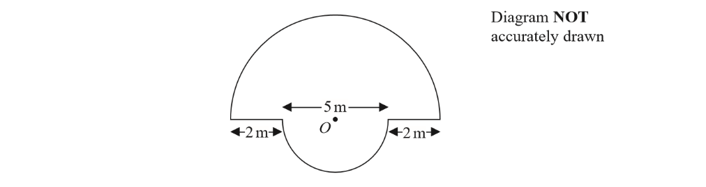

The edge of the lawn consists of two semicircles and two straight lines. 
Each semicircle has centre $O$. 
The diameters of the semicircles are 9 m and 5 m.

Brian is going to put lawn edging around the edge of the lawn. 
Lawn edging is sold in 2.4 metre rolls.

Brian has £35

| **Lawn edging**  £3.99 per roll  or  3 rolls for £10 |
|---|

Has Brian got enough money to buy all the rolls of lawn edging he needs?

You must show all your working.

*Source: 2017	June 1MA0/2H Q11*

### Q10 — very_hard — 11 marks

**Q10** [5 marks]

The diagram shows a circle, centre *O*.

The straight line *ABC* is a tangent to the circle at *B*.

*OB* = 8 cm, *AB* = 15 cm and *BC* = 22.4 cm.

*AO* crosses the circle at *X* and *OC* crosses the circle at *Y*.   Calculate angle *XOY*.

Angle *XOY* = ...............................................

*Source: 2018	Oct/Nov 0580/41 Q10A*

**Q10** [2 marks]

**Extract:**

OB = 8 cm, AB = 15 cm and BC = 22.4 cm. AO crosses the circle at X and OC crosses the circle at Y. Calculate angle XOY.

Calculate the length of the arc *XBY*.

.......................................... cm

*Source: 2018	Oct/Nov 0580/41 Q10B*

**Q10** [4 marks]

**Extract:**

The diagram shows a circle, centre O. The straight line ABC is a tangent to the circle at B. OB = 8 cm, AB = 15 cm and BC = 22.4 cm. AO crosses the circle at X and OC crosses the circle at Y.

Calculate the total area of the two shaded regions.

........................................ cm2

*Source: 2018	Oct/Nov 0580/41 Q10C*

### Q11 — hard — 5 marks

**Q11** [5 marks]

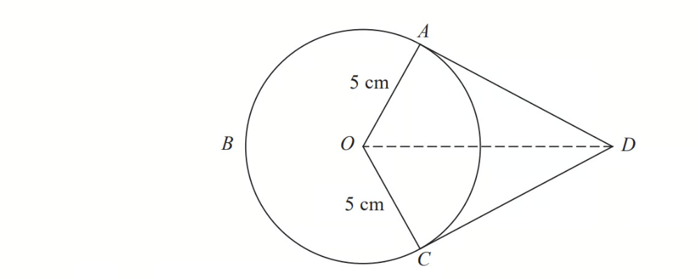

$A,B$ and $C$ are points on a circle of radius 5 cm, centre $O$.

$DA$ and $DC$ are tangents to the circle. 
$DO=9\mathrm{cm}$

Work out the length of arc $ABC$. 
Give your answer correct to 3 significant figures.

*Source: June 2017 1MA1/3H Q18*

### Q12 — hard — 3 marks

**Q12** [3 marks]

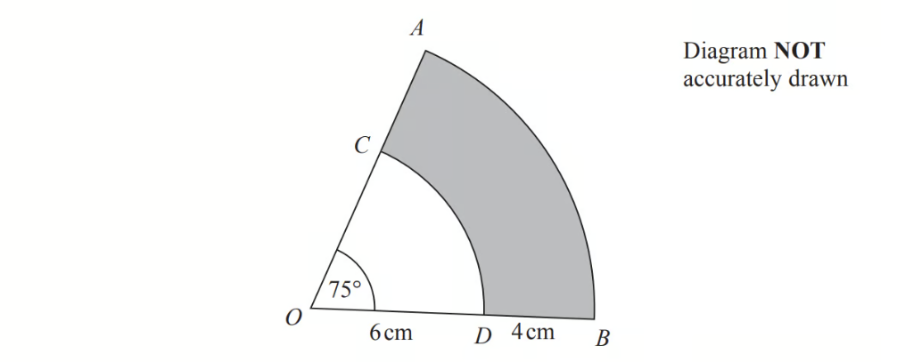

$OAB$ is a sector of a circle, centre $O$.
$OCD$ is a sector of a circle, centre $O$. 
$OCA$ and $ODB$ are straight lines.

Angle $AOB=75^{\circ}$ 
$OD=6\mathrm{cm}\,DB=4\mathrm{cm}$

Calculate the perimeter of the shaded region.
Give your answer correct to 3 significant figures.

*Source: June 2016 1MA0/2H Q22*

### Q13 — hard — 5 marks

**Q13** [5 marks]

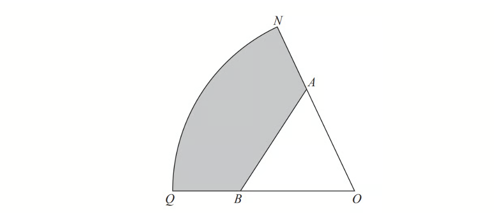

$ONQ$ is a sector of a circle with centre $O$ and radius 11 cm.

$A$ is the point on $ON$ and $B$ is the point on $OQ$ such that $AOB$ is an equilateral triangle of side 7 cm.

Calculate the area of the shaded region as a percentage of the area of the sector $ONQ$. 
Give your answer correct to 1 decimal place.

*Source: June 2017 1MA1/2H Q17*

### Q14 — very_hard — 16 marks

**Q14** [4 marks]

The diagram shows a design made from a triangle *AOC *joined to a sector *OCB*.

*AC* = 8cm, *OB* = *OC *= 7 cm and angle *ACO* = 78°.

Use the cosine rule to show that *OA* = 9.47 cm, correct to 2 decimal places.

*Source: 2018	May/June 0580/42 Q5A*

**Q14** [3 marks]

**Extract:**

The diagram shows a design made from a triangle AOC joined to a sector OCB. AC = 8cm, OB = OC = 7 cm and angle ACO = 78°. OA = 9.47 cm, correct to 2 decimal places.

Calculate angle *OAC*.

Angle *OAC* = ................................................

*Source: 2018	May/June 0580/42 Q5B*

**Q14** [5 marks]

**Extract:**

The diagram shows a design made from a triangle AOC joined to a sector OCB. AC = 8cm, OB = OC = 7 cm and angle ACO = 78°.

The perimeter of the design is 29.5 cm.

Show that angle *COB *= 41.2°, correct to 1 decimal place.

*Source: 2018	May/June 0580/42 Q5C*

**Q14** [4 marks]

**Extract:**

The diagram shows a design made from a triangle AOC joined to a sector OCB. AC = 8cm, OB = OC = 7 cm and angle ACO = 78°. Use the cosine rule to show that OA = 9.47 cm, correct to 2 decimal places. The perimeter of the design is 29.5 cm. Show that angle COB = 41.2°, correct to 1 decimal place.

Calculate the total area of the design.

......................................... cm2

*Source: 2018	May/June 0580/42 Q5D*

### Q15 — hard — 4 marks

**Q15** [4 marks]

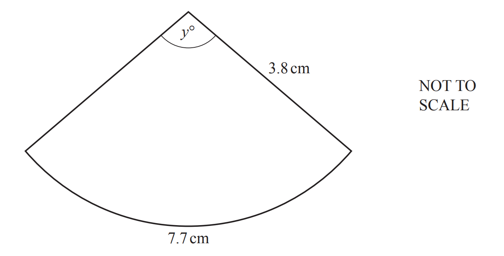

The diagram shows a sector of a circle of radius $3.8\text{cm}$. The arc length is $7.7\text{cm}$.

i) Calculate the value of $y$.

$y$ = .............................................. [2]

ii) Calculate the area of the sector.

........................................ cm2 [2]

*Source: 2019	May/June 0580/42 Q8B*

### Q16 — hard — 4 marks

**Q16** [4 marks]

Saphia is organising a conference.

People at the conference will sit at circular tables.

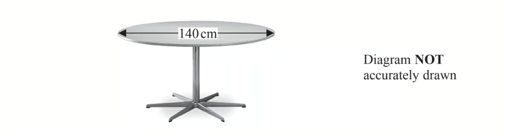

Each table has a diameter of 140 cm. 
Each person needs 60 cm around the circumference of the table.

There are 12 of these tables in the conference room.
A total of 90 people will be at the conference.

Are there enough tables in the conference room?

*Source: 2014	November 1MA0/2H Q11*

### Q17 — hard — 3 marks

**Q17** [3 marks]

Calculate the area of the sector of a circle with radius 65 mm and sector angle 42°. 
Give your answer in square centimetres.

................................................ cm2

*Source: 2020 May/June 0580/23 Q9*

### Q18 — medium — 3 marks

**Q18** [3 marks]

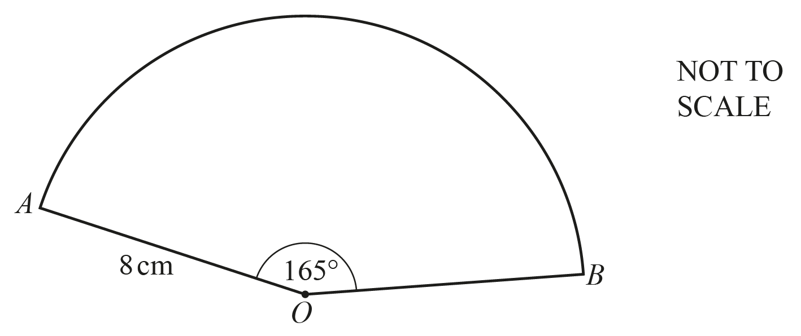

The diagram shows a sector of a circle with centre $O$, radius 8 cm and sector angle 165°.

Calculate the total perimeter of the sector.

............................................ cm

*Source: 2020	May/June 0580/41 Q9A*

### Q19 — medium — 2 marks

**Q19** [2 marks]

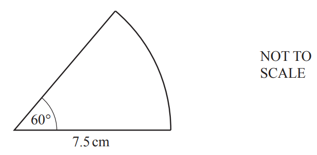

Calculate the area of this sector of a circle.

.......................................... cm2

*Source: 2020 Oct/Nov 0580/22 Q15*

### Q20 — very_hard — 8 marks

**Q20** [5 marks]

The diagram shows a company logo made from a rectangle and a major sector of a circle.

The circle has centre *O* and radius *OA*.

*OA* = *OD* = 0.5 cm and *AB* = 1.5 cm.

*E* is a point on *OC* such that *OE* = 0.25 cm and angle *OED* = 90°.

Calculate the perimeter of the logo.

............................................. cm

*Source: 2019 March 0580/42 Q6A*

**Q20** [3 marks]

**Extract:**

The diagram shows a company logo made from a rectangle and a major sector of a circle. The circle has centre O and radius OA. OA = OD = 0.5 cm and AB = 1.5 cm. E is a point on OC such that OE = 0.25 cm and angle OED = 90°.

Calculate the area of the logo.

............................................ cm2

*Source: 2019 March 0580/42 Q6B*

### Q21 — medium — 2 marks

**Q21** [2 marks]

The diagram shows a sector of a circle of radius 4 cm.

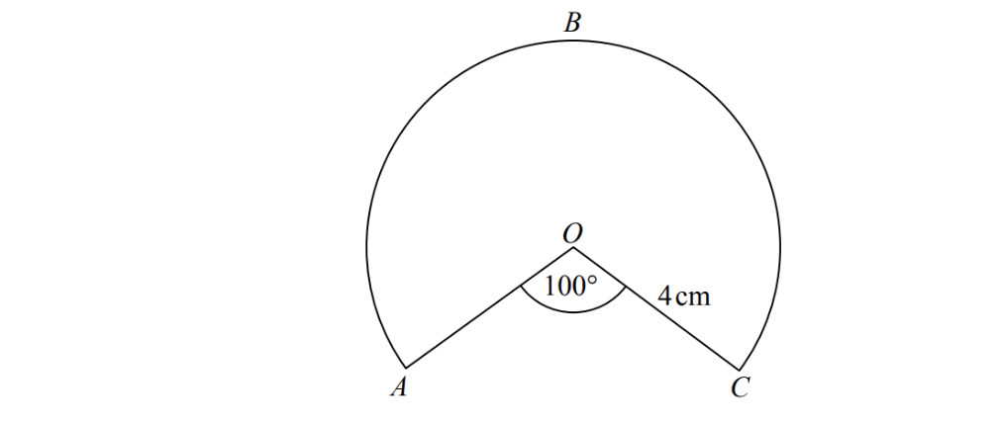

Work out the length of the arc $ABC$. 
Give your answer correct to 3 significant figures.

*Source: Spec2 2015 1MA1/3H Q16*

### Q22 — medium — 2 marks

**Q22** [2 marks]

Calculate the area of a circle with radius 5.1 cm.

......................................cm2

*Source: 2018	May/June 0580/21 Q6*

### Q23 — very_hard — 3 marks

**Q23** [3 marks]

The total perimeter of a semicircle is 19.02 cm.

Calculate the radius of the semicircle.

................................................ cm

*Source: 2020 May/June 0580/23 Q12*

### Q24 — very_hard — 4 marks

**Q24** [4 marks]

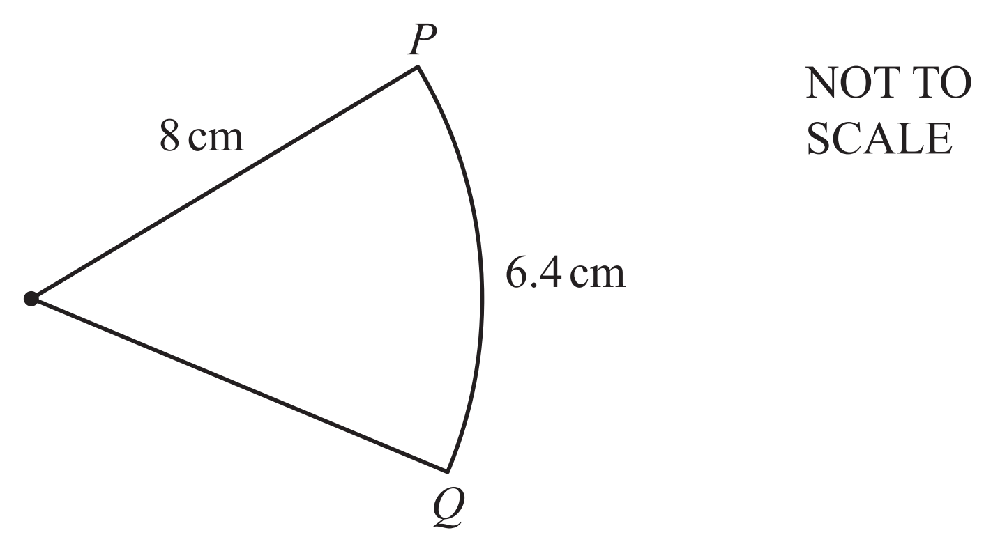

The diagram shows a sector of a circle of radius 8 cm. The length of the arc $PQ$ is 6.4 cm.

Find the area of the sector.

.......................................... cm2

*Source: 2020 May/June 0580/22 Q244*

### Q25 — medium — 4 marks

**Q25** [4 marks]

$OAB$ is a sector of a circle with centre $O$ and radius 7 cm.

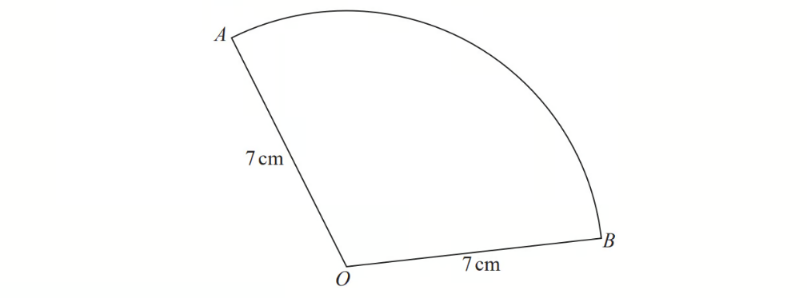

The area of the sector is 40 cm2.

Calculate the perimeter of the sector. 
Give your answer correct to 3 significant figures.

*Source: June 2019 1MA1/2H Q12*

### Q26 — medium — 3 marks

**Q26** [3 marks]

The diagram shows Yuen’s garden.

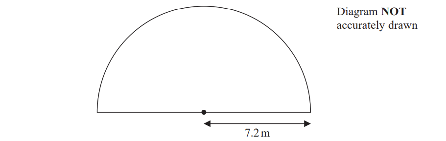

The garden is in the shape of a semicircle of radius $7.2m$. Yuen is going to cover his garden with grass seed.

Yuen has 12 boxes of grass seed. 
Each box of grass seed contains enough seed to cover $6m^{2}$ of the garden.

Has Yuen enough grass seed for his garden?
Show your working clearly.

*Source: Jan 2020 4MA1/1HR Q5*

### Q27 — hard — 3 marks

**Q27** [3 marks]

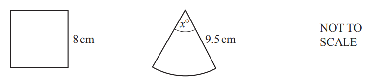

The diagram shows a square with side length 8 cm and a sector of a circle with radius 9.5 cm and sector angle $x$°. The perimeter of the square is equal to the perimeter of the sector.

Calculate the value of $x$.

$x=$ ................................................

*Source: 2020 Oct/Nov 0580/41 Q4D*

### Q28 — hard — 10 marks

**Q28** [5 marks]

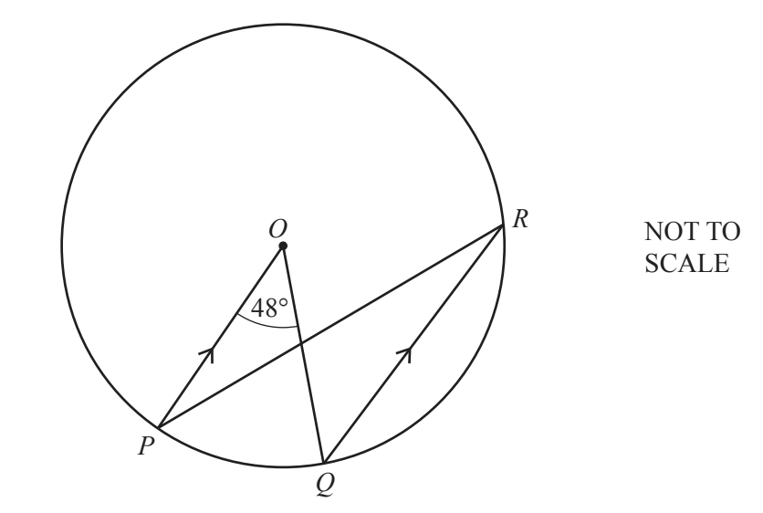

*P*, *Q* and *R* are points on the circumference of the circle, centre *O*. 
*PO* is parallel to *QR* and angle *POQ *= 48°.

Find angle *OPR*.

Angle *OPR* = ...............................................

*Source: 2018	May/June 0580/41 Q8C*

**Q28** [5 marks]

**Extract:**

P, Q and R are points on the circumference of the circle, centre O. PO is parallel to QR and angle POQ = 48°.

The radius of the circle is 5.4 cm. 
Calculate the length of the **major** arc *PQ*.

.......................................... cm

*Source: 2018	May/June 0580/41 Q8C*

### Q29 — medium — 9 marks

**Q29** [3 marks]

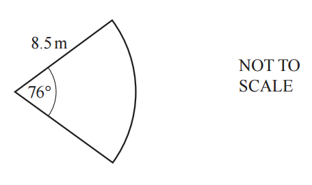

The cross-section of a gate is a sector of a circle with radius 8.5 m and angle 76°.

Calculate the perimeter of the sector.

............................................ m

*Source: 2018	Oct/Nov 0580/42 Q10A*

**Q29** [6 marks]

A solid metal cone has radius 10 cm and height 36 cm.

i) Calculate the volume of this cone. [The volume, $V$, of a cone with radius $r$ and height $h$ is  $V=\frac{1}{3}πr^{2}h$.]

......................................... cm3[2]

ii) The cone is cut, parallel to its base, to give a smaller cone.

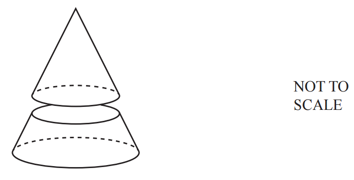

The volume of the smaller cone is half the volume of the original cone.
The smaller cone is melted down to make two different spheres.
The ratio of the radii of these two spheres is 1 : 2.

Calculate the radius of the smaller sphere.
[The volume, $V$, of a sphere with radius $r$ is  $V=\frac{4}{3}πr^{3}$.]

.......................................... cm [4]

*Source: 2018	Oct/Nov 0580/42 Q10B*

### Q30 — medium — 3 marks

**Q30** [3 marks]

The diagram shows the surface of a garden pond, made from a rectangle and two semicircles.
The rectangle measures 3 m by 1.2 m.

Calculate the area of this surface.

...............................................m2

*Source: 2019	May/June 0580/41 Q5A*

### Q31 — hard — 9 marks

**Q31** [9 marks]

In the diagram, *A*, *B*, *C* and *D* lie on the circle, centre *O*.

Angle *ADC* = 128°, angle *ACD* = 28° and angle *BCO* = 30°. Angle *AOC *= 104°.

The radius, *OC*, of the circle is 9.6 cm.

Calculate the total perimeter of the sector *OADC*.

.............................................. cm

*Source: 2019	Oct/Nov 0580/43 Q6A*

