# Mark Schemes — Volume & Surface Area
**Lengths, Areas & Volumes** · Cambridge (CIE) IGCSE maths (0580 & 0980)

## Calculator Questions (36 questions)

### Q1
> **[exam-tip]**
> The formula for volume of a cylinder is on the formula sheet in the exam paper:
> 
> $V=πr^{2}h$
> 
> - where $r$ is the radius of the base
> - and $h$ is the height

Substitute the known values into the formula

- $V=450π$ and $r=5$

$450 \pi = \pi ( 5 )^{2} h$

**[M1]**

Cancel a factor of $π$ from each side

$450 = ( 5 )^{2} h$

Solve for $h$

$450=25h$

$h=\frac{450}{25}=18$

**Final answer:** **18 cm**

**[A1]**
The volume of a cube is equal to its side length cubed

- Find the volume of 2990 of these cubes

$2990\times0.75^{3}=1261.40625$

**[M1]**

Subtract from the original volume of the cylinder to find the amount left over

$450π-1261.40625=152.310444...$

Round to a suitable degree of accuracy

- In general you should round to 3 significant figures, unless the question specifies otherwise

**Final answer:** **152 cm****3**** (3 s.f.)**

**[A1]**

> **[mark-scheme]**
> **M1**: For $2990\times0.75^{3}$.
> 
> **A1**: For 152, or an answer in the range 152.3 to 152.4.

### Q2
**Final answer:** **Triangular prism**

**[B1]**
> *Correctly separate the shape into its constituent parts*

> *Three rectangles with areas*

$8\times9=72\,6\times9=54\,9\times10=90$

**[M1]**

> *Two triangles with areas*

$\frac{8\times6}{2}=24$

**[M1]**

> *Adding all areas together*

$72+54+90+24+24=264$

$264\mathrm{cm}^{2}$

**[A1 B1]**

> **[mark-scheme]**
> **M1**: Correct method for finding the areas of the three rectangles.
> 
> **M1**: Correct formula for the area of a triangle.
> 
> **A1**: Correct answer 264.
> 
> **B1**: Correct units.
> *Use the area of the triangle from the previous part*

*Area of triangle = *$24\mathrm{cm}^{2}$

> *Multiply the area by the depth of the shape*

$24\times9=216$

**[M1]**

$216\mathrm{cm}^{3}$

**[A1 B1]**

> **[mark-scheme]**
> **M1**: Correct formula for the volume of a prism.
> 
> **A1**: Correct answer 216.
> 
> **B1**: Correct units.

### Q3
*To use the given formula, we need to first find *$h$*, the vertical height of the cone* 
*For the triangle below, we can use Pythagoras to find *$h$

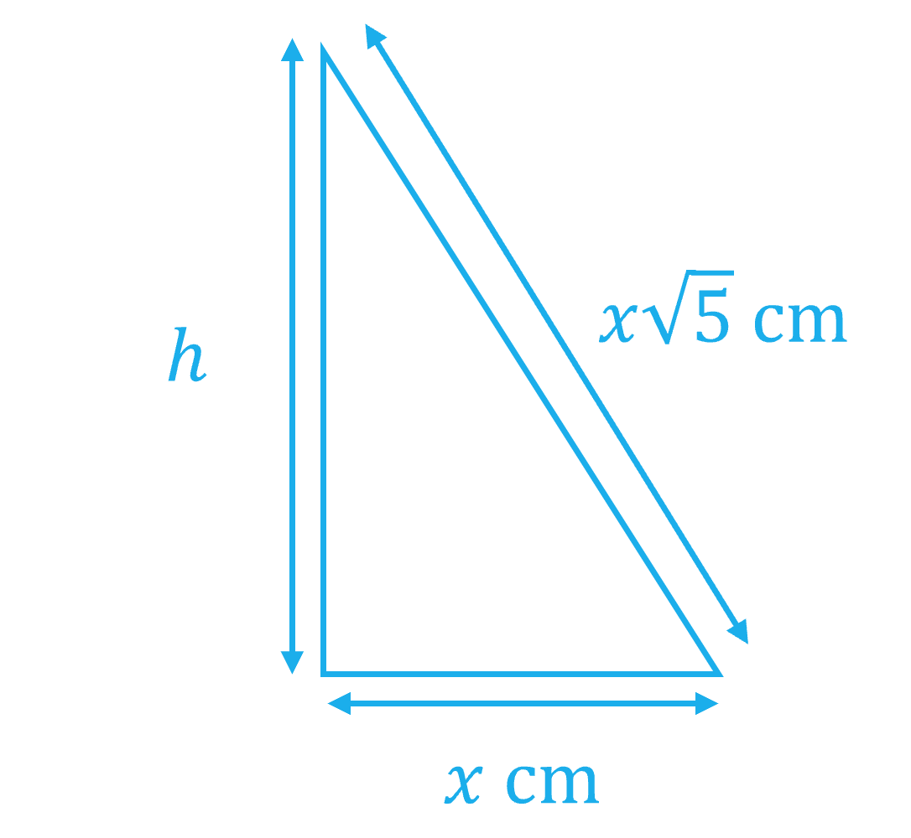

$h = \sqrt{( x \sqrt{5} )^{2} - x^{2}}$

**[1]**

> *Simplify*

$h=\sqrt{5x^{2}-x^{2}}=\sqrt{4x^{2}}=2x$

> *We can now use the given formula with *$r=x$* and *$h=2x$*, and using the known volume of 1000 cm**3*

$\frac{1}{3}\timesπ\timesx^{2}\times2x=1000$

> *Multiply both sides by 3, and simplify the algebraic terms*

$π\times2x^{3}=3000$

> *Divide both sides by *$π$*, and then divide both sides by 2 (equivalent to dividing by *$2π$*)*

$x^{3}=\frac{3000}{2π}$

**[2]**

> *Cube root both sides*

$x = \sqrt[3]{ \frac{3000}{2 \mathrm{\pi } } } = 7.815926418...$

$x=7.82$ **[1]** 
**Rounded to 3 significant figures** **7.815 to 7.816 allowed**

### Q4
> *The surface of the prism has six faces. *
*Identify the shape and dimensions of each face. *
*Trapezium **ABCD **= trapezium **EFGH **.*

> *Find the area of trapezium **ABCD.*

> *Area of a trapezium = *$\frac{( a + b ) h}{2}$*.*

*Area ***ABCD*** = *$\frac{( A B + D C ) h}{2}$

> *AB** = 8 cm, **DC** = **GH **= 5 cm.*

> *BC **= **AD** so the trapezium has a line of symmetry down the middle. **AC **can be split using 8 - 5 and dividing each of the edge parts by 2.*

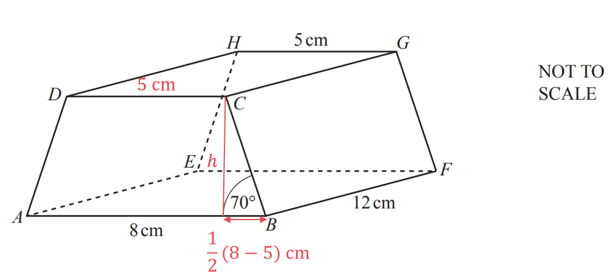

> *Use right-angled trigonometry to find the vertical height, **h**, of the trapezium.*

$\begin{gathered} \tan 70 & = \frac{h}{1 \frac{1}{2} ( 8 - 5 )} \\ \tan 70 & = \frac{h}{1.5} \\ h & = 1.5 \tan 70 \\ = 4.121216... \end{gathered}$

**[1]**

> *Find the area of trapezium **ABCD.*

*Area ***ABCD*** = *$\frac{( 8 + 5 ) ( 4.121216... )}{2} = 26.7879...$

**[1]**

> *BC = AD **so rectangle **ADEH **= rectangle **BCGF.*

> *Use right-angled trigonometry to find the side **BC.*

$\begin{gathered} \cos 70 & = \frac{1.5}{B C} \\ B C & = \frac{ 1.5 }{\cos 70} \\ = 4.385706... \end{gathered}$

**[1]**

> *Find the area of rectangle **ADEH **.*

*Area rectangle ***ADEH*** = 12 × 4.385706... = 52.6284.... *

**[1]**

> *Find the areas of the other two rectangles.*

*Top : 12 × 5 = 60*
*Bottom : 12 × 8 = 96*

**[1]**

> *Add the six areas together.*

*Total area = 2(area ***ABCD***) + 2(area ***ADEH***) + area ***CDHG ***+ area ***ABFE**

* = 2(26.7879) + 2(52.6284) + 60 + 96*

**315 cm****2** **(3 s.f.)** **[1] **
**Answers in the range 314.5 to 315.0 cm accepted.**

### Q5
i) *Change 20 minutes into seconds (by multiplying by 60)* * *

*20 *$\times$*60 = 1200* * *

*75 000 litres of water flows out every 1 second* *Find the amount of water flowing out over 1200 seconds (by multiplying 75 000 by 1200)* * *

*75 000 *$\times$*1200 = 90 000 000 litres* * *

> *Write 90 000 000 litres in millions*

**90 million litres** **[1]**

ii) *The volume of water that leaves the lake, **V,** formed a prism of height **h** m and cross-sectional area **A **m**2* * *

*V** = 90 000 000 litres from part (a)(i)* *Change **V** into m**3** (by dividing by 1000)* * *

**V*** = 90 000 m**3**  *

*A** = 55 hectares* *Change **A** into m**2** (by multiplying by 10**4** = 10 000)* * *

**A*** = 55 *$\times$*10 000 = 550 000 m**2* * *

*The volume of a prism is** V** = **A** *$\times$* **h **Make **h** the subject of the formula (by dividing both sides by **A**)* * *

$\frac{V}{A}=h$* * * *

*Substitute **V** = 90 000 and **A** = 550 000 into the formula* * *

$h=\frac{90000}{550000}=0.1636...$* metres*

*the figures 164 or 1636 seen** ***[1]** 
*0.164 or 0.1636...*** ****[1]**

> *Give **h** in cm (by multiplying by 100)*

**16.4 cm** **[1] **

### Q6
*The pipe is a cylinder.* 
*In one second the water has increased by a length of 12 cm.*

> *Convert one hour into seconds.*

*1 hour = 60 minutes = 60 × 60 seconds = 3600 seconds*

> *Find the length of water along the cylinder after 3600 seconds.*

*1 second is 12 cm* 
*3600 seconds is 3600 × 12 cm = 43200 cm*

*Find the volume of this water.*
*The formula for the volume of a cylinder is *$V=πr^{2}h$*, where **V** is the volume, **r **is the radius and **h **is the height/length.* 
*Identify the values of the variables.*

$V=?,r=2.6,h=43200$

> *Substitute the values into the formula to find the volume. Use the π on your calculator. If your calculator does not have this button then use 3.142 for π. *
*The units for the lengths were in cm, therefore the units for volume is cm**3**.*

$V=π\times2.6^{2}\times43200=917445.585...\mathrm{cm}^{3}$

**[1]**

*1000 cm**3** = 1 litre.* 
*Divide the volume in cm**3** by 1000 to get the volume in litres.*

$V=\frac{π\times2.6^{2}\times43200}{1000}=917.445585...\mathrm{litres}$

**[1]**

> *Round your answer to 3 significant figures.*

**917 litres** **[1]** 
**918 is accepted as you get this if you use 3.142 for π**

### Q7
> *Identify the values of each variable.*

$V=275,h=14.8,r=?$

> *Substitute the values into the formula to form an equation.*

$275=\frac{1}{3}\timesπ\timesr^{2}\times14.8$

**[1]**

*Rearrange to make **r** the subject. Rearrange fully before typing in your calculator. If you decide to type it in your calculator as you go then use the 'answer' button or lots of decimal places to avoid rounding errors.*

> *Multiply both sides by 3.*

$π\timesr^{2}\times14.8=275\times3=825$

> *Divide by sides by 14.8 × π.*

$r^{2}=\frac{275\times3}{14.8\timesπ}=17.7436...$

> *Square root both sides.*

$r=\pm\sqrt{\frac{275\times3}{14.8\timesπ}}=\pm4.2123...$

**[1]**

> *The radius is a length so can not be negative. Round the positive answer to 3 significant figures.*

**4.21 cm** **[1]**

### Q8
> *Substitute the volume of the prism into the given formula for the volume of a sphere, *$V=\frac{4}{3}πr^{3}$* and solve to find *$r$*.*

$2187=\frac{4}{3}\timesπ\timesr^{3}$

**[1]**

> *Divide both sides by *$\frac{4}{3}π$*.*

$522.10779...=r^{3}$

**[1]**

> *Cube root both sides.*

$8.05230...=r$

**8.05 cm**** [1]**
**Answers between 8.051 and 8.052 will be accepted.**

### Q9
> *We can imagine the shaded circular area of water moving along the pipe for one hour to form a cylinder, where the length of the cylinder is the distance traveled in 1 hour at 8 cm/s.*

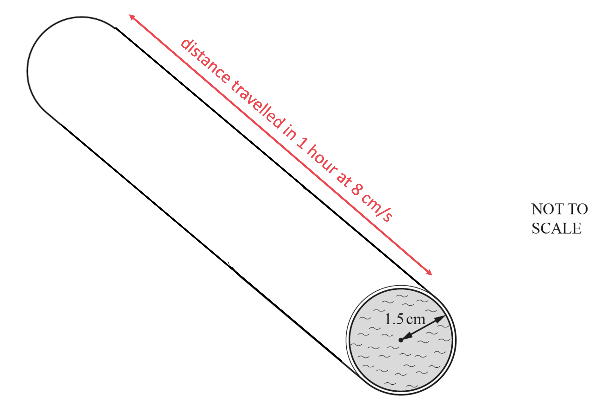

> *To find the volume of this cylinder, we need its length in cm, and the circle area.*

> *Circle area = *$πr^{2}$*.*

*Circle area*$=π\times1.5^{2}$

**[1]**

> *To find the length of the cylinder, distance = speed × time. *
*But the speed is in cm/s- and we want the distance in cm- so we need to convert 1 hour to seconds.*

*1 hour = 60 × 60 seconds = 3600 seconds*

*Distance = 8 cm/s × 3600 s = 28 800 cm*

> *Now we can calculate the volume using volume of a prism = base area × length.*

*Volume *$=π\times1.5^{2}\times28800$

**[1]**

$=203575.204...$*cm**3*

> *Be careful, the question asks for the answer in litres. 1 litre = 1000 cm**3**. So to convert to litres, we need to divide by 1000.*

$203575.204...\div1000=203.575204...$ *cm**3*

**[1]**

> *Round the final answer to at least 3 significant figures.*

**204 litres** **[1]**

**Depending on rounding and the value of π used, the final answer can be given as 204 or as **$203.5<\mathrm{volume}\leq203.6$** **

### Q10
> *Find the cross-sectional area of the pipe in m**2**. *
*Remember, 1 m = 100 cm, so 1 m**2** = (100)**2** cm**2**.*

$6\div(100)^{2}=0.0006$* m**2*

**[1]**

> *Find the volume of water that is flowing into the tank per second by multiplying the area by the speed.*

$0.0006\times1.2=0.00072$* m**3**/s*

> *Convert into m**3**/h.*

$0.00072\times60\times60=2.592$ *m**3**/h*

**[1]**

> *Convert the volume into litres, 1 m**3** = 1000 litres.*

$2.592\times1000$

**[1]**

$2592$** ****litres ****[1]**

### Q11
> *First convert litres to cubic centimetres using *$1000\mathrm{cm}^{3}=1\mathrm{litre}$*.*

$12\times1000=12000$

**[1]**

> *Letting the increase in height per minute be *$x$*, we can write an equation for *$x$*.*

$90\times75\timesx=12000$

> *Solving for *$x$*.*

$x=\frac{12000}{90\times75}=\frac{16}{9}$

> *So in seven minutes the height will increase by*

$7 \times \frac{16}{9} = 12. \dot{4}$

**[1]**

**12.4 cm**** [1]**

### Q12
> *We can sketch the equilateral based prism. As the shaded face is an equilateral triangle, all its internal angles are 60°*

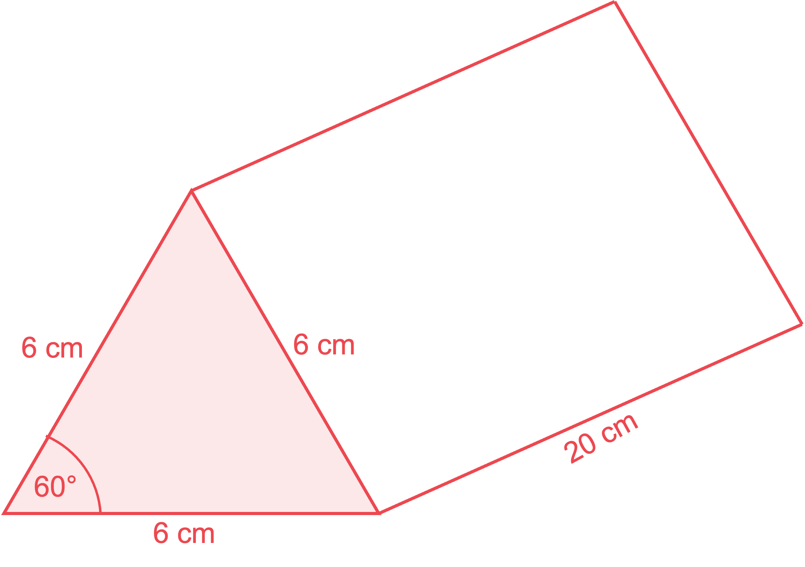

> *We can find the area of one of the two triangular faces using the sine area rule given on the formula sheet, *$\mathrm{Area}=\frac{1}{2}ab\mathrm{sin}C$*. So the area of both triangular faces is*

$\mathrm{Area}_{2\mathrm{triangles}}=2\times\frac{1}{2}\times6\times6\times\mathrm{sin}60$

**[1]**

> *The area of the three rectangular faces is*

$\mathrm{Area}_{3\mathrm{rectangles}}=3\times6\times20$

**[1]**

> *Add the area of the two triangular and three rectangular faces together to get the total surface area*

$\mathrm{Total} \mathrm{surface} \mathrm{area}=2\times\frac{1}{2}\times6\times6\times\mathrm{sin}60+3\times6\times20$

**[1]**

*= 391.1769145...*

> *Round to at least 3 significant figures*

**391 cm****2**** ****or ****391.1 to 391.2 cm****2** **[1]**

### Q13
> *Using the given formula with *$V=24430$

$24430=\frac{4}{3}πr^{3}$

**[1]**

> *Divide both sides by *$\frac{4}{3}$* (or multiply by 3, and then divide by 4)*

$\frac{36645}{2}=πr^{3}\mathrm{or}18322.5=πr^{3}$

> *Divide both sides by *$π$

$5832.23289...=r^{3}$

> *Cube root both sides*

$\sqrt[3]{5832.23289...} = 18.0002396...$

**[1]**

$18.0\mathrm{cm}$ **[1]**
 **Round to 3 significant figures**
> *The volume of a cylinder can be calculated by multiplying its cross-sectional area (a circle) by its height*

$V=πr^{2}h$

> *Applying this to a cylinder of radius 50 cm and depth 60 cm*

$V=π\times50^{2}\times60$

**[1]**

$V=150000π=471238.898...\mathrm{cm}^{3}$

> *As the sphere is placed inside the cylindrical tank, this will mean that not as much water is needed to fill it to a depth of 60 cm. *
*The cylinder will contain a volume of water equal to the difference between the volumes of the cylinder and the sphere*

$150000π-24430=446808.898...\mathrm{cm}^{3}$

**[1]**

> *There are 1000 cm**3** in 1 litre, so we can divide this by 1000 to find the answer in litres*

$446808.898\div1000=446.808898$

$447\mathrm{litres}$ **[1]** 
**Rounded to 3 significant figures**

### Q14
*The formula for the volume of a cylinder is *$V=πr^{2}h$* where **r** is the radius and **h** is the height.* 
*You know **r** = 6 so form an expression for the volume of the cylinder.*

$V=π\times6^{2}\timesh$

> *Simplify the expression and leave it in terms of π.*

$V=36πh$

*The formula for the volume of a sphere is *$V=\frac{4}{3}πr^{3}$* where **r** is the radius.* 
*You know **r** = 4.5 so form an expression for the volume of the sphere.*

$V=\frac{4}{3}\timesπ\times4.5^{3}$

> *Simplify the expression and leave it in terms of π.*

$V=\frac{243}{2}π$

> *The cylinder and sphere have the same volume so make the expressions equal to each other.*

$36hπ=\frac{243}{2}π$

**[1]**

> *Both sides have a factor of π, so you can divide both sides by π to cancel it out.*

$36h=\frac{243}{2}$

> *Divide both sides by 36.*

$h = \frac{ ( \frac{243}{2} ) }{36} = \frac{27}{8}$

**[1]**

$h=3.375$ **[1]**
> *The volume of a cube is *$V=l^{3}$* where **l **is the length a side. *
*You know **l** = 20 so find the volume.*

$V=20^{3}=8000$

> *This is the volume of 40 spheres. Find the volume of one sphere by dividing by 40.*

$\frac{8000}{40}=200$

*The formula for the volume of a sphere is *$V=\frac{4}{3}πr^{3}$* where **r** is the radius.* 
*You know **V** = 200 so form an equation.*

$200=\frac{4}{3}πr^{3}$

**[1]**

> *Multiply both sides by 3 and divide both sides by 4.*

$πr^{3}=\frac{200\times3}{4}\,πr^{3}=150$

> *Divide both sides by π but leave as an exact expression.*

$r^{3}=\frac{150}{π}$

**[1]**

> *Cube root both sides.*

`r = cbrt( 150 / pi ) = 3.62783...`

> *Round to 3 significant figures.*

$r=3.63$ **[1]**

### Q15
> *It's a hemisphere so its formula is given by*

$V=\frac{1}{2}\times\frac{4}{3}πr^{3}=\frac{2}{3}πr^{3}$

> *We need to substitute the volume of 230 cm**3** into the given formula, and rearrange to find *$r$

$230=\frac{2}{3}πr^{3}$

**[1]**

> *Now rearrange. It's easiest to treat the *$"\frac{4}{3}π"$* as one "thing" and divide both sides by it*

$230 \div ( \frac{2}{3} pi ) = r^{ } 3$

> *Now cube root both sides*

$r = \sqrt[3]{230 \div ( \frac{2}{3} pi ) }$

**[1]**

$=3.80084135...$

$r=3.80$** ****cm ****[1] **
**Answers must be given to at least 3 significant figures so don't round to "3.8"!**
> *We know from part (a) that the volume of the hemisphere is 230 cm**3**. So the volume of the cylinder is*

$300-230=70\mathrm{cm}^{3}$

> *Volume of a cylinder is *$V=πr^{2}h$* where *$r$* is the radius and *$h$* is the height. Substitute *$V=70$* and *$r=1.6$* (given in question)*

$70=π(1.6)^{2}h$

**[1]**

> *Rearrange to find *$h$

$\frac{70}{π(1.6)^{2}}=h$

**[1]**

$=8.70378595...$

$h=8.70$**cm ****[1]**
**Answers must be given to at least 3 significant figures so don't round to "8.7"!**

### Q16
> *Using the given formula for the volume of a sphere, substituting *$x$* for *$r$*, and using the known volume of 1000 cm**3** we can write the following equation*

$\frac{4}{3}\timesπ\timesx^{3}=1000$

**[1]**

> *Divide both sides by *$\frac{4}{3}$

$π\timesx^{3}=750$

> *Divide both sides by *$π$

$x^{3}=\frac{750}{π}$

**[1]**

> *Cube root both sides*

`x = cbrt( 750 / pi ) = 6.203504909...`

$x=6.20$ **[1]** 
**Rounded to 3 significant figures** 
**6.203 to 6.204 allowed**
*The volume of a prism is equal to its cross-sectional area, multiplied by its length* 
*In this case, the volume of the prism will be given by the area of the right-angled triangle with width *$x$* and height *$\frac{x}{2}$*, multiplied by its length of *$\frac{27x}{2}$

> *Finding the area of the cross-section, which is right angled triangle, using *$\mathrm{Area}=\frac{1}{2}\times\mathrm{base}\times\mathrm{height}$

$\mathrm{Area}=\frac{1}{2}\timesx\times\frac{x}{2}=\frac{x^{2}}{4}$

**[1]**

> *To find the volume, which is 1000 cm**3**, we multiply the cross-sectional area by the length. So the following equation can be written*

$\frac{x^{2}}{4}\times\frac{27x}{2}=1000$

**[1]**

> *Multiply the algebraic fractions*

$\frac{27x^{3}}{8}=1000$

> *Multiply both sides by 8*

$27x^{3}=8000$

> *Divide both sides by 27*

$x^{3}=\frac{8000}{27}$

**[1]**

> *Cube root both sides*

$x = \sqrt[3]{\frac{8000}{27}} = \frac{20}{3} = 6.666...$

$x=6.67$ **[1]** 
**Rounded to 3 significant figures** 
**Exact answer of **$6\frac{2}{3}$** also accepted**

### Q17
*The volume of a prism can be found by multiplying the cross-sectional area by the perpendicular length.* 
*Here you need to find the area of the triangular face and multiply it by the length of the prism.*

> *Work out the length of the base of the triangle. *
*It is a right-angled triangle so you can use Pythagoras' theorem, *$a^{2}+b^{2}=c^{2}$*.*

$a^{2}+5.2^{2}=10^{2}$

**[1]**

> *Simplify both sides.*

$a^{2}+27.04=100$

> *Subtract 27.04 from both sides.*

$a^{2}=72.96$

**[1]**

> *Square root both sides.*

$a=\sqrt{72.96}\,a=8.54166...$

**[1]**

> *Work out the area of the triangular face, using the area of a triangle formula, *$A=\frac{1}{2}bh$*, where *$b$* is the base of the triangle and *$h$* is the perpendicular height.*

$A=\frac{1}{2}\times8.54166...\times5.2$

**[1]**

$A=22.20832...$

> *Multiply the area of the triangular by the length of the prism to find its volume.*

$22.20832...\times18$

**[1]**

$399.74980...$

**400 cm****3**** [1]**
**Answers between 399.6 and 399.9 will be accepted.**

### Q18
> *We can find the volume of a full sphere, and then divide it by 2 to find the volume of the hemisphere*

> *Using the formula stated in the question for the volume of a sphere*

$V=\frac{4}{3}\timesπ\times5.6^{3}=735.6185806...$

**[1]**

> *Divide this by 2*

$367.8092903...$

> *Round to nearest cm**3*

$368\mathrm{cm}^{3}$ **[1]**
> *Find 80% of the volume of the bowl*

$0.8\times367.8092903...=294.2474322...\mathrm{cm}^{3}$

**[1]**

*This is the volume of the cylindrical tin* 
*The volume of a cylinder can be calculated by multiplying the cross-sectional area (a circle of area *$πr^{2}$*) by its height;*

$V=πr^{2}h$ 
*Applying this to the cylinder*

$294.2474322...=π\timesr^{2}\times10$

> *Divide both sides by 10, and then divide both sides by **π*

$9.36618666...=r^{2}$

**[2]**

> *Square root both sides*

$r=3.060422629...$

**3.06 cm** **[1]** 
**Round to 3 significant figures**

### Q19
> *i) Find the volume of the sphere using the given formula, *$V=\frac{4}{3}πr^{3}$*. *
*Leave your answer in terms of to avoid rounding errors and because it can make later working easier.*

$V=\frac{4}{3}\timesπ\times6^{3}$

$V=288π$

> *The volume of the cone is the same as the volume of the sphere. Use the given formula for the volume of the cone to find the height, *$V=\frac{1}{3}πr^{2}h$*.*

$288π=\frac{1}{3}\timesπ\times8^{2}\timesh$

**[1]**

> *Simplify the equation.*

$288π=\frac{64}{3}πh$

> *Divide by *$π$* on both sides.*

$288=\frac{64}{3}h$

> *Divide both sides by *$\frac{64}{3}$*.*

$288\div\frac{64}{3}=h$

$h=13.5$ **cm**** [1]**

> *ii) The slant height, radius and perpendicular height of the cone form a right angled triangle.*

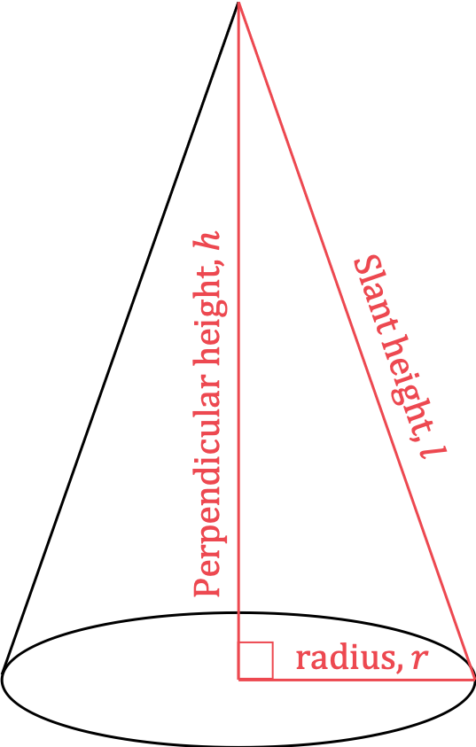

> *Find the slant height of the cone using Pythagoras' theorem, *$a^{2}+b^{2}=c^{2}$*.*

> *Substitute the values into the formula.*

$13.5^{2}+8^{2}=l^{2}$

**[1]**

> *Simplify.*

$246.25=l^{2}$

> *Take the square root of both sides.*

$\sqrt{246.25}=l$

$l=15.69235...$

$15.7$** cm** **[1]**
**A value of 15.69... will also be accepted.**

*iii) Substitute the value for the slant height into the given formula, *$A=πrl$*.* *Using the exact value for *$l$* will give you a more accurate answer.*

$A=π\times8\times15.69235...$

$A=394.39189...$

**394 cm****2** **[1]**
**If you use the rounded value from part ii) you may end up with an answer of 395 (3 s.f.), this will be accepted.**
**Any answer in the range 394.3 to 394.6... will also be accepted.**

### Q20
> *The shape is made up of a rectangle of length 3 m and width 1.2 m, and a circle (which has been separated into two halves) of diameter 1.2 m.*

> *Find the area of the rectangle*

$3\times1.2=3.6m^{2}$

*Find the area of the circle, even though it has been split in half we still need to find the area of one whole circle in total.* 
*The formula for the area of a circle is *$A=πr^{2}$

*Diameter = 1.2 m so radius = 0.6 m* 
$π\times0.6^{2}=1.130973355...m^{2}$

**[1]**

> *Add the two areas together*

$3.6+1.130973355...=4.730973355...$

**[1]**

$4.73m^{2}$ **[1]**

**Round to 3 significant figures**
> *A prism is a 3D shape which has the same cross section running throughout its length (or in this case depth), so the shape will look like this*

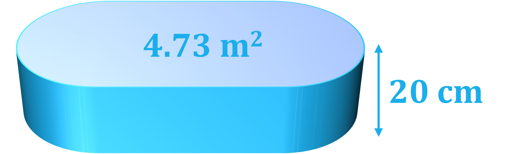

> *To find the volume of a prism, we can multiply the cross sectional area by the depth *
*It is important to use the same type of units, so we will convert the 20 cm to metres; 0.2 m*

$4.73m^{2}\times0.2m=0.946m^{3}$

**[1]**

> *The question asks for the number of litres, rather than m**3**, so we need to convert our answer *
*There are 1000 litres in 1 m**3**, so we need to multiply our answer by 1000*

> $0.946\times1000$* *

**[1]**

$946\mathrm{litres}$* ***[1] **
**946.0 to 942.2 allowed due to earlier rounding**
> *First find the difference in volume*

$1007\mathrm{litres}-946\mathrm{litres}=61\mathrm{litres}$

> *To make calculations with area and length easier, convert to m**3** using the fact that 1000 litres = 1 m**3*

$61\div1000=0.061m^{3}$

> *Recall that the volume of a prism is the cross sectional area (which was 4.73 m**2**) multiplied by the depth, *$d$

$0.061=4.73\timesd$

> *Divide both sides by 4.73*

$d=0.01289640592...m$

*Dividing volume by area [***1]**

> *Convert to cm as required by the question (100 cm in 1 metre)*

$0.01289640592\times100=1.289640592...\mathrm{cm}$

*Correct conversion between units ***[1]**
$1.29\mathrm{cm}$  **[1]** 
**1.284 to 1.290 allowed (due to earlier rounding) **

### Q21
*The volume of a prism is the area of its cross section multiplied by its length* 
*Find the area of the triangular cross section (using *$\frac{1}{2}\times$*base*$\times$*height)*

*area of the cross section = *$\frac{1}{2}\times6\timesh$

**[1]**

> *Find the volume of the prism (by multiplying the area of the cross section by 18) *

*volume of the prism = *$\frac{1}{2}\times6\timesh\times18$* *

> *Form an equation for *$h$* (by setting the volume of the prism equal to 253.8) *

$\frac{1}{2}\times6\timesh\times18=253.8$

**[1]**

*Write *$\frac{1}{2}\times6\times18$* as 54 and solve the equation (by dividing by 54)*

$54h=253.8\,h=\frac{253.8}{54}$

$h=4.7$ **[1]**
*Calculate the length of the diagonal on the triangle face (using Pythagoras' Theorem)* * *

$\sqrt{6^{2}+4.7^{2}}$

$6^{2}+4.7^{2}$* **correct ***[1]** 
*Correct with square root*** ****[1]**

*The total surface area is the sum of individual areas from five different faces* 
*Draw lengths on the diagram (to help see the areas)*

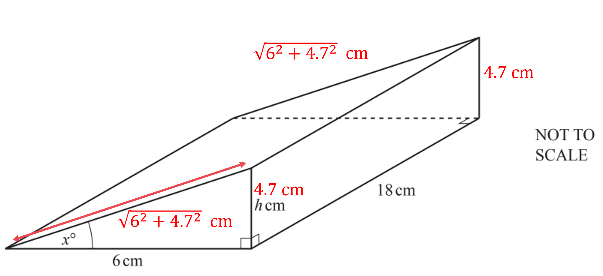

*Find the area of the triangle face at the front (using *$\frac{1}{2}\times$*base*$\times$*height)* * *

$\frac{1}{2}\times6\times4.7$ * *

> *This is the same area as the triangle face at the back*

*Triangle area for front and back** ***[1]**

*Find the area of the rectangular face on the side (using length *$\times$*width)* * *

$4.7\times18$

**[1]**

> *Find the area of the rectangular face on the top (using length *$\times$*width)*

> * *

$\sqrt{6^{2}+4.7^{2}}\times18$

* Find the area of the rectangular face on the bottom (using length width)* * *

$6\times18$

**[1]**

*Find the total surface area (by adding together the five individual areas)* * *

$\frac{1}{2}\times6\times4.7+\frac{1}{2}\times6\times4.7+4.7\times18+\sqrt{6^{2}+4.7^{2}}\times18+6\times18$

**358 cm****2** **[1]**

### Q22
i) *To be able to use the given formula to find the curved surface of the cone, we need to calculate the slant height, *$l$ 
*We can do this using Pythagoras*

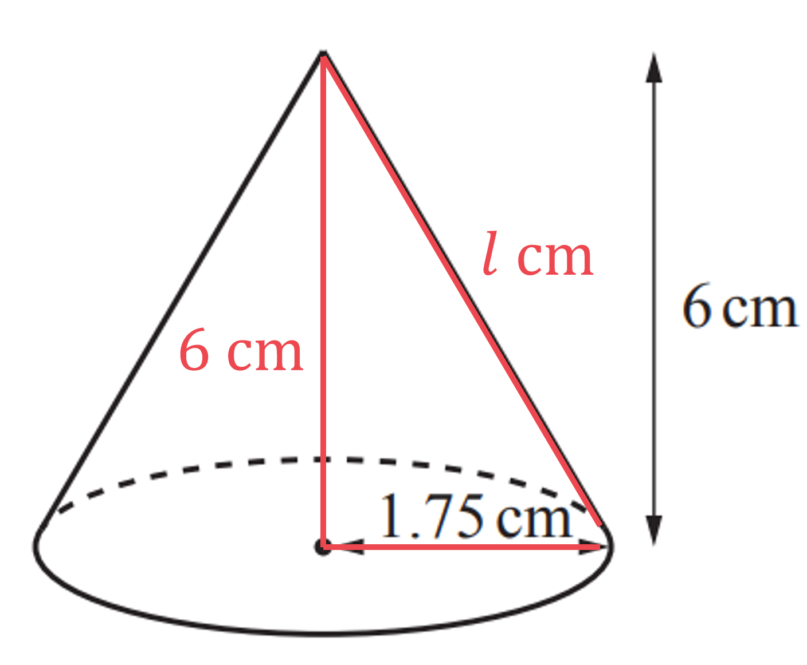

$l=\sqrt{1.75^{2}+6^{2}}=6.25\mathrm{cm}$

**[2]**

> *We can now use the given formula to find the curved surface of the cone*

$A=π\timesr\timesl\,A=π\times1.75\times6.25\,A=\frac{175}{16}π=34.36116965...\,$

**[1]**

> *Find the area of the circular base of the cone, using *$A=πr^{2}$

$π\times1.75^{2}=\frac{49}{16}π=9.621127502...$

*Sum the areas to find the total* 
*Use the most accurate values you can, so fractions and using **π **are preferable to decimals*

$\frac{175}{16}π+\frac{49}{16}π=14π=43.98229715...$

**[1]**

**44.0** **[1]**
 **Round to 3 significant figures**
> *The volume of the salt will be equal to the volume of the smaller empty cone shape at the top, subtracted from the volume of the larger, full cone*

> *The smaller cone has a height of 1.5 cm (6-4.5) and is an enlargement (or reduction in this case) of the large cone*

$\mathrm{Scale} \mathrm{Factor}=\frac{1.5}{6}=\frac{1}{4}$

**[1]**

> *We can then use this to find the radius of the smaller cone*

*Radius of smaller cone = *$\frac{1}{4}\times1.75=0.4375\mathrm{cm}$

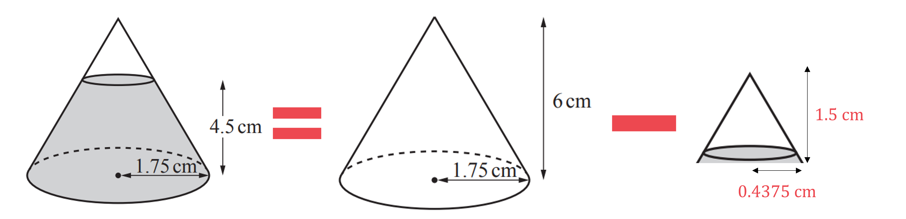

> *We can find the volume of both the large and small cones by using the formula given in the question*

> *Finding the volume of the large cone*

$V=\frac{1}{3}\timesπ\times1.75^{2}\times6=\frac{49}{8}π=19.242255...$

> *Finding the volume of the smaller cone*

$V=\frac{1}{3}\timesπ\times0.4375^{2}\times1.5=0.3006602344...$

**[1]**

> *Finding the difference*

$19.242255...-0.3006602344...=18.94159477...$

**[1]**

> *Round to 1 decimal place*

**18.9 cm****3** **[1]**
> *As the rate is stated in mm**3** per second, we should first change the volume of the salt, which is in cm**3**, to mm**3*

> *1 cm**3** is 1 cm × 1 cm × 1 cm, or 10 mm × 10 mm × 10 mm, so 1 cm**3** = 1000 mm**3*

$18.9\times1000=18900\mathrm{mm}^{3}$

**[1]**

> *Consider the units of 200 **mm**3** per second**, this is volume divided by (per) time*

$200 = \frac{volume ( \text{in} mm^{3} )}{time ( \text{in} \text{seconds} )}$

> *Filling in the known volume of the salt*

$200=\frac{18900}{\mathrm{time}}$

**[1]**

> *Multiply both sides by time, and then divide both sides by 200*

$\mathrm{time}=\frac{18900}{200}=94.5\mathrm{seconds}$

**95 s ****[1]**

### Q23
*First find the area of the sector - write 165 as a fraction of 360 and find this fraction of the area of the circle.* 
*The area of a circle is *$πr^{2}$*.*

*Sector Area*$=\frac{165}{360}\timesπ\times8^{2}=\frac{88}{3}π$

> *Again, do not round, write in terms of *$π$* and store exact values using your calculator's memory.*

**[1]**

> *Using the given formula we can now set up and solve an equation for the radius of the sphere.*

$4πr^{2}=\frac{88}{3}π\,r^{2}=\frac{88}{12}=\frac{22}{3}$

**[1]**

$r=\sqrt{\frac{22}{3}}=2.708012...$

**[1]**

$r=2.71$** ****cm**** [1]**
i) *The lengths **OA** and **OB** are equal and are the radius of the sector; this will be the slant height of the cone.*

$OA=OB=8$

> *The arc length of the sector will be the circumference of the circle of the base of the cone.*

*Arc length *$=\frac{165}{360}\times2\timesπ\times8=\frac{22}{3}π$

> *We can now set up and solve an equation for the radius, *$r$*, of the cone.*

$\frac{22}{3}π=2\timesπ\timesr$

**[1]**

$r = \frac{22}{6} = \frac{11}{3} = 3. \dot{6}$

$r=3.67$** ****cm**** [1]**

ii) *To find the volume of the cone we first need to find the height of the cone using Pythagoras' theorem (*$"a^{2}+b^{2}=c^{2}"$*).* 
*The slant height (**OA** = **OB**) is the radius of the sector, 8 cm.*

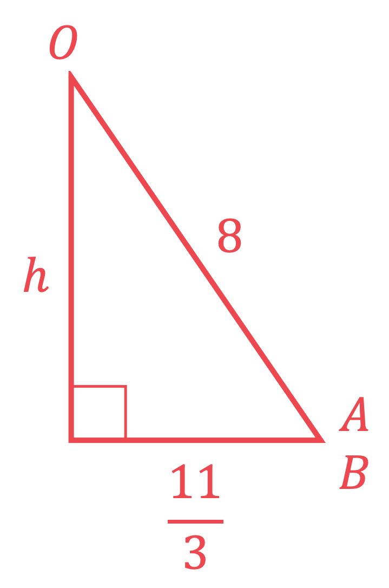

$\begin{array}{rcl} h^{2} + ( \frac{11}{3} )^{2} & = 8^{2} \end{array}$

**[1]**

$\begin{gathered} h^{2} & = \frac{455}{9} \\ h = 7.110 243 ... \end{gathered}$

**[1]**

*Store this in your calculator's memory.* 
*We can now apply the given volume formula.*

$V = 1 \frac{1}{3} \times \mathrm{\pi } \times ( 3. \dot{6} )^{2} \times 7.110 243 ...$

**[1]**

$V=100.105035...$

$V=100$ **cm****3** **[1]**

### Q24
i) *Substitute **r** = 8 and **l** = 17 into the formula given * * *

$A=π\times8\times17$

**[1]**

> *Use a calculator to work out this value, giving your answer to 3 significant figures*

**427 cm****2** **[1]**

ii) *The vertical height, **h**, is missing* 
*Find **h** using Pythagoras' Theorem* * *

$h^{2}+8^{2}=17^{2}$

**[1]**

*Make **h**2** the subject then square root both sides* * *

$h^{2}=17^{2}-8^{2}\,h=\sqrt{17^{2}-8^{2}}$

**[1]**

*Substitute **r** = 8 and **h =** *$\sqrt{17^{2}-8^{2}}$* **into the given volume formula* * *

$V=\frac{1}{3}\timesπ\times8^{2}\times\sqrt{17^{2}-8^{2}}$

**[1]**

> *Work out this value to 3 significant figures*

**1010 cm****3**** ****[1]**
**1005 or better will also be accepted**
i) *The conversion rate is 1 cm**3**  = 0.8 grams* *Convert 1010 cm**3** into grams (by multiplying by 0.8)*

*1010 *$\times$* 0.8 = 808*

**808 g** **[1]** 
**804 and between 804.2 to 804.4 are also accepted (depending on previous rounding)**

ii) *The mass of the cone and the box is 1.2 kg* 
*Change kg into g (by multiplying by 1000)* * *

*1.2 *$\times$* 1000 = 1200 grams* * *

*Find the mass of the box (by subtracting the mass of the cone, 808 g, from the combined mass above, 1200 g)*

*1200 - 808*

**392 g**** [1] **
**396 and between 395.6 to 395.8 are also accepted (depending on previous rounding)**

### Q25
> *Divide the volume of the prism into 6 equal parts.*

$500 \div 6 = 83. \dot{3} \text{or} \frac{250}{3}$

> *(It's a good idea to store the *$83. \dot{3}$* in your calculator, or use *$\frac{250}{3}$* to keep the final answer as accurate as possible).*

> *Substitute this volume into the given formula for the volume of a sphere.*

$\frac{250}{3}=\frac{4}{3}πr^{3}$

**[1]**

> *Rearrange and solve for *$r$*.*

`| 250 / 3 / 4 / 3 pi | = r ^3 | | r = cbrt( 250 / 3 / 4 / 3 pi ) | |`

**[1]**

$=2.709630351...$

**Answer = 2.71 cm** **[1]**
**Any version of "2.709630351..." rounded to at least 3 significant figures is accepted**

### Q26
> *Substitute the radius of 15 cm into the formula for the volume of a sphere (given in the question).*

`| V | = 4 / 3 pi r ^ 3 | | _ = 4 / 3 pi stretchy ( 15 stretchy ) ^ 3 | | _ = 4500 pi | | _ = 14137.1669... | |`

$V=14140\mathrm{cm}^{3}(4s.f)$

*Substituting 15 into the formula*** [1] **
*Calculating the value correctly*** [1]**
i) *The volume of water needed will be the volume of the cylindrical tank minus the volume of the sphere.*

> *Find the volume of the cylindrical tank. *
*Formula for volume of a cylinder: *$V=πr^{2}h$*, where *$r$* is the radius and *$h$* is the depth of the tank.*

> * Substitute *$r=25$* and *$h=60$* into the formula. *

$\begin{gathered} V_{( \tan k )} & = \pi ( 25 )^{2} ( 60 ) \\ = 37500 \pi \end{gathered}$

**[1]**

> *Subtract the volume of the sphere from the volume of the tank. Using exact values for both is better practice and will give you the most accurate possible answer. *

$\begin{gathered} V_{( w a t e r )} & = V_{( t a n k )} - V_{( s p h e r e )} \\ = 37500 \pi - 4500 \pi \\ = 33000 \pi \end{gathered}$

**[1]**

> *Use your calculator to find the solution.  *

$\begin{gathered} V_{( w a t e r )} & = 33000 \pi = 103672.557... \end{gathered}$

$\begin{array}{ccc} V_{stretchy} ( w a t e r \text{stretchy} ) & = & 103700 cm^{ } 3\end{array}$ **[1]**
**Final mark awarded for any answer that rounds to this.**

ii) *The volume of the water has not changed so depth of the water can be found by modelling the volume of water found in part (i) as a cylinder and solving for the height.*

> * Formula for volume of a cylinder: *$V=πr^{2}h$*, where *$r$* is the radius and *$h$* is the depth of the water.*

> * Substitute *$r=25$* and *$V=33000π$*  into the formula. It is a good idea to leave your answer in terms of *$π$* for the next part of your calculation.*

> * *$\begin{gathered} V_{( w a t e r )} & = \pi r^{2} d \\ 33000 \pi & = ( 25 )^{2} \pi d \end{gathered}$

> * Cancel *$π$* from both sides of the equation.*

$\begin{gathered} 33000 = 625 d \end{gathered}$

**[1]**

> * Solve by dividing both sides by 625.*

$\begin{gathered} d & = \frac{ 33000}{625} = 52.8 \end{gathered}$

$\begin{gathered} d & = 52 . 8 \text{cm} \end{gathered}$ **[1]**

### Q27
*The pipe is a cuboid.* 
*In one second the water has increased by a length of 20 cm.*

> *Convert one hour into seconds.*

*1 hour = 60 minutes = 60 × 60 seconds = 3600 seconds*

> *Find the length of water along the cuboid after 3600 seconds.*

*1 second is 20 cm* 
*3600 seconds is 3600 × 20 cm = 72000 cm*

**[1]**

*Find the volume of this water.* 
*The formula for the volume of a cuboid is *$V=h\timesw\timesl$*, where **V** is the volume,and **h, w, l **are the three perpendicular lengths.*

> *Substitute the values into the formula to find the volume.  *
*The units for the lengths were in cm, therefore the units for volume is cm**3**.*

$V=2.5\times15\times72000=2700000\mathrm{cm}^{3}$

**[1]**

*1000 cm**3** = 1 litre.* 
*Divide the volume in cm**3** by 1000 to get the volume in litres.*

$V=\frac{2700000}{1000}\mathrm{litres}$

**[1]**

**2700 litres** **[1]**

### Q28
*Volume of a prism = cross-section area × length.* 
*We need to find the cross-section area, which is the area of the regular hexagon. Because the hexagon is regular, it can be split into 6 equilateral triangles as below.*

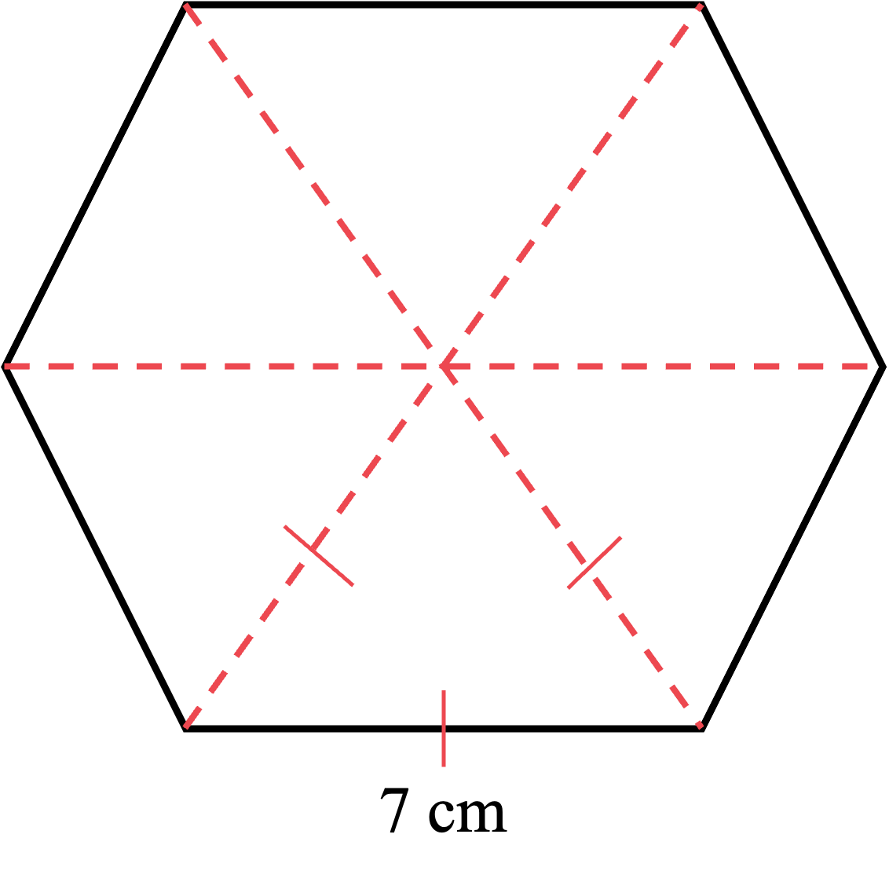

> *As the triangles are equilateral, their internal angles are all 60° and the lengths are 7 cm. *
*We can use area of a triangle = *$\frac{1}{2}ab\mathrm{sin}C$* to find the area of one triangle.*

$\Delta \text{area} = 1 \frac{1}{2} \times 7 \times 7 \times \sin 60 ( = 21.21762239... )$

*Correct angle; 60°*** [1] **
*Rest of formula*** [1]**

> *And we can multiply this by 6 for the area of the hexagon.*

$\text{Hexagon} \text{area} = 6 \times 1 \frac{1}{2} \times 7 \times 7 \times \sin 60 ( = 127.3057344... )$

**[1]**

> *This (cross-sectional) area multiplied by the length 15.2 cm gives the volume.*

$\mathrm{Volume}=15.2\times6\times\frac{1}{2}\times7\times7\times\mathrm{sin}60$

**[1]**

$=1935.047162...$

**1935 cm****3** **[1]**
> *Consider the net of a hexagonal prism.*

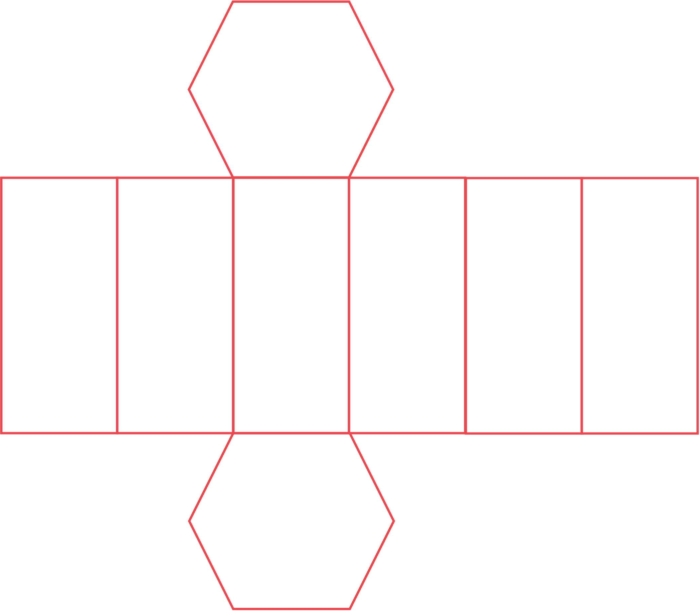

*The surface area is made up of six identical rectangles and 2 identical hexagons.* 
*From part i) the area of one hexagon is*

$\text{Hexagon} \text{area} = 6 \times 1 \frac{1}{2} \times 7 \times 7 \times \sin 60 ( = 127.3057344... )$

> *Each rectangle has a width of 7 cm and a length of 15.2 cm.*

$\mathrm{Rectangle} \mathrm{area}=7\times15.2=106.4$

**[1]**

> *So the total surface area of the hexagonal prism is*

$\begin{gathered} \text{Surface} \text{area} & = 2 \times 127.305 734 ... + 6 \times 106.4 \end{gathered}$

**[1]**

$\begin{gathered} \text{Surface} \text{area} & = 254.611 468 ... + 638.4 \\ = 893.011 468 ... \end{gathered}$

**893 cm****2** **[1]**

### Q29
> *Convert the thickness to cm to make the units consistent. 10 mm = 1 cm.*

*15 mm = 1.5 cm*

> *The volume of a prism, **V**, is its cross-section area, **A**, multiplied by its length, **l**. *$V=A\timesl.$

*Volume = 77.44 × 1.5 = 116.16 cm**3*

**[1]**

> *1 cm**3** weighs 19 grams. Multiply the volume by 19 to get its mass in grams.*

*Mass = 116.16 × 19 = 2207.04 g*

> *1 kg = 1000 g. Convert to kilograms by dividing by 1000.*

*Mass = 2207.04 ÷ 1000*

**[1]**

**Mass is 2.20704 kg** **[1]**

### Q30
> *Using the formula given in the question, the curved surface area of the cone is*

$A=π\times1.65\times4.70=\frac{1551}{200}π$

> *A cone also has a circular base; the formula for the area of a circle is *$πr^{2}$*.*

$πr^{2}=π\times1.65^{2}=\frac{1089}{400}π$

> *So the total surface area of the cone is given by*

$\frac{1551}{200}π+\frac{1089}{400}π=\frac{4191}{400}π=32.916037...$

**[1] **

$32.9\mathrm{cm}^{3}$* ***[1]**
> *To find the volume of the cone, we first need to find the height of the cone. *
*We have the right-angled triangle below.*

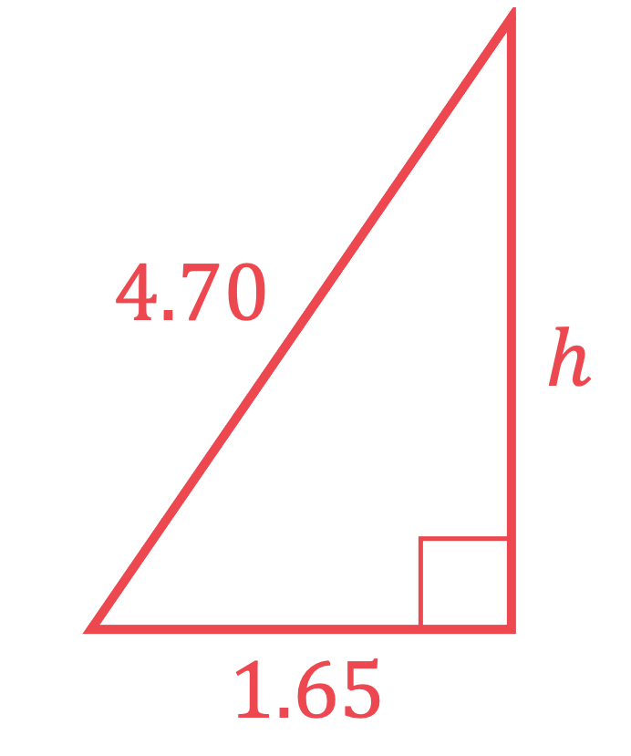

> *Use Pythagoras' theorem (*$a^{2}+b^{2}=c^{2}$*) to find the height.*

$1.65^{2}+h^{2}=4.70^{2}$

**[1]**

$h=\sqrt{4.70^{2}-1.65^{2}}$

**[1]**

$h=4.400852...$

*Do not round - store this value in your calculator's for possible later use.* 
*We can now apply the volume formula given in the question.*

$V = 1 \frac{1}{3} \times \mathrm{\pi } \times ( 1.65 )^{2} \times 4.400 582 ... = 12.546 809 ...$

**[1]**

> *Round for the answer line but also store the exact value in your calculator's memory for possible later use.*

$V=12.5\mathrm{cm}^{3}$ **[1]**
> *Start by finding the volume of the sphere that is melted down using the given formula.*

$V=\frac{4}{3}\timesπ\times5^{3}=\frac{500}{3}π$

**[1]**

> *We now need to find how many cones (of volume found in part i)) can be made from this volume using division.*

$\frac{500}{3}π\div12.546809...=41.731628...$

**[1] **
**Answer from 41.7 to 41.9**** [1]**

> *The question asks for the complete number of cones that can be made so the answer must be a whole number.*

**Number of cones that can be made is 41**** [1]**

### Q31
> *i) If you unrolled a cylinder, the curved surface would look like a rectangle with a height the same as the cylinder and the length the same as the circumference of the cylinder.*

> *The circumference of the cylinder can be found using the formula, *$C=2πr$*.*

> *Find the area of the rectangle formed by the unrolled cylinder using the formula, *$A=l\timesw$*, where *$l$* is the height of the cylinder and *$w$* is the circumference.*

$A=19\times2\timesπ\timesr$

**[1]**

$A=304π$

> *Use your calculator to find the decimal value.*

$A=955.04416...$

**955 m****2** **[1]**
**Using the value of 3.14 for **$π$** is ok, any answer between 955.0 and 955.2 will be accepted.**

*ii) Multiply the area by the cost per square metre.* *It's always best to use the full answer from a previous calculator. You can use the memory function in your calculator to store a value for later use.*

$955.04416...\times0.85=811.78754...$

**[1]**

**\$812** **[1]**
**A range of answers from 811.7 to 811.9 will be accepted.**

### Q32
> *The volume of a cuboid is length × width × height, and in this case is equal to 600 cm**3**. If the height is **h** then*

*10 × 12 × ***h*** = 600*

**[1]**

*120***h*** = 600*

> *Divide both sides by 120 to find **h*

**Answer = 5 cm ****[1]**
> *You are given the formula for the volume of a sphere. Volume = *$\frac{4}{3}πr^{3}$* where *$r$* is the radius  *

> *Therefore the volume of the spheres is *

$1120\times\frac{4}{3}π\times0.45^{3}$

**[1]**

*= 427.507028... cm**3*

> *Subtract this from the original 600 cm**3** of cuboid*

*600 − 427.507028... = 172.492072... cm**3 *

> *Round your answer to at least 3 significant figures*

**172 cm****3**** [1]** 
**172.4 cm****3**** to 172.5 cm****3**** is accepted**

### Q33
> *The formula for the volume of a cuboid is *$V=l\timesw\timesh$*, where **l **and **w** are the lengths of the two perpendicular sides of a rectangular face and **h** is the length of the side that is perpendicular to that face.*

*8 × 4 × 6.5*

**208 cm****3** **[1]**

### Q34
*The surface is made up of 3 pairs of rectangles.* *Find the area of each rectangle.*

*Front/Back : 12 × 7.5 = 90* 
*Sides : 5 × 7.5 = 37.5*
 *Top/Bottom : 12 × 5 = 60*

**[1]**

> *Add the three areas together and then double.*

*2 × (90 + 37.5 + 60)*

**[1]**

**375 cm****2** **[1]**

### Q35
> *Calculate the area of each rectangular face.*

*Front and back:* $2 ( 9.5 \times 7 ) = 133$
*Top and bottom: *$2 ( 9.5 \times 5 ) = 95$* *
*Sides:* $2 ( 5 \times 7 ) = 70$

* For one correct area*** [1]**

> *Add together all of the areas to find the total surface area.*

$133+95+70$

**[1]**

$298$ **cm****2**** [1]**

### Q36
> *A cuboid is made up from 3 pairs of opposite, identical faces. Calculate the area of each of face and add them together to find the total surface area of the cuboid.*

*Top/bottom: *$6\times1.5=9$

**[1]**

*Front/back: *$6\times1.5=9$

*Side: *$1.5\times1.5=2.25$

> *Add together each of the faces and multiply by two to take into account that for each face, the opposite face has the same area.*

*Total area = *$2 \times ( 9 + 9 + 2.25 )$

**[1]**

$40.5\mathrm{cm}^{2}$* ***[1]**
