# Exam Questions — Volume & Surface Area
**Lengths, Areas & Volumes** · Cambridge (CIE) IGCSE maths (0580 & 0980)
> Source: [https://www.savemyexams.com/igcse/maths/cie/25/extended/topic-questions/](https://www.savemyexams.com/igcse/maths/cie/25/extended/topic-questions/) · 36 questions across 1 sets

## Calculator Questions (36 questions)

### Q1 — hard — 4 marks

**Q1** [2 marks]

A solid metal cylinder has a volume of $450π\mathrm{cm}^{3}$.

The base of the cylinder has a radius of 5 cm.

Calculate the height of the cylinder.

.......................................... cm

**Q1** [2 marks]

**Extract:**

A solid metal cylinder has a volume of \[450 \pi cm^{3}\].

The solid metal cylinder is melted down and made into 2990 cubes, each with a side length of 0.75 cm.

Find the volume of metal **not** used in making these cubes.

......................................... cm3

### Q2 — medium — 8 marks

**Q2** [1 mark]

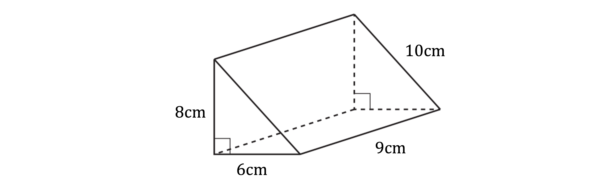

Write down the name of the 3D shape in the diagram.

**Q2** [4 marks]

Calculate the surface area of the shape.

Include units in your answer.

**Q2** [3 marks]

Work out the volume of the shape.

Include units in your answer.

### Q3 — very_hard — 4 marks

**Q3** [4 marks]

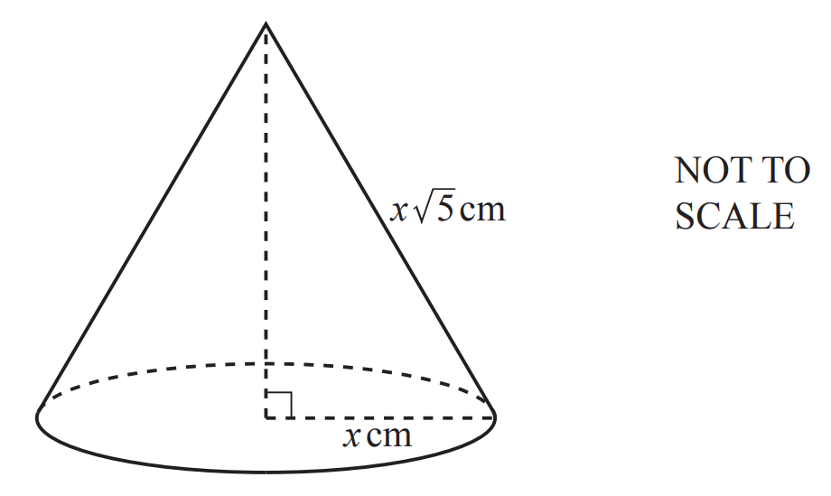

A cone has radius $x$ cm and slant height $x\sqrt{5}$ cm. The volume of the cone is 1000 cm3.

Calculate the value of $x$.
 [The volume, $V$, of a cone with radius $r$ and height $h$ is $V=\frac{1}{3}πr^{2}h$.]

$x=$ ....................................................

*Source: 2019	May/June 0580/41 Q10C*

### Q4 — very_hard — 6 marks

**Q4** [6 marks]

The diagram shows a prism with a rectangular base, *ABFE*. 
The cross-section, *ABCD*, is a trapezium with *AD* = *BC*.
 *AB* = 8 cm, *GH* = 5 cm, *BF* = 12 cm and angle *ABC* = 70°.

Calculate the total surface area of the prism.

.......................................... cm2

*Source: 2020 Oct/Nov 0580/42 Q9A*

### Q5 — medium — 4 marks

**Q5** [4 marks]

The lake behind a dam has an area of 55 hectares. 
When the gates in the dam are open, water flows out at a rate of 75 000 litres per second.

i) Show that 90 million litres of water flows out in 20 minutes.

[1]

ii) Beneath the surface, the lake has vertical sides.

Calculate the drop in the water level of the lake when the gates are open for 20 minutes. 
Give your answer in centimetres. 
[1 hectare = 104 m2, 1000 litres = 1 m3]

.......................................... cm [3]

*Source: 2018	Oct/Nov 0580/42 Q10A*

### Q6 — hard — 3 marks

**Q6** [3 marks]

A pipe is full of water. 
The cross-section of the pipe is a circle, radius 2.6 cm. 
Water flows through the pipe into a tank at a speed of 12 centimetres per second.

Calculate the number of litres that flow into the tank in one hour.

............................................ litres

*Source: 2019 March 0580/22 Q18*

### Q7 — hard — 3 marks

**Q7** [3 marks]

A cone with height 14.8 cm has volume 275 cm3.

Calculate the radius of the cone. 
[The volume, $V$, of a cone with radius $r$ and height $h$ is $V=\frac{1}{3}πr^{2}h$.]

............................................... cm

*Source: 2019 March 0580/22 Q12*

### Q8 — hard — 3 marks

**Q8** [3 marks]

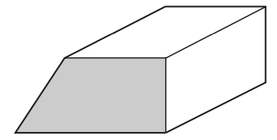

The diagram shows a solid metal prism.
The volume of the prism is 2187 cm3. 
The larger prism is melted down into a sphere.

Calculate the radius of the sphere. 
[The volume, $V$, of a sphere with radius $r$ is $V=\frac{4}{3}πr^{3}$ .]

.............................................. cm

*Source: 2019	Oct/Nov 0580/43 Q6B*

### Q9 — medium — 4 marks

**Q9** [4 marks]

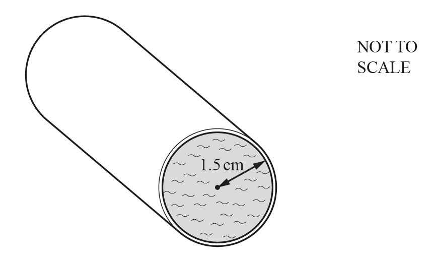

Water flows through a cylindrical pipe at a speed of 8 cm/s. 
The radius of the circular cross-section is 1.5 cm and the pipe is always completely full of water.

Calculate the amount of water that flows through the pipe in 1 hour. 
Give your answer in litres.

....................................... litres

*Source: 2018	May/June 0580/43 Q7A*

### Q10 — hard — 4 marks

**Q10** [4 marks]

A pipe is completely full of water.
Water flows through the pipe at a speed of 1.2 m/s into a tank. The cross-section of the pipe has an area of 6 cm2.

Calculate the number of litres of water flowing into the tank in 1 hour.

.......................................... litres

*Source: 2019	Oct/Nov 0580/21 Q22-*

### Q11 — medium — 3 marks

**Q11** [3 marks]

Water from Manjeet’s shower flows at a rate of 12 litres per minute. 
The water from the shower flows into a tank that is a cuboid of length 90 cm and width 75 cm.

Calculate the increase in the level of water in the tank when the shower is used for 7 minutes.

............................................ cm

*Source: 2020 March 0580/42 Q3C*

### Q12 — hard — 4 marks

**Q12** [4 marks]

The cross-section of a prism is an equilateral triangle of side 6cm.
The length of the prism is 20 cm.

Calculate the total surface area of the prism.

......................................... cm2

*Source: Specimen 2025 0580/04 Q19*

### Q13 — very_hard — 6 marks

**Q13** [3 marks]

The volume of a solid metal sphere is $24430\text{cm}^{3}$.
Calculate the radius of the sphere. 
[The volume, $V$, of a sphere with radius $r$ is $V=\frac{4}{3}πr^{3}$.]

......................................... cm

*Source: 2019	May/June 0580/42 Q10A*

**Q13** [3 marks]

The metal sphere is placed in an empty tank. 
The tank is a cylinder with radius $50\text{cm}$, standing on its circular base. 
Water is poured into the tank to a depth of $60\text{cm}$.

Calculate the number of litres of water needed.

...................................... litres

*Source: 2019	May/June 0580/42 Q10A*

### Q14 — very_hard — 6 marks

**Q14** [3 marks]

A cylinder with radius 6 cm and height $h$ cm has the same volume as a sphere with radius 4.5 cm.

Find the value of $h$.
 [The volume, $V$, of a sphere with radius $r$ is $V=\frac{4}{3}πr^{3}$.]

$h=$................................................

*Source: 2020 May/June 0580/42 Q8B*

**Q14** [3 marks]

A solid metal cube of side 20 cm is melted down and made into 40 solid spheres, each of radius $r$ cm.

Find the value of $r$. 
[The volume, $V$, of a sphere with radius $r$ is $V=\frac{4}{3}πr^{3}$.]

$r=$................................................

*Source: 2020 May/June 0580/42 Q8C*

### Q15 — hard — 6 marks

**Q15** [3 marks]

A solid hemisphere has volume 230 cm3.

Calculate the radius of the hemisphere. 
[The volume, $V$, of a sphere with radius $r$ is $V=\frac{4}{3}πr^{3}$.]

.......................................... cm

*Source: 2018	May/June 0580/41 Q6A*

**Q15** [3 marks]

**Extract:**

A solid cylinder with radius 1.6 cm is attached to the hemisphere to make a toy.
The total volume of the toy is 300 cm^3^.
A solid hemisphere has volume 230 cm^3^.

A solid cylinder with radius 1.6 cm is attached to the hemisphere to make a toy.

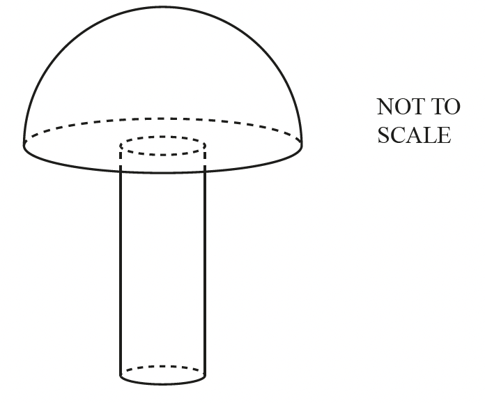

The total volume of the toy is 300 cm3.

Calculate the height of the cylinder.

.......................................... cm

*Source: 2018	May/June 0580/41 Q6B*

### Q16 — hard — 7 marks

**Q16** [3 marks]

A sphere has radius $x$ cm. The volume of the sphere is 1000 cm3.

Calculate the value of $x$. 
[The volume, $V$, of a sphere with radius $r$ is $V=\frac{4}{3}πr^{3}$.]

$x=$..........................................................

*Source: 2019	May/June 0580/41 Q10B*

**Q16** [4 marks]

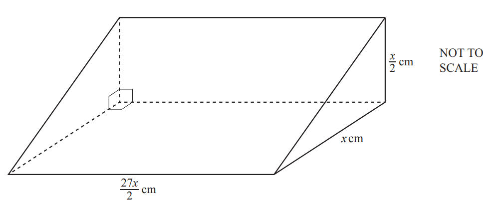

The diagram shows a prism with a right-angled triangle as its cross-section. The volume of the prism is 1000 cm3.

Calculate the value of $x$.

$x=$...................................................

*Source: 2019	May/June 0580/41 Q10D*

### Q17 — hard — 6 marks

**Q17** [6 marks]

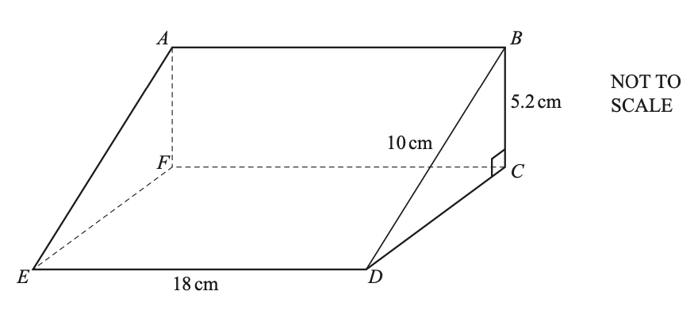

The diagram shows a prism *ABCDEF*.
 The cross-section is a right-angled triangle *BCD*.
 *BD* = 10 cm, *BC* = 5.2 cm and *ED* = 18 cm.

Work out the volume of the prism.

............................................. cm3

*Source: 2019	Oct/Nov 0580/42 Q4B*

### Q18 — very_hard — 6 marks

**Q18** [2 marks]

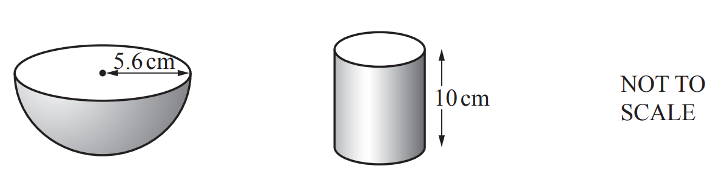

The diagram shows a hemispherical bowl of radius 5.6 cm and a cylindrical tin of height 10 cm.

Show that the volume of the bowl is 368 cm3, correct to the nearest cm3. 
[The volume, $V$, of a sphere with radius $r$ is $V=\frac{4}{3}πr^{3}$. ]

*Source: 2019	May/June 0580/43 Q4A*

**Q18** [4 marks]

**Extract:**

The diagram shows a hemispherical bowl of radius 5.6 cm and a cylindrical tin of height 10 cm.

Show that the volume of the bowl is 368 cm^3^, correct to the nearest cm^3^. 

[The volume, V, of a sphere with radius r is V = (4/3)πr^3.]

The tin is completely full of soup. 
When all the soup is poured into the empty bowl, 80% of the volume of the bowl is filled.

Calculate the radius of the tin.

......................................... cm

*Source: 2019	May/June 0580/43 Q4A*

### Q19 — hard — 5 marks

**Q19** [5 marks]

A solid metal sphere with radius 6 cm is melted down and all of the metal is used to make a solid cone with radius 8 cm and height $h$ cm.

i) Show that $h=13.5$.
 [The volume, $V$, of a sphere with radius $r$ is $V=\frac{4}{3}πr^{3}$.] 
[The volume, $V$, of a cone with radius $r$ and height $h$ is $V=\frac{1}{3}πr^{2}h$.]

[2]

ii) Calculate the slant height of the cone.

.............................................. cm [2]

iii) Calculate the curved surface area of the cone. 
[The curved surface area, $A$, of a cone with radius $r$ and slant height $l$ is $A=πrl$.]

............................................. cm2 [1]

*Source: 2019	Oct/Nov 0580/41 Q4B*

### Q20 — hard — 9 marks

**Q20** [3 marks]

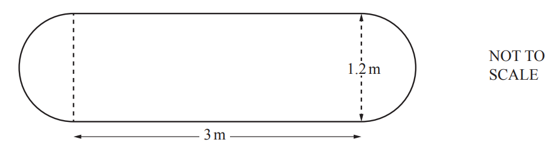

The diagram shows the surface of a garden pond, made from a rectangle and two semicircles. 
The rectangle measures 3 m by 1.2 m.

Calculate the area of this surface.

...............................................m2

*Source: 2019	May/June 0580/41 Q5A*

**Q20** [3 marks]

**Extract:**

The diagram shows the surface of a garden pond, made from a rectangle and two semicircles. The rectangle measures 3 m by 1.2 m. The pond is a prism and the water in the pond has a depth of 20 cm.

The pond is a prism and the water in the pond has a depth of 20 cm.

Calculate the number of litres of water in the pond.

........................................... litres

*Source: 2019	May/June 0580/41 Q5B*

**Q20** [3 marks]

**Extract:**

The diagram shows the surface of a garden pond, made from a rectangle and two semicircles. 

The rectangle measures 3 m by 1.2 m.

Calculate the area of this surface.

After a rainfall, the number of litres of water in the pond is 1007.

Calculate the increase in the depth of water in the pond. 
Give your answer in centimetres.

.............................................. cm

*Source: 2019	May/June 0580/41 Q5C*

### Q21 — hard — 9 marks

**Q21** [3 marks]

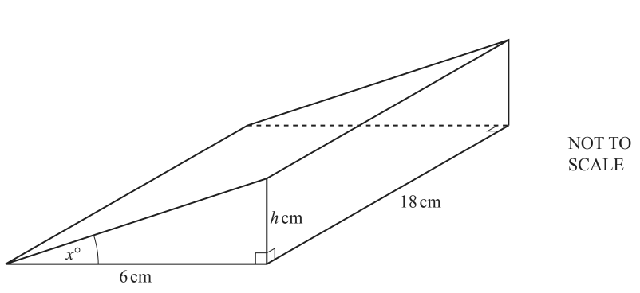

The diagram shows a prism with length 18 cm and volume 253.8 cm3. 
The cross-section of the prism is a right-angled triangle with base 6 cm and height $h$ cm.

Show that the value of $h$ is 4.7 .

*Source: 2018	Oct/Nov 0580/41 Q5A*

**Q21** [6 marks]

**Extract:**

The diagram shows a prism with length 18 cm and volume 253.8 cm^3^. The cross-section of the prism is a right-angled triangle with base 6 cm and height h. Show that the value of h is 4.7 .

Calculate the total surface area of the prism.

........................................ cm2

*Source: 2018	Oct/Nov 0580/41 Q5B*

### Q22 — very_hard — 12 marks

**Q22** [5 marks]

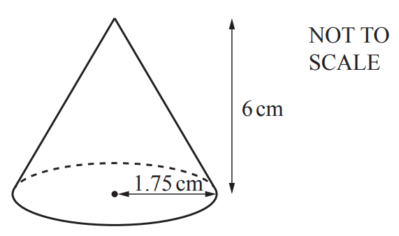

The diagram shows a cone with radius 1.75 cm and height 6 cm.

Calculate the total surface area of the cone.
[The curved surface area, $A$, of a cone with radius $r$ and slant height $l$ is $A=πrl$.]

........................................ cm2

*Source: 2019	May/June 0580/43 Q4B*

**Q22** [4 marks]

**Extract:**

The diagram shows a cone with radius 1.75 cm and height 6 cm.

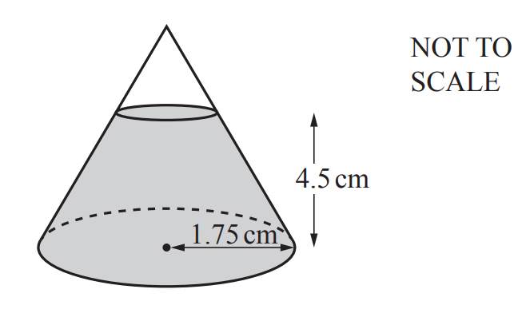

The cone contains salt to a depth of 4.5 cm. 
The top layer of the salt forms a circle that is parallel to the base of the cone.

Show that the volume of the salt inside the cone is 18.9 cm3, correct to 1 decimal place.
 [The volume, $V$, of a cone with radius $r$ and height $h$ is $V=\frac{1}{3}πr^{2}h$. ]

*Source: 2019	May/June 0580/43 Q4B*

**Q22** [3 marks]

**Extract:**

Show that the volume of the salt inside the cone is 18.9 cm^3, correct to 1 decimal place.

The salt is removed from the cone at a constant rate of 200 mm3 per second.

Calculate the time taken for the cone to be completely emptied. 
Give your answer in seconds, correct to the nearest second.

............................................. s

*Source: 2019	May/June 0580/43 Q4B*

### Q23 — hard — 10 marks

**Q23** [4 marks]

The diagram shows a sector of a circle with centre $O$, radius 8 cm and sector angle 165°. 
The surface area of a sphere is the same as the area of the sector.

Calculate the radius of the sphere. 
[The surface area, $A$, of a sphere with radius $r$ is  $A=4πr^{2}.$ ]

............................................ cm

*Source: 2020	May/June 0580/41 Q9B*

**Q23** [6 marks]

**Extract:**

The diagram shows a sector of a circle with centre O, radius 8 cm and sector angle 165°.

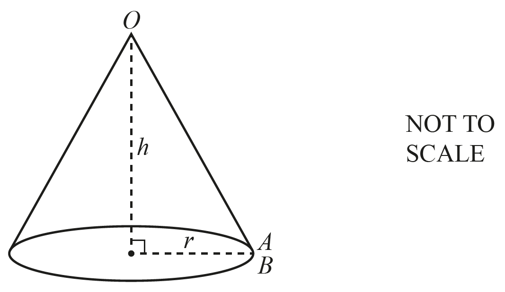

A cone is made from the sector by joining $OA$ to $OB$.

i) Calculate the radius, $r$, of the cone.

$r=$ ........................................... cm [2]

ii) Calculate the volume of the cone.

[The volume, $V$, of a cone with radius $r$ and height $h$ is  $V=\frac{1}{3}πr^{2}h.$ ]

.......................................... cm3 [4]

*Source: 2020	May/June 0580/41 Q9C*

### Q24 — hard — 8 marks

**Q24** [6 marks]

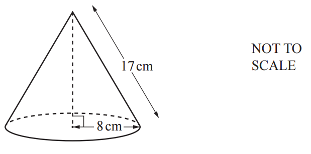

The diagram shows a solid cone. 
The radius is 8 cm and the slant height is 17 cm.

i) Calculate the curved surface area of the cone. 
[The curved surface area, $A$, of a cone with radius $r$ and slant height $l$ is $A=πrl$.]

........................................... cm2 [2]

ii) Calculate the volume of the cone. 
[The volume, $V$, of a cone with radius $r$ and height $h$ is $V=\frac{1}{3}πr^{2}h$.]

........................................... cm3 [4]

*Source: 2018	Oct/Nov 0580/43 Q3A*

**Q24** [2 marks]

**Extract:**

Calculate the volume of the cone. [The volume, V, of a cone with radius r and height h is V = (1/3)πr^2h.] ........................................... cm^3^ [4]

i) The cone is made of wood and 1 cm3 of the wood has a mass of 0.8 g.

Calculate the mass of the cone.

............................................... g [1]

ii) The cone is placed in a box. 
The total mass of the cone and the box is 1.2 kg.

Calculate the mass of the box. 
Give your answer in grams.

............................................... g [1]

*Source: 2018	Oct/Nov 0580/43 Q3A*

### Q25 — very_hard — 3 marks

**Q25** [3 marks]

A solid metal prism with volume 500 cm3 is melted and made into 6 identical spheres.

Calculate the radius of each sphere. 
[The volume, $V$, of a sphere with radius $r$ is $V=\frac{4}{3}πr^{3}$.]

........................................... cm

*Source: 2018	Feb/Mar 0580/42 Q5B*

### Q26 — hard — 7 marks

**Q26** [2 marks]

Show that the volume of a metal sphere of radius 15 cm is 14 140 cm3, correct to 4 significant figures.

[The volume, $V$, of a sphere with radius $r$ is $V=\frac{4}{3}πr^{3}$.]

*Source: specimen 2020 0580/04 Q10A*

**Q26** [5 marks]

i) The sphere is placed inside an empty cylindrical tank of radius 25 cm and height 60 cm. 
The tank is filled with water.

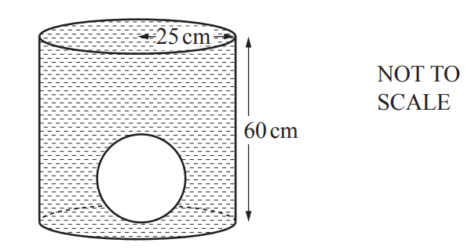

Calculate the volume of water needed to fill the tank.

......................................... cm3 [3]

ii) The sphere is removed from the tank.

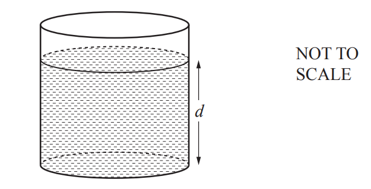

Calculate the depth, $d$, of water in the tank.

$d=$ ......................................... cm [2]

*Source: specimen 2020 0580/04 Q10B*

### Q27 — medium — 4 marks

**Q27** [4 marks]

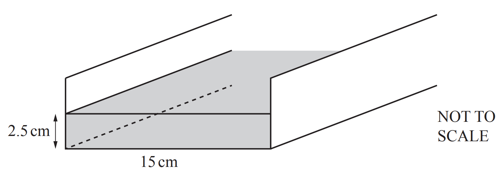

Water flows at a speed of 20 cm/s along a rectangular channel into a lake.
The width of the channel is 15 cm. 
The depth of the water is 2.5 cm.

Calculate the amount of water that flows from the channel into the lake in 1 hour.
Give your answer in litres.

........................................ litres

*Source: 2020 May/June 0580/43 Q6B*

### Q28 — very_hard — 8 marks

**Q28** [5 marks]

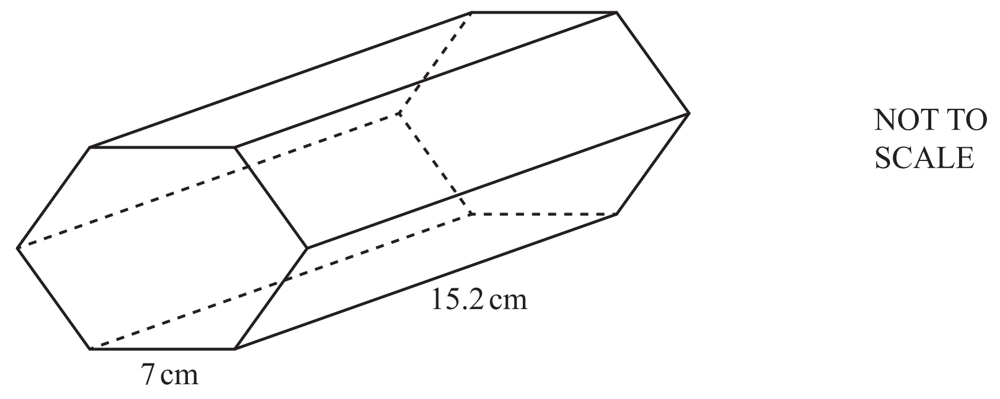

The diagram shows a solid prism with length 15.2 cm. The cross-section of this prism is a **regular** hexagon with side 7 cm.

Calculate the volume of the prism.

......................................... cm3

*Source: 2018	Feb/Mar 0580/42 Q5A*

**Q28** [3 marks]

**Extract:**

The diagram shows a solid prism with length 15.2 cm. The cross-section of this prism is a regular hexagon with side 7 cm.

Calculate the total surface area of the prism.

......................................... cm2

*Source: 2018	Feb/Mar 0580/42 Q5A*

### Q29 — hard — 3 marks

**Q29** [3 marks]

A gold model is made. 
This model is a prism with a cross-section of area 77.44 cm2.

This gold model is 15 mm thick. 
One cubic centimetre of gold has a mass of 19 grams.

Calculate the mass of the gold model in kilograms.

.............................................. kg

*Source: 2019 March 0580/42 Q6C*

### Q30 — very_hard — 10 marks

**Q30** [2 marks]

A solid metal cone has radius 1.65 cm and slant height 4.70 cm.

Calculate the **total** surface area of the cone. 
[The curved surface area, $A$, of a cone with radius $r$ and slant height $l$ is $A=πrl$.]

.......................................... cm2

*Source: 2020 March 0580/42 Q4A*

**Q30** [4 marks]

**Extract:**

A solid metal cone has radius 1.65 cm and slant height 4.70 cm.

Calculate the volume of the cone.
 [The volume, $V$, of a cone with radius $r$ and height $h$ is $V=\frac{1}{3}πr^{2}h$.]

.......................................... cm3

*Source: 2020 March 0580/42 Q4C*

**Q30** [4 marks]

**Extract:**

A solid metal cone has radius 1.65 cm and slant height 4.70 cm.

Calculate the volume of the cone.

 [The volume, V, of a cone with radius r and height h is V = 1/3 π r^2 h.]

A metal sphere with radius 5 cm is melted down to make cones identical to this one.

Calculate the number of complete identical cones that are made.
[The volume, $V$, of a sphere with radius $r$ is $V=\frac{4}{3}πr^{3}$.]

*Source: 2020 March 0580/42 Q4C*

### Q31 — medium — 4 marks

**Q31** [4 marks]

i) Calculate the external curved surface area of a cylinder with radius 8 m and height 19 m.

............................................... m2 [2]

ii) This surface is painted at a cost of \$0.85 per square metre.

Calculate the cost of painting this surface.

\$ ................................................... [2]

*Source: 2019	Oct/Nov 0580/41 Q4A*

### Q32 — medium — 4 marks

**Q32** [2 marks]

A solid metal cuboid has a volume of 600cm3.

The base of the cuboid is 10 cm by 12 cm. 
Calculate the height of the cuboid.

.......................................... cm

*Source: Specimen 2025 0580/04 Q6A*

**Q32** [2 marks]

**Extract:**

A solid metal cuboid has a volume of 600cm^3^.
The solid metal cuboid is melted and made into 1120 spheres, each with radius 0.45cm.

The solid metal cuboid is melted and made into 1120 spheres, each with radius 0.45cm.

Find the volume of metal **not** used in making these spheres.

......................................... cm3

*Source: Specimen 2025 0580/04 Q6B*

### Q33 — easy — 1 marks

**Q33** [1 mark]

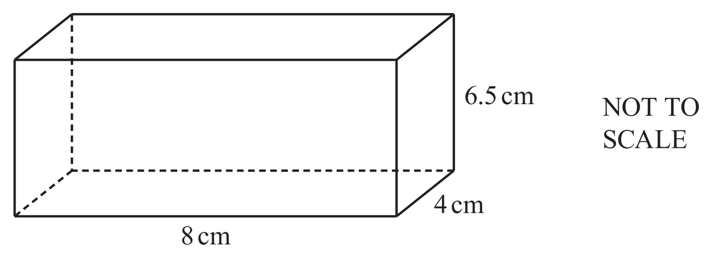

The diagram shows a cuboid.

Calculate the volume of the cuboid.

............................................... cm3

*Source: 2020 May/June 0580/23 Q2*

### Q34 — easy — 3 marks

**Q34** [3 marks]

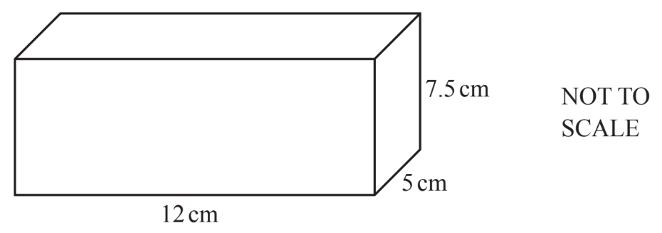

Calculate the total surface area of the cuboid.

..............................................cm2

*Source: 2019 March 0580/22 Q10*

### Q35 — easy — 3 marks

**Q35** [3 marks]

A cuboid measures 5cm by 7cm by 9.5cm.

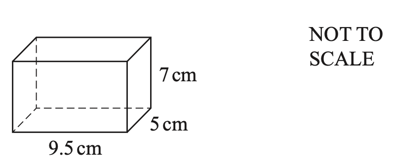

Work out the surface area of this cuboid.

............................................. cm2

*Source: 2019	Oct/Nov 0580/23 Q9-*

### Q36 — easy — 3 marks

**Q36** [3 marks]

Here is a cuboid.

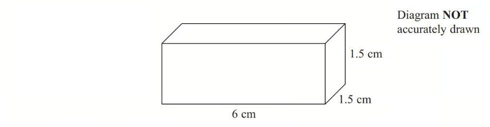

The cuboid is 6 cm by 1.5 cm by 1.5 cm.

Work out the total surface area of the cuboid.

*Source: June 2013 1MA0/2H Q1*

