# Mark Schemes — Prime Factors, HCF & LCM
**Number** · Cambridge (CIE) IGCSE maths (0580 & 0980)

## Calculator Questions (20 questions)

### Q1
> *Start with the number 252 and choose any two numbers that multiply together to make 252. *
*Break it down into these two numbers and circle any prime numbers. *
*Repeat this with the next numbers until all of the values are prime numbers and cannot be broken down any further.*

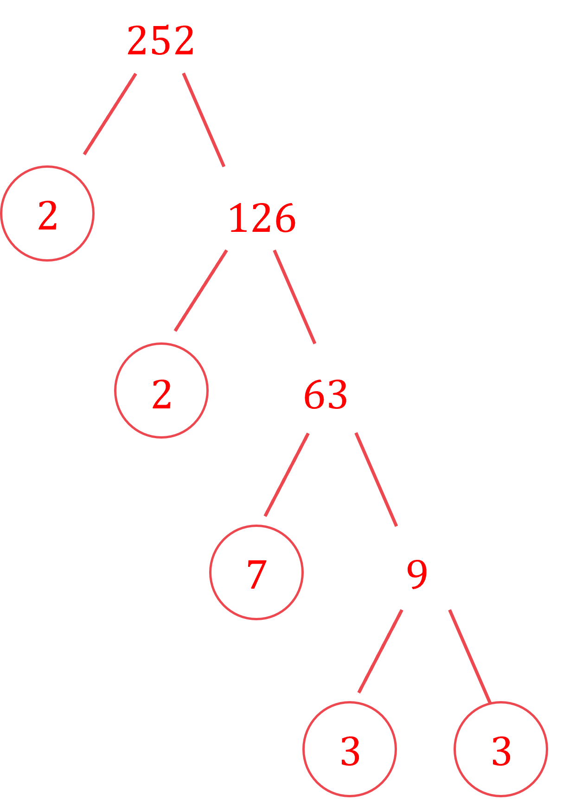

**[1]**

*252 = 2 × 2 × 3 × 3 × 7*

** 2****2**** × 3****2**** × 7*** ***[1]**
*From the question and part (a)* 
*672 = 2**5** × 3 ×7* 
*252 = 2**2** × 3**2** × 7*

> *Put these prime factorisations into a Venn diagram*

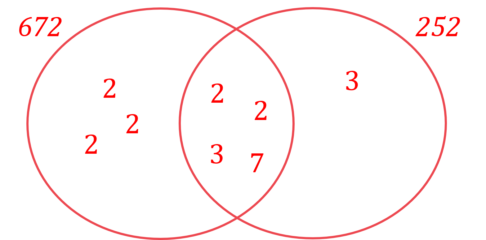

> *The highest common factor is the product of all the numbers in the overlapping section in the middle of the Venn diagram*

*2×2×3×7*

**84** **[1]**

### Q2
> *Find the prime factors of both numbers 96 and 120. *
*Factors trees are shown here.*

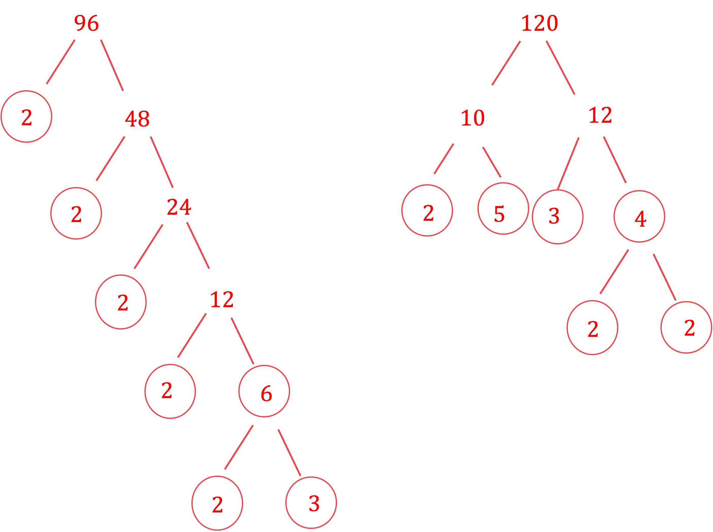

**any correct method to write 96 or 120 as products of primes ****[1]**

> *The prime factors of 96 are 2, 2, 2, 2, 2, 3 (96 = 2**5** × 3) and the prime factors of 120 are 2, 2, 2, 3, 5 (120 = 2**3** × 3 × 5).*

> *From this we can create a Venn diagram with the prime factors of both numbers.*

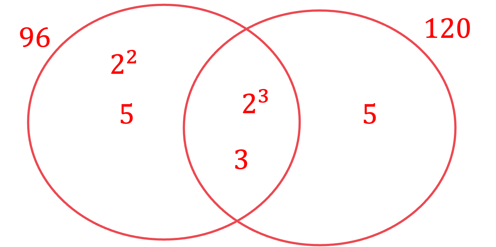

> *The HCF is the product of the prime factors which exist in the overlapping part of the Venn diagram*

*HCF = *$2^{3}\times3$

**HCF = 24*** ***[1]**
> *First it might be helpful to write the numbers as products of primes without the powers.*

$A=2\times2\times2\times5\times7\times7\times11\,B=2\times2\times2\times2\times7\times11\,C=3\times5\times5$

> *Now put the prime factors into a Venn diagram.*

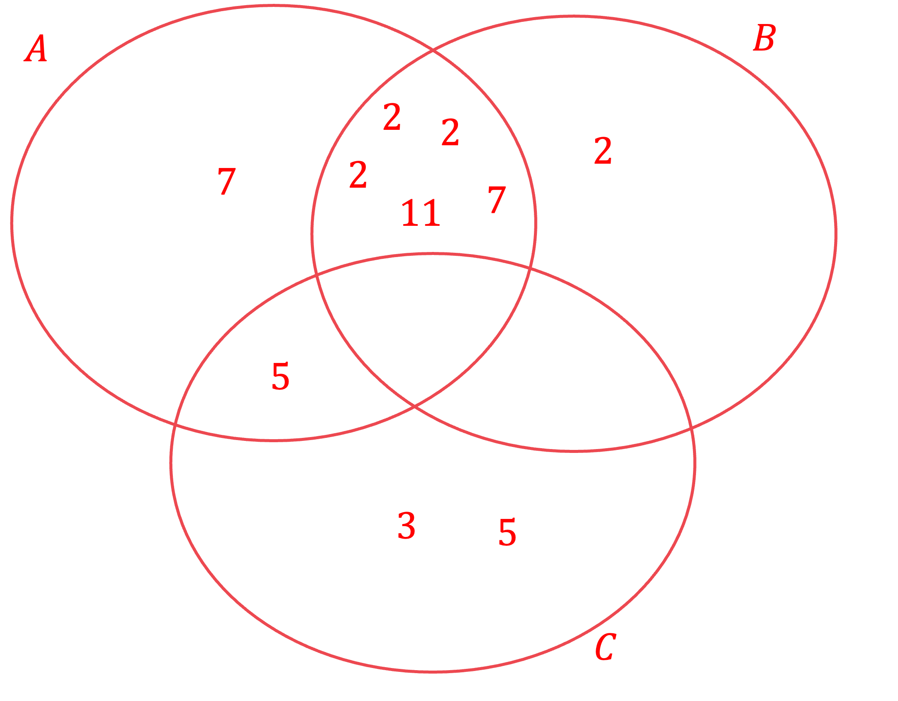

**[1]**

> *The LCM is the product of the prime numbers in the Venn diagram (in *$A\cupB\cupC$*)*

`table row LCM equals cell 7 cross times 2 cross times 2 cross times 2 cross times 11 cross times 7 cross times 2 cross times 5 cross times 3 cross times 5 end cell row blank equals cell 2 to the power of 4 cross times 3 cross times 5 squared cross times 7 squared cross times 11 end cell end table`

> *Use your calculator to evaluate the number.*

**LCM = 646 800** **[1]**

### Q3
> *As with all HCF / LCM questions, it may help to use factor trees to write the numbers as products of primes, and put the prime factors into a Venn diagram,*

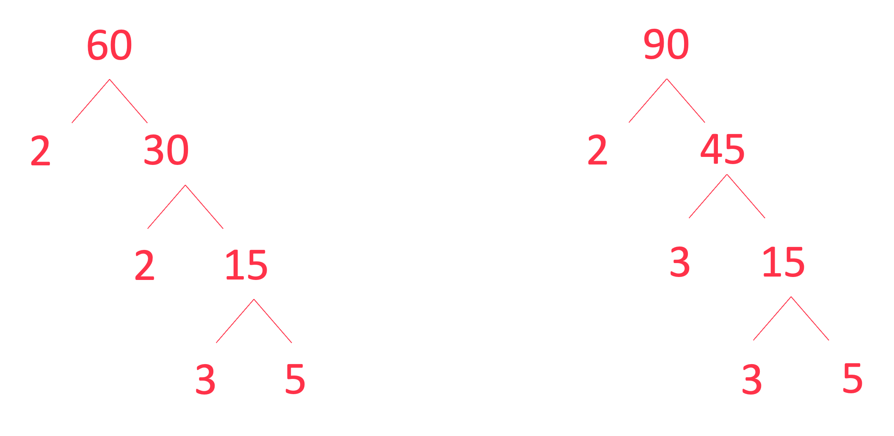

> *60 = 2 × 2 × 3 × 5  and 90 = 2 × 3 × 3 × 5. We can put these prime factors into a Venn diagram*

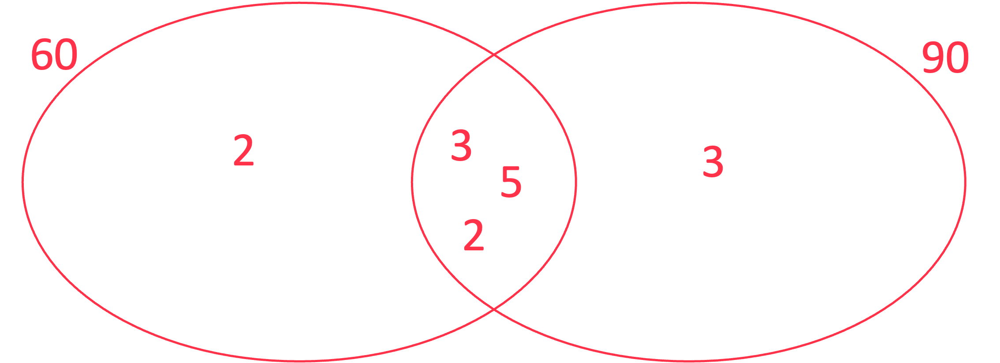

> *The highest common factor of 60 and 90 is 2 × 3 × 5 = 30, but this is even. If we remove the 2, the highest odd factor is 3 × 5 = 15*

**Answer = 15 ****[1]**

### Q4
> *Find the prime factors of both numbers 40 and . 56 Factors trees are shown here.*

> * *

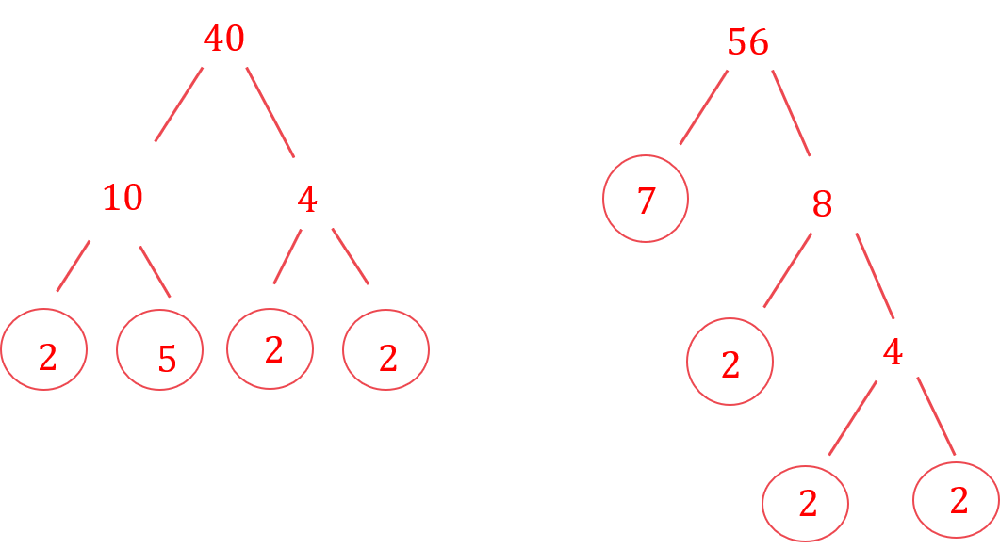

> *The prime factors of 40 are 2, 2, 2 and 5. *
*The prime factors of 56 are 2, 2, 2 and 7.*

**Correct method ****[1]**

> *The lowest common multiple is the product of the factors which exist in either list, ignoring repeats.   *
*An easy way of finding this is to sort the factors into a Venn diagram and then multiply the factors that are in all sections together.*

> * *

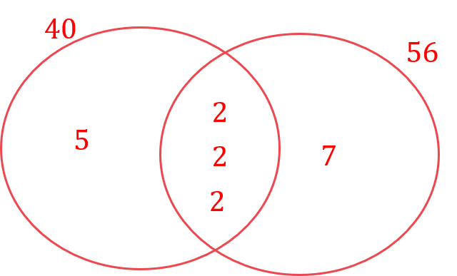

> *Multiply together all of the numbers in the Venn diagram.*

*LCM = 2 × 2 × 2 × 5 × 7*

** ****  LCM = 280 ****[1]**
> *The prime factors of **A** are 2, 2, 2, 3 and 5. *
*The prime factors of **B** are 2, 2, 3, 5 and 5.*

> *The highest common factor is the product of the factors which exist in both lists.   *
*There are two 2s, one 3 and one 5 in both lists, so multiply these together.*

*HCF = 2 × 2 × 3 × 5*

** ****  HCF = 60 ****[1]**

### Q5
> *Find the lowest common multiple (LCM) of 20 and 24. List the multiples of both numbers until you find one that is common.*

*20 , 40, 60, 80, 100, 120, 140 ... *

*24, 48, 72, 96, 120... *

**1 mark for each correct list ****[2]**

> *The smallest number that is in both lists is 120. *
*The next time will be after 120 minutes, divide by 60 to find this in hours.*

*120 minutes = 120 ÷ 60 = 2 hours*

> *They will next leave at the same time after 2 hours.*

**11.00 am**** [1]**

### Q6
> *Write the prime factors into a Venn diagram*

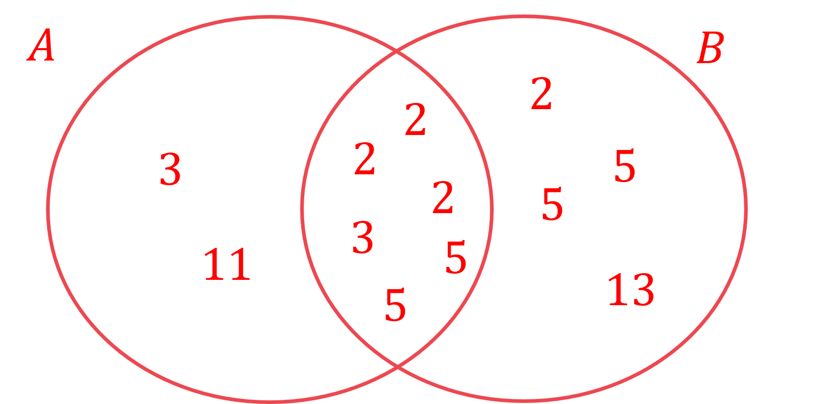

**[1]**

> *To find the lowest common multiple (LCM), multiply together all the values in the Venn diagram*

*3×11×2×2×2×3×5×5×2×5×5×13 = 12 870 000*

**12 870 000** **[1]**

### Q7
> *Write 120 and 144 as a product of their prime factors*

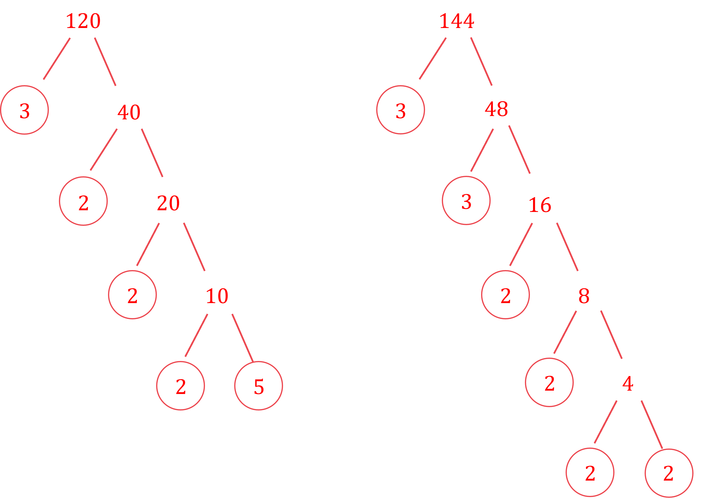

*120 = 2**3** × 3 × 5*
 *144 = 2**4** × 3**2*

> *Put the prime factors into a Venn diagram*

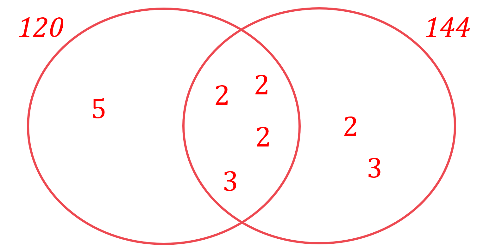

**[1]**

> *The lowest common multiple is the product of all the numbers in the Venn diagram*

*5×3×2×2×2×2×3*

**720 ****[1]**

### Q8
> *Either a factor tree or repeated division could be used here. *

> *Start with the number 84 and choose any two numbers that multiply together to make 84. Break it down into these two numbers and circle any prime numbers.*

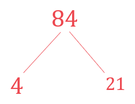

> *Repeat this with the next numbers until all of the values are prime numbers and cannot be broken down any further.*

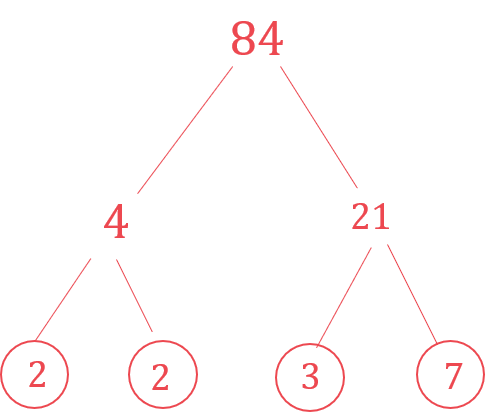

**[1]**

> *The answer will be the same regardless of the factors chosen in the first step.*

> *Write the prime numbers out as a product, any repeated prime numbers can be written as a power.*

** ****  **$2^{2}\times3\times7$**[1]**

### Q9
> *A** and **B** have already been given as products of primes so we can put the prime factors into a Venn diagram. It is helpful to know the **laws of indices**.*

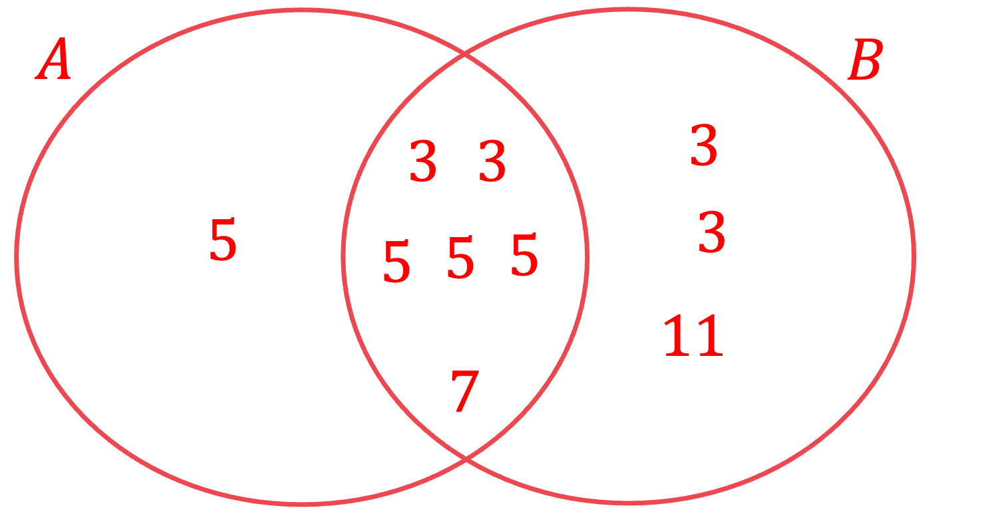

**[1]**

> *The HCF is the product of the primes in the overlapping part of the Venn diagram (*$A\capB$*).*

*HCF =** *$3^{2}\times5^{3}\times7$

> *Evaluate this using your calculator.*

**HCF = 7875** **[1]**
> *A** and **B** have already been given as products of primes so we can easily put the prime factors into a Venn diagram.*

**[1]**

> *The LCM is the product of the primes in the Venn diagram (*$A\cupB$*).*

*HCF =** *$5\times3^{2}\times5^{3}\times7\times3^{2}\times11$

> *Evaluate this using your calculator.*

**LCM = 3 898 125** **[1]**

### Q10
> *We can create a Venn diagram of the prime factors for all three numbers*

> *Only **B** and **C** have a shared factor of 2, and the HCF of **B** and** C** contains the term 2**3** so this must be in the overlap between **B** and** C** (but not in **A**)*
*As the LCM of **A** and **C** contains 2**4**, but we know that **A** does not have a factor of 2, the **C** circle (the part which is only **C**) needs an extra 2 to make the total within **C**, 2**4*

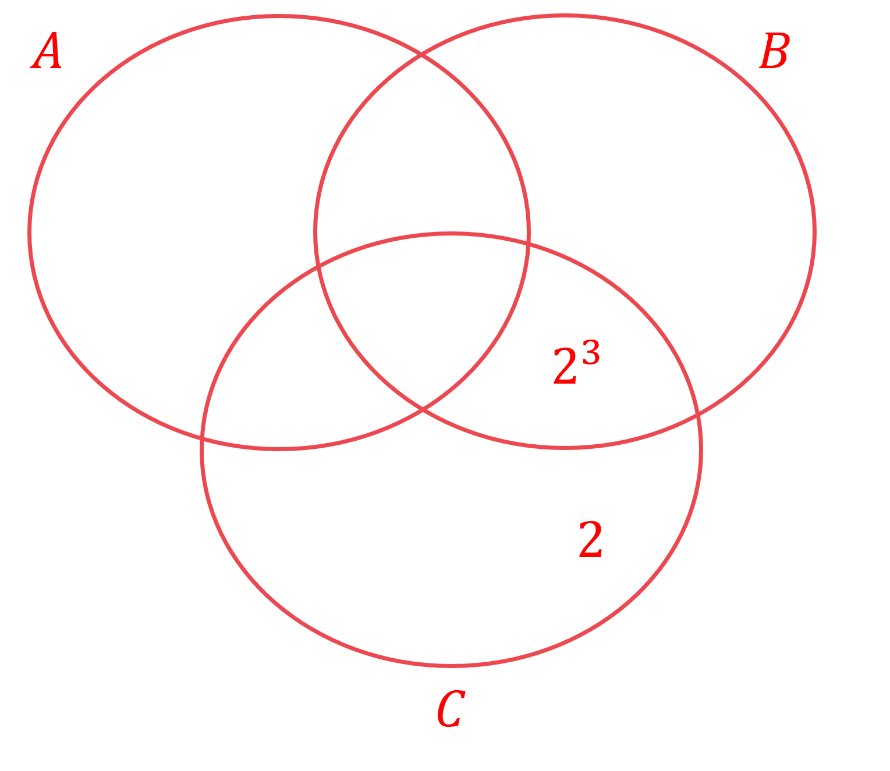

> *Only **A** and **B** have a shared factor of 3, **B** contains 3**1** and **A** contains 3**5** so we can put 3**1** into the overlap between **A** and **B** (but not in **C**), and then 3**4** into the "only** A**" section*

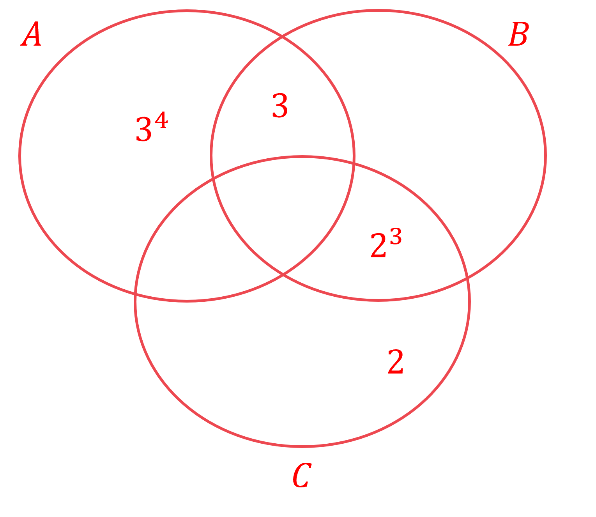

*Only **A** and **C** have a shared factor of 5, so there must be a power of 5 in the overlapping region between **A** and **C** (but not in **B**). **A** only contains 5**1**, so we can place 5**1** in the overlap* 
*The LCM of **A** and **C** contains 5**2**, so the remaining 5 must be in the "only **C**" section*

*All three of **A, B, C** contain a factor of 7, so there must be a power of 7 in the centre* 
*The HCF of **B** and **C** only contains 7**1**, so the power of 7 in the centre of the diagram will be 7**1*

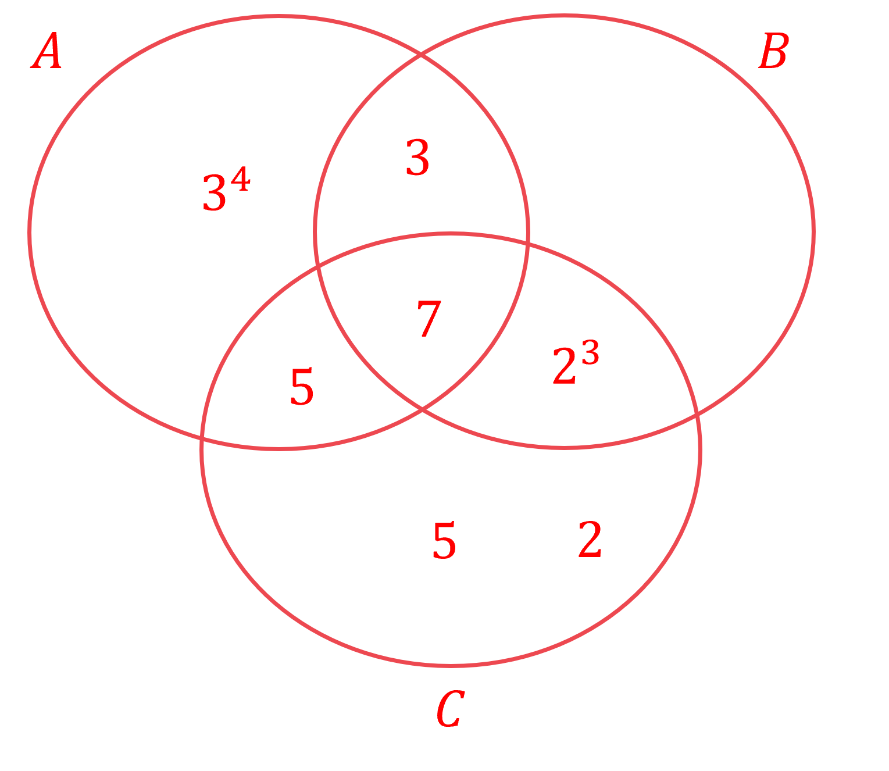

*A** contains a factor of 7**3**, so needs two more 7s* *B** contains a factor of 7**4**, so needs three more 7s* 
*This means we can put a 7**2** in the overlap between **A** and **B**, and then the remaining 7 in the "only** B**" section*

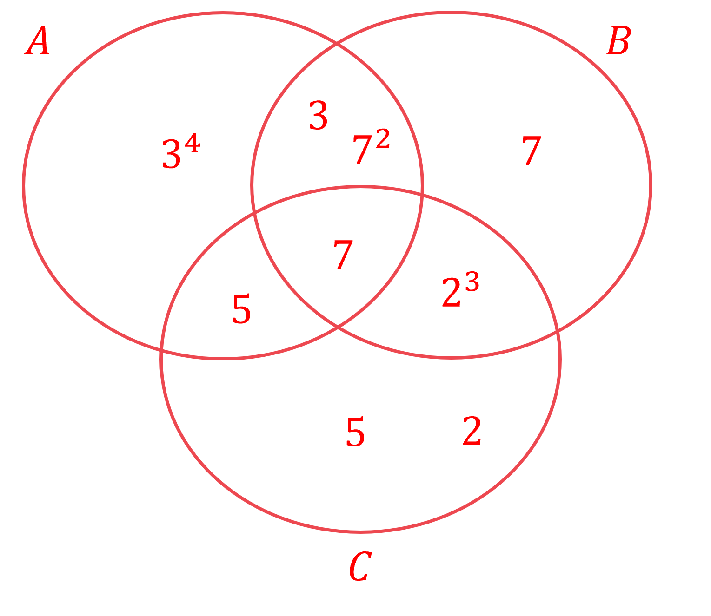

**Correct Venn diagram ****[1]**

> *Now that the Venn diagram is complete, we can read-off the factors of **C*

**C*** = 2×2**3**×5×5×7 = 2**4**×5**2**×7*

> *Recall that** C** was 2**p**×2**q**×2**r*

**p**** = 4** 
**q**** = 2**
 **r**** = 1**

**[1]**

**If Venn diagram not used then 1 mark out of 2 for either finding ****r****, or finding ****p**** and ****q**

### Q11
> *A** and **B** have already been given as products of primes so we can put the prime factors into a Venn diagram. It is helpful to know the **laws of indices**.*

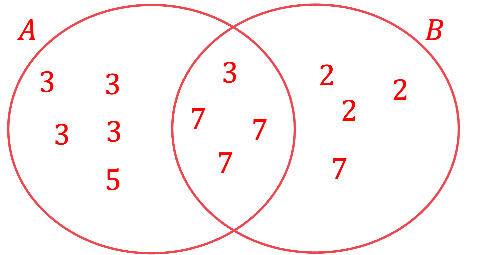

i) *The HCF is the product of the primes in the overlapping part of the Venn diagram (*$A\capB$*).*

**HCF =**** **$3\times7^{3}=1029$* ***[1] **

**You can write your final answer in either of the forms above**

ii) *The LCM is the product of the primes in the Venn diagram (*$A\cupB$*). Starting at the left of the Venn diagram;*

*LCM = *$3^{4}\times5\times3\times7^{3}\times2^{3}\times7$

> *Combine these using the laws of indices.*

**LCM =**** **$2^{3}\times3^{5}\times5\times7=23337720$* ***[1]**

** You can write your final answer in either of the forms above**

### Q12
> *Either a factor tree or repeated division could be used here. *

> *Start with the number 180 and choose any two numbers that multiply together to make 180. *
*Break it down into these two numbers and circle any prime numbers.*

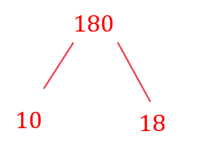

> *Repeat this with the next numbers until all of the values are prime numbers and cannot be broken down any further.*

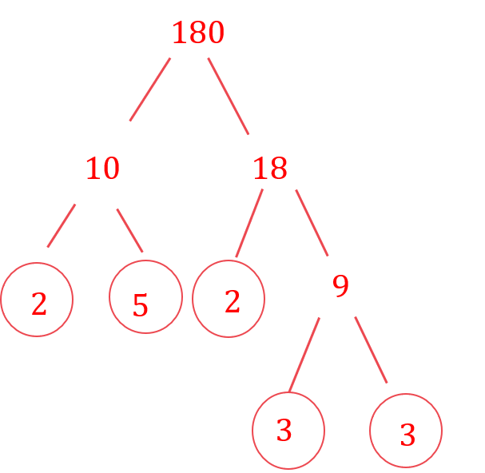

** ****Correct method ****[1] **
** All factors c****orrect ****[1]**

> *The answer will be the same regardless of the factors chosen in the first step.*

> *Write the prime numbers out as a product, any repeated prime numbers can be written as a power.*

** ****  **$2^{2}\times3^{2}\times5$**[1]**
> *6 is a factor of both numbers so the numbers must both be a multiple of 6. *

> *Choose one of the numbers as 6, to make sure the 6 is the highest common factor (choosing a multiple of 6 could mean that 6 is not the highest common factor).*

> *List the first few multiples of 6.*

*6, 12, 18, 24, 30, 36, ...*

> *  If the lowest common multiple is a multiple of 15, then the lowest common multiple could be 15, 30, 45, 60 etc. *

> *30 is in both lists, so 30 is the second number (a multiple of 6 and 15).*

**Two possible answers are 6 and 30 **** **

**Both numbers have a HCF of 6 ****[1]  **
**Both numbers have an LCM of a multiple of 15 ****[1] **

**There are other possible correct answers, e.g. 12 and 30.**

### Q13
> *Method 1 *

> *List the factors of each number, remembering that factors come in pairs, and then compare the two lists to find the highest common factor*

*Factors of 90*

*1, 90*

*2, 45*

*3, 30*

*5, 18*

*6, 15*

*9, 10*

*Factors of 48*

*1, 48*

*2, 24*

*3, 16*

*4, 12*

*6, 8*

> *Comparing the two lists and finding the highest factor that appears in both lists*

**HCF = 6 ****[2]**

> *Method 2 *

> *Write each number as a product of its prime factors*

$90=2\times3^{2}\times5\,48=2^{4}\times3$

**[1]**

> *Look to see where the products "overlap"*

`90 equals bottom enclose bold 2 bold cross times bold 3 end enclose cross times 3 cross times 5
48 equals 2 cross times 2 cross times 2 cross times bottom enclose bold 2 bold cross times bold 3 end enclose`

> *So the highest common factor is *$2\times3$

**HCF = 6 ****[1]**

### Q14
> *Either a factor tree or repeated division could be used here. *

> *Start with the number 525 and choose any two numbers that multiply together to make 525. Break it down into these two numbers and circle any prime numbers.*

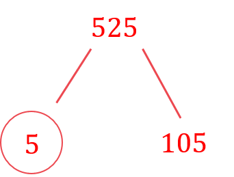

> *Repeat this with the next numbers until all of the values are prime numbers and cannot be broken down any further.*

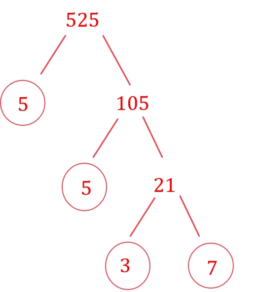

** ****Correct method ****[1]  **
**All factors c****orrect ****[1]**

> *The answer will be the same regardless of the factors chosen in the first step.*

> *Write the prime numbers out as a product, any repeated prime numbers can be written as a power.*

** ****  **$3\times5^{2}\times7$**[1]**

### Q15
> *Lamp A flashes every 20 seconds and lamp C flashes every 120 seconds, so lamp C flashes every 6th time that lamp A flashes, as 20 × 6 = 120.*

> *This means you can simply find how many times B and C flash together, as whenever lamp A flashes, C will also be flashing*

> *Find the times when lamps B and C flash together by finding the LCM of 45 and 120. *
*Find the prime factors of both numbers 45 and 120.  *
*Factors trees are shown here.*

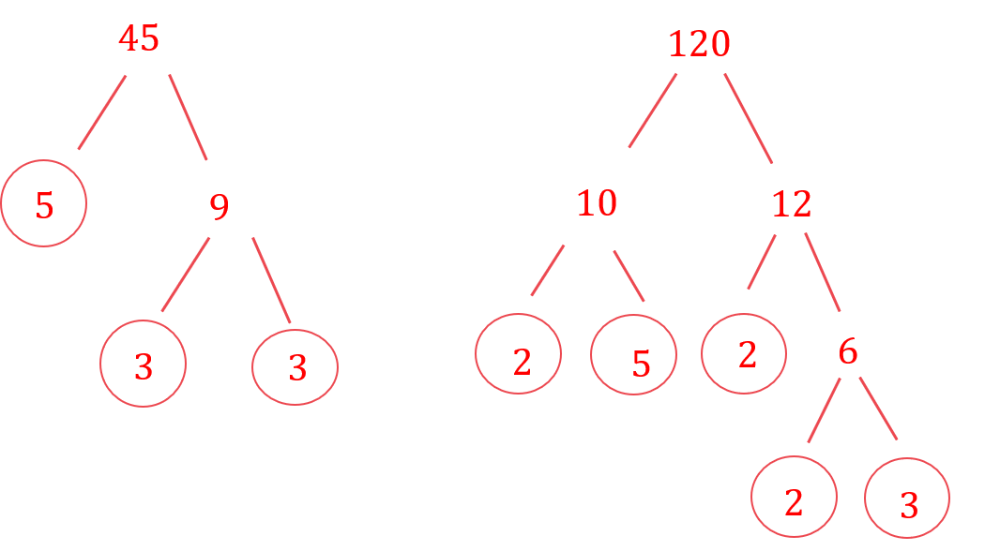

> *The prime factors of 45 are 3, 3 and 5. *
*The prime factors of 120 are 2, 2, 2, 3 and 5.*

**Correct method ****[1]**

> *The lowest common multiple is the product of the factors which exist in either list, ignoring repeats. *
*An easy way of finding this is to sort the factors into a Venn diagram and then multiply the factors that are in the Venn diagram together.*

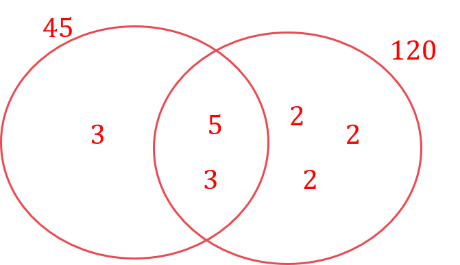

> *Multiply together the numbers that are in all sections.*

*LCM  = 2 × 2 × 2 × 3 × 3 × 5 = 360*

> *Lamps B and C will flash together every 360 seconds. *

> *Find how many times this is in one hour.*

*1 hour = 60 minutes × 60 seconds = 3600 seconds*

*3600 ÷ 360 = 10 *

**Correct method ****[1]**

** ****  The lamps will all flash together ten times per hour ****[1]**

### Q16
> *Find the lowest common multiple (LCM) of 9 and 12. List the multiples of both numbers.*

*9 , 18, 27, 36, 45, 54, ... *

*12 , 24, 36, ... *

**1 mark for each correct list ****[2]**

> *The smallest number that is in both lists is 36. *
*The next time will be after 36 minutes.*

**9.36 am**** [1]**

### Q17
> *Use factor tree method or repeated division. E.g.*

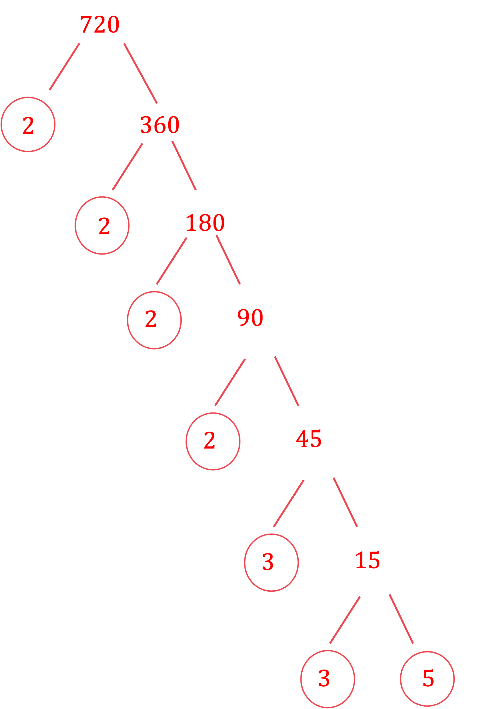

**[1]**

**720 = 2 × 2 × 2 × 2 × 3 × 3 × 5 = 2****4**** × 3****2**** × 5 ****[1] **

**You can write the final answer in either of the above forms**
> *Method 1*

> *If your answer to (a) is written in the form "2 × 2 × 2 × 2 × 3 × 3 × 5" then we can rearrange this to*

*[2 × 2 × 3] × [2 × 2 × 3] × 5*

> *[2 × 2 × 3] × [2 × 2 × 3] is already square so to make the full number square we would need to multiply by another 5 so the number becomes*

*[2 × 2 × 3 × 5] × [2 × 2 × 3 × 5]*

> *Using your calculator to evaluate this number gives*

**3600**** [1]**

> *Method 2*

> *If your answer to (a) is written in the form "2**4** × 3**2** × 5" then we can see that "2**4** × 3**2**" is already square (all even powers are square numbers, 2**4** × 3**2** = [2**2** × 3] × [2**2** × 3])*

> *To make the full number square, we would need to multiply by another 5 so the number becomes*

*2**4** × 3**2** × 5**2*

> * Using your calculator to evaluate this number gives*

**3600**** [1]**

### Q18
> *Find the prime factor decomposition of both numbers*

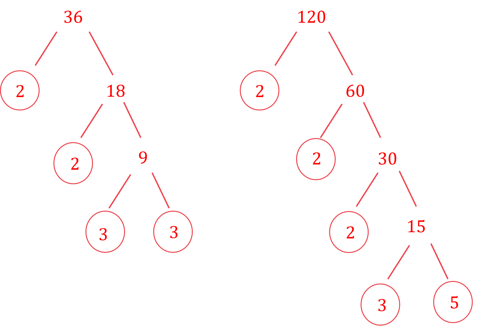

*36 = 2×2×3×3 = 2**2** × 3**2*

*120 = 2×2×2×3×5 = 2**3** × 3 × 5*

**[1]**

> *We can put the prime factors into a Venn diagram*

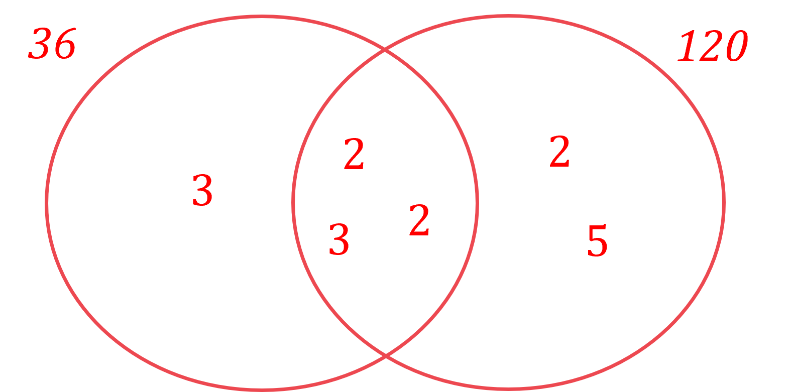

> *To find the lowest common multiple (LCM), multiply together all the numbers in the Venn diagram*

*3 × 2 × 2 × 3 × 2 × 5 = 360*

**LCM = 360** **[1]**

### Q19
> *We want to find the next time they sound at the same time, this would be after the lowest common multiple of 50 and 80 minutes later*

> *We can list out several multiples of each number, starting with the larger number*

*80, 160, 240, 320, 400, 480, ...*

> *It is easy to spot which would also be a multiple of 50, as multiples of 50 are either 100, 200, 300, ... or 150, 250, etc*

**Listing multiples, or alternatively using a prime factor and venn diagram method ****[1]**

*400 will be the lowest common multiple*

**400 identified ****[1]**

> *So the time they sound together next, will be 10 am plus 400 minutes*

*400 minutes = 400 ÷ 60 hours = 6.66666... hrs* 
*This is 6 hours and 2 thirds, or 6 hours 40 minutes*

*10 am + 6h40m = 16:40*

**16:40** **[1]**

### Q20
*A prime number is a whole number that is divisible only by itself and *$1$ 
*Draw a "factor tree" to list the prime factors of *$56$* (by dividing *$56$* by all prime numbers that go into it)* * *

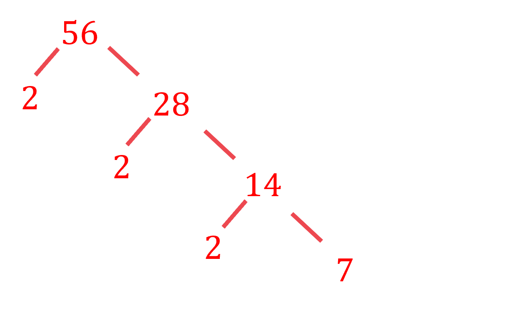

**  Identifying **$2$** and **$7$** as the only prime factors ****[1]**

*The word "product" means multiply* 
*Write *$56$* as the product of its prime factors (by putting *$\times$* between the numbers), in increasing order* * *

> $56=2\times2\times2\times7$*  *

> *Use powers to write *$2\times2\times2$* as *$2^{3}$

$56=2^{3}\times7$ **[1]**

**Step diagrams to find prime factors are also acceptable**
> *The lowest common multiple is the smallest number that both *$56$* and *$42$* go into*

*Method 1* 
*Use a factor tree to find the prime factors of *$42$

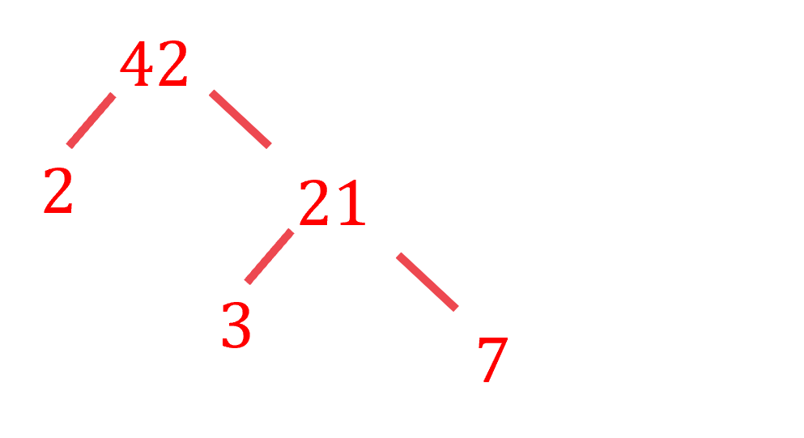

*Write both numbers as products of primes (by writing them as multiplications of their prime factors)* * *

$56=2^{3}\times7\,42=2\times3\times7$ * *

*The prime numbers *$2$*, *$3$*and *$7$*all appear, with their highest powers being *$2^{3}$*, *$3^{1}$* and *$7^{1}$ 
*Find the lowest common multiple by multiplying together these highest powers*

$2^{3}\times3\times7$

**[1]**

$168$* ***[1]**

*Method 2*

*List the first few multiples of *$56$* (by writing out the *$56$* times-table)* * *

`table attributes columnalign right center left columnspacing 0px end attributes row cell 56 cross times 1 end cell equals 56 row cell 56 cross times 2 end cell equals 112 row cell 56 cross times 3 end cell equals 168 row cell 56 cross times 4 end cell equals 224 row blank blank cell... end cell end table` * *

*List the first few multiples of *$42$ * *

`table row cell 42 cross times 1 end cell equals 42 row cell 42 cross times 2 end cell equals 84 row cell 42 cross times 3 end cell equals 126 row cell 42 cross times 4 end cell equals 168 row blank blank cell... end cell end table`

**[1]**

> *Find the lowest common multiple (by finding the first multiple that appears in both lists)*

$168$** ****[1]**
