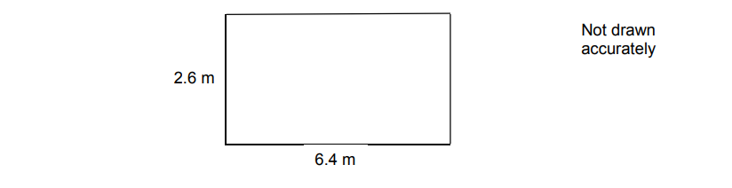

# Exam Questions — Rounding, Estimation & Bounds
**Number** · Cambridge (CIE) IGCSE maths (0580 & 0980)
> Source: [https://www.savemyexams.com/igcse/maths/cie/25/extended/topic-questions/](https://www.savemyexams.com/igcse/maths/cie/25/extended/topic-questions/) · 26 questions across 1 sets

## Calculator Questions (26 questions)

### Q1 — hard — 3 marks

**Q1** [3 marks]

A rectangle has a length of 12.8 cm, correct to the nearest millimetre.
The area of the rectangle is 308.5 cm2, correct to the nearest tenth of a cm2.

Calculate the maximum possible width of the rectangle.

......................................... cm

### Q2 — easy — 2 marks

**Q2** [2 marks]

A bag of crisps weighs $150g$ to the nearest gram.

Complete the statement about the weight, $wg$, in the bag.

$..............\leqw<..............$

### Q3 — very_hard — 5 marks

**Q3** [5 marks]

The dimensions of a rectangular floor are to the nearest 0.1 metres.

A force of 345 Newtons is applied to the floor.
 The force is to the nearest 5 Newtons.

| $\mathrm{pressure}=\frac{\mathrm{force}}{\mathrm{area}}$ |
|---|

Work out the upper bound of the pressure. 
Give your answer to 4 significant figures. 
You **must** show your working.

........................N/m2

*Source: Nov 2017 8300/2H Q25*

### Q4 — very_hard — 4 marks

**Q4** [4 marks]

Edith’s van can safely carry a maximum load of 920 kilograms.

She wants to use her van to carry

30 sacks of potatoes, each of mass 25 kilograms to the nearest kilogram

and

20 sacks of carrots, each of mass 7.5 kilograms to 1 decimal place.

Can she definitely use her van safely in one journey?

You **must **show your working.

*Source: Nov 2020 8300/2H Q26*

### Q5 — very_hard — 5 marks

**Q5** [5 marks]

A road is 4530 m long, correct to the nearest 10 metres. Kirsty drove along the road in 205 seconds, correct to the nearest 5 seconds.

The average speed limit for the road is 80 km/h.

Could Kirsty's average speed have been greater than 80 km/h? You must show your working.

*Source: 2014	November 1MA0/2H Q23*

### Q6 — very_hard — 4 marks

**Q6** [4 marks]

Sunil makes 7.5 litres of soup, correct to the nearest 0.5 litre. 
He serves the soup in 300 ml portions, correct to the nearest 10 ml. 
24 people order this soup.

Does Sunil definitely have enough soup to serve the 24 people? Show how you decide.

*Source: June 2017 J560/06 Q11*

### Q7 — very_hard — 6 marks

**Q7** [6 marks]

Claudine cycled a distance of 53 km in 2.7 hours. 
The distance is measured correct to the nearest km. 
The time is given correct to 1 decimal place.

Calculate the lower and upper bounds of her average speed.

Give your answers correct to 2 decimal places.

Lower bound = ................................ km/h

Upper bound = ................................ km/h

*Source: Nov 2019 J560/06 Q12B*

### Q8 — very_hard — 3 marks

**Q8** [3 marks]

A £1 coin weighs 8.75 g, correct to the nearest 0.01 g. 
Mitul weighs the contents of a large bag of £1 coins. 
The coins weigh 2.63 kg, correct to the nearest 10 g.

Mitul says

I am sure that the bag contains exactly £300 because, using bounds,    2625 ÷ 8.755 = 299.8 to 1 decimal place.

Show that Mitul may not be correct.

*Source: Nov 2018 J560/06 Q16*

### Q9 — medium — 2 marks

**Q9** [2 marks]

Calculate.

$\frac{16.379-0.879}{4.2}\times1.241$

Give your answer correct to 2 significant figures.

*Source: 2019	Oct/Nov 0580/21 Q3-*

### Q10 — hard — 2 marks

**Q10** [2 marks]

The formula  $s=\frac{1}{2}at^{2}$  is used to calculate the distance, $s$, travelled by a bicycle.

When $a=3$ and $t=10$, each correct to the nearest integer, calculate the lower bound of the distance, $s$.

*Source: 2019	Oct/Nov 0580/43 Q1F*

### Q11 — hard — 2 marks

**Q11** [2 marks]

Anna walks 31 km at a speed of 5 km/h. 
Both values are correct to the nearest whole number.

Work out the upper bound of the time taken for Anna’s walk.

...................................... hours

*Source: 2018	May/June 0580/22 Q12*

### Q12 — medium — 1 marks

**Q12** [1 mark]

Priya has 50 identical parcels. 
Each parcel has a mass of 17 kg, correct to the nearest kilogram.

Find the upper bound for the total mass of the 50 parcels.

.............................................. kg

*Source: 2019 March 0580/42 Q1D*

### Q13 — medium — 2 marks

**Q13** [2 marks]

The area of a square is 42.5 cm2, correct to the nearest 0.5 cm2.

Calculate the lower bound of the length of the side of the square.

.......................................... cm

*Source: 2018	Oct/Nov 0580/23 Q12*

### Q14 — medium — 3 marks

**Q14** [2 marks]

The length of each side of a regular pentagon is 8.4 cm to 1 decimal place.

Complete the error interval for the length of one side.

....................cm ⩽ length < ....................cm

*Source: June 2018 8300/2H Q9A*

**Q14** [1 mark]

**Extract:**

The length of each side of a regular pentagon is 8.4 cm to 1 decimal place.

Complete the error interval for the perimeter.

....................cm ⩽ perimeter < ....................cm

*Source: June 2018 8300/2H Q9B*

### Q15 — medium — 2 marks

**Q15** [2 marks]

The sides of a square are 15.1 cm, correct to 1 decimal place.

Find the upper bound of the area of the square.

............................................. cm2

*Source: 2019	Oct/Nov 0580/21 Q12-*

### Q16 — hard — 3 marks

**Q16** [3 marks]

A rectangle measures 8.5 cm by 10.7 cm, both correct to 1 decimal place.

Calculate the upper bound of the perimeter of the rectangle.

............................................ cm

*Source: 2020 Oct/Nov 0580/41 Q4A*

### Q17 — hard — 3 marks

**Q17** [3 marks]

Serge walks 7.9 km, correct to the nearest 100 metres. The walk takes 133 minutes, correct to the nearest minute.

Calculate the maximum possible average speed of Serge’s walk. Give your answer in kilometres/hour.

....................................... km/h

*Source: Specimen 2025 0580/04 Q23*

### Q18 — easy — 1 marks

**Q18** [1 mark]

Write 0.046875 correct to 2 significant figures.

*Source: 2019 March 0580/22 Q4A*

### Q19 — hard — 2 marks

**Q19** [2 marks]

Every page of the newspaper is a rectangle measuring $43\text{cm}$ by $28\text{cm}$, both correct to the nearest centimetre.
Calculate the upper bound of the area of a page.

........................................ cm2

*Source: 2019	May/June 0580/42 Q1E*

### Q20 — hard — 2 marks

**Q20** [2 marks]

Saafia has a barrel containing 6000 millilitres of oil, correct to the nearest 100ml.

She uses the oil to fill bottles which each hold exactly 50ml.   Calculate the upper bound for the number of bottles she can fill.

*Source: 2018	Oct/Nov 0580/21 Q8*

### Q21 — easy — 1 marks

**Q21** [1 mark]

Write the number 0.076499 correct to 2 significant figures.

*Source: 2018	Oct/Nov 0580/23 Q8A*

### Q22 — hard — 3 marks

**Q22** [3 marks]

The sides of an isosceles triangle are measured correct to the nearest millimetre. 
One side has a length of 8.2 cm and another has a length of 9.4 cm.

Find the largest possible value of the perimeter of this triangle.

............................................ cm

*Source: 2020 Oct/Nov 0580/22 Q18*

### Q23 — easy — 2 marks

**Q23** [1 mark]

Calculate $\sqrt{2.38+6.4^{2}}$, writing down your full calculator display.

*Source: 2018	May/June 0580/21 Q10A*

**Q23** [1 mark]

**Extract:**

Calculate [square root of 2.38 plus 6.4 squared end root], writing down your full calculator display.

Write your answer to **part (a)** correct to 4 decimal places.

*Source: 2018	May/June 0580/21 Q10B*

### Q24 — hard — 2 marks

**Q24** [2 marks]

On one day, the number of members using the exercise machines was 40, correct to the nearest 10.

Each member used a machine for 30 minutes, correct to the nearest 5 minutes.

Calculate the lower bound for the number of minutes the exercise machines were used on this day.

......................................... min

*Source: 2018	May/June 0580/41 Q10B*

### Q25 — hard — 3 marks

**Q25** [3 marks]

The dressmaker measures a length of fabric as 600 m, correct to the nearest 5 metres. 
He cuts this into dress lengths of 9 m, correct to the nearest metre.

Calculate the largest number of complete dress lengths he could cut.

*Source: 2018	Feb/Mar 0580/42 Q1C*

### Q26 — medium — 2 marks

**Q26** [2 marks]

An equilateral triangle has side length 12 cm, correct to the nearest centimetre.

Find the lower bound and the upper bound of the perimeter of the triangle.

Lower bound = ......................................... cm

Upper bound = ......................................... cm

*Source: 2018	Oct/Nov 0580/22 Q11*

