# Mark Schemes — Set Notation & Venn Diagrams
**Number** · Cambridge (CIE) IGCSE maths (0580 & 0980)

## Calculator Questions (21 questions)

### Q1
Use the information to fill in more of the Venn diagram

- `straight n open parentheses A intersection B apostrophe close parentheses` is the region inside the $A$ circle but outside the $B$ circle

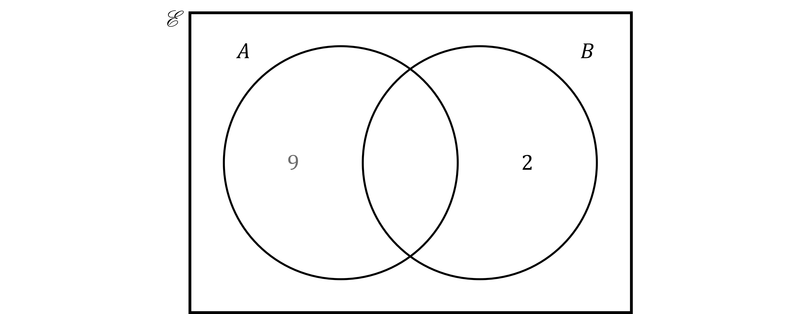

- `straight n open parentheses A union B close parentheses` is the entire region inside the $A$ circle or the $B$ circle (or both)

  - `straight n open parentheses A union B close parentheses equals 23`, so the number in the overlap, `straight n open parentheses A intersection B close parentheses`, must be

`straight n open parentheses A intersection B close parentheses equals 23 minus 9 minus 2`

**[M1]**

`straight n open parentheses A intersection B close parentheses equals 12`

**[A1]**

> **[mark-scheme]**
> **M1**: for 23-9-2 or equivalent, or for a correctly completed Venn diagram.
> 
> **A1**: For correct answer.
From part (a) you know all the numbers inside the circles

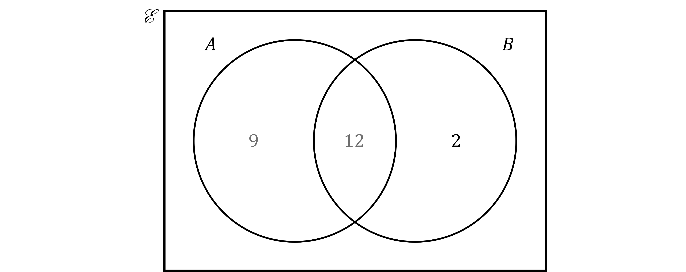

`straight n open parentheses A union B close parentheses apostrophe` is the region inside the rectangle but outside both circles

- `straight n open parentheses calligraphic E close parentheses equals 30`, so everything inside the rectangle must add up to 30
- Therefore

`straight n open parentheses A union B close parentheses apostrophe equals 30 minus 9 minus 12 minus 2`

`straight n open parentheses A union B close parentheses apostrophe equals 7`

**[B1]**

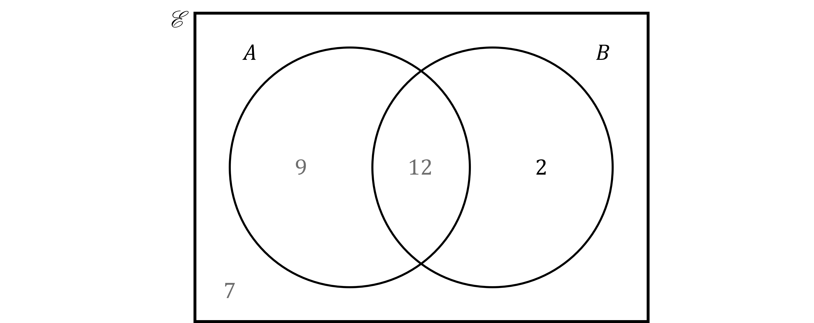

> **[exam-tip]**
> You could also find the answer here directly from the information in the question:
> 
> `table row cell straight n open parentheses A union B close parentheses apostrophe end cell equals cell straight n open parentheses calligraphic E close parentheses minus straight n open parentheses A union B close parentheses end cell row blank equals cell 30 minus 23 end cell row blank equals 7 end table`

### Q2
> *Start by completing the information for *$A\capB$*.*

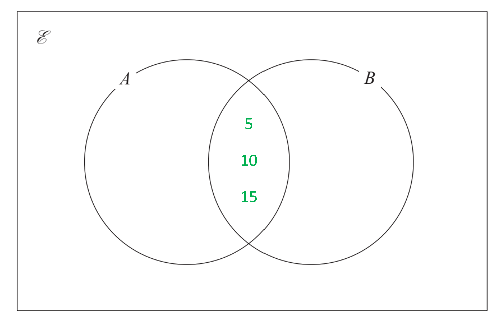

**[1]**

> *If we consider *$B'$* and *$A'$*, 7, 8 and 14 are not in **B** or in **A**, so put 7, 8 and 14 in *`open parentheses A union B close parentheses apostrophe`*.*

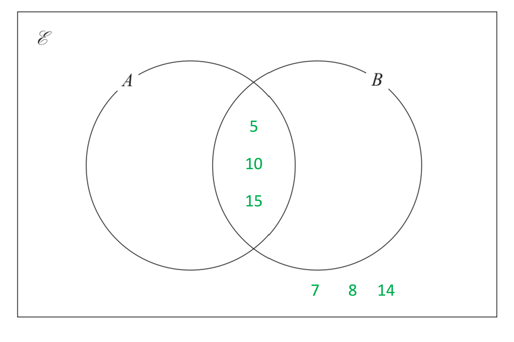

**[1]**

> *From the list of *$B'$*, place the remaining numbers in *$A\capB'$*.*

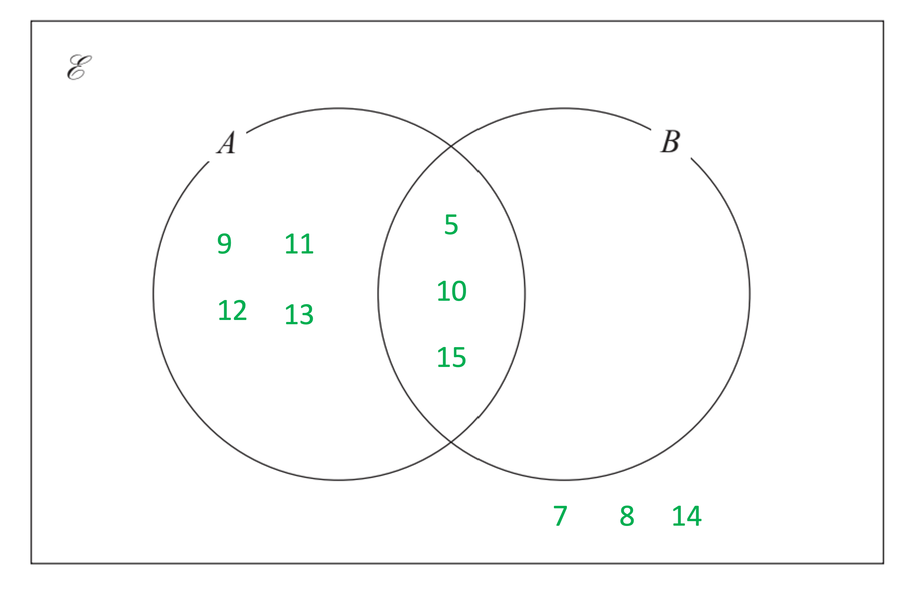

> *From the list of *$A'$*, place the remaining numbers in *$B\capA'$*.*

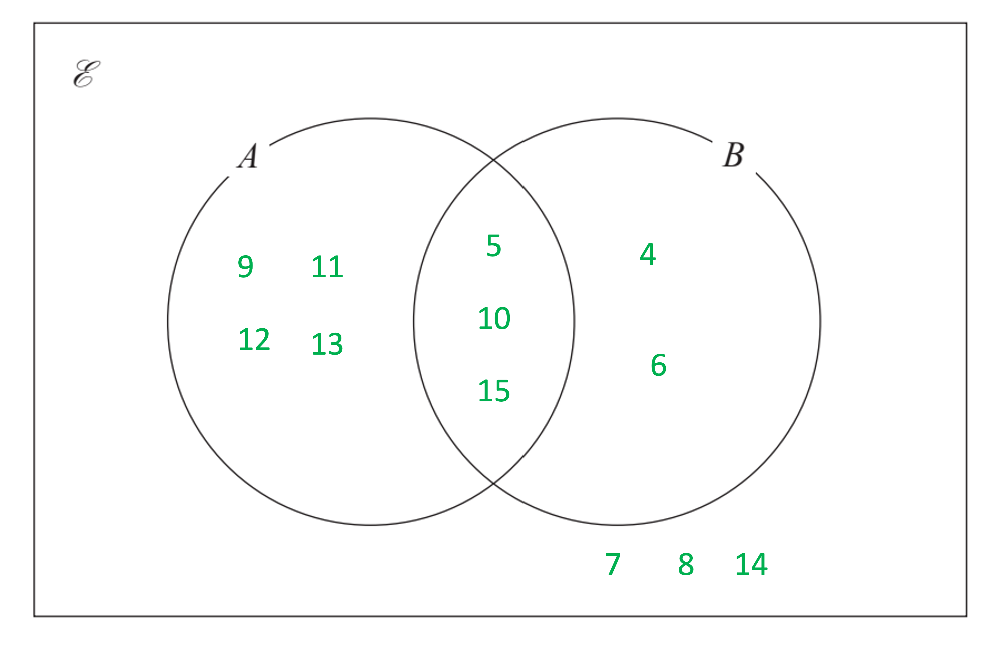

**[1]**

### Q3
> $n(A\cupB)$* means the number of elements in **A** **or **B.** It is everything shaded below.*

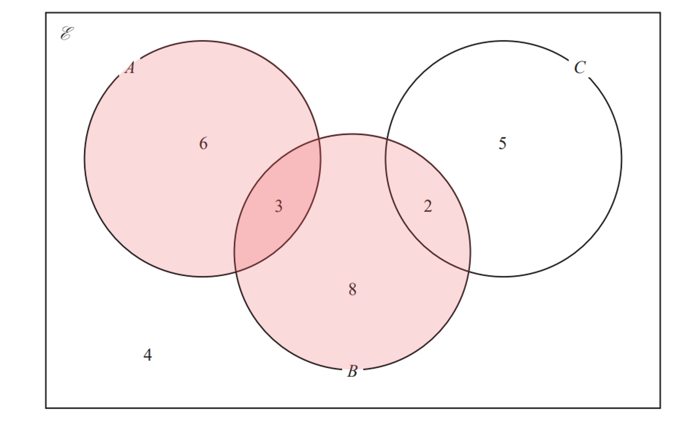

$n(A\cupB)=6+3+8+2$

**Answer = 19 ****[1]**
> $n(A\capB)$* means the number of elements in **A** **and **B.** It is the overlapping shaded part below.*

**Answer = 3 ****[1]**
> $n(B\capC')$* means the number of elements in **B** **and not** in **C.** It is everything shaded below.*

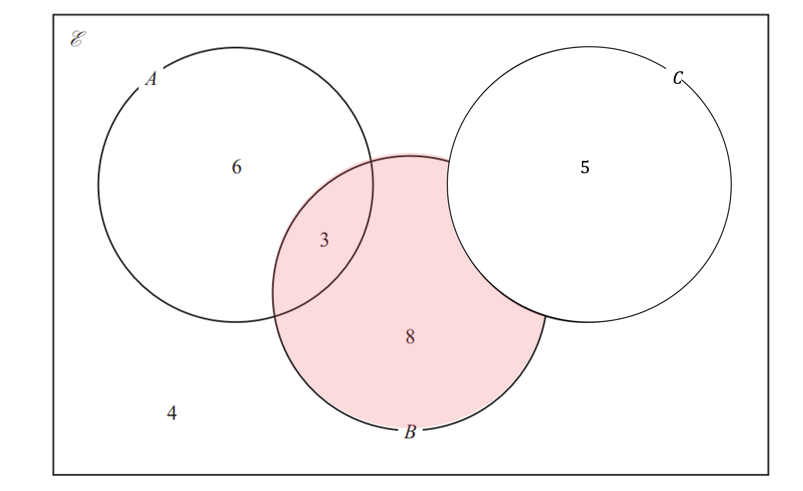

$n(B\capC')=3+8$

**Answer = 11 ****[1]**
> $n(A'\cupB'\cupC')$* means the number of elements that are either not in **A** or not in **B **or not in **C**. None of the elements are in **A**, **B** and **C** at the same time, so all of the elements are either not in **A** or not in **B **or not in **C.*

> *Add all the numbers in the diagram.*

$n(A'\cupB'\cupC')=6+3+8+2+5+4$

**Answer = 28 ****[1]**

### Q4
> *Write out the set of everything (the "universal" set) by listing numbers from 1 to 10 inclusive.*

`calligraphic E equals open curly brackets 1 comma 2 comma 3 comma 4 comma 5 comma 6 comma 7 comma 8 comma 9 comma 10 close curly brackets`

> *Write out the set *$A$* (by listing all even numbers in the universal set).*

> `A equals open curly brackets 2 comma 4 comma 6 comma 8 comma 10 close curly brackets`* *

$4\inA\capB$* means 4 is a number that is common in both *$A$* and *$B$ `n open parentheses A intersection B close parentheses equals 1`* means there is only one number common to both *$A$* and *$B$ 
*Write 4 in the overlap of the circles (the"intersection") and 2, 6, 8 and 10 in just *$A$*'s side* * *

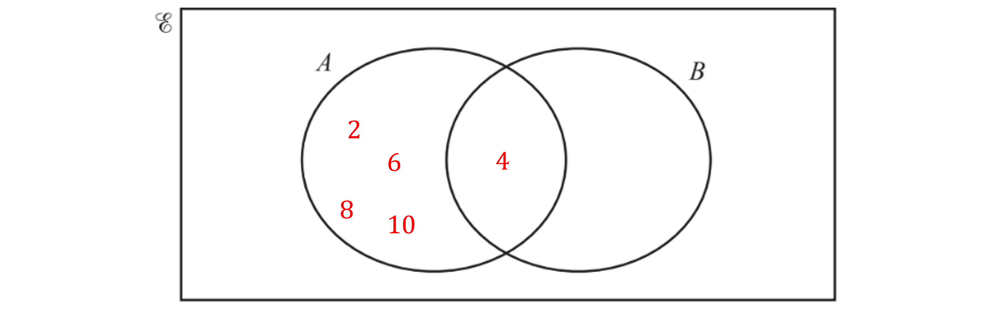

**4 correct**** [1]**

** ****2, 6, 8, 10 correct**** [1]**

`open parentheses A union B close parentheses apostrophe equals open curly brackets 1 comma 7 comma 9 close curly brackets`* means that 1, 7 and 9 are not in *$A$*, *$B$* or both* *Write the numbers 1, 7 and 9 outside of the circles * * *

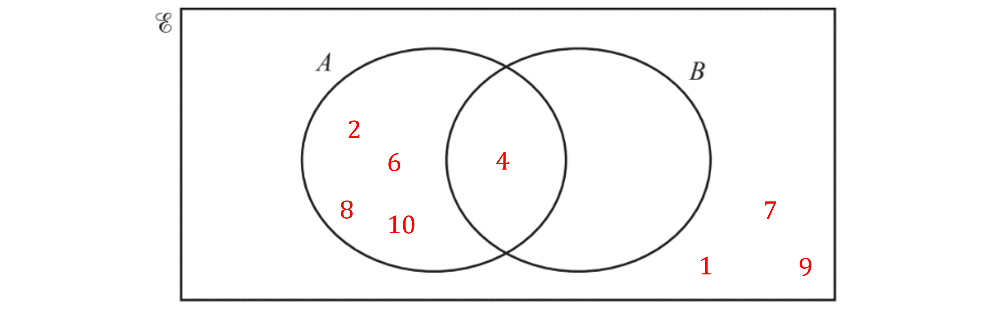

**1, 7 and 9 correct**** ****[1]**

*Write any remaining numbers (3 and 5) in just *$B$*'s side* * *

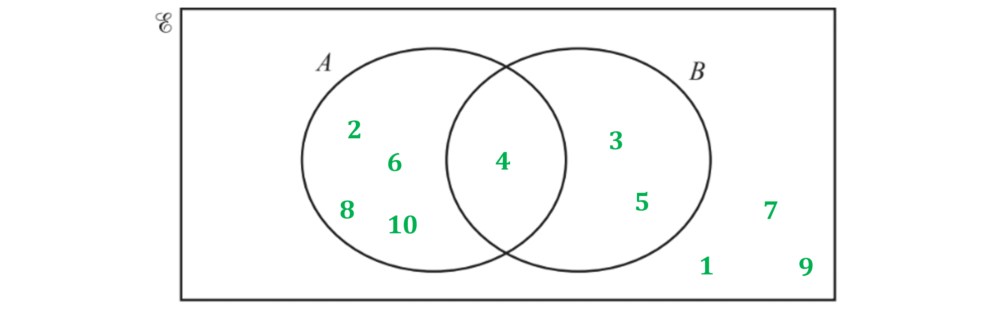

**3 and 5 correct**** ****[1]**
> *List the numbers that are in the whole *$B$* circle*

`bold italic B bold equals stretchy left curly bracket 3 comma space 4 comma space 5 stretchy right curly bracket`** [1]**

### Q5
> *Using the fact that 90 students play football but not baseball*

> *Using the fact that 120 students play football, the sum of the numbers in the **F** circle should be 120*

> *Using the fact that 40 students play baseball, the sum of the numbers in the **B** circle should be 40*

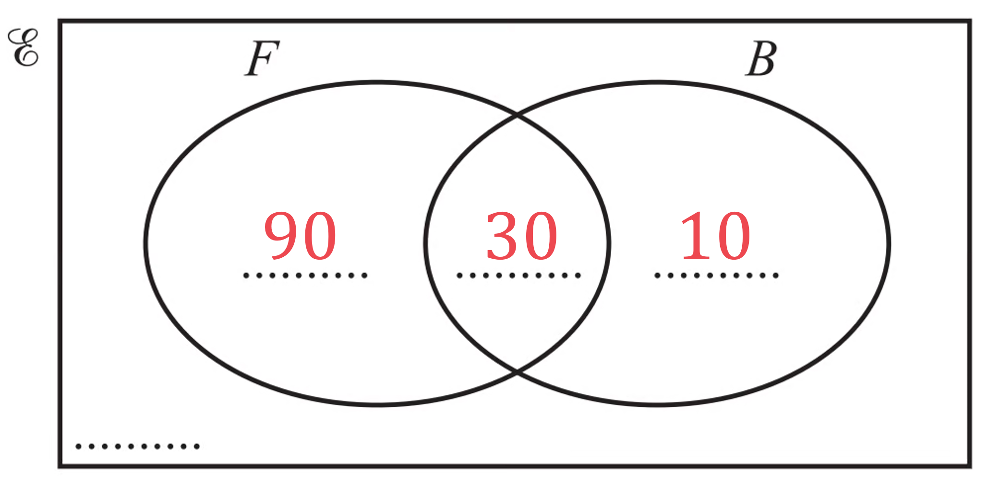

> *Lastly, using the fact that there are 240 students in the school, the numbers inside and outside the circles should sum to 240*

$240-90-10-30=110$

**Any one correct value**** [1]**

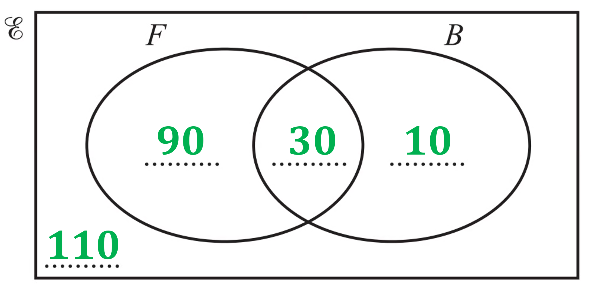

**All values correct**** [1]**
$\text{n}(F'\capB')$*means "the number of students who do not play football, and, do not play baseball* *This is the number outside the two circles*

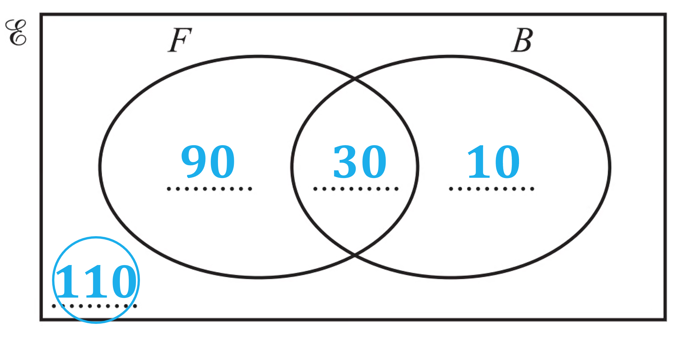

* ***110** **[1]**

### Q6
i)  *List the members of the set that are in **A** "and" **B.*

**24, 30** **[1]**

**It is helpful, though not essential, to realise that ****A**** is the set of even numbers and ****B**** is the set of multiples of 3.**

ii) *List the members of the set that are not in **A.*

**21, 23, 25, 27, 29** **[1] **

**It is helpful, though not essential, to realise that ****A**** is the set of even numbers so ****A****' is the odd numbers.**
> *23, 25, 29 are not in **A** or **B**.*

$(A\cupB)'$** ****or **$A'\capB'$** ****[1]**

** Writing **$(A\capB)'$** is a common mistake here which will receive no marks**

### Q7
> *The intersection of A and B is 12, so place that in the appropriate place on the diagram.*

> *Subtract the number of elements in the intersection of **A** and **B** from the number of elements in set **A** to find the number of elements that are only in set **A**.*

$22-12=10$

> *Subtract the number of elements in set **A** from the number of elements in the union of **A** and **B** to find the number of elements that are only in set **B**.*

$30-22=8$

> *Subtract the number of elements in the union of **A** and **B** from the number of elements in the universal set to find the number of elements that are not in set **A** or **B**.*

$37-30=7$

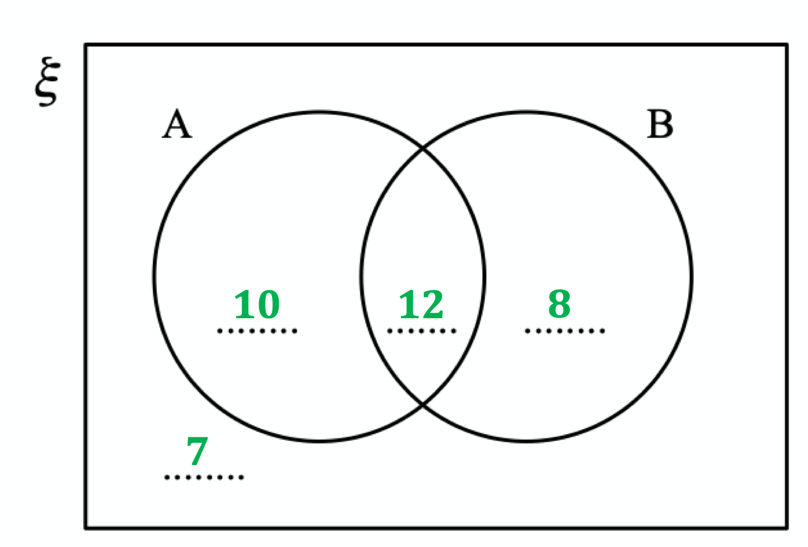

**Finding any correct missing value**** [1] **
**All values correct**** [1]**
*(i) **The number of elements that are in **A** 'and' not in **B**.*

**10**** ****[1]**

*(ii) **The number of elements that are not in **A** 'or' not in **B**.*

$10+8+7=25$

**25*** ***[1]**

### Q8
> *'*$n(A\cupB)'=3$*' means there are 3 elements outside **A** or **B '*$n(E)=20$*' **means there are 20 elements in total in the universal set, leaving 17 in **A** or **B** *
* **'*$n(A)=10$*' **means there are 10 elements in **A**, and  *$n(B)=13$* means there are 13 elements in **B **giving a total of 23. However we know there are only 17 elements in **A **and **B** so*

`straight n open parentheses A intersection B close parentheses equals 23 minus 17`

**[1]**

**6**** ****[1]**
> *We know from the question that *`straight n open parentheses A close parentheses equals 13`*, and we know from part (a) that  but 6 of these are included in *`straight n open parentheses A intersection B close parentheses equals 6`*. So 13 elements are in **A** but 6 of these are included in the '**A **and **B**' section*

> *To find , the number of elements in **B** but not in **A**, subtract 6 from 13*

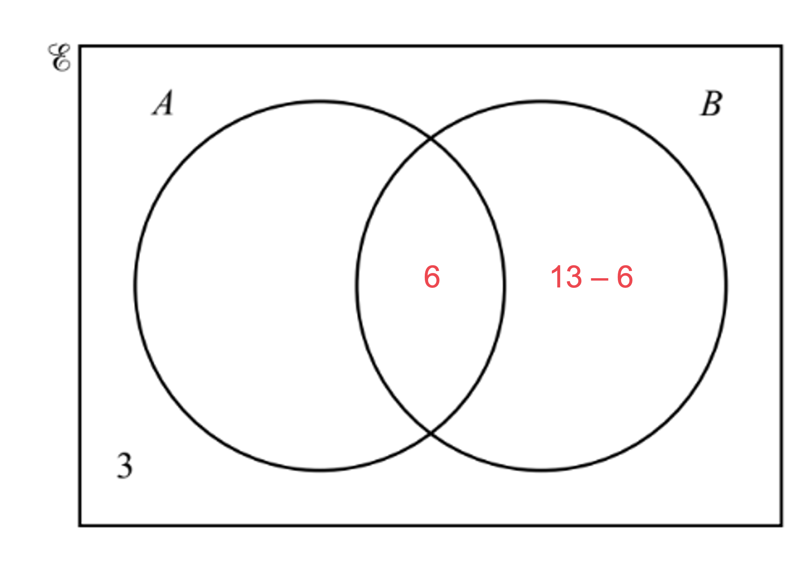

**7** **[1]**

### Q9
*Place 7, 11 and 9 can directly in the Venn diagram.* 
*Call the intersection between all three events *$x$*, say, and then the intersections between the pairs of events can be found in terms of *$x$*.*

> *As the total number of students is 40, we can now set up and solve an equation in *$x$*.*

`table row cell x plus open parentheses 8 minus x close parentheses plus open parentheses 6 minus x close parentheses plus open parentheses 3 minus x close parentheses plus 7 plus 11 plus 9 plus 0 end cell equals 40 end table`

**[1]**

`table row cell 44 minus 2 x end cell equals 40 row cell 2 x end cell equals 4 row x equals 2 end table`

> *Now we can complete all sections of the Venn diagram with values.*

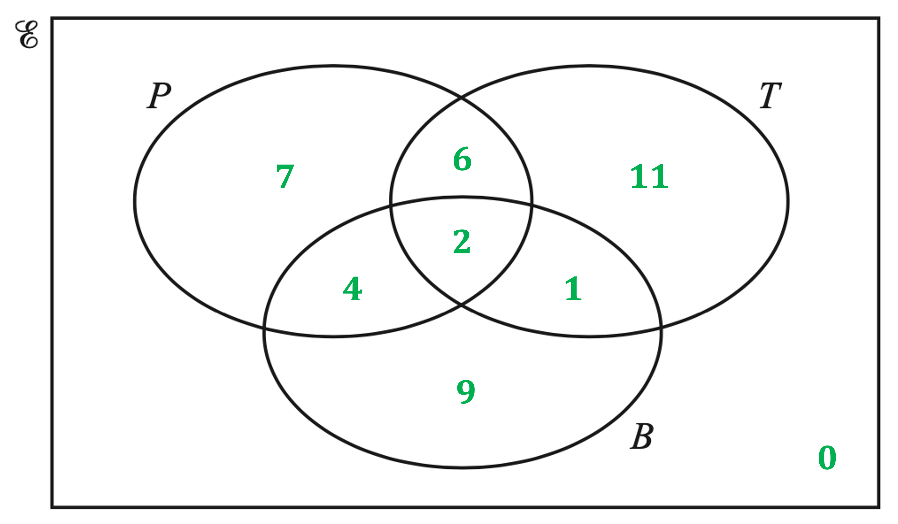

**5 correct values, must include '2'**** [1] **
**Fully correct diagram**** [1]**
> *Use a 'mini-Venn' to shade the area for *`open parentheses P union B close parentheses apostrophe`* - this is **"not** (*$P$* **or** *$B$* **or** both)".*

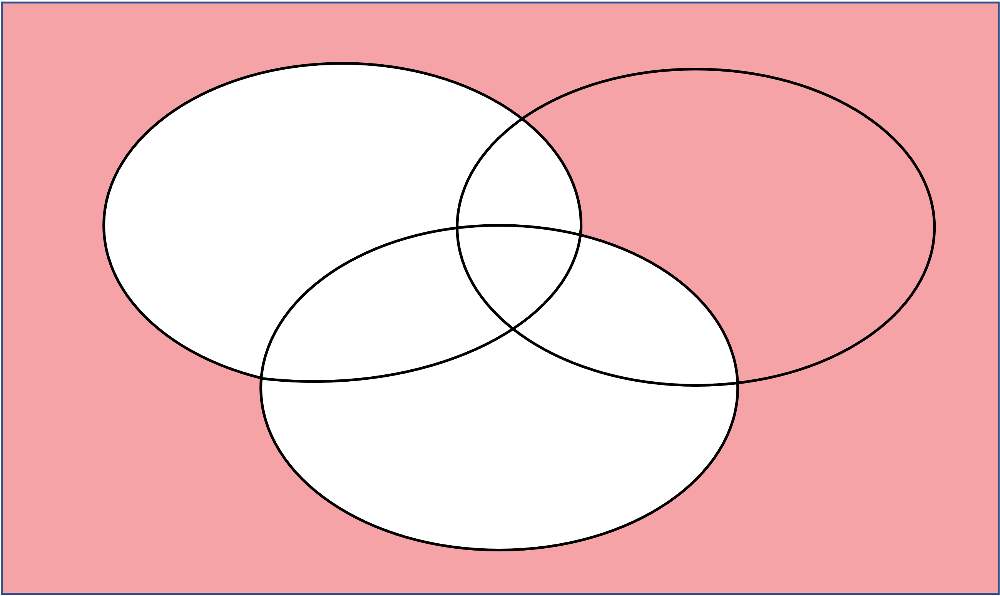

> *As one of the highlighted sections is 0 we can write the answer straight down.*

`bold n stretchy left parenthesis open parentheses P union B close parentheses apostrophe stretchy right parenthesis bold equals bold 11`**[1]**
> *Use a 'mini-Venn' to shade the area for *`open parentheses P union T union B close parentheses apostrophe`* - this is **"not** (*$P$* **or** *$T$* **or** *$B$* **or** any 2 **or** all 3)".*

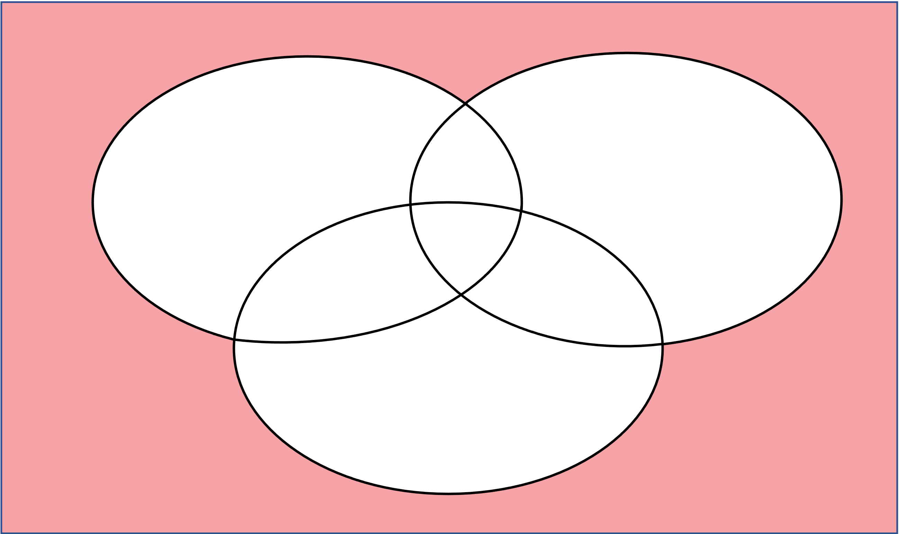

> *We can see that the number of students is 0. Write your answer in set notation.*

$(P\cupT\cupB)'=\emptyset$**or **`equation`** ****[1]**

### Q10
> *Start by adding to the diagram the 5 students who have neither a dog or a cat or a rabbit, and the 6 who have a dog, a cat and a rabbit.*

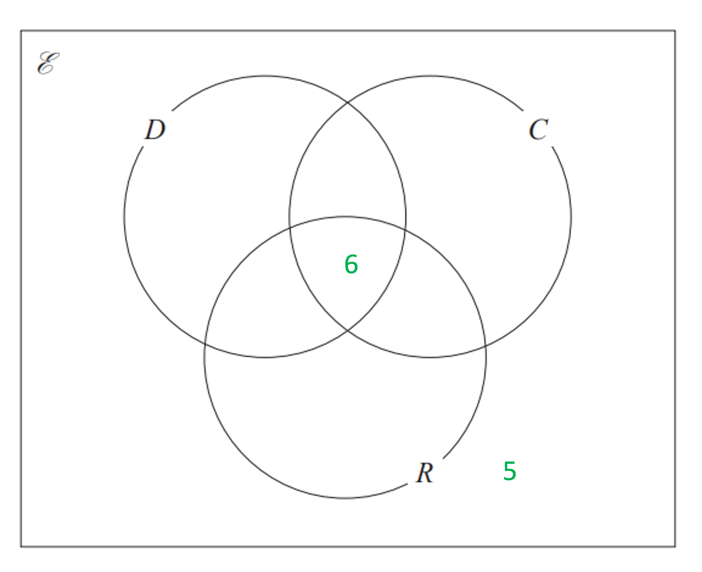

**2 or 3 correct values inserted**** [1]**

> *Work outwards; next add the students who have two types of pet.*

> $x$* have both a dog and a cat but this includes the 6 students in the centre who have all three type of pet, so enter *$x-6$* here*

> *9 have both a dog and a rabbit but this includes the 6 students in the centre who have all three type of pet, so enter 3 here*

> *8 have both a cat and a rabbit but this includes the 6 students in the centre who have all three type of pet, so enter 2 here*

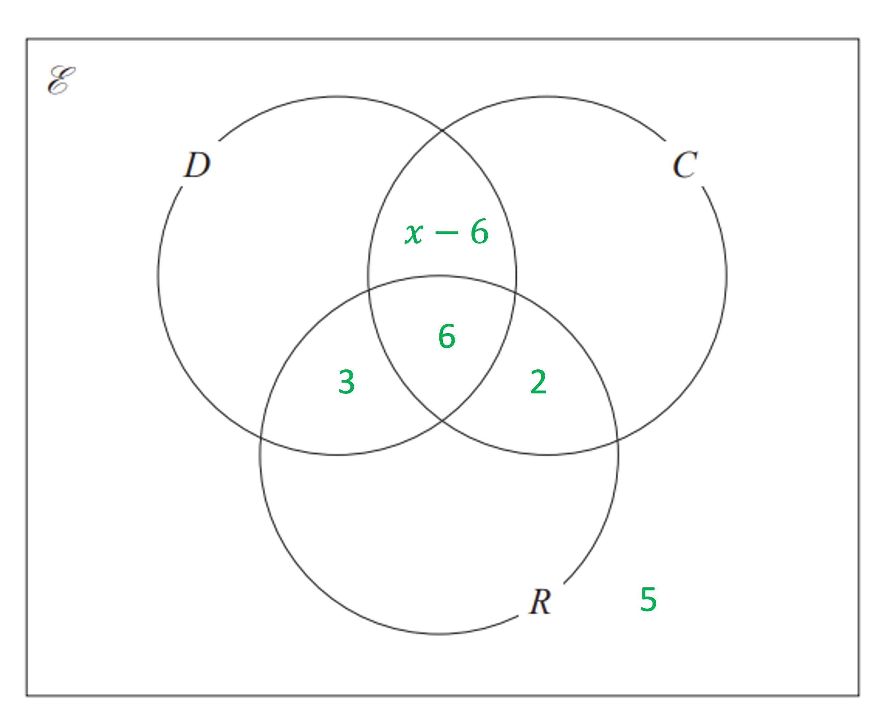

**4 to 7 correct values inserted**** [1]**

*Now add the students who have only one type of pet.* *20 students have a rabbit; use the Venn diagram so far to work out how many students have **only** a rabbit.*

*only a rabbit = 20 − (3 + 6 + 2) = 9*

> *18 students have a cat; use the Venn diagram so far to work out how many students have **only** a cat.*

*only a cat = 18 − (2 + 6 + *$x$* − 6) = 18 − (2 + *$x$*) = 16 − *$x$

> *28 students have a dog; use the Venn diagram so far to work out how many students have **only** a dog.*

*only a dog = 28 − (3 + 6 + *$x$* − 6) = 28 −(3 + *$x$*) = 25 − *$x$

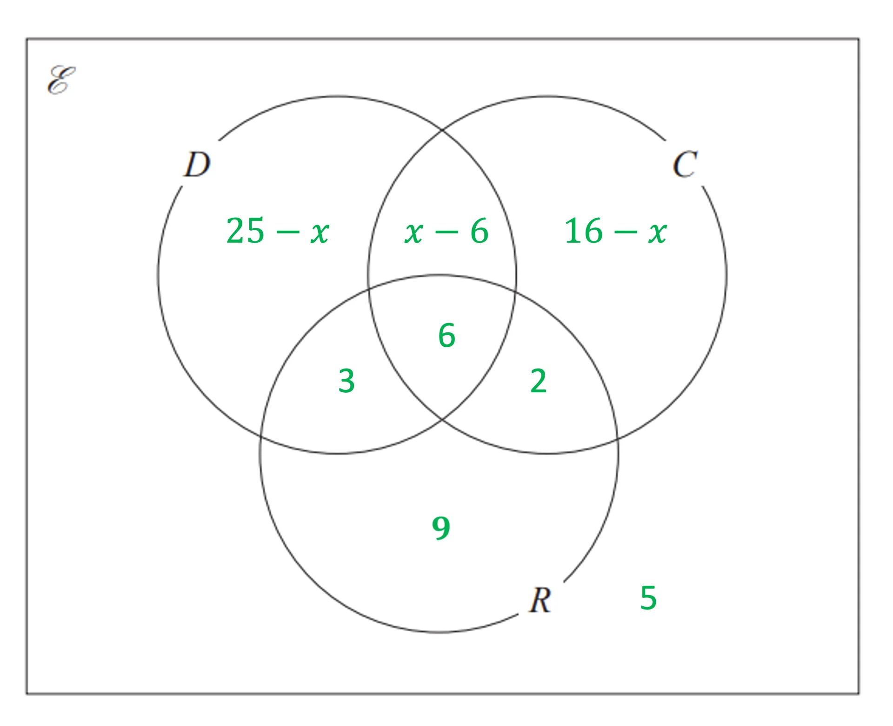

**all values inserted correctly**** [1]**
> *Add together all the values in the Venn diagram from (a) and equate to 50.*

$25-x+x-6+16-x+6+3+2+9+5=50$

**correctly summing together all the values in the Venn**** diagram [1]** 
**equating this sum to 50**** [1]**

> *Now collect like terms and solve.*

`table attributes columnalign right center left columnspacing 0px end attributes row cell 60 minus x end cell equals 50 row 10 equals x end table`

**10**** ****[1]**
> $n(Cʹ\capDʹ)$* means the number of students who do not have a cat and who do not have a dog (i.e. only have a rabbit, or have no pet, circled in the diagram below)*

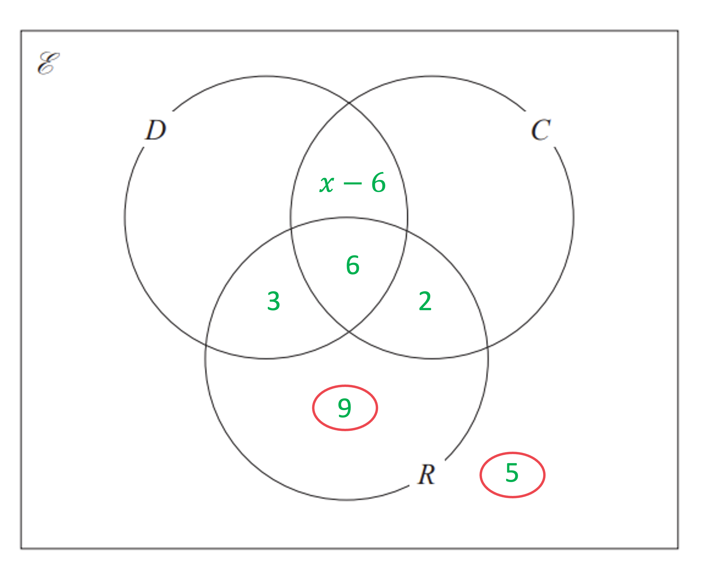

*9 + 5 = 14*

**14** **[1]**

### Q11
i) *The middle intersection represents the people who study all three subjects.* *The number of people who study all three subjects is 7.*

*The three middle intersections (that all contain *$x$*) represent the people who study exactly two of the three subjects.* 
*The number of people who study only two of the three subjects is *$x+x+x=3x$*.*

> *Form an equation using the fact that 19 people study two or three of these subjects.*

$3x+7=19$

**[1]**

> *Solve the equation. Subtract 7 from both sides.*

$3x=12$

> *Divide both sides by 3.*

$x=\frac{12}{3}$

$x=4$ **[1]**

ii) *18 people study only mathematics.* 
*18 goes in the part of the **M** circle that does not overlap any other circles.*

*23 people study geography.* 
*All the values in the **G** circle should add up to 23. Subtract the three values that are already in the circle from 23.*

*23 - 7 - 4 - 4 = 8*

*Everyone studies at least one of the three subject. Therefore there are 0 people who study none of the subjects.* 
*There should not be any values in the box outside of the circles. You can put a 0 if you want.* 
*There are 50 people in total.*
 *All the values in the Venn diagram should add up to 50. To find the missing value in the **H** circle, subtract all the other values in the Venn diagram from 50.*

*50 - 7 - 4 - 4 - 4 - 18 - 8 = 5*

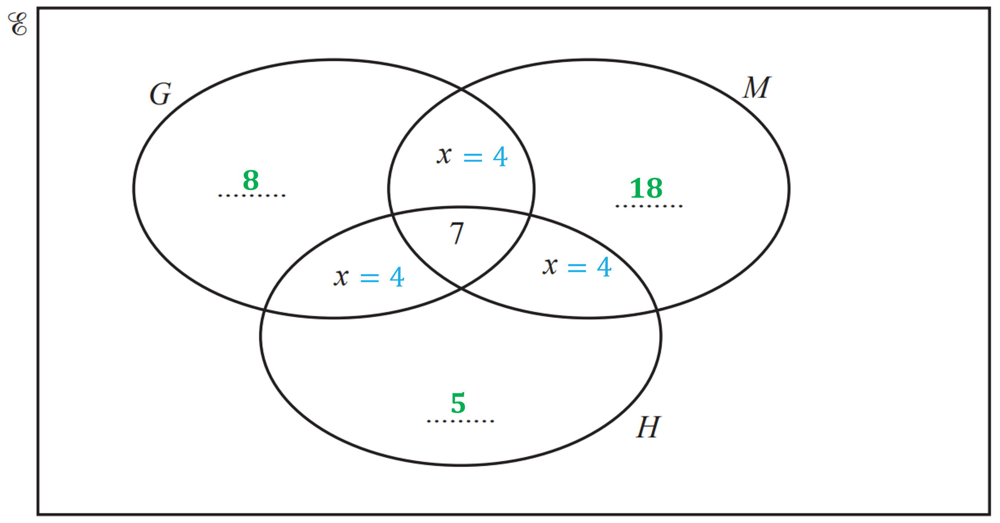

** ****2 of the 3 values are correct**** [1] **
**All of the 3 values are correct**** [1]**
i) *∪ means union, which means any elements which are in at least one of the sets.*

> *G**∪**M**∪**H** represents the set of people that study at least one of geography, mathematics or history.*

> *(**G**∪**M**∪**H**)' represents the set of people that do not student at least one of the three subjects. This means they study none of the subjects. *

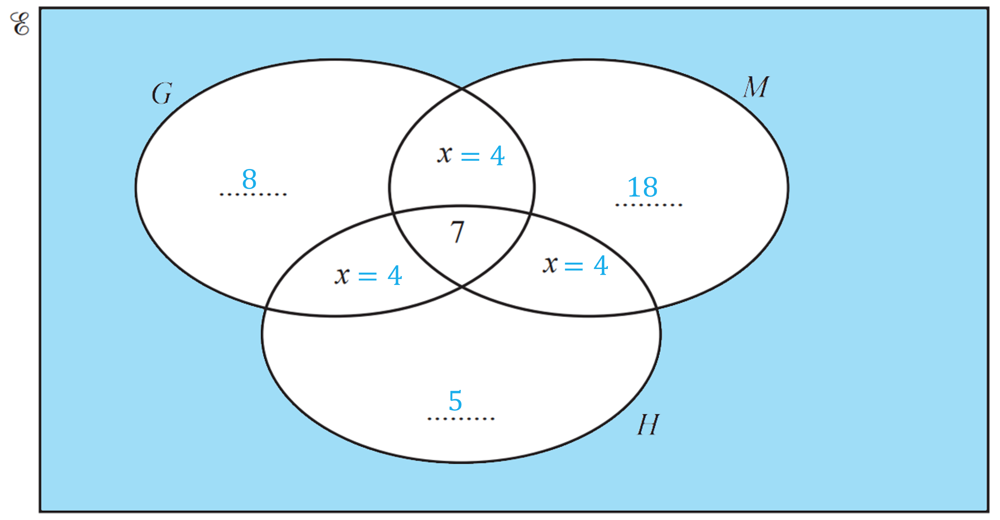

> *There are no students who study none of the three subjects. Therefore (**G**∪**M**∪**H**)' contains no elements so it is the empty set.*

> *Note that the answer is not zero. The actual set is empty so n((**G**∪**M**∪**H**)') would equal zero.*

$\emptyset$ **[1] **
**It is also acceptable to write: { }**

ii) *G**∩(**M**∪**H**) represents the set of people that study geography and at least one of the subjects: mathematics or history.* *n(**G**∩(**M**∪**H**)) is the number of people in this set.*

*As everyone in this set studies geography, we only need to look at the **G** circle and decide which numbers to add together.* *As everyone in the required set studies mathematics or history or both, we want to add together any of the numbers in the **G** circle that also appear in the **M** circle or the **H** circle or both of those circles.*

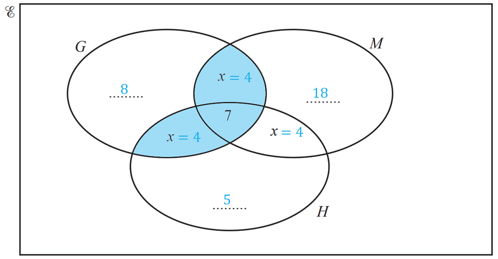

*7 + 4 + 4*

$n(G\cap(M\cupH))=15$ **[1]**

### Q12
*C**∩**D**' is the set of elements that are in **C** and also not in **D**.* 
*This is the part of the circle for **C** that does not overlap with **D**.*

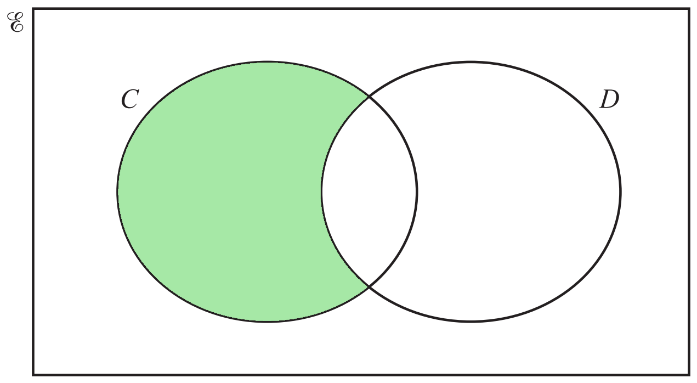

**  [1]**

### Q13
i) *d** is an element of the set **A**. The symbol for this is ∈.*

$d\inA$ **[1]**

ii) *The curly brackets means that it is a set of elements. The               elements **f **and **g **are the only elements in the intersection     of **A **and **B**, this means they are the only elements that are in both **A **and **B**. The symbol for intersection is ∩.*

`bold left curly bracket bold italic f bold comma bold space bold italic g bold right curly bracket bold equals bold italic A bold intersection bold italic B` **[1]**

iii) *n(**X**) means the number of elements in the set **X**.*

> *       Count how many elements there are in different sets until you         find a set with 6 elements.*

> *       B **= {**f, g, h, j, k, m**} so **B** has 6 elements.*

> *       A**' means the set of elements that are not in **A**. **A**' = {**h, j, k, m, p,        q**} so **A**' also has 6 elements.*

**Final answer:** $n(B)=6$** ****or**** **$n(A')=6$** **

**Writing one of the two answers ****[1]  **

### Q14
i) $B\cupG$ *means the members of set **B** or set **G.** Write the letters that are in blue or in grey, without repeats.*

**b, l, u, e, g, r, y** **[1]**

**the letters can be given in any order but must not contain repeats**

ii) $W\capG'$ *means the members of set **B** that are not in set **G**. Write the letters that are in white and not in grey.*

**w, h, i, t** **[1]**

**the letters can be given in any order**
> *"*$B\capG\capW=\emptyset$*" means "*$B\capG\capW$* is an empty set". In other words, there are no letters that appear in blue and in grey and in white.*

**No, because "e" appears in all three words (**$B\capG\capW$** is not an empty set)**** **

**"Serena's statement is not correct" plus a valid reason**** [1]**

### Q15
> *5 do not study any languages, so place 5 in the Venn diagram outside of both bubbles.*

> *Find the intersection of both bubbles *`open parentheses G intersection S close parentheses`* by finding how many students have been counted twice in German and Spanish. *

*German + Spanish - both + neither = 32 *

*15 + 18 - both + 5 = 32 *

*38 - both = 32*

*both = 6*

**[1]**

> *Place 6 in the Venn diagram in the intersection of both bubbles. *

> * *

> *Find the other two numbers by subtracting 6 from the total for that language.*

> * *

**[1]**

### Q16
i) *The area of the Venn diagram that corresponds to the people using the tennis court only is highlighted in the diagram below*

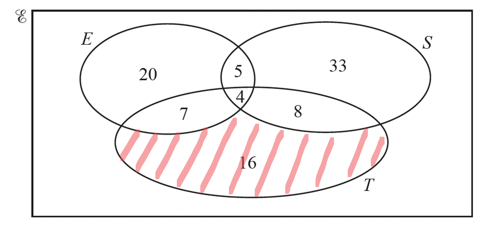

> *Hence the answer is 16 people*

**16 people ****[1]**

ii) *The area of the Venn diagram that corresponds to the people using the swimming pool is highlighted in the diagram below.*

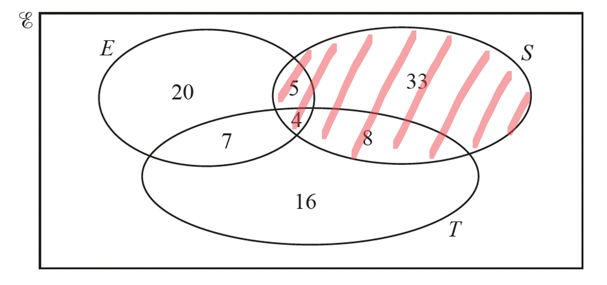

> *Add the number of people in the shaded region together*

*33 + 5 + 4 + 8 = 50*

**50 people ****[1]**

### Q17
> $ℰ$* is the universal set and, as *$x$* is an integer, the Venn diagram needs to contain the numbers 41, 42, 43, 44, 45, 46, 47, 48, 49 and 50. Considering the other statements,*

*41, 43 and 47 are odd and prime - *$A\cupC$* *
*42 and 48 are multiples of 3 - *$B$* *
*44, 46 and 50 are none of these - *$ℰ$* *
*45 is odd and a multiple of 3 - *$A\cupB$* *
*49 is odd - *$A$

> *Now we can complete the Venn diagram.*

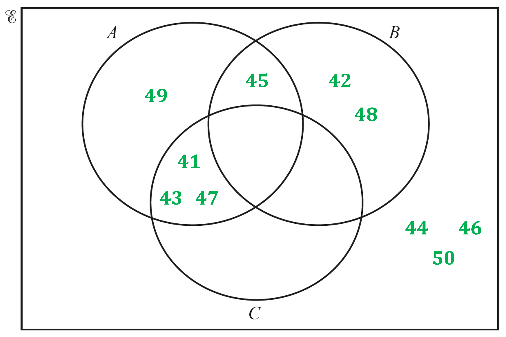

**Final answer:** **6 correct**** [1] **

**Final answer:** **8 correct**** [1] **

**Final answer:** **All correct**** [1]**
> *Elements are the values inside the Venn diagram, in this case the integers from 41 to 50 (inclusive).*

i) $A\capC$* is "*$A$* **and** *$C$*" (intersection). *

> *You can quickly sketch a 'mini' Venn diagram to help identify the region(s) needed.*

**The elements in  **$A\capC$**are 41, 43 and 47*** ***[1]**

ii) `open parentheses B union C close parentheses apostrophe`* is "**not** (*$B$* **or** *$C$*)" (not the union). *

> *You can quickly sketch a 'mini' Venn diagram to help identify the region(s) needed.*

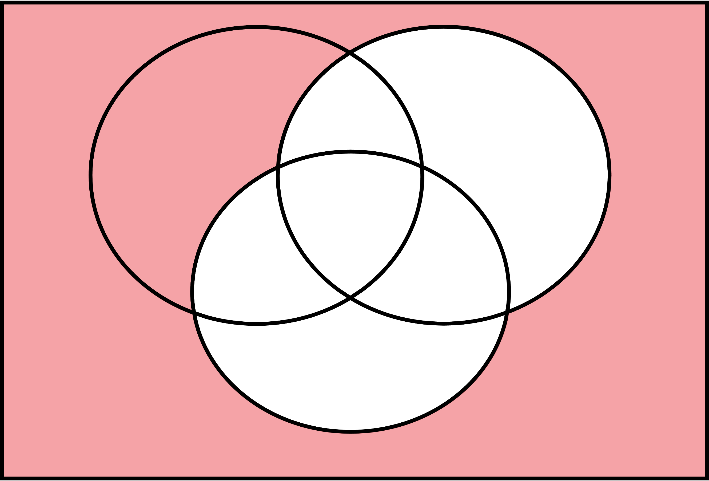

**The elements in **$(B\cupC)'$** are 44, 46, 49 and 50*** ***[1]**
`straight n open parentheses A intersection B intersection C close parentheses`* is the number of elements in *$A$* **and** *$B$* **and** *$C$* **(intersection** of all three).* 
*You can quickly sketch a 'mini' Venn diagram to help identify the region(s) needed.*

> *There are no values in this region of the Venn diagram.*

**0** **[1]**

### Q18
i) $B\cupI$ *means the members of set **B** or set **I**. Write the letters that are in brazil or in ireland, without repeats.*

**b, r, a, z, i, l, e, n, d** **[1]**

**the letters can be given in any order but must not contain repeats**

ii) $B\capI'$ *means the members of set **B** that are not in set **I**. Write the letters that are in brazil and not in ireland.*

**b, z** **[1]**

**the letters can be given in either order**
> *"*$B\capK=\emptyset$*" means "*$B\capK$* is an empty set". In other words, there are no letters that appear in both brazil and in kenya.*

**"a" appears in both Brazil and Kenya so **$B\capK$** is not an empty set** **[1]**

### Q19
i) *Add the number of students in the whole **M** circle*

*5 + 3 + 2+ 4*

**14 students ****[1]**

ii) *"Study exactly two subjects" means study Music and Drama only (3), Drama and Geography only (9) and Geography and Music only (4)* *Add these numbers together*

*3 + 9 + 4*

**16 students** **[1]**
*Find the set **M** (everything inside the **M** circle)*

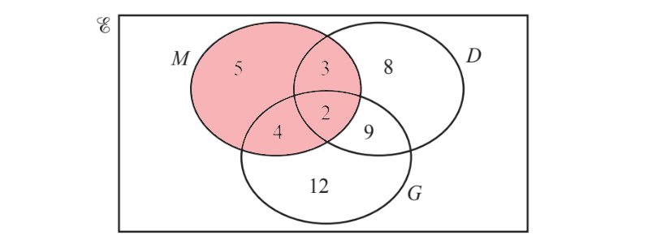

*Find the set **D'** (where **D'** means not **D**, so everything outside of the **D** circle)*

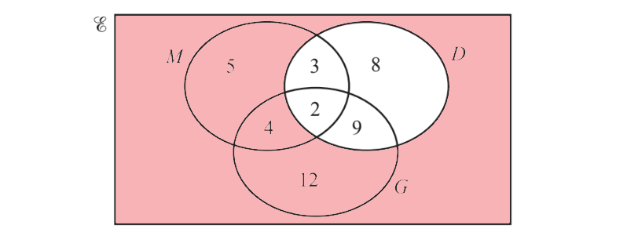

> *M*$\cap$*D'** means the regions that contain both **M** and **D'** *

*Shade the regions which appear in both* * *

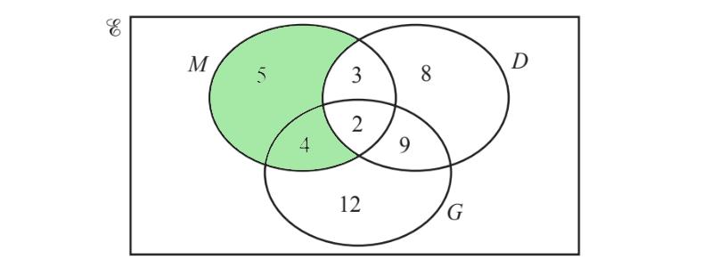

**[1]**

### Q20
> *Start by filling in the centre and the section outside the circles as you know these numbers.*

> *Subtract the number of people that study all three from the numbers that study two to find the numbers that study exactly two.*

*10 - 4 = 6 study Russian and French only* 
*13 - 4 = 9 study French and German only* 
*6 - 4 = 2 study Russian and German only*

> *Subtract the people that study German and another language from the people that study German to find the number that study only German.*

*24 - 4 - 9 - 2 = 9 study German only*

> *Double the number that study French only to find the number that study Russian only, leave this in terms of **x**.*

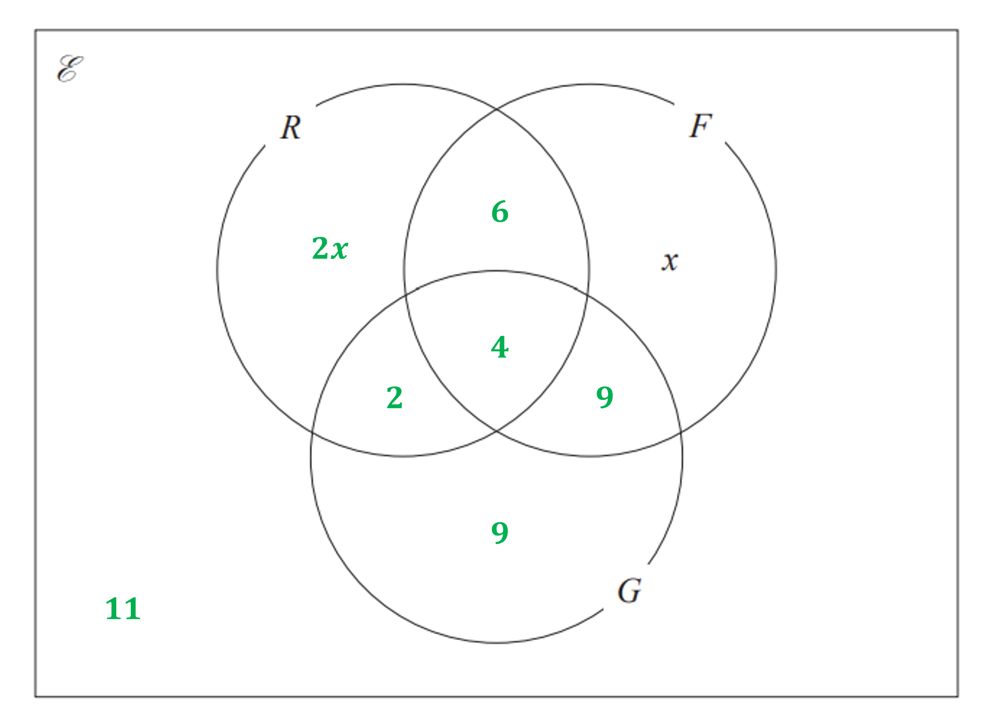

** ****3 sections correct**** [1]  **
**5 sections correct**** [1]  **
**All sections correct**** [1]**

** **
> *Form an equation by adding together the number in all the sections and making this equal 80.*

$4+2+6+9+9+2x+x+11=80$

**[1]**

> *Simplify and solve.*

`table attributes columnalign right center left columnspacing 0px end attributes row cell 3 x plus 41 end cell equals 80 row cell 3 x end cell equals 39 row x equals 13 end table`

**[1]**

> *Find the number of people that study Russian by adding together the numbers in that circle.*

`2 open parentheses 13 close parentheses plus 6 plus 2 plus 4`

**38 study Russian** **[1]**

### Q21
> `open parentheses E union S close parentheses`* or "*$E$*-union-*$S$*", means the people who use the exercise machines or the swimming pool (or both). Shade this region on the diagram*

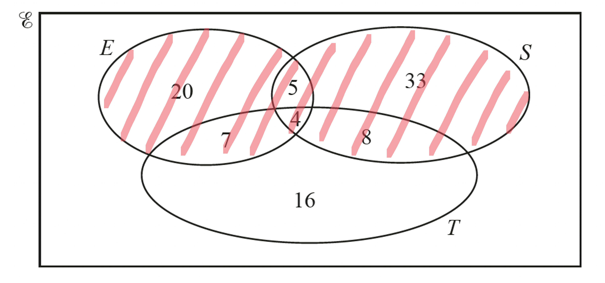

> *Shade region *$T$* using a different direction or colour*

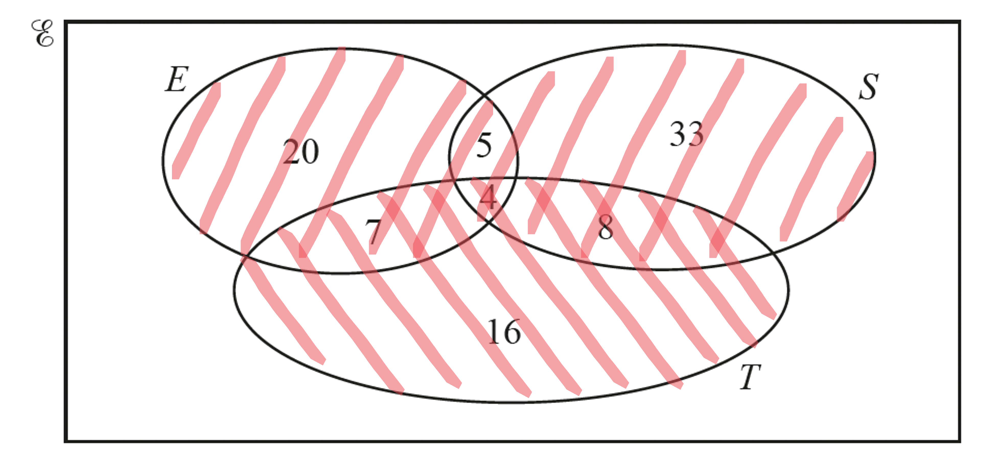

> `T intersection open parentheses E union S close parentheses`* or "the intersection of *$T$*and *$E$*-**union-*$S$*" means the people who are **both** use the tennis courts **and** use the exercise machines or the swimming pool. It is where the two shaded regions overlap*

*7 + 4 + 8 = 19*

**19**** ****people**** [1]**
