# Exam Questions — Set Notation & Venn Diagrams
**Number** · Cambridge (CIE) IGCSE maths (0580 & 0980)
> Source: [https://www.savemyexams.com/igcse/maths/cie/25/extended/topic-questions/](https://www.savemyexams.com/igcse/maths/cie/25/extended/topic-questions/) · 21 questions across 1 sets

## Calculator Questions (21 questions)

### Q1 — medium — 3 marks

**Q1** [2 marks]

$\mathrm{n} ( \text{calligraphic} E ) = 30$, $\mathrm{n} ( A ' \cap B ) = 2$, $\mathrm{n} ( A \cap B ' ) = 9$ and $\mathrm{n} ( A \cup B ) = 23$.
The Venn diagram shows some of this information.

Find $\mathrm{n} ( A \cap B )$.

**Q1** [1 mark]

**Extract:**

n(ε) = 30, n(A' ∩ B) = 2, n(A ∩ B') = 9 and n(A ∪ B) = 23.

Find $\mathrm{n} ( A \cup B ) '$.

### Q2 — hard — 3 marks

**Q2** [3 marks]

$E$ = {4, 5, 6, 7, 8, 9, 10, 11, 12, 13, 14, 15}

$A\capB$ = {5, 10, 15}

$B'$= {7, 8, 9, 11, 12, 13, 14}

$A'$= {4, 6, 7, 8, 14}

Complete the Venn diagram for this information.

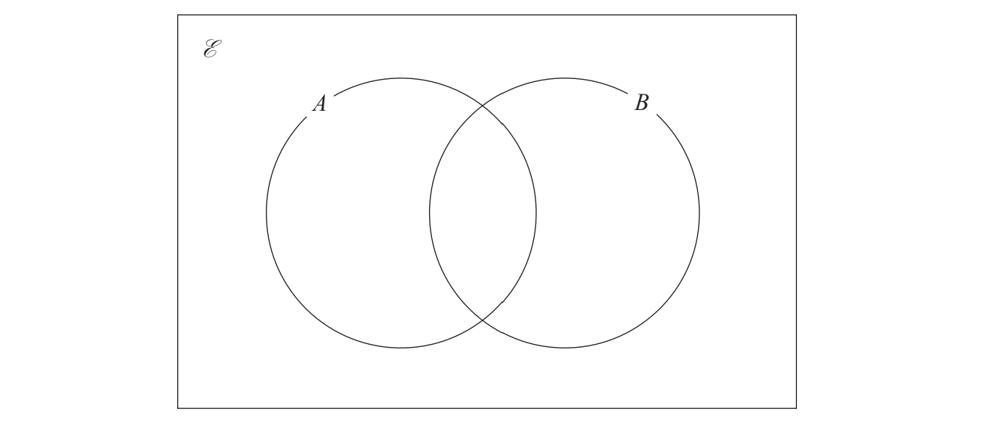

*Source: Jan 2022 4MA1/1H Q7*

### Q3 — hard — 4 marks

**Q3** [1 mark]

The Venn diagram shows a universal set $E$ and three sets $A,B$ and $C$.

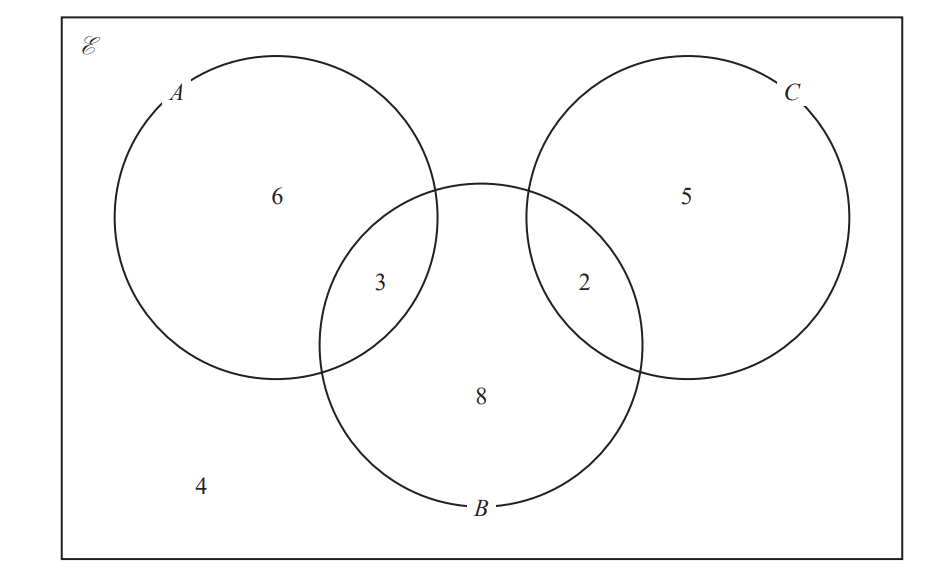

6, 3, 8, 2, 5 and 4 represent the **numbers **of elements.

Find

$n(A\cupB)$

*Source: Jan 2022 4MA1/1HR Q174*

**Q3** [1 mark]

**Extract:**

The Venn diagram shows a universal set and three sets A, B and C. 6, 3, 8, 2, 5 and 4 represent the numbers of elements.

$n(A\capB)$

*Source: Jan 2022 4MA1/1HR Q17I*

**Q3** [1 mark]

**Extract:**

6, 3, 8, 2, 5 and 4 represent the numbers of elements.

$n(B\capC')$

*Source: Jan 2022 4MA1/1HR Q17III*

**Q3** [1 mark]

**Extract:**

The Venn diagram shows a universal set and three sets A, B and C. 6, 3, 8, 2, 5 and 4 represent the numbers of elements.

$n(A'\cupB'\cupC')$

*Source: Jan 2022 4MA1/1HR Q17IV*

### Q4 — hard — 5 marks

**Q4** [4 marks]

`calligraphic E = left curly bracket x colon x`is an integer and `1 <= x <= 10 right curly bracket`
 `A = left curly bracket x colon x`is even`right curly bracket` 
`4 in A AND B n ( A AND B ) = 1 ( A OR B ) ' = left curly bracket 1 , 7 , 9 right curly bracket`

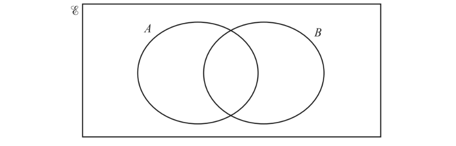

Complete the Venn diagram using this information.

*Source: 2018	Oct/Nov 0580/41 Q6B*

**Q4** [1 mark]

**Extract:**

![calligraphic E equals left curly bracket x space colon space x space]is an integer and ![1 less or equal than x less or equal than 10 right curly bracket]

 ![A equals left curly bracket x space colon space x space]is even![right curly bracket] 

![4 element of A intersection B
straight n left parenthesis A intersection B right parenthesis equals 1
left parenthesis A union B right parenthesis apostrophe equals left curly bracket 1 comma 7 comma 9 right curly bracket]

Use your Venn diagram to complete the statement.

`B equals left curly bracket`....................................................`right curly bracket`

*Source: 2018	Oct/Nov 0580/41 Q6B*

### Q5 — medium — 3 marks

**Q5** [2 marks]

$E=${students in a school}

$F=${students who play football}

$B=${students who play baseball}

There are 240 students in the school.

• 120 students play football

• 40 students play baseball

• 90 students play football but not baseball.

Complete the Venn diagram to show this information.

*Source: 2019	May/June 0580/41 Q6A*

**Q5** [1 mark]

**Extract:**

students in a school  
F = students who play football 
B = students who play baseball
There are 240 students in the school.  
• 120 students play football 
• 40 students play baseball  
• 90 students play football but not baseball.

Find $\text{n}(F'\capB').$

*Source: 2019	May/June 0580/41 Q6B*

### Q6 — easy — 3 marks

**Q6** [2 marks]

$E$ = {21, 22, 23, 24, 25, 26, 27, 28, 29, 30}

$A$ = {22, 24, 26, 28, 30}

$B$ = {21, 24, 27, 30}

List the members of the set

i) $A\capB$

[1]

ii) $A'$

[1]

*Source: Jan 2021 4MA1/2HR Q3A*

**Q6** [1 mark]

**Extract:**

![A] = {22, 24, 26, 28, 30}

![B] = {21, 24, 27, 30}

$C$ = {23, 25, 29}

Using set notation, find an expression for $C$ in terms of $A$ and $B$.

*Source: Jan 2021 4MA1/2HR Q3B*

### Q7 — very_hard — 4 marks

**Q7** [2 marks]

*A* and *B* are two sets.

n(ξ) = 37

n(*A*) = 22

n(*A* ∩ *B*) = 12

n(*A* ∪ *B*) = 30

Complete the Venn diagram to show the **number of elements** in each region.

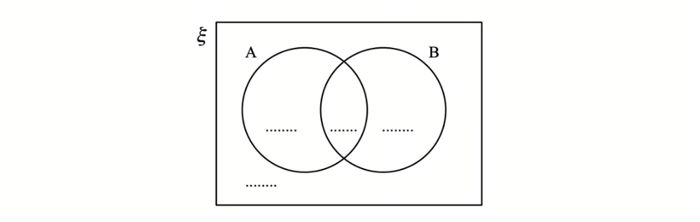

**Q7** [2 marks]

**Extract:**

A and B are two sets.
n(ξ) = 37
n(A) = 22
n(A ∩ B) = 12
n(A ∪ B) = 30

Find

(i)  n(*A* ∩ *B*′)

[1]

(ii) n(*A*′ ∪ *B*′)

[1]

### Q8 — hard — 3 marks

**Q8** [2 marks]

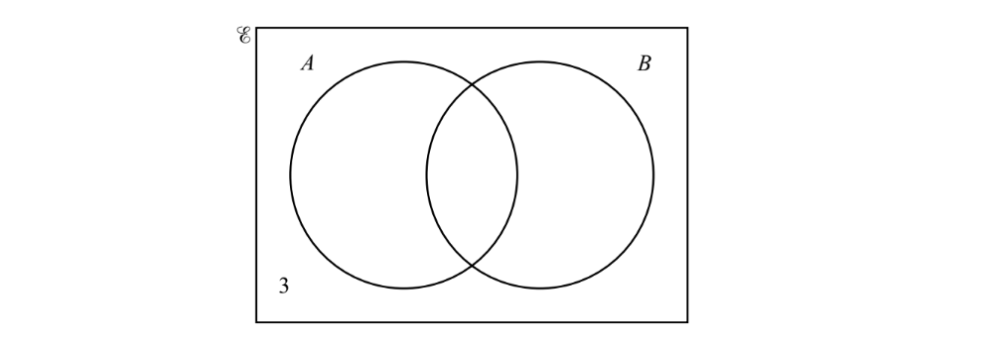

$n(E)=20,n(A\cupB)'=3,n(A)=10\mathrm{and}n(B)=13$.
 The Venn diagram shows some of this information.

Find

n(A ∩ B)

*Source: Specimen 2025 0580/04 Q11A*

**Q8** [1 mark]

**Extract:**

n(E) = 20, n((A ∪ B)′) = 3, n(A) = 10 and n(B) = 13.

n(A′ ∩ B) .

*Source: Specimen 2025 0580/04 Q11B*

### Q9 — very_hard — 5 marks

**Q9** [3 marks]

This year, 40 students have each travelled by one or more of plane ($P$), train ($T$) or boat ($B$).

7 have travelled only by plane. 
11 have travelled only by train. 
9 have travelled only by boat.

$n(P\capT)=8$
 $n(B\capT)=3$
 $n(B\capP)=6$

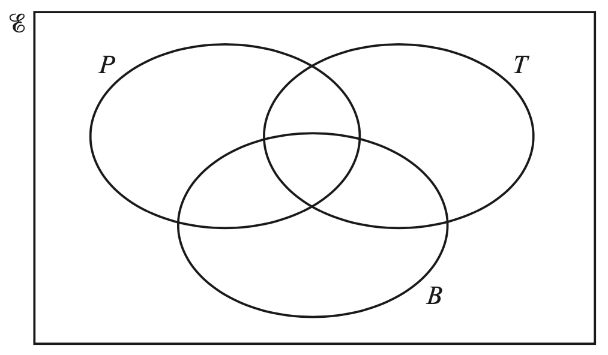

Complete the Venn diagram.

*Source: 2020 March 0580/42 Q9A*

**Q9** [1 mark]

**Extract:**

This year, 40 students have each travelled by one or more of plane (![P]), train (![T]) or boat (![B]). 

7 have travelled only by plane. 

11 have travelled only by train. 

9 have travelled only by boat.

![straight n left parenthesis P intersection T right parenthesis equals 8]

![straight n left parenthesis B intersection T right parenthesis equals 3]

![straight n left parenthesis B intersection P right parenthesis equals 6]

Find $n((P\cupB)')$.

*Source: 2020 March 0580/42 Q9B*

**Q9** [1 mark]

**Extract:**

This year, 40 students have each travelled by one or more of plane (![P]), train (![T]) or boat (![B]).

Use set notation to complete the statement.

$(P\cupT\cupB)'=$...........................

*Source: 2020 March 0580/42 Q9C*

### Q10 — very_hard — 6 marks

**Q10** [3 marks]

Some students in a school were asked the following question.

“Do you have a dog ($D$), a cat ($C$) or a rabbit ($R$)?”

Of these students

28 have a dog 
   18 have a cat
    20 have a rabbit
     8 have both a cat and a rabbit 
    9 have both a dog and a rabbit 
    $x$ have both a dog and a cat
     6 have a dog, a cat and a rabbit
     5 have not got a dog or a cat or a rabbit

Using this information, complete the Venn diagram to show the number of students in each appropriate subset. 
Give the numbers in terms of $x$ where necessary.

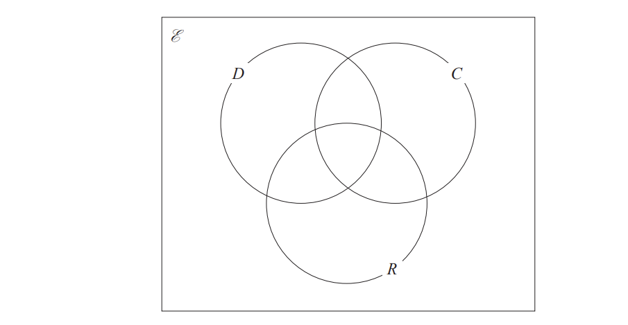

*Source: Jan 2020 4MA1/2HR Q17A*

**Q10** [2 marks]

**Extract:**

Some students in a school were asked the following question.

"Do you have a dog (![D]), a cat (![C]) or a rabbit (![R])?"

Of these students

   28 have a dog 

   18 have a cat

    20 have a rabbit

     8 have both a cat and a rabbit 

    9 have both a dog and a rabbit 

    ![x] have both a dog and a cat

     6 have a dog, a cat and a rabbit

     5 have not got a dog or a cat or a rabbit

Given that a total of 50 students answered the question,

work out the value of $x$.

$x$ = ........................

*Source: Jan 2020 4MA1/2HR Q17B*

**Q10** [1 mark]

**Extract:**

Some students in a school were asked the following question.

"Do you have a dog (![D]), a cat (![C]) or a rabbit (![R])?"

Of these students

   28 have a dog 

   18 have a cat

    20 have a rabbit

     8 have both a cat and a rabbit 

    9 have both a dog and a rabbit 

    ![x] have both a dog and a cat

     6 have a dog, a cat and a rabbit

     5 have not got a dog or a cat or a rabbit

Find  $n(Cʹ\capDʹ)$

*Source: Jan 2020 4MA1/2HR Q17C*

### Q11 — very_hard — 6 marks

**Q11** [4 marks]

50 students study at least one of the subjects geography ($G$), mathematics ($M$) and history ($H$). 
18 study only mathematics. 
19 study two or three of these subjects. 
23 study geography.

The Venn diagram below is to be used to show this information.

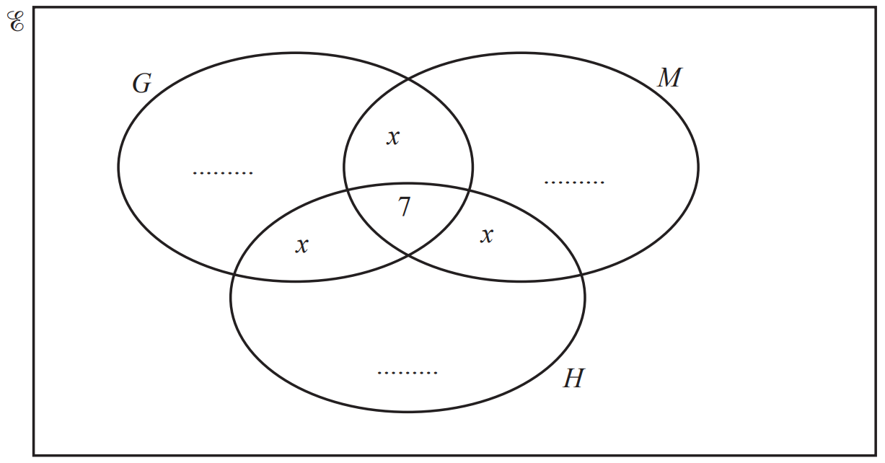

i) Show that $x=4$.

[2]

ii) Complete the Venn diagram.

[2]

*Source: 2019 March 0580/42 Q9C*

**Q11** [2 marks]

**Extract:**

50 students study at least one of the subjects geography (![G]), mathematics (![M]) and history (![H]). 

18 study only mathematics. 

19 study two or three of these subjects. 

23 study geography.

i) Use set notation to complete this statement.

$( G \cup M \cup H ) ' =$....................... [1]

ii) Find $\mathrm{n} ( G \cap ( M \cup H ) )$.

[1]

*Source: 2019 March 0580/42 Q9C*

### Q12 — medium — 1 marks

**Q12** [1 mark]

In the Venn diagram below, shade $C\capD'.$

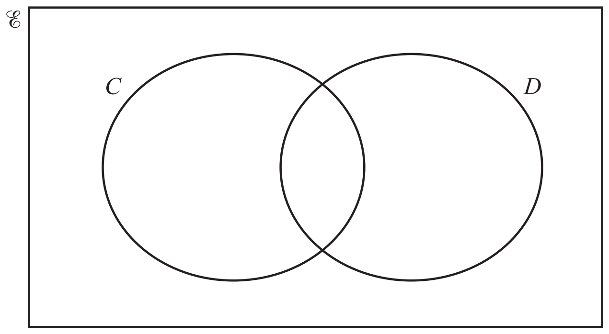

*Source: 2019 March 0580/42 Q9B*

### Q13 — medium — 3 marks

**Q13** [3 marks]

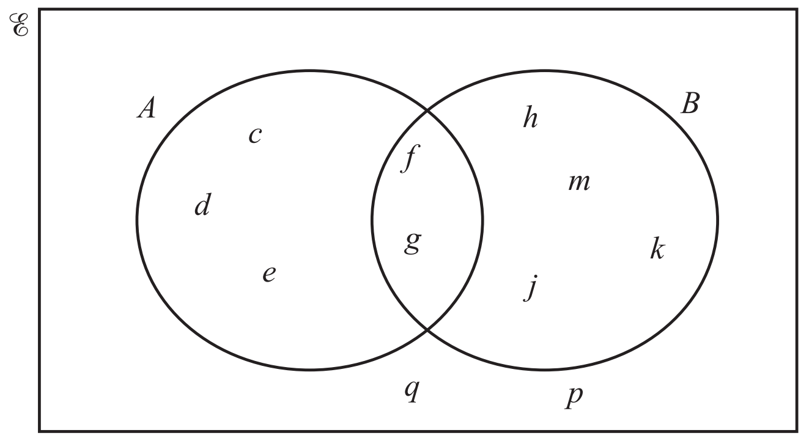

Use set notation to complete the statements.

i) $d$...................$A$

[1]

ii) `left curly bracket f , g right curly bracket =`...............................

[1]

iii) Complete the statement.

$n(.........................)=6$ [1]

*Source: 2019 March 0580/42 Q9A*

### Q14 — easy — 3 marks

**Q14** [2 marks]

$\begin{array}{rcl} B = \{ \mathrm{b} , \mathrm{l} , \mathrm{u} , \mathrm{e} \} \\ G = \{ \mathrm{g} , \mathrm{r} , \mathrm{e} , \mathrm{y} \} \\ W = \{ \mathrm{w} , \mathrm{h} , \mathrm{i} , \mathrm{t} , \mathrm{e} \} \end{array}$

List all the members of the set

i) $B\cupG$

[1]

ii) $W\capG'$

[1]

*Source: Jan 2020 4MA1/1HR Q4A*

**Q14** [1 mark]

**Extract:**

B = {b, l, u, e}
G = {g, r, e, y}
W = {w, h, i, t, e}

Serena writes down the statement $B\capG\capW=\emptyset$

Is Serena’s statement correct? 
You must give a reason for your answer.

[1]

*Source: Jan 2020 4MA1/1HR Q4B*

### Q15 — medium — 2 marks

**Q15** [2 marks]

There are 32 students in a class.

5 do not study any languages. 
15 study German (G). 
18 study Spanish (S).

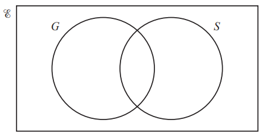

Complete the Venn diagram to show this information.

*Source: 2020 Oct/Nov 0580/41 Q9A*

### Q16 — medium — 2 marks

**Q16** [2 marks]

The number of members of a leisure centre using the exercise machines (*E*), the swimming pool (*S*) and the tennis courts (*T*) is shown on the Venn diagram.

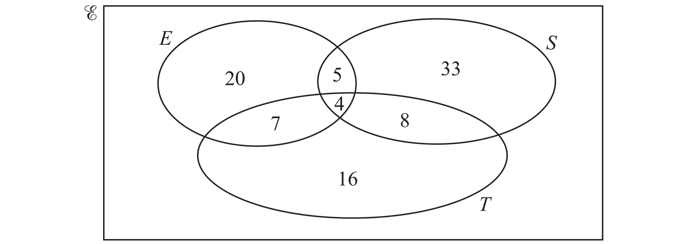

i) Find the number of members using only the tennis courts.

[1]

ii) Find the number of members using the swimming pool.

[1]

*Source: 2018	May/June 0580/41 Q10C*

### Q17 — medium — 6 marks

**Q17** [3 marks]

$x$ is an integer.

`ℰ = { x colon 41 <= x <= 50 }`

`A = left curly bracket x colon x`is an odd number`right curly bracket`

`B = left curly bracket x colon x`is a multiple of 3`right curly bracket`

`C = left curly bracket x colon x`is a prime number`right curly bracket`

Complete the Venn diagram to show this information.

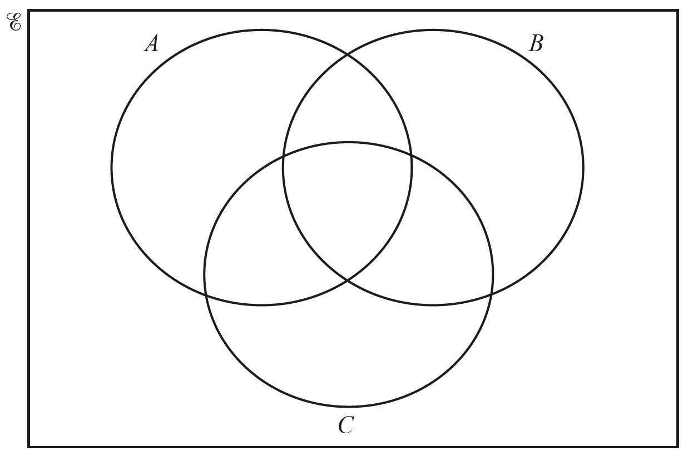

*Source: 2020	May/June 0580/41 Q5A*

**Q17** [2 marks]

**Extract:**

x is an integer.
ℰ = { x : 41 ≤ x ≤ 50 }
A = { x : x is an odd number }
B = { x : x is a multiple of 3 }
C = { x : x is a prime number }

List the elements of

i) $A\capC,$

[1]

ii) $( B \cup C ) '.$

[1]

*Source: 2020	May/June 0580/41 Q5B*

**Q17** [1 mark]

**Extract:**

ℰ equals open curly brackets x : 41 ≤ x ≤ 50 close curly brackets
A equals left curly bracket x : x is an odd number right curly bracket
B equals left curly bracket x : x is a multiple of 3 right curly bracket
C equals left curly bracket x : x is a prime number right curly bracket

Find $\mathrm{n} ( A \cap B \cap C ).$

*Source: 2020	May/June 0580/41 Q5C*

### Q18 — easy — 3 marks

**Q18** [2 marks]

$E$= {letters of the alphabet} 
$B$ = {b, r, a, z, i, l}
 $I$ = {i, r, e, l, a, n, d}

List the members of the set

i) $B\cupI$

[1]

ii) $B\capIʹ$

[1]

*Source: June 2021 4MA1/2H Q4*

**Q18** [1 mark]

**Extract:**

![B] = {b, r, a, z, i, l}

$K$ = {k, e, n, y, a}

Cody writes down the statement $B\capK=\emptyset$

Cody’s statement is wrong. Explain why.

*Source: June 2021 4MA1/2H Q4B*

### Q19 — hard — 3 marks

**Q19** [2 marks]

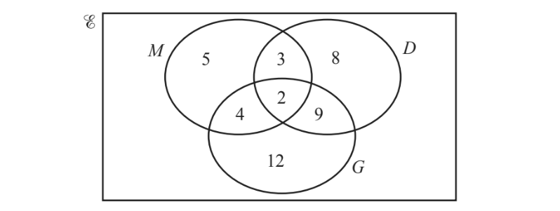

The Venn diagram above shows information about the number of students who study Music (*M*), Drama (*D*) and Geography (*G*).

i) How many students study Music?

[1]

ii) How many students study exactly two subjects?

[1]

*Source: 2018	Oct/Nov 0580/41 Q6A*

**Q19** [1 mark]

**Extract:**

The Venn diagram above shows information about the number of students who study Music (M), Drama (D) and Geography (G).

In the Venn diagram above, shade  $M\capD'$.

*Source: 2018	Oct/Nov 0580/41 Q6AIV*

### Q20 — very_hard — 6 marks

**Q20** [3 marks]

Some students were asked the following question.

“Which of the subjects Russian (*R*), French (*F*) and German (*G*) do you study?”

Of these students

4 study all three of Russian, French and German 
10 study Russian and French 
13 study French and German 
6 study Russian and German 
24 study German
11 study none of the three subjects
the number who study Russian only is twice the number who study French only.

Let $x$ be the number of students who study French only.

Show all this information on the Venn diagram, giving the number of students in each appropriate subset, in terms of $x$ where necessary.

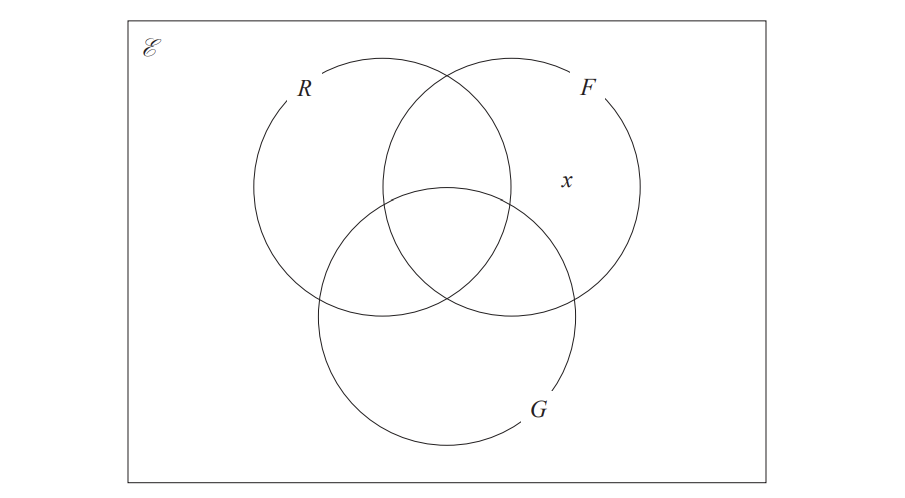

*Source: Jan 2021 4MA1/2H Q16A*

**Q20** [3 marks]

**Extract:**

4 study all three of Russian, French and German 
10 study Russian and French 
13 study French and German 
6 study Russian and German 
24 study German
11 study none of the three subjects
the number who study Russian only is twice the number who study French only.
Let ![x] be the number of students who study French only.

Given that the number of students who were asked the question was 80, work out the number of these students that study Russian.

*Source: Jan 2021 4MA1/2H Q16B*

### Q21 — hard — 1 marks

**Q21** [1 mark]

The number of members of a leisure centre using the exercise machines (*E*), the swimming pool (*S*) and the tennis courts (*T*) is shown on the Venn diagram.

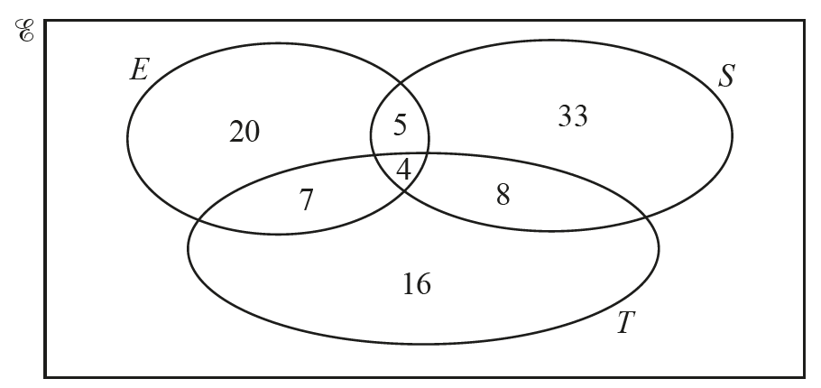

Find $n(T\cap(E\cupS))$.

*Source: 2018	May/June 0580/41 Q10C*

