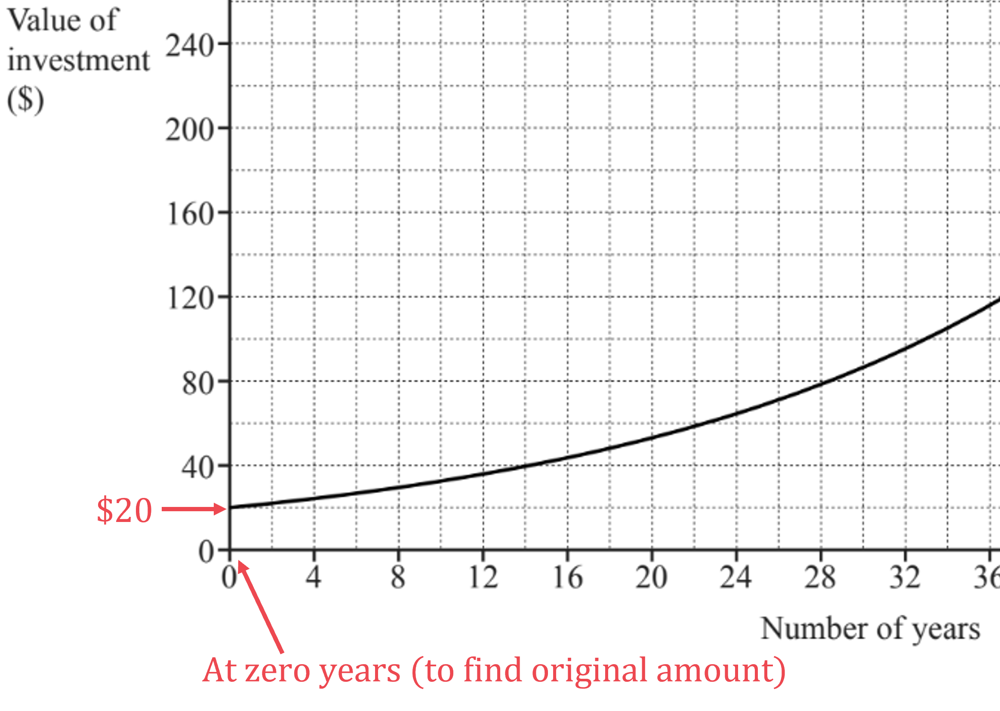
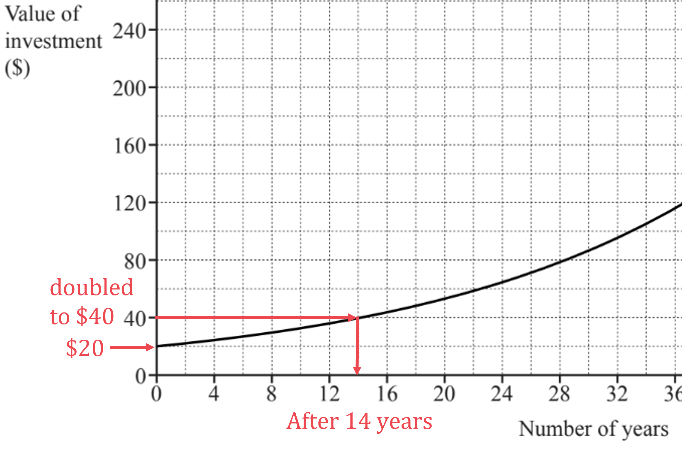

# Mark Schemes — Simple & Compound Interest, Growth & Decay
**Number** · Cambridge (CIE) IGCSE maths (0580 & 0980)

## Exam Questions (49 questions)

### Q1
(i)

**Simple** interest pays the same amount of interest every year

First find 3.2% of \$6000

- Divide 3.2 by 100 to get the decimal multiplier for 3.2%

$\frac{3.2}{100}=0.032$

- Multiply by \$6000

$0.032\times6000=192$

- So Eleni receives \$192 interest each year on that \$6000

There are 7 years in total

- So multiply \$192 by 7

$192\times7=1344$

- And add that on to \$6000

$6000+1344=7344$

**Final answer:** **Simple interest investment \$7344**

**[B1 B1 B1]**

**Compound** interest pays interest on the entire balance each year (including on previous interest amounts)

First find the percentage multiplier for 'increase by 3%'

- After increasing by 3%, the new total is 103% of the original
- Divide 103 by 100 to find the multiplier

$\frac{103}{100}=1.03$

That 'increase by 3%' multiplier is applied every year for 7 years

- So multiply \$6000 by 1.03 raised to the power of 7

$6000\times1.03^{7}=7379.24319...$

- Because this is a money question, round that to 2 decimal places

**Final answer:** **Compound interest investment \$7379.24**

**[B1 B1]**

> **[mark-scheme]**
> **B1**: For $\frac{6000\times3.2\times7}{100}$ or equivalent.
> 
> **B1**: For finding \$1344 for the interest.
> 
> **B1**: For correct final answer for simple interest investment. This correct answer automatically earns the previous two 'B' marks as well.
> 
> **B1**: For $6000\times1.03^{7}$ or equivalent.
> 
> **B1**: For correct final answer for compound interest investment. This correct answer automatically earns the previous 'B' mark as well.

(ii)

Find the total of the two amounts found in part (i)

$7344+7379.24=14723.24$

- Divide that by the original amount invested

$\frac{14723.24}{12000}=1.226936...$

- Multiply by 100 to find the percentage that the new amount is of the old amount

`1.226936... cross times 100 equals 122.6936... percent sign`

**[M1]**

- And subtract 100, to find the overall percentage increase over the original 100%

`122.6936... negative 100 equals 22.6936... percent sign`

Round to a suitable degree of accuracy

- In general you should round to 3 significant figures, unless a question says otherwise

**Final answer:** **22.7% (3 s.f.)**

**[A1]**

> **[mark-scheme]**
> **M1**: For $\frac{\mathrm{your} \mathrm{total} \mathrm{amount}}{12000}\times100$, or for `fraction numerator your space total space interest over denominator 12000 end fraction open square brackets cross times 100 close square brackets`.
> 
> **A1**: For 22.7 or 22.69 to 22.70.

(iii)

You know it takes longer than 7 years

- Multiply \$6000 by increasing powers of $1.03$ until the amount exceeds \$8300

$6000\times1.03^{8}=7600.620...$

$6000\times1.03^{9}=7828.639...$

$6000\times1.03^{10}=8063.498...$

$6000\times1.03^{11}=8305.403...$

**[M1 M1]**

**Final answer:** **11 years**

**[A1]**

> **[mark-scheme]**
> **M1**: For testing $6000\times1.03^{n}$ for at least two values of $n>7$.
> 
> **M1**: For testing $6000\times1.03^{n}$ for values of $n$ above and below $n=11$, or specifically for $n=10$ and $n=11$.
> 
> **A1**: For correct answer.
Divide the final value by the original amount invested

$\frac{16545}{8000}=2.068125$

So the original amount has been multiplied 2.068125 to get the final amount

- That has come from 20 years of compound interest
- So that has got to be equivalent to multiplying the original amount by some percentage multiplier raised to the power of 20
- If you call that percentage multiplier $x$, then

$x^{20}=2.068125$

**[M1]**

Take the 20th root of each side of the equation

- This will get rid of the power of 20 on the $x$

`table row cell root index 20 of x to the power of 20 end root end cell equals cell root index 20 of 2.068125 end root end cell row x equals cell root index 20 of 2.068125 end root end cell end table`

**[M1]**

Use your calculator to work that out

$x=1.03700019...$

- That is the percentage multiplier for a 3.700019...% increase
- So that must be the value of $r$

$r=3.7$

**[A1]**

> **[mark-scheme]**
> **M1**: For `8000 cross times open square brackets... close square brackets to the power of 20 equals 16545` or equivalent.
> 
> **M1**: For `root index 20 of 16545 over 8000 end root` or equivalent.
> 
> **A1**: For 3.7[0] or 3.700... .

### Q2
> *Considering The International Bank first*

> *4% earned for the first year, so the total after 1 year is*

*£2000 × 1.04 = £2080*

*Finding first year amount for either bank** ***[1]**

> *And then 1% interest each year after that, and there is only 1 year remaining*

*£2080 × 1.01 = £2100.80*

**[1]**

> *So the total earned in The International Bank after 2 years will be £2100.80*

> *Considering The Friendly Bank next*

> *5% earned for the first year, so the total after 1 year is*

*£2000 × 1.05 = £2100*

> *And then 0.5% interest each year after that, and there is only 1 year remaining*

*£2100 × 1.005 = £2110.50*

**[1]**

> *So the total earned in The Friendly Bank after 2 years will be £2110.50*

> *Comparing the two final amounts*

*£2110.50 > £2100.80*

**The Friendly Bank will give Viv the most money after 2 years** **[1]**

### Q3
*"decreases exponentially... each year" means this is a compound interest question* *If *$P$* is an initial amount decreasing by *$R$*% each year for *$n$* years, the final amount is  *`P open parentheses 1 minus R over 100 close parentheses to the power of n` * *

$P=30000,R=2,n=6$ * *

*Substitute these numbers into the formula* * *

`30 space 000 open parentheses 1 minus 2 over 100 close parentheses to the power of 6`

*Must have negative sign for decrease*** [1]**

*Use a calculator to find its value* * *

* *`30 space 000 open parentheses 1 minus 2 over 100 close parentheses to the power of 6 equals 26575.27...` * *

> *Give your answer correct to the nearest hundred*

**26 600 lions**** ****[1]**

### Q4
> *Using the compound interest formula, 5000 multiplied by [1+*$r$*] to the power of 15 is equal to 7566 (where *$r$* is the interest rate as a decimal)*

`5000 cross times open parentheses 1 plus r close parentheses to the power of 15 equals 7566`

**[1]**

> *Divide both sides by 5000*

`open parentheses 1 plus r close parentheses to the power of 15 equals 1.5132`

> *Take the 15th root of both sides to find '1 + *$r$*'*

`1 plus r equals root index 15 of 1.5132 end root`

**[1]**

$1+r=1.02799999...$

> *Subtract 1 from both sides*

$r=0.02799999...$

> *This is a decimal; convert it to a percentage by multiplying by 100*

**Answer = 2.799...% ****or**** 2.80% (3 s.f.)** **[1]**

### Q5
> *Use the formula for simple interest, **P **= 600, R = *$r$*, T = 10, **I **= 90*

$I=\frac{P\timesR\timesT}{100}$

$90=\frac{600\timesr\times10}{100}$

**[1]**

> *Multiply both sides by 100.*

$9000=6000r$

> *Divide both sides by 6000.*

$1.5=r$

`bold 1 bold. bold 5 bold percent sign`* ***[1]**

### Q6
*Compound interest is where each day the interest is calculated by finding the percentage of the current amount.*

> *Recall the formula for compound interest *`A equals P open parentheses 1 plus r over 100 close parentheses to the power of n`*. *

> *A** is the total final amount. *
*P **is the initial amount. *
*r** is the interest rate. *
*n** is the number of days.*

> *Substitute **P **= 200, **r** = 0.0035, **n** = 365 to find the total final amount after 1 year.*

`200 open parentheses 1 plus fraction numerator 0.0035 over denominator 100 end fraction close parentheses to the power of 365 equals 202.5713...`

**[1]**

> *Round US Dollars to 2 decimal places.*

**\$202.57*** ***[1] **
**It is acceptable to write as 3sf: \$203**

### Q7
> *Find the multiplier for a 1.5% increase by adding 1.5% to 1.*

$1+\frac{1.5}{100}=1.015$

> *This multiplier is multiplied to the value each year. After 30 years the initial value will be multiplied by the multiplier 30 times.*

$1.015^{30}=1.563080...$

**[1]**

> *This represents the multiplier to get from the initial value to the value after 30 years. To write as a percentage multiply by 100.*

$1.015^{30}\times100=156.3080...$

> *Round your answer to 3 significant figures.*

**156%*** ***[1]**

### Q8
*For a repeated percentage increase of **x**% we can use a multiplier of **m* *After 1 year the £12000 has increased by **x**% each year to £12336, so we can write*

*12000 × ***m*** = 12336*

**[1]**

> *Divide both sides by 12000*

**m*** = 1.028*

*This is equivalent to an increase of 2.8%*

**[1]**

> *In the second year the rate is *`x over 2 percent sign`

*The rate in the 2nd year is 2.8 ÷ 2 = 1.4%*

> *Take the final amount at the end of year 1, and increase by 1.4% for year 2*

*12336 × 1.014 = 12508.704*

**[1]**

> *Round to nearest penny*

**£12 508.70** **[1]**

### Q9
*Method 1*

*Simple interest means that the amount of interest each year is fixed- in this case at 2% of \$500.* 
*Find 2% of \$500.*

*500 × 0.02 = 10*

> *So \$10 interest is charged each year. Multiply \$10 by 15 years.*

*10 × 15 = 150*

**[1]**

**Answer = \$150** **[1]**

*Method 2*

> *Use the simple interest formula, *$I=\frac{P\timesR\timesT}{100}$*  where *$I$* is the amount of interest, *$P$* is the initial amount (the principal), *$R$*is the interest rate per year and *$T$* is the time in years.*

$I=\frac{500\times2\times15}{100}$

**[1]**

**Answer = \$150** **[1]**

### Q10
> *Method 1*

> *This is simple interest so the amount of interest paid each year is the same.*

> *Find the amount of interest paid each year.*

`2 percent sign space space of space space 550 space equals space 11`

> *\$11 was paid each year for ten years, multiply by 10.*

$11\times10=110$

**[1]**

> *Add the total interest to the initial amount.*

$550+110=660$

**[1]**

**Final amount = \$660 ****[1]**

> *Method 2*

> *The formula for simple interest can be used.  *$I=\frac{P\timesR\timesT}{100}$*, where **P **= initial amount, **R **= interest rate, **T **= number of years.*

> *P **= 550, **R **= 2, **T **= 10.*

$I=\frac{550\times2\times10}{100}$

> *Add this to the initial amount. *

$\frac{550\times2\times10}{100}+550$

** ***Using formula*** ****[1] **
*Substitute values into formula*** ****[1]**

**Final amount = \$660**** [1]**

### Q11
> *This is compound interest so the amount of interest paid each year increases.  *

> *Use the formula for compound interest, *`space P open parentheses 1 space plus space r over 100 close parentheses to the power of n`*, where **P **is the initial amount, **r  **is the interest rate and **n **is the number of years.*
*P** = \$550, **r **= 1.9%, **n **= 10.*

`table row cell Total space amount space end cell equals cell space P open parentheses 1 space plus space r over 100 close parentheses to the power of n end cell row blank blank blank row space equals cell space 550 space cross times space 1.019 to the power of 10 end cell end table`

**[1]**

**Final amount = \$663.90 ****[1]**

### Q12
> *Work out the number of years between 2018 to 2027.*

$2027-2018=9$

> *Work out the decimal multiplier for the percentage increase each year by adding the percentage change to 100% and dividing by 100.*

$\frac{8.7+100}{100}=1.087$

> *Calculate the amount that he will earn in 2027 by multiplying the amount he earns in 2018 by the decimal multiplier raised to the power of the number of years.*

$195600\times1.087^{9}=414414.313...$

**[1]**

> *Subtract the amount he earned in 2018 from the amount he earned in 2027 to find the difference.*

$414414.313...-195600$

**[1]**

$218814.313...$

**\$219 000 ****[1]**

**Answers of 218814.3...rounded to 4 s f or more will be accepted.**

### Q13
i) *Substitute the values into the formula for compound interest. Final amount = *`space P open parentheses 1 space plus space r over 100 close parentheses to the power of n`*, where **P **= initial amount, **r** = interest rate, **n** = number of years.*

> *P** = \$2000, **r **= 2%, **n **= 5 years.*

`table row cell Total space amount space end cell equals cell space 2000 open parentheses 1 space plus space 2 over 100 close parentheses to the power of 5 end cell row blank blank blank row space equals cell space 2000 space cross times space 1.02 to the power of 5 end cell end table`

* **Correct use of formula*** ****[1]**
** ****Final amount = \$2208.16 ****[1] **
**Unrounded answers accepted**

ii) *Method 1*

> *Find the difference between the original amount and the increased amount.*

$2208.16-2000=208.16$

> *Divide the difference by the original amount and multiply by 100% to find the percentage increase.*

$\frac{208.16}{2000}\times100$

* **Correct method ***[1] **
`bold 10 bold. bold 4 bold percent sign` **(3 s.f.)** **[1]**

> *Method 2*

> *Divide the increased amount by the original investment and multiply by 100 to find the increased amount as a percentage of the original amount.*

$\frac{2208.16}{2000}\times100=110.408$

**[1]**

> *Subtract 100% to find the percentage increase.*

$110.408-100$

* **Correct method*** ****[1] **

`bold 10 bold. bold 4 bold percent sign` **(3 s.f.)** **[1]**

iii) *Substitute the values into the formula for compound interest, letting the final amount be 2500 and leaving **n** unknown. Final amount = *`space P open parentheses 1 space plus space r over 100 close parentheses to the power of n`*, where **P **= initial amount, **r** = interest rate, **n** = number of years.*

> *P** = \$2000, **r **= 2%, **n **= **n** years.*

> *The question asks for more than so use the inequality >. *

`table row cell 2000 open parentheses 1 space plus space 2 over 100 close parentheses to the power of n end cell greater than cell space 2500 end cell end table`

**[1]**

> *The value of **n** can be found by trial and improvement. It may be easier to simplify the equation first. *

`table row cell fraction numerator 2000 open parentheses 1 space plus space 2 over 100 close parentheses to the power of n over denominator 2000 end fraction end cell greater than cell space 2500 over 2000 end cell row cell 1.02 to the power of n space end exponent end cell greater than cell space 1.25 end cell end table`

> *Try **n** = 11.*

`table row cell 1.02 to the power of 11 space end exponent end cell equals cell space 1.24337... space less than space 1.25 end cell end table`

> *Try **n** = 12.*

`table row cell 1.02 to the power of 12 space end exponent end cell equals cell space 1.26824... space greater than space 1.25 end cell end table`

*  **Trying n = 11 or 12*** [1] **
**12 complete years ****[1]**

### Q14
> *The question describes an increase of 5%, so add 5% to the original 100% and divide by 100 to find the percentage multiplier.*

$(100+5)\div100=1.05$

> *i) If you know the original amount and you wanted to find the final amount after 2 years, you would multiply the original amount by the percentage multiplier squared.*

$\mathrm{original} \mathrm{amount}\times1.05^{2}=882$

**[1]**

> *For this reverse percentages question you need to work backwards.*
*Divide the final amount by the percentage multiplier squared to find the original amount.*

$\mathrm{original} \mathrm{amount}=882\div1.05^{2}$

**\$800** **[1]**

**As the answer is an exact number of dollars, you don't need to include the 2 d.p. **

> *ii) Substitute different integer (whole number) values for *$n$* into the equation *$882\times1.05^{n}$*, until the final amount is greater than \$1100.*

*E.g.* $n=4$

$882\times1.05^{4}=1072.07651...$

**[1] **

> *This answer is just a little bit lower than needed, so try a higher value for *$n$*.*

*E.g.* $n=5$

$882\times1.05^{5}=1125.68033...$

> *This has just exceeded the value of \$1100.*

**5 years** **[1]**

### Q15
> *Using the compound interest formula *`I equals P open parentheses 1 plus r over 100 close parentheses to the power of n`* applied to a decreasing population. *

*I** - the population in **n** years time. *
*P** - the population now, **P** = 250 000 *
*r** - the rate; this will be negative as the population is **decreasing**, **r** = - 1.7* 
*n** - the number of years, **n** = 5*

`I equals 250 space 000 open parentheses 1 plus fraction numerator negative 1.7 over denominator 100 end fraction close parentheses to the power of 5`

**[1]**

$I=229460.321...$

**[1]**

> *Round your answer to the **nearest hundred.*

**The population at the end of 5 years will be 229 500 ****[1]**

### Q16
> *This is compound interest so the amount of interest paid each year increases.  Use the formula for compound interest, *`space P open parentheses 1 space plus space r over 100 close parentheses to the power of n`*, where **P **is the initial amount, **r  **is the interest rate and **n **is the number of years.*

> *P** = \$550,  *`r space equals space x percent sign`* so use the multiplier *`open parentheses 1 space plus space x over 100 close parentheses`*, **n **= 10.*

`550 space cross times space open parentheses 1 space plus space x over 100 close parentheses to the power of 10 space equals space 638.30`

**[1]**

> *Rearrange by taking the tenth root of both sides.*

`table row cell space open parentheses 1 space plus space x over 100 close parentheses to the power of 10 space end cell equals cell space fraction numerator 638.3 over denominator 550 end fraction end cell row blank blank blank row cell 1 space plus space x over 100 space end cell equals cell space root index 10 of fraction numerator 638.3 over denominator 550 end fraction end root end cell end table`

**[1]**

> *Solve the equation by subtracting 1 and multiplying by 100.*

`table attributes columnalign right center left columnspacing 0px end attributes row cell x space end cell equals cell 100 space open parentheses root index 10 of fraction numerator 638.3 over denominator 550 end fraction end root space minus space 1 close parentheses end cell row blank blank blank row blank equals cell space 1.50004... end cell end table`

> *Round the final answer appropriately.*

$x=1.5$** ****[1]**

### Q17
> *Using the compound interest formula *`I equals P open parentheses 1 plus r over 100 close parentheses to the power of n`* but applying it to this increasing value question. *
$I$* - the value at the end of 5 years, *$I=736$* *
$P$* - the value now, *$P=550$* *
$r$* - the rate of increase *
$n$* - the number of years, *$n=5$* *
*Substitute these values into the formula.*

`736 equals 550 open parentheses 1 plus r over 100 close parentheses to the power of 5`

**[1]**

*Rearrange the equation carefully - one step at a time to keep accuracy.** *

`fifth root of 736 over 550 end root equals 1 plus r over 100`

**[1]**

`table row cell fifth root of 736 over 550 end root minus 1 end cell equals cell r over 100 end cell row r equals cell 100 open parentheses fifth root of 736 over 550 end root minus 1 close parentheses end cell end table`

> *Solve the equation using your calculator.*

$r=5.999306...$

**6.00*** ***[1]**

**Remember your answer is ****not**** a percentage!**

### Q18
> *Use the compound interest formula *`I equals P open parentheses 1 plus r over 100 close parentheses to the power of n`* but apply it to a **decreasing** population. *

> $I$* - the population of Newton after 5 years *
$P$* - the population now, *$P=23000$* *
$r$* - the rate; this will be **negative** as the population is decreasing, *$r=-1.4$* *
$n$* - the number of years, *$n=5$* Substitute these values into the formula.*

`I equals 23 space 000 open parentheses 1 plus fraction numerator negative 1.4 over denominator 100 end fraction close parentheses to the power of 5`

**[1]**

> *Work this out using your calculator.*

$I=21434.453...$

> *For population, of this size, it would be sensible to round to the nearest whole number, nearest 10 or nearest 100. We've chosen to round to the nearest 100.*

**21 400** **[1]**

### Q19
i) *18% is 0.18. Decreasing by 18% is the same as multiplying by 0.82 (1 − 0.12 = 0.82).* 
*Multiplying by 0.82 **n** times is the same as multiplying by 0.82**n**.*

> *So to calculate the value of the car after 5 years:*

*Value = 21000 × 0.82**5*

**[1]**

*= 7 785.536707...*

**[1]**

> *The question asks for the answer to the nearest \$100 so round after the hundreds column (2nd digit).*

**Answer = \$7 800 ****[1]**

ii) *Method 1 *

> *We need to represent the information given in an equation. The value of the car is multiplied by an amount each year. Let's call this multiplier **p.*

$42,190=15000\timesp^{12}$

**[1]**

> *Rearrange and solve for **p.*

`fraction numerator 42 space 190 over denominator 15 space 000 end fraction equals p to the power of 12
p equals root index 12 of fraction numerator 42 space 190 over denominator 15 space 000 end fraction end root`

**[1]**

> *Use your calculator to take the 12th root.*

$p=1.090000061...$

> *We started by letting **p** be the multiplier. Multiplying by 1.0900 is equivalent to a percentage increase of 9.00%*

**Answer = 9.00% or 9% ****[1]**

**Due the real life context, rounding to 9% (less than 3 significant figures) is accepted in this question**

ii) *Method 2 *

> *We need to represent the information given in an equation. *

`42 space 190 equals 15 space 000 cross times open parentheses 1 plus r over 100 close parentheses to the power of 12`

**[1]**

> *Start to rearrange and solve for **r.*

`table row cell fraction numerator 42 space 190 over denominator 15 space 000 end fraction end cell equals cell open parentheses 1 plus r over 100 close parentheses to the power of 12 end cell row cell 1 plus r over 100 end cell equals cell root index 12 of fraction numerator 42 space 190 over denominator 15 space 000 end fraction end root end cell end table`

**[1]**

> *We can take the 12th root using our calculator.*

`table row cell 1 plus r over 100 end cell equals cell 1.090000061... end cell row cell r over 100 end cell equals cell 0.090000061... end cell row r equals cell 9.0000061... end cell end table`

**Answer = 9.00% or 9% ****[1]**

**Due the real life context, rounding to 9% (less than 3 significant figures) is accepted in this question**

### Q20
i) *For the **simple interest investment**, first find the total amount of interest by multiplying the initial amount by the percentage rate as a decimal by the number of years*

*total interest = 2000 × 0.025 × 8*

**[1]**

*= 400*

**[1]**

> *Add this to the initial amount to find the final amount *

*final amount = 2000 + 400 *

**simple interest investment = \$2400 ****[1]**

> *For the compound interest investment, find the final amount by multiplying the initial amount by [1 + the interest rate as a decimal] to the power of the number of years*

*final amount = 2000 × 1.02**8*

**[1]**

*                       = 2343.31876...*

> *As this is in dollars, round to 2 decimal places, for dollars and cents*

**compound interest investment = \$2343.32 ****[1]**

ii) *Add together the two final amounts found in part (i)*

*2400 + 2343.32 = \$4743.32*

> *The percentage increase is the difference between this and the original \$4000 invested, divided by the original \$4000 (and multiplied by 100%)*

`fraction numerator 4743.32 minus 4000 over denominator 4000 end fraction cross times 100 percent sign`

**[1]**

**Final answer:** **Answer = 18.583%**

*18.6 or 18.57 to 18.58... [***1]**
> *Equate 2500 to 2000 times by 1.02**n*

*2500 = 2000 × 1.02***n**

> *To solve the equation and find **n**, first divide both sides by 2000*

*1.25 = 1.02***n**

> *Now use trial and error to find the first value of **n** that gives 1.25 or above. For example:*

**   n*** = 5,   1.02**5** = 1.10408080... ***  **
**n*** = 10, 1.02**10** = 1.2189944... ***    **
**n*** = 11, 1.02**11** = 1.24337731... ***  **
**n*** = 12, 1.02****12**** =**** 1.2682418...***

*at least 2 trials above n = 8*** [1] **
*trials below and above n = 12*** [1]**

> *Therefore the complete year in which the value of the investment is greater than \$2500 is the 12th*

**Answer = 12 ****[1]**

### Q21
> *A percentage increase of 4% is applied at the end of each year*

*7500×1.04**2*

**[1]**

**£8112** **[1]**

### Q22
> *Method 1*

> * **You can use the compound interest formula, if you learn it: *`A equals P open parentheses 1 plus r over 100 close parentheses to the power of n`* where *$A$* is the final amount, *$P$* is the initial amount, *$r$* is the interest rate as a percentage and *$n$*is the number of years*

`A equals 12 space 000 open parentheses 1 plus fraction numerator 2.2 over denominator 100 end fraction close parentheses to the power of 6`

**[1]**

$=13673.7...$

**[1]**

> *The question asks for the answer to the nearest dollar, so round to the nearest whole number*

`bold $ bold 13 bold space bold 674` **[1] **
**You will lose a mark if you don't round to the nearest dollar!**

> *Method 2** *

> *If you don't want to learn the formula, you can use a "multiplier" method *
*A 2.2% increase is equivalent to multiplying by 1.022. And compound interest for 6 years means it's 1.022 to the power of 6*

$A=12000\times1.022^{6}$

**[1]**

$=13673.7...$

**[1]**

> *The question asks for the answer to the nearest dollar, so round to the nearest whole number*

`bold $ bold 13 bold space bold 674` **[1]**
** You will lose a mark if you don't round to the nearest dollar!**

### Q23
*"increases exponentially" means this is like a compound interest question* *If an original amount, **P**, increases at a rate of **r**% each year, then the final amount after **n** years is  *

> `P open parentheses 1 plus r over 100 close parentheses to the power of n`*  *

> *Substitute **P** = 256 000, **r** = 2 and **n** = 30 into the formula  *

> `256 space 000 space open parentheses 1 plus 2 over 100 close parentheses to the power of 30`* *

**[1]**

*Work out this value* * *

*463708.565...*

**[1]**

> *Give your final answer correct to the nearest thousand*

**464 000** **[1]**

### Q24
> *In the first year, 2.5% interest is earned on £2000*

*2000 × 1.025 = £2050*

**[1]**

*x**% is earned in year 2 and 3 (compound interest), and there is a total of £2124.46 at the end of the 3rd year* *An increase of **x**% can be represented by a multiplier **m*

*2050 × ***m***2** = 2124.46*

**[1]**

> *Divide both sides by 2050*

**m***2** = 1.036321951*

> *Square root both sides*

**m*** = 1.017998...*

**[1]**

*This is equivalent to an increase of 1.7998... %*

> *Round to 3 significant figures*

**1.80 %** **[1]**
*There has been an increase by 12.5% to £225* *So £225 represents 112.5% of the original price*

*£225 = 112.5%*

**[1]**

> *Divide both sides by 112.5*

*£2 = 1%*

**[1]**

> *Multiply both sides by 100*

**[1]**

*£200 = 100%*

**Final answer:** **£200**** [1]**

### Q25
> *We are looking for when the boat is less than 50% of its new value*

*0.5 × 12500 = £6250*

> *Substitute increasing values for n into the formula 12500×(0.85)**n** until the value is below 6250*

*n=1: 12500×(0.85)**1** = 10625*

*n=2: 12500×(0.85)**2** = 9031.25*

*n=3: 12500×(0.85)**3** = 7676.5625*

*n=4: 12500×(0.85)**4** = 6525.078125*

*n=5: 12500×(0.85)**5** = 5546.316406*

*Method** ***[1]**

*5546.32 < 6250*

**5 years** **[1]**
> *After paying 40% tax on the interest, Jack receives £79.20. This means that 60% of the interest is £79.20*

*60% = £79.20*

> *Divide both sides by 60*

*1% = £1.32*

> *Multiply both sides by 100*

*100% = £132 interest*

**[1]**

*We now know that he earned £132 interest on £5500 after 1 year* *We can now work out what percentage of £5500, this interest represents*

`fraction numerator £ 132 over denominator £ 5500 end fraction cross times 100`

**[1]**

**R**** = 2.4 %** **[1]**

### Q26
> *The question describes an increase of 2%, so add 2% to the original 100% and divide by 100 to find the percentage multiplier.*

$(100+2)\div100=1.02$

> *Multiply the original amount by the percentage multiplier to the power of 5, to find the amount after 5 years of interest.*

$600\times1.02^{5}=662.44848...$

**[1]**

`bold $ bold 662 bold. bold 45` **[1]**

**Remember that answers involving money should always be rounded to 2 d.p.**

### Q27
i) *The original amount of money invested will be the value on the **y**-axis after no time has past*

**\$20** **[1]**

ii) *The number of years it takes for the original amount to double will be the value on the **x**-axis when **y **= 40*

> * *

**14 years ****[1]**
*If an original amount, **P**, receives a compound interest of **r**% each year, then the final amount after **n** years is  *`P open parentheses 1 plus r over 100 close parentheses to the power of n`* * *From part (a)(i), the original amount is \$20*

**P*** = 20*

*From part (a)(ii), it takes 14 years for the value to double to \$40*

**n*** = 14,     final amount = \$40*

**n = 14 ****[1]**

> *Substitute** P** = 20 and **n** = 14 into the formula  *

> `20 open parentheses 1 plus r over 100 close parentheses to the power of 14`*  *

> *The whole formula is the "final amount" *

> *Form an equation in **r** by setting the whole formula equal to \$40*

$20(1+\frac{r}{100})^{14}=40$ **[1] **

**Both sides of the equation are needed for the final mark **
**This equation does not need to be solved**

### Q28
*"increases exponentially" means this is like a compound interest question* *If an original amount, **P**, increases at a rate of **r**% each year, then the final amount after **n** years is  *

> `P open parentheses 1 plus r over 100 close parentheses to the power of n`*  *

> *The original population is unknown, so call it **P ** *

*original population = ***P***  *

> *The final population is an increase of 309% on **P **Work out a "309% increase" as a decimal (by dividing it by 100 and adding 1)  *

> $\frac{309}{100}+1=4.09$*  *

> *Write down an expression for the final population (by multiplying **P** by 4.09)  *

*final population = 4.09***P***  *

> *Substitute **P** = **P**, **r** = **r** and **n** = 32 into the formula  *

> `P open parentheses 1 plus r over 100 close parentheses to the power of 32`*  *

> *This formula is the value of the final population Form an equation by setting the formula equal to 4.09**P**   *

> `P open parentheses 1 plus r over 100 close parentheses to the power of 32 equals 4.09 P`*  *

> *Cancel the **P**'s on both sides  *

`open parentheses 1 plus r over 100 close parentheses to the power of 32 equals 4.09`

**[1]**

> *Take the 32th root of both sides  *

`1 plus r over 100 equals root index 32 of 4.09 end root`

*right-hand side seen*** ****[1]**

*Solve the equation for **r **(by subtracting 1 from both sides and multiplying by 100)*

`table row cell r over 100 end cell equals cell root index 32 of 4.09 end root space minus 1 end cell row r equals cell 100 open parentheses root index 32 of 4.09 end root space minus 1 close parentheses end cell end table`

**4.50**** [1]**

### Q29
*This is a "backwards" compound interest problem* *The multiplier for an increase of 3% is 1.03, and it is applied twice, so we can write*

*M × 1.03**2** = £2652.25*

**[1]**

*Where M is the amount of money initially invested* *Divide both sides by 1.03**2 **(which is 1.0609)*

*M = 2652.25 ÷ 1.03**2*

**[1]**

**£2500** **[1]**
> *Call the initial amount of money A*

> *The Saver Account gives 4% compound interest, for 5 years, so the amount of money at the end of 5 years will be*

*A × 1.04**5** *

> *Find the value of 1.04**5** on your calculator*

*A × 1.216652902...*

*So this is an increase of approximately 21.7%*

**[1]**

> *The Investment Account awards 21% interest at the end of 5 years*

*21.7% > 21%*

**So the Saver Account is the best** **[1]**

**Requires full working/explanation for answer mark**

### Q30
> *Simple interest is where you only earn interest on the initial amount, so for the Simple account*

*2.3% of £15 000 = 0.023 × 15000 = £345*

**[1]**

> *£345 interest is earned every year for 3 years, i.e. there is no interest earned on the interest each year (it is not 'compounded')*

*£15 000 + ( £345 × 3 ) = £16 035*

**[1]**

*In the Compound interest account, interest is earned on the interest each year, so there is a repeated percentage increase each year, for 3 years* 
*We can use a multiplier of 1.0215 for an increase of 2.15% *

*£15 000 × 1.0215**3** = £15 988.45*

**[1]**

> *Comparing the two values*

*£16 035 > £15 988.45*

**Jack should choose the simple interest savings account**** [1]**

### Q31
> *Exponential increase means that he sales of biscuits were **multiplied** by the **same amount** each year. *

> *If we call the amount multiplied by year **p** then*

`table row cell 15.6 cross times p cross times p cross times p end cell equals cell 20.8 end cell row cell 15.6 cross times p cubed end cell equals cell 20.8 end cell end table`

**[1]**

> *Divide both sides by 15.6 to get **p**3** and then cube root to get **p.*

`table row cell p cubed end cell equals cell fraction numerator 20.8 over denominator 15.6 end fraction end cell row p equals cell cube root of fraction numerator 20.8 over denominator 15.6 end fraction end root end cell end table`

**[1]**

`table row p equals cell 1.100642416... end cell end table`

> *Note that "1.100642416..." is not the percentage increase - it is the amount multiplied by each year. *
*A multiplier, p, of 1.100642... represents a percentage increase of 10.0642...% *
*So the percentage increase is*

`table row cell open parentheses 1.100642416... negative 1 close parentheses cross times 100 percent sign end cell equals cell 10.0642416... percent sign end cell end table`

> *Round your answer to at least 3 significant figures.*

**Answer = 10.1% **** ****[1]**

**An alternative method uses the formula **`15.6 open parentheses 1 plus r over 100 close parentheses cubed equals 20.8`** and rearranges for ****r**

### Q32
> *The starting amount was 1 763 000 and this has reduced to 58 000 over 21 years exponentially, so we can write*

$58000=1763000\timesp^{21}$

**[1]**

> *Where *$p$* is the decimal equivalent of *`open parentheses 100 minus x close parentheses space percent sign`* (the multiplier), as we are decreasing by *`x space percent sign`* per year*

> *Divide both sides by 1 763 000*

$\frac{58000}{1763000}=p^{21}$

> *Find the 21-root of the fraction (you may have a button that looks like this on your calculator *`root index box enclose blank end enclose of box enclose blank end enclose end root`* )*

`root index 21 of fraction numerator 58 space 000 over denominator 1 space 763 space 000 end fraction end root equals p`

**[1]**

$p=0.8499420541...$

> *This is equivalent to 84.99... % or a decrease of 100-84.99= 15.01 %*

$x=15.0$** ****[1]** 
R**ounded to 3 significant figures**

### Q33
> *Simple interest is where each year the interest is calculated by finding the percentage of the initial amount invested.*

> *Find 1.7% of \$500 by dividing 1.7 by 100 to convert to a decimal and then multiplying by the amount.*

$\frac{1.7}{100}\times500=8.5$

*For simple interest, \$8.50 will be the interest for each year.* *Find the total interest earned over the 10 years by multiplying the yearly interest by 10.*

$8.50\times10=85$

**[1]**

**\$85**** [1]**

### Q34
*For an exponential decrease, a percentage decrease is applied at the end of each year to the population at that point in time.* *e.g. For a decrease of 10%, the population would be multiplied by 0.90 (*$\frac{100-10}{100}$*) repeatedly*

> *We can form an equation to represent the problem, where 6400 is the initial population, 22 is the number of years, and *$p$* is the multiplier used for a decrease of *`r space percent sign`

$6400\timesp^{22}=2607$

**[1]**

> *Divide both sides by 6400*

$p^{22}=\frac{2607}{6400}$

> *Find the 22**nd** root*

`p equals space root index 22 of 2607 over 6400 end root equals 0.95999... almost equal to 0.96`

**[1]**

> *0.96 is the same as 96 %, or a decrease of 4 %*

$r=4$ **[1]**

### Q35
> *£200 000 increases by 1.5% per year, for 4 years*

*£200 000 × 1.015**4** = £212 272.71*

*Or could multiply by 0.015**4** to find the answer directly*** ****[2]**

*This is the total in the account at the end of 4 years* *The question asks s for the total amount of **interest** earned*

*£212 272.71 - £200 000*

**Final answer:** **£12 272.71**** [1]**

### Q36
> *Simple interest is where each year the interest is calculated by finding the percentage of the initial amount invested.*

> *Find 1.25% of \$2000 by dividing 1.25 by 100 to convert to a decimal and then multiplying by the amount.*

$\frac{1.25}{100}\times2000=25$

*For simple interest, \$25 will be the interest for each year.* *Find Paddy's amount after 5 years by adding 5 lots of \$25 to the initial amount.*

$5\times25+2000=2125$

**[1]**

*Compound interest is where each year the interest is calculated by finding the percentage of the current amount.*

*Recall the formula for compound interest *`A equals P open parentheses 1 plus r over 100 close parentheses to the power of n`*.*

*A** is the total final amount.* 
*P **is the initial amount.* 
*r** is the interest rate.* 
*n** is the number of years.*

> *Anna's final amount is the same as Paddy's so is also \$2125. Substitute **A** = 2125, **P **= 2000, **n** = 5 to form an equation.*

`2125 equals 2000 open parentheses 1 plus r over 100 close parentheses to the power of 5`

* Correct right hand side expression*** [1] **
*Correct equation*** [1]**

> *Divide both sides by 2000.*

`open parentheses 1 plus r over 100 close parentheses to the power of 5 equals 2125 over 2000 equals 1.0625`

> *Take the 5th root of both sides.*

`1 plus r over 100 equals fifth root of 1.0625 end root equals 1.012198...`

**[1]**

> *Solve the equation by subtracting 1 from both sides and then multiplying both sides by 100. Use the answer button to avoid losing accuracy.*

`table row cell r over 100 end cell equals cell 0.012198... end cell row r equals cell 1.2198... end cell end table`

> *Round to 3 significant figures.*

$r=1.22$* ***[1]**

### Q37
*Exponential growth means that the percentage increase is applied at the end of each year to the population at that point in time (i.e. not just to the original population)*
 *To increase a number by 1.6 %, we can multiply by 1.016, and this is then applied 20 times in this case* 
*You could also think of this as representing 101.6 % of the amount*

$1.016^{20}=1.373643891...$

**[1]**

> *1.374 represents 137.4% of an amount, so this is an increase of 37.4 %*

`bold 37 bold. bold 4 bold space bold percent sign` **[1]**

### Q38
*Recall the formula for compound interest *`A equals P open parentheses 1 plus r over 100 close parentheses to the power of n`*.*

*A** is the total final amount.* 
*P **is the initial amount.* 
*r** is the interest rate.* 
*n** is the number of years.*

> *Identify the values for each variable.*

$A=6999.31,P=?,r=2.16,n=5$

> *Substitute the values into the formula to form an equation.*

`6999.31 equals P open parentheses 1 plus fraction numerator 2.16 over denominator 100 end fraction close parentheses to the power of 5`

**[1]**

*Rearrange to solve the equation.* *Simplify the bracket.*

$P(1.0216)^{5}=6999.31$

> *Divide both sides by 1.0216**5**.*

`table attributes columnalign right center left columnspacing 0px end attributes row P equals cell fraction numerator 6999.31 over denominator 1.0216 to the power of 5 end fraction end cell row P equals cell 6290.0023... end cell end table`

**[1]**

> *Round dollars to 2 decimal places.*

**Eric invested \$6290.00** **[1]** 
**Rounding to 3sf is also acceptable: \$6290**

### Q39
> *Use the compound interest formula *`I equals P open parentheses 1 plus r over 100 close parentheses to the power of n`*. *

*I** - value of the investment after **n** years *
*P** - amount invested; **P** = 5000*
*r** - the rate; **r** = 2* 
*n** - the number of years, **n** = 3*

`I equals 5000 open parentheses 1 plus 2 over 100 close parentheses cubed equals 5306.04`

*Substituting values into formula*** [1]** 
**\$5306.04** **[1]**

**US Dollars so two decimal places are needed.**

### Q40
> *Exponential growth is similar to compound interest and the same formula can be used for this problem.*

*The formula for exponential growth *`P equals P subscript 0 open parentheses 1 plus r over 100 close parentheses to the power of n`*.*

*P** is the final population.* 
*P**0** **is the initial population.* 
*r** is the rate of increase of the population.* 
*n** is the number of years.*

> *Identify the values for each variable.*

$P_{0}=45000,P=?,r=1.6,n=5$

> *Substitute the values into the formula.*

`P equals 45000 open parentheses 1 plus fraction numerator 1.6 over denominator 100 end fraction close parentheses to the power of 5`

**[1]**

> *Use your calculator to find the solution.*

$P=48717.057...$

**[1]**

> *Round the answer to the nearest hundred (this will be equivalent to three significant figures in this problem, as the third digit is in the hundreds place value).*

**The population will be 48 700** **[1]**

### Q41
> *Exponential growth is similar to compound interest and the same formula can be used for this problem.*

*The formula for exponential growth *`P equals P subscript 0 open parentheses 1 plus r over 100 close parentheses to the power of n`*.*

*P** is the final population.* 
*P**0** **is the initial population.* 
*r** is the rate of increase of the population.* 
*n** is the number of years.*

> *Identify the values for each variable.*

$P_{0}=7.53\times10^{9},P=6.02\times10^{9},r=y,n=17$

> *Substitute the values into the formula.*

`7.53 space cross times space 10 to the power of 9 space end exponent equals space open parentheses 6.02 space cross times space 10 to the power of 9 close parentheses open parentheses 1 plus y over 100 close parentheses to the power of 17`

**[1]**

> *Both sides are multiplied by 10**9**, so the problem can be simplified by cancelling this out.*

`7.53 equals space open parentheses 6.02 close parentheses open parentheses 1 plus y over 100 close parentheses to the power of 17`

> *Divide both sides by 6.02.*

`fraction numerator 7.53 over denominator 6.02 end fraction equals space open parentheses 1 plus y over 100 close parentheses to the power of 17`

> *Take the 17th root of both sides.*

`root index 17 of fraction numerator 7.53 over denominator 6.02 end fraction end root equals space 1 plus y over 100
space 1 plus y over 100 space equals space 1.013252...`

**[1]**

> *Solve by subtracting 1 and multiplying by 100.*

`table row cell y over 100 space end cell equals cell space 1.013252... space minus space 1 end cell row blank equals cell space 0.013252... space end cell row blank blank blank row cell y space end cell equals cell space 1.32522.... end cell end table`

$y=1.33$** ****3 s.f.*** ***[1]**

### Q42
> *Substitute the values into the formula for compound interest.*

*Formula for compound interest *`A equals P open parentheses 1 plus r over 100 close parentheses to the power of n`*.*

*A** = final amount = 206.46* 
*P  =** initial amount = 200* 
*r**  =  interest rate = **r* 
*n** = number of years = 2.*

> *Substitute the values into the formula to form an equation.   *

`200 open parentheses 1 plus r over 100 close parentheses squared space equals space 206.46 space`

**[1]**

> *Divide both sides by 200.  *

`open parentheses 1 plus r over 100 close parentheses squared space equals space fraction numerator 206.46 over denominator 200 end fraction space
open parentheses 1 plus r over 100 close parentheses squared space equals space 1.0323`

> *  Expand the brackets by multiplying every term in the first bracket by every term in the second bracket.   *

`table row cell open parentheses 1 plus r over 100 close parentheses open parentheses 1 plus r over 100 close parentheses space end cell equals cell space 1.0323 end cell row cell 1 open parentheses 1 plus r over 100 close parentheses space plus r over 100 open parentheses 1 plus r over 100 close parentheses space end cell equals cell space 1.0323 end cell row cell 1 space plus space r over 100 space plus space r over 100 plus space open parentheses r over 100 close parentheses squared space end cell equals cell space 1.0323 end cell row cell 1 space plus space space fraction numerator 2 r over denominator 100 end fraction plus space open parentheses r over 100 close parentheses squared space end cell equals cell space 1.0323 end cell end table`

**[1]**

> *Set equal to zero and rearrange. *

> *      *

`table row cell 1 space plus space space fraction numerator 2 r over denominator 100 end fraction plus space open parentheses r over 100 close parentheses squared space minus space 1.0323 space end cell equals cell space 0 end cell row cell space open parentheses r over 100 close parentheses squared space space plus space fraction numerator 2 r over denominator 100 end fraction space minus space 0.0323 space end cell equals cell space 0 end cell end table`

> *    *

> *Remove the fractions by multiplying every term by 100**2** .*

> *  *

`table row cell open parentheses r over 100 close parentheses squared space open parentheses 100 close parentheses squared space plus space fraction numerator 2 r over denominator 100 end fraction space open parentheses 100 close parentheses squared space minus space 0.0323 open parentheses 100 close parentheses squared space end cell equals cell space 0 end cell row cell fraction numerator 10000 r squared over denominator 10000 end fraction space plus space fraction numerator 20000 r over denominator 100 end fraction space minus 323 space end cell equals cell space 0 end cell end table`

$r^{2}+200r-323=0$ **[1]**

### Q43
> *Calculate the total amount of money in Bryan's bank account after 4 years before he buys the bicycle.*

> *Add the interest rate to 100% as it is an increase and divide the result by 100 to turn it into a decimal.*

$\frac{100+2.1}{100}=1.021$

> *Multiply the original amount by the decimal multiplier to the power of the number of years.*

$480\times1.021^{4}=521.60795...$

**[1]**

> *Subtract the cost of the bicycle from the amount in the bank account.*

$521.60795...-430$

**[1]**

$91.60795...$

**\$91.61**** [1]**

**Answers between 91.60 to 91.61 will be accepted.**

### Q44
*For a repeated percentage increase of **x**% we can use a multiplier of **m* *After 5 years the £6000 has increased by **x**% each year to £8029.35, so we can write*

*6000 × ***m***5** = 8029.35*

**[1]**

> *Divide both sides by 6000*

**m***5** = 1.338225*

> *Take the 5th root of both sides, you may have to press *`SHIFT plus box enclose square root of blank end root end enclose`* on your calculator*

`m equals fifth root of 1.338225 end root space equals space 1.0599999...`

**[1]**

> *This is equivalent to an increase of 5.999... %*

**x ****= 6%** **[1]**

### Q45
*Compound interest is where each year the interest is calculated by finding the percentage of the current amount.*

*Recall the formula for compound interest *`A equals P open parentheses 1 plus r over 100 close parentheses to the power of n`*.*

*A** is the total final amount.*
*P **is the initial amount.*
*r** is the interest rate.* 
*n** is the number of years.*

> *Substitute **A** = 559.78, **P **= 500, **n** = 6 to form an equation.*

`559.78 equals 500 open parentheses 1 plus r over 100 close parentheses to the power of 6`

** [1]**

> *Divide both sides by 500.*

`open parentheses 1 plus r over 100 close parentheses to the power of 6 equals fraction numerator 559.78 over denominator 500 end fraction equals 1.11956`

> *Take the 6th root of both sides.*

`1 plus r over 100 equals root index 6 of 1.11956 end root equals 1.019000...`

**[1]**

> *Solve the equation by subtracting 1 from both sides and then multiplying both sides by 100. Use the answer button to avoid losing accuracy.*

`table row cell r over 100 end cell equals cell 0.019000... end cell row r equals cell 1.9000... end cell end table`

> *Round to 3 significant figures.*

$r=1.90$* ***[1]**

### Q46
> *Exponential decay is similar to compound interest and the same formula can be used for this problem. *
*As the population is decreasing, make sure you subtract the rate from 1.*

*The formula for exponential decay *`P equals P subscript 0 open parentheses 1 minus r over 100 close parentheses to the power of n`*.*

*P** is the final population.*
*P**0** **is the initial population.* 
*r** is the rate of decrease of the population.* 
*n** is the number of years.*

> *Identify the values for each variable.*

$P_{0}=P_{0},P=255,r=4,n=16$

> *Substitute the values into the formula.*

`255 equals P subscript 0 open parentheses 1 space minus 4 over 100 close parentheses to the power of 16`

**  ***Correct use of formula*** ****[1]**
*Substituting values correctly*** [1]**

> *Rearrange to make **P**0 **the subject.*

`P subscript 0 space equals fraction numerator space 255 over denominator open parentheses 1 space minus 4 over 100 close parentheses to the power of 16 end fraction space equals space 490.0049...`

> *The answer is a population (number of people) so make sure you round the final answer to the nearest whole number.*

**The population was 490** **[1]**

### Q47
*This question is about simple interest (not compound interest)* *The amount of interest paid each year is the same*

*Method 1*

> *Work out the amount of interest paid after 1 year by finding 3% of \$800*

*3% of £800 = \$24*

> *\$24 is paid each year for 4 years, so multiply by 4*

$4\times24=96$

**[1]**

> *Add this total interest to the original amount*

*800 + 96 = 896*

**[1]**

**\$896 ****[1]**

*Method 2*

> *Use the formula for simple interest with **P** = 800, **R** = 3 and **T** = 4*

$I=\frac{PRT}{100}\,\,I=\frac{800\times3\times4}{100}$

**[1]**

> *Add this to the initial amount *

$800+\frac{800\times3\times4}{100}$

**[1]**

**\$896*** ***[1]**

### Q48
*With **simple interest**, interest is only paid on the original amount* *1.5 % of \$500 is earned each year, for 7 years* *Find 1.5% of \$500*

*1% = \$5 0.5% = \$2.50 1.5% = \$7.50*

> *Multiply by 7*

*\$7.50 × 7 = \$49 + \$3.50 = \$52.50*

**[1]**

> *Add this on to the starting amount*

$500+52.50$

**[1]**

`bold $ bold space bold 552 bold. bold 50` **[1]**

### Q49
> *A 2.5% increase is applied at the end of each year, for 3 years*

*6200 × 1.025**3** = 6676.721875...*

**[2]**

> *Round to nearest penny*

**£6676.72** **[1]**
