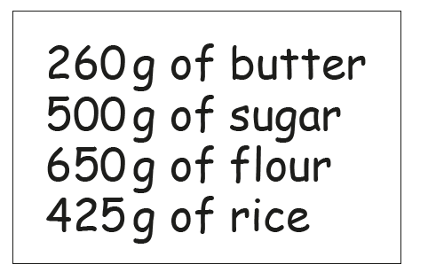

# Exam Questions — Working with Ratios
**Number** · Cambridge (CIE) IGCSE maths (0580 & 0980)
> Source: [https://www.savemyexams.com/igcse/maths/cie/25/extended/topic-questions/](https://www.savemyexams.com/igcse/maths/cie/25/extended/topic-questions/) · 11 questions across 1 sets

## Calculator Questions (11 questions)

### Q1 — medium — 2 marks

**Q1** [2 marks]

The table shows the surface area of some countries and their estimated population in 2017.

| Country | Surface area (km2) | Estimated population in 2017 |
|---|---|---|
| Brunei | 5.77 × 103 | 433 100 |
| China | 9.60 × 106 | 1 388 000 000 |
| France | 6.41 × 105 | 67 000 000 |
| Maldives | 3.00 × 102 | 374 600 |

The ratio       surface area of the Maldives : surface area of China can be written in the form   1 : $n$.

Find the value of $n$.

$n=$ ................................................

*Source: 2020 Oct/Nov 0580/43 Q1B*

### Q2 — easy — 1 marks

**Q2** [1 mark]

The fares for a train journey are shown in the table below.

| From London to Marseille | Standard fare | Premier fare |
|---|---|---|
| Adult | \$84 | \$140 |
| Child | \$60 | \$96 |

For the **standard fare**, write the ratio    adult fare : child fare    in its simplest form.

..................... : .....................

*Source: 2019	May/June 0580/43 Q1B*

### Q3 — easy — 3 marks

**Q3** [3 marks]

For a morning flight, the costs of tickets are in the ratio

First Class : Premium : Economy = 14 : 6 : 5.

The cost of a Premium ticket is \$114.

Calculate the cost of a First Class ticket and the cost of an Economy ticket.

First Class \$ ................................................

Economy \$ .................................................

*Source: 2020 Oct/Nov 0580/41 Q2B*

### Q4 — easy — 3 marks

**Q4** [3 marks]

In a cycling club, the number of members are in the ratio males : females = 8 : 3. The club has 342 females.

i) Find the total number of members.

[2]

ii) Find the percentage of the total number of members that are female.

................................................ % [1]

*Source: 2019	Oct/Nov 0580/43 Q1A*

### Q5 — hard — 5 marks

**Q5** [5 marks]

The fares for a train journey are shown in the table below.

| From London to Marseille | Standard fare | Premier fare |
|---|---|---|
| Adult | \$84 | \$140 |
| Child | \$60 | \$96 |

For one journey from London to Marseille, the ratio

number of adults : number of children = 11 : 2.

There were 220 adults in total on this journey. 
All of the children and 70% of the adults paid the standard fare.  The remaining adults paid the premier fare.
Calculate the total of the fares paid by the adults and the children.

\$ .............................................

*Source: 2019	May/June 0580/43 Q1B*

### Q6 — medium — 3 marks

**Q6** [3 marks]

A school has 240 students. The ratio   girls : boys = 25 : 23.

i) Show that the number of boys is 115.

[1]

ii) One day, there are 15 girls absent and 15 boys absent.

Find the ratio   girls : boys in school on this day. 
Give your answer in its simplest form.

..................... : ..................... [2]

*Source: 2018	Oct/Nov 0580/43 Q2A*

### Q7 — hard — 4 marks

**Q7** [4 marks]

Arjun and Gretal each pay rent.

In 2018, the ratio of the amount each paid in rent was Arjun : Gretal = 5 : 7. 
In 2019, the ratio of the amount each paid in rent was Arjun : Gretal = 9 : 13.

Arjun paid the same amount of rent in both 2018 and 2019. 
Gretal paid \$290 more rent in 2019 than she did in 2018.

Work out the amount Arjun paid in rent in 2019.

\$ ................................................

*Source: 2020	May/June 0580/41 Q1E*

### Q8 — medium — 5 marks

**Q8** [5 marks]

Here is a list of ingredients to make 20 biscuits.

i) Find the mass of butter needed to make 35 of these biscuits.

............................................. g [2]

ii) Michel has 2 kg of each ingredient.

Work out the greatest number of these biscuits that he can make.

[3]

*Source: 2018	May/June 0580/42 Q1A*

### Q9 — hard — 6 marks

**Q9** [6 marks]

Some people who work for a company are in the following age groups.

| Group A | Group B | Group C |
|---|---|---|
| Under 30 years | 30 to 50 years | Over 50 years |

The ratio of the number in group A to the number in group B is  7 : 10. 
The ratio of the number in group B to the number in group C is  4 : 3.

i) Find the ratio of the number in group A to the number in group C. 
Give your answer in its simplest form.

....................... : ....................... [3]

ii) There are 45 people in group C. 
Find the total number of people who work for the company.

[3]

*Source: 2018	May/June 0580/42 Q1D*

### Q10 — medium — 2 marks

**Q10** [2 marks]

Amol and Priya deliver 645 parcels in the ratio Amol : Priya = 11 : 4.
Calculate the number of parcels Amol delivers.

*Source: 2019 March 0580/42 Q1A*

### Q11 — medium — 3 marks

**Q11** [1 mark]

Mohsin has 600 pear trees and 720 apple trees on his farm.

Write the ratio pear trees : apple trees in its simplest form.

........................ : .......................

*Source: 2019	Oct/Nov 0580/42 Q1A*

**Q11** [2 marks]

One week, the total mass of pears picked was 18 540 kg. 
For this week, the ratio mass of apples : mass of pears = 13 : 9.

Find the mass of apples picked that week.

............................................... kg

*Source: 2019	Oct/Nov 0580/42 Q1B*

