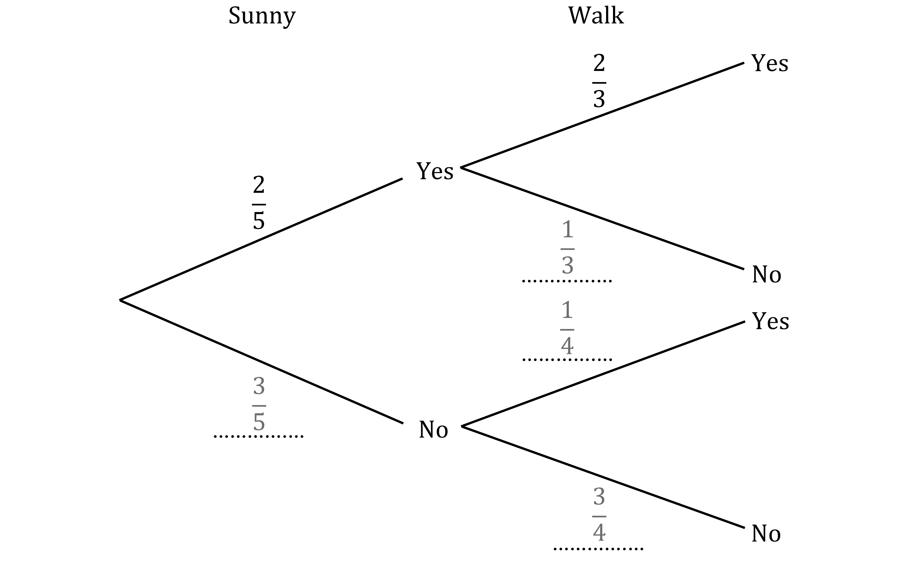
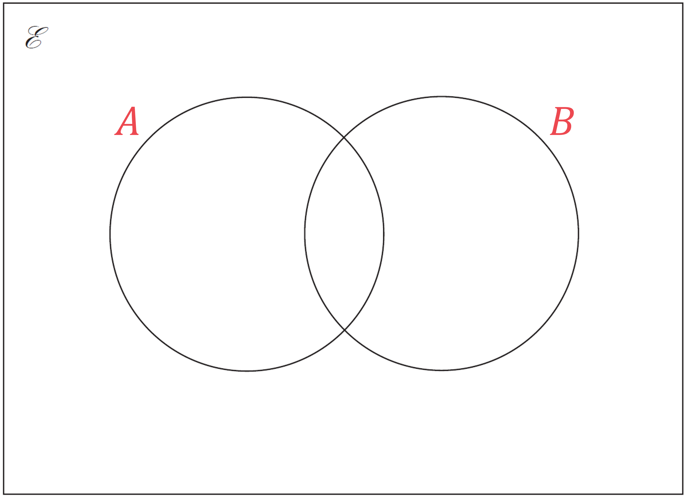
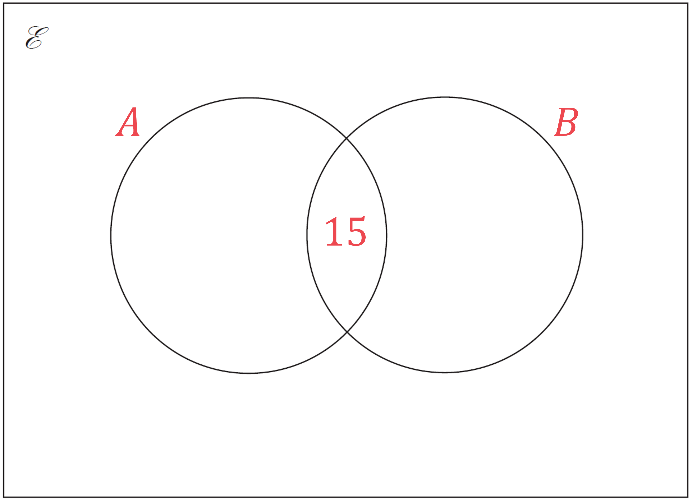
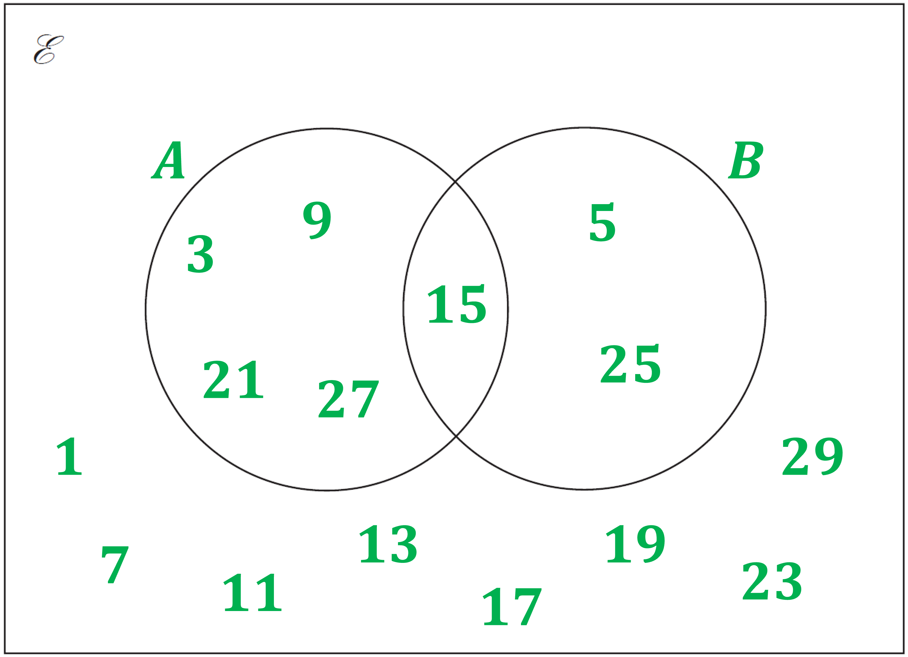
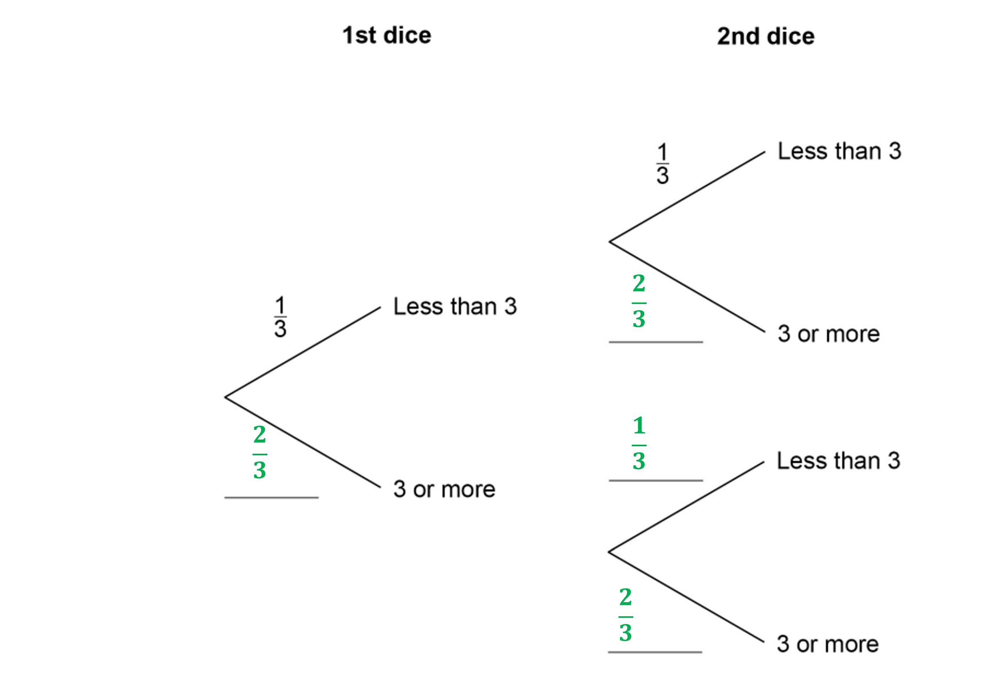
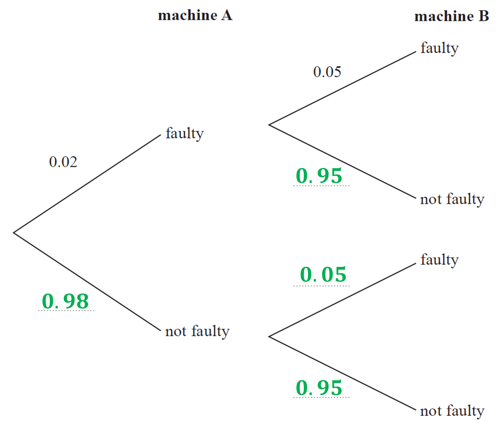
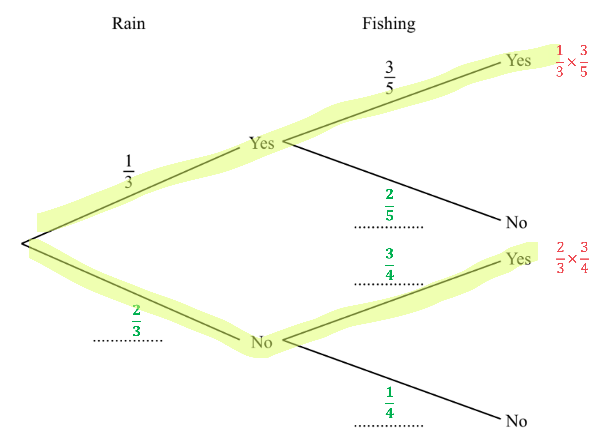
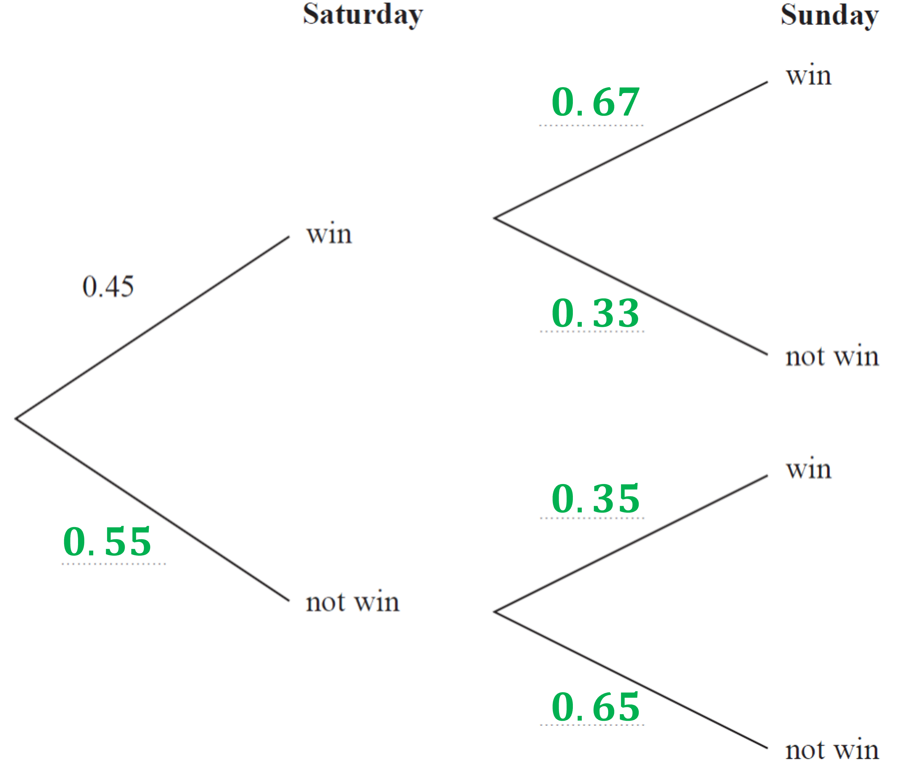
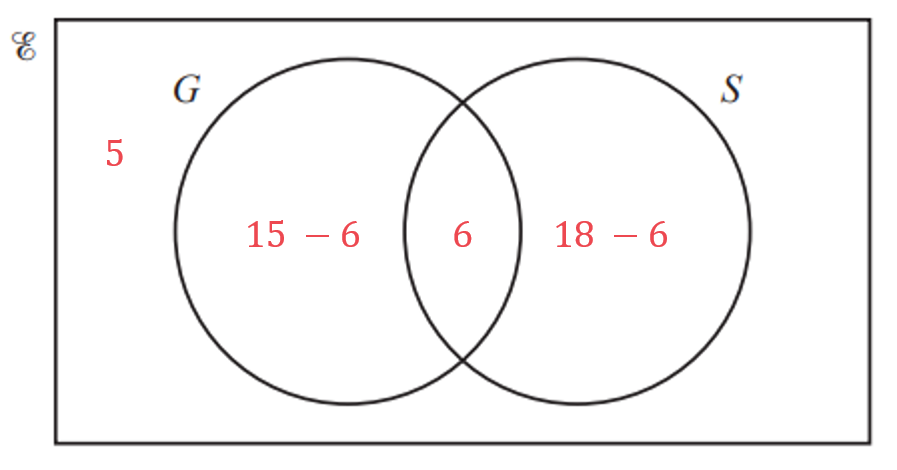

# Mark Schemes — Probability Diagrams (Tree & Venn Diagrams)
**Probability** · Cambridge (CIE) IGCSE maths (0580 & 0980)

## Calculator Questions (17 questions)

### Q1
The question tells you that the 'Sunny no, walk yes' probability is $\frac{1}{4}$

And on each set of branches the probabilities must add up to 1, so:

$\mathrm{Sunny} \mathrm{no}=1-\frac{2}{5}=\frac{3}{5}$

$\mathrm{Walk} \mathrm{no} \mathrm{after} \mathrm{Sunny} \mathrm{yes}=1-\frac{2}{3}=\frac{1}{3}$

$\mathrm{Walk} \mathrm{no} \mathrm{after} \mathrm{Sunny} \mathrm{no}=1-\frac{1}{4}=\frac{3}{4}$

**[M1 A1]**

> **[mark-scheme]**
> **M1**: For 2 or 3 correct probabilities.
> 
> **A1**: For all 4 correct probabilities.
You need to find the probabilities for the paths that end at 'No' on the second set of branches

- then add those together for the probability of not going on a walk

You can multiply along the branches to find the probability for a single path

*Sunny yes, Walk no:*

$\frac{2}{5}\times\frac{1}{3}=\frac{2}{15}$

**[M1]**

*Sunny no, Walk no*

$\frac{3}{5}\times\frac{3}{4}=\frac{9}{20}$

Add those together

$\frac{2}{15}+\frac{9}{20}=\frac{7}{12}$

**[M1]**

$\frac{7}{12}$

**[A1]**

> **[mark-scheme]**
> **M1**: For one product of probabilities.
> 
> **M1**: For $\frac{2}{5}\times\mathrm{your}\frac{1}{3}+\mathrm{your}\frac{3}{5}\times\mathrm{your}\frac{3}{4}$.
> 
> **A1**: For correct final answer or equivalent, e.g. $\frac{35}{60},\frac{175}{300}$ or $0.5833...$.

### Q2
> *Total probability of all bus routes is *$1$

$0.4+0.35+C=1\,C=1-0.4-0.35\,C=0.25$

**[B1]**

> *Complete the tree diagram*

**[B1]**
> *Calculate the probability of a student being late on journey *$A$*, *$B$*, and *$C$

$A:0.4\times0.08=0.032\,B:0.35\times0.05=0.0175\,C:0.25\times0.12=0.03$

**[M1]**

> *Adding these probabilities together*

$0.032+0.0175+0.03=0.0795$

**[M1]**

$0.0795$

**[A1]**

> **[mark-scheme]**
> **M1**: For calculating at least one relevant product.
> 
> **M1**: For a complete method to find the probability.
> 
> **A1**: Correct answer. You can also write `7.95 percent sign` or $\frac{159}{2000}$.

### Q3
> *Start by labelling the circles in the diagram.*

**[1]**

> *15 is the only number that's in **A** **and** **B**, so put that that in the 'overlap' (middle) part of the diagram. *

**[1]**

> *The numbers in **A** that aren't also in **B** (3, 9, 21, 27) go in the '**A** only' part of the **A** circle. *
*The numbers in **B** that aren't also in **A** (5, 25) go in the '**B** only' part of the **B** circle. {odd numbers less than 30} = {1, 3, 5, 7, 9, 11, 13, 15, 17, 19, 21, 23, 25, 27, 29} *
*The numbers in that set that aren't in **A** or** B** (1, 7, 11, 13, 17, 19, 23, 29) go inside the rectangle outside the two circles.*

> * *

**  [2]**

**1 mark for the 'only A' part, the 'only B' part, or the 'outside the circles' part being correct. **
**2 marks for ALL those numbers being in the correct place.**
> *There are 15 numbers in the universal set. *
$A\cupB$* is all the numbers that are in either or both of the circles. So *`A union B space equals space open curly brackets 3 comma space 5 comma space 9 comma space 15 comma space 21 comma space 25 comma space 27 close curly brackets`*, with 7 numbers in that set.*

$\frac{7}{15}$**  [2]**

**1 mark for 7 in the numerator (as long as the denominator is **$\geq$**7****), or for 15 in the denominator (as long as the numerator is **$\leq$**7****).  2 marks for 7/15.  If your part (a) answer was wrong, you can still get the part (b) marks for correctly interpreting your incorrect part (a) diagram.**

### Q4
> *Find the probability: the bus is late AND Seb is travelling on the bus.  If event 1 AND event 2 are both occurring, MULTIPLY the probabilities.*

*The school bus is late AND Seb travels on the bus: *$\frac{9}{10}\times\frac{15}{16}=\frac{27}{32}$

> *Find the probability: the bus is on time and Seb travels on the bus. *
*The probability that the bus is on time = (1 - The probability that the bus is late)*

*The school bus is on time AND Seb travels on the bus: *$\frac{1}{10}\times\frac{3}{4}=\frac{3}{40}$

** Either **$\frac{27}{32}$** or **$\frac{3}{40}$** [1]**

> *When one OR the other outcome could happen, ADD the probabilities.*

$\frac{27}{32}+\frac{3}{40}=\frac{147}{160}$

**[1]**

$\frac{147}{160}$** [1]**

### Q5
> *(i) List the numbers that appear in set **A  **AND in set **B  **(i.e., in the 'overlap' of the two sets in the Venn diagram).*

**2, 4, 6, 12**  **[1]**

** **

> *(ii) List the numbers that are NOT in set **B  **(i.e., all the numbers anywhere in the Venn diagram outside of the **B** circle). *
*B'**  is the **complement** of set **B**, and includes everything in the universal set *$ℰ$* that isn't in set **B**.*

**5, 7, 8, 9, 10, 11, 13, 14**  **[1]**
> *There are three numbers that are in set **A** but not in set **B  **(8, 10, and 14). There are 14 numbers in total in the Venn diagram.*

$\frac{3}{14}$**  [2]**

**1 mark for 3 in the numerator (with the denominator greater than 3) or for 14 in the denominator (with the numerator less than 14). 1 mark for a fully correct answer.**

### Q6
*Find P(3 or more) by subtracting a third from 1* * *

$1-\frac{1}{3}=\frac{2}{3}$ * *

> *Fill in the tree diagram*

**[1]**
*P(both dice land on "less than 3") = P(1st one lands on "less than 3") × P(2nd one lands on "less than 3")*

$\frac{1}{3}\times\frac{1}{3}$

$\frac{1}{9}$ **[1]**
*Method 1 *
*To get exactly one "less than 3", either the 1st one is "less than 3" **and** the 2nd one is "3 or more", **or** the 1st one is "3 or more" **and** the 2nd one is "less than 3" ("and" means × and "or" means +)*

$\frac{1}{3}\times\frac{2}{3}+\frac{2}{3}\times\frac{1}{3}$

**first or second product of fractions**** [1]**

$\frac{2}{9}+\frac{2}{9}$

$\frac{4}{9}$ **[1]**

*Method 2 *
*Getting exactly one "less than 3" means definitely not getting no less than 3s and definitely not getting both less than 3s Subtract these impossible scenarios from 1*

$1-\frac{2}{3}\times\frac{2}{3}-\frac{1}{3}\times\frac{1}{3}$

** [1]**

$1-\frac{4}{9}-\frac{1}{9}$

$\frac{4}{9}$ **[1]**

### Q7
> *The first disc is replaced before the second disc is chosen. The probabilities will not change and it is possible for both discs to be any of the colours.*

> *Draw a probability tree, keeping the probabilities the same for the second disc.   *

> *Multiply the probabilities with the same colour together and add the products.*

`open parentheses 1 over 6 cross times 1 over 6 close parentheses space plus open parentheses 2 over 6 cross times 2 over 6 close parentheses space plus open parentheses 3 over 6 cross times 3 over 6 close parentheses`

** At least one of the probabilities correct**** [1] **
**Correct method ****[1]**

> *Use your calculator to find the solutions.*

`space open parentheses 1 over 6 close parentheses squared plus space open parentheses 2 over 6 close parentheses squared plus space open parentheses 3 over 6 close parentheses squared space equals space 14 over 36`

$\frac{7}{18}$** [1] **
**Unsimplified fraction or equivalent correct decimal accepted.**

### Q8
> *The probabilities on each branch of the tree must add up to 1. *
*So we can subtract the known probabilities from 1 to find the missing probabilities.*

$1-0.02=0.98\,\,1-0.05=0.95$

** *** *

**  [2]**

**1 mark for 0.98 in the right place on 'machine A'.  **
**1 mark for 0.95, 0.05 and 0.95 in the right places on 'machine B'.**
> *'At least one is faulty' is the same thing as 'both aren't not faulty'. The easiest way to do this is to find the 'not faulty AND not faulty' probability and subtract it from 1. *
*In combined probabilities, 'and' usually means 'multiply'. So multiply 0.98 by 0.95 to find the probability both bottles are **not **faulty.*

$0.98\times0.95=0.931$

**[1]**

> *Then subtract that from 1 to find the probability that at least one is faulty.*

$1-0.931=0.069$

**0.069 *** ***[1]**

**You can also do this by multiplying to get the probabilities for 'faulty AND faulty', 'faulty AND not faulty', and 'not faulty AND faulty', and then adding those together to get the answer. I.e., **`open parentheses 0.02 space cross times space 0.05 close parentheses space plus space open parentheses 0.02 space cross times space 0.95 close parentheses space plus space open parentheses 0.98 space cross times space 0.05 close parentheses space equals space 0.069`

### Q9
> *The expected frequency is the probability times by the number of trials. In this case,*

$\frac{1}{3}\times60$

**20** **[1]**
> *For each pair of branches, the probability must add up to 1. *
*Use this to calculate the two missing probabilities below*

**[1]**

> *We can use the information that "when it does not rain the probability that Amira goes fishing is *$\frac{3}{4}$*" to complete the final two spaces*

**[1]**
> *The two 'paths' that lead to Amira going fishing are highlighted below *
*For each path, to find the resulting probability, multiply the two probabilities together as shown*

**one of the two multiplications shown above**** [1]**

> *Add the resulting probabilities to get the total probability of Amira going fishing*

$\frac{1}{3}\times\frac{3}{5}+\frac{2}{3}\times\frac{3}{4}$

**[1]**

**Answer  = **$\frac{7}{10}$ **[1]**
** '0.7' or equivalent fractions are accepted**

### Q10
> *Consider the different cases where Bob plays football (P) for two Saturdays and does not play (N) for one Saturday.*

*PPN, PNP, NPP: 3 ways this can happen*

> *You could draw a tree diagram but it would be quicker to spot that each possibility contains 2 Ps and 1 N, and the probabilities are the same for each Saturday. *
*Therefore the probability for all 3 possibilities are the same.*
* Find the probability of one possibility by multiplying the three probabilities together.*

`table row cell straight P open parentheses Bob space plays close parentheses cross times straight P open parentheses Bob space plays close parentheses cross times straight P open parentheses Bob space does space not space play close parentheses end cell equals cell 2 over 5 cross times 2 over 5 cross times 3 over 5 equals 12 over 125 end cell end table`

**[1]**

> *As all three possibilities have the same probability you can multiply this by 3.*

$\frac{12}{125}\times3$

**[1]**

$\frac{36}{125}$ **[1]** 
**It is acceptable to write as a decimal: 0.288**
> *You want to find the probability that Arun plays football and he scores the winning goal.*

> *You could draw a tree diagram but there is only one route you are interested in.*

$\mathrm{Arun} \mathrm{plays}\rightarrow\mathrm{Scores} \mathrm{winning} \mathrm{goal}$

> *Multiply the two probabilities together.*

$\frac{3}{4}\times\frac{1}{7}$

**[1]**

$\frac{3}{28}$ **[1] **
**It is a recurring decimal so leave as a fraction**

### Q11
> *We can fill in the probabilities we are given in the question first*

> *The probabilities on each pair of branches should sum to 1*

$1-\frac{5}{8}=\frac{3}{8}\mathrm{and}1-\frac{1}{6}=\frac{5}{6}\mathrm{and}1-\frac{7}{10}=\frac{3}{10}$

> *Complete the tree diagram with these probabilities*

**1 mark for each correct pair of probabilities on diagram**** [3]**
*Let the probability it will rain tomorrow be *`P open parentheses R close parentheses`* and the probability Rafael walks to school be *`P open parentheses W close parentheses`*.* *Using the "and" rule: *`P open parentheses A space and space B close parentheses equals P open parentheses A close parentheses cross times P open parentheses B close parentheses`

`P open parentheses R space and space W close parentheses equals 5 over 8 cross times 1 over 6`

**[1]**

$\frac{5}{48}$** [1] **
**It's neater and more accurate to leave your answer as a fraction, rather than as a rounded decimal or percentage**
> *There are two ways that Rafael can not walk to school tomorrow- these two ways are highlighted on the diagram below*

> *It can rain and Rafael does not walk to school...*

`P open parentheses R space and space W apostrophe close parentheses space equals 5 over 8 cross times 5 over 6 equals 25 over 48`

> *...or it can not rain and Rafael does not walk to school*

`space P open parentheses R apostrophe space and space straight W apostrophe close parentheses equals 3 over 8 cross times 3 over 10 equals 9 over 80`

** ****calculating either of the above correctly ****[1]**

*That it rains or does not rain are mutually exclusive events- they cannot both happen.* 
*The "or" rule for mutually exclusive events states *`P open parentheses A space o r space B close parentheses equals P open parentheses A close parentheses plus P open parentheses B close parentheses`

`P open parentheses R space and space W apostrophe close parentheses space or space P open parentheses R apostrophe space and space straight W apostrophe close parentheses equals 25 over 48 plus 9 over 80`

**[1]**

> *Use your calculator to work out the final answer*

$\frac{19}{30}$* ***[1]**

**Other equivalent fractions such as **$\frac{304}{480}$**are permitted**

### Q12
> *The probabilities on each branch of the tree must add up to 1. So we can subtract the known probabilities from 1 to find the missing probabilities.*

$1-0.45=0.551-0.67=0.331-0.35=0.65$

** *** *

**  [2]**

**1 mark for 0.55 in the right place on 'Saturday'.  **
**1 mark for the other 4 numbers in the right places on 'Sunday'.**
> *With combined probabilities, 'and' usually means 'multiply' and 'or' usually means 'add'. *
*'Wins exactly one match' is the same as 'wins on Saturday AND does not win on Sunday' OR 'does not win on Saturday AND wins on Sunday'. *
*So multiply the probabilities from the corresponding parts of the tree diagram, and then add the products together to get the answer.*

`open parentheses 0.45 space cross times space 0.33 close parentheses space plus space open parentheses 0.55 space cross times space 0.35 close parentheses space equals space 0.341`

**  [2]**** **
**1 mark for one correct product.  **
**1 mark for two correct products added together.**

** ****0.341****  ****[1] **
**Answers between 0.34 and 0.341 will get the mark here.**

### Q13
> *5 do not study any languages, so place 5 in the Venn diagram outside of both bubbles.*

> *Find the intersection of both bubbles *`open parentheses G intersection S close parentheses`* by finding how many students have been counted twice in German and Spanish.*

> * *

*German + Spanish - both + neither = 32 *

*15 + 18 - both + 5 = 32 *

*38 - both = 32*

*both = 6*

**[1]**

** **

> *Place 6 in the Venn diagram in the intersection of both bubbles.*

> * *

> * *

> *Find the other two numbers by subtracting 6 from the total for that language.*

> * *

**[1]**
> *Reading from the Venn diagram, 12 students study Spanish but not German.*

> *Find the probability by dividing this by the total number of students.*

`straight P open parentheses Spanish close parentheses space equals space 12 over 32`

$\frac{3}{8}$** [1] **
**The unsimplified fraction is accepted.**
*In total, 15 students study German.* *Of these, 6 of them also study Spanish.*

> *Find the probability by dividing the number who study both by the total number of students who study German.*

`straight P space open parentheses Student space who space studies space German space also space studies space Spanish close parentheses equals space 6 over 15`

$\frac{2}{5}$** [1]**
** The unsimplified fraction is accepted.**

### Q14
> *The bead is replaced each time, so the probability stays the same for each red bead.*

> *Find the probability of choosing one red bead.  *

> `straight P open parentheses Red close parentheses space equals space fraction numerator 15 over denominator 15 space plus space 10 end fraction space equals space 15 over 25`*   *

> *To find the probability of two things both happening, multiply the probabilities. *
*You could draw a tree diagram to help. *
*P(Both red) = P(first red) and P(second red)  = P(first red) × P(second red).  *

`straight P open parentheses Both space red close parentheses space space equals space 15 over 25 space cross times space 15 over 25`

** [1]**

> * *

> *Use your calculator to multiply the two fractions.*

$\frac{9}{25}$** [1] **
**The unsimplified fraction is accepted.**
> *Ariana can either pick two red beads, or not pick two red beads. The two events are mutually exclusive. *
*The probabilities of mutually exclusive events add up to 1. *
*The probability of not picking two red beads will be 1 - the probability of picking two red beads. *

`straight P open parentheses Not space both space red close parentheses space equals space 1 space minus space 9 over 25`

$\frac{16}{25}$** [1]**

### Q15
> *The probabilities in a Venn diagram must sum to 1, as they are exhaustive (cover all possibilities) so we can use this to find the probability on the outside of the circles*

*1-0.3-0.15-0.35=0.2*

> $P(A'UB)$* means "the probability of not A, or B", note that this is different to "not A or B"*

> *The blue shaded area shows the regions which satisfy "not A, or B"*

**[1]**

*The outside is shaded as it satisfies "not A"* *The 0.35 is shaded as it satisfies "not A"* *The 0.15 is shaded as it satisfies "...or B"*

> *Summing the probabilities in the shaded regions*

*0.15+0.35+0.2=0.7*

**0.7** **[1]**

### Q16
(i) $A\cupB$* is the set of all numbers that are in **A** or in **B** or in both.*

**10, 12, 14, 15, 16, 18****  [1]**

**The numbers don't need to be put in order to get the mark, but it can help you make sure you haven't repeated any!**

(ii)

> $A\capB$*is the set of all numbers that are in **A **and in **B**.*

> * *

**12, 18**** [1]**
> *A**' is the set of all numbers that **aren't** in **A**.  (It's called the 'complement' of** A.**) *
*Basically, the question is asking you 'What's the probability that the number isn't in set **A**?'*

`A apostrophe space equals space open curly brackets 10 comma space 11 comma space 13 comma space 14 comma space 16 comma space 17 comma space 19 close curly brackets`

**[1] ****You can also get this mark for indicating where set A' is on the Venn diagram.**

> *There are 7 numbers in set **A'**. *
*There are a total of 10 numbers in the diagram.*

$\frac{7}{10}$**  [1]**

### Q17
> *Let *$R$* **be the probability that Raphael picks a blue pen and *$Q$* be the probability that Paulo picks a blue pen.*
*You could draw a tree to help you see the outcomes.*

> *For two events *$R$* **and *$Q$*,  *$P(R\mathrm{and}Q)=P(R)\timesP(Q)$* **so*

`8 over 15 equals 2 over 3 cross times straight P open parentheses Q close parentheses`

**[1]**

> *Divide both sides by *$\frac{2}{3}$* to find *$P(Q)$

`table row cell straight P open parentheses Q close parentheses end cell equals cell 8 over 15 divided by 2 over 3 end cell row blank equals cell 4 over 5 end cell end table`

> *Remember that you can use your calculator to divide the fractions.*

`table row blank blank cell bold 4 over bold 5 end cell end table` **[1]**

**Equivalent fractions, a decimal (0.8) or a percentage (80%) are also accepted**
> *Let *$R$* **be the probability that Raphael picks a blue pen and *$Q$* be the probability that Paulo picks a blue pen.*

> *As there are only blue or green pens, the probability that Raphael picks a green pen is the same as the probability Raphael does not pick a blue pen, or *$P(R')$*. *
*The same logic is true for Paulo. *
*We are told *$P(R)=\frac{2}{3}$*. And from part (a), *$P(Q)=\frac{4}{5}$*. Therefore*

`straight P open parentheses R apostrophe close parentheses equals 1 minus 2 over 3 equals 1 third`*  **and**  *`straight P open parentheses Q apostrophe close parentheses equals 1 minus 4 over 5 equals 1 fifth`

**either of these results**** [1]**

> *You could draw a tree diagram to see this. Multiply the two probabilities to find the probability they both happen*

`table row cell straight P open parentheses R apostrophe space and italic space Q apostrophe close parentheses end cell equals cell 1 third cross times 1 fifth end cell end table`

**[1]**

**Answer = **`table attributes columnalign right center left columnspacing 0px end attributes row blank blank cell bold 1 over bold 15 end cell end table` **[1]**

**It is best to leave this answer as a fraction to avoid rounding it as a decimal**
