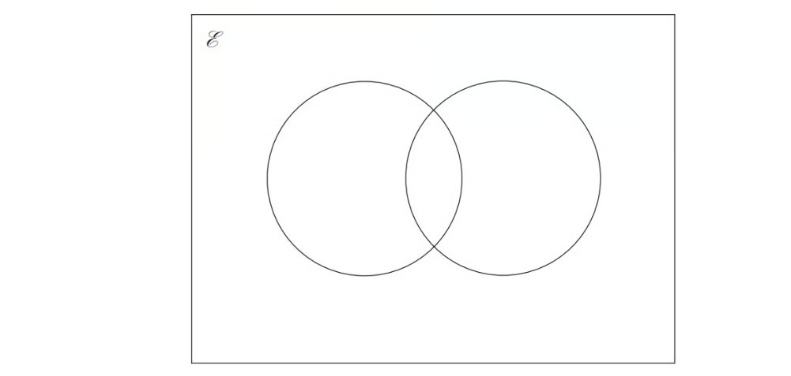
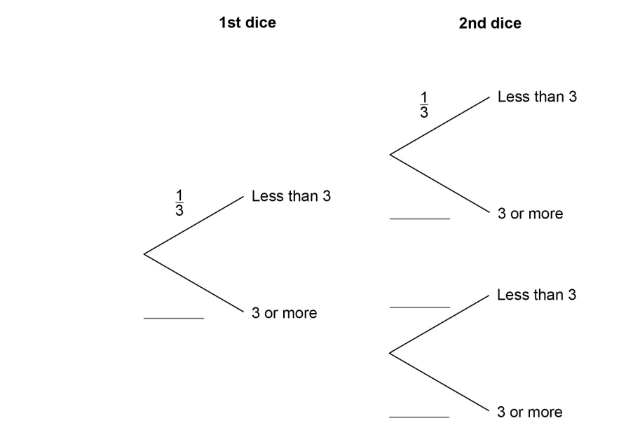
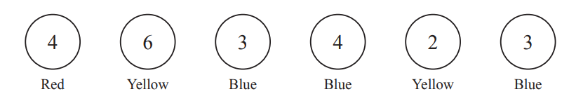
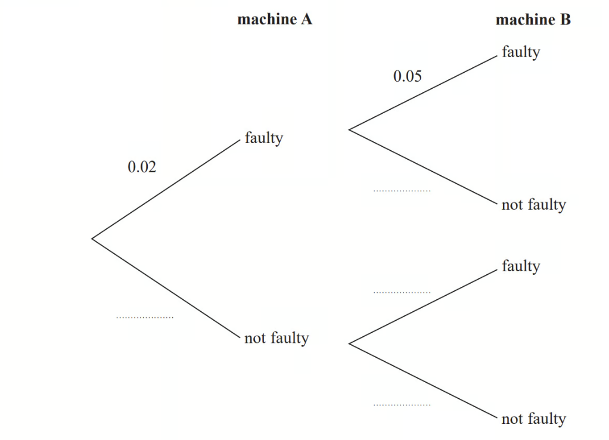
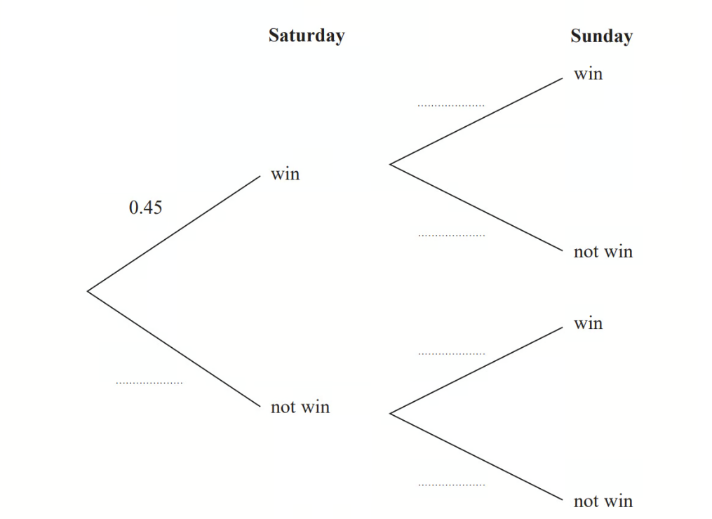
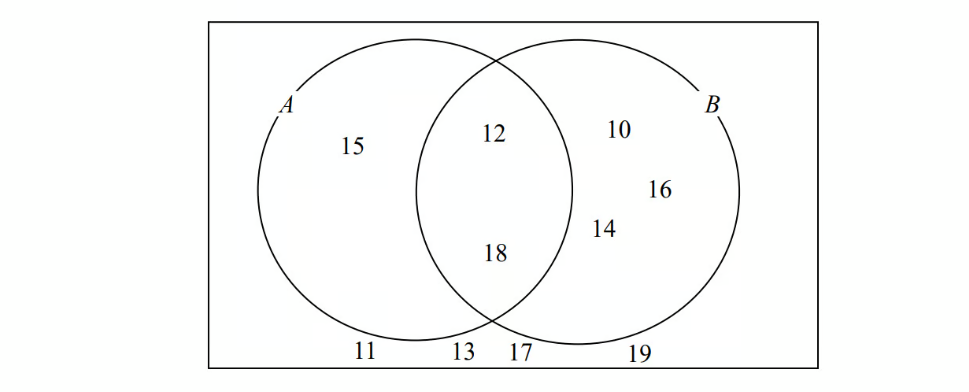

# Exam Questions — Probability Diagrams (Tree & Venn Diagrams)
**Probability** · Cambridge (CIE) IGCSE maths (0580 & 0980)
> Source: [https://www.savemyexams.com/igcse/maths/cie/25/extended/topic-questions/](https://www.savemyexams.com/igcse/maths/cie/25/extended/topic-questions/) · 17 questions across 1 sets

## Calculator Questions (17 questions)

### Q1 — medium — 5 marks

**Q1** [2 marks]

**Extract:**

On any given day the probability that it is sunny is \[\frac{2}{5}\].

When it is sunny the probability that Zohran goes for a walk is \[\frac{2}{3}\].

When it is not sunny the probability that Zohran goes for a walk is \[\frac{1}{4}\].

On any given day the probability that it is sunny is $\frac{2}{5}$.

When it is sunny the probability that Zohran goes for a walk is $\frac{2}{3}$.

When it is not sunny the probability that Zohran goes for a walk is $\frac{1}{4}$.

Complete the tree diagram.

**Q1** [3 marks]

**Extract:**

On any given day the probability that it is sunny is \[\frac{2}{5}\].

When it is sunny the probability that Zohran goes for a walk is \[\frac{2}{3}\].

When it is not sunny the probability that Zohran goes for a walk is \[\frac{1}{4}\].

Find the probability that on any day Zohran **doesn't** go for a walk.

### Q2 — medium — 5 marks

**Q2** [2 marks]

At a school, students can travel using one of three bus routes: $A$, $B$, and $C$.

- `40 percent sign` of students use route $A$
- `35 percent sign` of students use route $B$
- The rest of the students use route $C$

On any given day, some buses may be late.

- Buses that use route $A$ have an `8 percent sign` chance of being late
- Buses that use route $B$ have an `5 percent sign` chance of being late
- Buses that use route $C$ have an `12 percent sign` chance of being late

Draw a tree diagram to demonstrate all possible outcomes and associated probabilities.

**Q2** [3 marks]

Calculate the probability that a student is late.

### Q3 — medium — 6 marks

**Q3** [4 marks]

$E=${odd numbers less than 30}

$A=${3, 9, 15, 21, 27} 
$B=${5, 15, 25}

Complete the Venn diagram to represent this information.

*Source: 2017	June 1MA1/3H Q1A*

**Q3** [2 marks]

**Extract:**

![calligraphic E space equals space]{odd numbers less than 30} 

![A space equals space]{3, 9, 15, 21, 27} 

![B space equals space]{5, 15, 25}

A number is chosen at random from the universal set, $E$.

What is the probability that the number is in the set $A\cupB$?

*Source: 2017	June 1MA1/3H Q1B*

### Q4 — very_hard — 3 marks

**Q4** [3 marks]

The probability that the school bus is late is $\frac{9}{10}$. 
If the school bus is late, the probability that Seb travels on the bus is $\frac{15}{16}$. 
If the school bus is on time, the probability that Seb travels on the bus is $\frac{3}{4}$.

Find the probability that Seb travels on the bus.

*Source: 2019	Oct/Nov 0580/21 Q20-*

### Q5 — medium — 4 marks

**Q5** [2 marks]

The numbers from $1$ to $14$ are shown in the Venn diagram.

i) List the members of the set $A\capB$

[1]

ii) List the members of the set $Bʹ$

[1]

*Source: Nov 2020 4MA1/1H Q1A*

**Q5** [2 marks]

**Extract:**

The numbers from 1 to 14 are shown in the Venn diagram.

A number is picked at random from the numbers in the Venn diagram.

Find the probability that this number is in set $A$but is **not** in set $B$.

*Source: Nov 2020 4MA1/1H Q1B*

### Q6 — hard — 4 marks

**Q6** [1 mark]

Two ordinary fair dice are rolled.

Complete the tree diagram.

*Source: June 2018 8300/2H Q11A*

**Q6** [1 mark]

**Extract:**

Two ordinary fair dice are rolled.

Work out the probability that **both** dice land on a number less than 3.

*Source: June 2018 8300/2H Q11B*

**Q6** [2 marks]

**Extract:**

Two ordinary fair dice are rolled.

Work out the probability that **exactly one** of the dice lands on a number less than 3.

*Source: June 2018 8300/2H Q11C*

### Q7 — very_hard — 3 marks

**Q7** [3 marks]

The diagram shows six discs. Each disc has a colour and a number.

Two of the six discs are picked at random **with **replacement.

Find the probability that both discs have the same colour.

*Source: 2020 Oct/Nov 0580/42 Q6C*

### Q8 — hard — 5 marks

**Q8** [2 marks]

Machine A and machine B make bottles.

The probability that a bottle made by machine A is faulty is 0.02 The probability that a bottle made by machine B is faulty is 0.05

Complete the probability tree diagram.

*Source: 2017	June 1MA0/2H Q19A*

**Q8** [3 marks]

**Extract:**

The probability that a bottle made by machine A is faulty is 0.02 The probability that a bottle made by machine B is faulty is 0.05

Shazia takes at random one bottle made by machine A and one bottle made by machine B.

Work out the probability that at least one of these bottles is faulty.

*Source: 2017	June 1MA0/2H Q19B*

### Q9 — medium — 6 marks

**Q9** [1 mark]

On any day the probability that it rains is $\frac{1}{3}$.

When it rains the probability that Amira goes fishing is $\frac{3}{5}$. 
When it does not rain the probability that Amira goes fishing is $\frac{3}{4}$.

In a period of 60 days on how many days is it expected to rain?

*Source: Specimen 2025 0580/04 Q7A*

**Q9** [2 marks]

**Extract:**

On any day the probability that it rains is 1/3. When it rains the probability that Amira goes fishing is 3/5. When it does not rain the probability that Amira goes fishing is 3/4.

Complete the tree diagram.

*Source: Specimen 2025 0580/04 Q7B*

**Q9** [3 marks]

**Extract:**

On any day the probability that it rains is ![1 third].

When it rains the probability that Amira goes fishing is ![3 over 5]. 

When it does not rain the probability that Amira goes fishing is ![3 over 4].

Find the probability that on any day Amira goes fishing.

*Source: Specimen 2025 0580/04 Q7C*

### Q10 — hard — 5 marks

**Q10** [3 marks]

On any Saturday, the probability that Bob plays football is $\frac{2}{5}.$   Calculate the probability that Bob plays football for 2 of the next 3 Saturdays.

*Source: 2020 May/June 0580/43 Q7B*

**Q10** [2 marks]

On any Saturday, the probability that Arun plays football is $\frac{3}{4}.$ When Arun plays football, the probability that he scores the winning goal is $\frac{1}{7}.$   
Calculate the probability that Arun scores the winning goal one Saturday.

*Source: 2020 May/June 0580/43 Q7C*

### Q11 — very_hard — 8 marks

**Q11** [3 marks]

The probability that it will rain tomorrow is $\frac{5}{8}$. 
If it rains, the probability that Rafael walks to school is $\frac{1}{6}$. 
If it does not rain, the probability that Rafael walks to school is $\frac{7}{10}$.

Complete the tree diagram.

*Source: 2018	May/June 0580/41 Q9A*

**Q11** [2 marks]

**Extract:**

The probability that it will rain tomorrow is ![5 over 8]. 

If it rains, the probability that Rafael walks to school is ![1 over 6].

Calculate the probability that it will rain tomorrow and Rafael walks to school.

*Source: 2018	May/June 0580/41 Q9B*

**Q11** [3 marks]

**Extract:**

The probability that it will rain tomorrow is ![5 over 8]. 
If it rains, the probability that Rafael walks to school is ![1 over 6]. 
If it does not rain, the probability that Rafael walks to school is ![7 over 10].

Calculate the probability that Rafael does not walk to school.

*Source: 2018	May/June 0580/41 Q9C*

### Q12 — hard — 5 marks

**Q12** [2 marks]

A darts team is going to play a match on Saturday and on Sunday. The probability that the team will win on Saturday is 0.45

If they win on Saturday, the probability that they will win on Sunday is 0.67 If they do **not** win on Saturday, the probability that they will win on Sunday is 0.35

Complete the probability tree diagram.

*Source: 2018	June 1MA1/2H Q15A*

**Q12** [3 marks]

**Extract:**

The probability that the team will win on Saturday is 0.45
If they win on Saturday, the probability that they will win on Sunday is 0.67
If they do not win on Saturday, the probability that they will win on Sunday is 0.35

Find the probability that the team will win exactly one of the two matches.

*Source: 2018	June 1MA1/2H Q15B*

### Q13 — hard — 4 marks

**Q13** [2 marks]

There are 32 students in a class.

5 do not study any languages. 15 study German (G). 18 study Spanish (S).

Complete the Venn diagram to show this information.

*Source: 2020 Oct/Nov 0580/41 Q9A*

**Q13** [1 mark]

**Extract:**

There are 32 students in a class.

5 do not study any languages. 15 study German (G). 18 study Spanish (S).

A student is chosen at random.   
Find the probability that the student studies Spanish but not German.

*Source: 2020 Oct/Nov 0580/41 Q9A*

**Q13** [1 mark]

**Extract:**

There are 32 students in a class.

5 do not study any languages. 15 study German (G). 18 study Spanish (S).

A student who studies German is chosen at random. 
Find the probability that this student also studies Spanish.

*Source: 2020 Oct/Nov 0580/41 Q9A*

### Q14 — medium — 3 marks

**Q14** [2 marks]

A bag contains 15 red beads and 10 yellow beads. 
Ariana picks a bead at random, records its colour and replaces it in the bag. 
She then picks another bead at random.

Find the probability that she picks two red beads.

*Source: 2020 Oct/Nov 0580/41 Q9C*

**Q14** [1 mark]

**Extract:**

A bag contains 15 red beads and 10 yellow beads. 

Ariana picks a bead at random, records its colour and replaces it in the bag. 

She then picks another bead at random.

Find the probability that she does not pick two red beads.

*Source: 2020 Oct/Nov 0580/41 Q9C*

### Q15 — medium — 2 marks

**Q15** [2 marks]

A and B are two events.

Some probabilities are shown on the Venn diagram.

Work out $P(A'\cupB)$.

*Source: Nov 2018 8300/1H Q14*

### Q16 — medium — 4 marks

**Q16** [2 marks]

Here is a Venn diagram.

Write down the numbers that are in set

i) $A\cupB$

[1]

ii) $A\capB$

[1]

*Source: 2015	Spec2 1MA1/2H Q5A*

**Q16** [2 marks]

**Extract:**

Here is a Venn diagram.

One of the numbers in the diagram is chosen at random.

Find the probability that the number is in set $A'$.

*Source: 2015	Spec2 1MA1/2H Q5B*

### Q17 — very_hard — 5 marks

**Q17** [2 marks]

Box *A* and box *B* each contain blue and green pens only. 
Raphael picks a pen at random from box *A* and Paulo picks a pen at random from box *B*. 
The probability that Raphael picks a blue pen is $\frac{2}{3}$. The probability that both Raphael and Paulo pick a blue pen is $\frac{8}{15}$.

Find the probability that Paulo picks a blue pen.

*Source: 2018	May/June 0580/22 Q24A*

**Q17** [3 marks]

**Extract:**

Box *A* and box *B* each contain blue and green pens only. Raphael picks a pen at random from box *A* and Paulo picks a pen at random from box *B*. The probability that Raphael picks a blue pen is ![2 over 3]. The probability that both Raphael and Paulo pick a blue pen is ![8 over 15].

Find the probability that both Raphael and Paulo pick a green pen.

*Source: 2018	May/June 0580/22 Q24B*

