# Mark Schemes — 3D Pythagoras & Trigonometry
**Pythagoras & Trigonometry** · Cambridge (CIE) IGCSE maths (0580 & 0980)

## Exam Questions (31 questions)

### Q1
> *The line *$AR$* and the line *$AB$* form a right-angle triangle with the line *$RB$*- which is on the plane *$BCRQ$* as shown below. The angle between the diagonal *$AR$* and the plane *$BCRQ$* is therefore the angle between *$AR$*and the line *$RB$*.*

**identifying the required angle ****[1]**

> *Angle *$ABR$* is a right angle so to find angle *$ARB$* we can use the tangent ratio with *$AB=8$* and *$BR$*.*

> *To find *$BR$* we can use Pythagoras' theorem with *$CR=5$* and *$BC=4$*.*

$BR=\sqrt{4^{2}+5^{2}}$

**[1]**

> *Now we can apply the tangent ratio to find the angle. *

`tan open parentheses A R B close parentheses equals fraction numerator 8 over denominator square root of 4 squared plus 5 squared end root end fraction`

**[1]**

> *Inverse tangent on your calculator to find the angle.*

`table row cell A R B end cell equals cell tan to the power of negative 1 end exponent open parentheses fraction numerator 8 over denominator square root of 4 squared plus 5 squared end root end fraction close parentheses end cell row blank equals cell 51.32655062... degree end cell end table`

**51.3° ****[1]**
**Give answers in degrees to at least one decimal place**

### Q2
> *To identify the angle between a line and a plane it is helpful to draw a right angled triangle using the line that is perpendicular to the plane.*

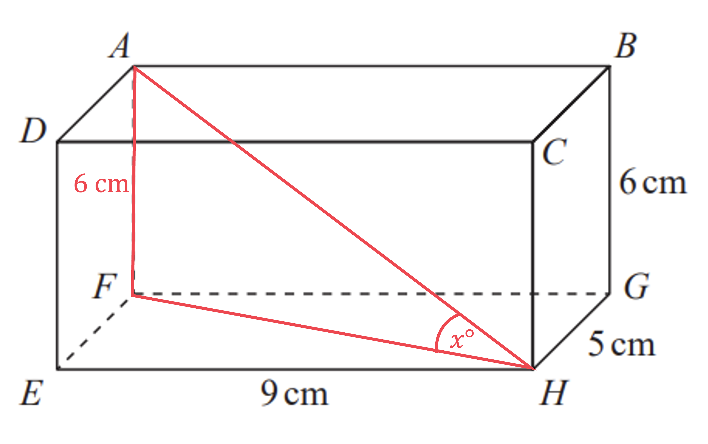

> *We need to find angle **x**. Notice that we have side **AF.** In order to find the required angle we first need to find the length of the side **FH**. To do this draw a right angled triangle connecting hypotenuse **FH** with two sides whose lengths are known.*

> *In triangle **EFH **we can use Pythagoras' Theorem to find **FH.*

$FH=\sqrt{9^{2}+5^{2}}$

**[1]**

$=\sqrt{106}$

> *It is best to leave this result in its exact form for accuracy. We can add this result to our diagram.*

> *Now we can use right-angle trigonometry to find the required angle.*

`table row cell tan open parentheses x close parentheses end cell equals cell fraction numerator 6 over denominator square root of 106 end fraction end cell end table`

**[1]**

> *Use the inverse tangent function ("SHIFT tan" on your calculator) to find **x.*

`table row x equals cell tan to the power of negative 1 end exponent open parentheses fraction numerator 6 over denominator square root of 106 end fraction close parentheses end cell end table`

**[1]**

`table row blank equals cell 30.23241412... end cell end table`

> *Round your answer to 3 significant figures as requested. Remember to include the units.*

**Answer = **$30.2^{\circ}$ **[1]**

### Q3
> *Imagine the diagonal *$AG$* as a wire, with a light shining from directly above it casting a shadow on the plane *$ABCD$*. The shadow would be *$AC$*, as shown below. The angle between the diagonal *$AG$* and the plane *$ABCD$* is the angle between *$AG$*and this shadow line *$AC$*.*

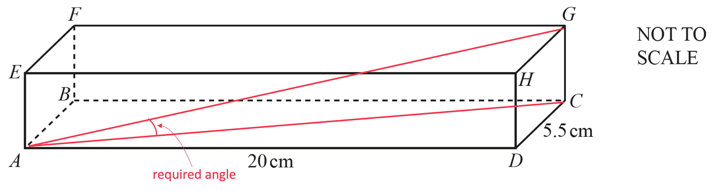

**identifying the required angle**** ****[1]**

> *To find the angle we can use the tangent ratio with *$AC$* and *$CG$*.*

> *To find *$AC$* we can use Pythagoras' theorem with *$AD$* and *$CD$

`A C equals square root of 20 squared plus 5.5 squared end root space open parentheses equals 20.74246851... close parentheses`

**[1]**

> *To find *$CG$* we can divide the given volume of the cuboid (495 cm**3**) by the area, where the area is (20 × 5.5) cm**2*

$CG=\frac{495}{20\times5.5}=4.5$

**[1]**

> *Now we can apply the tangent ratio to find the angle. *$\mathrm{tan}θ=\frac{\mathrm{opposite}}{\mathrm{adjacent}}$

$\mathrm{tanθ}=\frac{4.5}{\sqrt{20^{2}+5.5^{2}}}$

**[1]**

> *Inverse tangent on your calculator to find the angle*

`theta equals tan to the power of negative 1 end exponent open parentheses fraction numerator 4.5 over denominator square root of 20 squared plus 5.5 squared end root end fraction close parentheses equals 12.24042045... degree`

> *Round to at least one decimal place*

**12.2° ****[1]**

### Q4
> *The line **PV, **the line **PT **and the angle **PVT  **form a right-angled triangle so SOHCAHTOA can be used to find the missing side **PT.*

> *Draw the sides of the triangle onto the diagram to make the right-angled triangle clearer.*

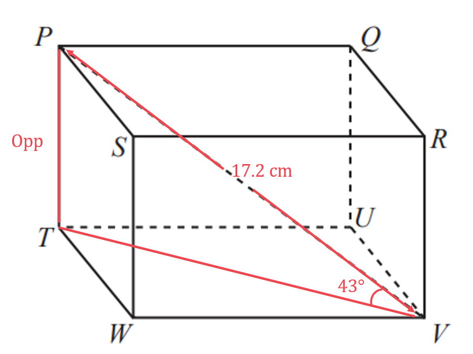

** Identifying the angle on the diagram correctly**** [1]**

> *The side opposite the angle is needed and the hypotenuse is known so use  *$\mathrm{sin}x^{\circ}=\frac{\mathrm{Opp}}{\mathrm{Hyp}}$*.*

$\mathrm{sin}43^{\circ}=\frac{PT}{17.2}$

**[1]**

> * Solve the trigonometric equation to find the side **PT.** *

`table row cell P T space end cell equals cell space 17.2 space sin space 43 degree space end cell row blank equals cell space 11.7303... end cell end table`

**PT**** = 11.7 cm (3 s.f.)**** [1]**

### Q5
> *Start by marking the given information on the diagram:*

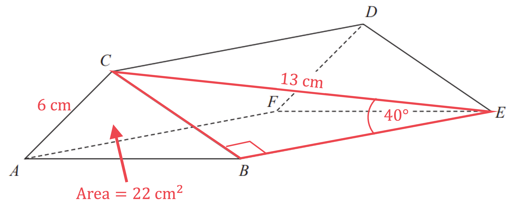

> *We cannot assume that **BC** is 6 cm as we are not told that triangle **ABC **is isosceles. Therefore we need to use trigonometry with triangle **BCE **to find** **BC.*

`sin open parentheses 40 close parentheses equals fraction numerator B C over denominator 13 end fraction`

> *Multiply both sides by 13 to find **BC.*

`B C equals 13 sin open parentheses 40 close parentheses equals 8.356238926...`

**[1]**

*Store this result in your calculator to preserve accuracy in future calculations.* *We can use this result with the area of triangle **ABC** to find the angle **ACB.*

`22 equals 1 half open parentheses 6 close parentheses open parentheses 8.356238926... close parentheses sin C`

**[1]**

> *Rearrange to find the angle **ACB.*

`sin C equals fraction numerator 22 over denominator 1 half open parentheses 6 close parentheses open parentheses 8.356238926... close parentheses end fraction
C equals sin to the power of negative 1 end exponent open parentheses fraction numerator 22 over denominator 1 half open parentheses 6 close parentheses open parentheses 8.356238926... close parentheses end fraction close parentheses
equals 61.35273622...`

**[1]**

> *This is the acute angle, so you can subtract this from 180**o** to find the obtuse angle*

$180-61.35273622...=118.6472638...$

**[1]**

> *Finally, we can use the cosine rule with triangle **ACB** as we have two sides and an included angle, to find **AC*

`A C squared equals 6 squared plus 8.356... squared minus 2 open parentheses 6 close parentheses open parentheses 8.356... close parentheses cos open parentheses 118.647... close parentheses`

**[1]**

> *Evaluate and square root both sides to find **AC**.*

`table attributes columnalign right center left columnspacing 0px end attributes row cell A C end cell equals cell square root of 6 squared plus 8.356... squared minus 2 open parentheses 6 close parentheses open parentheses 8.356... close parentheses cos open parentheses 118.647... close parentheses end root end cell row blank equals cell 12.405647... end cell end table`

> *Round your answer to 1 decimal place as requested.*

**Answer = 12.4 cm** **[1]**

### Q6
> *As the base is a square and the vertex of the pyramid is above the centre of the base, each of the triangular faces have the same area.*

> *Work out the area of one triangular face by subtracting the area of the base from the given total surface area and dividing the result between the four identical triangles.*

$\frac{360-100}{4}=65$

> *Look at one of the triangular faces, e.g. triangle **ACD**.*

> *Calculate the perpendicular height of the triangle using the area of a triangle formula, *$A=\frac{1}{2}bh$*.*

$65=\frac{1}{2}\times10\timesh$

**[1]**

$h=13$

**[1]**

> *Look at the right-angled triangle **AOP**.*

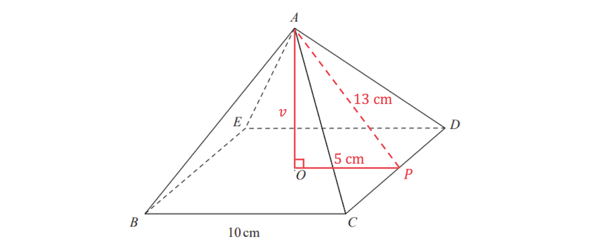

> *Use Pythagoras' theorem to calculate the vertical height of the pyramid **AO**.*

`table row cell v squared end cell equals cell 13 squared minus 5 squared end cell row cell v squared end cell equals 144 row v equals 12 end table`

**[1]**

> *Look at the right-angled triangle **OPC** on the base of the pyramid.*

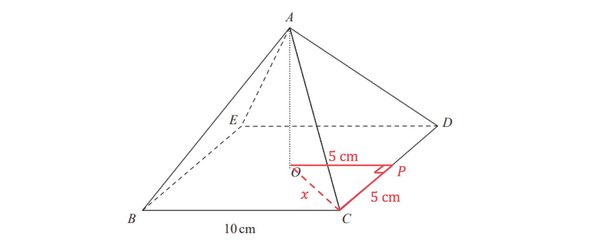

> *Calculate the length **OC** using Pythagoras' theorem.*

`table row cell x squared end cell equals cell 5 squared plus 5 squared end cell row cell x squared end cell equals 50 row x equals cell square root of 50 end cell end table`

**[1]**

> *Look at the right-angled triangle AOC.*

> *Calculate the angle **OCA** using trigonometry.  You know the adjacent side and the opposite side so use *$\mathrm{tan}θ=\frac{Opp}{Adj}$

`table row cell tan space theta end cell equals cell fraction numerator 12 over denominator square root of 50 end fraction end cell end table`

**[1]**

`table row theta equals cell tan to the power of negative 1 end exponent open parentheses fraction numerator 12 over denominator square root of 50 end fraction close parentheses end cell row theta equals cell 59.4910... end cell end table`

**Final answer:** **59.5****o**** [1]**

### Q7
> *Don't be put off by the ratio/ the fact that the actual lengths are not given. It doesn't matter what lengths are used- due to the properties of **similarity**, so long as the lengths are in the correct ratio, the angles will be correct.*

> *So put some imaginary lengths into the diagram- it makes sense to use the simplest form of the given ratio!*

> *To identify the angle between a line and a plane we can draw a right angled triangle using the line that is perpendicular to the plane:*

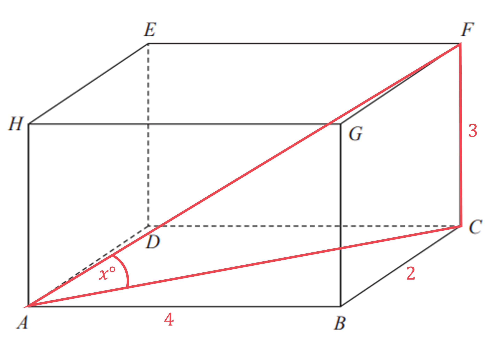

> *We need to find angle **x**. Notice that we have side **CF.** In order to find the required angle we first need to find the length of the side **AC**. To do this draw a right angled triangle connecting hypotenuse **AC** with two sides whose lengths are known:*

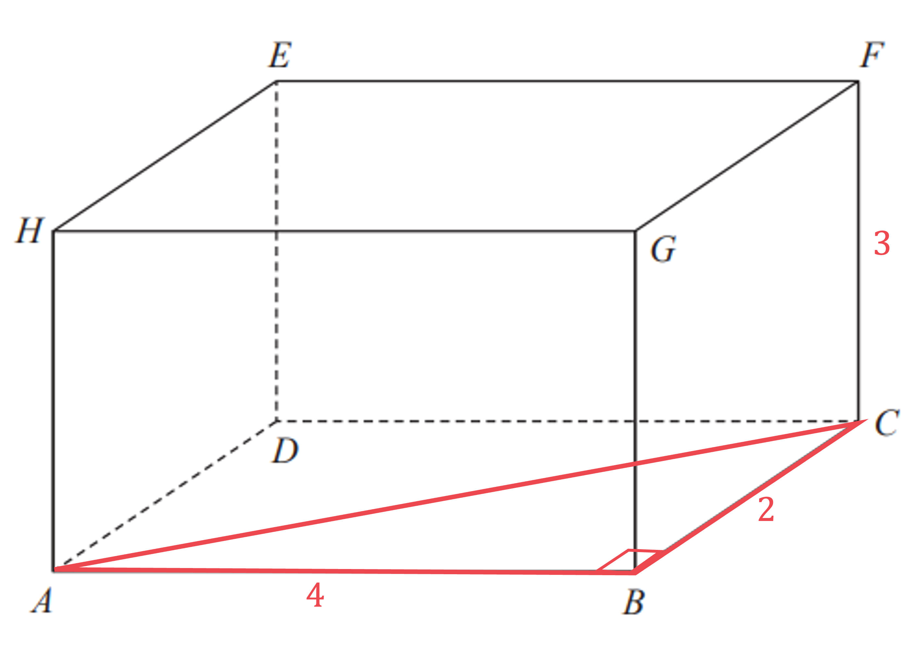

> *In triangle **ABC** we can use Pythagoras' Theorem to find **AC.*

$AC=\sqrt{4^{2}+2^{2}}$

**[1]**

$=2\sqrt{5}$

> *It is best to leave this result in its exact form for accuracy. We can add this result to our diagram:*

> *Now we can use right-angle trigonometry to find the required angle.*

`table row cell tan open parentheses x close parentheses end cell equals cell fraction numerator 3 over denominator 2 square root of 5 end fraction end cell end table`

**[1]**

> *Use the inverse tangent function ("SHIFT tan" on your calculator) to find **x.*

`table row x equals cell tan to the power of negative 1 end exponent open parentheses fraction numerator 3 over denominator 2 square root of 5 end fraction close parentheses end cell row blank equals cell 33.85451481... end cell end table`

> *Round your answer to 1 decimal place as requested. Remember to include the units.*

**Answer = **$33.9^{\circ}$ **[1]**

### Q8
> *Begin by drawing the diagonal from A to C on the base of the diagram. This forms the right-angled triangle ACD**.*

> *Use Pythagoras' theorem, *$a^{2}+b^{2}=c^{2}$*, on the right-angled triangle ACD to find the length AC.*

`table row cell A C to the power of 2 space end exponent end cell equals cell space 11 squared space plus space 10 squared end cell end table`

**[1]**

`table row cell A C squared space end cell equals cell space 221 end cell row cell A C space end cell equals cell space square root of 221 italic space cm end cell end table`

> *Use Pythagoras' theorem on the right-angled triangle ACF to find the length AF, make sure you use the exact value for the length AC.*

`table row cell A F squared space end cell equals cell space A C squared space plus space C F squared end cell row blank equals cell space open parentheses square root of 221 close parentheses squared space plus space 6 squared end cell end table`

**[1]**

`table row cell A F to the power of 2 space end exponent end cell equals cell space 221 space plus space 36 end cell row cell A F space end cell equals cell space square root of 221 space plus space 36 end root end cell end table`

**[1]**

$AF=\sqrt{257}\mathrm{cm}$* ***[1]**

### Q9
> *Drawing a diagram of the angle we are trying to find using triangle *$AMV$

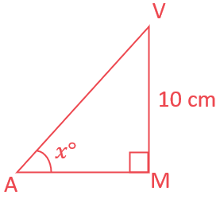

> *This would be solvable using tan if we knew the length of *$AM$

> *Considering the base of the pyramid*

> *Find the length of the diagonals using Pythagoras*

$AC=\sqrt{8^{2}+8^{2}}=8\sqrt{2}$

**Finding diagonal length**** [1]**

> *Length *$AM$* is half the length of a diagonal*

$AM=4\sqrt{2}$

**Finding length that helps find angle**** [1]**

> *We can then fill this information in on the first diagram*

> *This can then be solved using the tan ratio; *$\text{tan}θ=\frac{\text{opposite}}{\text{adjacent}}$

`table row cell text tan end text x end cell equals cell fraction numerator 10 over denominator 4 square root of 2 end fraction end cell row x equals cell text tan end text to the power of negative 1 end exponent open parentheses fraction numerator 10 over denominator 4 square root of 2 end fraction close parentheses equals 60.5037915 degree end cell end table`

**Using tan ratio correctly*** ***[1]**

$60.5^{\circ}$ **[1]**

** Angles should be rounded to 1 decimal place**

### Q10
> *You will need to know the perpendicular height of the pyramid. *

> *Let **O** be the centre of the base directly below the vertex **A** of the pyramid. *

> *Let **M** be the mid-point of the edge **BC.**  *

> *Look at the right-angled triangle **BOM** and calculate the length **BO **using Pythagoras' theorem: *$a^{2}+b^{2}=c^{2}$*.*

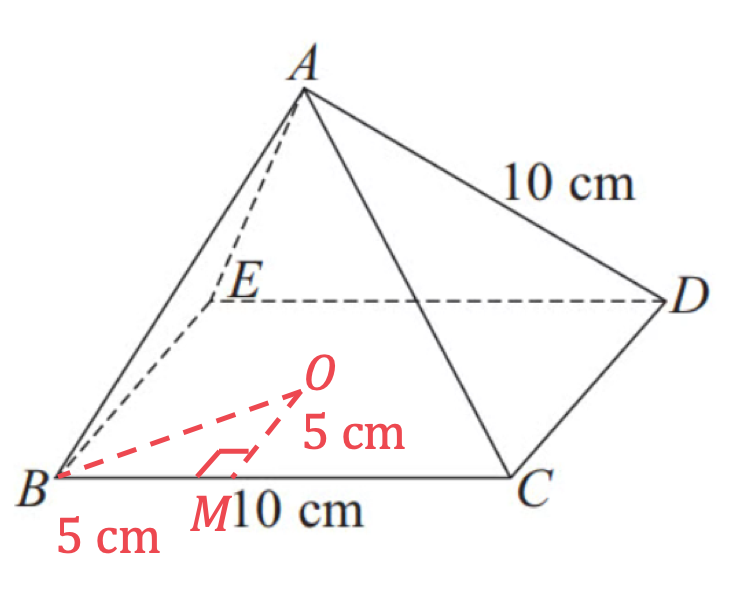

`table row cell B M squared plus O M squared end cell equals cell B O squared end cell row cell 5 squared plus 5 squared end cell equals cell B O squared end cell end table`

**[1]**

`table row 50 equals cell B O squared end cell row cell square root of 50 end cell equals cell B O end cell row cell B O end cell equals cell 5 square root of 2 space cm end cell end table`

> *Using Pythagoras' theorem on the right-angled triangle **AOB**, to calculate the perpendicular height of the pyramid, **AO**.*

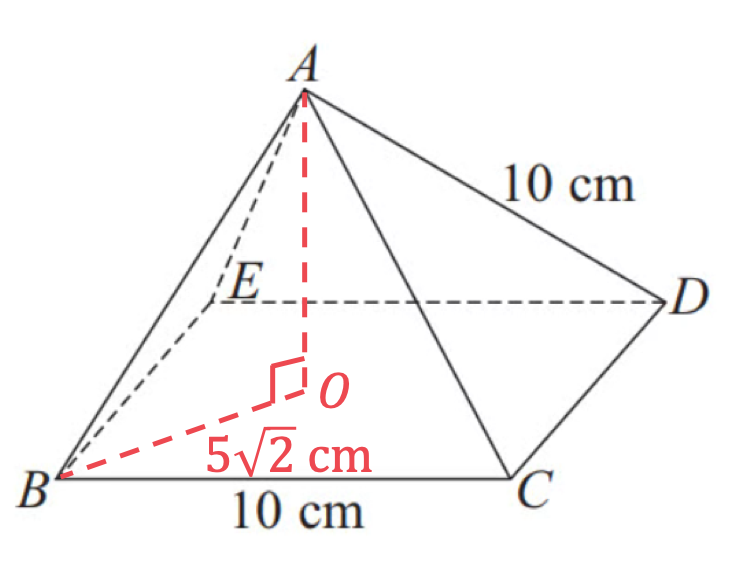

`table row cell B O plus A O squared end cell equals cell A B squared end cell row cell open parentheses 5 square root of 2 close parentheses squared plus A O squared end cell equals cell 10 squared end cell end table`

**[1]**

`table row cell 50 plus A O squared end cell equals 100 row cell A O squared end cell equals 50 row cell A O end cell equals cell 5 square root of 2 space cm end cell end table`

> *Calculate the area of the base of the pyramid.*

`table row A equals cell 10 cross times 10 end cell row blank equals cell 100 space cm squared end cell end table`

> *Calculate the volume of the square-based pyramid, using the formula: *$V=\frac{1}{3}\timesAreaofbase\timesPerpendicularheight$*.*

`table row V equals cell 1 third cross times 100 cross times 5 square root of 2 end cell end table`

**[1]**

$\frac{500}{3}\sqrt{2}\mathrm{cm}^{3}$* ***[1]**
> *Look at the right-angled triangle **AOB**.*

$BO=AO\,\Rightarrow\mathrm{Angle}OAB=45^{\circ}$

**[1]**

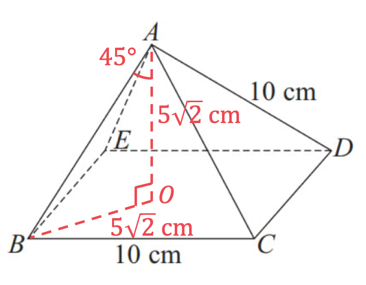

> *Find Angle **BAD**.*

$\mathrm{Angle}OAB=\mathrm{Angle}OAD$

$\mathrm{Angle}DAB=2\times\mathrm{Angle}OAB\,\mathrm{Angle}DAB=2\times45$

$\mathrm{Angle}DAB=90^{\circ}$** [1]**

### Q11
> *To identify the angle between a line and a plane it is helpful to draw a right angled triangle using the line that is perpendicular to the plane:*

> *We need to find angle **x**. Notice that we have side **AE.** In order to find the required angle we first need to find the length of the side **AC**. To do this draw a right angled triangle connecting hypotenuse **AC** with sides whose lengths are known:*

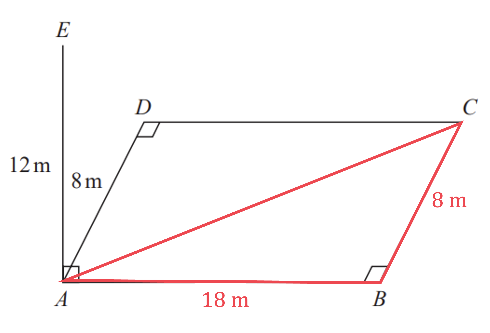

> *In triangle **ABC** we can use Pythagoras' Theorem to find **AC.*

$AC=\sqrt{18^{2}+8^{2}}$

**[1]**

$=2\sqrt{97}$

> *It is best to leave this result in its exact form for accuracy. We can add this result to our diagram:*

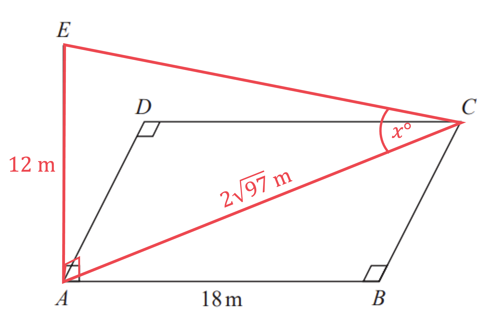

> *Now we can use right-angle trigonometry to find the required angle.*

`table row cell tan open parentheses x close parentheses end cell equals cell fraction numerator 12 over denominator 2 square root of 97 end fraction end cell end table`

**[1]**

> *Use the inverse tangent function ("SHIFT tan" on your calculator) to find **x.*

`table row x equals cell tan to the power of negative 1 end exponent open parentheses fraction numerator 12 over denominator 2 square root of 97 end fraction close parentheses end cell row blank equals cell 31.35009472... end cell end table`

> *Round your answer to 1 decimal place as requested. Remember to include the units.*

**Answer = **$31.4^{\circ}$ **[1]**

### Q12
> *Use Pythagoras' theorem, *$a^{2}+b^{2}=c^{2}$*, on the right-angled triangle **ABF** to find the length **BF**.*

`table attributes columnalign right center left columnspacing 0px end attributes row cell 5 squared plus 7 squared end cell equals cell B F squared end cell end table`

**[1]**

`table row 74 equals cell B F squared end cell row cell B F end cell equals cell square root of 74 space cm end cell end table`

> *Use Pythagoras' theorem on the right-angled triangle **BCF** to find the length **BC**.*

`table row cell open parentheses square root of 74 close parentheses squared plus B C squared end cell equals cell 15 squared end cell row cell 74 plus B C squared end cell equals 225 row cell B C squared end cell equals 151 row cell B C end cell equals cell square root of 151 space cm end cell end table`

**[1]**

> *Calculate the volume of the cuboid, using the formula: *$V=l\timesw\timesh$*, where *$l$* is the length, *$w$* is the width and *$h$* is the height of the cuboid.*

`table row V equals cell square root of 151 cross times 7 cross times 5 end cell end table`

**[1]**

`table attributes columnalign right center left columnspacing 0px end attributes row V equals cell 430.087200... end cell end table`

$430\mathrm{cm}^{3}$* ***[1]**

### Q13
> *Sketch a diagram showing the length **BC** and the top of the post **P.*

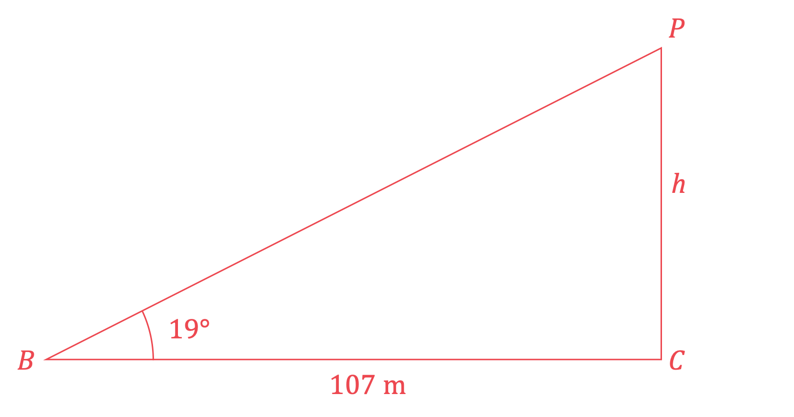

> *This is a right-angled triangle so the height of the post can be found using *$\mathrm{tan}x=\frac{Opp}{Adj}$*.*

`tan space open parentheses 19 close parentheses equals h over 107`

**[1]**

> *Multiply both sides by 107.*

$107\mathrm{tan}19=h$

$36.84305...=h$

**36.8 m ****[1]**

** Answers of 36.84... will also be accepted.**

### Q14
> *Method 1*

> *Triangle **CDE** is a right-angled triangle.*

> *Calculate the length **EC** using Pythagoras' theorem, *$a^{2}+b^{2}=c^{2}$*. Use **CD** = 8.54166... from part ia).*

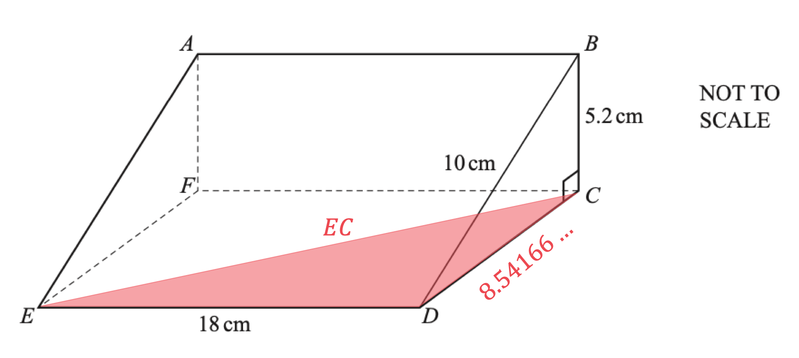

$EC^{2}=18^{2}+8.54166...^{2}$

**[1]**

> *Simplify the right hand side.*

$EC^{2}=396.96$

> *Square root both sides.*

$EC=19.92385...$

**[1]**

> *Triangle **BCE** is a right angled triangle.*

> *Calculate angle **BEC** using, *$\mathrm{tan}x=\frac{Opp}{Adj}$*.*

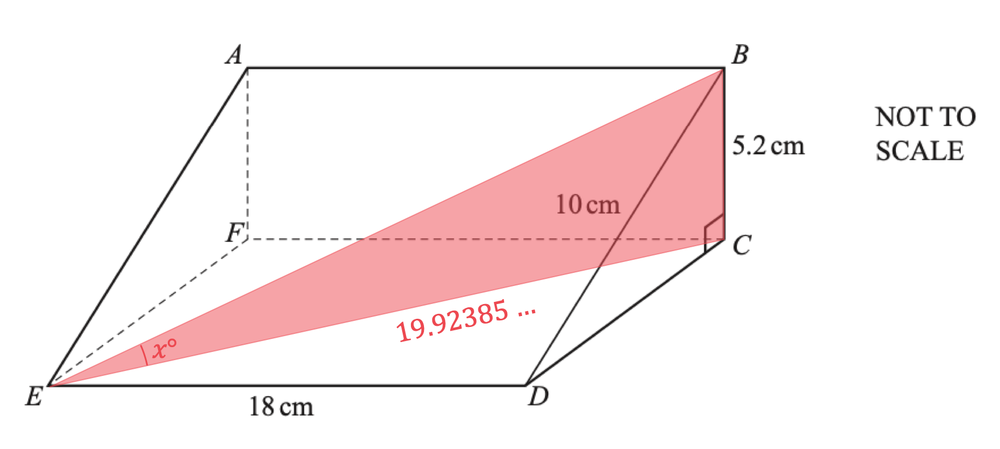

$\mathrm{tan}x=\frac{5.2}{19.92385...}$

**[1]**

> *Take the inverse tan, tan**-1**, of both sides.*

> `x equals tan to the power of negative 1 end exponent open parentheses fraction numerator 5.2 over denominator 19.92385... end fraction close parentheses`* *$x=14.62753...$

**Angle ****BEC = ****14.6****o**** ****[1]**

**Answers between 14.62 and 14.63... will be accepted.**

> *Method 2*

> *Triangle **BDE** is a right-angled triangle.*

> *Calculate the length **BE** using Pythagoras' theorem, *$a^{2}+b^{2}=c^{2}$*.*

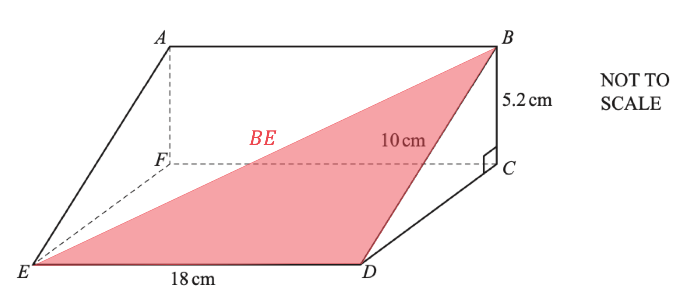

$BE^{2}=18^{2}+10^{2}$

**[1]**

> *Simplify the right hand side.*

$BE^{2}=424$

> *Square root both sides.*

$BE=20.59126...$

**[1]**

> *Triangle **BCE** is a right angled triangle.*

> *Calculate angle **BEC** using, *$\mathrm{sin}x=\frac{Opp}{Hyp}$*.*

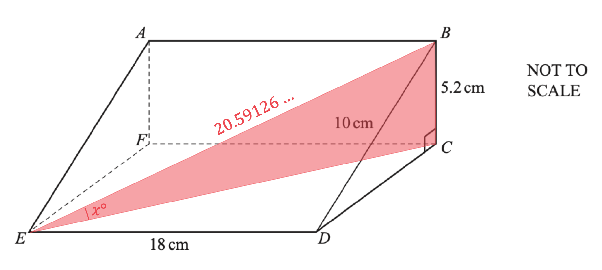

$\mathrm{sin}x=\frac{5.2}{20.59126...}$

**[1]**

> *Take the inverse sin, sin**-1**, of both sides.*

> `x equals sin to the power of negative 1 end exponent open parentheses fraction numerator 5.2 over denominator 20.59126... end fraction close parentheses`* *$x=14.62753...$

**Angle ****BEC = ****14.6****o**** ****[1]**

**Answers between 14.62 and 14.63... will be accepted.**
> *Triangle **BDG** is a right angled triangle.*

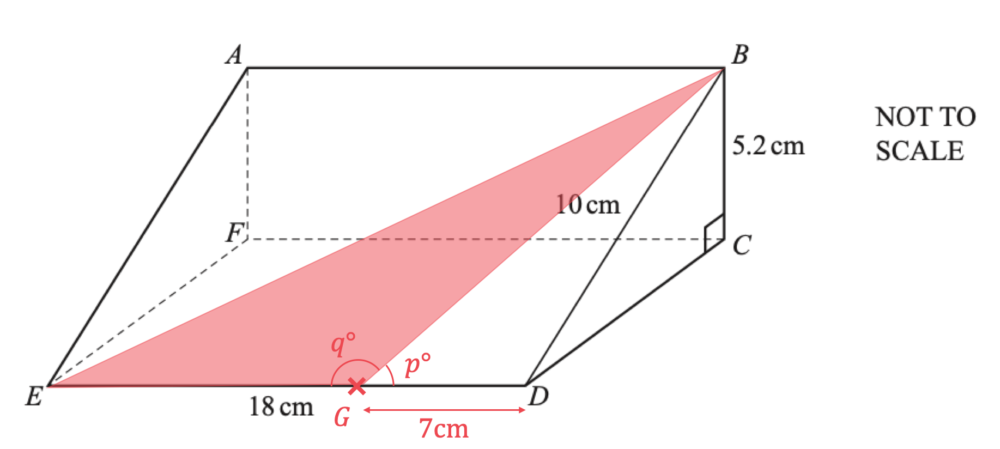

> *Work out angle **BGD** using simple trig, *$\mathrm{tan}x=\frac{Opp}{Hyp}$*.*

$\mathrm{tan}p=\frac{10}{7}$

**[1]**

> *Take the inverse tan, tan**-1**, of both sides.*

`space p equals tan to the power of negative 1 end exponent open parentheses 10 over 7 close parentheses`

$p=55.00797...$

> *E**, **G** and **D** lie on a straight line, so angle **BGE **+ angle **DGB **= 180**o**.*

> *Subtract *$p$* from 180**o** to find *$q$*.*

$180-55.00797...=q$

**[1]**

$q=124.99202...$

**Angle ****BGE**** = 125****o**** ****[1]**

**Answers between 124.9 to 125.0... will be accepted.**

### Q15
*The area of the base is 10 cm × 10 cm = 100 cm**2* *Fill in the volume formula using **V** for volume and **h** for perpendicular height* * *

$V=\frac{1}{3}\times100\timesh$

**[1]**

*Triangle **AMV** is right-angled at **M** so SOHCAHTOA can be used* *Highlight AM on the diagram (half the diagonal of the square** ABCD**)* * *

> * *

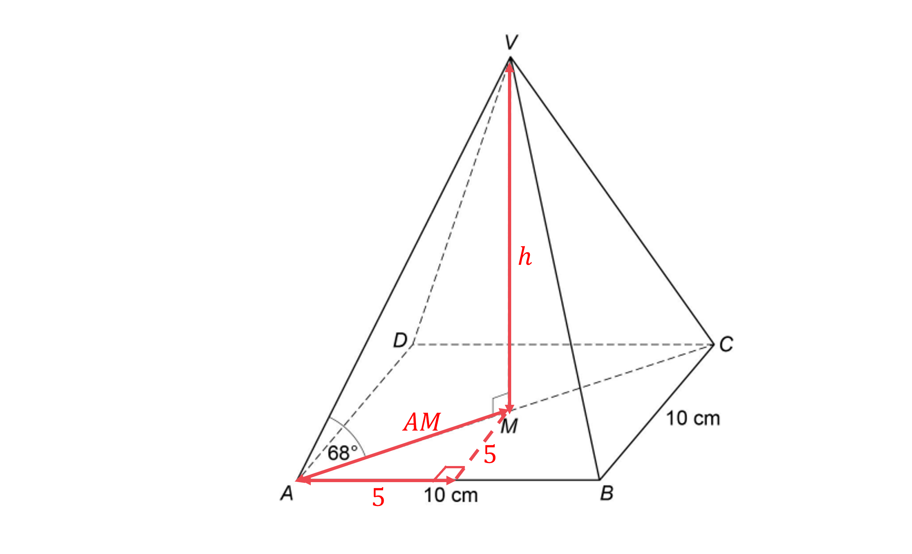

*Find **AM** using Pythagoras' Theorem on the base* * *

$AM^{2}=5^{2}+5^{2}\,AM=\sqrt{5^{2}+5^{2}}\,AM=5\sqrt{2}$

*correct under the square root*** ****[1] **

*correct with square root*** ****[1]**

*Use tan **x** = *$\frac{\mathrm{opp}}{\mathrm{adj}}$* in triangle **AMV* * *

$\mathrm{tan}68=\frac{h}{5\sqrt{2}}$

**[1]**

*Multiply both sides by 5√2 to calculate **h* * *

$5\sqrt{2}\mathrm{tan}68=h$

**[1]**

*Substitute this value of **h** into the volume formula above* * *

`table row V equals cell 1 third cross times 100 cross times 5 square root of 2 space tan space 68 end cell row blank equals cell 583.38... end cell end table`

**583 cm****3**** ****[1]**

**Answers between 576 and 587 are accepted (and so is the rounded answer 590)**

### Q16
> *To find the angle between a line and a plane it is helpful to draw a right angled triangle using the line that is perpendicular to the plane:*

> *In order to find the required angle you will first need to find the length of the side **DB**. To do this draw a right angled triangle joining **DB** with two other known sides:*

> *Now we can use Pythagoras to find **DB**.*

`table row cell D B squared end cell equals cell 8 squared plus 24 squared end cell row cell D B end cell equals cell square root of 8 squared plus 24 squared end root end cell row blank equals cell 8 square root of 10 end cell end table`

**[1]**

> *Mark this length on the diagram*

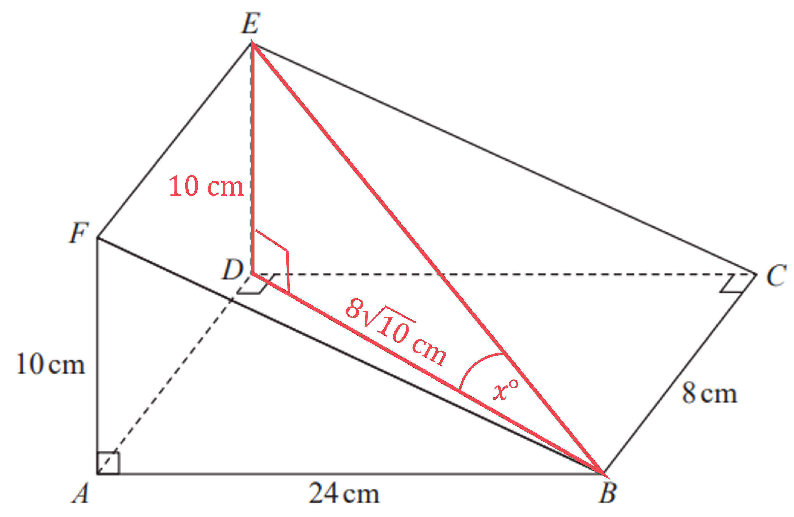

> *Now we know the opposite and adjacent sides in a right-angle triangle so use the tangent ratio to find the required angle*

`tan open parentheses x close parentheses equals fraction numerator 10 over denominator 8 square root of 10 end fraction`

**[1]**

> *Find the angle by using the inverse tan function ("SHIFT tan" on your calculator)*

`table row x equals cell tan to the power of negative 1 end exponent open parentheses fraction numerator 10 over denominator 8 square root of 10 end fraction close parentheses end cell row blank equals cell 21.5681294... end cell end table`

> *Round your answer to 1 decimal place as requested. Remember to include the units*

**Answer = **$21.6^{\circ}$ **[1]**

### Q17
> *Draw the point **C** on the diagram*

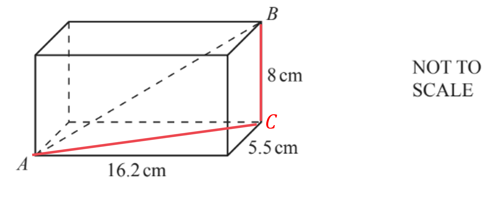

*Draw the base of the cuboid as a flat rectangle*

> *Find the length **AC** (using Pythagoras' Theorem)*

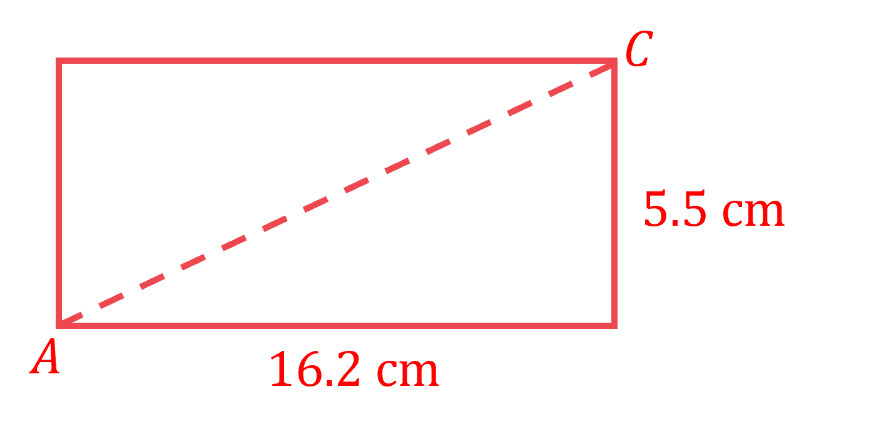

`table attributes columnalign right center left columnspacing 0px end attributes row cell A C end cell equals cell square root of 16.2 squared plus 5.5 squared end root end cell row blank equals cell 17.108... end cell end table`

**For **$16.2^{2}+5.5^{2}$** [1]**

**For*** *$\sqrt{16.2^{2}+5.5^{2}}$**[1]**

*Draw the (3D) triangle **ABC** as a flat (2D) triangle* *Write all the known lengths on the diagram and write angle **BAC** as *$x$

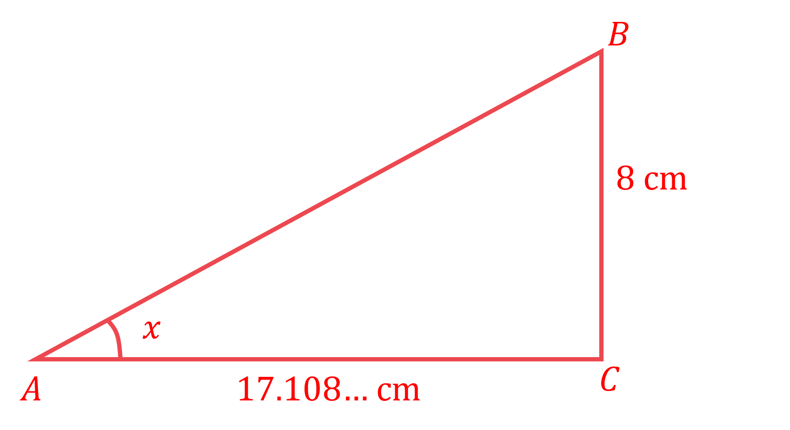

> * *

*The angle between **AB** and the horizontal base of the cuboid is *$x$ *Find *$x$* (by using the tan ratio)*

> * *

`tan space x equals fraction numerator 8 over denominator 17.108... end fraction
x equals tan to the power of negative 1 space end exponent open parentheses fraction numerator 8 over denominator 17.108... end fraction close parentheses
x equals 25.06...`

**For correct tan ratio**** [1]**

> *Round the angle to 1 decimal place*

$25.1^{\circ}$** [1]**

### Q18
> *Draw the stick on the diagram such that it extends from a bottom corner through the diagonally opposite top corner and out of the crate.  *

> *Let the length of the stick inside the crate be **x **cm, then the length of the stick outside of the crate will be 95 - **x **cm.*

> *It also may help to add the right-angled triangles that the diagonal makes with the edges onto the diagram.*

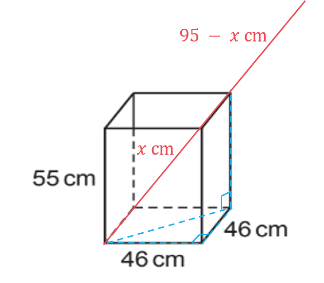

> *Use Pythagoras' theorem, *$a^{2}+b^{2}=c^{2}$*, on the right-angled triangle on the base of the crate to find length of the diagonal on the base.*

`table row cell 46 squared space plus space 46 squared space end cell equals cell space c squared end cell end table`

**[1]**

`table row cell c squared space end cell equals cell space 2 open parentheses 46 squared close parentheses space end cell row blank equals cell space 4232 end cell row cell c space end cell equals cell square root of 4232 space end cell row blank equals cell space 46 square root of 2 space cm end cell end table`

**[1]**

> *Use Pythagoras' theorem on the right-angled triangle made up of the diagonal at the base, the side with length 55 cm and the diagonal made by the part of the stick inside the crate, **x.*

`table row cell open parentheses 46 square root of 2 close parentheses squared space plus space 55 squared space end cell equals cell space x squared end cell row cell 4232 space plus space 3025 end cell equals cell space x squared end cell row cell x squared space end cell equals cell space 7257 end cell row cell x space end cell equals cell square root of 7257 space cm end cell end table`

**[1]**

> *Calculate the length of the stick that extends out of the crate by subtracting **x** from the length of the stick.*

`table row cell 95 space minus space x space end cell equals cell space 95 space minus space square root of 7257 space end cell row blank equals cell space 95 space minus space 85.188027... space end cell end table`

$9.81\mathrm{cm}$* ***[1]**
> *To find the angle between a line and a plane it is helpful to draw a right angled triangle using the line that is perpendicular to the plane.*

> *Add the lengths that are known either from the question or found in part (a) to the diagram.*

*Indicating correct angle*** ****[1]**

> *In the triangle you know the length of the side opposite the angle and the length of the side adjacent to the angle so use the tan ratio. Use the exact value found in part (a) for the length of the diagonal of the base.*

`tan open parentheses theta close parentheses equals straight O over straight A space equals space fraction numerator 55 over denominator 46 square root of 2 end fraction`

**[1]**

> *Find the angle by using the inverse tan function.*

`table row cell theta space end cell equals cell space tan to the power of negative 1 end exponent open parentheses fraction numerator 55 over denominator 46 square root of 2 end fraction close parentheses end cell row blank equals cell 40.212974... end cell end table`

> *Round your answer to 1 decimal place. Remember to include the units.*

$\mathrm{Angle}=40.2^{\circ}(1\mathrm{dp})$ **[1]**

### Q19
> *To identify the angle between a line and a plane it is helpful to draw a right angled triangle using **AD** and the line that is perpendicular to the plane:*

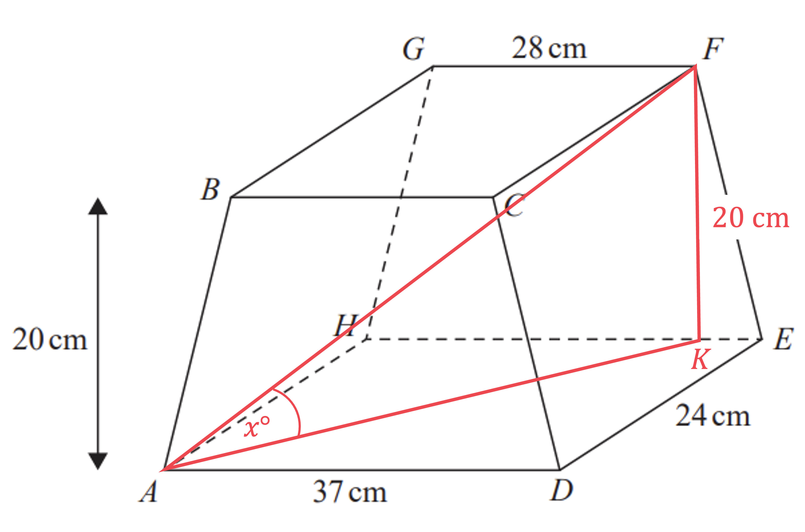

> *We have added **K **to the diagram. To find **x**, we need to obtain the length **AK **so we can consider triangle **AHK**:*

> *In right-angle triangle **AHK**, we already have length **AH** so to find **AK** we need length **HK.** We can deduce **HK** by considering trapezium **EFGH**:*

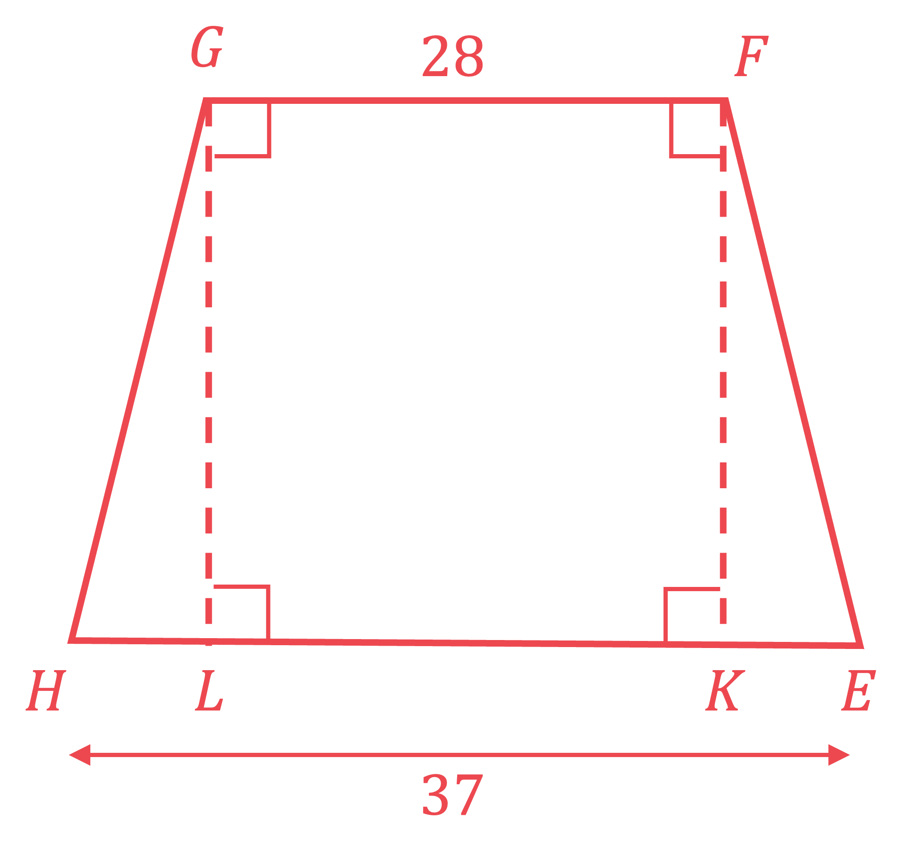

$HL=KE\mathrm{and}HL+KE=37-28\,KE=\frac{37-28}{2}=4.5\,HK=37-4.5=32.5$

> *Now we can find **AK **using Pythagoras' Theorem in triangle **AHK **(our second diagram).*

`table row cell A K end cell equals cell square root of A H squared plus H K squared end root end cell row blank equals cell square root of 24 squared plus 32.5 squared end root end cell row blank equals cell 40.40111385... end cell end table`

**[1]**

> *(This mark was hard won! But the remaining two marks are now close!)*

> *Save this result in your calculator to preserve accuracy.*

> * Find **x** using triangle **AFK **(our first diagram) and the tangent ratio.*

`tan open parentheses x close parentheses equals fraction numerator 20 over denominator 40.40111385... end fraction`

**[1]**

> *Use the inverse tangent function ("SHIFT tan" on your calculator) to find the required angle.*

`table row x equals cell tan to the power of negative 1 end exponent open parentheses fraction numerator 20 over denominator 40.40111385... end fraction close parentheses end cell row blank equals cell 26.33706009... end cell end table`

> *Round your answer to 1 decimal place as requested. Remember to include the units.*

**Answer = **$26.3^{\circ}$ **[1]**

### Q20
> *Length **BX** is half the length of **BD** as **X**  is at the centre of the base.*

$BX=8\div2=4$* **cm*

*Triangle** PXB** is a right angled triangle.* *The angle between **PB** and the base **ABCD** is angle **PXB**.*

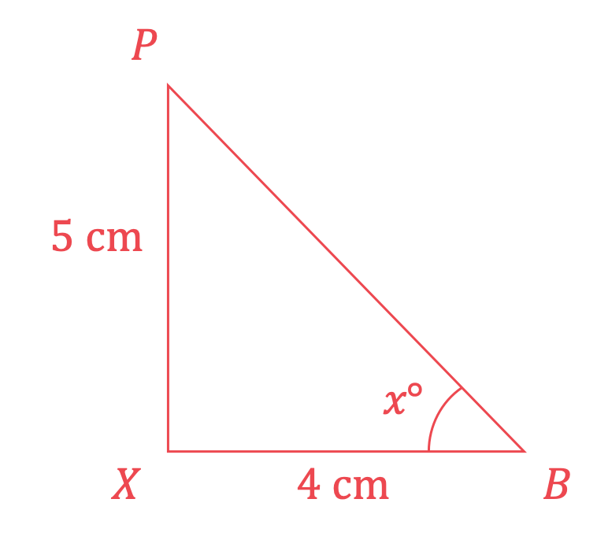

**[1]**

*Use simple trigonometry to find the angle **PBX**.* *You know the opposite and adjacent sides, so use the tan ratio.*

$\mathrm{tan}x=\frac{5}{4}$

**[1]**

> *Find the inverse tan of both sides.*

`x equals tan to the power of negative 1 end exponent open parentheses 5 over 4 close parentheses`

$x=51.34019...$

$51.3^{\circ}$ **[1]**

**A value of 51.34... will be accepted.**

### Q21
> *Let **O** be the centre of the base directly below the vertex **V** of the pyramid and II be the midpoint of **AB**. *

> *Look at the right-angled triangle **AMO**, use Pythagoras' theorem, *$a^{2}+b^{2}=c^{2}$*, to calculate the length **AO**.*

`table row cell A O squared end cell equals cell 10 squared plus 10 squared end cell row cell A O squared end cell equals 200 row cell A O end cell equals cell 10 square root of 2 end cell end table`

**[1]**

> *Use SOHCAHTOA on the right-angled triangle **AOB **to calculate the perpendicular height. You have the length **AO **(adjacent) and you want to know the height (opposite) so use: *$\mathrm{tan}θ=\frac{Opp}{Hyp}$*.*

> * *`table row cell tan 55 end cell equals cell fraction numerator V O over denominator 10 square root of 2 end fraction end cell row cell 10 square root of 2 cross times tan 55 end cell equals cell V O end cell end table`

**[1]**

`table row cell V O end cell equals cell 20.19706... space cm end cell end table`

> *Work out the perpendicular height of one of the triangular faces by using Pythagoras' theorem on the right-angled triangle **VOM**.*

`table row cell 10 squared plus open parentheses 20.1... close parentheses squared end cell equals cell V M squared end cell row cell 507.921345... end cell equals cell V M squared end cell row cell V M end cell equals cell 22.537110... space cm end cell end table`

**[1]**

*Calculate the area of one of the triangular faces, using the formula*: $A=\frac{1}{2}bh$*, where *$b$* is the base of the triangle and *$h$* is the perpendicular height.*

`table row cell A subscript t r i a n g l e end subscript end cell equals cell 1 half cross times 20 cross times 22.5... end cell end table`

**[1]**

`table row cell A subscript t r i a n g l e end subscript end cell equals cell 225.371104... space cm to the power of 2 space end exponent end cell end table`

> *Calculate the total surface area by adding together the area of the square base and four of the triangular faces.*

`table row cell A subscript t o t a l end subscript end cell equals cell 20 cross times 20 plus 4 cross times 225.371104... end cell row blank equals cell 1301.48441... space cm squared end cell end table`

> *Round to 2 significant figures.*

$1300\mathrm{cm}^{2}$* ***[1]**

**Answers between 1300 and 1302 will be accepted**

### Q22
> *To find the angle between a line and a plane it is helpful to draw a right angled triangle using the line that is perpendicular to the plane.*

> *In order to find the required angle you will first need to find the length of the side **AC**. To do this draw a right angled triangle using the other information you are given.*

> *In the triangle **ABC** you know an angle and the length of the side opposite. You want to find the hypotenuse so use the sin ratio.*

`sin open parentheses 48 close parentheses equals fraction numerator 7.3 over denominator x end fraction`

**[1]**

> *Multiply both sides by **x** and divide by sin(48).*

`table attributes columnalign right center left columnspacing 0px end attributes row x equals cell fraction numerator 7.3 over denominator sin open parentheses 48 close parentheses end fraction end cell row blank equals cell 9.823118... end cell end table`

**[1]**

> *Now you can use the triangle **CAH**. In this triangle you want to find an angle and you know the lengths of the sides that are opposite and adjacent to the angle so use the tan ratio. Use the answer button or the exact value for the length of the side **AC**.*

`tan open parentheses x close parentheses equals fraction numerator 8.1 over denominator 9.823118... end fraction`

**[1]**

> *Find the angle by using the inverse tan function.*

`table row x equals cell tan to the power of negative 1 end exponent open parentheses fraction numerator 8.1 over denominator 9.823118... end fraction close parentheses end cell row blank equals cell 39.508492... end cell end table`

> *Round your answer to 1 decimal place. Remember to include the units.*

$\mathrm{Angle} \mathrm{between}AH\mathrm{and} \mathrm{the} \mathrm{plane}ABCD=39.5^{\circ}(1\mathrm{dp})$ **[1]**

### Q23
> *The longest part of the cuboid will be a diagonal from a bottom corner to the opposite top corner.  Draw this diagonal onto the diagram. *

> *ACG** is a right-angled triangle. *

> *ABC** is a right-angled triangle, where **AB **= 8 cm, **BC** = 5 cm.*

> *Use Pythagoras'  theorem with triangle **ABC **to find the length of **AC**.*

*  *$AC^{2}=AB^{2}+BC^{2}\,AC^{2}=8^{2}+5^{2}$

**[1]**

> *Solve**.*

`table row cell A C to the power of space end cell equals cell square root of 8 squared space plus space 5 squared end root end cell row blank equals cell square root of 89 space end cell end table`

> *Use Pythagoras'  theorem with triangle **ACG **to find the length of **AG**.*

*  *`table row cell A G to the power of space 2 space end exponent end cell equals cell space A C to the power of space 2 space end exponent plus space C G to the power of space 2 end exponent end cell row cell A G to the power of space 2 space end exponent end cell equals cell open parentheses square root of 89 close parentheses squared space plus space 11 squared end cell end table`

**[1]**

> *Solve**.*

`table row cell A G to the power of space end cell equals cell square root of 89 space plus space 11 squared end root end cell row blank equals cell square root of 210 space end cell end table`

**[1]**

> *Write 13 as a square root and compare.*

`13 equals table row blank blank cell square root of 169 end cell end table less than square root of 210 table row blank blank space end table`

**AG ****=**** **$\sqrt{210}$** cm > 13 cm so yes the pencil will fit. ****[1]**

### Q24
> *We know that *$AX=40$* cm so need to find the length *$AG$*. We can use Pythagoras' theorem for this either using it twice in 2D, or once in 3D.*

> *Method 1** - Using 2D Pythagoras' theorem twice*

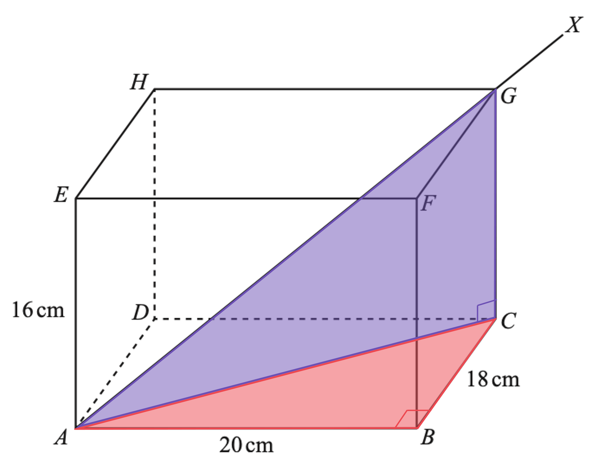

`open parentheses A C close parentheses squared equals 20 squared plus 18 squared equals 400 plus 324 equals 724`

**[1]**

> *There is no need to square root as we will need *`open parentheses A C close parentheses squared`* in the next stage.*

`open parentheses A G close parentheses squared equals open parentheses A C close parentheses squared plus 16 squared equals 724 plus 256 equals 980`

**[1]**

$AG=\sqrt{980}=14\sqrt{5}$

> *Now we can find the length of the rod outside of the box (*$GX$*).*

$GX=40-14\sqrt{5}=8.695048...$

**[1]**

**Final answer:** $GX$**, the length of the rod outside the box is 8.70 cm ****[1]**

> *Method 2** - Using 3D Pythagoras' theorem*

`open parentheses A G close parentheses squared equals 20 squared plus 18 squared plus 16 squared`

**[2]**

$AG=\sqrt{980}=14\sqrt{5}$

**[1]**

$GX=40-14\sqrt{5}=8.695048...$

$GX$*, ***the length of the rod outside the box is 8.70 cm*** ***[1]**
> *The angle the rod makes with the base is the angle *$CAG$*.*

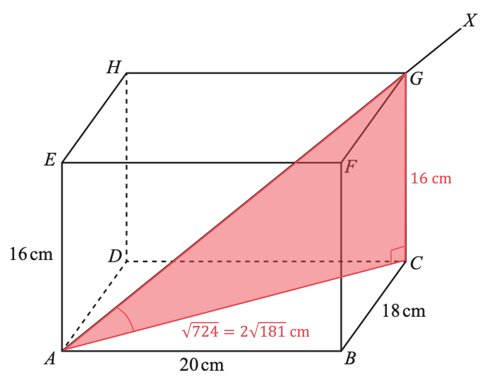

> *Angle *$CAG$* can be found using tangent.*

> * *$\mathrm{tan}CAG=\frac{CG}{AC}=\frac{16}{2\sqrt{181}}$

**Identifying angle **$CAG$** [1] **

**Use of trigonometric ratio**** [1]**

*Use inverse tan to find angle *$CAG$**.**

`C A G equals tan to the power of negative 1 end exponent space open parentheses fraction numerator 16 over denominator 2 square root of 181 end fraction close parentheses equals 30.737 space 211 space...`

> *Give angle answers to one decimal place.*

**The angle the rod makes with the base of the box is 30.7° ****[1]**

**Alternatively you could use sine with **$AG$** and **$GC$** or cosine with **$AG$** and **$AC$**.**

### Q25
> *Triangle **AMV** is right angled and **AV** is the hypotenuse. *

*You need to find one more side of this triangle in order to find the angle **VAM**.*

*The diagonals of a square intersect at the centre of the square.* *Therefore you can find the length of **AM** as it is half of the side **AC**.*

> *Find the length **AC **by using Pythagoras with the two sides of the square. Leave your answer as an exact value.*

$AC^{2}=11^{2}+11^{2}\,AC^{2}=242\,AC=\sqrt{242}=11\sqrt{2}$

**[1]**

> *Halve this length to find the length of **AM**. Leave your answer as an exact value.*

$AM=\frac{1}{2}\timesAC=\frac{11\sqrt{2}}{2}$

**[1]**

> *The side **AM** is adjacent to the angle **VAM**. Therefore use the trig ratio *$\mathrm{cos}θ=\frac{\mathrm{Adjacent}}{\mathrm{Hypotenuse}}.$

`cos open parentheses V A M close parentheses equals fraction numerator open parentheses fraction numerator 11 square root of 2 over denominator 2 end fraction close parentheses over denominator 18.6 end fraction`

**[1]**

> *Find the angle by using inverse cos.*

`V A M equals cos to the power of negative 1 end exponent open parentheses fraction numerator open parentheses fraction numerator 11 square root of 2 over denominator 2 end fraction close parentheses over denominator 18.6 end fraction close parentheses equals 65.28017...`

> *Round the angle to 1 decimal place.*

**65.3°** **[1]**

### Q26
> *Draw the line **AC** on the diagram*

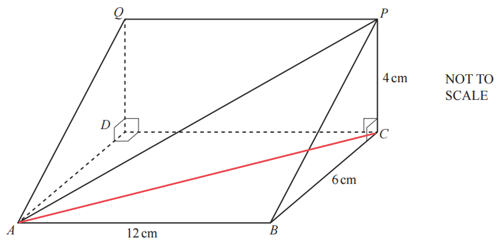

*Draw the base **ABCD** as a flat rectangle* *Find the length **AC** (using Pythagoras' Theorem)*

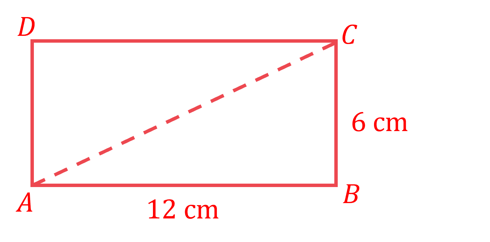

`table row cell A C end cell equals cell square root of 12 squared plus 6 squared end root end cell end table`

**For**** **$12^{2}+6^{2}$** [1]**

**For*** *$\sqrt{12^{2}+6^{2}}$**[1]**

*Draw the (3D) triangle **ACP** as a flat (2D) triangle* *Write all the known lengths on the diagram and write angle **PAC** as *$x$

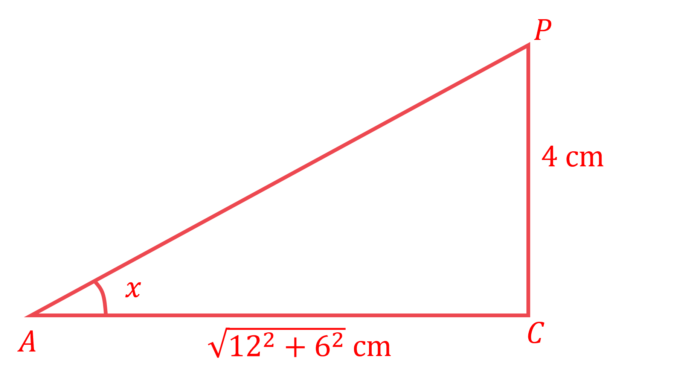

> * *

*The angle between **AP** and the horizontal base is *$x$ *Find *$x$* (using the tan ratio)*

`tan space x equals fraction numerator 4 over denominator square root of 12 squared plus 6 squared end root end fraction
x equals tan to the power of negative 1 space end exponent open parentheses fraction numerator 4 over denominator square root of 12 squared plus 6 squared end root end fraction close parentheses
x equals 16.60...`

**For correct tan ratio**** [1]**

> *Round the angle to 1 decimal place*

$16.6^{\circ}$** [1]**

### Q27
> *To find the angle between a line and a plane it is helpful to draw a right angled triangle using the line that is perpendicular to the plane.*

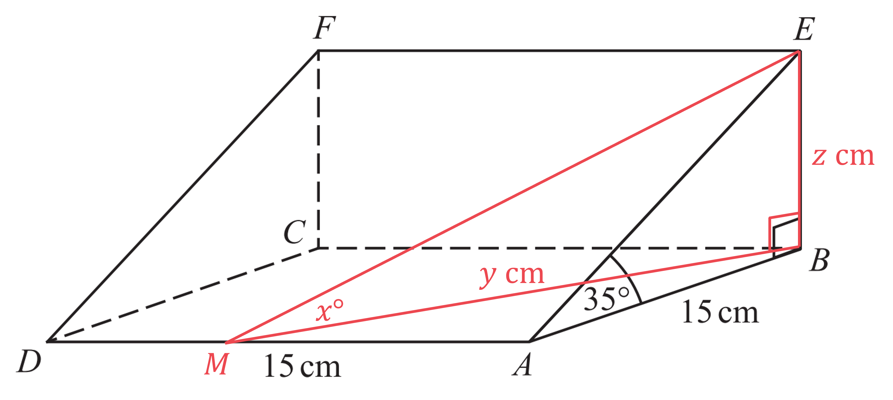

> *In order to find the required angle you will first need to find the lengths of the side **MB **and **BE**. To find **BE** draw a right angled triangle **ABE **using the other information you are given.*

> *In the triangle **ABE** you know an angle and the length of the adjacent side. You want to find the length of the opposite side so use the tan ratio.*

`tan open parentheses 35 close parentheses equals z over 15`

**[1]**

> *Multiply both sides by 15. Leave as an exact value.*

`table row z equals cell 15 cross times tan open parentheses 35 close parentheses end cell row blank equals cell 15 tan open parentheses 35 close parentheses end cell end table`

> *To find **MB** draw a right angled triangle **ABM **using the other information you are given.*

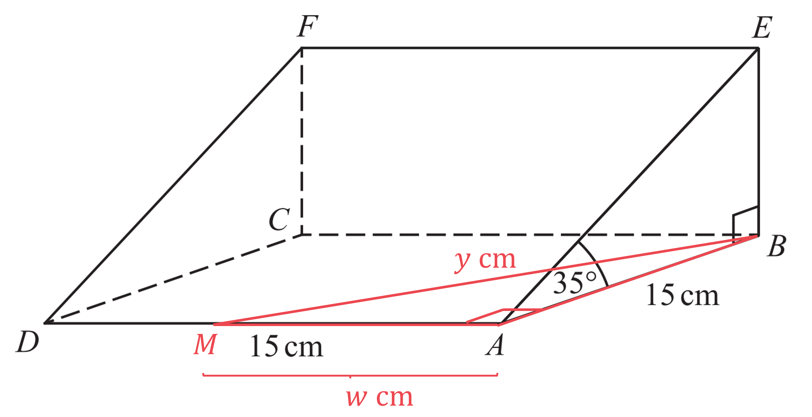

> *As **DM** : **MA** = 2 : 3, you know that **MA** is *$\frac{3}{2+3}$* of the length of **DA**.*

$MB=\frac{3}{5}\times15=9\mathrm{cm}$

> *In the triangle **ABM** you know two lengths and want to find the hypotenuse so you can use Pythagoras' theorem.*

`table attributes columnalign right center left columnspacing 0px end attributes row cell M A squared plus A B squared end cell equals cell M B squared end cell row cell 9 squared plus 15 squared end cell equals cell y squared end cell row 306 equals cell y squared end cell end table`

> *Take the positive square root of both sides. Leave as an exact answer.*

$y=\sqrt{306}$

**[1]**

> *Now you can use the triangle **MBE**. In this triangle you want to find an angle and you know the lengths of the sides that are opposite and adjacent to the angle so use the tan ratio. Use the exact values for the lengths or use your calculator's memory function.*

`table row cell tan open parentheses x close parentheses end cell equals cell fraction numerator 15 tan open parentheses 35 close parentheses over denominator square root of 306 end fraction end cell row blank equals cell 0.600423... end cell end table`

**[1]**

> *Find the angle by using the inverse tan function.*

`table row x equals cell tan to the power of negative 1 end exponent open parentheses fraction numerator 15 tan open parentheses 35 close parentheses over denominator square root of 306 end fraction close parentheses end cell row blank equals cell tan to the power of negative 1 end exponent open parentheses 0.600423... close parentheses end cell row blank equals cell 30.981574... end cell end table`

> *Round your answer to 1 decimal place. Remember to include the units.*

$\mathrm{Angle} \mathrm{between}EM\mathrm{and} \mathrm{the} \mathrm{base}=31.0^{\circ}(1\mathrm{dp})$ **[1]**

### Q28
*The volume of a cuboid, **V**, is the area of its base, 150 cm**2**, multiplied by its height, **h* * *

**V*** = 150 × ***h***  *

*Write the 20 cm and** h** on the diagram* * *

> * *

*The triangle formed with the diagonal is a right-angled triangle, so SOHCAHTOA can be used* *Use sin **x** = *$\frac{\mathrm{opp}}{\mathrm{hyp}}$* * * *

$\mathrm{sin}24=\frac{h}{20}$

**[1]**

*Multiply both sides by 20 to calculate **h* * *

$20\mathrm{sin}24=h$

**[1]**

*Find the volume of the cuboid, by substituting this height into the volume formula above*

$V=150\times20\mathrm{sin}24$

**1220 cm****3** **[1]**

**The question can also be done using** $\mathrm{cos}66=\frac{h}{20}$

**Answers within the range 1215 to 1221 are accepted**

### Q29
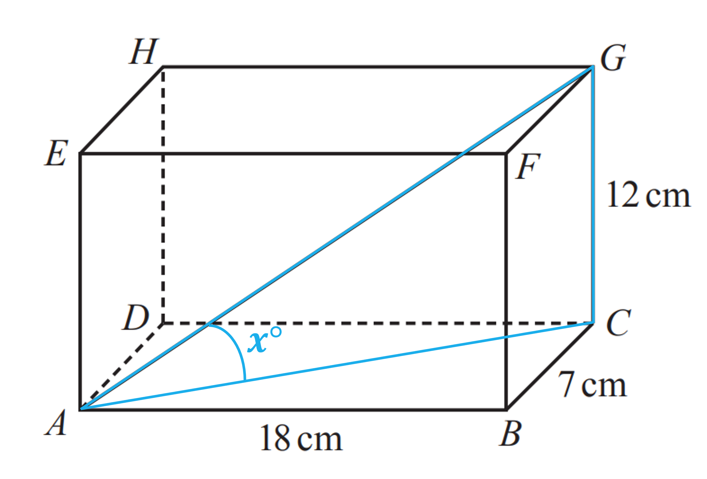

*To find angle *$x$* using right-angled trigonometry (SOHCAHTOA) we need to first find another side*

> *We can find length *$AC$* by considering the right-angled triangle *$ABC$* and using Pythagoras*

$AC=\sqrt{18^{2}+7^{2}}=\sqrt{373}$

**[2]**

> *Considering the right-angled triangle *$ACG$

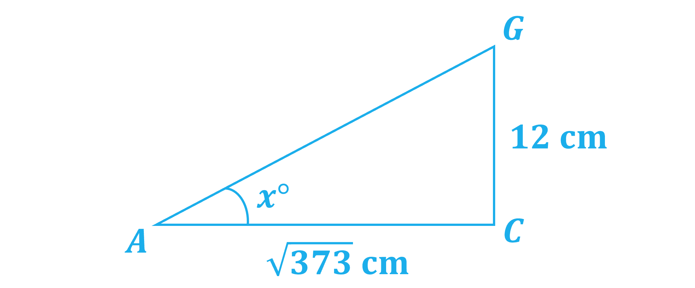

> *We want to find an angle, and we know the opposite and the adjacent, so we can use the tan ratio; *$\mathrm{tan}θ=\frac{\mathrm{opposite}}{\mathrm{adjacent}}$

$\mathrm{tan}x=\frac{12}{\sqrt{373}}$

**[1]**

> *Using inverse tan (usually shift and tan on your calculator)*

`x equals tan to the power of negative 1 end exponent open parentheses fraction numerator 12 over denominator square root of 373 end fraction close parentheses equals 31.85419091...`

$31.9^{\circ}$ **[1]**

**Angles should be rounded to 1 decimal place**

### Q30
i) *The angle **CAB **is opposite the side **BC **and adjacent to the side **AB**, so use the tan ratio.  *

`table attributes columnalign right center left columnspacing 0px end attributes row cell tan space C A B space end cell equals cell fraction numerator B C over denominator A B end fraction end cell row cell tan space C A B space end cell equals cell space 5 over 8 end cell end table`

**[1]**

> *Use the tan**-1 **button on your calculator to find the angle.*

`table row cell C A B space end cell equals cell space tan to the power of negative 1 end exponent open parentheses 5 over 8 close parentheses end cell row blank equals cell space 32.0053... end cell end table`

**Angle ****CAB ****= 32.0° (1 d.p.) ****[1]**

ii) *The angle **GAC **is opposite the side **CG. **The hypotenuse is the diagonal **AG**, so use the sine ratio. *

> *Use the unrounded version of your answer for **AG **from part (b).  *

`table row cell sin space G A C space end cell equals cell fraction numerator G C over denominator A G end fraction end cell row cell sin space G A C space end cell equals cell space fraction numerator 11 over denominator square root of 210 end fraction end cell end table`

**[1]**

> *Use the sin**-1 **button on your calculator to find the angle.  *

`table row cell G A C space end cell equals cell space sin to the power of negative 1 end exponent open parentheses fraction numerator 11 over denominator square root of 210 end fraction close parentheses end cell row blank equals cell space 49.3824... end cell end table`

**Angle ****GAC ****= 49.4° (1 d.p.) ****[1]**

### Q31
i) *Considering a diagram may help.*

> * *

> * *

> *EH **= **FG** so the trapezium is isosceles and has a line of symmetry through the centre.  Hence, **EY **=** XF **= ½(8 - 5) = 1.5 cm.*

**EX**** = 8 - ½(8 - 5) = 6.5 cm ****[1]**

ii) *Consider the diagram, **AEX** is a right-angled triangle where **AE **= 12 cm, **EX** = 6.5 cm.*

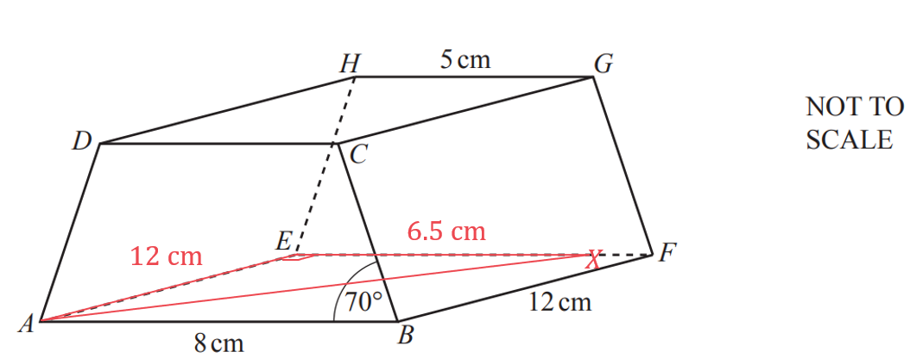

> *  *

> *Use Pythagoras'  theorem to find **AX.*

$AX^{2}=AE^{2}+EX^{2}\,AX^{2}=12^{2}+6.5^{2}$

**[1]**

> *Solve.*

`table row cell A X to the power of space end cell equals cell square root of 12 squared space plus space 6.5 squared end root end cell row blank equals cell space 13.64734... end cell end table`

**AX **** = 13.6 cm (3 s.f.)****  [1]**

iii) *Draw the line from **A** to **G** and use it to form a right-angled triangle on the diagram. *

> * Use the perpendicular height, **h**, and the point **X** to help.*

**[1]**

> *Angle **GAX  **is needed so use the triangle formed by the points **G, A **and **X**. **GX** = **h** = 4.121216... cm.*

> *AX** = 13.64735... cm.*

> *The sides opposite and adjacent to the angle are known so use the tan ratio.  *

`table row cell tan space G A X space end cell equals cell fraction numerator space G X over denominator A X end fraction end cell row blank equals cell fraction numerator space 4.121216... over denominator 13.64735 end fraction end cell row blank equals cell space 0.301979... end cell end table`

> *Use the tan**-1** button to find the answer.*

`table row cell tan space G A X space end cell equals cell space 0.301979... end cell row cell G A X space end cell equals cell space tan to the power of negative 1 end exponent open parentheses 0.301979... close parentheses space end cell end table`

**Angle ****GAX****  = 16.8°**** [1]**
