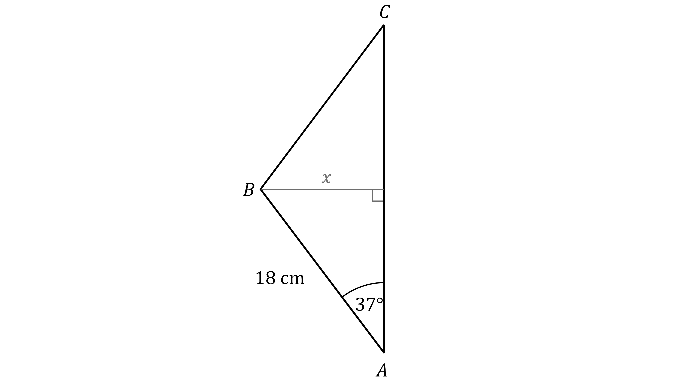
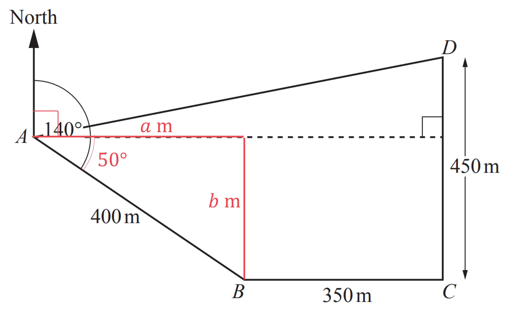
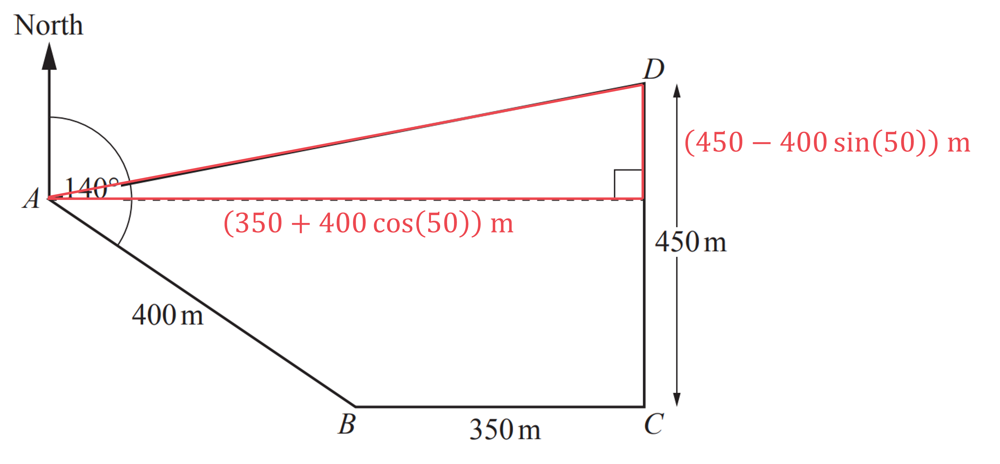
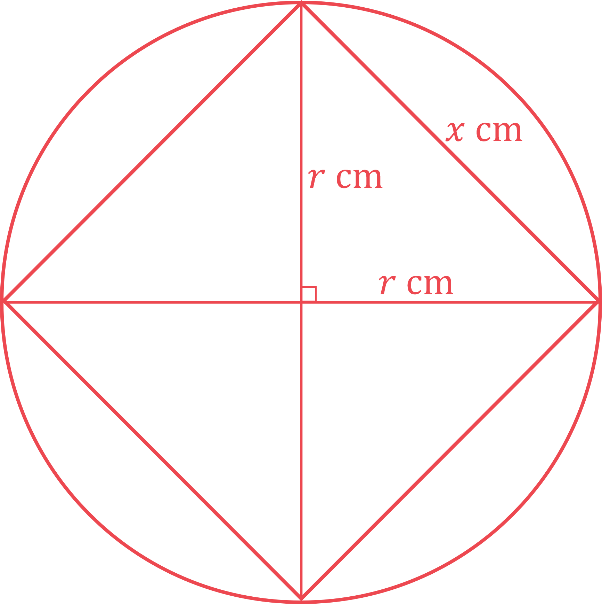
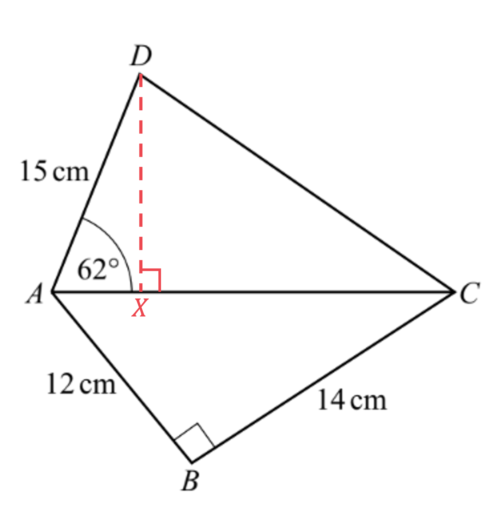
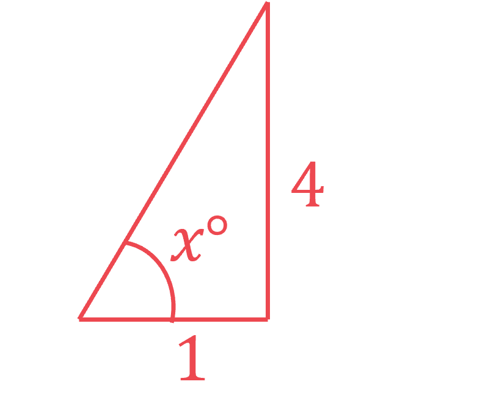
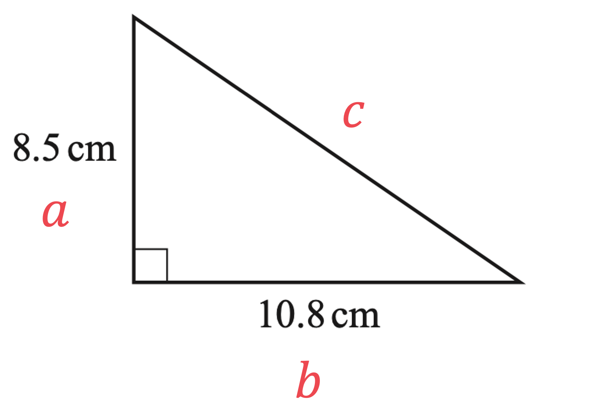

# Mark Schemes — Right-Angled Triangles (Pythagoras & Trigonometry)
**Pythagoras & Trigonometry** · Cambridge (CIE) IGCSE maths (0580 & 0980)

## Calculator Questions (38 questions)

### Q1
Start by finding the hypotenuse of the triangle using Pythagoras' theorem

- The two equal sides are 7 cm each, so the hypotenuse is

$\sqrt{7^{2}+7^{2}}=\sqrt{98}=9.899494...\mathrm{cm}$

**[M1]**

Now you can start finding the surface area

- There are the two triangular faces on the ends

  - Use $\mathrm{Area}=\frac{1}{2}\times\mathrm{base}\times\mathrm{height}$
  
    - where base and height are both equal to 7 cm
  - Multiply by 2 because there are two of them

$2 \times ( 1 \frac{1}{2} \times 7 \times 7 ) = 49 cm^{2}$

**[M1]**

- There are also three rectangular faces

  - All have a length of 18 cm
  
    - Two have a width of 7 cm
    - One has a width of $\sqrt{98}=9.899494...$ cm
  - Use $\mathrm{Area}=\mathrm{length}\times\mathrm{width}$

$2 \times ( 18 \times 7 ) + 18 \times 9.899494... = 430.190908... cm^{2}$

**[M1]**

Add those together to get the total surface area

$49+430.190908...=479.190908...\mathrm{cm}^{2}$

Round to a sensible degree of accuracy

- In general you should round to 3 significant figures, unless a question says otherwise

**Final answer:** **479 cm****2**** (3 s.f.)**

**[A1]**

> **[mark-scheme]**
> **M1**: For using Pythagoras' theorem to find the hypotenuse of the right-angled triangle.
> 
> **M1**: For a correct method to find the area of the triangular faces.
> 
> **M1**: For a correct method to find the area of the rectangular faces.
> 
> **A1**: For 479 or  479.1 to 479.2.

### Q2
The shortest distance from $B$ to $AC$ forms a right angle with $AC$

That creates a right-angled triangle in which

- $x$ is opposite to the 37° angle
- and the hypotenuse is 18 cm

Use the sine ratio 'SOH' from SOHCAHTOA

$\mathrm{sin}37=\frac{x}{18}$

**[M1 M1]**

Solve for $x$

$\begin{gathered} x = 18 \times \sin 37 \\ = 10.832670... \end{gathered}$

Round to a sensible degree of accuracy

- In general you should round to 3 significant figures, unless a question says otherwise

**Final answer:** **10.8 cm (3 s.f.)**

**[A1]**

> **[mark-scheme]**
> **M1**: For recognition seen or implied of what the 'shortest distance' is. This could include a sketch, or an annotation of the diagram from the question.
> 
> **M1**: For $\mathrm{sin}37=\frac{\mathrm{distance}}{18}$. This formula alone earns both 'M' marks.
> 
> **A1**: For 10.8, or 10.83... . You don't need to include units to get this mark.

### Q3
> *Using and rearranging Pythagoras' theorem*

$a^{2}+b^{2}=c^{2}\,21^{2}+YZ^{2}=29^{2}\,YZ^{2}=29^{2}-21^{2}$

**[M1]**

$YZ=\sqrt{29^{2}-21^{2}}=20$

$YZ=20\mathrm{cm}$

**[A1]**
> **[exam-tip]**
> You can use any trig ratio. However, it's best to use the numbers given in the question.

> *Identify the corresponding sides*

$\begin{gathered} \text{adjacent} = 21 \\ \text{hypotenuse} = 29 \end{gathered}$

> *Substituting these values into the cos ratio*

$\cos ( X ) = \frac{21}{29}$

**[M1]**

> *Use the inverse of cos to work out the value of *$x$

$X = \cos ^{- 1} ( \frac{21}{29} )
X = 43.602...$

> *Round to 1 decimal place*

$X=43.6^{\circ}$

**[A1]**

### Q4
> *It is a right angled triangle with an angle (**θ**) so you can use trigonometry. Angle **RPQ** is the angle in the triangle at **P**. You know the length of the hypotenuse (**H**) and the length of the side that is adjacent (**A**) to the angle. Therefore you can use the cos ratio: *$\mathrm{cos}θ=\frac{A}{H}$*.*

$\cos ( \\theta ) = \frac{17}{25}$

**[1]**

> *Use the inverse cos function to get **θ** by itself.*

$\begin{gathered} \\theta = \cos ^{- 1} ( \frac{17}{25} ) \\ = 47.156356... \end{gathered}$

**[1]**

> *Round to 1 decimal place. Remember to include the units for the angle.*

$\mathrm{Angle}RPQ=47.2^{\circ}(1\mathrm{dp})$ **[1]**

### Q5
> *Using Pythagoras' theorem, *$a^{2}+b^{2}=c^{2}$*, side **AC** is given by*

$2.8^{2} + 1.6^{2} = ( A C )^{2}$

**[1]**

$\begin{array}{rcl} A C & = \sqrt{10.4} \\ = 3.224903... \end{array}$

**AC = 3.22 m*** ***[1]**

### Q6
> *It is a right angled triangle with an angle (**θ**) so you can use trigonometry. You know the length of the hypotenuse (**H**) and you want the length of the side that is opposite (**O**) the angle. Therefore you can use the sin ratio: *$\mathrm{sin}θ=\frac{O}{H}$*.*

$\sin ( 23 ) = \frac{A B}{15}$

**[1]**

> *Multiply both sides by 15 to get **AB** by itself.*

$\begin{gathered} A B & = 15 \times \sin ( 23 ) \\ = 5.860966... \end{gathered}$

> *Round to 3 significant figures. Remember to include the units for the length.*

$AB=5.86\mathrm{cm}(3\mathrm{sf})$** ****[1]**

### Q7
> *Draw a horizontal to split the shape into a rectangle and a right angled triangle. Subtract the vertical lengths to find the height of the triangle.*

> *It is a right angled triangle so you can use Pythagoras' Theorem: *$a^{2}+b^{2}=c^{2}$*, where **c** is the length of the hypotenuse and **a** and **b **are the lengths of the other two sides.*

$\begin{array}{rcl} 10^{2} + 7^{2} & = x^{2} \\ 100 + 49 & = x^{2} \\ 149 = x^{2} \end{array}$

**[1]**

> *Take the positive square root of both sides. Leave as a surd.*

$\begin{array}{rcl} x = \sqrt{149} \end{array}$

**[1]**

> *Add together the lengths around the shape to find the perimeter.*

$\begin{array}{rcl} 11 + 10 + 18 + \sqrt{149} \end{array}$

**[1]**

$\begin{array}{rcl} 39 + \sqrt{149} & = 51.206555... \end{array}$

**[1]**

> *Compare the perimeter to 50 m to decide whether the farmer has enough fence.*

**51.2... m > 50 m**** so the farmer does ****not**** have enough fence ****[1]**

### Q8
> *Method 1 *

> *The smallest angle is the angle between "*$2x-3$*" and *$6$*.  We have a right-angle triangle, *$x$* (or 3.82) is opposite the required angle and *$6$* is the hypotenuse. So we can use the sine ratio, *$\mathrm{sin}θ=\frac{\mathrm{opposite}}{\mathrm{hypotenuse}}$*.*

$\mathrm{sin}θ=\frac{3.82}{6}$

**[1]**

> *Inverse sine to find the angle.*

$\begin{gathered} \\theta = \sin ^{- 1} ( \frac{3.82}{6} ) \\ = 39.54370792...^{\circ} \end{gathered}$

> *Give angles in degrees to 1 decimal place.*

**Final answer:** **Angle = 39.5° **

*final answer between 39.3° and 39.5° depending on rounding of x value***  ****[1]**

> *Method 2 *

> *The smallest angle is the angle between "*$2x-3$*" and *$6$*. Evaluate "*$2x-3$*" by substituting *$x=3.82$*.*

$2\times3.82-3=4.64$

> *We have a right-angle triangle, *$2x-3$* (or 4.64) is adjacent to the angle and *$6$* is the hypotenuse. So we can use the cosine ratio, *$\mathrm{cos}θ=\frac{\mathrm{adjacent}}{\mathrm{hypotenuse}}$*.*

$\mathrm{cos}θ=\frac{4.64}{6}$

**[1]**

> *Inverse cosine to find the angle.*

$\begin{gathered} \\theta = \cos ^{- 1} ( \frac{4.64}{6} ) \\ = 39.34582977...^{\circ} \end{gathered}$

> *Give angles in degrees to 1 decimal place.*

**Angle = 39.3°  ****[1]**

*final answer between 39.3° and 39.5° depending on rounding of x value  ***[1]**

### Q9
> *Split the 140° angle at **A** into a right angle and a 50° angle. *

> *You can then form a right angled triangle using the 50° angle and the side **AB** as the hypotenuse. *

> *Label the side adjacent to the 50° as **a** and the side opposite as **b**.*

> *You can find the values of **a **and **b** using the trig ratios: *$\sin ( 50 ) = \frac{Opposite}{Hypotenuse}$* and *$\text{cos} ( 50 ) = \frac{Adjacent}{Hypotenuse}.$

$\begin{gathered} \sin ( 50 ) & = \frac{b}{400} \\ \cos ( 50 ) & = \frac{a}{400} \end{gathered}$

*1 mark for each correct equation*** [2]**

> *Rearrange both equations by multiplying both sides by 400. Leave the values for **a** and **b** in exact form to avoid rounding errors.*

$\begin{gathered} a = 400 \cos ( 50 ) \\ b = 400 \sin ( 50 ) \end{gathered}$

> *You can then form a right angled triangle using **AD **as the hypotenuse and the right angle given in the diagram. *

> *The horizontal length can be found by adding **a **to 350 m.*

*The vertical length can be found by subtracting **b** from 450 m.*

*Correct expression for horizontal length*** [1]*** *

*Correct expression for vertical length*** [1]**

> *You can then use Pythagoras' theorem *$c^{2}=a^{2}+b^{2}$* to find the length of **AD**.*

$A D^{2} = ( 350 + 400 \cos ( 50 ) )^{2} + ( 450 - 400 \sin ( 50 ) )^{2}$

**[1]**

> *Square root both sides of the expression.*

$A D = \sqrt{( 350 + 400 \cos ( 50 ) )^{2} + ( 450 - 400 \sin ( 50 ) )^{2}}$

> *Type the expression in your calculator.*

$AD=623.8625...$

> *Round to 3 significant figures.*

$AD=624m$** ****[1]**

### Q10
*The diagonal splits the rectangle into two right-angled triangles.*

> *Because it is a right-angled triangle and you know the lengths of two of the sides, you can use Pythagoras' theorem to work out the length of the third side (the diagonal).*

> *Substitute the values from the diagram into Pythagoras' theorem, *$c^{2}=a^{2}+b^{2}$*.*

$c^{2}=5.6^{2}+8.5^{2}$

**[1]**

> *Simplify the right hand side.*

$c^{2}=103.61$

> *Find the value of *$a$* by taking the square root of both sides.*

$\begin{array}{rcl} c = \sqrt{103.61} \end{array}$

**[1]**

$\begin{array}{rcl} c = 10.1788... \end{array}$

> *Round to 1 decimal place.*

$c=10.2\mathrm{cm}$* ***[1]**

### Q11
> *OB **is at a right-angle to **AC** (a tangent meets a radius at a right-angle) so SOHCAHTOA can be used in the two right-angled triangles **AOB** and **BOC.*

**[1]**

*Find angle **AOB** (using the tan ratio because the opposite and adjacent sides are known).* * *

`equation`

**[1]**

$A O B = \tan ^{- 1} ( \frac{15}{8} ) = 61.92...^{\circ}$ * *

*Find angle** BOC** (also using the tan ratio).* * *

$\tan ( B O C ) = \frac{22.4}{8}$

**[1]**

$B O C = \tan ^{- 1} ( \frac{22.4}{8} ) = 70.34...^{\circ}$ * *

*Find angle **XOY**  by adding angle **AOB** to angle** BOC.**  *

$61.92...^{\circ}+70.34...^{\circ}$

*At least one correct*** [1]**

** **$132.3^{\circ}$ **[1]**

**The range 132.26 to 132.28 is also accepted**

### Q12
> *Draw a line down the middle of the triangle to split the shape into two identical right angled triangles. The length of this line will be the height of the original triangle and can be used to find the area.*

> *The new triangle is a right angled triangle with an angle (**θ**) so you can use trigonometry. You know the length of the side that is adjacent (**A**) to the angle and you want the length of the side that is opposite (**O**) the angle. Therefore you can use the tan ratio: *$\mathrm{tan}θ=\frac{O}{A}$*.*

$\tan ( 54 ) = \frac{x}{6}$

**[1]**

> *Multiply both sides by 6.*

$\begin{gathered} x = 6 \times \tan ( 54 ) \\ = 8.258291... \end{gathered}$

**[1]**

> *You can now find the area of the triangle using the formula *$A=\frac{1}{2}\timesb\timesh$*, where **b** is the length of the base and **h** is the length of the perpendicular height. Use the answer button or store the height in your calculator's memory.*

$\begin{gathered} \text{Area} = 1 \frac{1}{2} \times 12 \times 8.258291... \\ = 49.549749... \end{gathered}$

**[1]**

> *Round to 3 significant figures. Remember to include square units for the area.*

$\mathrm{Area}=49.5\mathrm{cm}^{2}(3\mathrm{sf})$* ***[1] **

**This can also be done using the sine rule**

### Q13
> *You need to find the hypotenuse, using Pythagoras' theorem, *$a^{2}+b^{2}=c^{2}$*.*

$AC^{2}=2.5^{2}+4.1^{2}$

**[1]**

$\begin{gathered} A C & = \sqrt{2.5^{2} + 4.1^{2}} \\ = \sqrt{23.06} \end{gathered}$

$AC=4.80$** ****or **$4.802...$*  ***[1]**

**Answers to at least 3 significant figures- don't round to "4.8"!**

### Q14
> *The missing side *$DE$* can be found using Pythagoras, *$c^{2}=a^{2}+b^{2}$*, as triangle *$ADE$* is right-angled with *$DE$* as the hypotenuse.*

$( D E )^{2} = 50^{2} + 120^{2}$

Take the square root of both sides.

$\begin{gathered} D E & = \sqrt{50^{2} + 120^{2}} \\ = 130 \mathrm{m} \end{gathered}$

> *The missing side *$CD$* can also be found using Pythagoras, as triangle *$BCD$* is right-angled with *$BC$* as the hypotenuse.*

$CD=\sqrt{170^{2}-150^{2}}=80m$

*Correct method for either DE or CD*** [1]**

*Correct value for DE** ***[1]**

*Correct value for CD*** [1]**

> *Find the perimeter (total distance around the outer edge).*

$100+50+130+80+170$

$530m$ **[1]**

### Q15
> *Draw a sketch. Label the radius **r**. The diagonals of a square are perpendicular.*

> *Form an equation using the area of the circle.*

$π\timesr^{2}=49$

**[1]**

> *Rearrange to make **r** the subject.*

`| r ^2 | = 49 / pi | | r = sqrt( 49 / pi ) | |`

> *You can form a right angled triangle using one side of the square and two radii. The length of the square is the hypotenuse of the triangle, you can use Pythagoras' theorem.*

$\begin{gathered} r^{2} + r^{2} & = x^{2} \end{gathered}$

**[1]**

`| ( sqrt( 49 / pi ) ) ^2 + ( sqrt( 49 / pi ) ) ^2 | = x ^2 | | 49 / pi + 49 / pi | = x ^2 | | 98 / pi | = x ^2 | |`

**[1]**

> *Take the positive square root of both sides.*

`| x = sqrt( 98 / pi ) | | _ = 5.585191... | |`

> *Round to 3 significant figures.*

$x=5.59(3\mathrm{sf})$* ***[1]**

### Q16
> *Find the diagonal length **DB**. **DCB** is a right angled triangle so you can use Pythagoras' Theorem: *$a^{2}+b^{2}=c^{2}$*, where **c** is the length of the hypotenuse and **a** and **b **are the lengths of the other two sides.*

$\begin{array}{rcl} D C^{2} + C B^{2} & = D B^{2} \\ 60^{2} + 200^{2} & = D B^{2} \\ 43600 = D B^{2} \end{array}$

**[1]**

> *Take the positive square root of both sides. Leave as a surd.*

$\begin{array}{rcl} D B & = \sqrt{43600} \\ = 20 \sqrt{109} \end{array}$

**[1]**

> *Add together the lengths of the 5 rods.*

$\begin{gathered} 60 + 200 + 60 + 200 + 20 \sqrt{109} & = 520 + 20 \sqrt{109} \\ = 728.806... \text{cm} \end{gathered}$

> *Convert to metres by dividing by 100.*

$\begin{gathered} 728.806... \div 100 & = 7.28806... \mathrm{m} \end{gathered}$

> *Multiply by 0.9 to find the total mass of the framework in kilograms.*

$0.9\times7.28806...=6.55925...\mathrm{kg}$

**[1]**

> *Round to 3 significant figures.*

$6.56\mathrm{kg}(3\mathrm{sf})$* ***[1]**

### Q17
> *Point **D** will be closest to point **B** when **BD** is perpendicular to **AC**. *

> *Because **ABD** is a right angled triangle, you can use simple trigonometry to find the length **AD**.*

> *You know the hypotenuse and you want to find the length of the adjacent side, so use the cos ratio.*

$\mathrm{cos}82.8=\frac{AD}{120}$

**[1]**

> *Multiply both sides by 120.*

$15.039988...=AD$

$15$ **m** **[1]**

**Answers between 14.99 and 15.04 will be accepted.**

### Q18
> *It is a right angled triangle so you can use Pythagoras' Theorem: *$a^{2}+b^{2}=c^{2}$*, where **c** is the length of the hypotenuse and **a** and **b **are the lengths of the other two sides.*

$\begin{gathered} A B^{2} + B C^{2} & = A C^{2} \\ 39^{2} + 70^{2} & = A C^{2} \\ 6421 = A C^{2} \end{gathered}$

**[1]**

> *Take the positive square root of both sides.*

$\begin{gathered} A C & = \sqrt{6421} \\ = 80.131142... \end{gathered}$

**[1]**

> *Round to 1 decimal place. Remember to include the units for the length.*

$AC=80.1\mathrm{cm}(1\mathrm{dp})$ **[1]**

### Q19
*This is a right-angled triangle and any out of sin, cos or tan can be used here*

> *For example, find the tan ratio (using the opposite and adjacent sides).*

$\begin{gathered} \tan \\theta & = \frac{O p p}{A d j} \\ \tan ( X A B ) & = \frac{6}{8} \end{gathered}$

**[1]**

*Find the angle (by applying inverse tan to both sides).* * *

$\begin{gathered} \text{angle} X A B & = \tan ^{- 1} ( \frac{6}{8} ) \\ = 36.869... \end{gathered}$

**36.9°**** ****[1]**

### Q20
> *Draw a right-angled triangle made from the height, radius and slant height of the cone. Use trigonometry to find the angle.*

> *From SOHCAHTOA we need CAH; *$\mathrm{cos}x^{\circ}=\frac{\mathrm{adj}}{\mathrm{hyp}}$*.*

$\mathrm{cos}x^{\circ}=\frac{1.65}{4.70}$

**[1]**

> *Rearrange and solve the trigonometric equation using inverse cosine.*

$x^{\circ} = \cos ^{- 1} ( \frac{1.65}{4.70} )
x^{\circ} = 69.447 602 ...$

**Angle the slant height makes with the base is 69.4° ****[1]**

### Q21
> *Calculate the length **CD** using SOHCAHTOA on the right-angled triangle **ACD**.*

*You know the adjacent side and you want to work out the opposite side so use *$\mathrm{tan}θ=\frac{Opp}{Adj}$*.*

$\begin{gathered} \tan 20 & = \frac{C D}{13} \end{gathered}$

**[1]**

$\begin{gathered} 13 \times \tan 20 & = C D \end{gathered}$

**[1]**

$\begin{array}{rcl} C D & = 4.7316... \end{array}$

> *Find the length **BD** by adding together the lengths **BC** and **CD**.*

$8+4.7316...=12.7316...$

> *Calculate the angle **BAD** by using SOHCAHTOA on the right-angled triangle **ABD**. *

> *You know the opposite side and the adjacent side so use *$\mathrm{tan}θ=\frac{Opp}{Adj}$* again.*

$\begin{gathered} \tan ( B A D ) & = \frac{12.7316...}{13} \end{gathered}$

**[1]**

$\begin{array}{rcl} B A D & = \tan ^{- 1} ( \frac{12.7316...}{13} ) \end{array}$

**[1]**

$\begin{gathered} B A D & = 44.4024... \end{gathered}$

> *Find the size of angle **BAC** by subtracting angle **CAD** from angle **BAD**.*

$44.4024...-20=24.4024...$

> *Round to 1 decimal place.*

**24.4****o**** ****[1]**

**Answers between 24.3 and 24.41 will be accepted**

### Q22
> *It is a right angled triangle with an angle (**θ**) so you can use trigonometry. You know the length of the hypotenuse (**H**) and the length of the side that is opposite (**O**) to the angle. Therefore you can use the sin ratio: *$\mathrm{sin}θ=\frac{O}{H}$*.*

$\sin ( x ) = \frac{5}{14}$

**[1]**

> *Use the inverse sin function to get **x** by itself.*

$\begin{gathered} x = \sin ^{- 1} ( \frac{5}{14} ) \\ = 20.924832... \end{gathered}$

> *Round to 1 decimal place. Remember to include the units for the angle.*

$x=20.9^{\circ}(1\mathrm{dp})$ **[1]**

### Q23
> *In triangle **BAC**, we have the opposite and adjacent sides to angle **BAC**. Therefore use the tangent ratio*

$\tan ( \text{angle} B A C ) = \frac{14}{12}$

**[1]**

> *Find angle **BAC** by inverse tangent (SHIFT-tan on your calculator) 14/12*

$\text{angle} B A C = \tan ^{- 1} ( \frac{14}{12} ) = 49.3987054...$

> *Give non-exact answers in degrees correct to one decimal place*

**Final answer:** **49.4° **

*49.4 or 49.39 to 49.40*** [1]**
> *The shortest distance from **D** to **AC** meets **AC** at a right angle*

*recognising that the shortest distance forms a right angle with AC*** ****[1]**

> *Triangle **DAX** is a right-angle triangle so we can use right-angle trigonometry to find **DX**, specifically the sine ratio*

$\mathrm{sin}62=\frac{DX}{15}$

**[1]**

> *Multiply both sides by 15 to find **DX**, the shortest distance from **D** to **AC*

$DX=15\mathrm{sin}62$

> *Be careful to enter '15sin62' or 'sin(62)×15' into your calculator but not 'sin(62×15)'*

*= 13.2442139...*

> *Round to at least 3 significant figures*

**13.2 cm**** **

*13.2 or 13.24...** ***[1]**

### Q24
> *Considering the right-angled triangle *$ABC$

> *As we know the hypotenuse and the angle, we can find the adjacent *$( A B )$* using the cosine ratio; *$\mathrm{cos}θ=\frac{\mathrm{adjacent}}{\mathrm{hypotenuse}}$*.*

$\cos ( 26 ) = \frac{A B}{76.7}$

**[1]**

> *Multiply both sides by 76.7.*

$76.7 \times \cos ( 26 ) = A B$

$AB=68.93750335...$

**[1]**

> *We can then find the length *$BD$

$68.93750335-58=10.93750335...$

**10.9 m*** ***[1]*** *

**Round to 3 significant figures**

### Q25
*As **M** is the midpoint of** AB**, **MB ** is half of 12, so **MB** = 6cm.*

> *Mark this and **OM** = 4.5 cm on the diagram.*

> *OB **is a radius of the circle.*

*As **M** is the midpoint of the chord, **OM** and **AB** are perpendicular, so triangle **OMB** is a right-angle triangle.*

> *So we can use Pythagoras' theorem, *$c^{2}=a^{2}+b^{2}$* to find **OB.*

$( O B )^{2} = 4.5^{2} + 6^{2}
O B = \sqrt{4.5^{2} + 6^{2}}$

*realising angle OMB is a right-angle (this can be implied by use of Pythagoras' theorem)*** [1] **

*correct use of  Pythagoras' theorem*** [1]**

$OB=7.5$

**7.5 cm ****[1]**

### Q26
> *The required angle *$BAE$* is marked on the diagram below.*

> *Triangle *$ACD$* is equilateral so all angles are 60°.*

*Angle* $DAC=60^{\circ}$

**[1]**

> *We can find angle *$DAE$* using right-angle trigonometry, SOHCAHTOA. We have the hypotenuse and the opposite sides so use sine.*

$\begin{gathered} \sin \\theta & = \frac{O p p}{H y p} \\ \sin ( \text{angle} D A E ) & = \frac{6}{12} \end{gathered}$

**[1]**

> *Take the inverse tan of both sides.*

$\begin{gathered} \text{angle} D A E & = \sin ^{- 1} ( \frac{6}{12} ) = 30^{\circ} \end{gathered}$

> *We can find angle *$BAC$* using right-angle trigonometry, SOHCAHTOA. We have the adjacent and the opposite sides so use tangent.*

$\begin{gathered} \tan \\theta & = \frac{O p p}{A d j} \\ \tan ( \text{angle} B A C ) & = \frac{6}{12} \end{gathered}$

**[1]**

> *Take the inverse tan of both sides.*

$\begin{gathered} \text{angle} D A C & = \tan ^{- 1} ( \frac{6}{12} ) = 26.56505118...^{\circ} \end{gathered}$

> *Now add the three found angles to get angle *$BAE$*. *

$\begin{gathered} \text{angle} B A E & = 60 + 30 + 26.56505118... = 116.56505118... \end{gathered}$

**Angle **$BAE=116.6^{\circ}$ **[1]**

**Give answers in degrees to at least one decimal place**
> *Triangle *$ABC$* is right-angled so we can find *$AB$* using Pythagoras' theorem, *$c^{2}=a^{2}+b^{2}$*, where we have two shorter sides, *$a$* and *$b$*.*

$\begin{array}{rcl} ( A B )^{2} & = 6^{2} + 12^{2} \end{array}$

**[1]**

> *Take the square root of both sides.*

$\begin{array}{rcl} A B & = \sqrt{6^{2} + 12^{2}} \\ = \sqrt{180} \\ = 13.41640786... \end{array}$

> *Give your final answer to at least 3 significant figures.*

$AB=13.4$** ****cm** **[1]**
> *Triangle *$AED$* is right-angled so we can find *$AE$* using Pythagoras' theorem, *$c^{2}=a^{2}+b^{2}$*, where we have the hypotenuse, *$c$* and a shorter side, *$a$*.*

$\begin{gathered} 12^{2} & = 6^{2} + ( A E )^{2} \end{gathered}$

**[1]**

$\begin{array}{rcl} ( A E )^{2} & = 12^{2} - 6^{2} \end{array}$

> *Take the square root of both sides.*

$\begin{gathered} A E & = \sqrt{12^{2} - 6^{2}} \\ = \sqrt{108} \end{gathered}$

**[1]**

> *Evaluate and give your final answer to at least 3 significant figures.*

$\begin{gathered} A E & = 10.39230485... \end{gathered}$

$AE=10.4$** ****cm** **[1]**

### Q27
> *The line *$AC$* has a gradient of 4, which means for every 1 unit right, it goes upwards by 4 units.*

> *We are trying to find the angle between the line and the **x**-axis (the horizontal) which has been marked *$x^{\circ}$*.*

> *As we know the opposite and the adjacent, we can use the tan ratio; *$\mathrm{tan}θ=\frac{\mathrm{opposite}}{\mathrm{adjacent}}$*.*

$\tan ( x ) = \frac{4}{1} 
\tan ( x ) = 4$

**[1]**

> *Use inverse tan (*$\mathrm{tan}^{-1}$*) on your calculator to find *$x$*.*

$x = \tan ^{- 1} ( 4 )$

$x=75.96375653...$

**76.0°** **[1]**

**Round angles to 1 decimal place**

### Q28
> $AD$* is a diameter so the radius is half of *$AD$*.*

> * Angle *$ACD$* is 90° because it is the angle in a semi-circle.*

> *Therefore *$AD$* is the hypotenuse of right-angle triangle *$ACD$*. We can use Pythagoras' theorem to find *$AD$* but we need to find *$AC$* first.*

> *Triangle *$ABE$* and triangle *$ACD$* are similar, and the scale factor is:*

$\frac{\mathrm{equivalent} \mathrm{longer} \mathrm{side}}{\mathrm{equivalent} \mathrm{shorter} \mathrm{side}}=\frac{CD}{BE}=\frac{18}{13.5}$

**[1]**

> *Multiplying the length of *$AB$* by the scale factor gives *$AC$*.*

$AC=21\times\frac{18}{13.5}=28$

**[1]**

> *Now we can use Pythagoras' theorem *$a^{2}+b^{2}=c^{2}$*.*

$28^{2}+18^{2}=AD^{2}$

**[1]**

> *Rearrange to get *$AD$*.*

$\begin{gathered} A D & = \sqrt{28^{2} + 18^{2}} \\ = 33.28663395... \end{gathered}$

**[1]**

> *The radius is half of *$AD$*.*

$\begin{gathered} r = ( 33.28663395... ) \div 2 \\ = 16.64331698... \end{gathered}$

> *Round the answer to at least 3 significant figures.*

**16.6 cm**** ****[1]**

### Q29
> *ABDF  **is a parallelogram so **DF **= **AB **= 9 cm.*

> *DEF ** is a right-angled triangle so right-angled trigonometry (SOHCAHTOA) can be used to find the height, **h**. *

> *The hypotenuse and the angle opposite the height are known, so use the sin ratio.*

> *  *$\mathrm{sin}θ=\frac{\mathrm{Opp}}{\mathrm{Hyp}}\,\mathrm{sin}80^{\circ}=\frac{h}{9}$

**[1]**

**   ***Solve by multiplying both sides by 9.  *

$\begin{gathered} 9 \sin 80^{\circ} & = h \\ h & = 9 \sin 80^{\circ} \\ = 8.86326... \end{gathered}$

$h=8.86$* ***cm (3 s.f.) ****[1]**

### Q30
*We know the angle, and the hypotenuse, and want to find the opposite side.*

> *So we will use the sine ratio:  *$\text{sin}θ=\frac{\text{opposite}}{\text{hypotenuse}}$*, substitute in the values and then rearrange to find the missing value.*

$\begin{gathered} \text{\sin } ( 35^{\circ} ) & = \frac{x}{12} \end{gathered}$

**[1]**

$\begin{gathered} x = 12 \times \text{\sin } ( 35^{\circ} ) \\ x = 6.882917236... \end{gathered}$

$x=6.88\text{cm}$ **[1]**

**Round to 3.s.f for final answer **
**6.882 to 6.883 allowed**

### Q31
*The shortest distance from point **B** to side **AC** is a perpendicular line.* *This line is the (perpendicular) height of the triangle when **AC** is the base.* *We can find the height by considering the area of the triangle in two different ways.*

*1. Using* $"A=\frac{1}{2}bh"$

$\mathrm{Area} \mathrm{of}\DeltaABC=\frac{1}{2}\times115\timesh=57.5h$

**[1]**

*2. Using* $"A=\frac{1}{2}bc\mathrm{sin}A"$

$\mathrm{Area} \mathrm{of}\DeltaABC=\frac{1}{2}\times115\times80\times\mathrm{sin}72^{\circ}=4600\mathrm{sin}72^{\circ}$

> *These two areas are equal so we can form an equation for **h**.*

$\begin{gathered} 57.5 h & = 4600 \sin 72^{\circ} \\ h = 76.084 521 ... \end{gathered}$

**[1]**

> *This height is the shortest distance between point **B** and **AC**.*

**Shortest distance from point ****B**** to ****AC**** is 76.1 m (3 s.f.)*** ***[1]**

### Q32
*First find the length of the diagonal side using Pythagoras' theorem *$( a^{2} + b^{2} = c^{2} )$*.* *It may help to label the diagram first.*

$8.5^{2}+10.8^{2}=c^{2}$

**[1]**

$\begin{gathered} c^{2} & = 188.89 \\ c = 13.743725... \end{gathered}$

> *Do not round but store the number using your calculator's memory to keep accuracy. *

> *Add up the three sides to find the perimeter.*

$P=8.5+10.8+13.743725...$

**[1]**

$P=33.043725...$

> *Round to a suitable degree of accuracy*

- *If a question doesn't say otherwise, 3 significant figures is usually a good choice*

**33.0 cm**** [1]**

### Q33
*The volume of a prism is the area of its cross section multiplied by its length.*

*Find the area of the triangular cross section (using *$\frac{1}{2}\times$*base*$\times$*height).* * *

*area of the cross section = *$\frac{1}{2}\times6\timesh$

**[1]**

*Find the volume of the prism (by multiplying the area of the cross section by 18).* * *

*volume of the prism = *$\frac{1}{2}\times6\timesh\times18$ * *

*Form an equation for *$h$* (by setting the volume of the prism equal to 253.8).* * *

$\frac{1}{2}\times6\timesh\times18=253.8$

**[1]**

*Write *$\frac{1}{2}\times6\times18$* as 54 and solve the equation (by dividing by 54).*

$54h=253.8\,h=\frac{253.8}{54}$

$h=4.7$ **[1]**
> *The cross-section is a right angle triangle. The sides that are adjacent and opposite *$x$* are known so use the tan ratio. *

> *Write out the correct tan ratio (using *$\mathrm{tan}x=\frac{\mathrm{opp}}{\mathrm{adj}}$*).*

$\mathrm{tan}x=\frac{4.7}{6}$

**[1]**

*Find *$x$* (by taking inverse tan of both sides).* * *

$x = \tan ^{- 1} ( \frac{4.7}{6} )
x = 38.0727...$ * *

> *As it is an angle, round to 1 decimal place.*

$x=38.1^{\circ}$ **[1]**
*Calculate the length of the diagonal on the triangle face (using Pythagoras' Theorem, *$a^{2}+b^{2}=c^{2}$*).* * *

$\begin{gathered} c^{2} & = 6^{2} + 4.7^{2} \\ c = \sqrt{6^{2 } + 4.7^{2}} \end{gathered}$

$6^{2}+4.7^{2}$** ***correct*** ****[1]**

*Correct with square root*** ****[1]**

*The total surface area is the sum of individual areas from five different faces.* *Draw lengths on the diagram (to help see the areas).*

*Find the area of the triangle face at the front (area of a triangle = *$\frac{1}{2}\times$*base*$\times$*height).* * *

$\frac{1}{2}\times6\times4.7$ * *

> *This is the same area as the triangle face at the back.*

*Triangle area for front and back*** [1]**

*Find the area of the rectangular face on the side (using length*$\times$*width).* * *

$4.7\times18$

**[1]**

> *Find the area of the rectangular face on the top (using length *$\times$*width).*

> * *

$\sqrt{6^{2}+4.7^{2}}\times18$

* Find the area of the rectangular face on the bottom (using length width).* * *

$6\times18$

**[1]**

*Find the total surface area (by adding together the five individual areas).* * *

$( 1 \frac{1}{2} \times 6 \times 4.7 ) + ( 1 \frac{1}{2} \times 6 \times 4.7 ) + ( 4.7 \times 18 ) + ( \sqrt{6^{2} + 4.7^{2}} \times 18 ) + ( 6 \times 18 ) = 357.9902...$

**358 cm****2** **[1]**

### Q34
> *It is an isosceles triangle so you can draw a vertical line down from **Q** to split it into two identical right angled triangles.*

> *The new triangle is a right angled triangle with an angle (**θ**) so you can use trigonometry. You know the length of the hypotenuse (**H**) and you want the length of the side that is opposite (**O**) the angle. Therefore you can use the sin ratio: *$\mathrm{sin}θ=\frac{O}{H}$*.*

$\sin ( 70 ) = \frac{x}{8}$

> *Multiply both sides by 8.*

$\begin{gathered} x = 8 \times \sin ( 70 ) \\ = 7.517540... \end{gathered}$

**[1]**

> *This is half the length of **PR**. So double this value. Use the answer button.*

$\begin{gathered} 2 \times 8 \times \sin ( 70 ) & = 2 \times 7.517540... \\ = 15.035081... \end{gathered}$

**[1]**

> *Round your answer to 3 significant figures. Remember to include the units for the length.*

$PR=15.0\mathrm{cm}(3\mathrm{sf})$ **[1]**

### Q35
> *It is a right angled triangle with an angle (**θ**) so you can use trigonometry. You know the length of the hypotenuse (**H**) and the length of the side that is adjacent (**A**) to the angle. Therefore you can use the cos ratio: *$\mathrm{cos}θ=\frac{A}{H}$*.*

$\cos ( \\theta ) = \frac{7}{11}$

**[1]**

> *Use the inverse cos function to get **θ** by itself.*

$\begin{gathered} \\theta = \cos ^{- 1} ( \frac{7}{11} ) \\ = 50.478803... \end{gathered}$

> *Round to 1 decimal place. Remember to include the units for the angle.*

$\mathrm{Angle}ABC=50.5^{\circ}(1\mathrm{dp})$ **[1]**
> *The hypotenuse has changed to 10 but the adjacent side has remained the same. You can still use *$\mathrm{cos}θ=\frac{A}{H}$*.*

$\cos ( A B C ) = \frac{7}{10}$

$\mathrm{cos}(ABC)$** has ****increased**** as **$\frac{7}{10}>\frac{7}{11}$**[1]**

### Q36
> *It's a good idea to start this question by sketching the information as below.*

> *Hopefully you can see that the points form a right-angle triangle. We could add a point **C** to help visualise this.*

> * Considering the difference between the **y**-coordinates, we can see that *$BC=5$*and by considering the **x**-coordinates, *$AC=1$*.** We need to find angle *$BAC$* in a right angle triangle and we know the adjacent and opposite side lengths. So we can use trigonometry tangent ratio!*

$\tan ( B A C ) = \frac{5}{1}$

*Recognising that we need to use tangent ratio ***[1] **

*Applying tangent ratio correctly*** ****[1]**

> *Remember to inverse tangent ("SHIFT tan" or "tan**-1**" on the calculator).*

$78.7^{\circ}$** [1]**

**Give answers in degrees to 1 decimal place**

### Q37
> *The shortest distance from *$A$* to *$BD$* will be the perpendicular line directly from *$A$* to *$BD$*.*

> *Add the line to the diagram and consider the right angled triangle formed by the line.*

> *Use right-angled trigonometry (SOHCAHTOA) to find the length of the line *$AX$*.*

> *The hypotenuse is known and the side opposite the known angle is needed so use  *$\mathrm{sin}θ=\frac{O}{H}$*.*

$\mathrm{sin}40=\frac{AX}{55}$

**[1]**

> *Rearrange to find *$AX$*.*

$\begin{gathered} A X & = 55 \sin 40^{\circ} \\ = 35.3533... \end{gathered}$

$AX=35.4m(3s.f.)$* ***[1]**

> * *

### Q38
> *It is a right angled triangle with an angle (**θ**) so you can use trigonometry. You know the length of the hypotenuse (**H**) and the length of the side that is adjacent (**A**) to the angle. Therefore you can use the cos ratio: *$\mathrm{cos}θ=\frac{A}{H}$*.*

$\cos ( x ) = \frac{6.4}{9.6}$

**[1]**

> *Use the inverse cos function to get **x** by itself.*

$\begin{gathered} x = \cos ^{- 1} ( \frac{6.4}{9.6} ) \\ = 48.189685... \end{gathered}$

**[1]**

> *Round to 1 decimal place.*

$x=48.2(1\mathrm{dp})$ **[1]**
