# Exam Questions — Right-Angled Triangles (Pythagoras & Trigonometry)
**Pythagoras & Trigonometry** · Cambridge (CIE) IGCSE maths (0580 & 0980)
> Source: [https://www.savemyexams.com/igcse/maths/cie/25/extended/topic-questions/](https://www.savemyexams.com/igcse/maths/cie/25/extended/topic-questions/) · 38 questions across 1 sets

## Calculator Questions (38 questions)

### Q1 — hard — 4 marks

**Q1** [4 marks]

The cross-section of a prism is a right-angled isosceles triangle with its equal sides each being 7 cm.

The length of the prism is 18 cm.

Calculate the total surface area of the prism.

......................................... cm2

### Q2 — medium — 3 marks

**Q2** [3 marks]

**Extract:**

The diagram shows a quadrilateral, [A B C D], formed from two triangles, [A B C] and [A C D].

Angle BAC is 37°. AB=18 cm.

The diagram shows a quadrilateral, $ABCD$, formed from two triangles, $ABC$ and $ACD$.

Calculate the shortest distance from $B$ to $AC$.

.......................................... cm

### Q3 — medium — 4 marks

**Q3** [2 marks]

Calculate the value of the length $YZ$.

**Q3** [2 marks]

Find the interior angle at $X$.

### Q4 — medium — 3 marks

**Q4** [3 marks]

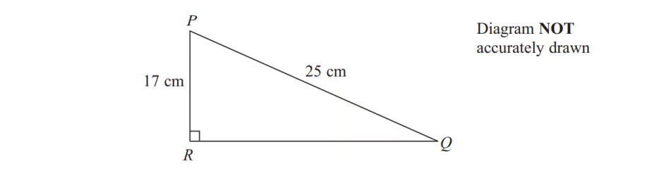

$PQR$is a right-angled triangle.

$PR$ = 17 cm

$PQ$= 25 cm

Work out the size of angle $RPQ$.

Give your answer correct to 1 decimal place.

*Source: March 2013 1MA0/2H Q13B*

### Q5 — medium — 2 marks

**Q5** [2 marks]

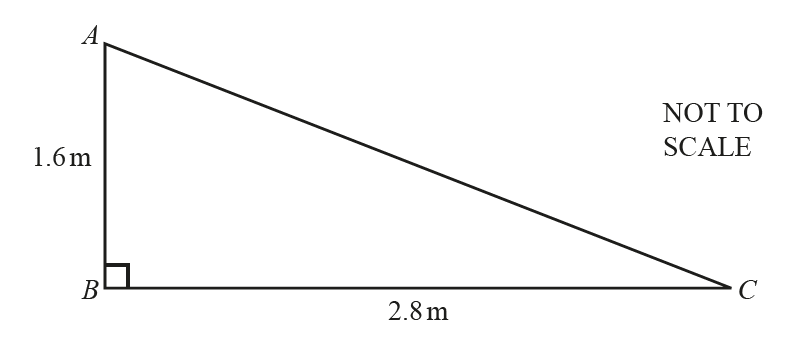

Calculate *AC*.

*AC* = .................................... m

*Source: 2018	Feb/Mar 0580/22 Q16B*

### Q6 — medium — 2 marks

**Q6** [2 marks]

$ABC$is a right-angled triangle.

Calculate the length of $AB$.

Give your answer correct to 3 significant figures.

*Source: June 2017 1MA1/3H Q7*

### Q7 — medium — 5 marks

**Q7** [5 marks]

Here is part of a field.

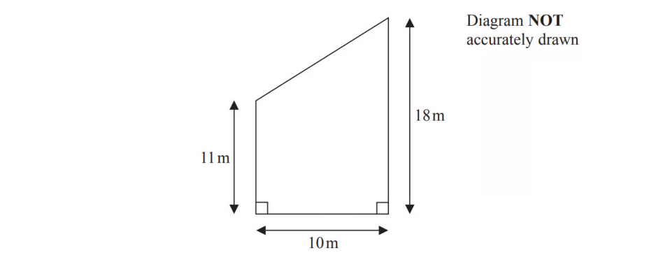

This part of the field is in the shape of a trapezium.

A farmer wants to put a fence all the way around the edge of this part of the field.

The farmer has 50m of fence.

Does he have enough fence? You must show all your working.

*Source: November 2015 1MA0/2H Q7*

### Q8 — hard — 2 marks

**Q8** [2 marks]

In this question, all measurements are in metres.

The diagram shows a right-angled triangle.

Given that $x=3.82$ to 3 significant figures, calculate the smallest angle of the triangle.

*Source: 2018	May/June 0580/42 Q7D*

### Q9 — very_hard — 6 marks

**Q9** [6 marks]

The diagram shows a field *ABCD*.

The bearing of *B* from *A* is 140°.

*C* is due east of *B* and *D* is due north of *C*.

*AB* = 400m, *BC* = 350m and *CD* = 450m.

Calculate the distance from *D* to *A*.

............................................. m

*Source: 2020 May/June 0580/42 Q5B*

### Q10 — medium — 3 marks

**Q10** [3 marks]

The diagram shows a rectangle and a diagonal of the rectangle.

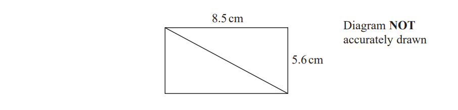

Work out the length of the diagonal of the rectangle.

Give your answer correct to 1 decimal place.

.....................$\mathrm{cm}$

*Source: Jan 2020 4MA1/2HR Q4*

### Q11 — medium — 5 marks

**Q11** [5 marks]

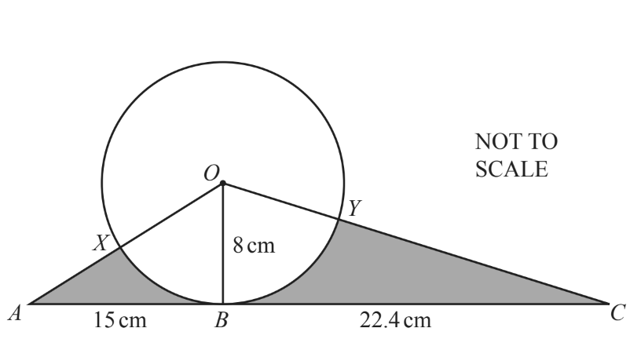

The diagram shows a circle, centre *O*. 
The straight line *ABC* is a tangent to the circle at *B*. 
*OB* = 8 cm, *AB* = 15 cm and *BC* = 22.4 cm. 
*AO* crosses the circle at *X* and *OC* crosses the circle at *Y*.

Calculate angle *XOY*.

Angle *XOY* = .............................................

*Source: 2018	Oct/Nov 0580/41 Q10A*

### Q12 — hard — 4 marks

**Q12** [4 marks]

$ABC$is an isosceles triangle.

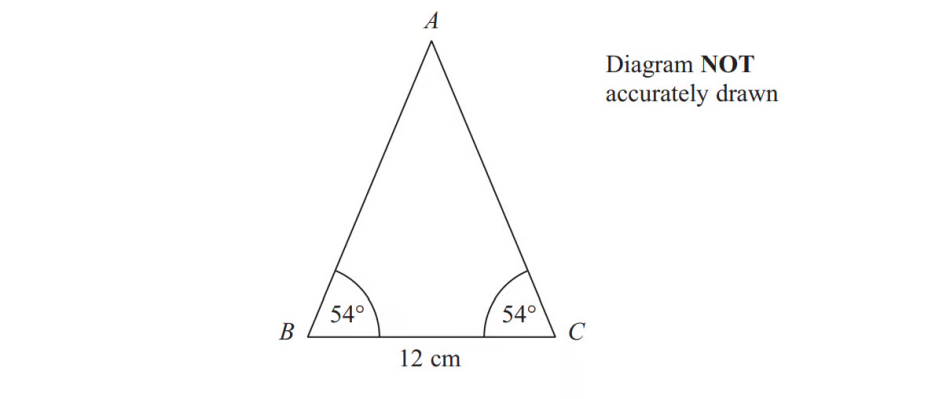

Work out the area of the triangle.

Give your answer correct to 3 significant figures.

*Source: November 2013 1MA0/2H Q18*

### Q13 — medium — 2 marks

**Q13** [2 marks]

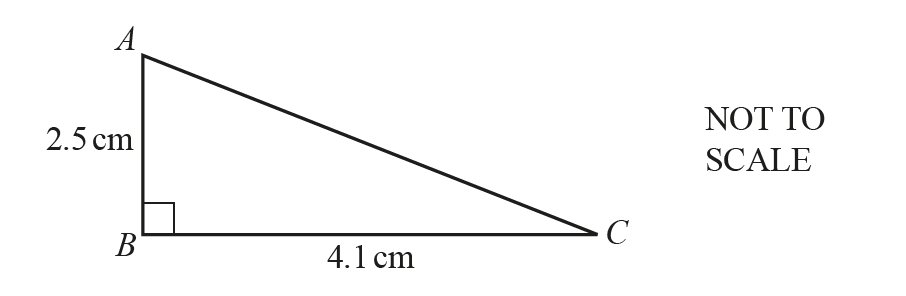

Calculate the length of *AC.*

*AC *= ........................................ cm

*Source: 2018	May/June 0580/21 Q7*

### Q14 — very_hard — 4 marks

**Q14** [4 marks]

The diagram shows a field *ABCDE*.

Calculate the perimeter of the field *ABCDE*.

................................................ m

*Source: 2019	May/June 0580/41 Q3A*

### Q15 — very_hard — 4 marks

**Q15** [4 marks]

A square, with sides of length $x$ cm, is inside a circle. Each vertex of the square is on the circumference of the circle.

The area of the circle is 49 cm2.

Work out the value of $x$.

Give your answer correct to 3 significant figures.

*Source: June 2017 1MA1/3H Q8*

### Q16 — medium — 4 marks

**Q16** [4 marks]

The diagram shows a rectangular framework.

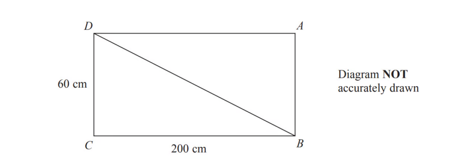

The framework is made from 5 metal rods.

The metal rods have a weight of 0.9 kg per metre.

Work out the total weight of the framework.

Give your answer, in kg, correct to 3 significant figures.

*Source: November 2016 1MA0/2H Q9*

### Q17 — very_hard — 2 marks

**Q17** [2 marks]

The angle $BAC$* *is* *$82.8^{\circ}$* *correct to 3 significant figures.

*D* is the point on *AC* that is nearest to *B*.

Calculate the distance from *D* to *A*.

................................................ m

*Source: 2019	Oct/Nov 0580/41 Q5D*

### Q18 — medium — 3 marks

**Q18** [3 marks]

Here is a right-angled triangle.

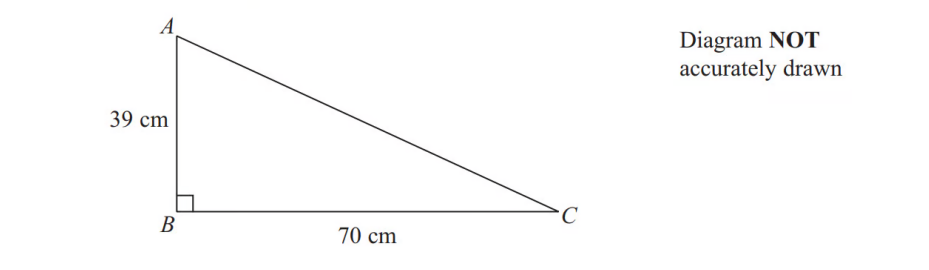

Work out the length of $AC$. Give your answer correct to 1 decimal place.

*Source: November 2013 1MA0/2H Q15*

### Q19 — medium — 2 marks

**Q19** [2 marks]

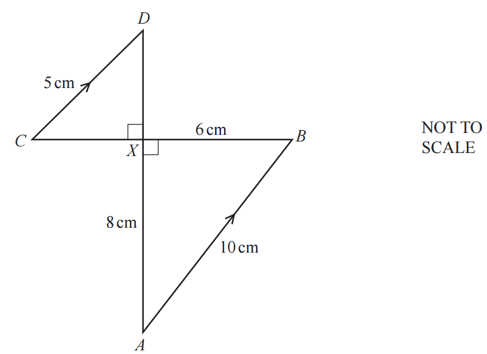

In the diagram, *AB* and *CD* are parallel. 
*AD* and *BC* intersect at right angles at the point *X*. 
*AB* = 10 cm, *CD* = 5 cm, *AX* = 8 cm and *BX* = 6 cm.

Calculate angle *XAB.*

Angle *XAB* = ..............................................

*Source: 2018	Oct/Nov 0580/43 Q8A*

### Q20 — hard — 2 marks

**Q20** [2 marks]

A solid metal cone has radius 1.65 cm and slant height 4.70 cm.

Find the angle the slant height makes with the base of the cone.

*Source: 2020 March 0580/42 Q4B*

### Q21 — very_hard — 5 marks

**Q21** [5 marks]

Here is triangle $ABD.$

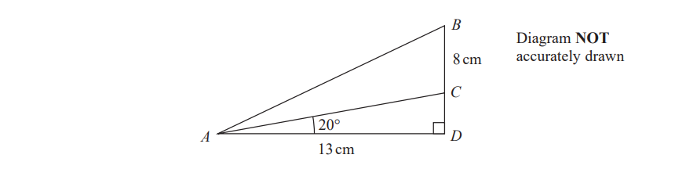

The point $C$ lies on $BD$.

$AD=13\mathrm{cm}BC=8\mathrm{cm} \mathrm{angle}ADB=90^{\circ}\mathrm{angle}CAD=20^{\circ}$

Calculate the size of angle $BAC$.

Give your answer correct to $1$ decimal place.

*Source: Jan 2019 4MA1/1H Q10*

### Q22 — medium — 2 marks

**Q22** [2 marks]

$PQR$is a right-angled triangle.

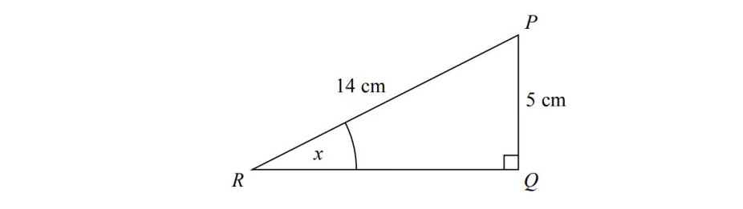

Work out the size of the angle marked $x$.

Give your answer correct to 1 decimal place.

*Source: Sample 2015 1MA1/2H Q2*

### Q23 — medium — 5 marks

**Q23** [2 marks]

The diagram shows a quadrilateral, $ABCD$, formed from two triangles, $ABC$ and $ACD$.

$ABC$ is a right-angled triangle.

Calculate angle $BAC$.

Angle $BAC$ = ..............................................

*Source: Specimen 2025 0580/04 Q13A*

**Q23** [3 marks]

**Extract:**

The diagram shows a quadrilateral, A B C D, formed from two triangles, A B C and A C D. A B C is a right-angled triangle.

Calculate the shortest distance from $D$ to $AC$*.*

*..........................................* cm

*Source: Specimen 2025 0580/04 Q13C*

### Q24 — very_hard — 3 marks

**Q24** [3 marks]

In the diagram, $BC$ is a vertical wall standing on horizontal ground $AB$. $AC$ = 76.7 m.

$D$ is the point on $AB$ where $AD$ = 58 m.

The angle of elevation of $C$ from $A$ is 26°.

The angle of elevation of $C$ from $D$ is 72°.

Calculate $BD$.

$BD$ = .......................................... m

*Source: 2019	May/June 0580/43 Q9A*

### Q25 — hard — 3 marks

**Q25** [3 marks]

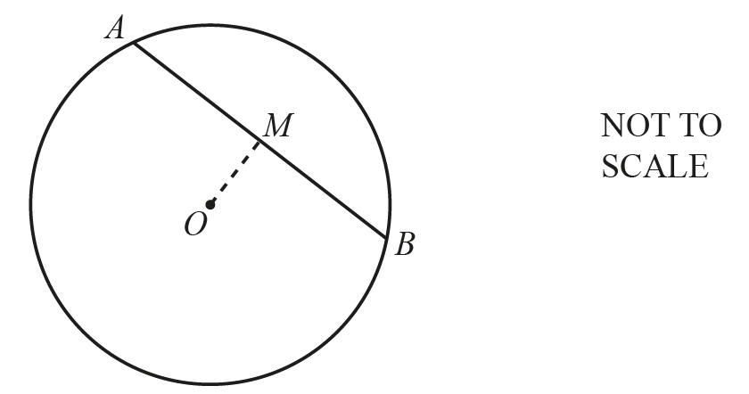

The diagram shows a circle, centre *O*.

*AB* is a chord of length 12 cm.

*M* is the mid-point of *AB* and *OM* = 4.5 cm.

Calculate the radius of the circle.

.......................................... cm

*Source: 2018	May/June 0580/22 Q16*

### Q26 — hard — 9 marks

**Q26** [4 marks]

In the pentagon $ABCDE$, angle $ACB$ = angle $AED$ = 90°. Triangle $ACD$ is equilateral with side length 12 cm.

$DE$ = $BC$ = 6 cm.

Calculate angle $BAE$.

Angle $BAE$ = ...............................................

*Source: 2018	May/June 0580/43 Q6A*

**Q26** [2 marks]

**Extract:**

In the pentagon A B C D E, angle A C B = angle A E D = 90°. Triangle A C D is equilateral with side length 12 cm. D E = B C = 6 cm.

Calculate $AB$.

$AB$ = ......................................... cm

*Source: 2018	May/June 0580/43 Q6A*

**Q26** [3 marks]

**Extract:**

In the pentagon [A B C D E], angle [A C B] = angle [A E D] = 90°. Triangle [A C D] is equilateral with side length 12 cm.

[D E] = [B C] = 6 cm.

Calculate $AE$.

$AE$ = ......................................... cm

*Source: 2018	May/June 0580/43 Q6A*

### Q27 — hard — 2 marks

**Q27** [2 marks]

The straight line $AC$* *has equation $y=4x+5$.

Calculate the acute angle between $AC$ and the $x$-axis.

*Source: 2019	May/June 0580/43 Q7B*

### Q28 — very_hard — 5 marks

**Q28** [5 marks]

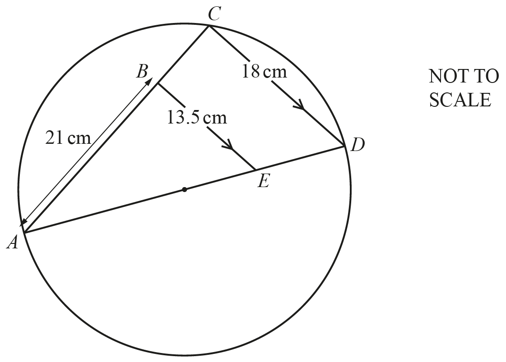

$C$ lies on a circle with diameter $AD$.

$B$ lies on $AC$ and $E$ lies on $AD$ such that $BE$ is parallel to $CD$.

$AB$ = 21 cm, $CD$ = 18 cm and $BE$ = 13.5 cm.

Work out the radius of the circle.

............................................ cm

*Source: 2020	May/June 0580/21 Q13*

### Q29 — medium — 2 marks

**Q29** [2 marks]

*ABDF *is a parallelogram and *BCDE  *is a straight line.

*AF* = 12cm, *AB *= 9 cm, angle *CFD *= 40° and angle *FDE* = 80°.

Calculate the height, $h$, of the parallelogram.

$h=$ ........................................... cm

*Source: 2020 Oct/Nov 0580/41 Q4B*

### Q30 — medium — 2 marks

**Q30** [2 marks]

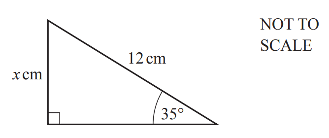

The diagram shows a right-angled triangle.

Calculate the value of $x$.

$x$ = ............................................

*Source: 2019	May/June 0580/21 Q7*

### Q31 — very_hard — 3 marks

**Q31** [3 marks]

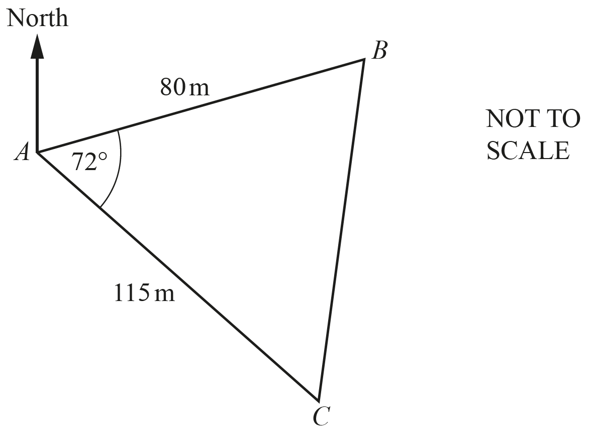

The diagram shows the positions of three points $A$, $B$ and $C$ in a field.

Calculate the shortest distance from point $B$ to $AC$.

............................................. m

*Source: 2020	May/June 0580/41 Q7E*

### Q32 — medium — 3 marks

**Q32** [3 marks]

The diagram shows a right-angled triangle.

Calculate the perimeter.

............................................ cm

*Source: 2020	March 0580/22 Q7B*

### Q33 — medium — 11 marks

**Q33** [3 marks]

The diagram shows a prism with length 18 cm and volume 253.8 cm3.

The cross-section of the prism is a right-angled triangle with base 6 cm and height $h$ cm.

Show that the value of $h$ is 4.7 .

*Source: 2018	Oct/Nov 0580/41 Q5A*

**Q33** [2 marks]

Calculate the value of $x$.

$x$ = ...............................................

*Source: 2018 0580/41 Q5A*

**Q33** [6 marks]

**Extract:**

The diagram shows a prism with length 18 cm and volume 253.8 cm^3^. The cross-section of the prism is a right-angled triangle with base 6 cm and height 4.7 cm.

Calculate the total surface area of the prism.

........................................ cm2

*Source: 2018	Oct/Nov 0580/41 Q5B*

### Q34 — hard — 3 marks

**Q34** [3 marks]

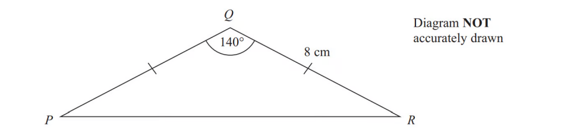

Calculate the length of $PR$.

Give your answer correct to 3 significant figures.

*Source: March 2013 1MA0/2H Q20*

### Q35 — hard — 3 marks

**Q35** [2 marks]

$ABC$is a right-angled triangle.

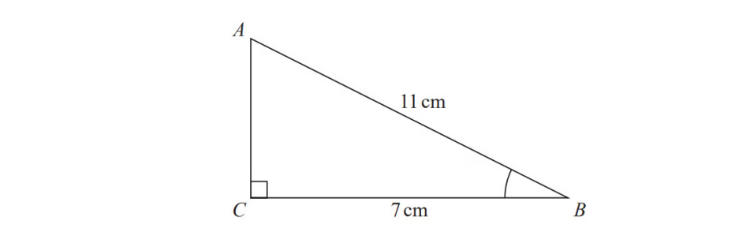

Work out the size of angle $ABC$.

Give your answer correct to 1 decimal place.

*Source: June 2018 1MA1/3H Q5A*

**Q35** [1 mark]

**Extract:**

[A B C] is a right-angled triangle.
Angle [A C B] is still 90°.
The length of the side [B C] is still 7 cm.

The length of the side $AB$is reduced by 1 cm.

The length of the side $BC$is still 7 cm.

Angle $ACB$is still 90°

Will the value of cos$ABC$increase or decrease?

You must give a reason for your answer.

*Source: June 2018 1MA1/3H Q5B*

### Q36 — very_hard — 3 marks

**Q36** [3 marks]

Point *A* has co-ordinates (1, 0) and point *B* has co-ordinates (2, 5).

Calculate the angle between the line *AB* and the $x$-axis.

*Source: 2018	May/June 0580/21 Q24A*

### Q37 — hard — 2 marks

**Q37** [2 marks]

The diagram shows a trapezium $ABCD$.

$AB$ is parallel to $DC$.

$AB=55m$, $BD=70m$, angle $ABD=40^{\circ}$ and angle $BCD=32^{\circ}$.

Calculate the shortest distance from $A$ to $BD$.

............................................ m

*Source: 2020 Specimen 0580/04 Q9D*

### Q38 — medium — 3 marks

**Q38** [3 marks]

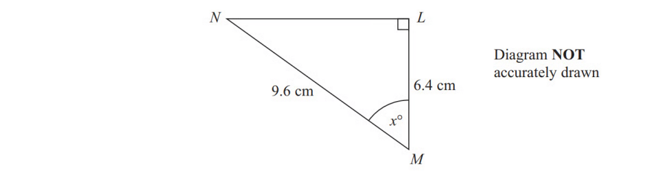

$LMN$is a right-angled triangle.

$MN$= 9.6 cm.

$LM$= 6.4 cm.

Calculate the size of the angle marked $x^{\circ}$.

Give your answer correct to 1 decimal place.

*Source: June 2012 1MA0/2H Q16*

