# Mark Schemes — Sine, Cosine Rule & Area of Triangles
**Pythagoras & Trigonometry** · Cambridge (CIE) IGCSE maths (0580 & 0980)

## Exam Questions (51 questions)

### Q1
> **[exam-tip]**
> The sine formula for the area of a triangle is on the formula sheet in the exam paper:
> 
> $\mathrm{Area}=\frac{1}{2}ab\mathrm{sin}C$
> 
> - where angle $C$ is the angle in between sides $a$ and $b$

Substitute the information from the question into the sine formula for triangle area

$102 = 1 \frac{1}{2} ( 17 ) ( x ) ( \frac{3}{5} )$

**[M1]**

Solve to find the value of $x$

- Start by multiplying all the numbers on the right-hand side together

$102=\frac{51}{10}x$

- Multiply both sides by 10

$1020=51x$

- Divide by 51 to find the value of $x$

$x=\frac{1020}{51}$

$x=20$

**[A1]**

### Q2
In triangle $ACD$ you know a side/angle pair, and the side opposite the angle you want to know

- Therefore use the Sine Rule

> **[exam-tip]**
> The Sine Rule formula is on the on the formula sheet in the exam paper.

$\frac{\mathrm{sin}CAD}{29}=\frac{\mathrm{sin}26}{13}$

**[M1]**

Rearrange, then use $\mathrm{sin}^{-1}$ on your calculator to find angle $CAD$

$\mathrm{sin}CAD=29\times\frac{\mathrm{sin}26}{13}$

$\begin{gathered} C A D & = \sin ^{- 1} ( 29 \times \frac{\sin 26}{13} ) \\ = 77.933290... \end{gathered}$

Round to a sensible degree of accuracy

- You should round angles in degrees to 1 decimal place, unless a question says otherwise

**Final answer:** **77.9° (1 d.p.)**

**[A1]**

> **[mark-scheme]**
> **M1**: For substituting into Sine Rule formula.
> 
> **A1**: For 77.9, or 77.93 to 77.94.
Consider triangle $BAD$

- From part (a) you now know that

*angle *$BAD=37+77.933290...=114.933290...^{\circ}$

**[B1]**

- And you know sides $AB$ and $AD$ from the diagram

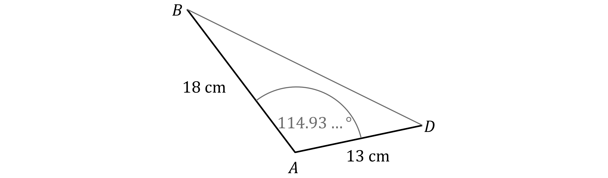

So you know two sides and the angle between them, and want to know the third side

- That is a job for the Cosine Rule

> **[exam-tip]**
> The Cosine Rule formula is on the on the formula sheet in the exam paper.

$( B D )^{2} = 18^{2} + 13^{2} - 2 \times 18 \times 13 \times \cos ( 114.933290... )$

**[M1]**

Take the square root of both sides

$B D = \sqrt{18^{2} + 13^{2} - 2 \times 18 \times 13 \times \cos ( 114.933290... )}$

**[M1]**

$=26.273396...$

Round to a sensible degree of accuracy

- In general you should round to 3 significant figures, unless a question says otherwise

**Final answer:** **26.3 cm (3 s.f.)**

**[A1]**

> **[mark-scheme]**
> **B1**: For adding your answer from part (a) to 37°.
> 
> **M1**: For substituting into Cosine Rule formula.
> 
> **M1**: For taking square root of Cosine Formula with your value for angle $BAD$, or for 690.291371... .
> 
> **A1**: For 26.3, or 26.27 to 26.28. You don't need to include units to get this mark.

### Q3
Use the formula   $A=\frac{1}{2}ab\mathrm{sin}C$

- $a=4$
- $b=5$
- $C=60^{\circ}$

$\text{Area} = 1 \frac{1}{2} \times 4 \times 5 \times \sin ( 60^{\circ} )$

**[M1]**

Use the exact trig value

$\sin ( 60^{\circ} ) = \frac{ \sqrt{3} }{2}$

**[M1]**

Simplify

$\begin{gathered} \text{Area} = 1 \frac{1}{2} \times 4 \times 5 \times \frac{ \sqrt{3} }{2} \\ = \frac{20 \sqrt{3} }{4} \end{gathered}$

**Final answer:** $5\sqrt{3}\mathrm{cm}^{2}$** **

**[A1]**

> **[mark-scheme]**
> **M1**: For correctly using the formula for the area of a triangle.
> 
> **B1**: For the correct trig value.
> 
> **A1**: Correct answer. You do not need to state the units.

### Q4
**Method 1**

> *Find the area of one triangle using *$\frac{1}{2}ab\mathrm{sin}C$

$1 \frac{1}{2} \times 15 \times 15 \times \sin ( 60 ) = 97.42...$

**[M1 A1]**

> *Since there are six triangles*

$97.42...\times6=584.56...$

**[M1]**

> *Round to 3 significant figures*

$585\mathrm{cm}^{2}$

**[A1]**

**Method 2**

> *First, find the perpendicular height, *$h$*, of the triangle*

> **[exam-tip]**
> Use a line of symmetry to split a triangle into two congruent right-angled triangles.

$7.5^{2}+h^{2}=15^{2}\,h^{2}=15^{2}-7.5^{2}\,h^{2}=168.75\,h=\sqrt{168.75}\,h=12.99...$

**[M1]**

> *Use this and the base length, *$b$*, to find the area of one triangle*

$\frac{1}{2}\timesbh\,\frac{1}{2}\times15\times12.99...\,97.42...$

**[A1]**

> *Since there are six triangles*

$97.42...\times6=584.56...$

**[M1]**

> *Round to 3 significant figures*

$585\mathrm{cm}^{2}$

**[A1]**

### Q5
> *Use sine rule to find angle at *$A$

$\frac{\sin ( A )}{14} = \frac{\sin ( 25 )}{7} 
\sin ( A ) = \frac{14 \times \sin ( 25 )}{7}$

**[M1]**

> *Substitute correct values into the formula*

$A = \sin ^{- 1} ( 2 \times \sin ( 25 ) )
A = 57.69...$

**[M1]**

> *Angles in a triangle sum to *$180^{\circ}$

$C+25+57.69...=180\,C=180-25-57.69...\,C=97.30...$

**[M1]**

> *Use cosine rule to find the length of *$c$

$c^{2} = a^{2} + b^{2} - 2 a b \cos ( C )
c^{2} = 7^{2} + 14^{2} - 2 \times 7 \times 14 \times \cos ( 97.30... )
c = \sqrt{7^{2} + 14^{2} - 2 \times 7 \times 14 \times \cos ( 97.30... )} 
c = 16.42...$

**[M1]**

$c=16.4$

**[A1]**

> **[exam-tip]**
> Remember to leave rounding until the very end. Use the ANS button on your calculator, or store the values in your calculator.
> *Work out the area of triangle *$ABC$

$1 \frac{1}{2} a b \sin ( C )
1 \frac{1}{2} \times 16.4 \times 14 \times \sin ( 25 )$

**[M1]**

$48.60...\mathrm{cm}^{2}$

> *Work out the area of the sector*

$\frac{θ}{360}\times\mathrm{πr}^{2}\,\frac{25}{360}\timesπ\times8.96^{2}$

**[M1]**

$=17.51...\mathrm{cm}^{2}$

> *Subtract the two areas to find the shaded section*

$48.60...-17.51...=31.08...$

**[M1]**

$31.1\mathrm{cm}^{2}$

**[A1]**

> **[mark-scheme]**
> If rounding is saved towards the end, an answer of $31.1$ should be achieved. However, numbers which round to $31$ are also accepted.

### Q6
> *First use the area to form an equation.*

> *The formula for the area of a triangle is *$\mathrm{Area}=\frac{1}{2}ab\mathrm{sin}C$*, where **a** and **b** are the lengths of the two sides that form angle **C**.*
*Substitute Area = 100, **a** = **y**, **b** = 8.4 and **C** = 40 into the formula.*

$\begin{gathered} 100 = 1 \frac{1}{2} \times y \times 8.4 \times \sin ( 40 ) \end{gathered}$

**[1]**

> *Rearrange to get **y** by itself by multiplying both sides by 2 and dividing both sides by 8.4sin(40). Type into your calculator.*

$\begin{gathered} y = \frac{100 \times 2}{8.4 \times \sin ( 40 )} \\ = 37.041043... \end{gathered}$

**[1]**

> *You now know the lengths of two sides and the angle between them and you want to find the length of the third side. Therefore you need to use the cosine rule.*

> *The formula for the cosine rule is *$a^{2}=b^{2}+c^{2}-2bc\mathrm{cos}A$*, where **b** and **c** are the lengths of the two sides that form angle **A** and **a** is the length of the side opposite **A**.*
*Substitute **a** = **x**, **b** = 8.4, **c** = 37.041043... (using the answer button) and **A** = 40 into the formula.*

$x^{2} = 8.4^{2} + 37.041043...^{2} - 2 ( 8.4 ) ( 37.041043... ) \cos ( 40 )$

**[1]**

> *Type the expression into your calculator altogether as one line. If you do it separately you need to remember the order of operations (multiplication before addition).*

$x^{2}=965.897466...$

**[1]**

> *Take the positive square root of both sides.*

$\begin{gathered} x = \sqrt{965.897466...} \\ = 31.078891... \end{gathered}$

> *Round to 3 significant figures. Remember to include units for the length.*

$AB=31.1m(3\mathrm{sf})$* ***[1]**

### Q7
> *You only need to use triangle **PRS**. You might find it easier to label the angles **A**, **B**, **C** and the sides opposite these **a**, **b**, **c**.*

> *You are given a side (**b **= **PR** = 7.4) and the angle opposite (**B **= **PSR **= 97°). *

*As you are given a side and the angle opposite you can use the sine rule.*

> *You are also given the angle (**A **= **RPS** = 53°) so you can find the opposite side (**a **= **SR** = *$x$*).*

> *Sine rule: *$\frac{a}{\mathrm{sin}A}=\frac{b}{\mathrm{sin}B}$*.*

> *Substitute the values into the formula.*

$\frac{x}{\mathrm{sin}(53)}=\frac{7.4}{\mathrm{sin}(97)}$

**[1]**

> *Solve for *$x$* by multiplying both sides by sin53.*

$\begin{gathered} x = \frac{7.4}{\sin ( 97 )} \times \sin ( 53 ) \\ x = 5.95428... \end{gathered}$

**[1]**

> *Round to 3 significant figures.*

**SR ****= 5.95 cm** **[1]**
> *You only need to use triangle **PQR**. You might find it easier to label the angles **A**, **B**, **C** and the sides opposite these **a**, **b**, **c**.*

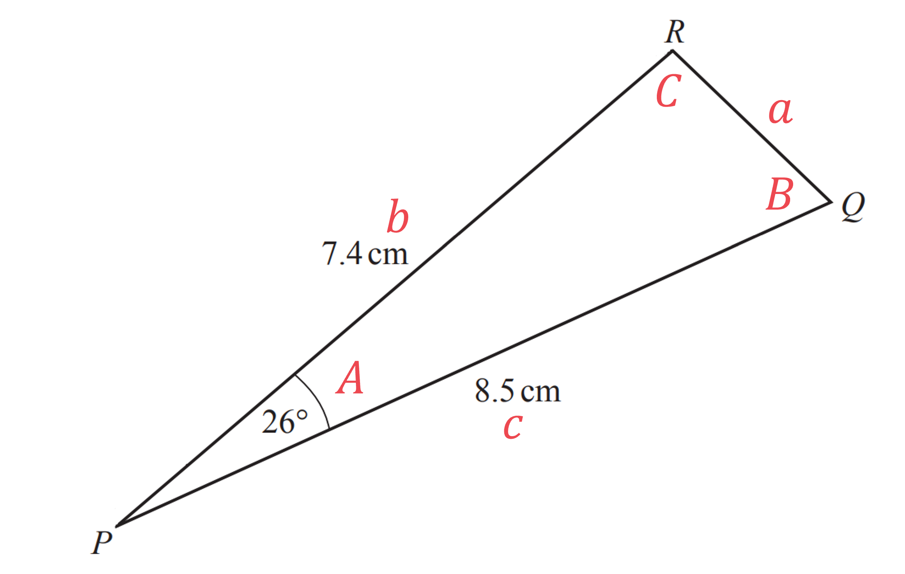

> *You are given two sides (**b **= **PR** = 7.4 and **c** = **PQ** = 8.5) and the angle between them (**A **= **QPR **= 26°). *

*As you are given a pair of sides and the angle between you can use the cosine rule.* *You can find the side opposite the angle (**a **= **QR** = *$y$*).*

> *Cosine rule: *$a^{2}=b^{2}+c^{2}-2bc\mathrm{cos}A$*.*

> *Substitute the values into the formula.*

$y^{2}=7.4^{2}+8.5^{2}-2(7.4)(8.5)\mathrm{cos}(26)$

**[1]**

> *Simplify the expression, type it in the calculator as one long expression. If you evaluate the expression bit by bit then remember to apply the order of operations (multiplication before subtraction).*

$y^{2}=13.9417...$

**[1]**

> *Solve for *$y$* by square rooting both sides. Use the answer button or type the exact expression in your calculator.*

$\begin{array}{rcl} y = \sqrt{7.4^{2} + 8.5^{2} - 2 ( 7.4 ) ( 8.5 ) \cos ( 26 )} = \sqrt{13.9417...} \\ y = 3.73385... \end{array}$

**[1]**

> *Round to 3 significant figures.*

**RQ ****= 3.73 cm** **[1]**

### Q8
> *The required angle *$BAE$* is marked on the diagram below.*

> *Triangle *$ACD$* is equilateral so all angles are 60°.*

*Angle* $DAC=60^{\circ}$

**[1]**

> *We can find angle *$DAE$* using right-angle trigonometry, SOHCAHTOA. We have the hypotenuse and the opposite sides so use sine.*

$\begin{gathered} \sin ( \text{angle} D A E ) & = \frac{6}{12} \end{gathered}$

**[1]**

$\begin{gathered} \text{angle} D A E & = \sin ^{- 1} ( \frac{6}{12} ) = 30^{\circ} \end{gathered}$

> *We can find angle *$BAC$* using right-angle trigonometry, SOHCAHTOA. We have the adjacent and the opposite sides so use tangent.*

$\begin{gathered} \tan ( \text{angle} B A C ) & = \frac{6}{12} \end{gathered}$

**[1]**

$\begin{gathered} \text{angle} D A C & = \tan ^{- 1} ( \frac{6}{12} ) = 26.56505118...^{\circ} \end{gathered}$

> *Now add the three found angles to get angle *$BAE$*. *

$\begin{gathered} \text{angle} B A E & = 60 + 30 + 26.56505118... = 116.56505118... \end{gathered}$

**Angle **$BAE=116.6^{\circ}$ **[1]**

**Give answers in degrees to at least one decimal place**
i) *Triangle *$ABC$* is right-angled so we can find *$AB$* using Pythagoras' theorem, *$h^{2}=a^{2}+b^{2}$* where we have two shorter sides, *$a$* and *$b$*.*

$\begin{array}{rcl} ( A B )^{2} & = 6^{2} + 12^{2} \end{array}$

**[1]**

$\begin{array}{rcl} A B & = \sqrt{6^{2} + 12^{2}} \\ = \sqrt{180} \\ = 13.41640786... \end{array}$

> *Give your final answer to at least 3 significant figures.*

$AB=13.4$** ****cm** **[1]**

ii) *Triangle *$AED$* is right-angled so we can find *$AE$* using Pythagoras' theorem, *$h^{2}=a^{2}+b^{2}$* where we have the hypotenuse, *$h$* and a shorter side, *$a$*.*

$\begin{gathered} 12^{2} & = 6^{2} + ( A E )^{2} \end{gathered}$

**[1]**

$\begin{array}{rcl} b^{2} & = 12^{2} - 6^{2} \\ = \sqrt{12^{2} - 6^{2}} \end{array}$

**[1]**

> *Evaluate and give your final answer to at least 3 significant figures.*

$\begin{array}{rcl} = 10.39230485... \end{array}$

$AE=10.4$** ****cm** **[1]**
> *We need to treat the pentagon as 3 separate triangles, *$ADE$*, *$ACD$* and *$ABC$*. All the lengths and angles needed are marked on the diagram below.*

> *Triangle *$ACD$* is not right-angled so use area *$=\frac{1}{2}ab\mathrm{sin}C$* where *$a$* and *$b$* are adjacent sides and *$C$* is the included angle*

*Area* $ACD=\frac{1}{2}\times12\times12\times\mathrm{sin}60$

**[1]**

$=62.35382907...$** ***cm**2*

> *Triangle *$ADE$* is right-angled so we can use area*$=\frac{1}{2}\times\mathrm{base}\times\mathrm{height}$*. The base is *$AD$*, which we know from part (iii) is 10.4 cm, and the height is *$ED$*= 6 cm.*

$\begin{gathered} A D E & = 1 \frac{1}{2} \times 10.4 \times 6 \end{gathered}$

**[1]**

$\begin{array}{rcl} = 31.2 \end{array}$ *cm**2*

> *Triangle *$ABC$* is right-angled so we can use area*$=\frac{1}{2}\times\mathrm{base}\times\mathrm{height}$*. The base is *$AC$* = 12 cm and the height is *$BC$* = 6 cm.*

$\begin{gathered} A B C & = 1 \frac{1}{2} \times 12 \times 6 \end{gathered}$

**[1]**

$\begin{gathered} = 36 \end{gathered}$ *cm**2*

> *Now add the three found angles to get the final answer. *

$\begin{gathered} \text{angle} B A E & = 62.35382907... + 31.2 + 36 = 129.55382907... \end{gathered}$ *cm**2*

**Answer = 130 cm****2**** ****or 129.5... to 129.6 cm****2** **[1]**

**Final answer depends on the level of rounding during working but must be either 130, or within the range **$129.5<\mathrm{area}\leq129.6$

### Q9
> *The lines on the sides **PQ** and **RQ** mean that they are equal so they are both 8 cm.*

> *You know the lengths of two sides and the angle between them and you want to find the length of the third side. Therefore you need to use the cosine rule.*

> *The formula for the cosine rule is *$a^{2}=b^{2}+c^{2}-2bc\mathrm{cos}A$*, where **b** and **c** are the lengths of the two sides that form angle **A** and **a** is the length of the side opposite **A**. Substitute **a** = **PR**, **b** = 8, **c** = 8 and **A** = 140 into the formula.*

$P R^{2} = 8^{2} + 8^{2} - 2 ( 8 ) ( 8 ) \cos ( 140 )$

**[1]**

> *Type the expression into your calculator altogether as one line. If you do it separately you need to remember the order of operations (multiplication before addition).*

$PR^{2}=226.053688...$

**[1]**

> *Take the positive square root of both sides. Use the answer button or your calculator's memory function.*

$\begin{array}{rcl} P R & = \sqrt{226.053688...} \\ = 15.035081... \end{array}$

> *Round to 3 significant figures. Remember to include units for the length.*

$PR=15.0\mathrm{cm}(3\mathrm{sf})$* ***[1] **

**This can also be done using the right angled trigonometry**

### Q10
i) *Looking at triangle *$QRS$*, we have one side-angle pair and the angle opposite the side we're trying to find (*$QR$*).*

> *So use sine rule, *$\frac{s}{\mathrm{sin}S}=\frac{r}{\mathrm{sin}R}$*.*

$\frac{QR}{\mathrm{sin}25^{\circ}}=\frac{6}{\mathrm{sin}72^{\circ}}$

**[1]**

> *Rearrange before working any values out to keep accuracy.*

$QR=\frac{6\mathrm{sin}25^{\circ}}{\mathrm{sin}72^{\circ}}$

**[1]**

$QR=2.666202...$

$QR=2.67$* ***cm*** ***[1]**

ii) *Looking at triangle *$PQS$*, we have two sides and the angle between them. *

> *We want the the side opposite that angle (*$PS$*), so use cosine rule, *$q^{2}=p^{2}+s^{2}-2ps\mathrm{cos}Q$*.*

$( P S )^{2} = 6^{2} + 7.4^{2} - 2 \times 6 \times 7.4 \times \cos 34^{\circ}$

**[1]**

$( P S )^{2} = 17.141 463 ...$

**[1]**

> *Square root before rounding.*

$PS=4.140225...$

$PS=4.14$* ***cm*** ***[1]**

iii) *Split quadrilateral *$PQRS$* into two triangles and apply the area formula *$"A=\frac{1}{2}ab\mathrm{sin}C"$* on each.*

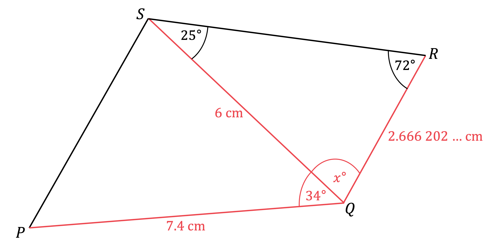

> *We know the length of *$QR$* from our answer to part i), but we do need to find angle *$RQS$* - marked *$x$*° on the diagram.*

*Angle *$R Q S = x^{\circ} = 180^{\circ} - ( 25^{\circ} + 72^{\circ} ) = 83^{\circ}$

**[1]**

*Area of *$RQS=\frac{1}{2}\times6\times2.666202...\times\mathrm{sin}83^{\circ}=7.938988...$

**[1]**

> *Store this value in your calculator's memory for later.*

*Area of *$PQS=\frac{1}{2}\times6\times7.4\times\mathrm{sin}34^{\circ}=12.414082...$

**[1]**

> *Add the two triangle areas to find the area of the quadrilateral *$PQRS$*.*

*Area of *$PQRS=7.938988...+12.414082...=20.353070...$

$20.4\mathrm{cm}^{2}$* ***[1]**

### Q11
> *Use triangle *$BCD$* to find the angle *$CBD$*. *

> $CD$* is opposite the angle and the two other sides are known so the cosine rule should be used.*

> *Substitute the values of *$BD=168,BC=192\mathrm{and}CD=287.9$*into the cosine rule.  *

> *Cosine Rule:  *$c^{2}=a^{2}+b^{2}-2ab\mathrm{cos}C$*, where *$C$* is the angle opposite side *$c.$*   *

$\begin{gathered} C D^{2 } & = B C^{2 } + B D^{2 } - 2 ( B C ) ( B D ) \cos C B D \\ 287.9^{2 } & = 192^{2} + 168^{2 } - 2 ( 192 ) ( 168 ) \cos C B D \end{gathered}$

**[1]**

> *Rearrange to make*$\mathrm{cos}CBD$* the subject.*

$\begin{gathered} 287.9^{2 } - ( 192^{2} + 168^{2 } ) & = - 2 ( 192 ) ( 168 ) \cos C B D \\ \cos C B D & = \frac{287.9^{2 } - 192^{2} - 168^{2 } }{- 2 ( 192 ) ( 168 )} \end{gathered}$

** ****[1]**

> *Use your calculator to find the value of *$\mathrm{cos}CBD$*.*

$\begin{gathered} \cos C B D & = - 0.275893... \end{gathered}$

**[1]**

> *Use the cos**-1** button on your calculator to find the value of *$CBD$*.*

$\begin{gathered} C B D^{ & = \cos ^{-1} } ( - 0.275893... ) \\ = 106.0152.... \end{gathered}$

$CBD=106.0^{\circ}(1d.p.)$* ***[1]**

### Q12
> *Use triangle *$BCX$* to find angle *$BXC$*. *

> *All three sides are known and one angle is needed so the cosine rule should be used.*

> *Substitute the values of  *$BX=5,BC=8\mathrm{and}CX=7$* into the cosine rule.  *

> *Cosine Rule:  *$c^{2}=a^{2}+b^{2}-2ab\mathrm{cos}C$*.*

$B C^{2 } = B X^{2 } + C X^{2 } - 2 ( B X ) ( C X ) \cos B X C
8^{2 } = 5^{2} + 7^{2 } - 2 ( 5 ) ( 7 ) \cos B X C$

**Correct use of equation**** [1]**

> *Rearrange the equation to make *$\mathrm{cos}BXC$* the subject.*

$\begin{gathered} 8^{2 } & = 5^{2} + 7^{2 } - 70 \cos B X C \\ 70 \cos B X C & = 5^{2 } + 7^{2 } - 8^{2} \\ \cos B X C & = \frac{ 5^{2 } + 7^{2 } - 8^{2}}{70} \end{gathered}$

**Equation rearranged**** ****[1]  **

> *Use your calculator to find the value of *$cosBXC$*.*

$\mathrm{cos}BXC^{}=\frac{10}{70}=\frac{1}{7}$

**[1]**

> *Use the cos**-1** button on your calculator to find the value of *$BXC$*.    *

$\begin{gathered} B X C^{ & = \cos ^{-1} } ( \frac{1}{7} ) \\ = 81.7867... \end{gathered}$

$BXC=81.8^{\circ}(1d.p.)$* ***[1]**

### Q13
*The cosine rule is *$a^{2}=b^{2}+c^{2}-2bc\mathrm{cos}A$* where* * *

> * *

*Write the distance from **G** to **B** as *$x$ *Substitute *$a=x,b=864,c=928$* and *$A=67$* into the formula* * *

$x^{2}=864^{2}+928^{2}-2\times864\times928\times\mathrm{cos}67$

**[2]**

*Work out this value on your calculator* * *

$x^{2}=981109.81...$

**[1]**

*Find *$x$* (by square-rooting both sides)*

$x=990.509...$

**991 km** **[1] **
*Draw a north arrow at **G** and label the bearing of **H** from **G** as *$x$

*By thinking of the north arrows as parallel lines, find the co-interior angle at **H **(by subtracting 133° and 67° from 360°)*

*360° - 133° - 67° = 160°*

*Co-interior angles add to 180°* *Find *$x$* (by subtracting 160° from 180°)*

$x$* = 180° - 160° = 20°* * *

*Label angle **HGB** as *$y$* and label** GB** as 991 km from part (c)* *The sine rule is *$\frac{a}{\mathrm{sin}A}=\frac{b}{\mathrm{sin}B}=\frac{c}{\mathrm{sin}C}$* where*

*Substitute *$a=991,A=67,b=928$* and *$B=y$* into the formula* * *

$\frac{991}{\mathrm{sin}67}=\frac{928}{\mathrm{sin}y}$ * *

*Multiply both sides by *$\mathrm{sin}67$* and *$\mathrm{sin}y$ * *

$991\mathrm{sin}y=928\mathrm{sin}67$ * *

*Make *$\mathrm{sin}y$* the subject (by dividing by 991)* * *

$\mathrm{sin}y=\frac{928\mathrm{sin}67}{991}$

**[2]**

*Find *$y$* (by taking inverse sin of both sides)* * *

$y = \sin ^{- 1} ( \frac{928 \sin 67}{991} ) = 59.5^{\circ}$

**[1] **

*Find the bearing (by adding *$x=20$* to *$y=59.5$*)* * *

$\begin{gathered} x + y & = 20 + 59.5 \\ = 79.5 \end{gathered}$ * *

> *Give the final bearing as three digits (and to one decimal place)*

**079.5°** **[1]**

### Q14
> *You can use the cosine rule to find angle **BAC** because you know all three sides.*

> *Let angle **BAC** be *$x^{\circ}$*.*

> *Use the cosine formula, *$\mathrm{cos}A=\frac{b^{2}+c^{2}-a^{2}}{2bc}$*.*

$\begin{gathered} \cos x & = \frac{150^{2} + 120^{2} - 180^{2}}{2 \times 150 \times 120} \end{gathered}$

*Correct substitution into either form of the cosine formula ***[1]** *Correct form of the cosine formula used*** [1]**

$\begin{gathered} \cos x & = \frac{4500}{36000} \end{gathered}$

**[1]**

> *Take the inverse cos of both sides.*

$x = \cos ^{- 1} ( \frac{4500}{36000} )
x = 82.81924...$

**Angle ****BAC**** = **$82.8^{\circ}$** ****[1]**

**Answers between 82.81****o**** and 82.82****o**** through using the cosine rule will be accepted.**

### Q15
> *Find the length **AH** by using Pythagoras on the triangle **ADH**.*

$\begin{array}{rcl} A H^{2} & = A D^{2} + D H^{2} \\ = 6^{2} + 6^{2} \\ = 72 \\ A H & = \sqrt{72} \end{array}$

**[1]**

> *Find the length **AF** by using Pythagoras on the triangle **ABF**. Note that **BF** = **DH** = 6 cm.*

$\begin{gathered} A F^{2} & = A B^{2} + B F^{2} \\ = 8^{2} + 6^{2} \\ = 100 \\ A F & = 10 \end{gathered}$

**[1]**

> *EH** = **AD** = 6 cm and **EF** = **AB** = 8 cm. Therefore the rectangle **EFGH** is the same size as the rectangle **ABFE**. Therefore the diagonals of the two rectangles are equal.*

$FH=10$

> *Think of triangle **AFH** as a triangle in 2D. You have 3 sides so can find a missing angle using the cosine rule: *$a^{2}=b^{2}+c^{2}-2bc\mathrm{cos}A.$* Use angle **HAF **for **A **in the formula, **FH** for **a**, **AF **for **b** and **AH **for **c**.*

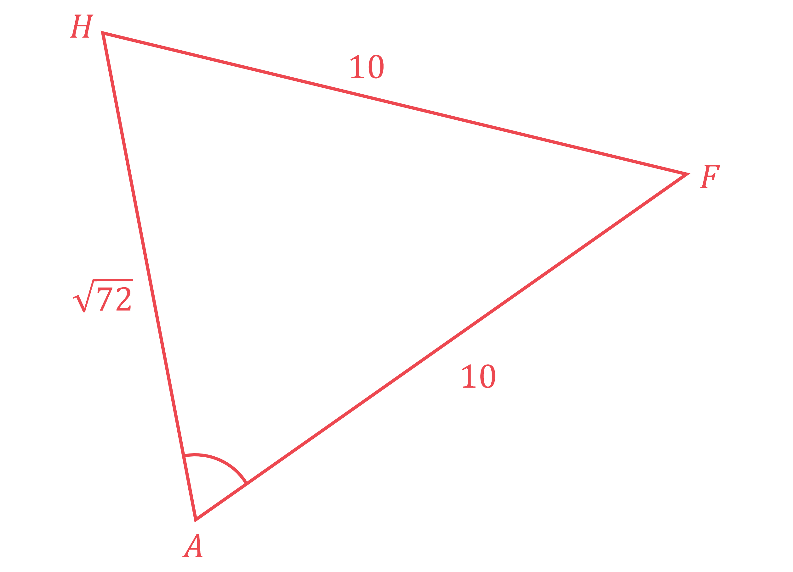

$\begin{gathered} F H^{2} & = A F^{2} + A H^{2} - 2 \times A F \times A H \times \cos ( H A F ) \\ 100 = 100 + 72 - 2 \times 10 \times \sqrt{72} \times \cos ( H A F ) \end{gathered}$

**[1]**

> *Simplify each term. Leave each term as exact values.*

$\begin{gathered} 100 = 172 - 20 \sqrt{72} \cos ( H A F ) \end{gathered}$

**[1]**

> *Subtract 172 from both sides.*

$\begin{gathered} - 72 & = - 20 \sqrt{72} \cos ( H A F ) \end{gathered}$

> *Divide both sides by *$-20\sqrt{72}$*.*

$\frac{- 72}{- 20 \sqrt{72} } = \cos ( H A F )$

**[1]**

> *Use inverse cos on your calculator to find the angle **HAF**.*

$H A F = \cos ^{- 1} ( \frac{- 72}{- 20 \sqrt{72} } ) = 64.8959...$

> *Round angles to 1 decimal place.*

**Angle ****HAF**** = 64.9°*** ***[1]**

### Q16
> *You can find the angle between the sides **AC** and **AB** by spotting that the three interior angles of the triangle should add up to 180°.*

$\begin{gathered} \text{Angle} B A C & = 180 - 64 - 49 \\ = 67 \end{gathered}$

> *To find the area of a triangle you need to know the lengths of two sides and the angle between them.*

> *You know the length of one side and the angle opposite it. You also know another angle so you can find the length of the side opposite that using the sine rule.*

> *The formula for the sine rule is *$\frac{a}{\mathrm{sin}A}=\frac{b}{\mathrm{sin}B}$*, where **a** and **b** are the lengths of the two sides that are opposite the angles **A **and **B **respectively. Substitute **a** = **AC**, **b** = 8.7, **A** = 49 and **B** = 64 into the formula.*

$\frac{A C}{\sin ( 49 )} = \frac{8.7}{\sin ( 64 )}$

**[1]**

> *Multiply both sides by sin(49) and type into your calculator.*

$\begin{gathered} A C & = \frac{8.7}{\sin ( 64 )} \times \sin ( 49 ) \\ = 7.305314... \end{gathered}$

*Rearranging correctly** ***[1] **

*Correct answer** ***[1]**

> *The formula for the area of a triangle is *$\mathrm{Area}=\frac{1}{2}ab\mathrm{sin}C$*, where **a** and **b** are the lengths of the two sides that form angle **C**. Substitute **a** = 7.305314... (using the answer button), **b** = 8.7 and **C** = 67 into the formula.*

$\begin{gathered} \text{Area} = 1 \frac{1}{2} \times 7.305314... \times 8.7 \times \sin ( 67 ) \end{gathered}$

**[1]**

> *Type into your calculator.*

$\begin{array}{rcl} \text{Area} = 29.251912... \end{array}$

> *Round to 3 significant figures. Remember to include the units for the area.*

$\mathrm{Area}=29.3\mathrm{cm}^{2}(3\mathrm{sf})$ **[1]**

### Q17
> *The formula for the area of a triangle is *$\mathrm{Area}=\frac{1}{2}ab\mathrm{sin}C$*, where **a** and **b** are the lengths of the two sides that form angle **C**. Substitute Area = *$6\sqrt{2}$*, **a** = *$( x + 3 )$*, **b** = *$( 2 x - 1 )$* and **C** = 45 into the formula.*

$\begin{gathered} 6 \sqrt{2} & = 1 \frac{1}{2} \times ( x + 3 ) \times ( 2 x - 1 ) \times \sin ( 45 ) \end{gathered}$

*Correct expression on the right hand side*** [1] **

*Forming a correct equation ***[1]**

> *Use the fact that *$\sin ( 45 ) = \frac{ \sqrt{2} }{2}$*.*

$\begin{gathered} 6 \sqrt{2} & = 1 \frac{1}{2} \times ( x + 3 ) \times ( 2 x - 1 ) \times \frac{ \sqrt{2} }{2} \end{gathered}$

> *Divide both sides by √2 and multiply both sides by 4 to get rid of the surds and denominators.*

$\begin{gathered} 24 = ( x + 3 ) ( 2 x - 1 ) \end{gathered}$

> *Expand the brackets then simplify.*

$2x^{2}-x+6x-3=24\,2x^{2}+5x-3=24$

**[1]**

> *Subtract 24 from both sides to make the quadratic equal 0.*

$2x^{2}+5x-27=0$

> *As the question asks for 3 significant figures, this suggests that the quadratic does not factorise. Solve by using the quadratic formula, *$x=\frac{-b\pm\sqrt{b^{2}-4ac}}{2a}$*. *

> *Substitute **a** = 2, **b** = 5 and **c =** -27 into the formula.*

$\begin{gathered} x = \frac{- 5 \pm \sqrt{5^{2} - 4 ( 2 ) ( - 27 )} }{2 ( 2 )} \end{gathered}$

**[1]**

> *Simplify using your calculator.*

$\begin{gathered} x = \frac{- 5 + \sqrt{241} }{4} = 2.631043... \\ \text{or} \\ x = \frac{- 5 - \sqrt{241} }{4} = - 5.131043... \end{gathered}$

> *As **x** + 3 is a length then it can not be negative, so **x** > -3. Therefore reject **x** = -5.131043... *

> *Round the other solution to 3 significant figures.*

$x=2.63(3sf)$* ***[1]**

### Q18
> *Sketch a regular hexagon. A regular hexagon can be divided into 6 equilateral triangles as below.*

*The side lengths of the triangles are all 7.4 cm and the angles inside the triangles are all 60°*

> *We can find the area of one triangle using the sine area rule, Area *$=\frac{1}{2}ab\mathrm{sin}C$*, where *$a$* and *$b$* are adjacent sides and *$C$* is the included angle*

$\begin{gathered} \text{Area} \Delta & = 1 \frac{1}{2} \times 7.4 \times 7.4 \times \sin 60 \end{gathered}$

**[1]**

> *Multiply by 6 to find the area of the hexagon*

$\begin{gathered} \text{Area} \text{hexagon} & = 6 \times 1 \frac{1}{2} \times 7.4 \times 7.4 \times \sin 60 \end{gathered}$

**[1]**

$\begin{gathered} = 3 \times 7.4^{2} \times \sin 60 \\ = 142.2706533... \end{gathered}$

> *Round your answer to at least 3 significant figures*

**142 cm****2**** **** ****[1]**

### Q19
> *According to the labeling in the question, the sine rule would be*

$\frac{\sin ( A B C )}{5.9} = \frac{\sin ( 84.6 )}{17.8}$

**[1]**

$\sin ( A B C ) = 5.9 \times \frac{\sin ( 84.6 )}{17.8}$

**[1]**

**                 **$=0.32998964...$

> *It's a good idea to store this answer on your calculator and use the exact value for the next step. Don't forget to inverse sine to get the final answer!*

$\mathrm{Angle}ABC=19.3^{\circ}$** ****[1]**

**If you round to more than 3 significant figures, your answer must be between 19.26 and 19.27**

### Q20
> *Use triangle *$ABD$* to find the missing side *$AD$*.*

> $AD$* is opposite the given angle and the two other sides are known so the cosine rule should be used.*

> *Substitute the values of  *$a=55,b=70\mathrm{and}C=40^{\circ}$* into the cosine rule. *

> *Cosine Rule:  *$c^{2}=a^{2}+b^{2}-2ab\mathrm{cos}C$*.*

> $c^{2 } = 55^{2 } + 70^{2 } - 2 ( 55 ) ( 70 ) \cos 40$*  *

**Correct use of equation**** [1] **

**Substitute values into the equation**** ****correctly ****[1]**

> *Use your calculator to find the value of *$c^{2}$*.*

$c^{2}=2026.45778...$

**[1]**

> *Square root to find the value of *$c$*.*

$\begin{gathered} c^{ } & = \sqrt{ 2026.45778...} \\ = 45.0161... \end{gathered}$

$c=45.0m(3s.f.)$* ***[1] **

**If not rounded, 45.01 to 45.02 is accepted.**
> *Use triangle *$BCD$* to find the missing side *$BC$*.*

> $BC$* is adjacent to the given angle, one other side is known and one more angle is needed to use the sine rule.*

> *The lines *$AB$* and *$DC$* are parallel so angle *$BDC$* is an alternate to angle *$ABD$*. Alternate angles are equal.*

$B \hat{D} C = 40^{\circ}$

**[1]**

> *Substitute the values of  *`B D = 70 , B D -hat C = 40 and B C -hat D = 32 deg`* into the sine rule. *

> *Sine Rule:  *$\frac{a}{\mathrm{sin}A}=\frac{b}{\mathrm{sin}B}=\frac{c}{\mathrm{sin}C}$*.*

$\frac{BC}{\mathrm{sin}40^{\circ}}=\frac{70}{\mathrm{sin}32^{\circ}}$

**[1]**

> *Rearrange the equation to find the value of *$BC.$

$\begin{gathered} B C & = \frac{ 70 \sin 40^{\circ}}{\sin 32^{\circ}} \\ = 84.90941... \end{gathered}$

** ****[1]**

$BC=84.9m(3s.f.)$* ***[1] **

**If not rounded, 84.90 to 84.91 is accepted.**
> *Find the area of each triangle individually and add them together. Formula for the area of a triangle: *$\mathrm{Area}=\frac{1}{2}ab\mathrm{sin}C$*.*

> *Find the area of triangle *$ABD$*.*

$\begin{gathered} A B D & = 1 \frac{1}{2} ( A B ) ( A D ) \sin ( A \hat{B} D ) \\ = 1 \frac{1}{2} ( 55 ) ( 70 ) \sin ( 40^{\circ} ) \\ = 1925 \sin 40^{\circ} \\ = 1237.366... \end{gathered}$

**[1]**

> *To find the area of triangle *$BCD$* the third angle in the triangle will be needed.*

$\begin{gathered} D \hat{B} C & = 180 - B \hat{C} D - B \hat{D} C \\ = 180 - 32 - 40 \\ = 108^{\circ} \end{gathered}$

> *Area of triangle *$B C D \begin{gathered} = \end{gathered} \begin{gathered} \end{gathered} \begin{gathered} 1 \frac{1}{2} \end{gathered} \begin{gathered} \end{gathered} \begin{gathered} ( B C ) \end{gathered} \begin{gathered} ( A D ) \end{gathered} \begin{gathered} \end{gathered} \begin{gathered} \mathrm{s} \end{gathered} \begin{gathered} \mathrm{i} \end{gathered} \begin{gathered} \mathrm{n} \end{gathered} \begin{gathered} \end{gathered} \begin{gathered} ( B C D ) \end{gathered}$*. *

$\begin{gathered} B C D & = 1 \frac{1}{2} ( 84.90941... ) ( 70 ) \sin ( 108^{\circ} ) \\ = 2826.377... \end{gathered}$

**[1]**

> *Add the areas of the two triangles together.*

$\begin{gathered} \text{Area} A B C D & = 1237.366... + 2826.377... \\ = 4063.743... \end{gathered}$

$\begin{array}{ccc} Area A B C D & = & 4060 cm^{ } 2 \text{stretchy} ( 3 s. f. \text{stretchy} )\end{array}$* ***[1] **

**Answers in the range 4063 to 4064 cm****2**** will gain full marks.**

### Q21
> *Finding the angle opposite the side **LN** will help you.*

> *You know the length of one side and the angle opposite it. You also know the length of another side so you can use the sine rule to find the angle opposite it.*

> *The formula for the sine rule is *$\frac{\mathrm{sin}A}{a}=\frac{\mathrm{sin}B}{b}$*, where **a** and **b** are the lengths of the two sides that are opposite the angles **A **and **B **respectively. *

> *Substitute **a** = **12.8**, **b** = 15.7, **A** = **MLN** and **B** = 136 into the formula.*

$\frac{\sin ( M L N )}{12.8} = \frac{\sin ( 136 )}{15.7}$

**[1]**

> *Multiply both sides by 12.8 and then find the angle by using the inverse sin function.*

$\begin{gathered} \sin ( M L N ) & = \frac{\sin ( 136 )}{15.7} \times 12.8 \\ M L N & = \sin ^{- 1} ( \frac{\sin ( 136 )}{15.7} \times 12.8 ) \end{gathered}$

**[1]**

> *Type into your calculator.*

$\begin{gathered} M L N & = 34.495789... \end{gathered}$

**[1]**

> *You can find the angle between the sides **LM** and **MN** by spotting that the three interior angles of the triangle should add up to 180°. Use the answer button on your calculator.*

$\begin{gathered} \text{Angle} L M N & = 180 - 136 - 34.495789... \\ = 9.504210... \end{gathered}$

> *You now have enough information to find the side **LN** using either the sine rule or the cosine rule.*

> *Method 1 - Using the sine rule*

> *The formula for the sine rule is *$\frac{a}{\mathrm{sin}A}=\frac{b}{\mathrm{sin}B}$*, where **a** and **b** are the lengths of the two sides that are opposite the angles **A **and **B **respectively. *

> *Substitute **a** = **LN**, **b** = 15.7, **A** = 9.504210... (using the answer button) and **B** = 136 into the formula.*

$\frac{L N}{\sin ( 9.504210... )} = \frac{15.7}{\sin ( 136 )}$

**[1]**

> *Multiply both sides by sin(9.504210...) and type into your calculator.*

$\begin{gathered} L N & = \frac{15.7}{\sin ( 136 )} \times \sin ( 9.504210... ) \\ = 3.731885... \end{gathered}$

> *Round to 3 significant figures. Remember to include the units for the length.*

$LN=3.73\mathrm{cm}(3\mathrm{sf})$** [1]**

> *Method 2 - Using the cosine rule*

> *The formula for the cosine rule is *$a^{2}=b^{2}+c^{2}-2bc\mathrm{cos}A$*, where **b** and **c** are the lengths of the two sides that form angle **A** and **a** is the length of the side opposite **A**. *

> *Substitute **a** = **LN**, **b** = 15.7, **c** = 12.8 and **A** = 9.504210... (using the answer button) into the formula.*

$L N^{2} = 15.7^{2} + 12.8^{2} - 2 ( 15.7 ) ( 12.8 ) \cos ( 9.504210... )$

**[1]**

> *Type the expression into your calculator altogether as one line. If you do it separately you need to remember the order of operations (multiplication before addition).*

$LN^{2}=13.926966...$

> *Take the positive square root of both sides.*

$\begin{gathered} L N & = \sqrt{13.926966...} \\ = 3.731885... \end{gathered}$

> *Round to 3 significant figures. Remember to include the units for the length.*

$LN=3.73\mathrm{cm}(3\mathrm{sf})$** [1]**

### Q22
> *The missing side *$DE$* can be found using Pythagoras, as triangle *$ADE$* is right-angled with *$DE$* as the hypotenuse*

$DE=\sqrt{50^{2}+120^{2}}=130m$

> *The missing side *$CD$* can also be found using Pythagoras, as triangle *$BCD$* is right-angled with *$BC$* as the hypotenuse*

$CD=\sqrt{170^{2}-150^{2}}=80m$

*Correct method for either DE or CD*** [1]**

*Correct value for DE** ***[1]**

*Correct value for CD*** [1]**

> *Find the perimeter (total distance around the outer edge)*

$100+50+130+80+170$

$530m$ **[1]**
> *Considering the triangle *$ABD$*, we have 3 known sides and 1 unknown angle, so we will use the cosine rule: *$a^{2} = b^{2} + c^{2} - 2 b c \cos ( A )$

*The labels currently on the triangle in the question don't work for this formula, as we need the angle to be labelled *$A$*, so we will re-label the diagram as below* *Recall that angles use upper case letters, whilst the side directly opposite them is given the lower case label of the same letter*

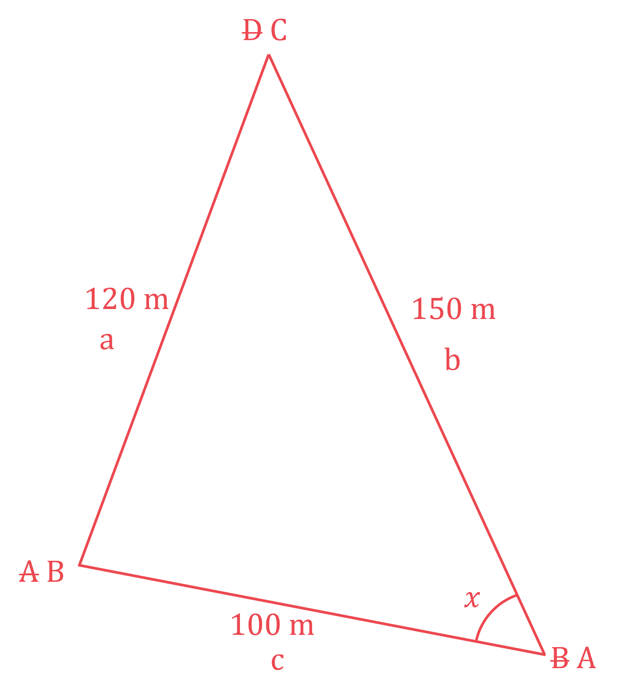

> *Substitute the values of the sides and angle into the cosine rule formula*

$120^{2} = 150^{2} + 100^{2} - ( 2 \times 150 \times 100 \times \cos x )$

**[1]**

> *Rearrange to make *$cosx$* the subject*

$\begin{gathered} 120^{2} - 150^{2} - 100^{2} & = - ( 2 \times 150 \times 100 \times \cos x ) \\ \frac{120^{2} - 150^{2} - 100^{2}}{2 \times 150 \times 100} & = - ( \cos x ) \\ - \frac{120^{2} - 150^{2} - 100^{2}}{2 \times 150 \times 100} & = \cos x \end{gathered}$

**[1]**

*To find angle *$x$*, use the inverse cos function on your calculator (usually shift+cos)* *To maintain accuracy, type in the whole expression rather than a decimal*

$\begin{gathered} x = \cos ^{- 1} ( - \frac{120^{2} - 150^{2} - 100^{2}}{2 \times 150 \times 100} ) \\ x = 52.89099505... \end{gathered}$

*Correct fraction or decimal within the *$\cos ^{- 1} ( )$*; 0.603... or *$\frac{181}{300}$* ***[1]**

$\mathrm{Angle}ABD=52.9^{\circ}$ **[1]**

**Angles should be rounded to 1 decimal place**
i) *Redrawing the triangle *$CBD$

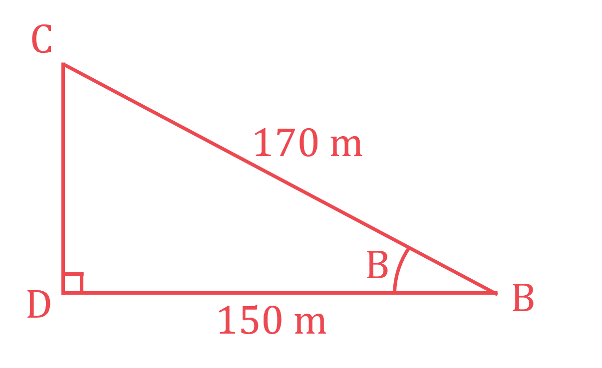

*This is a right-angled triangle and we want to find the angle (*$B$*), whilst we know the lengths of the hypotenuse (170 m) and the adjacent (150 m)* *So we will use the cosine ratio *$\mathrm{cos}θ=\frac{\mathrm{adjacent}}{\mathrm{hypotenuse}}$* and substitute in the values, and then use the inverse cos function to find the angle*

$\mathrm{cos}B=\frac{150}{170}$

> *Use the inverse cos function on calculator (usually shift+cos)*

$B = \cos ^{- 1} ( \frac{150}{170} ) = 28.07248694...$

*For using inverse cos correctly*** [1]**

$\mathrm{Angle}CBD=28.1^{\circ}$ **[1] **

> *Angles should be rounded to 1 decimal place*

ii) *Drawing the two lines *$BC$* and *$BD$* and using the angle found in part i*

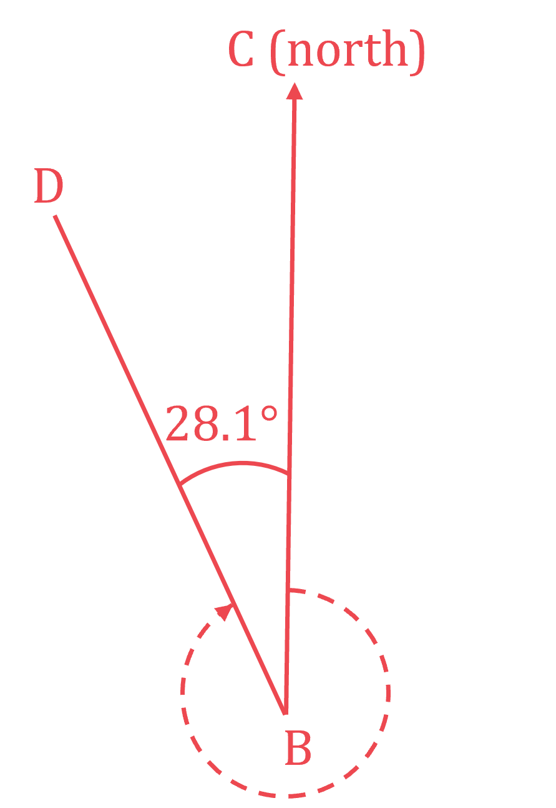

*Bearings are measured clockwise, and from north. The bearing of *$D$* from *$B$* will be the angle shown by the dashed line* *Using the fact that there are 360° in a circle*

$360-28.1$

*360-(answer from i***)**** [1]**

$331.9^{\circ}$ **[1]**
> *Draw a diagram containing all of the information we have been told and worked out so far We can then work out the total area by summing the areas of the three individual triangles*

> *Triangles *$ADE$* and *$BCD$* are both right-angled, so their areas can be found using *$\text{Area} = 1 \frac{1}{2} ( \text{base} \times \text{height} )$

$\text{Area} A D E = 1 \frac{1}{2} ( 50 \times 120 ) = 3000 \mathrm{m}^{2}$

**[1]**

$\text{Area} B C D = 1 \frac{1}{2} ( 150 \times 80 ) = 6000 \mathrm{m}^{2}$

**[1]**

> *Triangle *$ABD$* is not right-angled, so we can instead use the formula *$\text{Area} = 1 \frac{1}{2} \text{ab} \sin ( C )$* where sides *$a$* and *$b$* are either side of angle *$C$

$\text{Area} A B D = 1 \frac{1}{2} ( 150 \times 100 \times \sin ( 52.9 ) ) = 5981.879466... \mathrm{m}^{2}$

**[1]**

> *Find total area by summing the three areas*

$\mathrm{Total} \mathrm{Area}=3000+6000+5981.879466...=14981.87947m^{2}$

> *Convert to hectares, it is stated in the question that 1 hectare = 10 000m**2**, so divide by 10 000*

$14981.87947\div10000=1.498187947...$

$1.50$** ****hectares** **[1]**

**Round to 3 significant figures**

### Q23
*The cosine rule is *$a^{2}=b^{2}+c^{2}-2bc\mathrm{cos}A$* where* * *

> * *

> *Use the cosine rule on triangle **ABC** with **a** = 11, **b** = 13, **c** = 4 and **A** = angle **ACB = x  *

$11^{2}=13^{2}+4^{2}-2\times13\times4\times\mathrm{cos}x$

**[1]**** **

*Simplify the numbers (for example, 11**2** = 121)* * *

* *$121=169+16-104\mathrm{cos}x\,121=185-104\mathrm{cos}x$ * *

*Add *$104\mathrm{cos}x$* to both sides to make it positive* * *

$121+104\mathrm{cos}x=185$ * *

*Get *$104\mathrm{cos}x$* on its own (by subtracting 121 from both sides)* * *

$104\mathrm{cos}x=185-121\,104\mathrm{cos}x=64$ * *

*Get *$\mathrm{cos}x$* on its own (by dividing both sides by 104)* * *

$\mathrm{cos}x=\frac{64}{104}$

**[1]**

*Find **x** (by taking inverse cos of both sides)* * *

$x = \cos ^{- 1} ( \frac{64}{104} )$

**[1]**

> *Give your answer to 1 decimal place*

**52.0°**** ****[1]**
*The sine rule is *$\frac{a}{\mathrm{sin}A}=\frac{b}{\mathrm{sin}B}=\frac{c}{\mathrm{sin}C}$* where* * *

*The sine rule on triangle **ADC** only finds angle **DAC**, not angle **ACD.*

*Use the sine rule to find angle **DAC** (by substituting in **a** = 8, **A** = angle **DAC** = **y**, **b** = 13 and **B** = 80)* * *

$\frac{8}{\mathrm{sin}y}=\frac{13}{\mathrm{sin}80}$

**[1]**

*Multiply both sides by the denominators then divide both sides by 13* * *

> $8\mathrm{sin}80=13\mathrm{sin}y\,\frac{8\mathrm{sin}80}{13}=\mathrm{sin}y$* *

**[1]**

*Find **y** (by taking inverse sin of both sides)* * *

$\begin{gathered} \sin ^{- 1} ( \frac{8 \sin 80}{13} ) & = y \\ 37.30... & = y \end{gathered}$ * *

*Angles in a triangle add up to 180°*

*Find angle **ACD** (by subtracting 80° and 37.30...° from 180°)* * *

*180° - 80° - 37.30...°*

**[1]**

> *Give your answer to 1 decimal place*

**62.7°**** [1]**
*The area of a triangle is *$\frac{1}{2}ab\mathrm{sin}C$* where* * *

> * *

*Draw the angles in part (a) and (b) on to the diagram* * *

> * *

*Split the area of the quadrilateral **ABCD** into the area of triangle **ACD** and the area of triangle **ACB*

*Find the area of triangle **ACD (**by substituting **a** = 13, **b** = 8 and **C** = 62.7 into the formula)* * *

$\frac{1}{2}\times13\times8\times\mathrm{sin}62.7$

**[1]**

*Find the area of triangle **ACB** (by substituting **a** = 4, **b** = 13 and **C** = 52.0 into the formula)* * *

$\frac{1}{2}\times4\times13\times\mathrm{sin}52.0$

**[1]**

*Calculate the total area of **ABCD** (by adding the two triangle areas together)* * *

$\frac{1}{2}\times13\times8\times\mathrm{sin}62.7+\frac{1}{2}\times4\times13\times\mathrm{sin}52.0$ * *

> *Find this value to 3 significant figures*

**66.7 cm****2**** [1]**

### Q24
> *First use the area to form an equation.*

> *The formula for the area of a triangle is *$\mathrm{Area}=\frac{1}{2}ab\mathrm{sin}C$*, where **a** and **b** are the lengths of the two sides that form angle **C**. *

> *Substitute Area = 18, **a** = 8, **b** = 7 and **C** = **z** into the formula.*

$\begin{gathered} 18 = 1 \frac{1}{2} \times 8 \times 7 \times \sin ( z ) \end{gathered}$

**[1]**

> *Simplify the equation. Then rearrange to find the value of **z**.*

$\begin{gathered} 28 \sin ( z ) & = 18 \\ \sin ( z ) & = \frac{18}{28} \\ z = \sin ^{- 1} ( \frac{18}{28} ) \\ z = 40.005200... \end{gathered}$

**[1]**

> *You now know the lengths of two sides and the angle between them so you can find the length of the third side using the cosine rule.*

> *The formula for the cosine rule is *$a^{2}=b^{2}+c^{2}-2bc\mathrm{cos}A$*, where **b** and **c** are the lengths of the two sides that form angle **A** and **a** is the length of the side opposite **A**.*

> * Substitute **a** = **y**, **b** = 8, **c** = 8 and **A** = 40.005200... (using the answer button) into the formula.*

$y^{2} = 8^{2} + 7^{2} - 2 ( 8 ) ( 8 ) \cos ( 40.005200... )$

**[1]**

> *Type the expression into your calculator altogether as one line. If you do it separately you need to remember the order of operations (multiplication before addition).*

$y^{2}=27.209557...$

**[1]**

> *Take the positive square root of both sides.*

$\begin{gathered} y = \sqrt{27.209557...} \\ = 5.216278... \end{gathered}$

> *Now you can find the size of angle **BAC** using the formula for the triangle but this time using the sides **AB** and **AC**.*

> *Substitute Area = 18, **a** = 7, **b** = 5.216278... (using the answer button)  and **C** = **x** into the formula.*

$\begin{array}{rcl} 18 = 1 \frac{1}{2} \times 7 \times 5.216278... \times \sin ( x ) \end{array}$

**[1]**

> *Rearrange to find the value of **x**.*

$\begin{gathered} \sin ( x ) & = \frac{18 \times 2}{7 \times 5.216278...} \\ x = \sin ^{- 1} ( \frac{18 \times 2}{7 \times 5.216278...} ) \\ x = 80.375501... \end{gathered}$

> *Round to 3 significant figures. Remember to include units for the angle.*

$\mathrm{Angle}BAC=80.4^{\circ}(3\mathrm{sf})$* ***[1]**

### Q25
> $x$* is opposite a given side and another side with its opposite angle is known so the sine rule can be used.*

> *Sine Rule:  *$\frac{a}{\mathrm{sin}A}=\frac{b}{\mathrm{sin}B}=\frac{c}{\mathrm{sin}C}$*.*

$\frac{8}{\mathrm{sin}x^{\circ}}=\frac{9}{\mathrm{sin}100^{\circ}}$

**[1]**

> *Rearrange the equation to find the value of *$\mathrm{sin}x$*.*

$\begin{gathered} 8 \sin 100 & = 9 s \text{in} x \\ \sin x & = \frac{ 8 \sin 100}{9} \end{gathered}$

** ****[1]**

> *Use the *$\mathrm{sin}^{-1}$* button on your calculator to find the value of *$x$*.*

$\begin{gathered} x & = \sin ^{- 1} ( \frac{ 8 \sin 100}{9} ) \\ = 61.0905... \end{gathered}$

$x=61.1^{\circ}(1d.p.)$* ***[1]**
> *The formula for the area of a triangle (if the vertical height is not known) is *$\frac{1}{2}ab\mathrm{sin}C$*.*

> *The angle needs to be between the two known sides, so find the third angle in the triangle by subtracting the two known angles from 180°.*

$180 - ( 100 + 61.0905... ) = 18.9^{\circ}$

**[1]**

> *Substitute the angle found and the two given sides into the formula for the area of a triangle. *

$1 \frac{1}{2} ( 8 ) ( 9 ) \sin 18.9 = 11.66665...$

**[1]**

**Area = 11.7 cm****2**** [1]**

### Q26
> *In triangle **BAC**, we have the opposite and adjacent sides to angle **BAC**. Therefore use the tangent ratio*

$\tan ( \text{angle} B A C ) = \frac{14}{12}$

**[1]**

> *Find angle **BAC** by inverse cosine (SHIFT-cos on your calculator) 14/12*

$\text{angle} B A C = \tan ^{- 1} ( \frac{14}{12} ) = 49.3987054...$

> *Give non-exact answers in degrees correct to one decimal place*

**Final answer:** **49.4° **

*49.4 or 49.39 to 49.40** ***[1]**
> *Using the answer from part (a), we have a triangle with two sides and the included angle*

*Angle *$BAD$* = 62 + 49.4 = 111.4°*

**[1]**

> *Therefore we can use the version of the cosine rule given to you on the formula sheet, *$a^{2}=b^{2}+c^{2}-2bc\mathrm{cos}A$*, taking *$BD$* as *$a$

$a^{2} = 12^{2} + 15^{2} - 2 \times 12 \times 15 \cos ( 62 + 49.4 )$

**[1]**

$=500.355642...$

> *Square root this to find *$a$* (or *$BD$*)*

$a=\sqrt{500.355642...}=22.3686308...$

> *Round to at least 3 significant figures*

**22.4 cm**** **
**22.4 or 22.36 to 22.37 cm**** ****[1]**

### Q27
> *First use the area to form an equation using triangle **ADC**.*

> *The formula for the area of a triangle is *$\mathrm{Area}=\frac{1}{2}ab\mathrm{sin}C$*, where **a** and **b** are the lengths of the two sides that form angle **C**. Substitute Area = 56, **a** = **z**, **b** = 11 and **C** = 105 into the formula.*

$\begin{gathered} 56 = 1 \frac{1}{2} \times z \times 11 \times \sin ( 105 ) \end{gathered}$

**[1]**

> *Rearrange to get **z** by itself by multiplying both sides by 2 and dividing both sides by 11sin(105). Type into your calculator.*

$\begin{gathered} z = \frac{56 \times 2}{11 \times \sin ( 105 )} \\ = 10.540993... \end{gathered}$

**[1]**

> *You now know the lengths of two sides and the angle between them and you want to find the length of the third side. Therefore you need to use the cosine rule.*

> *The formula for the cosine rule is *$a^{2}=b^{2}+c^{2}-2bc\mathrm{cos}A$*, where **b** and **c** are the lengths of the two sides that form angle **A** and **a** is the length of the side opposite **A**. *

> *Substitute **a** = **y**, **b** = 11, **c** = 10.540993... (using the answer button) and **A** = 105 into the formula.*

$y^{2} = 11^{2} + 10.540993...^{2} - 2 ( 11 ) ( 10.540993... ) \cos ( 105 )$

**[1]**

> *Type the expression into your calculator altogether as one line. If you do it separately you need to remember the order of operations (multiplication before addition).*

$y^{2}=292.133170...$

> *Take the positive square root of both sides.*

$\begin{array}{rcl} y = \sqrt{292.133170...} \\ = 17.091903... \end{array}$

> *Now use triangle **ABC**. You know the length of a side and the angle opposite it. You also know another angle so you can use the sine rule to find the length of the side opposite it.*

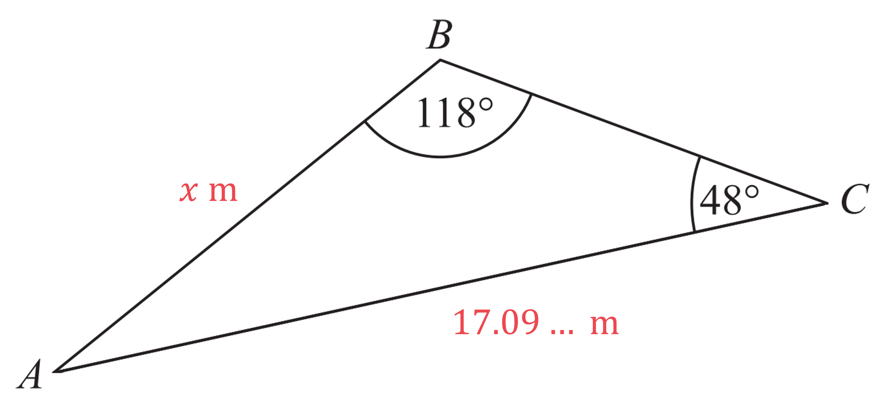

> *The formula for the sine rule is *$\frac{a}{\mathrm{sin}A}=\frac{b}{\mathrm{sin}B}$*, where **a** and **b** are the lengths of the two sides that are opposite the angles **A **and **B **respectively. *

> *Substitute **a** = **x**, **b** = 17.091903... (using the answer button), **A** = 48 and **B** = 118 into the formula.*

$\frac{x}{\sin ( 48 )} = \frac{17.091903...}{\sin ( 118 )}$

**[1]**

> *Multiply both sides by sin(48) and type into your calculator.*

$\begin{gathered} x = \frac{17.091903...}{\sin ( 118 )} \times \sin ( 48 ) \\ = 14.385632... \end{gathered}$

> *Round to 1 decimal place. Remember to include units for the length.*

$AB=14.4m(1\mathrm{dp})$* ***[1]**

### Q28
> *"SSS" so use the cosine rule, *$\mathrm{cos}A=\frac{b^{2}+c^{2}-a^{2}}{2bc}$

> *Remember that in the numerator, the side you subtract is the one opposite the angle you want to find*

$\mathrm{cos}(LMN)=\frac{19^{2}+16^{2}-14^{2}}{2\times19\times16}$

**[2]**

$=\frac{421}{608}\mathrm{or}0.6924...$

**[1]**

> *Now inverse cosine ("SHIFT cos" or "cos**-1**" on your calculator) to get the final answer*

**46.2°*** ***[1]**

**Remember to give answers in degrees to at least 1 decimal place**

### Q29
*We have a triangle with two sides and the included angle, so can use the "sine area rule" given on the formula sheet*

> *Substitute the given values for the two lengths and the area into *$\mathrm{Area}=\frac{1}{2}ab\mathrm{sin}C$

$50=\frac{1}{2}\times18\times13\times\mathrm{sin}x$

**[1]**

> *We can work out '*$\frac{1}{2}\times18\times13$*' first*

$50=117\mathrm{sin}x$

> *Divide both sides by 117 to get *$\mathrm{sin}x$

$\mathrm{sin}x=\frac{50}{117}=0.427350427...$

> *Round to at least 3 significant figures*

**0.427**** or ****0.4273 to 0.4274** **[1]**

**Read the question carefully- you are not asked to find **$x$**, only **$\mathrm{sin}x$**!**

### Q30
> *Sine rule is *$"\frac{a}{\mathrm{sin}A}\equiv\frac{b}{\mathrm{sin}B}\equiv\frac{c}{\mathrm{sin}C}"$*. *

> *It will help to label the diagram with the side names and other information given in the question.*

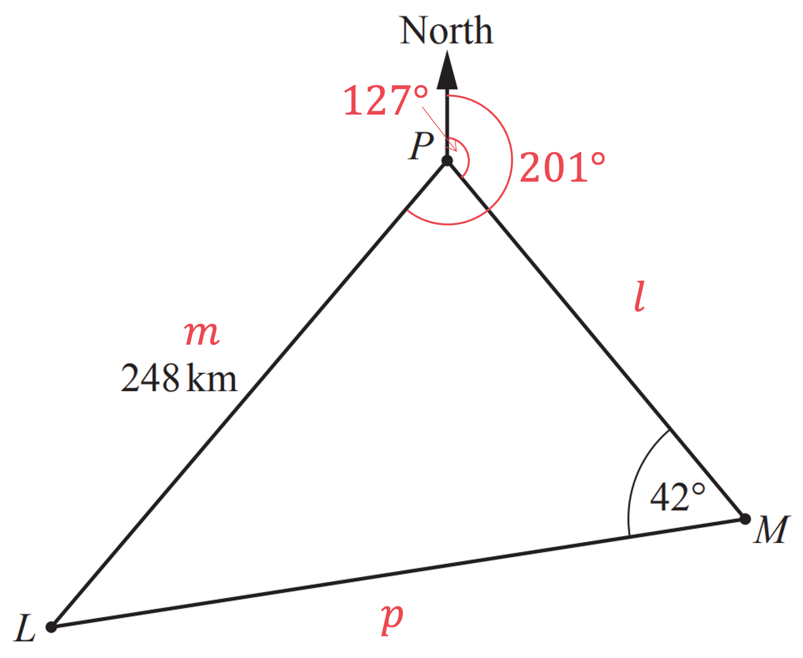

> *Find angle **LPM** using the given bearings.*

$201^{\circ}-127^{\circ}=74^{\circ}$

**[1]**

> *We have one side-angle pair (*$m$* and *$M$*) and the angle for the side we are trying to find (**LM**) so apply sine rule.*

$\begin{gathered} \frac{p}{\sin P} & \equiv \frac{m}{\sin M} \\ \frac{p}{\sin 74^{\circ}} & = \frac{248}{\sin 42^{\circ}} \end{gathered}$

**[1]**

> *Rearranging we can solve for **p** which is side **LM**.*

$p=\frac{248\mathrm{sin}74^{\circ}}{\mathrm{sin}42^{\circ}}=356.272599...$

**[1]**

**LM**** = 356 km*** ***[1]**
*The shortest distance from **M** to **LP** will be the length of a line from **M** that is perpendicular to **LP**.* *This can be considered as the (perpendicular) height (*$h$*) of the triangle when **LP** (248 km) is considered its base.*

> *Area** links the height and base in a triangle using the formula *$"A=\frac{1}{2}\timesb\timesh"$*.*

$\mathrm{Area} \mathrm{of}\DeltaLPM=\frac{1}{2}\times248\timesh=124h$

> *We can also now work out the angle MLP as angles in a triangle add up to 180°.*

$\mathrm{Angle}MLP=180^{\circ}-74^{\circ}-42^{\circ}=64^{\circ}$

**[1]**

> *We now know the length of two sides and the angle between them so can work out the area of triangle **LPM** using the formula *$"A=\frac{1}{2}ab\mathrm{sin}C"$*.*

`| Area of \Delta L P M | = 1 half x 248 x 356.272 ... x sin 64 deg | | _ = 39 706.745 ... | |`

**[1]**

> *Using the two area formulae we can set up and solve an equation for *$h$*.*

$\begin{gathered} 124 h & = 39 706.745... \\ h = 320.215 691 ... \end{gathered}$

**Shortest distance from ****M**** to ****LP**** is 320 km*** ***[1]**

### Q31
> *We have "SAS" and are finding a missing side so use the version of the cosine rule: *$a^{2}=b^{2}+c^{2}-2bc\mathrm{cos}A$*. *

> *For the purposes of substituting into the formula, it may help to replace the letters on the diagram with the letters from the formula. The formula "*$a$*" is the side to be found, so the formula angle "*$A$*" is always the angle opposite that side- while the formula "*$b$*" and "*$c$*| are interchangeable as the sides either side of the angle. See below:*

> *Thus, according to the letters in the formula, *$b=8,c=7\mathrm{and}A=78$*.*

$( O A )^{2} = 8^{2} + 7^{2} - 2 \times 8 \times 7 \times \text{\cos } 78$

*correct substitution ***[2]**

> *It's a "show that" question so the right hand side of the above line of working must be shown to achieve marks. Evaluate.*

$=89.71389063...$

**[1]**

> *Now square root this result.*

$OA=\sqrt{89.71389063...}$

$OA=9.471741689...=9.47(2d.p.)$

* **showing this result to more than 2 decimal places*** ****[1]**

**The question asks you to "show that ... to two decimal places" - so you must show the above result to ****more than 2 decimal places**** before rounding, to get the final mark for this question!**
*We can use the sine rule to find angle *$OAC$* as we have two pairs of opposite sides and angles; angle *$OAC$* is opposite 7 cm, and angle 78° is opposite 9.47 cm (from part (a)).*

> *Using sine rule *$\frac{a}{\mathrm{sin}A}=\frac{b}{\mathrm{sin}B}$*,*

$\frac{\sin ( O A C )}{7} = \frac{\sin 78}{9.47}$

**[1]**

> *Make *$\sin ( O A C )$* the subject by multiplying by 7.*

$\sin ( O A C ) = \frac{7 \sin 78}{9.47} = 0.723023569...$

**[1]**

> *To find angle *$OAC$*, inverse sine (SHIFT sin on your calculator) the above result*

**Angle** $OAC=46.3^{\circ}$ **[1] **

**Give answers in degrees to at least one decimal place**
> $OCB$* is a sector, therefore *$OC$*and *$OC$* are radii, therefore *$OC=OB=7\mathrm{cm}$*.*

> * We know from part (a) that *$AO=9.47\mathrm{cm}$

> *We can find *$CB$* by subtracting all the remaining lengths from the given perimeter, 29.5 cm*

$C B = 29.5 - ( 8 + 9.47 + 7 ) = 5.03 \text{cm}$

**[1]**

> *We can use the formula for an arc length to find the angle *$COB$*. Arc length = *`theta / 360 x 2 pi r ( or (theta pi r)/(180) )`* where *$r$* is the radius and *$θ$*is the angle bound by the radii. Therefore*

$5.03 = \frac{angle C O B}{360} \times 2 \mathrm{\pi } \times 7$

*using the arc length formula correctly*** [1] **

*equating the arc length formula to 5.03 ***[1]**

> *Rearrange to find angle *$COB$

$\begin{gathered} 5.03 & = \frac{angle C O B}{360} \times 2 \mathrm{\pi } \times 7 \\ 5.03 \times 360 & = \text{angle} C O B \times 2 \mathrm{\pi } \times 7 \\ \frac{5.03 \times 360}{2 \mathrm{\pi } \times 7} & = \text{angle} C O B \end{gathered}$

**[1]**

> *"Show that ... to 1 decimal place" so to achieve the final mark you must **show angle *$COB$* to more than one decimal place*

$\begin{gathered} \text{angle} C O B & = 41 . 17111014 . . .^{\circ} ( = 41.2^{\circ} \text{to} 1 d. p. ) \end{gathered}$** [1]**

**The final mark will be withheld if you do not state at least "41.17..."**
> *The shape is already split into a non-right-angle triangle and a sector. Sector area = *$\frac{θ}{360}\timesπr^{2}$* where *$r$* is the radius, 7 cm and *$θ$* is the angle bound by the radii, 41.2° (given in part (c))*

*Sector area =*$\frac{41.2}{360}\timesπ\times7^{2}$

**[1]**

> *For the area of the non-right-angle triangle, use Area = *$\frac{1}{2}ab\mathrm{sin}C$*. We can ignore the letters given on the diagram and set *$C$* as 78, and *$a$* and *$b$* as 8 and 7*

*Triangle area = *$\frac{1}{2}\times8\times7\times\mathrm{sin}78$

**[1]**

> *Now add these two areas to get the answer*

*Total area = *$\frac{41.2}{360}\timesπ\times7^{2}+\frac{1}{2}\times8\times7\times\mathrm{sin}78$

**[1]**

$=17.61735347...+27.38813282...\,=45.00548629...$

> *Round the final answer to at least 3 significant figures*

**Total area = 45.0 cm****2 **** ****[1] **

**"45" as your final answer will lose a mark, as it is not rounded to 3 significant figures**

### Q32
> *The formula for the area of a triangle is *$\mathrm{Area}=\frac{1}{2}ab\mathrm{sin}C$*, where **a** and **b** are the lengths of the two sides that form angle **C**. Substitute **a** = 7, **b** = 6 and **C** = 60 into the formula.*

$\begin{gathered} \text{Area} = 1 \frac{1}{2} \times 7 \times 6 \times \sin ( 60 ) \\ = 21 \sin ( 60 ) \end{gathered}$

**[1]**

> $\sin ( 60 ) = \frac{ \sqrt{3} }{2}$*.*

$\begin{gathered} \text{Area} = 21 \times \frac{ \sqrt{3} }{2} \\ \end{gathered}$

> *Remember to include square units for the area.*

`Area = | _ _ ( 21 sqrt( 3)/( 2) | | cm ^ 2` **[1]**
> *You know the lengths of two sides and the angle between them and you want to find the length of the third side. Therefore you need to use the cosine rule.*

> *The formula for the cosine rule is *$a^{2}=b^{2}+c^{2}-2bc\mathrm{cos}A$*, where **b** and **c** are the lengths of the two sides that form angle **A** and **a** is the length of the side opposite **A**. Substitute **a** = **AB**, **b** = 6, **c** = 7 and **A** = 60 into the formula.*

$\begin{gathered} A B^{2} & = 6^{2} + 7^{2} - 2 ( 6 ) ( 7 ) \cos ( 60 ) \\ = 36 + 49 - 84 \cos ( 60 ) \\ = 85 - 84 \cos ( 60 ) \end{gathered}$

**[1]**

$\cos ( 60 ) = 1 \frac{1}{2}$

$\begin{gathered} A B^{2} & = 85 - 84 \times 1 \frac{1}{2} \\ = 85 - 42 \\ = 43 \end{gathered}$

**[1]**

> *Take the positive square root of both sides. Remember to include units for the length.*

`A B = | _ _ sqrt( 43 | | cm`* ***[1]**

### Q33
i) *The sine rule is *$\frac{a}{\mathrm{sin}A}=\frac{b}{\mathrm{sin}B}=\frac{c}{\mathrm{sin}C}$* where*

*Write angle** BCD** as *$x$* on the diagram* * *

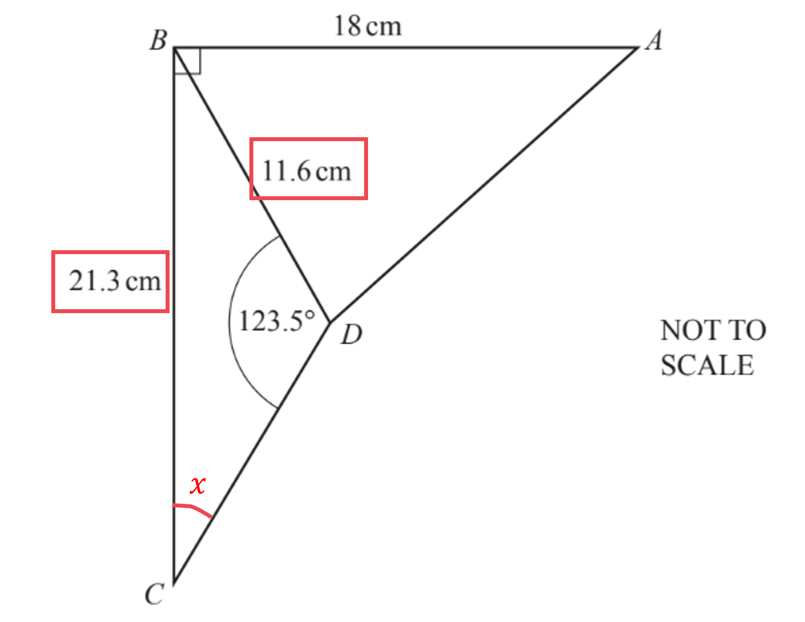

*The sine rule can be used on triangle **BCD* *Substitute *$a=21.3$*, *$A=123.5$*, *$b=11.6$* and *$B=x$* into the sine rule* * *

$\frac{21.3}{\mathrm{sin}123.5}=\frac{11.6}{\mathrm{sin}x}$

**[1]**

*Make *$\mathrm{sin}x$* the subject (by multiplying both sides by the denominators then dividing by 21.3)* * *

$\begin{gathered} 21.3 \sin x & = 11.6 \sin 123.5 \\ \sin x & = \frac{11.6 \sin 123.5}{21.3} \end{gathered}$

**[1]*** *

*Find *$x$* (by taking inverse sine of both sides)* * *

$x = \sin ^{- 1} ( \begin{gathered} \frac{11.6 \sin 123.5}{21.3} \end{gathered} )$ * *

> *Use a calculator find angle *$x$*, giving your answer to 1 decimal place*

$x=27.0^{\circ}$ **[1]**

ii) *The cosine rule is *$a^{2}=b^{2}+c^{2}-2bc\mathrm{cos}A$* where *

*The cosine rule can be used to find **AD**, if angle **ABD** is known* *First, find angle **CBD** (using angles in a triangle add to 180°)* * *

*angle ***CBD*** = 180° - 123.5° - 27.0° = 29.5°* * *

*Then find angle **ABD** (using that **CBA** is a right-angle)* * *

*angle ***ABD*** = 90° - angle ***CBD*** = 90° - 29.5° = 60.5°*

**[1]**

*Draw these angles on the diagram if it helps* * *

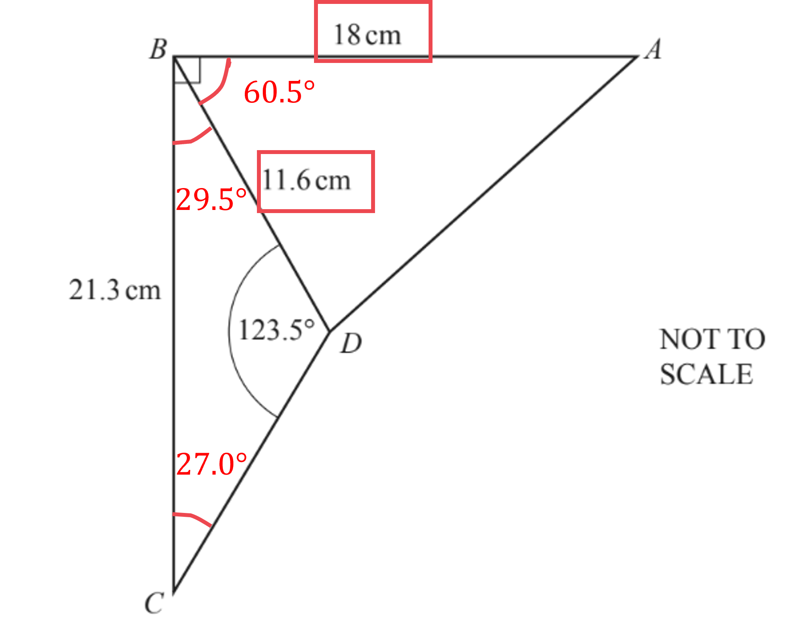

*Use the cosine rule with *$a=AD$*, *$b=11.6$*, *$c=18$* and *$A=60.5^{\circ}$ * *

$AD^{2}=11.6^{2}+18^{2}-2\times11.6\times18\times\mathrm{cos}60.5$

**[2] **

*Use a calculator to find *$AD^{2}$ * *

$AD^{2}=252.92...$

**[1]**

> *Square root the answer to find *$AD$

$AD=15.9$** ****cm ****[1]**

**Answers in the range 15.90 to 15.91 are accepted**

### Q34
*Substitute the given values from triangle **ABC **into the cosine rule,* $\mathrm{cos}A=\frac{b^{2}+c^{2}-a^{2}}{2bc}$*.*

$\cos ( B A C ) = \frac{158^{2} + 132^{2} - 107^{2}}{2 \times 158 \times 132}$

* Correct substitution in to the cosine rule ***[1] **

*Correct version of the cosine rule used*** [1]**

$\cos ( B A C ) = 0.74172...$

**[1]**

> *Take cos**-1** of both sides.*

$BAC=42.12109...$

**Angle ****BAC**** = 42.1****o**** [1]**

**Answers of 42.12... will also be accepted.**
*Substitute the given values from triangle **CAD** into the sine rule.* *Make sure you use the version of the sine rule with the angles in the numerators, *$\frac{\mathrm{sin}A}{a}=\frac{\mathrm{sin}B}{b}=\frac{\mathrm{sin}C}{c}$*.*

$\frac{\sin ( C A D )}{86} = \frac{\sin 116}{132}$

**[1]**

> *Multiply both sides by 86.*

$\sin ( C A D ) = \frac{\sin 116}{132} \times 86$

**[1]**

$\sin ( C A D ) = 0.58557...$

> *Take sin**-1** of both sides.*

$CAD=35.84382...$

**Angle ****CAD**** = 35.8****o**** ****[1]**

**Answers of 35.84... will also be accepted.**
> *Calculate the area of the triangle **ABC** using the area of a triangle formula, *$A=\frac{1}{2}ab\mathrm{sin}C$*. *

> *Substitute the values from the diagram and from part b).*

$A = 1 \frac{1}{2} \times 158 \times 132 \times \sin ( 42.12109... )
A = 6994.05650...$

**[1]**

> *Work out angle **ACD** by subtracting angle **ADC**  and angle **CAD **(from part c)) from 180**o**.*

$180-116-35.84382...=28.15617...$

> *Calculate the area of the triangle **ACD** using the area of a triangle formula. *

> *Substitute the values from the diagram and from part b).*

* *$A = 1 \frac{1}{2} \times 132 \times 86 \times \sin ( 28.15617... )
A = 2678.37078...$

**[1]**

> *Add the areas of the two triangles together to find the total area of the field.*

$6994.05650...+2678.37078...=9672.42728...$

**9670**** m****2**** [1]**

**Answers between 9669 and 9676 will also be accepted.**

### Q35
> *First look at triangle **ABD**.*

> *You know the length of one side and the angle opposite it. You also know another angle so you can find the length of the side opposite that using the sine rule.*

> *The formula for the sine rule is *$\frac{a}{\mathrm{sin}A}=\frac{b}{\mathrm{sin}B}$*, where **a** and **b** are the lengths of the two sides that are opposite the angles **A **and **B **respectively.*

> * Substitute **a** = **y**, **b** = 7.4, **A** = 45 and **B** = 80 into the formula.*

$\frac{y}{\sin ( 45 )} = \frac{7.4}{\sin ( 80 )}$

**[1]**

> *Multiply both sides by sin(45) and type into your calculator.*

$\begin{gathered} y = \frac{7.4}{\sin ( 80 )} \times \sin ( 45 ) \\ = 5.313311... \end{gathered}$

**[1]**

> *Now look at triangle **BCD**. You know the angles **BDC** and **ADB** add up to 180° so you can find the missing angle.*

> *You know the lengths of two sides and the angle between them and you want to find the length of the third side. Therefore you need to use the cosine rule.*

> *The formula for the cosine rule is *$a^{2}=b^{2}+c^{2}-2bc\mathrm{cos}A$*, where **b** and **c** are the lengths of the two sides that form angle **A** and **a** is the length of the side opposite **A**. *

> *Substitute **a** = **x**, **b** = 5.8, **c** = 5.313311... (using the answer button) and **A** = 100 into the formula.*

$x^{2} = 5.8^{2} + 5.313311...^{2} - 2 ( 5.8 ) ( 5.313311... ) \cos ( 100 )$

**[1]**

> *Type the expression into your calculator altogether as one line. If you do it separately you need to remember the order of operations (multiplication before addition).*

$x^{2}=72.573980...$

**[1]**

> *Take the positive square root of both sides.*

$\begin{array}{rcl} x = \sqrt{72.573980...} \\ = 8.519036... \end{array}$

> *Round to 3 significant figures. Remember to include units for the length.*

$BC=8.52\mathrm{cm}(3\mathrm{sf})$* ***[1]**

### Q36
> *i) Substitute the values from the diagram into the cosine rule, *$a^{2}=b^{2}+c^{2}-2bc\mathrm{cos}A$*, where *$a$* is the unknown side, *$b$* and *$c$* are the known sides and *$A$* is the included angle.*

$a^{2} = 8^{2} + 13^{2} - 2 \times 8 \times 13 \times \cos ( 79 )$

*Correct formula*** [1] **

*Correct substitution into formula*** [1]**

$a^{2}=193.31172...$

**[1]**

> *Square root both sides.*

$a=13.90365...$

**BC = ****13.9 m ****[1]**

**Answers of 13.9... will be accepted.**

> *ii) To find a missing angle substitute the known sides and angles into the sine rule. Use the sine rule with the angles on the numerators, *$\frac{\mathrm{sin}A}{a}=\frac{\mathrm{sin}B}{b}=\frac{\mathrm{sin}C}{c}$*. Use the length of **BC** from part i).*

$\frac{\sin ( A C B )}{13} = \frac{\sin ( 79 )}{13.90365...}$

**[1]**

> *Multiply both sides by 13.*

$\sin ( A C B ) = 13 \times \frac{\sin ( 79 )}{13.90365...}$

**[1]**

$\sin ( A C B ) = 0.91782...$

> *Take sin**-1** of both sides.*

$ACB=66.61044...$

**Final answer:** **Angle ****ACB**** = 66.6****o**** ****[1]**

**Answers between 66.60 and 66.65 will be accepted.**

### Q37
> *We have two sides, the angle between them and are asked to show the length of the third side.*

*This is cosine rule, *$"a^{2}=b^{2}+c^{2}-2bc\mathrm{cos}A"$

> *It may help to label the diagram.*

$( B C )^{2} = 115^{2} + 80^{2} - 2 \times 115 \times 80 \times \cos 72^{\circ}$

**[1]**

> *Avoid rounding before your final answer - store the exact value in your calculator's memory.*

$( B C )^{2} = 13 939.087 ...$ 
$BC=118.063911...$

> *Final answer is to be shown to **one decimal place.*

$BC=118.1$** cm (1 d.p.)** **[1]**
> *We now know side **BC**.*

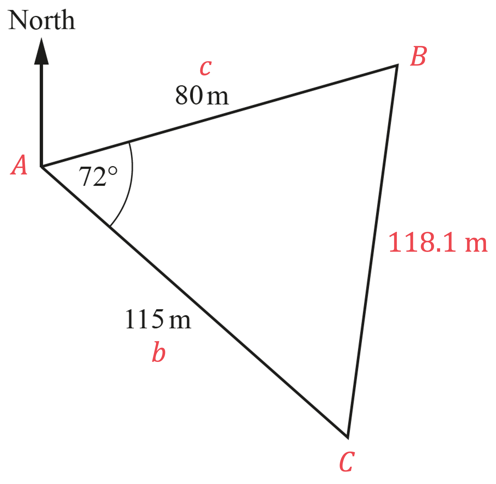

> *For angle **ABC**, we know it's opposite side and a another side-angle pair. *

*This is sine rule, * $"\frac{sinA}{a}=\frac{sinB}{b}"$*.*

$\frac{\mathrm{sin}72^{\circ}}{118.063...}=\frac{\mathrm{sin}ABC}{115}$

**[1]**

> *Do not work out or round any values until your final answer. Use the exact answer for side **BC** stored in your calculator from part a. Rearrange the equation.*

$\mathrm{sin}ABC=\frac{115\mathrm{sin}72^{\circ}}{118.063...}$

**[1]**

> *Use inverse sine (sin**-1**) to find angle **ABC**.*

$\begin{gathered} A B C & = \sin ^{- 1} ( \frac{115 \sin 72^{\circ}}{118.063 ...} ) \\ A B C & = 67.876 670 ... \end{gathered}$

**Angle ****ABC**** = 67.9° (1 d.p.)*** ***[1]**

### Q38
> *Formula for the area of a triangle: *$\mathrm{Area}=\frac{1}{2}ab\mathrm{sin}C$*. Substitute the values for the two sides adjacent to the angle in triangle **BCD.*

$\begin{gathered} \text{area} B C D & = 1 \frac{1}{2} ( B C ) ( B D ) \sin ( C B D ) \\ = 1 \frac{1}{2} ( 192 ) ( 168 ) \sin ( 106^{\circ} ) \end{gathered}$

**[1]**

> *Use your calculator to find the area.*

> $\begin{gathered} 1 \frac{1}{2} ( 192 ) ( 168 ) \sin ( 106^{\circ} ) & = 15503.2286... \end{gathered}$*   *

`equation`* ***[1] **

**Unrounded answers in the range 15 501 to 15 503 m****2**** accepted.**
> *Convert the unrounded area found in part (ii) to hectares using the conversion 1 hectare = 10 000m**2**. *

*15503.2286... ÷ 10000 = 1.5503... hectares*

> *Tomas buys 1.5503 hectares at \$35 750 per hectare.*

*1.5503... × 35750 = 55424.0423...*

**Final answer:** **The land costs \$55 400 (to the nearest \$100) **

*Correct answer** ***[1] **

*Answer** rounded correctly ***[1]**

### Q39
> *You only need to use triangle **PQR**. *

> *You are given the lengths of two sides and the angle in between them. Therefore you can use the cosine rule to find the length of the side opposite the angle. Cosine rule: *$a^{2}=b^{2}+c^{2}-2bc\mathrm{cos}A$*.*

> *For the sides use, **a** = **QR**, **b **= **PR** = 150 and **c** = **PQ** = 120 and for the angle use **A **= **QPR **= 25°.*

> *Substitute the values into the formula.*

$QR^{2}=150^{2}+120^{2}-2(150)(120)\mathrm{cos}(25)$

**[1]**

> *Simplify the expression, type it in the calculator as one long expression. If you evaluate the expression bit by bit then remember to apply the order of operations (multiplication before subtraction).*

$QR^{2}=4272.9196...$

**[1]**

> *Solve for **QR** by square rooting both sides. Use the answer button or type the exact expression in your calculator.*

$\begin{gathered} Q R & = \sqrt{150^{2} + 120^{2} - 2 ( 150 ) ( 120 ) \cos ( 25 )} = \sqrt{4272.9196...} \\ Q R & = 65.3675... \end{gathered}$

> *Round to 3 significant figures.*

**QR ****= 65.4 m** **[1]**
> *You only need to use triangle **PRS**.*

> *You are given two angles so find the 3rd angle by subtracting the other two from 180°.*

$\begin{gathered} \text{Angle} P S R & = 180^{\circ} - 45^{\circ} - 55^{\circ} \\ = 80^{\circ} \end{gathered}$

**[1]**

> *As you know the length of a side (**PR**) and the angle opposite (**PSR**) you can use the sine rule to find the length of the side (**RS**) which is opposite to the angle (**RPS**). Sine rule: *$\frac{a}{\mathrm{sin}A}=\frac{b}{\mathrm{sin}B}$*.*

> *For the lengths use **a **= **RS **and **b **= **PR** = 150, and for the angles use **A **= **RPS** = 55° and **B **= **RPS **= 100°*

$\frac{RS}{\mathrm{sin}(55)}=\frac{150}{\mathrm{sin}(80)}$

**[1]**

> *Solve for **RS** by multiplying both sides by sin55.*

$\begin{gathered} x = \frac{150}{\sin ( 80 )} \times \sin ( 55 ) \\ x = 124.7683... \end{gathered}$

**[1]**

> *Round to 3 significant figures.*

**RS ****= 125 m** **[1]**
> *The formula for the area of a triangle is *$\frac{1}{2}ab\mathrm{sin}C$* where **a **and **b **are the two sides that make angle **C**.*

> *Find the area of triangle **PQR** by using **a** = **PR** = 150, **b **= **PQ** = 120 and **C** = **QPR ** = 25.*

$1 \frac{1}{2} ( 150 ) ( 120 ) \sin ( 25 ) = 3803.5643...$

**[1]**

> *Find the area of triangle **PSR** by using **a** = **PR** = 150, **b **= **RS** = 124.7683... and **C** = **PRS ** = 45. Try to use the exact answer for **RS**, if it is still in your calculator then you can use the answer button.*

$1 \frac{1}{2} ( 150 ) ( 124.7683... ) \sin ( 45 ) = 6616.8392...$

**[1]**

> *Add together the two areas to find the total area.*

$3803.5643...+6616.8392...=10420.4036...$

> *Round to 3 significant figures.*

**10 400 m****2** **[1]**

### Q40
*As the sides *$EF$* and *$FG$* are in the ratio *$1:2$*, this means we do not know their exact length, but we know that *$FG$* is double the length of *$EF$

> *So we can call their lengths *$x$* and *$2x$

> *Draw a sketch of the triangle*

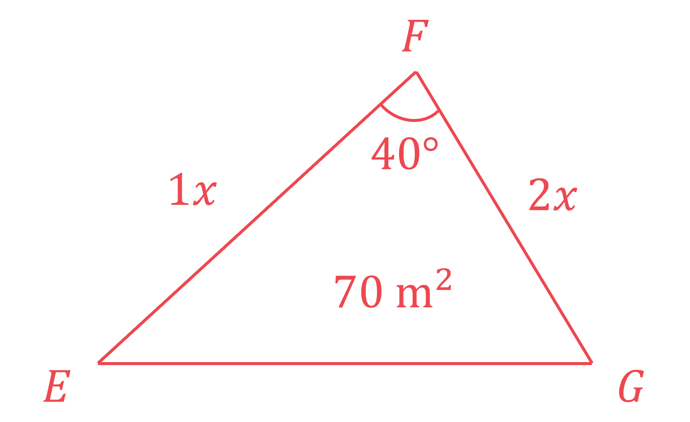

> *Using the formula for the area of a triangle; *$\mathrm{Area}=\frac{1}{2}ab\mathrm{sin}C$* where *$a$* and *$b$* are either side of angle *$C$

$70 = 1 \frac{1}{2} \times x \times 2 x \times \sin ( 40 )$

**[1]**

> *Simplify*

$70 = x^{2} \times \sin ( 40 )$

**[1]**

> *Divide both sides by *$\sin ( 40 )$

$\frac{70}{\sin ( 40 )} = x^{2}$

> *Square root both sides*

$x = \sqrt{ \frac{70}{\sin ( 40 )} } = 10.43554828...$

**[1]**

$EF=10.4m$ **[1]**
> *This triangle has a similar arrangement to the previous triangle, however we now know that *$PQ=EF=10.4m$* which means that *$QR=20.8m$

*It has the same area, and two of the same side lengths as the previous triangle, but it is stated that is is different.*

> *This is because there are two possibilities for the angle, which would give the same area*

$\mathrm{Area}=\frac{1}{2}ab\mathrm{sin}C$

$70=\frac{1}{2}\times10.4\times20.8\times\mathrm{sin}θ$

> *Simplifying*

$70=108.16\times\mathrm{sin}θ$

> *Divide both sides by 108.16*

$\mathrm{sin}θ=\frac{70}{108.16}=0.647...$

$\\theta = \sin ^{- 1} ( \frac{70}{108.16} ) = 40$

> *There are two solutions for *$θ$* in this equation, one of them is 40 (used in the triangle for part i) and we must find the other*

> *The other solution is *

$180-40=140$

*This can be seen geometrically, and by using angles on a straight line summing to 180° to find the angle marked *$y$ *(Note this diagram is not to scale)*

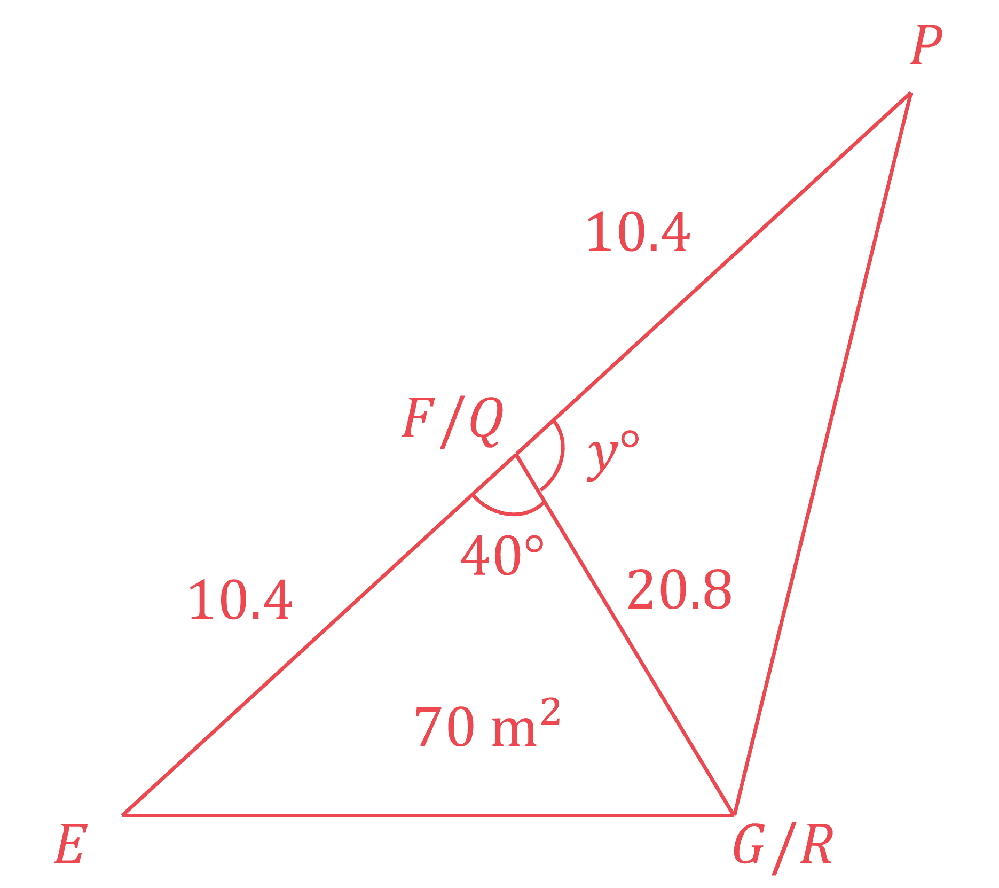

> *You can also consider the graph of *$y=\mathrm{sin}θ$* and the line *$y=\frac{70}{108.16}$* *

*Their intersections are the solutions to *$\mathrm{sin}θ=\frac{70}{108.16}$

> *You can use the symmetry of the graph to help see why the 2nd solution is 180-40*

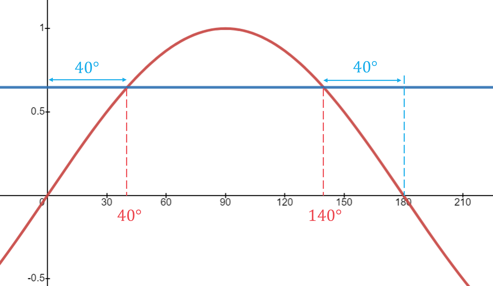

$\mathrm{Angle}PQR=140^{\circ}$ **[1]**

### Q41
> *The area of a triangle is *$\frac{1}{2}ab\mathrm{sin}C$

*Find the area of **PQR** (by substituting *$a=8.9$*, *$b=12.5$* and *$C=130.6^{\circ}$* into the formula)* * *

$\frac{1}{2}\times8.9\times12.5\times\mathrm{sin}130.6$

**[1]**

> *Find this value to 3 significant figures (using a calculator)*

**42.2 cm****2**** ****[1]**

### Q42
> *Look at triangle **BCG**. You know the lengths of three sides and want to find one of the angles. Therefore you can use the cosine rule: *$a^{2}=b^{2}+c^{2}-2bc\mathrm{cos}A$*where **A** is the required angle (**BCG**), **a **is the length opposite the angle (**BG**), **b **and **c **are the lengths adjacent to the angle (**CG **and **BC**).*

$6.9^{2}=5.3^{2}+11^{2}-2\times5.3\times11\times\mathrm{cos}x$

**[1]**

> *Simplify each term.*

$47.61=149.09-116.6\mathrm{cos}x$

> *Subtract 149.09 from both sides.*

$-101.48=-116.6\mathrm{cos}x$

> *Divide both sides by -116.6. Leave as a fraction but you can cancel out the negative signs*

$\begin{gathered} \frac{- 101.48}{- 116.6} & = \cos x \\ \cos x & = \frac{101.48}{116.6} \end{gathered}$

**[1]**

> *Use inverse cos on your calculator to find the angle.*

$x = \cos ^{- 1} ( \frac{101.48}{116.6} ) = 29.5034...$

**[1]**

> *You need to round angles to 1 decimal place.*

$x=29.5$ **[1]**
> *Look at triangle **ABC**. You can work out angle angle **ABC** by forming an equation using the fact that the interior angles in a triangle add up 180°. Angle ACB is 54 + **x**, so use the full value for **x** (using the answer button on your calculator) rather than the rounded answer. *

$\begin{gathered} 42 + ( 54 + 29.5034... ) + A B C & = 180 \\ 125.5034... + A B C & = 180 \\ A B C & = 180 - 125.5034... \\ A B C & = 54.4965... \end{gathered}$

**[1]**

> *You know an angle and the side opposite (**CAB** and **BC**). You know the angle **ABC** and want to find the side opposite (**AC**). This involves two pairs of opposite angles and sides so you can use the sine rule *$\frac{a}{\mathrm{sin}A}=\frac{b}{\mathrm{sin}B}$* with **a** as side **AC**, **b** as side **BC**, **A** as angle **ABC** and **B** as angle **CAB**.*

$\frac{A C}{\sin ( 54.4965... )} = \frac{11}{\sin ( 42 )}$

**[1]**

> *Multiply both sides by sin(54.4965...).*

$A C = \frac{11}{\sin ( 42 )} \times \sin ( 54.4965... ) = 13.3828...$

**[1]**

> *Round to 3 significant figures.*

**AC ****= 13.4 cm** **[1]**

### Q43
i) *To find length *$AB$* we can consider triangle *$ABD$* and use the cosine rule:* $a^{2}=b^{2}+c^{2}-2bc\mathrm{cos}A$

> *In this formula, the lower-case sides, *$a,b,c$* must be opposite their respective angles, which are capital letters (in this case only *$A$*)*

*We will re-label the triangle (in red) to reflect this*

> *Using the cosine rule*

$a^{2} = 12.4^{2} + 16.5^{2} - ( 2 \times 12.4 \times 16.5 \times \cos ( 64 ) )$

**[2]**

> *Evaluating the right hand side using calculator*

$a^{2}=246.6285267...$

**[1]**

> *Square-rooting (make sure you use the unrounded value)*

$a=\sqrt{246.6285267...}=15.70441106...$

$AB=15.7\mathrm{cm}$ **[1]**

**Rounded to 3 significant figures**

ii) *Considering triangle *$BDC$* (using the original labels), we can find angle *$C$* using the fact that the sum of the interior angles in a triangle is 180°*

$180-95-53=32$

**[1]**

> *We can now use the sine rule, *$\frac{a}{\mathrm{sin}A}=\frac{b}{\mathrm{sin}B}=\frac{c}{\mathrm{sin}C}$* where the sides *$a,b,c$* must be opposite their respective angles, which are capital letters*

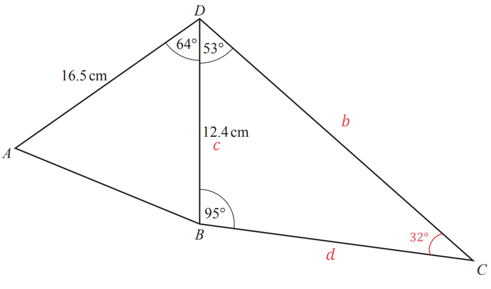

> *Applying the sine rule to *$BDC$* (we are trying to find *$BC$*, labelled as *$d$*)*

$\frac{d}{\sin ( 53 )} = \frac{12.4}{\sin ( 32 )}$

> *Multiply both sides by *$\sin ( 53 )$

$d = \frac{12.4}{\sin ( 32 )} \times \sin ( 53 )$

**[2]**

$d=18.68790398...$

$BC=18.7\mathrm{cm}$ **[1]**

**Rounded to 3 significant figures**

### Q44
a) *Labelling the diagram with the angles of elevation*

> *The sum of the angles on a straight line is 180°, and we can use this fact to find angle *$ADC$

$ADC=180-72=108$

**[1]**

> *The interior angles in a triangle sum to 180°, and this can be applied to triangle *$ACD$* to find angle *$ACD$

$ACD=180-26-108=46$

**[1]**

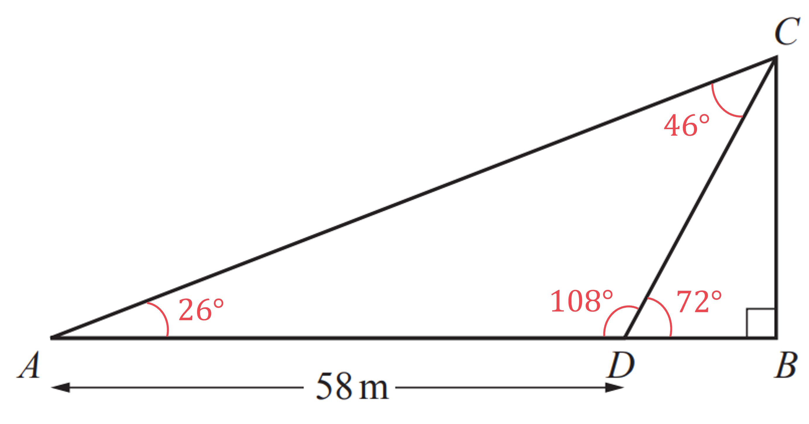

> *To find the length of *$AC$* we can use the sine rule; *$\frac{a}{\mathrm{sin}A}=\frac{b}{\mathrm{sin}B}=\frac{c}{\mathrm{sin}C}$* where the lower-case letters are the side lengths and the upper case letters are the angles opposite those sides*

> *Applying the sine rule to the triangle *$ACD$

$\frac{A C}{\sin ( 108 )} = \frac{58}{\sin ( 46 )}$

> *Multiplying both sides by *$\sin ( 108 )$

$A C = \frac{58}{\sin ( 46 )} \times \sin ( 108 )$

**[2]**

$AC=76.68320023...$

$AC=76.7m$* ***[1]*** *

**Rounded to 1 decimal place**

ii) *Considering the right-angled triangle *$ABC$

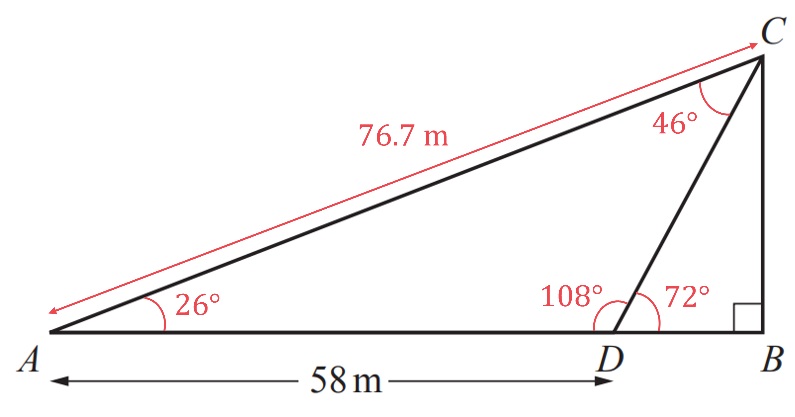

> *As we know the hypotenuse and the angle, we can find the adjacent *$( A B )$* using the cosine ratio; *$\mathrm{cos}θ=\frac{\mathrm{adjacent}}{\mathrm{hypotenuse}}$

$\cos ( 26 ) = \frac{A B}{76.7}$

**[1]**

> *Multiply both sides by 76.7*

$76.7 \times \cos ( 26 ) = A B$

$AB=68.93750335...$

**[1]**

> *We can then find the length *$BD$

$68.93750335-58=10.93750335...$

**10.9 m*** ***[1]*** *

**Round to 3 significant figures**

### Q45
> *The parallelogram is split into two identical triangles. To use the formula for the area of a triangle you need two sides and the angle between them. You do not currently have this so use triangle **ACD** to help find the required angle.*

> *You know the length of one side and the angle opposite it. You also know the length of another side so you can use the sine rule to find the angle opposite it.*

> *The formula for the sine rule is *$\frac{\mathrm{sin}A}{a}=\frac{\mathrm{sin}B}{b}$*, where **a** and **b** are the lengths of the two sides that are opposite the angles **A **and **B **respectively. *

> *Substitute **a** = **9**, **b** = 11, **A** = **y** and **B** = 100 into the formula.*

$\frac{\sin ( y )}{9} = \frac{\sin ( 100 )}{11}$

**[1]**

> *Multiply both sides by 9 and then find the angle by using the inverse sin function.*

$\begin{gathered} \sin ( y ) & = \frac{\sin ( 100 )}{11} \times 9 \\ y = \sin ^{- 1} ( \frac{\sin ( 100 )}{11} \times 9 ) \end{gathered}$

**[1]**

> *Type into your calculator.*

$\begin{gathered} y = 53.682923... \end{gathered}$

> *You can find the third angle by spotting that the three interior angles of the triangle should add up to 180°. Use the answer button on your calculator.*

$\begin{gathered} x = 180 - 100 - 53.682923... \\ = 26.317076... \end{gathered}$

**[1]**

> *You now have enough information to find the area of one of the triangles.*

> *The formula for the area of a triangle is *$\mathrm{Area}=\frac{1}{2}ab\mathrm{sin}C$*, where **a** and **b** are the lengths of the two sides that form angle **C**. Substitute **a** = 9, **b** = 11 and **C** = 26.317076... (using the answer button) into the formula.*

$\begin{gathered} \text{Area} = 1 \frac{1}{2} \times 9 \times 11 \times \sin ( 26.317076... ) \\ = 21.945249... \end{gathered}$

**[1]**

> *Multiply by 2 to find the area of the parallelogram.*

$\begin{gathered} 2 \times 21.945249... & = 43.890498... \end{gathered}$

> *Round to 3 significant figures. Remember to include square units for the area.*

$\mathrm{Area}=43.9\mathrm{cm}^{2}(3\mathrm{sf})$** [1]**

### Q46
> *The area of a triangle is *$\frac{1}{2}ab\mathrm{sin}C$

> *Triangle **ABC** is equilateral so **AC** = **AB** = 10 cm and angle **CAB **is 60° *

*Find the area of triangle **ABC** (by substituting *$a=10$*, *$b=10$* and *$C=60$* into the formula)* * *

$\frac{1}{2}\times10\times10\times\mathrm{sin}60\,=50\mathrm{sin}60$

**[1]**

$\sin ( 60 ) = \frac{ \sqrt{3} }{2}$

$=50\times\frac{\sqrt{3}}{2}\,=25\sqrt{3}$

**[1]**

> *M** is the mid-point of **AC** (length **AM** is half of **AC**) *

*Draw **AM** = 5 cm and angle **CAB** = 60° on to the diagram* * *

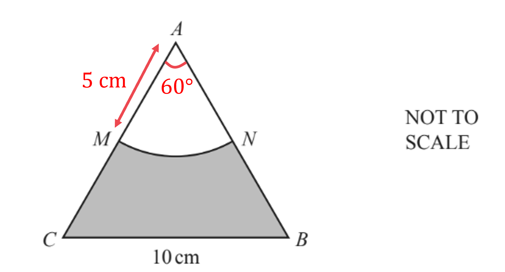

*The area of a sector with angle *$k$*° is *$\frac{k}{360}\timesπr^{2}$

*Find the area of sector **AMN** (by substituting *$k=60$* and *$r=5$* into the formula)* * *

$\frac{60}{360}\timesπ\times5^{2}\,=\frac{1}{6}\timesπ\times25\,=\frac{25}{6}π$

**[1]**

> *Find the grey area by subtracting the sector area from the triangle are*

$(25\sqrt{3}-\frac{25}{6}π)$** cm****2** **[1]**

**There are longer methods involving Pythagoras' Theorem**

### Q47
> *First look at triangle **BCD**.*

> *You know the length of one side and the angle opposite it. You also know another angle so you can find the length of the side opposite that using the sine rule.*

> *The formula for the sine rule is *$\frac{a}{\mathrm{sin}A}=\frac{b}{\mathrm{sin}B}$*, where **a** and **b** are the lengths of the two sides that are opposite the angles **A **and **B **respectively. *

> *Substitute **a** = **y**, **b** = 12.5, **A** = 34 and **B** = 109 into the formula.*

$\frac{y}{\sin ( 34 )} = \frac{12.5}{\sin ( 109 )}$

**[1]**

> *Multiply both sides by sin(34) and type into your calculator.*

$\begin{gathered} y = \frac{12.5}{\sin ( 109 )} \times \sin ( 34 ) \\ = 7.392674... \end{gathered}$

**[1]**

> *Now look at triangle **ABD**.*

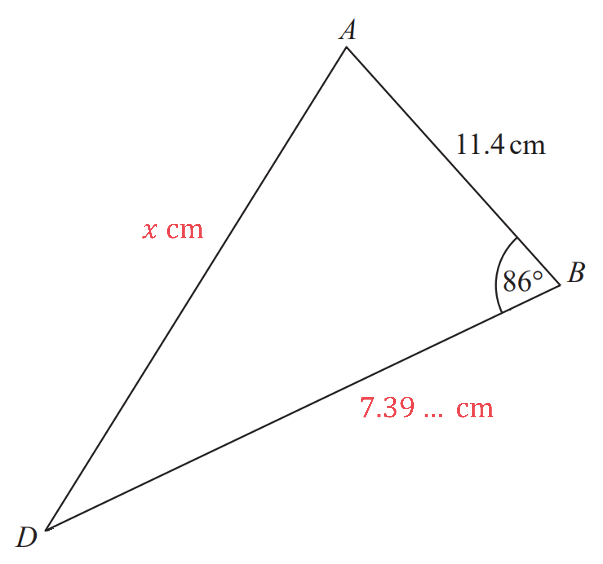

> *You know the lengths of two sides and the angle between them and you want to find the length of the third side. Therefore you need to use the cosine rule.*

> *The formula for the cosine rule is *$a^{2}=b^{2}+c^{2}-2bc\mathrm{cos}A$*, where **b** and **c** are the lengths of the two sides that form angle **A** and **a** is the length of the side opposite **A**. *

> *Substitute **a** = **x**, **b** = 11.4, **c** = 7.392674... (using the answer button) and **A** = 86 into the formula.*

$x^{2} = 11.4^{2} + 7.392674...^{2} - 2 ( 11.4 ) ( 7.392674... ) \cos ( 86 )$

**[1]**

> *Type the expression into your calculator altogether as one line. If you do it separately you need to remember the order of operations (multiplication before addition).*

$x^{2}=172.853978...$

**[1]**

> *Take the positive square root of both sides.*

$\begin{array}{rcl} x = \sqrt{172.853978...} \\ = 13.147394... \end{array}$

> *Round to 3 significant figures. Remember to include units for the length.*

$AD=13.1\mathrm{cm}(3\mathrm{sf})$* ***[1]**

### Q48
> *Use the formula for the area of a triangle, *$A=\frac{1}{2}ab\mathrm{sin}C$*.*

$A = 1 \frac{1}{2} \times 11 \times 13 \times \sin ( 39 )$

**[1]**

$A=44.996407...$

$45.0$** ****cm****2**** ****[1]**

**Answers between 44.99 and 45.00 are accepted.**

### Q49
> *We have three known sides (SSS). Therefore to find a missing angle we can use the cosine rule *$\mathrm{cos}A=\frac{b^{2}+c^{2}-a^{2}}{2bc}$

> *When applying the cosine rule to find an angle, always set *$a$* to be the side opposite the angle (*$b$* and *$c$* are interchangeable)*

$\cos ( x ) = \frac{11^{2} + 5^{2} - 13^{2}}{2 \times 11 \times 5}$

**correct substitution into cosine rule in any form**** ****[1] **

**correct substitution into cosine rule in the above form*** ***[1]**

> *It's advisable to calculate the numerator and the denominator separately.*

$\cos ( x ) = \frac{- 23}{110}$

> *If you prefer to work out cos(*$x$*) on one line of your calculator, remember to put brackets around the numerator and the denominator:*

$\begin{gathered} \cos ( x ) & = ( 11^{2} + 5^{2} - 13^{2} ) \div ( 2 \times 11 \times 5 ) \\ = - 0.209090909... \end{gathered}$

**  **$\frac{-23}{110}$** or **$-0.209090909...$** [1]**

> *Inverse cosine to get *$x$

$x=102.1^{\circ}$* *** [1]**

**Remember to give answers in degrees to at least one decimal place**

### Q50
> *i) Substitute the values in the diagram into the area of a triangle formula, *$A=\frac{1}{2}ab\mathrm{sin}C$*, where *$a$* and *$b$* are the two known sides and *$C$* is the included angle.*

$70 = 1 \frac{1}{2} \times ( x + 4 ) \times ( 4 x - 5 ) \times \sin ( 30 )$

**[1]**

> *Simplify the right hand side.*

$70 = 1 \frac{1}{4} ( x + 4 ) ( 4 x - 5 )$

> *Multiply both sides by 4.*

$280 = ( x + 4 ) ( 4 x - 5 )$

**[1]**

> *Expand the brackets on the right hand side.*

$280=4x^{2}+16x-5x-20$

**[1]**

> *Simplify by collecting like terms.*

$280=4x^{2}+11x-20$

> *Subtract 280 from both sides.*

$0=4x^{2}+11x-300$

$4x^{2}+11x-300=0$ **[1]**

> *ii) Substitute the given values into the quadratic formula, *$x=\frac{-b\pm\sqrt{b^{2}-4ac}}{2a}$*, given an equation of the form *$ax^{2}+bx+c=0$*.*

$x=\frac{-11\pm\sqrt{11^{2}-4\times4\times-300}}{2\times4}$

*Correct substitution of values into the discriminant (the part inside the square root sign)*** [1] **

*Correct substitution of values in to the rest of the formula*** [1]**

> *Simplify the right hand side.*

$x=\frac{-11\pm\sqrt{4921}}{8}$

> *Work out the two results by doing the calculation twice, once using the positive sign and once using the negative sign in front of the square root.*

$x=7.39372...$* or *$x=-10.14372...$

**Final answer:** $x=7.39$** or **$x=-10.14$

*7.39*** [1] **

*-10.14*** [1]**

**Remember to give your answers to 2 d.p. as the question asks for, otherwise you will drop a mark!**

> *iii) Substitute the (positive) value for *$x$* from part ii) into the expression for the side **DE**.*

$7.39372...+4=11.39372...$

**DE**** = 11.4 m**** [1]**

**Answers of 11.39... will be accepted.**

### Q51
> *You have two pairs of opposite sides and angles, because you know three of the pieces of information and you want to find the missing angle, you can use the sine rule with the angles on top.*

> *Substitute your values, *$a=12,A=x^{\circ},b=8$* and *$B=39^{\circ}$* into the sine rule, *$\frac{\mathrm{sin}A}{a}=\frac{\mathrm{sin}B}{b}=\frac{\mathrm{sin}C}{c}$*.*

$\begin{gathered} \frac{\sin ( x )}{12} & = \frac{\sin ( 39 )}{8} \end{gathered}$

**[1]**

> *Multiply both sides by 12.*

$\begin{array}{rcl} \sin ( x ) & = \frac{12 \sin ( 39 )}{8} \end{array}$

**[1]**

> *Find *$x$* by taking the inverse sin of both sides (the *$\mathrm{sin}^{-1}$* button on your calculator).*

$x=70.731164...$

> *The angle you have found in the acute angle. *

> *Because the original information you are given for the triangle is SSA, there are two possible triangles that it could be and therefore two possible values that the missing angle could be. To find the obtuse angle, subtract the result from 180.*

$180-70.731164=109.268835...$

$109.3^{\circ}$* ***[1]**

**It's best to round angles to 1 d.p. but answers between 109.26 and 109.27 will be accepted.**
