# Exam Questions — Sine, Cosine Rule & Area of Triangles
**Pythagoras & Trigonometry** · Cambridge (CIE) IGCSE maths (0580 & 0980)
> Source: [https://www.savemyexams.com/igcse/maths/cie/25/extended/topic-questions/](https://www.savemyexams.com/igcse/maths/cie/25/extended/topic-questions/) · 51 questions across 1 sets

## Exam Questions (51 questions)

### Q1 — hard — 2 marks

**Q1** [2 marks]

`sin open parentheses theta degree close parentheses equals 3 over 5`
The area of the triangle is 102 cm2.

Calculate the value of $x$.

$x=$ ..............................................

### Q2 — hard — 6 marks

**Q2** [2 marks]

The diagram shows a quadrilateral, $ABCD$, formed from two triangles, $ABC$ and $ACD$.

Calculate angle $CAD$.

Angle $CAD=$ ..............................................

**Q2** [4 marks]

**Extract:**

The diagram shows a quadrilateral, \[A B C D\], formed from two triangles, \[A B C\] and \[A C D\].

Angle ACD is 26° and angle BAC is 37°. AB=18 cm, AD=13 cm, and CD=29 cm.

Calculate $BD$.

$BD=$ ......................................... cm

### Q3 — medium — 3 marks

**Q3** [3 marks]

Find the exact area of the triangle, leaving your answer in its simplest form.

............................ cm2

### Q4 — hard — 4 marks

**Q4** [4 marks]

A regular hexagon has side lengths 15 cm.

The hexagon is made up of six equilateral triangles.

Work out the area of the hexagon.

Leave your answer correct to 3 significant figures.

### Q5 — very_hard — 9 marks

**Q5** [5 marks]

The diagram above shows triangle $ABC$.

$BC$ is $14\mathrm{cm}$ and $AC$ is $7\mathrm{cm}$.

Angle $ABC$ is $25^{\circ}$.

Given that the angle `angle A C B` is obtuse, find the value of $c$.

Leave your answers to three significant figures.

**Q5** [4 marks]

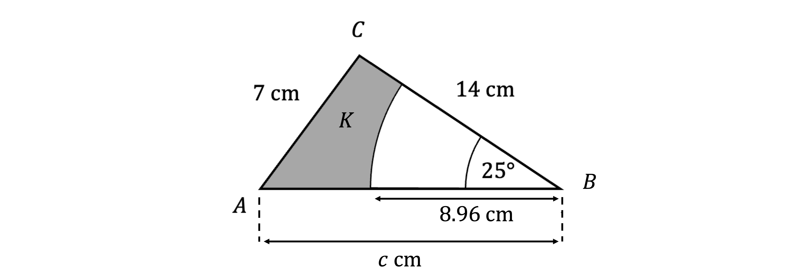

Using your value for $c$, work out the area of the shaded section $K$.

### Q6 — hard — 5 marks

**Q6** [5 marks]

$ABC$is a triangle.

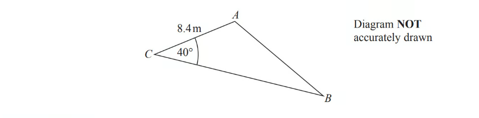

$AC$= 8.4m
Angle $ACB$= 40°

The area of the triangle = 100 m2.

Work out the length of $AB$.
Give your answer correct to 3 significant figures.
You must show all your working.

*Source: November 2015 1MA0/2H Q24*

### Q7 — hard — 7 marks

**Q7** [3 marks]

Calculate *SR*.

*SR* = ............................................... cm

*Source: 2019 March 0580/22 Q24A*

**Q7** [4 marks]

Calculate *RQ*.

*RQ* = ............................................... cm

*Source: 2019 March 0580/22 Q24B*

### Q8 — hard — 13 marks

**Q8** [4 marks]

In the pentagon $ABCDE$, angle $ACB$ = angle $AED$ = 90°. Triangle $ACD$ is equilateral with side length 12 cm.

$DE$ = $BC$ = 6 cm.

Calculate angle $BAE$.

Angle $BAE$ = .............................................

*Source: 2018	May/June 0580/43 Q6A*

**Q8** [5 marks]

**Extract:**

In the pentagon [A B C D E], angle [A C B] = angle [A E D] = 90°. Triangle [A C D] is equilateral with side length 12 cm. [D E] = [B C] = 6 cm.

Calculate.

i) $AB$.

$AB$ = ......................................... cm [2]

ii) $AE$.

$AE$ = ......................................... cm [3]

*Source: 2018	May/June 0580/43 Q6AIII*

**Q8** [4 marks]

**Extract:**

In the pentagon, angle ACB = angle AED = 90°. Triangle ACD is equilateral with side length 12 cm. DE = BC = 6 cm.

AB = ... cm
AE = ... cm

Calculate the area of the pentagon.

......................................... cm2

*Source: 2018	May/June 0580/43 Q6A*

### Q9 — medium — 3 marks

**Q9** [3 marks]

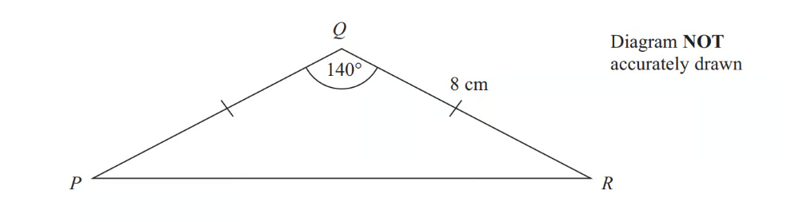

Calculate the length of $PR$.

Give your answer correct to 3 significant figures.

*Source: March 2013 1MA0/2H Q20*

### Q10 — hard — 10 marks

**Q10** [10 marks]

The diagram shows a quadrilateral $PQRS$ formed from two triangles, $PQS$ and $QRS$. Calculate

i) $QR$,

$QR=$ ............................................ cm [3]

ii) $PS$,

$PS=$ ............................................ cm [3]

iii) the area of quadrilateral $PQRS$.

........................................... cm2 [4]

*Source: 2020 March 0580/42 Q8A*

### Q11 — hard — 4 marks

**Q11** [4 marks]

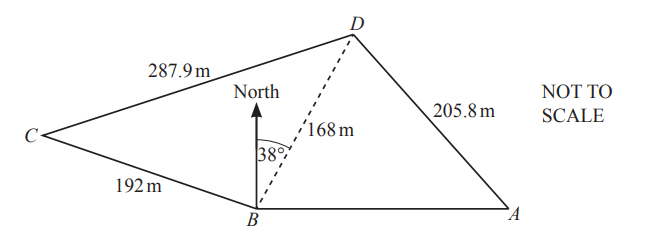

The diagram shows a field, *ABCD*, on horizontal ground.

*BC *= 192 m, *CD *= 287.9 m and *BD *= 168 m.

Calculate angle *CBD* and show that it rounds to 106.0°, correct to 1 decimal place.

*Source: 2020 Oct/Nov 0580/41 Q6A*

### Q12 — hard — 4 marks

**Q12** [4 marks]

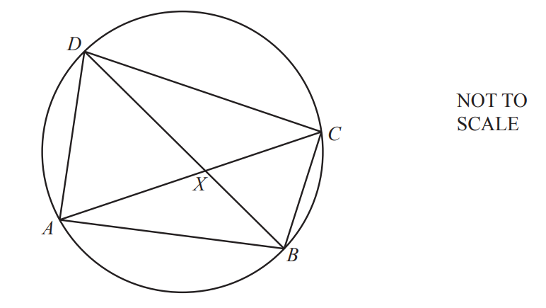

*AD  *= 10 cm, *BC  *= 8 cm, *BX*  = 5 cm, *CX * = 7 cm.

The diagonals of the cyclic quadrilateral *ABCD* intersect at *X*.

Calculate angle *BXC*.

Angle *BXC* = ................................................

*Source: 2020 Oct/Nov 0580/42 Q8C*

### Q13 — hard — 8 marks

**Q13** [4 marks]

The diagram shows the positions of three cities, Geneva (*G*), Budapest (*B*) and Hamburg (*H*).

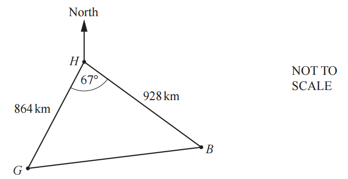

Use the cosine rule to calculate the distance from Geneva to Budapest.

.......................................... km

*Source: 2018	Oct/Nov 0580/42 Q8B*

**Q13** [4 marks]

The bearing of Budapest from Hamburg is 133°.

Calculate the bearing of Budapest from Geneva.

*Source: 2018	Oct/Nov 0580/42 Q8C*

### Q14 — medium — 4 marks

**Q14** [4 marks]

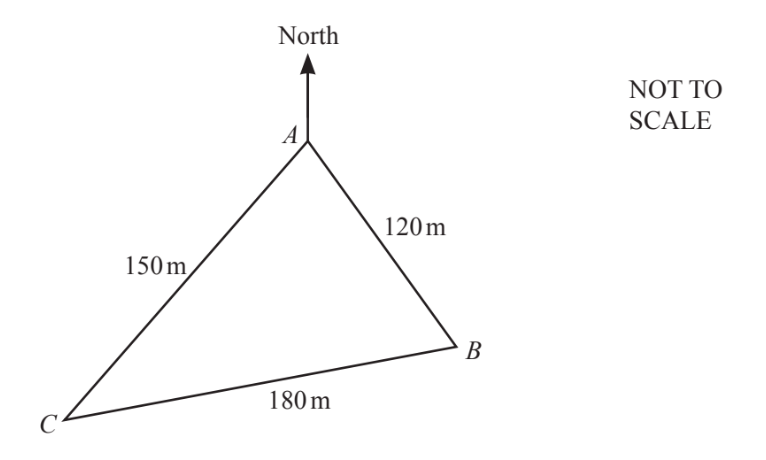

Use the cosine rule to find angle *BAC*.

Angle *BAC* = ...................................................

*Source: 2019	Oct/Nov 0580/41 Q5B*

### Q15 — very_hard — 6 marks

**Q15** [6 marks]

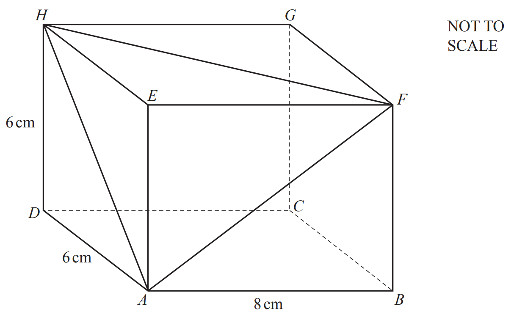

The diagram shows a cuboid.

*AB* = 8 cm, *AD* = 6 cm and *DH* = 6 cm.

Calculate angle *HAF*.

Angle *HAF* = .................................................

*Source: 2020 May/June 0580/22 Q27*

### Q16 — hard — 5 marks

**Q16** [5 marks]

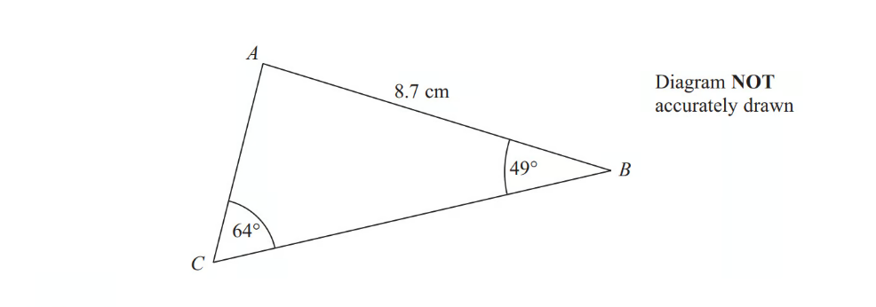

$ABC$is a triangle.

$AB=8.7\mathrm{cm}.\,\mathrm{Angle}ABC=49^{\circ}.\,\mathrm{Angle}ACB=64^{\circ}.$

Calculate the area of triangle $ABC$.

Give your answer correct to $3$ significant figures.

*Source: June 2012 1MA0/2H Q24*

### Q17 — very_hard — 5 marks

**Q17** [5 marks]

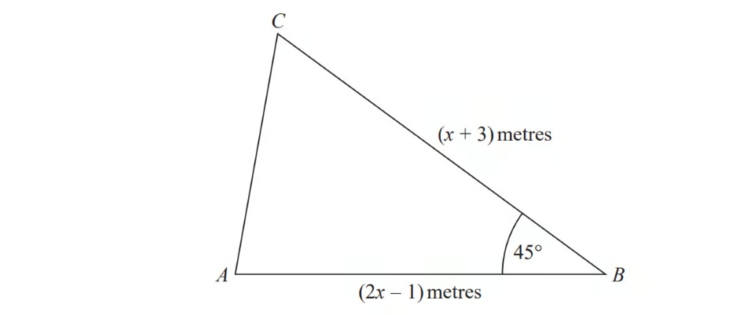

The area of triangle $ABC$ is $6\sqrt{2}$m2.

Calculate the value of $x$.

Give your answer correct to $3$significant figures.

*Source: June 2017 1MA1/3H Q15*

### Q18 — very_hard — 3 marks

**Q18** [3 marks]

Find the area of a regular hexagon with side length 7.4 cm.

.......................................... cm2

*Source: 2020	May/June 0580/21 Q22*

### Q19 — medium — 3 marks

**Q19** [3 marks]

Use the sine rule to find angle *ABC*.

Angle *ABC* = ..............................................

*Source: 2018	May/June 0580/21 Q13*

### Q20 — hard — 11 marks

**Q20** [4 marks]

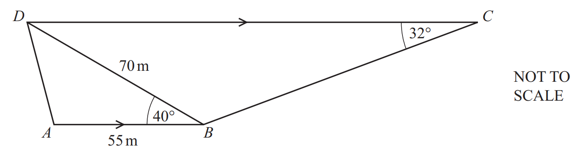

The diagram shows a trapezium $ABCD$.

$AB$ is parallel to $DC$.

$AB=55m$, $BD=70m$, angle $ABD=40^{\circ}$ and angle $BCD=32^{\circ}$.

Calculate $AD$.

$AD=$ ........................................... m

*Source: specimen 2020 0580/04 Q9A*

**Q20** [4 marks]

**Extract:**

The diagram shows a trapezium ABCD. AB is parallel to DC. AB = 55 m, BD = 70 m, angle ABD = 40°, and angle BCD = 32°.

Calculate $BC$.

$BC=$ ........................................... m

*Source: 2020 Specimen 0580/04 Q9B*

**Q20** [3 marks]

**Extract:**

The diagram shows a trapezium ABCD. AB is parallel to DC. AB = 55 m, BD = 70 m, angle ABD = 40°, and angle BCD = 32°.

Calculate the area of $ABCD$.

.......................................... m2

*Source: 2020 Specimen 0580/04 Q9C*

### Q21 — hard — 5 marks

**Q21** [5 marks]

The diagram shows triangle $LMN$.

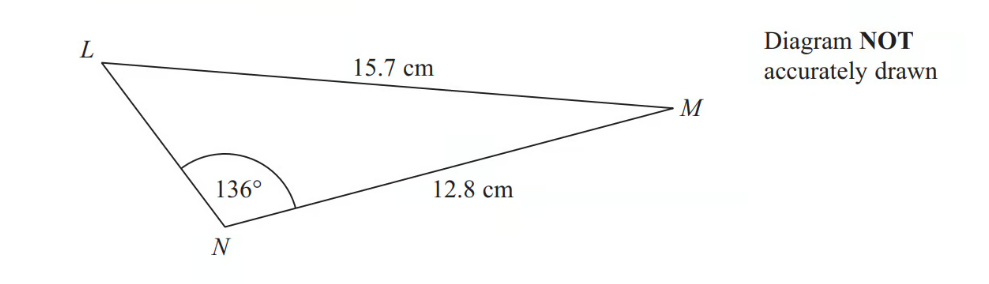

Calculate the length of $LN$.

Give your answer correct to 3 significant figures.

*Source: November 2013 1MA0/2H Q26*

### Q22 — very_hard — 16 marks

**Q22** [4 marks]

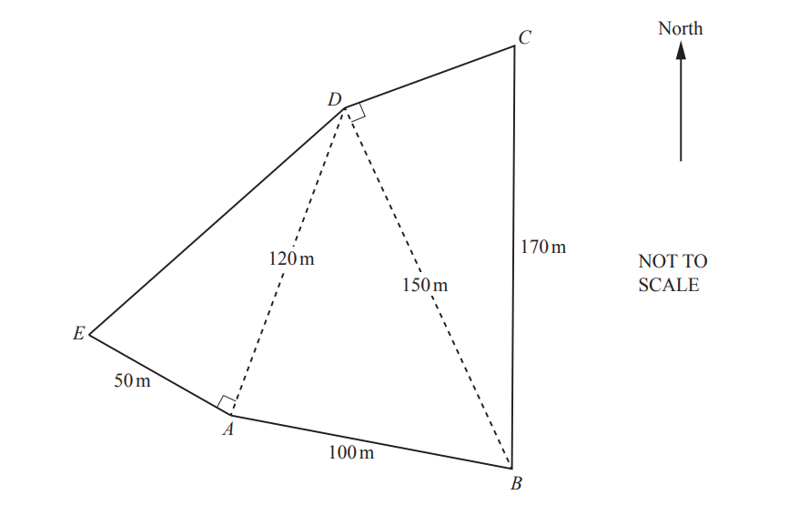

The diagram shows a field *ABCDE*.

Calculate the perimeter of the field *ABCDE*.

................................................ m

*Source: 2019	May/June 0580/41 Q3A*

**Q22** [4 marks]

Calculate angle *ABD*.

Angle *ABD* =  ..........................................................

*Source: 2019	May/June 0580/41 Q3B*

**Q22** [4 marks]

i) Calculate angle *CBD*.

Angle *CBD* = .................................................... [2]

ii) The point *C* is due north of the point *B*.   Find the bearing of *D* from *B*.

[2]

*Source: 2019	May/June 0580/41 Q3C*

**Q22** [4 marks]

Calculate the area of the field *ABCDE*.

Give your answer in hectares. [1 hectare = 10 000m2]

...................................... hectares

*Source: 2019	May/June 0580/41 Q3D*

### Q23 — hard — 11 marks

**Q23** [4 marks]

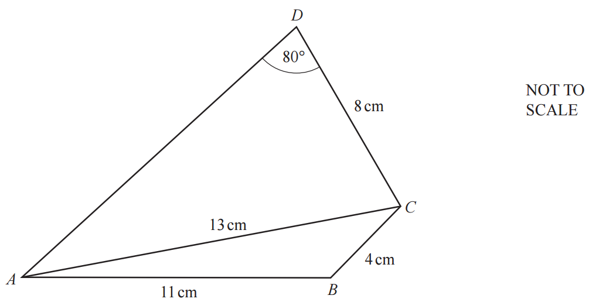

Calculate angle *ACB*.

Angle *ACB* = .................................................

*Source: 2018	Oct/Nov 0580/43 Q6A*

**Q23** [4 marks]

Calculate angle* ACD*.

Angle *ACD* = ..................................................

*Source: 2018	Oct/Nov 0580/43 Q6B*

**Q23** [3 marks]

Calculate the area of the quadrilateral *ABCD*.

........................................... cm2

*Source: 2018	Oct/Nov 0580/43 Q6C*

### Q24 — very_hard — 6 marks

**Q24** [6 marks]

$ABC$is an acute-angled triangle. $BA$= 7cm $BC$  = 8cm

The area of triangle $ABC$ is 18 cm2.

Work out the size of angle $BAC$.

Give your answer correct to 3 significant figures.

You must show all your working.

*Source: June 2016 1MA0/2H Q25*

### Q25 — hard — 6 marks

**Q25** [3 marks]

Calculate the value of $x$.

$x=$................................................

*Source: 2020 Oct/Nov 0580/22 Q19A*

**Q25** [3 marks]

Calculate the area of the triangle.

.......................................... cm2

*Source: 2020 Oct/Nov 0580/22 Q19B*

### Q26 — medium — 6 marks

**Q26** [2 marks]

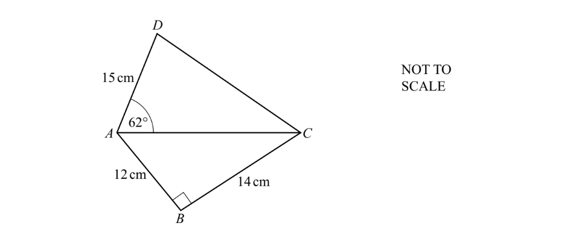

The diagram shows a quadrilateral, $ABCD$, formed from two triangles, $ABC$ and $ACD$.

$ABC$ is a right-angled triangle.

Calculate angle $BAC$.

Angle $BAC$ = ..............................................

*Source: Specimen 2025 0580/04 Q13A*

**Q26** [4 marks]

Calculate $BD$.

$BD$ = ......................................... cm

*Source: Specimen 2025 0580/04 Q13B*

### Q27 — very_hard — 5 marks

**Q27** [5 marks]

$ABC$and $ADC$are triangles.

The area of triangle $ADC$is 56 m2

Work out the length of $AB.$

Give your answer correct to 1 decimal place.

*Source: November 2017 1MA1/3H Q17*

### Q28 — medium — 4 marks

**Q28** [4 marks]

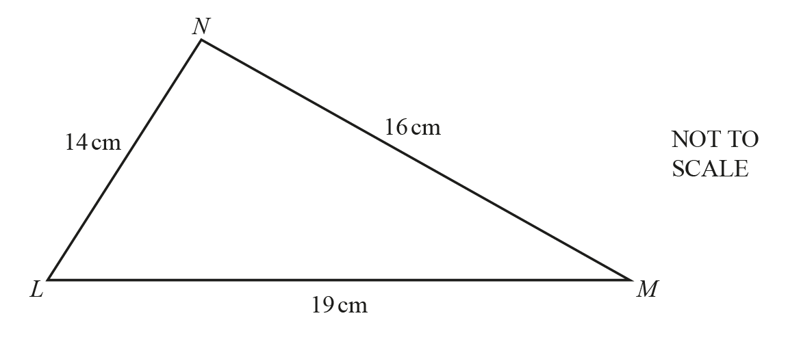

Calculate angle *LMN*.

Angle *LMN* = ..............................................

*Source: 2018	May/June 0580/21 Q19*

### Q29 — medium — 2 marks

**Q29** [2 marks]

The area of the triangle is 50cm2.

Calculate the value of $\mathrm{sin}x$.

$\mathrm{sin}x$= ..............................................

*Source: Specimen 2025 0580/04 Q17*

### Q30 — very_hard — 7 marks

**Q30** [4 marks]

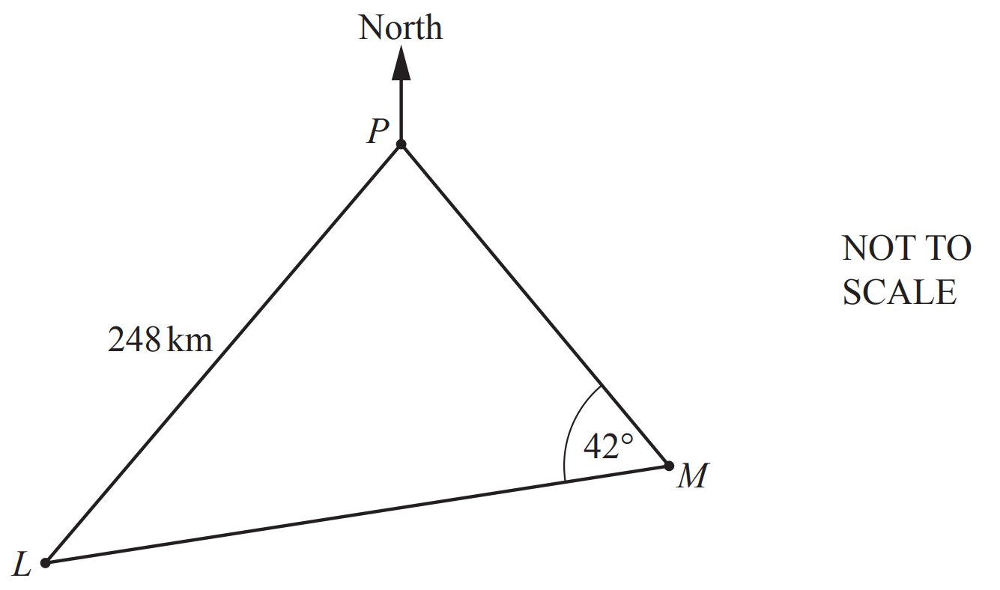

The diagram shows two ports, *L* and *P*, and a buoy, *M*.

The bearing of *L* from *P* is 201° and *LP* = 248 km.

The bearing of *M* from *P* is 127°. Angle *PML* = 42°.

Use the sine rule to calculate *LM*.

*LM* = ......................................... km

*Source: 2018	Feb/Mar 0580/42 Q8A*

**Q30** [3 marks]

**Extract:**

The diagram shows two ports, L and P, and a buoy, M. The bearing of L from P is 201° and LP = 248 km. The bearing of M from P is 127°. Angle PML = 42°.

A ship sails directly from *L* to *P*.

Calculate the shortest distance from *M* to *LP*.

.......................................... km

*Source: 2018	Feb/Mar 0580/42 Q8B*

### Q31 — very_hard — 16 marks

**Q31** [4 marks]

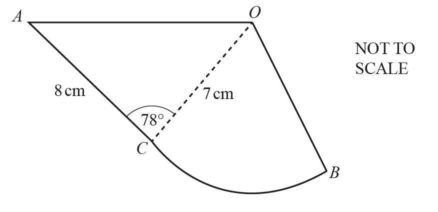

The diagram shows a design made from a triangle *AOC *joined to a sector *OCB*.

*AC* = 8cm, *OB* = *OC *= 7 cm and angle *ACO* = 78°.

Use the cosine rule to show that *OA* = 9.47 cm, correct to 2 decimal places.

*Source: 2018	May/June 0580/42 Q5A*

**Q31** [3 marks]

**Extract:**

The diagram shows a design made from a triangle AOC joined to a sector OCB. AC = 8cm, OB = OC = 7 cm and angle ACO = 78°. OA = 9.47 cm, correct to 2 decimal places.

Calculate angle *OAC*.

Angle *OAC* = ................................................

*Source: 2018	May/June 0580/42 Q5B*

**Q31** [5 marks]

**Extract:**

The diagram shows a design made from a triangle AOC joined to a sector OCB. AC = 8cm, OB = OC = 7 cm and angle ACO = 78°.

The perimeter of the design is 29.5 cm.

Show that angle *COB *= 41.2°, correct to 1 decimal place.

*Source: 2018	May/June 0580/42 Q5C*

**Q31** [4 marks]

**Extract:**

The diagram shows a design made from a triangle AOC joined to a sector OCB. AC = 8cm, OB = OC = 7 cm and angle ACO = 78°.

Calculate the total area of the design.

......................................... cm2

*Source: 2018	May/June 0580/42 Q5D*

### Q32 — medium — 5 marks

**Q32** [2 marks]

$ABC$ is a triangle.

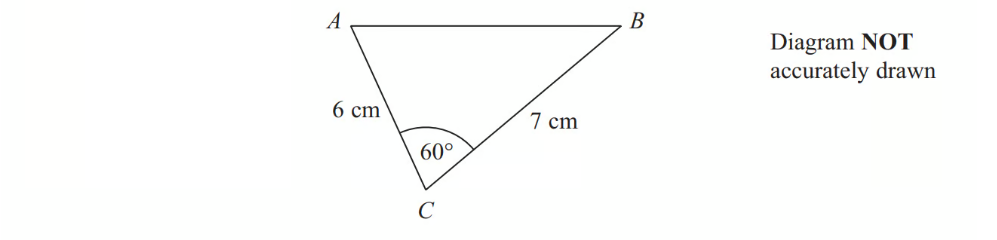

Work out the area of triangle $ABC$.

Give your answer as an exact value.

*Source: June 2013 1MA0/2H Q24A*

**Q32** [3 marks]

**Extract:**

![A B C] is a triangle.

Work out the length of the side $AB$. Give your answer as a simplified surd.

*Source: June 2013 1MA0/2H Q24B*

### Q33 — hard — 8 marks

**Q33** [8 marks]

In the diagram, *AB* = 18 cm, *BC* = 21.3 cm and *BD* = 11.6 cm.

Angle *BDC* = 123.5° and angle *ABC* is a right angle.

i) Calculate angle *BCD*.

Angle *BCD* = ............................................... [3]

ii) Calculate *AD*.

*AD* = ......................................... cm [5]

*Source: 2018	Oct/Nov 0580/41 Q7B*

### Q34 — medium — 10 marks

**Q34** [4 marks]

The diagram shows a field, *ABCD*, on horizontal ground.

Use the cosine rule to find angle *BAC*.

Angle *BAC* = ...................................................

*Source: 2019	Oct/Nov 0580/43 Q4B*

**Q34** [3 marks]

**Extract:**

The diagram shows a field, ABCD, on horizontal ground.

Use the sine rule to find angle *CAD*.

Angle *CAD* = ...................................................

*Source: 2019	Oct/Nov 0580/43 Q4C*

**Q34** [3 marks]

**Extract:**

The diagram shows a field, ABCD, on horizontal ground.

Calculate the area of the field.

............................................... m2

*Source: 2019	Oct/Nov 0580/43 Q4D*

### Q35 — hard — 5 marks

**Q35** [5 marks]

$ABC$is a triangle.

$D$ is a point on $AC$.

Angle $BAD$= 45°

Angle $ADB$= 80°

$AB$ = 7.4cm

$DC$ = 5.8 cm

Work out the length of $BC$.

Give your answer correct to 3 significant figures.

*Source: November 2014 1MA0/2H Q21*

### Q36 — medium — 7 marks

**Q36** [7 marks]

The diagram shows triangle *ABC*.

i) Use the cosine rule to calculate *BC.*

* *

*BC* = ............................................... m [4]

ii) Use the sine rule to calculate angle *ACB*.

Angle *ACB* = ................................................... [3]

*Source: 2019	Oct/Nov 0580/42 Q6A*

### Q37 — medium — 6 marks

**Q37** [3 marks]

The diagram shows the positions of three points $A$, $B$ and $C$ in a field.

Show that $BC$ is 118.1 m, correct to 1 decimal place.

*Source: 2020	May/June 0580/41 Q7A*

**Q37** [3 marks]

Calculate angle $ABC$.

Angle $ABC=$ ................................................

*Source: 2020	May/June 0580/41 Q7B*

### Q38 — medium — 4 marks

**Q38** [2 marks]

The diagram shows a field, *ABCD*, on horizontal ground. *BC *= 192 m, *CD *= 287.9 m and *BD *= 168 m.

Angle *CBD*  rounds to 106.0°, correct to 1 decimal place.

Calculate the area of triangle *BCD*.

............................................ m2

*Source: 2020 Oct/Nov 0580/41 Q6B*

**Q38** [2 marks]

**Extract:**

The diagram shows a field, ABCD, on horizontal ground. BC = 192 m, CD = 287.9 m and BD = 168 m. 
Angle CBD rounds to 106.0°, correct to 1 decimal place.
Calculate the area of triangle BCD.
 ............................................ m^2^

Tomas buys the triangular part of the field, *BCD*.

The cost is \$35 750 per hectare.

Calculate the amount he pays.

Give your answer correct to the nearest \$100. [1 hectare = 10000m2]

\$ ................................................

*Source: 2020 Oct/Nov 0580/41 Q6B*

### Q39 — medium — 10 marks

**Q39** [3 marks]

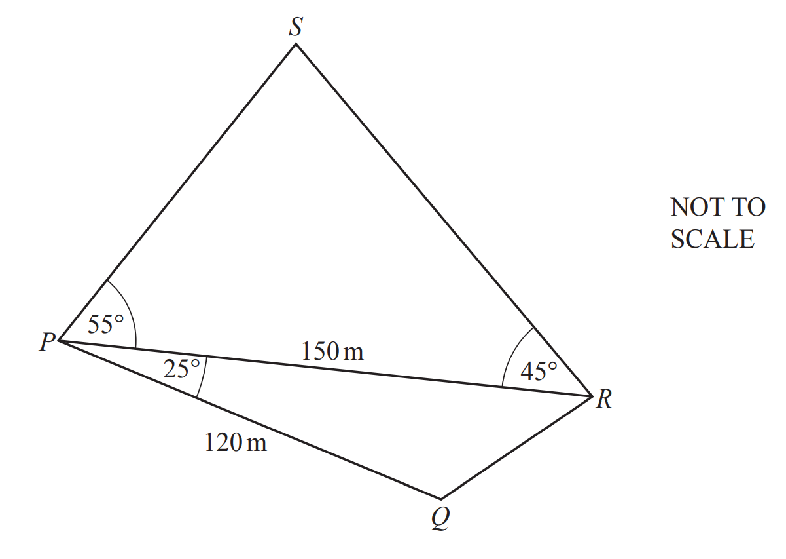

The diagram shows two triangles.

Calculate *QR*.

*QR* = ............................................ m

*Source: 2020 May/June 0580/42 Q4A*

**Q39** [4 marks]

Calculate *RS*.

*RS* = ............................................ m

*Source: 2020 May/June 0580/42 Q4B*

**Q39** [3 marks]

**Extract:**

Calculate QR.   QR = ............................................ m
Calculate RS.   RS = ............................................ m

Calculate the total area of the two triangles.

............................................ m2

*Source: 2020 May/June 0580/42 Q4C*

### Q40 — very_hard — 5 marks

**Q40** [4 marks]

Triangle $EFG$ has an area of 70 m2.

$EF:FG=1:2$ and angle $EFG$=40°.

Calculate $EF$.

$EF$ = .......................................... m

*Source: 2019	May/June 0580/43 Q9B*

**Q40** [1 mark]

A **different **triangle $PQR$ also has an area of 70 m2.

$PQ:QR=1:2$ and $PQ=EF$

Find angle $PQR$.

Angle $PQR$ = ..............................................

*Source: 2019	May/June 0580/43 Q9B*

### Q41 — medium — 2 marks

**Q41** [2 marks]

Calculate the area of triangle *PQR*.

........................................ cm2

*Source: 2018	Oct/Nov 0580/41 Q7A*

### Q42 — very_hard — 8 marks

**Q42** [4 marks]

The diagram shows triangle *ABC* with point *G* inside.

*CB* = 11 cm, *CG* = 5.3 cm and *BG* = 6.9 cm.

Angle *CAB* = 42° and angle *ACG* = 54°.

Calculate the value of $x$.

$x=$................................................

*Source: 2020 May/June 0580/43 Q6A*

**Q42** [4 marks]

**Extract:**

The diagram shows triangle ABC with point G inside. 
CB = 11 cm, CG = 5.3 cm and BG = 6.9 cm.  
Angle CAB = 42° and angle ACG = 54°.

Calculate *AC*.

*AC* = ........................................... cm

*Source: 2020 May/June 0580/43 Q6A*

### Q43 — hard — 8 marks

**Q43** [8 marks]

The diagram shows two triangles $ABD$ and $BCD$.

$AD=16.5\text{cm}$ and $BD=12.4\text{cm}$.

Angle $ADB=64^{\circ}$, angle $BDC=53^{\circ}$ and angle $DBC=95^{\circ}$.

i) Find $AB$.

$AB$ = ........................................ cm [4]

ii) Find $BC$.

$BC$ = ........................................ cm [4]

*Source: 2019	May/June 0580/42 Q8A*

### Q44 — hard — 8 marks

**Q44** [8 marks]

In the diagram, $BC$ is a vertical wall standing on horizontal ground $AB$.

$D$ is the point on $AB$ where $AD$ = 58 m.

The angle of elevation of $C$ from $A$ is 26°.

The angle of elevation of $C$ from $D$ is 72°.

i) Show that $AC$ = 76.7 m, correct to 1 decimal place.

[5]

ii) Calculate $BD$.

$BD$ = .......................................... m

[3]

*Source: 2019	May/June 0580/43 Q9A*

### Q45 — very_hard — 5 marks

**Q45** [5 marks]

$ABCD$is a parallelogram.

$AC$ = 9 cm

$DC$ = 11 cm

Angle $DAC$ = 100°

Calculate the area of the parallelogram.

Give your answer correct to 3 significant figures.

*Source: June 2014 1MA0/2H Q27*

### Q46 — very_hard — 4 marks

**Q46** [4 marks]

The diagram shows an equilateral triangle *ABC* with sides of length 10 cm.

*AMN* is a sector of a circle, centre *A*.

*M* is the mid-point of *AC*.

Work out the area of the shaded region.

Give your answer in the form `open parentheses straight a square root of 3 minus straight b over straight c straight pi close parentheses space cm squared` where $a,b$ and $c$ are integers.

......................................... cm2

*Source: 2018	Oct/Nov 0580/22 Q21*

### Q47 — hard — 5 marks

**Q47** [5 marks]

Work out the length of  $AD$.

Give your answer correct to 3 significant figures.

*Source: June 2018 1MA1/3H Q17*

### Q48 — medium — 2 marks

**Q48** [2 marks]

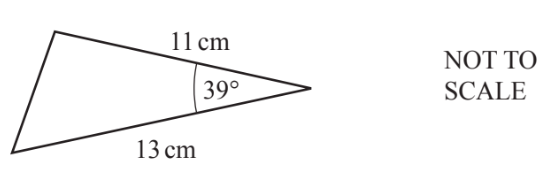

Calculate the area of the triangle.

............................................. cm2

*Source: 2019	Oct/Nov 0580/21 Q13-*

### Q49 — medium — 4 marks

**Q49** [4 marks]

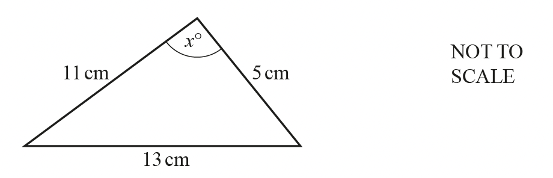

Calculate the value of $x$.

$x=$................................................

*Source: 2018	May/June 0580/23 Q23*

### Q50 — very_hard — 9 marks

**Q50** [9 marks]

The area of triangle *DEF* is 70 m2.

i) Show that  $4x^{2}+11x-300=0$.

[4]

ii) Use the quadratic formula to solve $4x^{2}+11x-300=0$.

Show all your working and give your answers correct to 2 decimal places.

$x$ = .......................... or $x$ = .......................... [4]

iii) Find the length of *DE*.

*DE* = ............................................... m [1]

*Source: 2019	Oct/Nov 0580/42 Q6B*

### Q51 — hard — 3 marks

**Q51** [3 marks]

Calculate the **obtuse** angle $x$ in this triangle.

$x$ = ...................................................

*Source: 2019	Oct/Nov 0580/21 Q16-*

