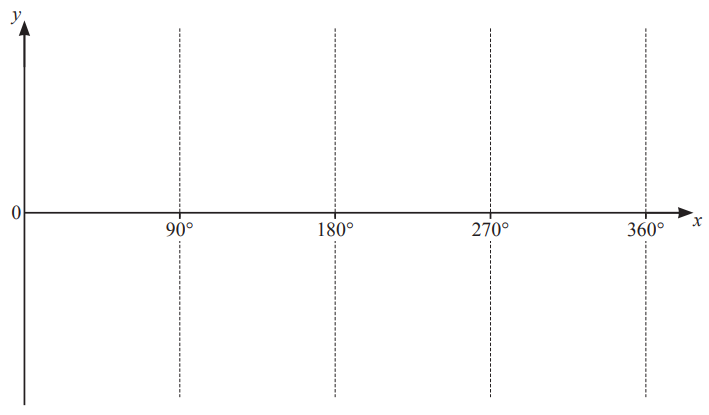
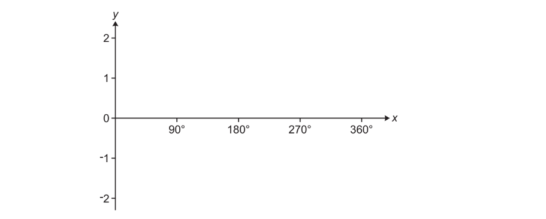
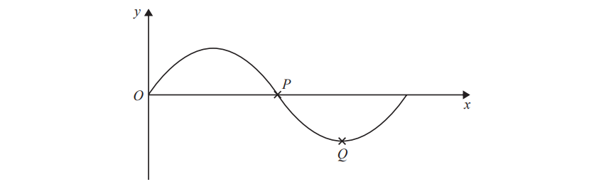
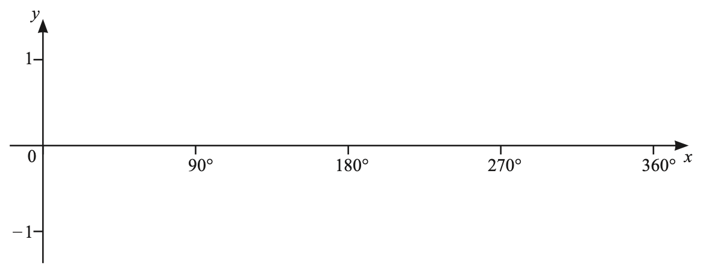
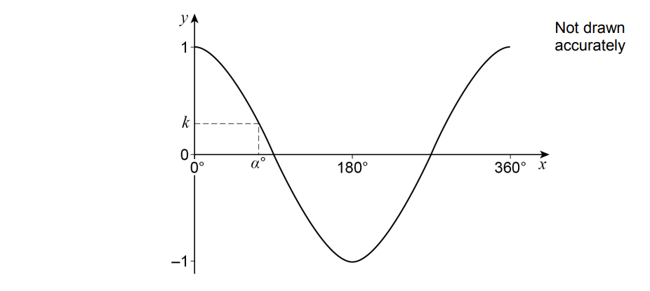
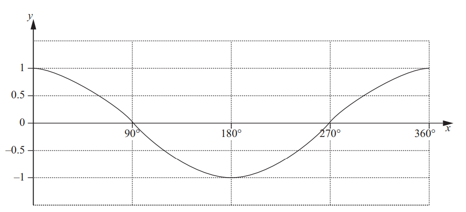

# Exam Questions — Trigonometric Graphs & Equations
**Pythagoras & Trigonometry** · Cambridge (CIE) IGCSE maths (0580 & 0980)
> Source: [https://www.savemyexams.com/igcse/maths/cie/25/extended/topic-questions/](https://www.savemyexams.com/igcse/maths/cie/25/extended/topic-questions/) · 15 questions across 1 sets

## Exam Questions (15 questions)

### Q1 — medium — 2 marks

**Q1** [1 mark]

When $\mathrm{sin}x^{\circ}=0.36$, find the acute angle $x^{\circ}$.

*Source: 2019	Oct/Nov 0580/23 Q8A*

**Q1** [1 mark]

When $\mathrm{sin}x^{\circ}=0.36$, find the obtuse angle $x^{\circ}$.

*Source: 2019	Oct/Nov 0580/23 Q8B*

### Q2 — very_hard — 7 marks

**Q2** [4 marks]

i) On the axes, sketch the graph of  $y=\mathrm{sin}x$  for  $0^{\circ}\leqx\leq360^{\circ}.$

[2]

ii) Describe fully the symmetry of the graph of  $y=\mathrm{sin}x$  for  $0^{\circ}\leqx\leq360^{\circ}.$

[2]

*Source: 2020	May/June 0580/41 Q8A*

**Q2** [3 marks]

Solve  $4\mathrm{sin}x-1=2$  for  $0^{\circ}\leqx\leq360^{\circ}.$

$x=$ ........................ and $x=$ ......................

*Source: 2020	May/June 0580/41 Q8B*

### Q3 — medium — 2 marks

**Q3** [2 marks]

Sketch the graph of `y space equals space cos space x degree space for space 0 less-than or slanted equal to space x less-than or slanted equal to space 360`

*Source: 2015	Spec2 1MA1/2H Q19A*

### Q4 — medium — 2 marks

**Q4** [2 marks]

On the diagram, sketch the graph of $y=\mathrm{tan}x$ for $0^{\circ}\leqx\leq360^{\circ}$.

*Source: 2020 Oct/Nov 0580/41 Q10B*

### Q5 — medium — 2 marks

**Q5** [2 marks]

Sketch the graph of $y=\mathrm{sin}x$ for $0^{\circ}<x<360^{\circ}$

*Source: Nov 2020 J560/05 Q13A*

### Q6 — very_hard — 1 marks

**Q6** [1 mark]

$y$is an obtuse angle.

Which **one** statement is true?

*Source: Nov 2020 8300/1H Q24*

### Q7 — medium — 4 marks

**Q7** [2 marks]

The diagram shows part of a sketch of the curve $y=\mathrm{sin}x^{\circ}$

Write down the coordinates of

i) the point P

ii) the point Q

*Source: Specimen 2016 4MA1/2H Q16A*

**Q7** [2 marks]

Sketch the graph of $y=\mathrm{tan}x$ for `0 degree space less-than or slanted equal to space x space less-than or slanted equal to space 360 degree`

Show the coordinates of any points of intersection with the coordinate axes.

*Source: Specimen 2016 4MA1/2H Q16B*

### Q8 — very_hard — 2 marks

**Q8** [2 marks]

The diagrams show the graph of a function.   Write down the function.

$\mathrm{f} ( x ) =$................................................

*Source: 2020 May/June 0580/43 Q10A*

### Q9 — very_hard — 5 marks

**Q9** [2 marks]

On the diagram, sketch the graph of $y=\mathrm{cos}x$ for $0^{\circ}\leqx\leq360^{\circ}$.

*Source: 2020 March 0580/22 Q19A*

**Q9** [3 marks]

Solve the equation $4\mathrm{cos}x+2=3$ for $0^{\circ}\leqx\leq360^{\circ}$.

$x=$ .................... and $x=$ ....................

*Source: 2020 March 0580/22 Q19B*

### Q10 — very_hard — 3 marks

**Q10** [3 marks]

Solve the equation  $5\mathrm{tan}x=-7$  for  $0^{\circ}\leqx\leq360^{\circ}$.

$x=$.................... or $x=$....................

*Source: 2020 Oct/Nov 0580/41 Q10B*

### Q11 — hard — 2 marks

**Q11** [1 mark]

Here is a sketch of $y=\mathrm{cos}x$for values of $x$ from 0° to 360°

$α^{\circ}$ is an acute angle.

$\mathrm{cos}α^{\circ}=k$

What is the value of $\mathrm{cos}(180^{\circ}--α^{\circ})$?

*Source: Nov 2018 8300/1H Q27A*

**Q11** [1 mark]

What is the value of $\mathrm{cos}$$(360^{\circ}+α^{\circ})$?

*Source: Nov 2018 8300/1H Q27B*

### Q12 — hard — 3 marks

**Q12** [3 marks]

Solve $3\mathrm{tan}x=-4$ for $0^{\circ}\leqx\leq360^{\circ}$.

$x=$.................. or $x=$..................

*Source: 2020 Oct/Nov 0580/23 Q25*

### Q13 — hard — 2 marks

**Q13** [2 marks]

$x^{\circ}$ is an obtuse angle and $\mathrm{sin}x^{\circ}=0.43$ .

Find the value of $x$.

$x$ = ..............................................

*Source: 2018	Oct/Nov 0580/22 Q12*

### Q14 — hard — 5 marks

**Q14** [4 marks]

The grid shows the graph of $y=\mathrm{cos}x$ for `0 degree space less-than or slanted equal to space x space less-than or slanted equal to space 360 degree`.

Solve the equation $3\mathrm{cos}x=1$ for `0 degree space less-than or slanted equal to space x space less-than or slanted equal to space 360 degree.`

Give your answers correct to 1 decimal place.

.................... and ....................

*Source: specimen 2020 0580/04 Q8A*

**Q14** [1 mark]

On the same grid, sketch the graph of $y=\mathrm{sin}x$ for `0 degree space less-than or slanted equal to space x space less-than or slanted equal to space 360 degree`.

*Source: 2020 Specimen 0580/04 Q8B*

### Q15 — hard — 2 marks

**Q15** [2 marks]

Solve the equation  $\mathrm{tan}x=2$  for  $0^{\circ}\leqx\leq360^{\circ}$ .

$x=$ ........................   or  $x=$ ........................

*Source: 2020 Oct/Nov 0580/22 Q25*

