# Mark Schemes — Cumulative Frequency
**Statistics** · Cambridge (CIE) IGCSE maths (0580 & 0980)

## Calculator Questions (13 questions)

### Q1
> *Cumulative frequency adds the frequencies as you go down the table *

| Battery life (t hours) | Cumulative Frequency |
|---|---|
| $6\leqt<8$ | **Final answer:** **5** |
| $6\leqt<10$ | **Final answer:** **19** |
| $6\leqt<12$ | **Final answer:** **41** |
| $6\leqt<14$ | **Final answer:** **54** |
| $6\leqt<16$ | **Final answer:** **60** |

**[B1]**
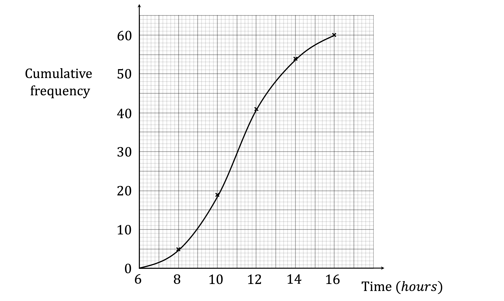

**[B1 B1]**

> **[mark-scheme]**
> **B1**: For correct points plotted. The endpoints must be used.
> 
> **B1**: For correct graph. You can join the dots together with straight lines for this mark.
> *The total frequency *$N=60$

> *The lower quartile would be at *$\frac{N}{4}=15$

> *Locate where the cumulative frequency of *$15$* meets the curve, then trace that down to the associated hours for that point*

> *At a cumulative frequency of *$15$*, the time is *`tilde 9.6`

> *The upper quartile would be at *$\frac{3N}{4}=45$

> *Repeat the steps for the upper quartile*

> *At a cumulative frequency of *$45$*, the time is *`tilde 12.6`

**[M1]**

> *Subtracting this gets the interquartile range*

$12.6-9.6=3$

**[M1 A1]**

> **[mark-scheme]**
> **M1**: For a correct method to find at least one of the quartiles.
> 
> **M1**: For subtracting your quartiles.
> 
> **A1**: Answer in the range 2.8 to 3.2.
> *Locate 13 hours and draw a line to meet the curve*

> *Draw another line to beet the **y**-axis*

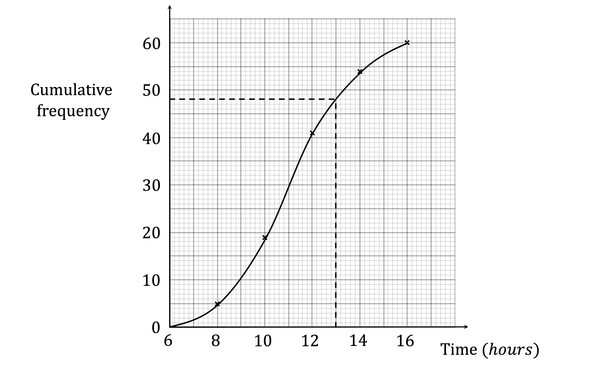

> *This gives a  cumulative frequency of 48*

**[M1]**

> *Since the question says "at least", subtract this from the total*

$60-48=12$

**Final answer:** **The number of phones with at least 13 hours is **$12$

**[A1]**

### Q2
i) *There are a total of 120 plants, so an estimate of the median will be the 60**th** (120 ÷ 2) plant. *
*Use a ruler to draw a horizontal line from 60 on the cumulative frequency axis to the curve, then draw a vertical line down to the height axis. *

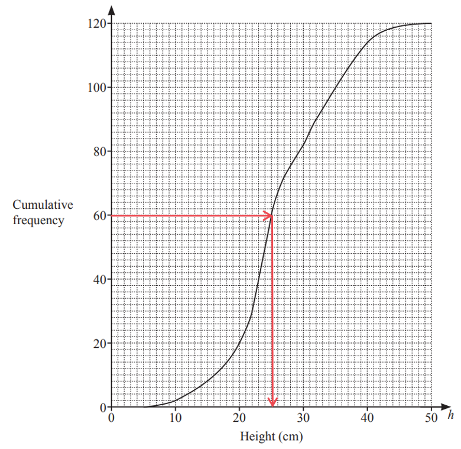

> *Read off the height axis to estimate the median.*

**Median = 25 cm****  ****[1]**

ii) *The interquartile range (IQR) is equal to the upper quartile (UQ) subtract the lower quartile (LQ). *
*For the LQ, use a ruler to draw horizontal lines from 30 (one-quarter of 120) on the cumulative frequency axis to the curve, then draw a vertical line down to the height axis. *
*For the UQ, use a ruler to draw horizontal lines from 90 (three-quarters of 120) on the cumulative frequency axis to the curve, then draw a vertical line down to the height axis.*

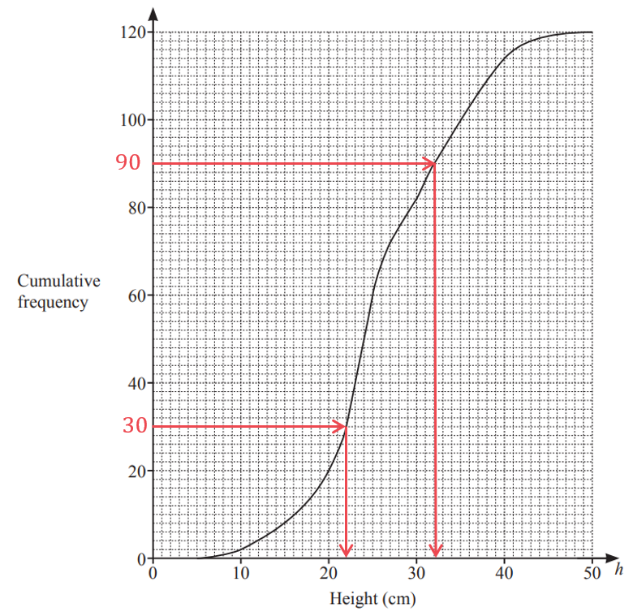

> *Read off the height axis to find the LQ and UQ.*

*LQ = 22 * 
*UQ = 32 *

**Either correct ****[1]**

> *Calculate the IQR by subtracting the LQ from the UQ.*

*IQR = 32 - 22 = 10*

**IQR = 10 cm**** ****[1]**

iii) *The 60**th** percentile will be 60% of the way through the data.*

$60 \% of 120 = \frac{60}{100} \times 120 = 72$

> *i.e. The 60**th** percentile will be the 72**nd** value.*

> *Find the value of the 60**th** percentile by using a ruler to draw a horizontal line from 72 on the cumulative frequency axis to the curve, then draw a vertical line down to the height axis. *

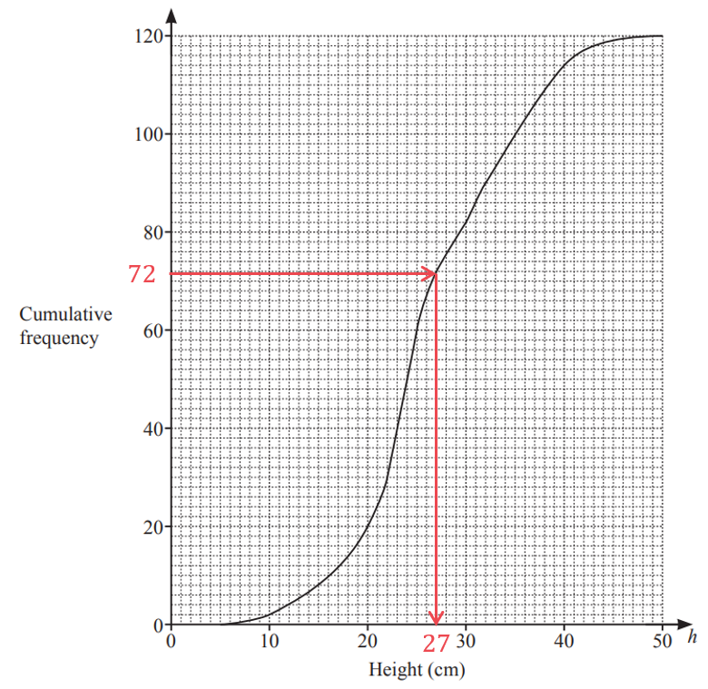

> *Read off the height axis to find the 60**th** percentile.*

**60****th**** percentile = 27 cm**** ****[1]**

iv) *Find the cumulative frequency at a height of 40 cm by using a ruler to draw a vertical line from 40 on the height axis to the curve; then draw a horizontal line across to the cumulative frequency axis.*

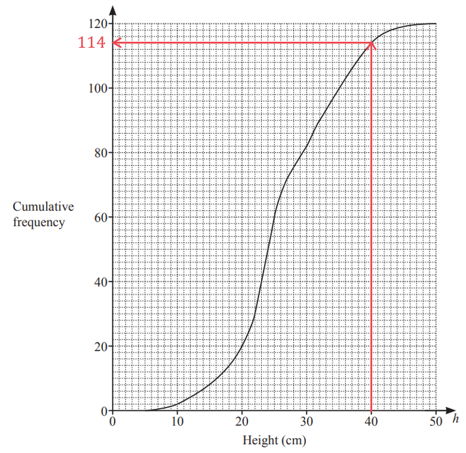

> *Read off the cumulative frequency axis - beware, this is not the final answer!*

*114 plants have a height of ****less**** than 40 cm*

**[1]**

> *We require the number of plants with a height greater than 40 cm so subtract 114 from the total number of plants (120).*

*120 - 114 = 6*

**Approximately 6 plants have a height greater than 40 cm ****[1]**

### Q3
i) *The median is the middle value.  There are 80 values so we can estimate the median by finding the 80 ÷ 2 = 40**th** value.* 
*Draw a horizontal line from 40 on the cumulative frequency axis across to the curve, then draw a vertical line down to the time axis.  *
*Read off the time axis to get an estimate of the median.*

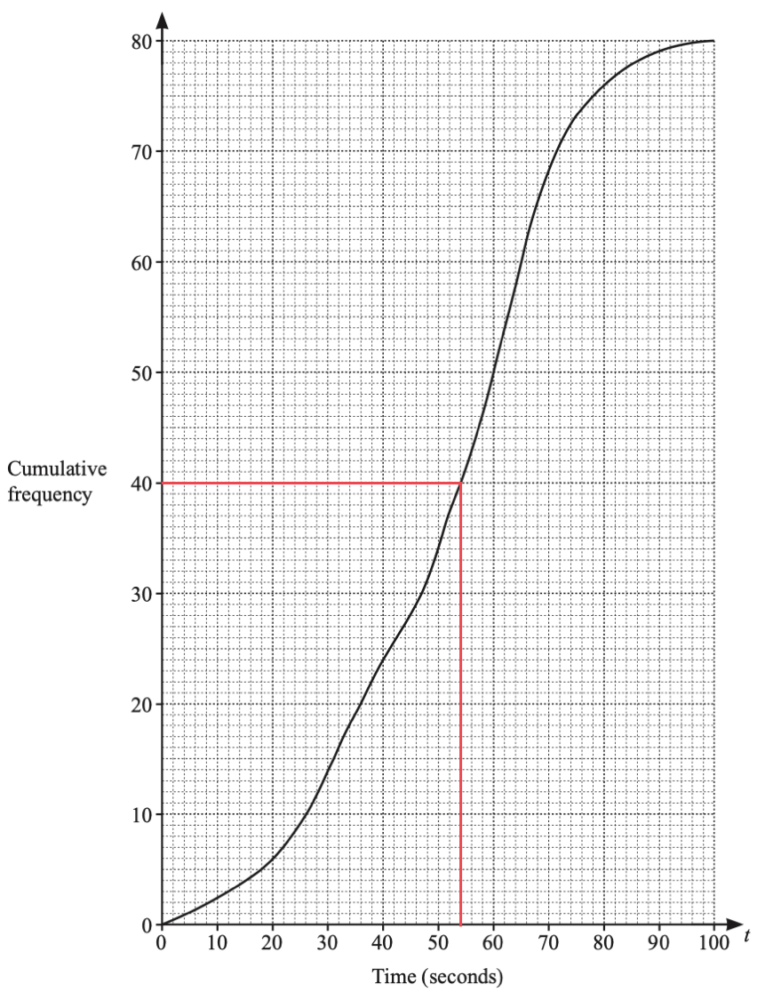

**54 seconds*** ***[1]**

ii) *The interquartile range (IQR) is the middle 50% of the data items.* *Find the lower quartile, LQ, (80 ÷ 4 = 20).*

> *Find the upper quartile, UQ, (lower quartile × 3 = 60).*

> *Draw horizontal lines from both the UQ and the LQ until they meet the curve, then draw vertical lines down to the time axis.*

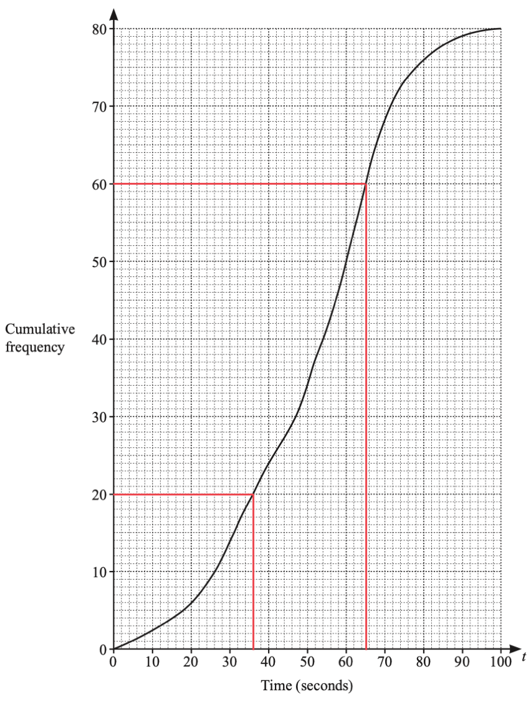

*Upper quartile = 65 seconds* 
*Lower quartile = 36 seconds*

**Either the correct UQ or LQ seen**** [1]**

> *Subtract the LQ from the UQ to find the IQR.*

*UQ - LQ = 65 - 36*

**29 seconds*** ***[1]**

iii) *Find the 20**th** percentile position by dividing 80 by 100 and multiplying by 20.*

$\frac{80}{100}\times20=16$

> *Draw a horizontal line from the cumulative frequency axis at the 20**th** percentile (16) across to the curve. *
*Draw a vertical line down from the curve until it hits the time axis. Read off the time axis to find an estimate for the 20**th** percentile.*

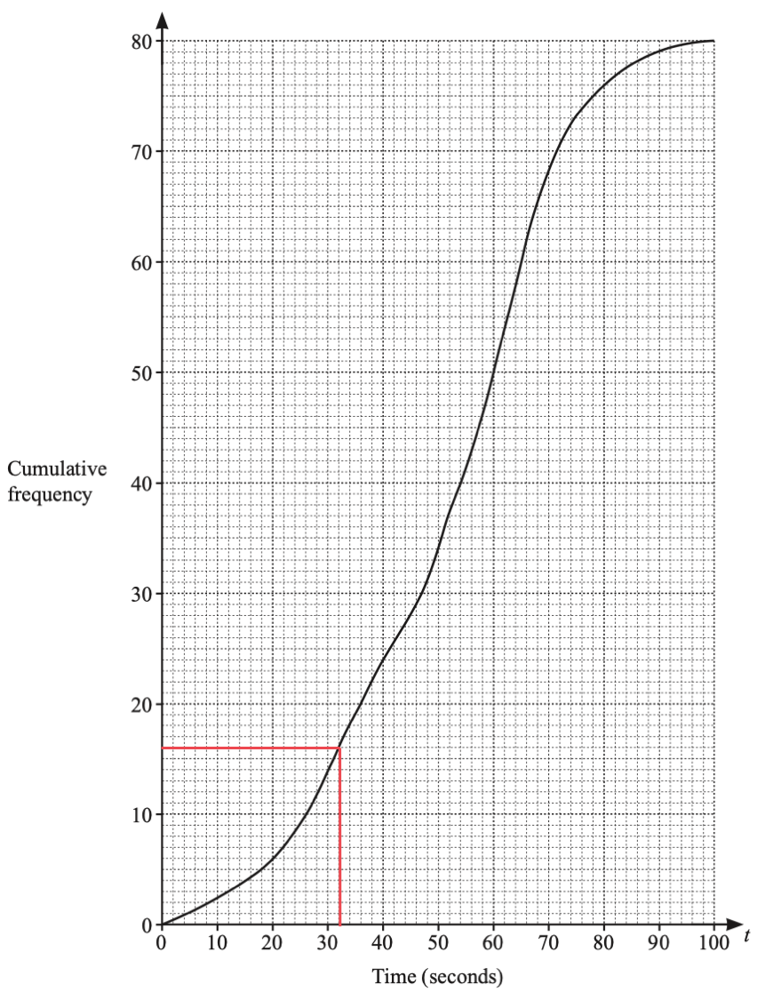

**32 seconds**** ****[1]**

iv) *We can use the cumulative frequency graph to estimate the number of girls who took **less** than 66 seconds. *
*Draw a vertical line up from 66 seconds on the time axis to the curve. * 
*Draw a horizontal line from the curve across to the cumulative frequency axis. *
*Read off the value for an estimate of the number of girls taking **less** than 66 seconds.*

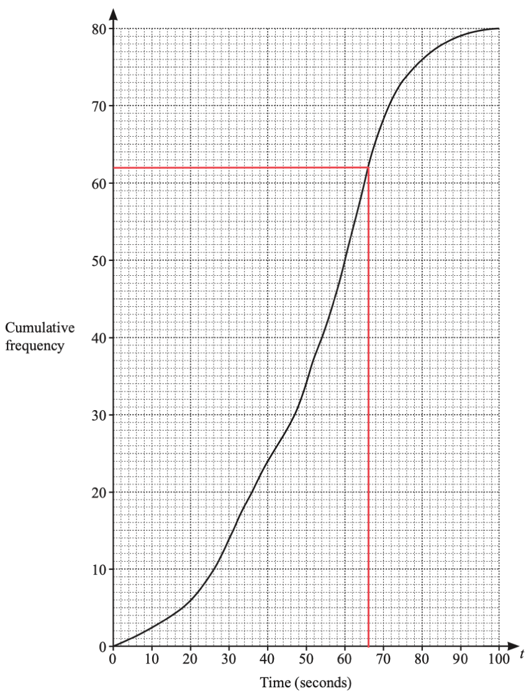

*62 girls solved the problem in 66 seconds or less*

**A value between 61 and 63 seen**** [1]**

> *Subtract 62 from the total number of girls.*

*80 - 62 = 18*

**18** **[1]**

**Answers of 17 or 19 will also be accepted.**
i) *Draw vertical lines up from the time axis, at the end of each interval, until they reach the curve. *
*Then draw horizontal lines from the curve across to the cumulative frequency axis.*

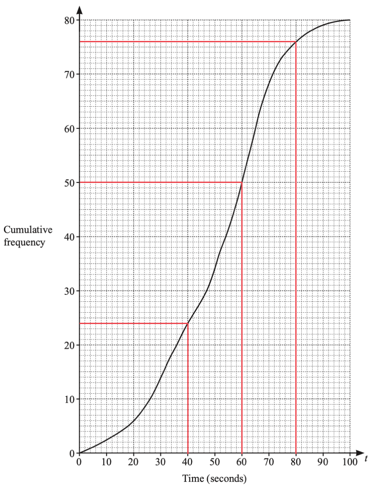

> *Subtract the number of girls in the **previous** class from the values read off the graph to find the number of girls **only** in the class you want.*

$20<t\leq40:24-6=18$

$40<t\leq60:50-24=26$

$60<t\leq80:76-50=26$

> *Now complete the table.*

| Time ($t$ seconds) | $0<t\leq20$ | $20<t\leq40$ | $40<t\leq60$ | $60<t\leq80$ | $80<t\leq100$ |
|---|---|---|---|---|---|
| Frequency | 6 | **Final answer:** **18** | **Final answer:** **26** | **Final answer:** **26** | 4 |

**One or two values correct**** [1] **
**Third value correct**** [1]**

ii) *First find the sum of the products of the midpoint of each class interval and its frequency.*

$( 10 \times 6 ) + ( 30 \times 18 ) + ( 50 \times 26 ) + ( 70 \times 26 ) + ( 90 \times 4 ) = 4080$

**Correct midpoints**** [1] **
**Calculating the sum of the frequencies multiplied by the midpoints**** [1]**

> *To estimate the mean, divide this total by the total number of girls.*

$4080\div80=51$

**[1]**

**51 seconds** **[1]**
i) *The number of boys who solved the problem in 66 seconds or less was the upper quartile.*

**75%**** ****[1]**

ii) *'Variation' means 'spread' in this case so we should consider either the **range** or **interquartile** range. *
*From the information given, we can find the interquartile range (IQR) for the boys. *
*Work out the interquartile range (IQR) for the boys.*

*66 - 46 = 20 seconds*

**[1]**

> *The IQR for the girls (from part a) is 29 seconds. The larger the IQR, the more the results vary.*

**The IQR of the girls (29) is greater than the IQR of the boys (20) so Howard is incorrect - the boys' times vary less than the girl's tomes.**** ****[1]**

### Q4
*Find the number of large bags (by dividing 93.75 euros by 3.75)* * *

*93.75 ÷ 3.75 = 25 large bags*

**[1]**

*The top 25 largest bags is from the 90 - 25 = 65th bag onwards* *Draw a horizontal line from 65 on the **y**-axis across to the curve, then a vertical line from the curve down to the **x**-axis  *

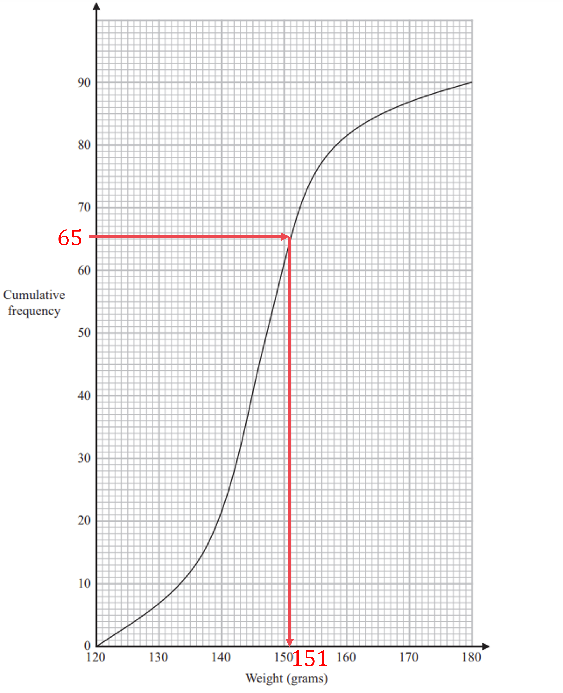

**[1]*** *

> *Read off the weight of the 65th bag This is the weight, **d**, of large bags  *

*151 kg on the ***x***-axis*

**d**** = 151 ****[1]**

### Q5
> *First, convert 4 hours to minutes.*

*4 × 60 = 240 (minutes)*

> *Use the cumulative frequency graph for **males** to take a reading at 240 minutes.  *
*Use a straight edge for accuracy.*

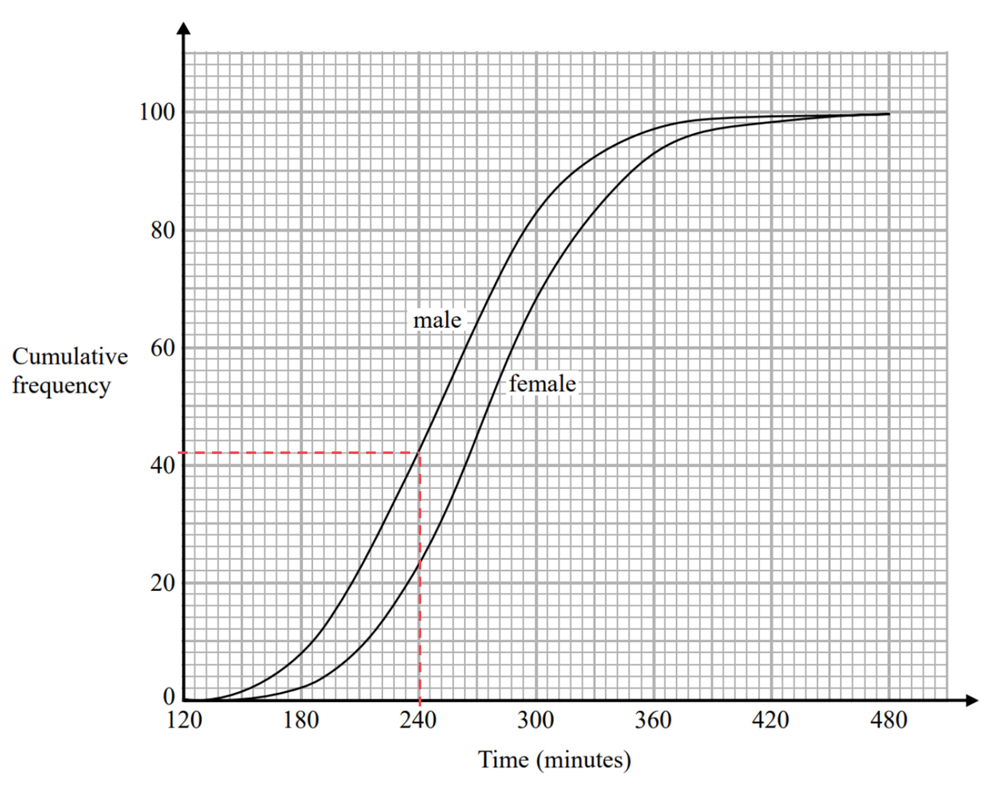

*240 minutes has a cumulative frequency of 42*

**[1]**

*This means that (approximately) 42 male runners took less than 240 minutes (4 hours) to finish the London marathon.* 
*To write as a probability, we write this as a fraction out of the total number of male runners (100) - be careful here, the questions states "A **male** runner is chosen at random."*

$\frac{42}{100} ( = \frac{21}{50} )$

**An estimate for he probability that a male runner chosen at random took less than four hours is **$\frac{21}{50}$* ***[1]**

**Unless the question asks you to, it is not essential to simplify the fraction.**
*As there are 100 runners in both the male and female categories, the positions of the median and quartiles are easy to work out.* 
*In both cases, the median will be (estimated by) the 50**th** value and the lower and upper quartiles by the 25**th** and 75**th** values respectively.* 
*There will be lots of lines on your graph to find these values, so work carefully, using a straight edge for accuracy. *
*Also be careful with the scale, 1 'small square' represents 6 seconds.*

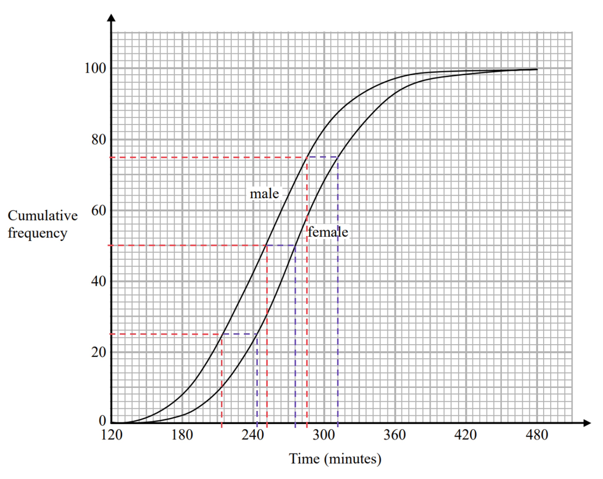

|   | ***Males*** | ***Females*** |
|---|---|---|
| ***Median*** | *252* | *276* |
| ***IQR**** (=UQ - LQ)* | *285 - 213 = 72* | *312 - 243 = 69* |

**At least one median (249-252 and 273-276) ****[1]** 
**At least one interquartile range (69-73 and 67-71) ****[1]**

*Compare the average using medians, compare spread using IQR.* 
*Make sure you answer in the context of the question which is about finishing times for the London marathon.*

**The median time for the female runners (276 mins) is higher than that for the male runners (252 mins) so on average the male runners were faster at running the London marathon ****[1]** 
**The interquartile range for the male runners (72 mins) is higher than that for the female runners (69 mins) showing that the times for the male runners were more varied ****[1]**

### Q6
i) *The median is the value in the middle of the data set, so with 160 students, we will find the 80**th** student, and read-off the corresponding time.*

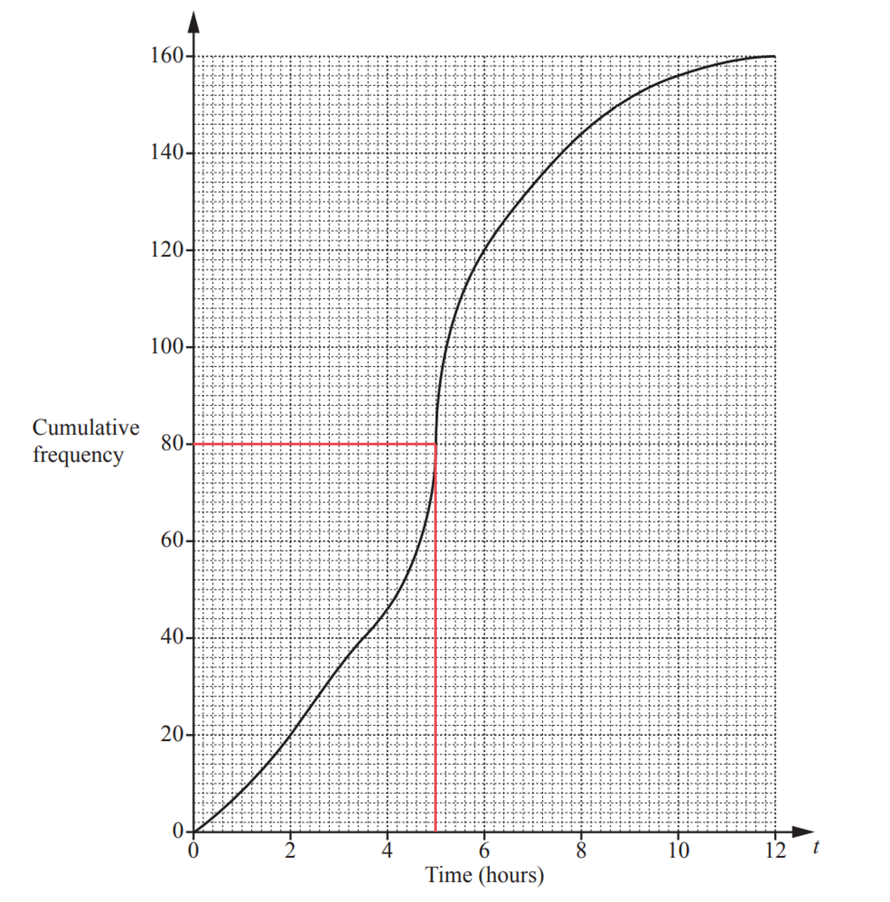

**5 hours** **[1]**

ii) *The interquartile range is the difference between the upper quartile (UQ) and the lower quartile (LQ).* 
*The lower quartile is one quarter of the way through the data set; so the 40**th** data value.* 
*The upper quartile is three quarters of the way through the data set; so the 120**th** data value. *
*We can find both of these using the cumulative frequency graph and then find the difference.*

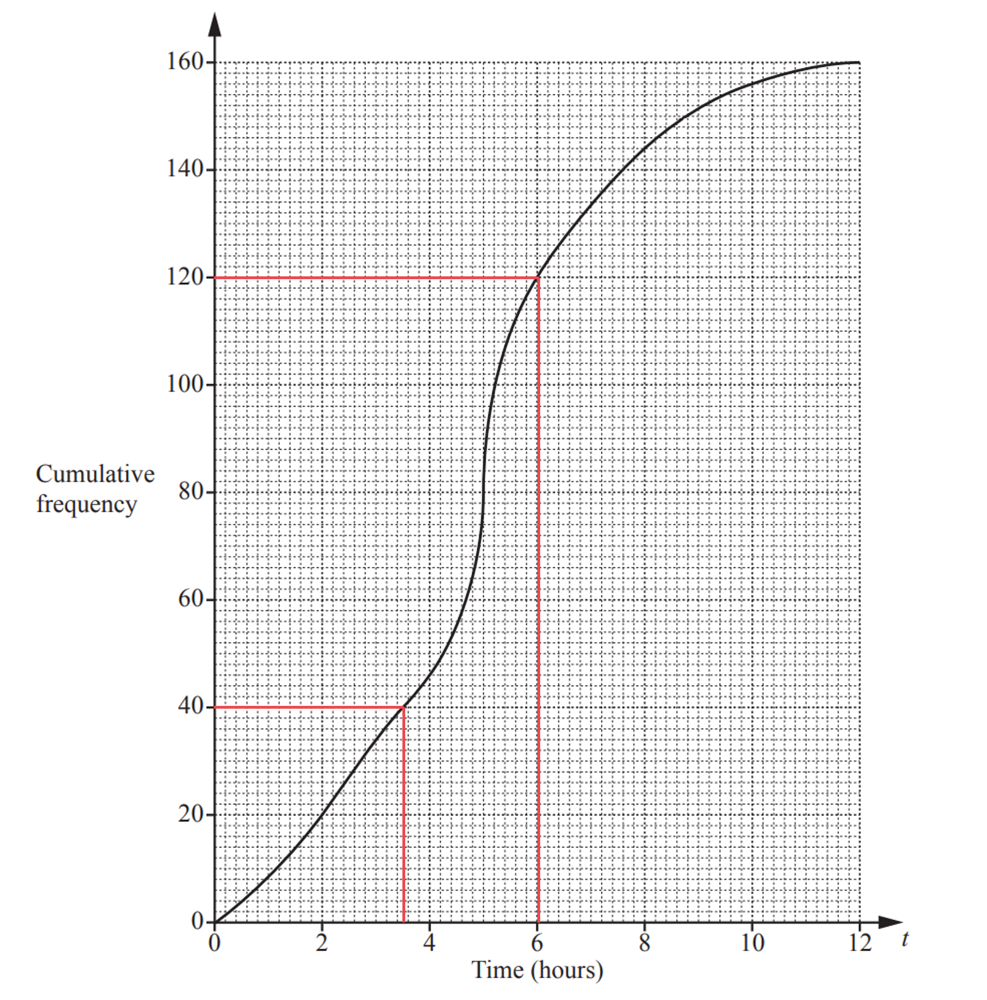

$\begin{gathered} \text{UQ} = 6 \\ \text{LQ} = 3.5 \end{gathered}$

**UQ at 6, or LQ between 3.4 and 3.6**** [1]**

> *Find the interquartile range by finding the difference between upper and lower quartiles.*

$6-3.5=2.5$

$2.5$ **hours** **[1]** 
**2.4 to 2.6 allowed.**
> *We can find the cumulative frequencies at the end of each interval (running total) from the graph. *
*We can then use these to find the frequencies for each class interval. *
*Using 4 hours and 6 hours the cumulative frequencies can be found at the upper ends of the class intervals.*

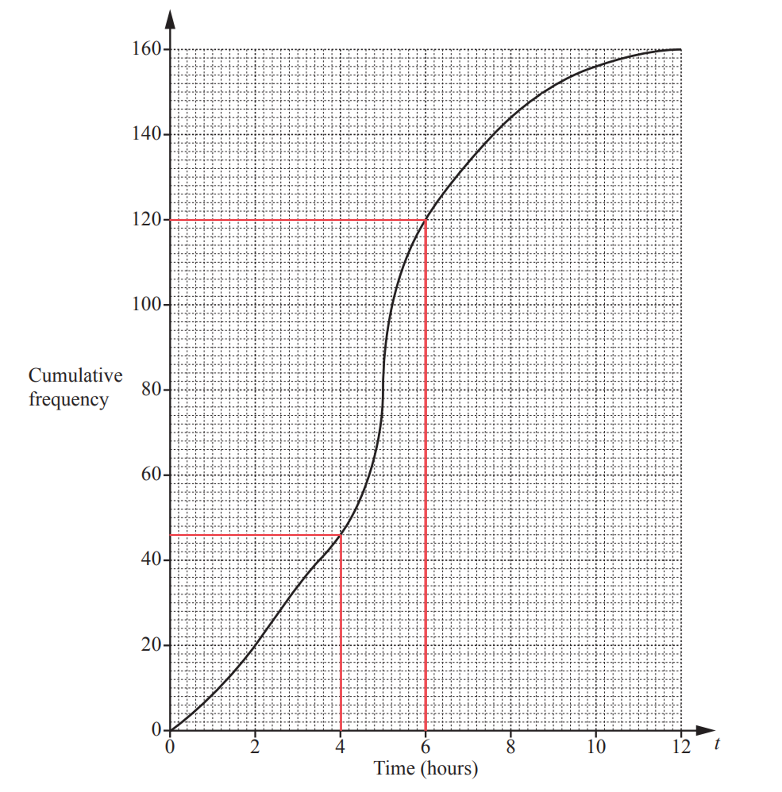

*The cumulative frequency at **4 hours** is **46 students**. *
*The frequency in the *$2<t\leq4$* class must be **46 - 20 = 26**.  (As there is already 20 students in the *$0<t\leq2$* class.)*

*The cumulative frequency at **6 hours** is **120 students**. *
*The frequency in the *$4<t\leq6$* class must be **120 - 46 = 74**.  (As there is already 46 students in total for *$0<t\leq4$*.)*

| Time ($t$ hours) | $0<t\leq2$ | $2<t\leq4$ | $4<t\leq6$ | $6<t\leq8$ | $8<t\leq10$ | $10<t\leq12$ |
|---|---|---|---|---|---|---|
| Frequency | 20 | **Final answer:** **26** | **Final answer:** **74** | 24 | 12 | 4 |

**Mark for each of 26 and 74** **[2]**

### Q7
i) *In the first class interval the cumulative frequency will be the same as the frequency. *
*In subsequent class intervals, add the frequency to the cumulative frequency of the previous class interval.*

| Time ($t$ minutes) | $20<t\leq25$ | $25<t\leq30$ | $30<t\leq35$ | $35<t\leq40$ | $40<t\leq45$ |
|---|---|---|---|---|---|
| Frequency | 44 | 32 | 28 | 12 | 4 |
| *Cumulative frequency* | *44* | *44 + 32 = 76* | *76 + 28 = 104* | *104 + 12 = 116* | *116 + 4 = 120* |

**following this method with one error**** [1]**

| Time ($t$ minutes) | $t\leq20$ | $t\leq25$ | $t\leq30$ | $t\leq35$ | $t\leq40$ | $t\leq45$ |
|---|---|---|---|---|---|---|
| Cumulative frequency | $0$ | $44$ | **Final answer:** **76** | **Final answer:** **104** | **Final answer:** **116** | **Final answer:** **120** |

**[1]**

ii) *No students had a time of less than 20 minutes. So plot the first point at (20, 0). *
*44 students had a time of 25 minutes or less so plot the next point at (25, 44) on the grid, and so on to (45, 120), plotting at the **upper** bound of each class interval. *
*After plotting all six points, join them up with a smooth curve.*

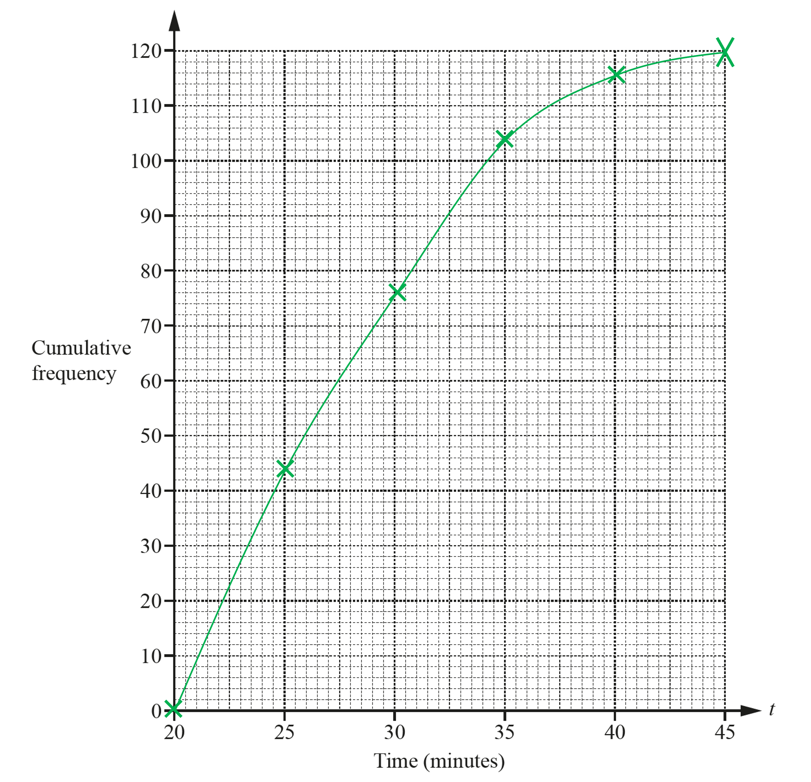

**all points correctly plotted on the time axis ****[1] **
**all points correctly plotted on the cumulative frequency axis ****[1] ****all points joined with a smooth curve ****[1]**

iii) *The median is halfway along the 120 students, for an estimate we use the (120 ÷ 2 =) 60**th** student. *
*(For small data sets, or accurate location of the median, we would use *$( \frac{n + 1}{2} ) \text{th}$* data value.)* 
*Use a ruler to draw a horizontal line across from 60 on the cumulative frequency axis until it hits the curve, then draw a vertical line down to the time axis.*

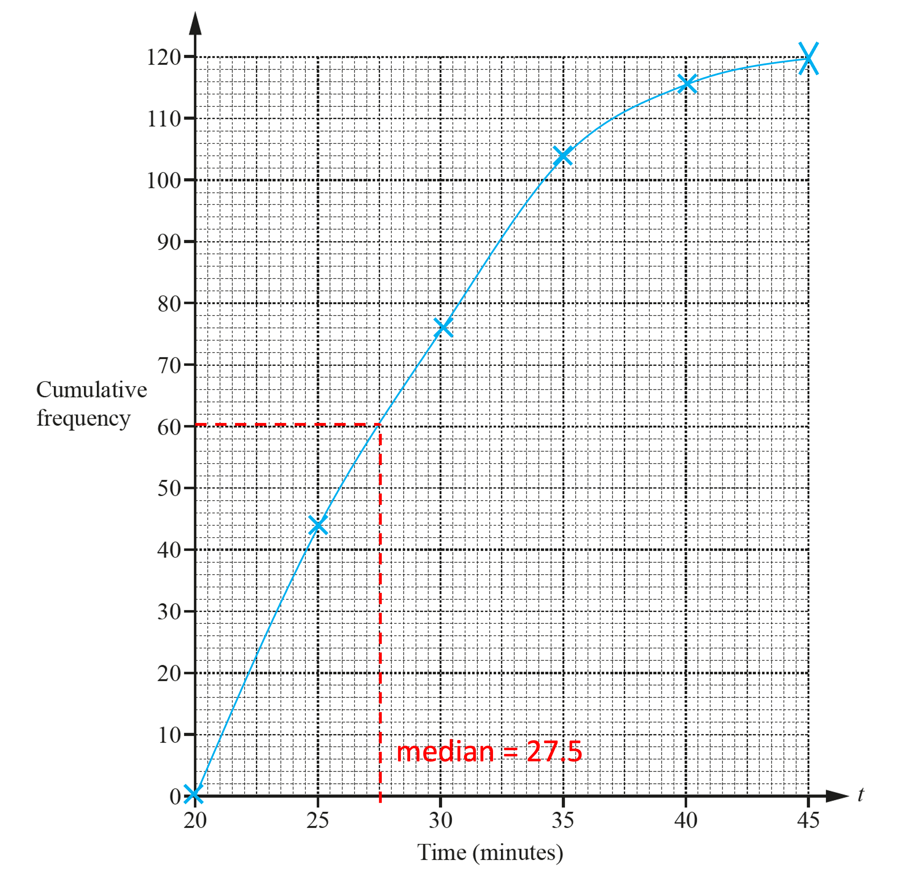

> *Read off the time axis to estimate the median.*

**Answer = 27.5 ****[1]**

**Any answer between 27 and 27.5 is acceptable so long as it is consistent with your curve.**

iv) *To find the interquartile range (IQR) we need the upper quartile (UQ) and lower quartile (LQ). *
*The LQ is one-quarter of the way along 120 students, so the (120 ÷ 4 =) "30**th** student". *
*Use a ruler to draw a horizontal line across from 30 on the cumulative frequency axis until it hits the curve and then draw a vertical line down to the time axis.*
* The UQ is three-quarters of the way along 120 students, so the (120 ÷ 4 x 3 =) "90**th** student". *
*Repeat the process above but from 90 on the cumulative frequency axis.*

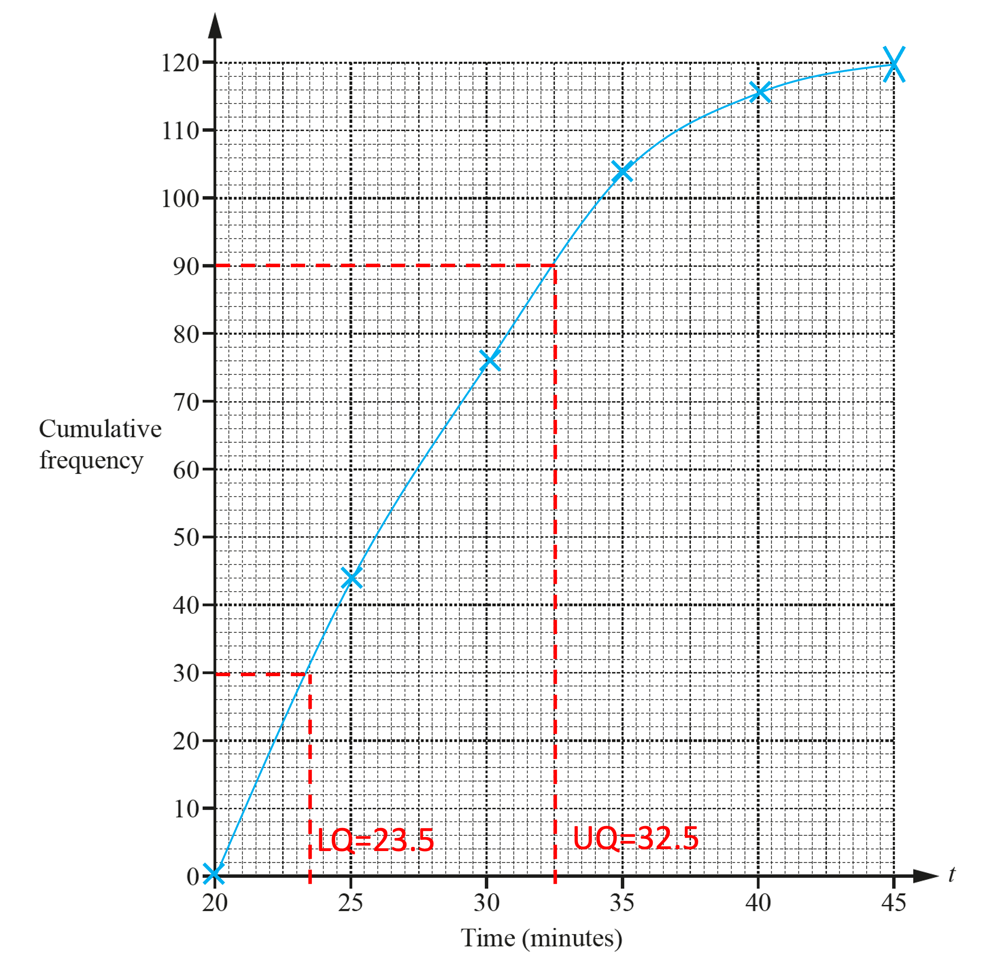

> *Read off the time axis to estimate the LQ and UQ.*

*LQ = 23.5 *
*UQ = 32.5*

**  ****correctly showing at least one of the quartiles according to your curve ****[1]**

> *IQR = UQ − LQ.*

*IQR = 32.5 − 23.5 = 9*

**IQR = 9 ****[1]**

**Any answer between 8.5 and 9.5 is acceptable so long as it is consistent with your curve.**

v) *We can estimate the number of students with a time of **less** than or equal to 37 minutes by using a ruler to draw a vertical line up from 37 on the time axis to the curve; then draw a horizontal line across to the cumulative frequency axis.*

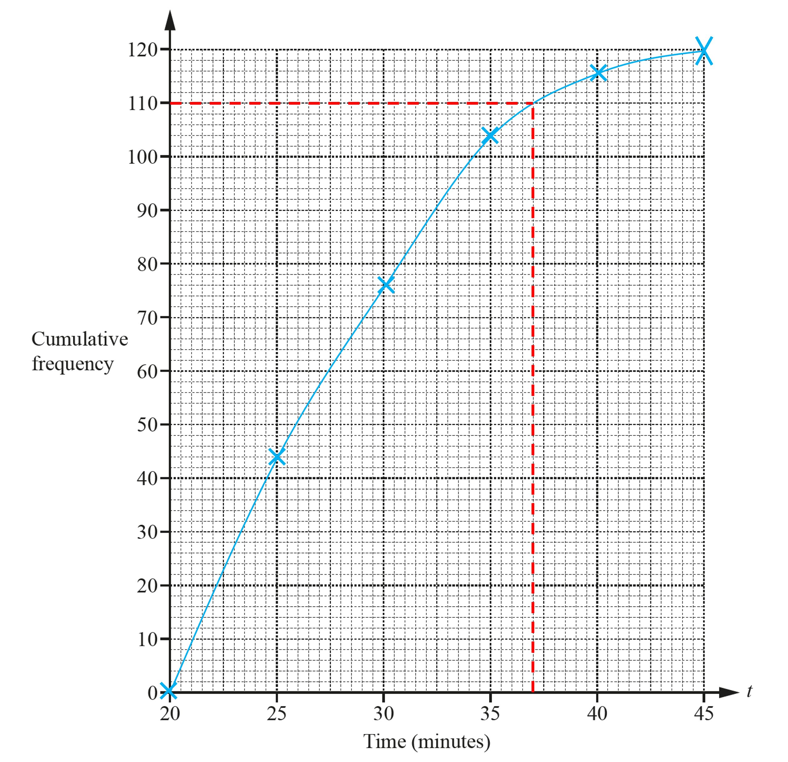

> *Read off the graph on the cumulative frequency axis but beware - this is not the final answer!*

*110 students took a time of 37 minutes or ****less***

**reading 108 to 112 from the graph, depending on curve from (b)(ii) ****[1]**

> *We require the number of students who took more than 37 minutes so subtract 110 from 120.*

*Answer = 120 − 110 = 10*

**10 students** **[1]**

### Q8
i) *The median is value half way along the 60 values/male cyclists.  60 ÷ 2 = 30.* *Estimate the median by drawing a horizontal line from 30 on the cumulative frequency axis across to the curve, then draw a vertical line down to the distance axis. Read off the distance axis to estimate the median.*

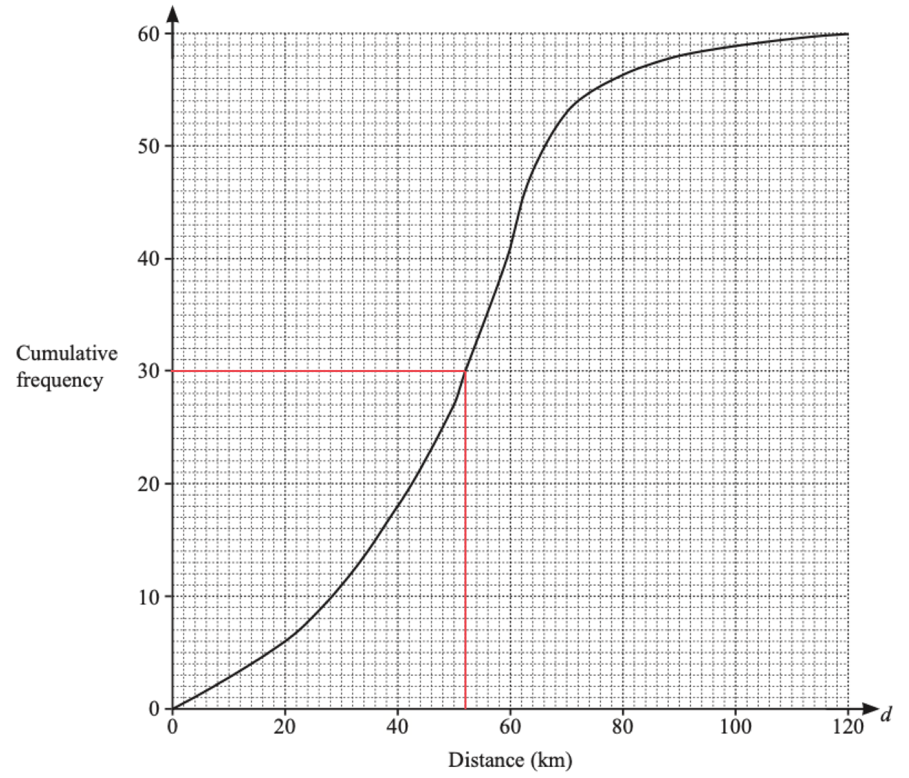

**Median = 52 km*** ***[1]**

> *ii) Estimate the lower quartile, LQ, the value one-quarter along the 60 values/male cyclists.  LQ = *$60\times\frac{1}{4}=15$*. *
*Draw a horizontal line from 15 on the cumulative frequency axis across to the curve, then draw a vertical line down to the distance axis. *
*Read off the distance to estimate the LQ.*

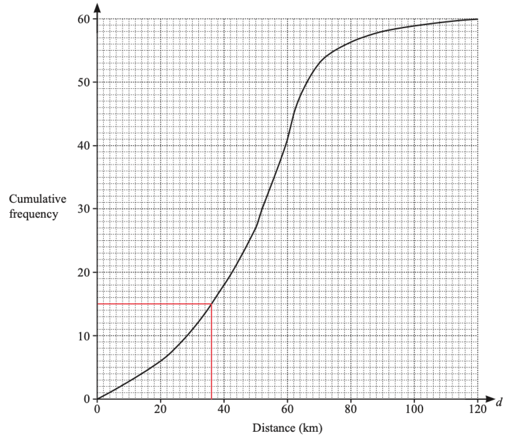

**Final answer:** **LQ = 36 km ****[1]**

iii) *The interquartile range (IQR) is the middle 50% of the data items and is the difference between the upper quartile (UQ) and the lower quartile (LQ). Use the lower quartile estimate from part (ii).*

*LQ = 36*

> *Estimate the upper quartile, UQ, the value three-quarters along the 60 values/male cyclists.*

* *$60\times\frac{3}{4}=45$

> *Draw a horizontal line from 45 across to the curve, then a vertical line down to the distance axis. Read off the distance axis to estimate the UQ. (The graph below also shows how the LQ was found in part (ii).)*

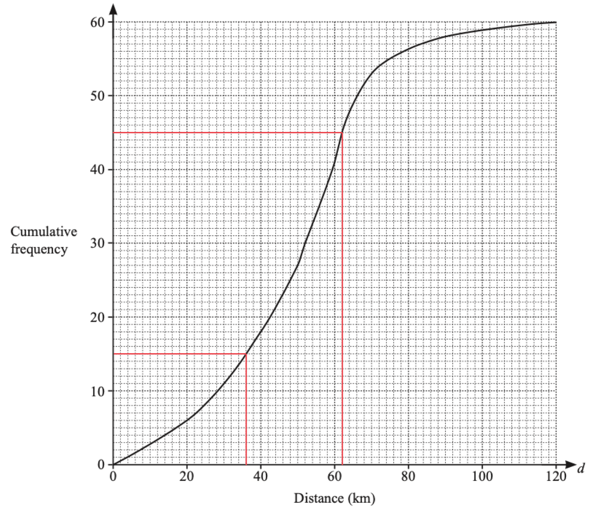

*UQ = 62 km* 
*LQ = 36 km*

> *Subtract the LQ from the UQ to find the IQR.*

*IQR = UQ - LQ = 62 - 36 = 26*

**IQR = 26 km*** ***[1]**
**The IQR of the female cyclists is 40 km which is greater than the IQR of 26 km for the male cyclists.      Therefore, the distances travelled by the females are more varied than the distances travelled by the males.**** [1]**
*First use the cumulative frequency graph to help estimate the number of male cyclists to travel more than 50 km. *
*Draw a vertical line from 50 km on the distance axis to the curve. *
*Draw a horizontal line from the curve across to the cumulative frequency axis. *
 *This is the number of cyclists who travelled 50 km or **less.*

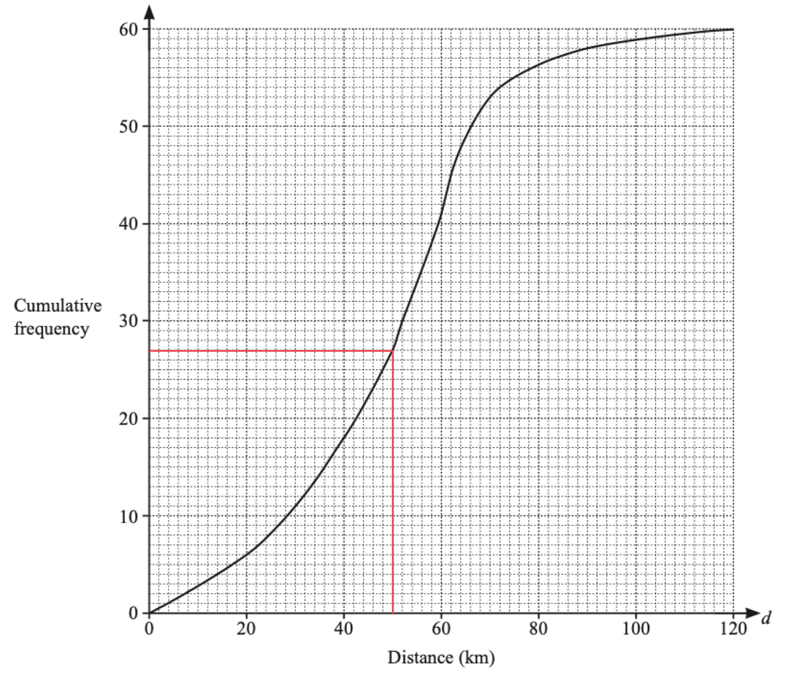

*27 males cycled 50 km or ****less***

**[1]**

> *Subtract this value from the total number of cyclists to work out the number of cyclists that travelled **more** than 50 km.*

*60 - 27 = 33*

> *For the probability we need the fraction of the number of male cyclists who travelled more than 50 km out of the total number of male cyclists.*

$\frac{33}{60}$

> *Simplify the fraction.*

$\frac{11}{20}$** ****[1]**

**Any equivalent, fraction, decimal or percentage answer will be accepted.**
i) *Draw vertical lines up from the distance axis at the upper boundary of each class interval to the curve.*
* Then draw horizontal lines from the curve across to the cumulative frequency axis. *
*Take readings for the **cumulative frequency** of each class interval.*

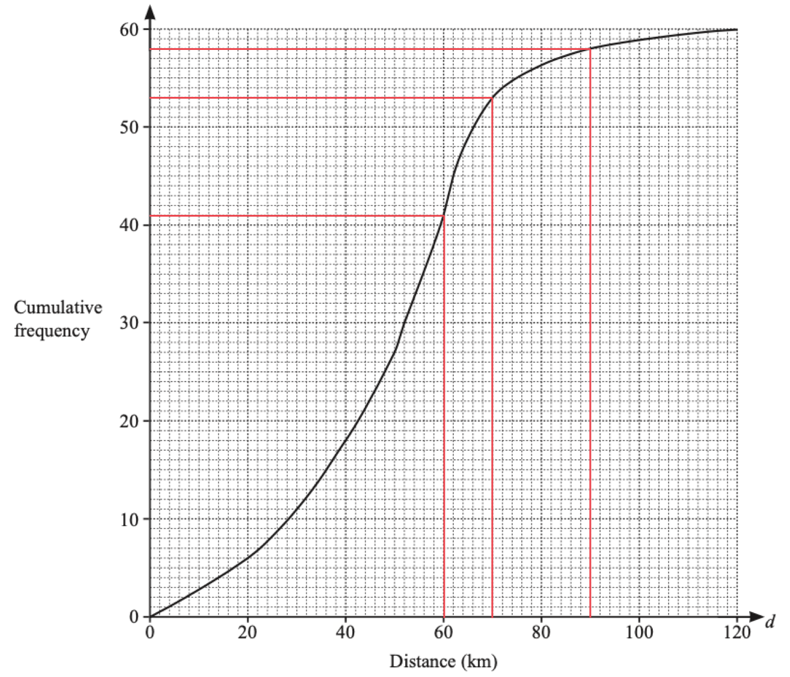

> *Find the frequency of each class interval by subtract the number of male cyclists in the previous class from the cumulative frequency readings for each class.*

$50 < t \le 60 : 41 - ( 9 + 18 ) = 14$

$60<t\leq70:53-41=12$

$70<t\leq90:58-53=5$

> *And now complete the table.*

| **Distance (**$d$** km)** | **Number of male cyclists** |
|---|---|
| $0<d\leq40$ | $18$ |
| $40<d\leq50$ | $9$ |
| $50<d\leq60$ | $14$ |
| $60<d\leq70$ | $12$ |
| $70<d\leq90$ | $5$ |
| $90<d\leq120$ | $2$ |

**One or two values correct**** [1] **
**Third value correct**** [1]**

ii) *To estimate the mean we first need to multiply the midpoint of each group by its frequency.*

$( 20 \times 18 ) + ( 45 \times 9 ) + ( 55 \times 14 ) + ( 65 \times 12 ) + ( 80 \times 5 ) + ( 105 \times 2 ) = 2925$

**Correct midpoints**** [1] **
**Calculating the sum of the frequencies multiplied by the midpoints**** [1]**

> *Now divide this total by the total number of male cyclists.*

$2925\div60=48.75$

**[1]**

**48.75 km** **[1]**

### Q9
> *Fill in the table (by adding all frequencies up to that point).*

| Height ($h$ cm) | $h\leq70$ | $h\leq90$ | $h\leq100$ | $h\leq110$ | $h\leq115$ | $h\leq125$ |
|---|---|---|---|---|---|---|
| Cumulative Frequency | **Final answer:** **8** | *8 + 26 = ***34** | *34 + 35 = ***69** | *69 + 67 = ***136** | *136 + 28 = ***164** | *164 + 16 = ***180** |

**Correct with at most one error**** [1] **
**All table correct**** [1]**

> *A quick check can be that the final value in your table is equal to the number of children (180).*
*Plot the height "end-points" on the horizontal (height) axis and the cumulative frequency on the vertical axis.* 
*Start from the point *$( 60 , 0 )$* (the lowest height in the table).  *

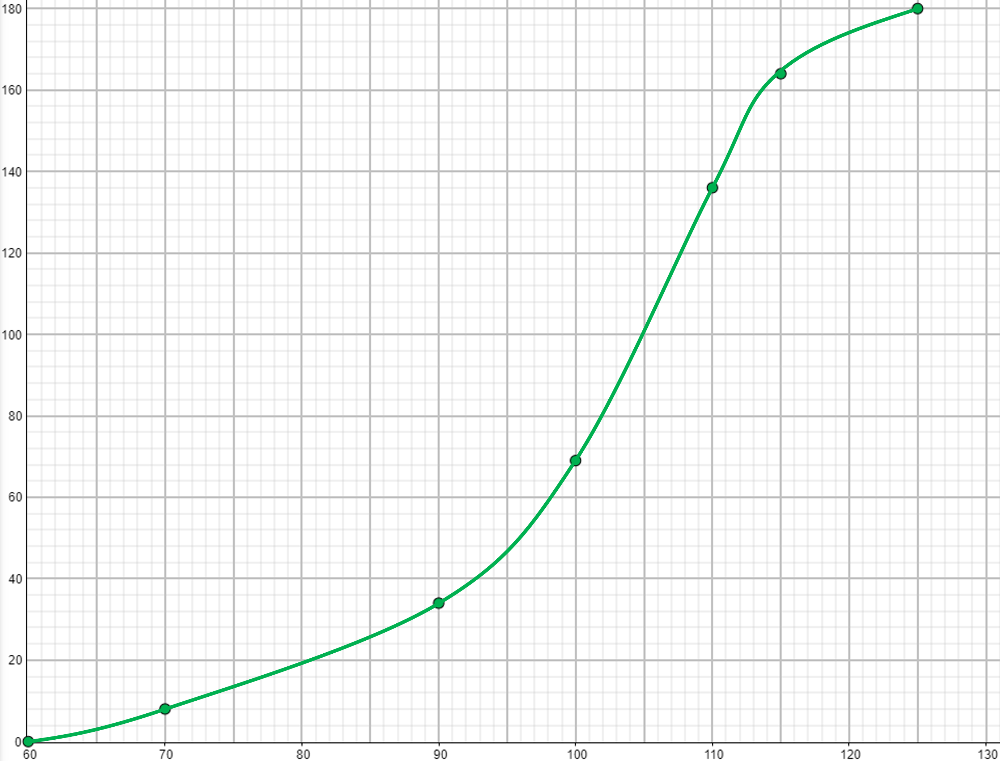

**Correct vertical placement of points ****[1] **
**Correct horizontal placement of points**** [1] **
**Smooth curve through the points**** [1]**
i) *The interquartile range (IQR) requires the lower quartile (LQ) and upper quartile (UQ). Use a ruler to draw horizontal lines to the curve at 45 and 135 on the cumulative frequency axis (a "quarter" and "three-quarters" of 180), then draw vertical lines down to the height axis.*

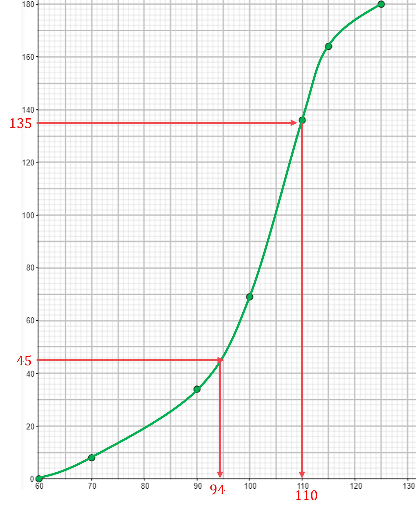

> *Read off the height axis to find the LQ and UQ.*

*LQ = 94 *
*UQ = 110*

> *The interquartile range is the difference between the quartiles.  i.e. IQR = UQ -LQ. *

*110 - 94 = 16*

**At least one value correct, in the range 93 to 94 or 109 to 110 ****[1]*** ***16*** ***[1]**

ii) *The 70th percentile will be the value 70% along the way of the 180 students. *
*Find 70% of 180 by dividing 70 by 100 then multiplying by 180.*

$\frac{70}{100}\times180=126$

> *Use a ruler to draw a horizontal line to the curve from 126 on the cumulative frequency axis until it hits the curve and then draw a vertical lines down to the height axis.  *

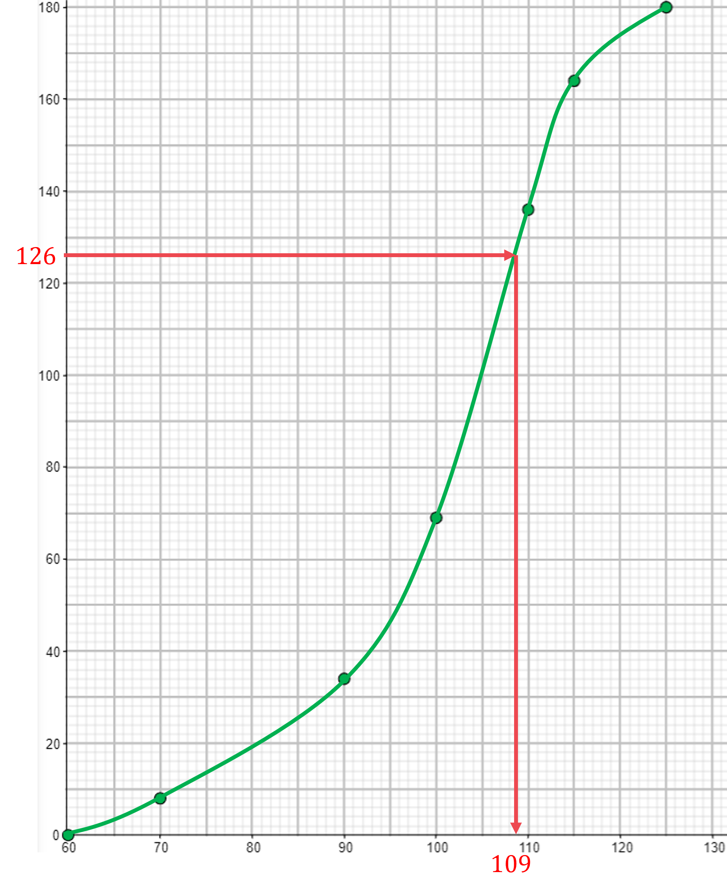

> * Read off the height axis to find the 70**th** percentile.*

**126 seen**** ****[1]*** *
**109*** ***[1] **
**Values between 107 and 109 are accepted.**

iii) *Use a ruler to draw a vertical line up to the curve from 106 cm on the height axis, then draw a horizontal line across to the cumulative frequency axis.  *

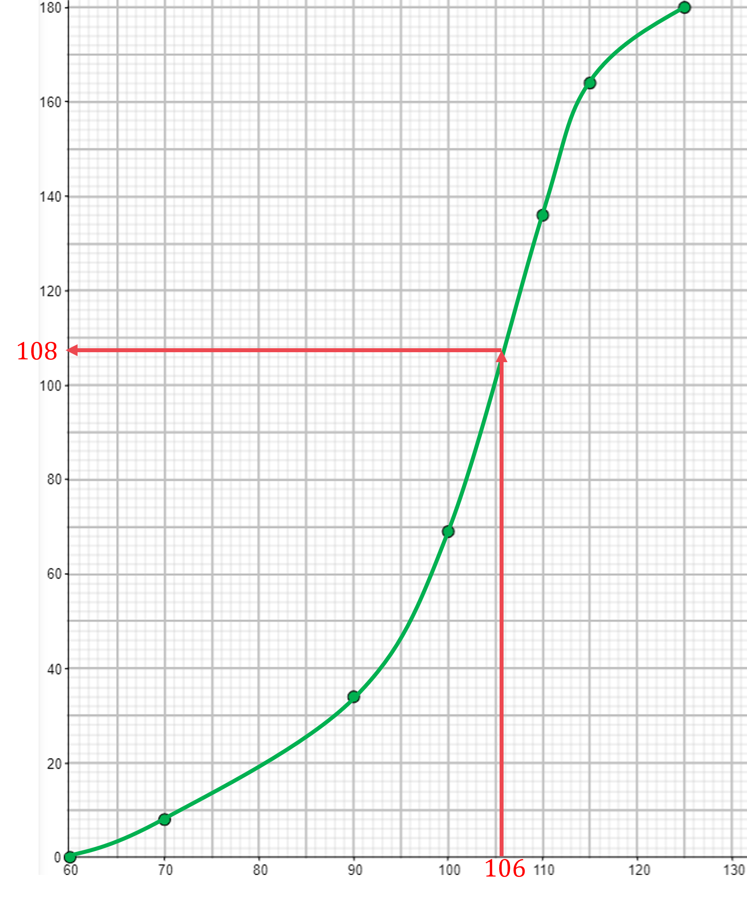

> *Read off the value at the cumulative frequency axis but beware, this is not the final answer!*

*The number of children with heights ****less**** than 106 cm is 108*

* ***reading off the graph at 106**** [1]**

> *We require the number of children with heights **greater** than 106 cm so subtract 108 from 80.*

*180 - 108 = 72*

**Around 72 children have a height greater than 106 cm*** ***[1]*** ***Answers between 66 and 72 are accepted.**

### Q10
*As this is a large data set, use the *$( \frac{80}{2} )^{th} = 40^{th}$* value as the median.* 
*Take a reading from 40 on the cumulative frequency axis, use a straight edge to be as accurate as possible.*

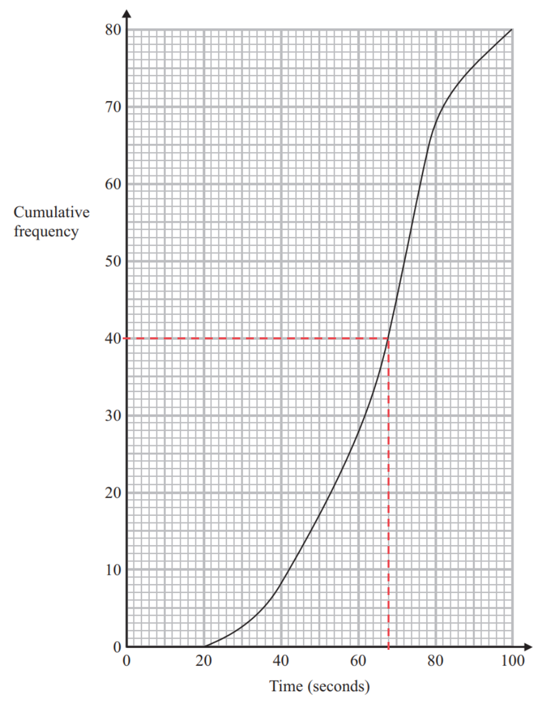

**An estimate for the median time is 68 seconds** **[1]**
> *Take a reading from the graph at a time of 60 seconds, use a straight edge to be as accurate as possible.*

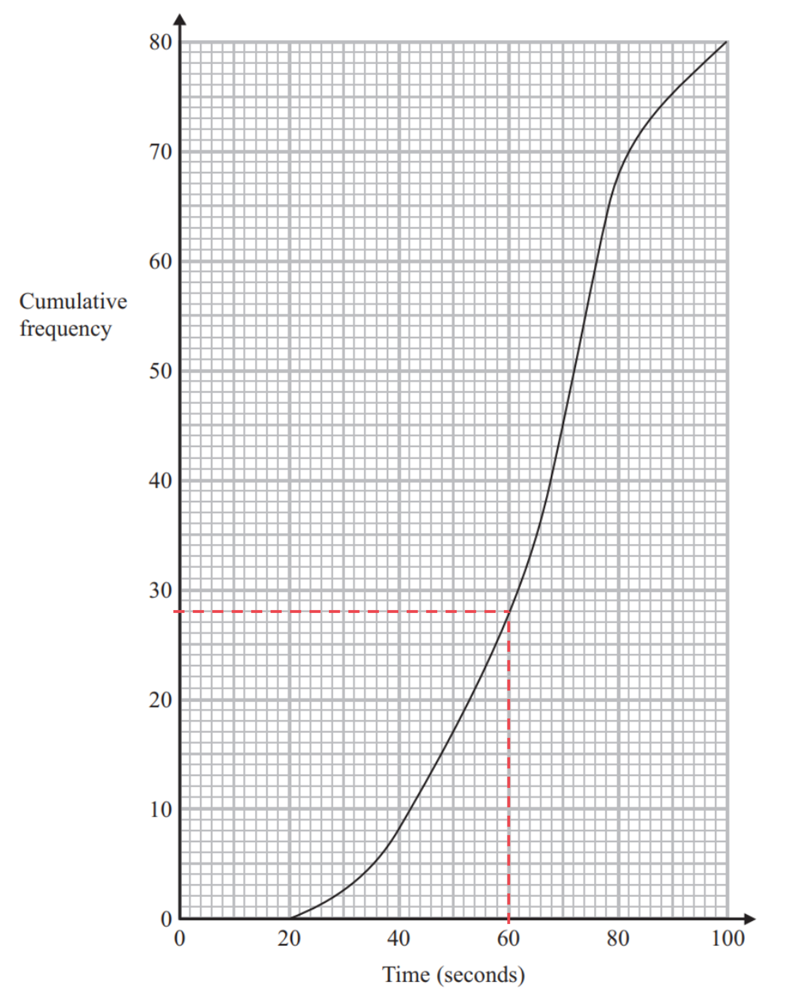

*A time of 60 seconds has a cumulative frequency of 28*

**Reading (27 or 28)**** [1]**

*This means there are (approximately) 28 swimmers with a time of 60 seconds or less to swim 50 metres.* 
*Express this as a percentage by dividing 28 by the total number of swimmers (80) and multiplying by 100%, and compare to 25%.*

$\frac{28}{80} \times 100 \% = 35 \%$

**[1]**

**The team captain is right, more than 25% (about 35%) qualified for the swimming team** **[1]**

### Q11
> *Cumulative frequency is a running total of the frequencies.*

| **Time (*****t *****minutes)** | **Cumulative Frequency** |
|---|---|
| 0 < *t* ≤ 20 | **Final answer:** **5** |
| 0 < *t* ≤ 40 | *5 + 30 = ***35** |
| 0 < *t* ≤ 60 | *35 + 20 = ***55** |
| 0 < *t* ≤ 80 | *55 + 15 = ***70** |
| 0 < *t* ≤ 100 | *70 + 8 = ***78** |
| 0 < *t* ≤ 120 | *78 + 2 = ***80** |

**All correct**** [1]**
*Cumulative frequencies are plotted at the **end** of the class intervals.* *So in these case we would plot the points **(20, 5), (40, 35), (60, 55), (80, 70), (100, 78)** and **(120, 80)**.*
*Also plot a point at (0, 0) and join all points with a smooth curve.*

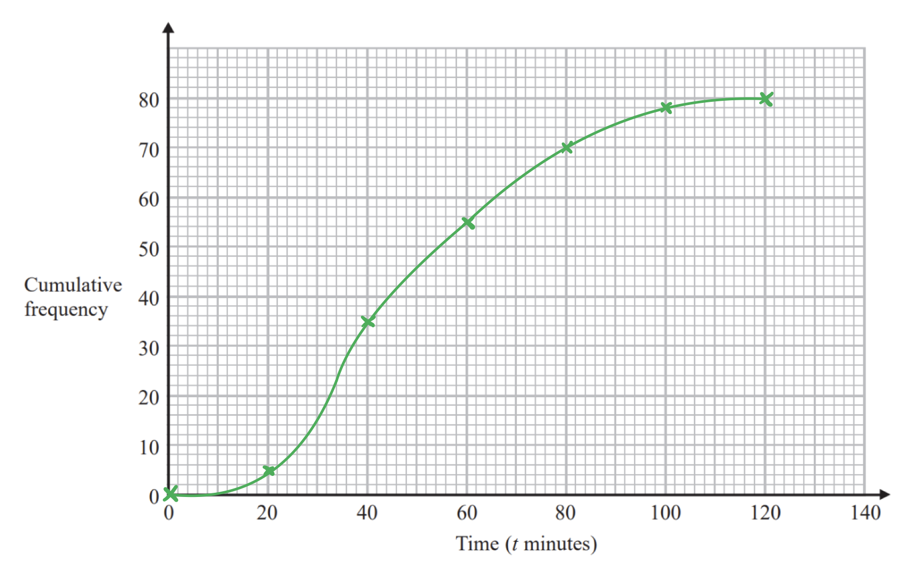

**At least five points plotted correctly ****[1]**** **
**Fully correctly and points joined ****[1]**
*Draw a vertical line up from 90 minutes on the time axis until it reaches the curve.* 
*Then draw a horizontal line across to the cumulative frequency axis and take a reading.*

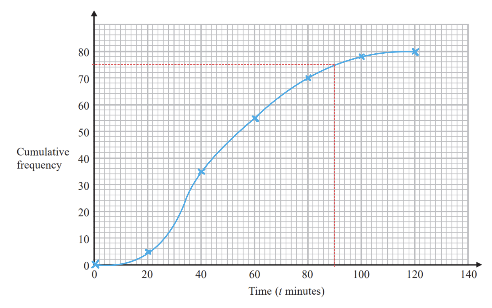

*A time of 90 minutes has a cumulative frequency of 75*

**Reading from graph in range 152 - 160*** ***[1]**

> *This means there are (approximately) 75 office workers who take less than 90 minutes to get to work. *
*The question requires the number of office workers who take more than 90 minutes to get to work so subtract this from the total number of students, which is 80.*

*80 - 75 = 5*

> *To express this as a percentage, write this as a fraction out of the total number of office workers, 80, and multiply by 100%.*

$\frac{5}{80} \times 100 \% = 6.25 \%$

**[1]**

**Approximately 6.25% of the office workers take more than 90 minutes to get to work ****[1]**

**Readings of 72 - 76 are accepted leading to percentages 5% - 10%.**

### Q12
i) *The 60**th** percentile will be 60% of the way through the number of children.*

$60 \% of 100 = \frac{60}{100} \times 100 = 60$

> *Use a ruler to draw a horizontal line from 60 on the cumulative frequency axis to the curve and then draw a vertical line down to the time axis.   *

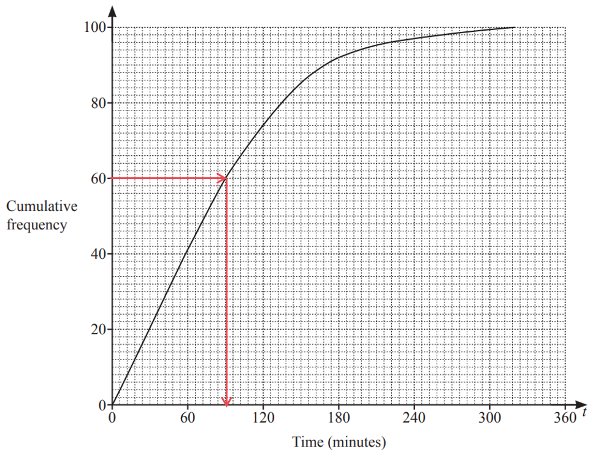

> *Read off the time axis to get an estimate of the 60**th** percentile. Use the scale carefully - each large square (10 small squares) on the time axis represents 60 minutes.*

**60****th**** percentile = 90 min**** ****[1]**

ii) *Use the cumulative frequency graph to estimate the number of children who spent **less** than 3 hours exercising. Units on the graph are in minutes though.*

*3 hours = 3 × 60 = 180 minutes*

> *To estimate the number of children draw a vertical line up from 180 on the time axis to the curve; then draw a horizontal line across to the cumulative frequency axis.*

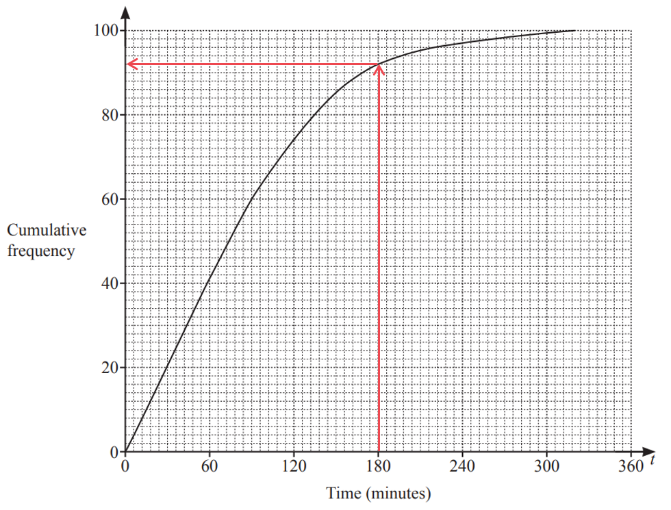

> *Read off the cumulative frequency axis to estimate the number of children exercising **less** than 3 hours per week. *
*Each large square (10 small squares) on the cumulative frequency axis represents 20 children.*

*92 children exercised for ****less**** than 3 hours*

**[1]**

> *Estimate the number of children who exercised for **more** than 3 hours by subtracting this from the total number of children.*

*100 - 92 = 8*

**Approximately 8 children exercised for more than 3 hours ****[1]**

### Q13
*Cumulative frequency is a running total of the frequencies.* *(Note in this question a new table with every interval starting at zero is provided; sometimes a third column is added to the original table.) *
*We are told in the question there are 80 parcels, so the final entry in the cumulative frequency column should be 80.*

| **Weight (*****w *****kg)** | **Cumulative Frequency** |
|---|---|
| 0 < *w* ≤ 1 | **Final answer:** **19** |
| 0 < *w* ≤ 2 | *19 + 17 = ***36** |
| 0 < *w* ≤ 3 | *36 + 15 = ***51** |
| 0 < *w* ≤ 4 | *51 + 12 = ***63** |
| 0 < *w* ≤ 5 | *63 + 10 = ***73** |
| 0 < *w* ≤ 6 | *73 + 7 = ***80** |

**All correct**** [1]**
*Cumulative frequencies are plotted at the **end** of the class intervals.* *So in these case we would plot the points **(1, 19), (2, 36), (3, 51), (4, 63), (5, 73)** and **(6, 80)**. *
*Also plot a point at (0, 0) and join all points with a smooth curve.*

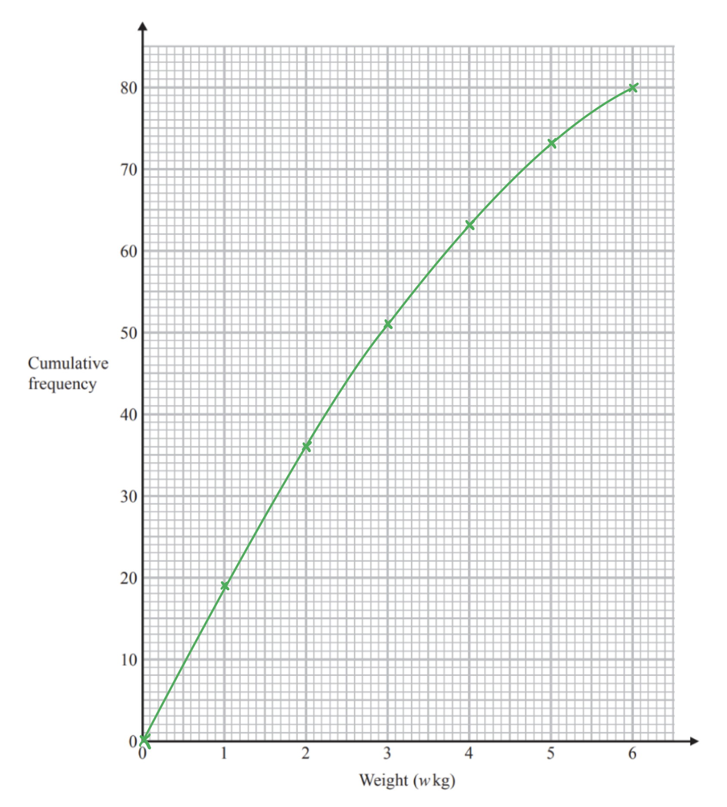

**Five or six points plotted correctly ****[1]**** **
**Points joined ****[1]**
*Draw a vertical line up from 3.4 kg on the weight axis until it reaches the curve.* 
*Then draw a horizontal line across to the cumulative frequency axis and take a reading.*

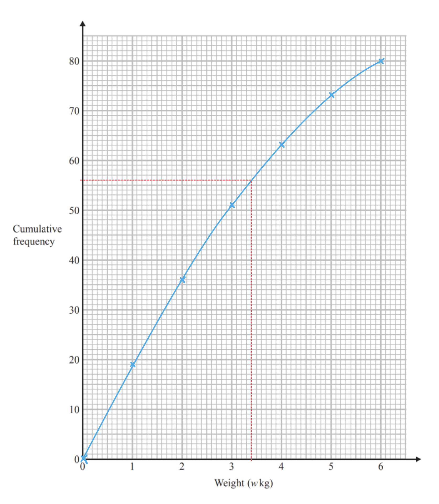

*3.4 kg has a cumulative frequency of 56*

**Reading from graph in range 55 - 57*** ***[1]**

> *This means there are (approximately) 56 parcels with a weight less than 3.4 kg. *
*To express this as a percentage so we can compare to what Sue says, write 56 out of 80 as a fraction and multiplying by 100%.*

$\frac{56}{80} \times 100 \% = 70 \%$

**Sue is not correct as approximately 70% of the parcels weighed less than 2.4 kg ****[1]**
