# Exam Questions — Cumulative Frequency
**Statistics** · Cambridge (CIE) IGCSE maths (0580 & 0980)
> Source: [https://www.savemyexams.com/igcse/maths/cie/25/extended/topic-questions/](https://www.savemyexams.com/igcse/maths/cie/25/extended/topic-questions/) · 13 questions across 1 sets

## Calculator Questions (13 questions)

### Q1 — medium — 8 marks

**Q1** [1 mark]

The table shows information about battery life of $60$ smartphones on a video-playback test.

| Battery life (t hours) | Frequency |
|---|---|
| $6\leqt<8$ | 5 |
| $8\leqt<10$ | 14 |
| $10\leqt<12$ | 22 |
| $12\leqt<14$ | 13 |
| $14\leqt<16$ | 6 |

Complete the cumulative frequency table for the data.

| Battery life (t hours) | Cumulative Frequency |
|---|---|
| $6\leqt<8$ |   |
| $6\leqt<10$ |   |
| $6\leqt<12$ |   |
| $6\leqt<14$ |   |
| $6\leqt<16$ |   |

**Q1** [2 marks]

Draw a cumulative frequency graph for the table.

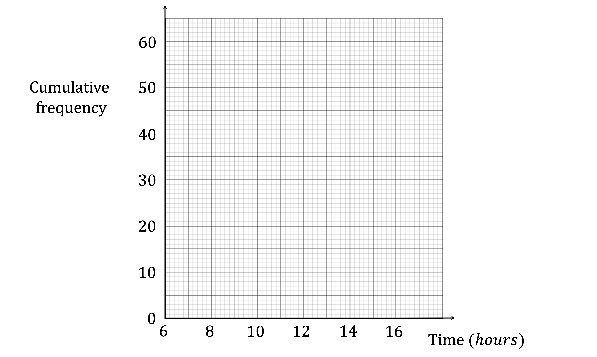

**Q1** [3 marks]

Work out an estimate for the interquartile range for the data.

**Q1** [2 marks]

Work out an estimate for the number of phones with a battery life of at least 13 hours.

### Q2 — medium — 6 marks

**Q2** [6 marks]

The height, *h *cm, of each of 120 plants is measured.
 The cumulative frequency diagram shows this information.

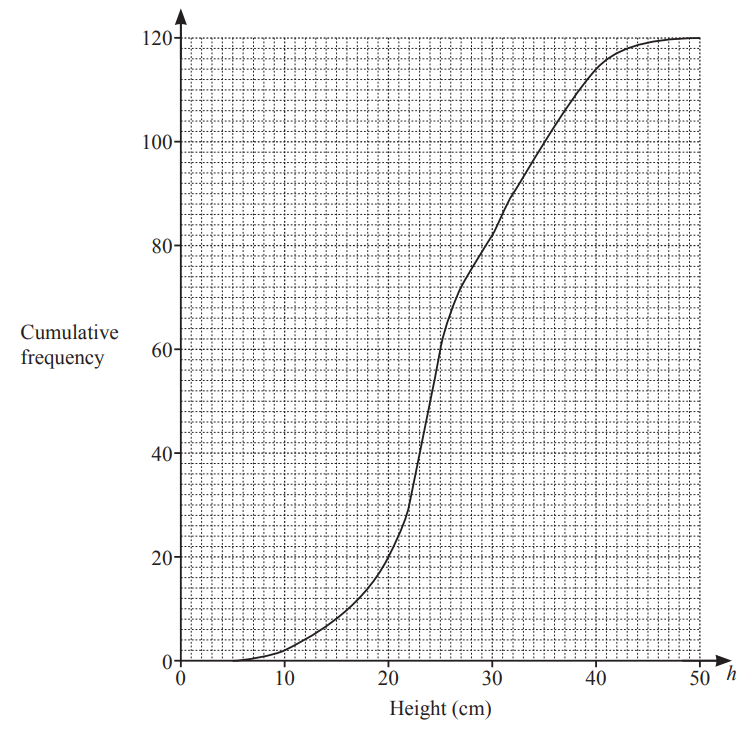

Use the cumulative frequency diagram to find an estimate of

i) the median,

............................................ cm [1]

ii) the interquartile range,

............................................ cm [2]

iii) the 60th percentile,

............................................ cm [1]

iv) the number of plants with a height greater than 40cm.

[2]

*Source: 2020 Oct/Nov 0580/42 Q4A*

### Q3 — hard — 15 marks

**Q3** [6 marks]

The cumulative frequency diagram shows information about the time taken, $t$ seconds, for a group of girls to each solve a maths problem.

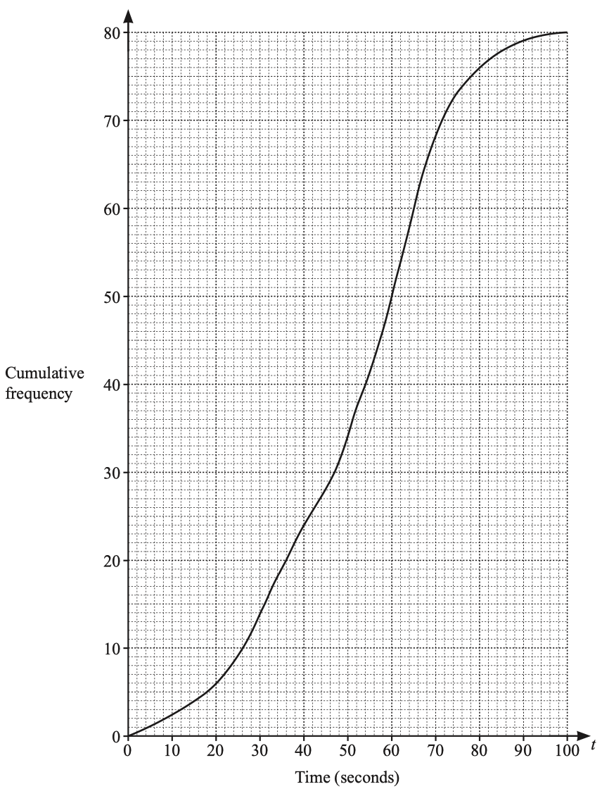

Use the cumulative frequency diagram to find an estimate for

i) the median,

.................................................. s [1]

ii) the interquartile range,

.................................................. s [2]

iii) the 20th percentile,

.................................................. s [1]

iv) the number of girls who took more than 66 seconds to solve the problem.

[2]

*Source: 2019	Oct/Nov 0580/42 Q2A*

**Q3** [6 marks]

**Extract:**

The cumulative frequency diagram shows information about the time taken, t seconds, for a group of girls to each solve a maths problem.

i) Use the cumulative frequency diagram to complete the frequency table.

| Time ($t$ seconds) | $0<t\leq20$ | $20<t\leq40$ | $40<t\leq60$ | $60<t\leq80$ | $80<t\leq100$ |
|---|---|---|---|---|---|
| Frequency | 6 |   |   |   | 4 |

[2]

ii) Calculate an estimate of the mean time.

.................................................. s [4]

*Source: 2019	Oct/Nov 0580/42 Q2B*

**Q3** [3 marks]

**Extract:**

The cumulative frequency diagram shows information about the time taken, t seconds, for a group of girls to each solve a maths problem. Use the cumulative frequency diagram to find an estimate for the median, the interquartile range.

A group of boys solved the same problem. The boys had a median time of 60 seconds, a lower quartile of 46 seconds and an upper quartile of 66 seconds.

i) Write down the percentage of boys with a time of 66 seconds or less.

................................................ % [1]

ii) Howard says

"The boys' times vary more than the girls' times."

Explain why Howard is incorrect.

[2]

*Source: 2019 OCt/Nov 0580/42 Q2C*

### Q4 — hard — 3 marks

**Q4** [3 marks]

The cumulative frequency graph gives information about the weights, in grams, of 90 bags of sweets.

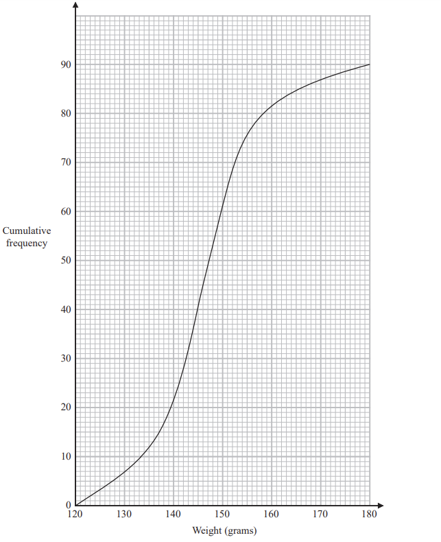

Roberto sells the bags of sweets to raise money for charity. 
Bags with a weight greater than $d$ grams are labelled large bags and sold for 3.75 euros each bag.

The total amount of money he receives by selling all the large bags is 93.75 euros.

Find the value of $d$.

*Source: Jan 2021 4MA1/1H Q11B*

### Q5 — hard — 6 marks

**Q5** [2 marks]

The cumulative frequency graphs show information about the times taken by 100 male runners and by 100 female runners to finish the London marathon.

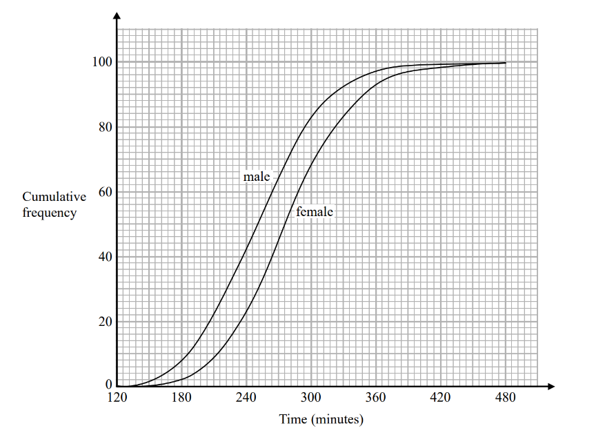

A male runner is chosen at random.

Find an estimate for the probability that this runner took less than 4 hours to finish the London marathon.

*Source: Spec2 2015 1MA1/2H Q11A*

**Q5** [4 marks]

Use medians and interquartile ranges to compare the distribution of the times taken by the male runners with the distribution of the times taken by the female runners.

*Source: Spec2 2015 1MA1/2H Q11B*

### Q6 — medium — 5 marks

**Q6** [3 marks]

160 students record the amount of time, $t$ hours, they each spend playing computer games in a week. 
This information is shown in the cumulative frequency diagram.

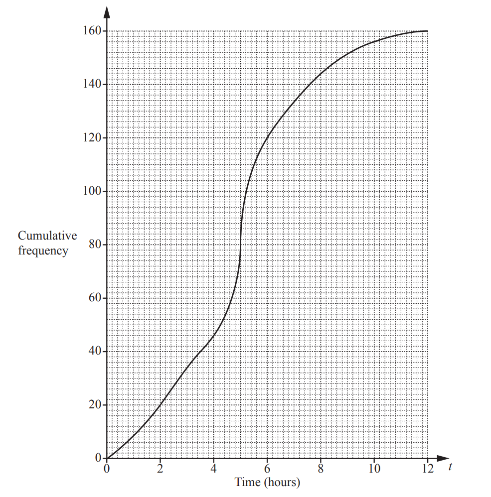

Use the diagram to find an estimate of

i)  the median,

.......................................... hours [1]

ii) the interquartile range.

.......................................... hours [2]

*Source: 2019	May/June 0580/23 Q23A*

**Q6** [2 marks]

**Extract:**

160 students record the amount of time, ![t] hours, they each spend playing computer games in a week. 

This information is shown in the cumulative frequency diagram.

Use the diagram to complete this frequency table.

| Time ($t$ hours) | $0<t\leq2$ | $2<t\leq4$ | $4<t\leq6$ | $6<t\leq8$ | $8<t\leq10$ | $10<t\leq12$ |
|---|---|---|---|---|---|---|
| Frequency | 20 |   |   | 24 | 12 | 4 |

*Source: 2019	May/June 0580/23 Q23B*

### Q7 — medium — 10 marks

**Q7** [10 marks]

The time taken for each of 120 students to complete a cooking challenge is shown in the table.

| Time ($t$ minutes) | $20<t\leq25$ | $25<t\leq30$ | $30<t\leq35$ | $35<t\leq40$ | $40<t\leq45$ |
|---|---|---|---|---|---|
| Frequency | $44$ | $32$ | $28$ | $12$ | $4$ |

i) Complete the cumulative frequency table.

| Time ($t$ minutes) | $t\leq20$ | $t\leq25$ | $t\leq30$ | $t\leq35$ | $t\leq40$ | $t\leq45$ |
|---|---|---|---|---|---|---|
| Cumulative frequency | $0$ | $44$ |   |   |   |   |

[2]

ii) On the grid, draw a cumulative frequency diagram to show this information.

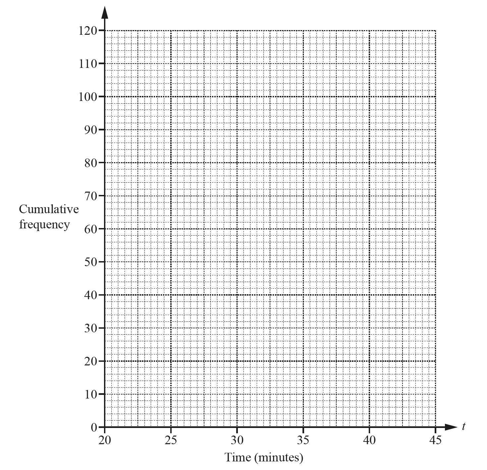

[3]

iii) Find the median time.

......................................... min [1]

iv) Find the interquartile range.

......................................... min [2]

v) Find the number of students who took more than 37 minutes to complete the cooking challenge.

[2]

*Source: 2018	May/June 0580/42 Q2B*

### Q8 — hard — 12 marks

**Q8** [3 marks]

The cumulative frequency diagram shows information about the distance, $d$ km, travelled by each of 60 male cyclists in one weekend.

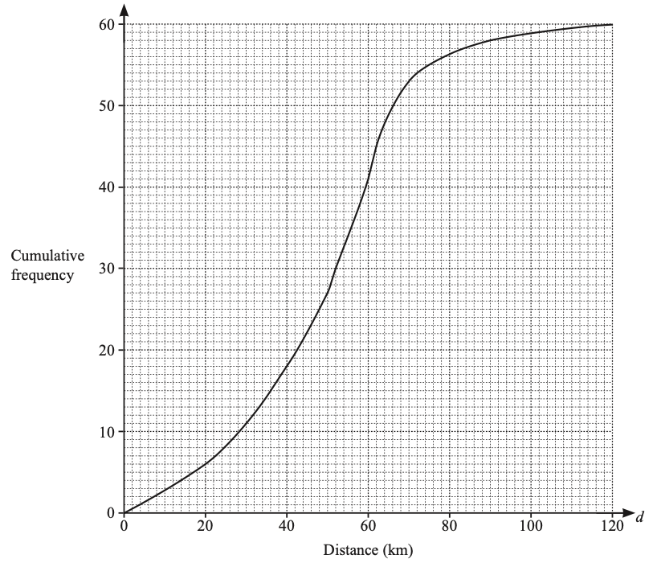

Use the cumulative frequency diagram to find an estimate of

i) the median,

.............................................. km [1]

ii) the lower quartile,

.............................................. km [1]

iii) the interquartile range.

.............................................. km [1]

*Source: 2019	Oct/Nov 0580/43 Q5A*

**Q8** [1 mark]

**Extract:**

iii) the interquartile range.

   .............................................. km [1]

For the same weekend, the interquartile range for the distances travelled by a group of female cyclists is 40 km.

Make one comment comparing the distribution of the distances travelled by the males with the distribution of the distances travelled by the females.

*Source: 2019	Oct/Nov 0580/43 Q5B*

**Q8** [2 marks]

**Extract:**

The cumulative frequency diagram shows information about the distance, d km, travelled by each of 60 male cyclists in one weekend.

A male cyclist is chosen at random.

Find the probability that he travelled more than 50 km.

*Source: 2019	Oct/Nov 0580/43 Q5C*

**Q8** [6 marks]

**Extract:**

The cumulative frequency diagram shows information about the distance, d km, travelled by each of 60 male cyclists in one weekend.

i) Use the cumulative frequency diagram to complete this frequency table.

| **Distance (**$d$** km)** | **Number of male cyclists** |
|---|---|
| $0<d\leq40$ | $18$ |
| $40<d\leq50$ | $9$ |
| $50<d\leq60$ |   |
| $60<d\leq70$ |   |
| $70<d\leq90$ |   |
| $90<d\leq120$ | $2$ |

[2]

ii) Calculate an estimate of the mean distance travelled.

.............................................. km [4]

*Source: 2019	Oct/Nov 0580/43 Q5D*

### Q9 — medium — 11 marks

**Q9** [2 marks]

A school nurse records the height, $h$ cm, of each of 180 children. 
The table shows the information.

| Height ($h$ cm) | $60<h\leq70$ | $70<h\leq90$ | $90<h\leq100$ | $100<h\leq110$ | $110<h\leq115$ | $115<h\leq125$ |
|---|---|---|---|---|---|---|
| Frequency | 8 | 26 | 35 | 67 | 28 | 16 |

Complete the cumulative frequency table below.

| Height ($h$ cm) | $h\leq70$ | $h\leq90$ | $h\leq100$ | $h\leq110$ | $h\leq115$ | $h\leq125$ |
|---|---|---|---|---|---|---|
| Cumulative Frequency |   |   |   |   |   | 180 |

*Source: 2018	Oct/Nov 0580/41 Q4C*

**Q9** [3 marks]

**Extract:**

| Height (h cm) | 60 < h ≤ 70 | 70 < h ≤ 90 | 90 < h ≤ 100 | 100 < h ≤ 110 | 110 < h ≤ 115 | 115 < h ≤ 125 |
| Frequency | 8 | 26 | 35 | 67 | 28 | 16 |

| Height (h cm) | h ≤ 70 | h ≤ 90 | h ≤ 100 | h ≤ 110 | h ≤ 115 | h ≤ 125 |
| Cumulative Frequency |   |   |   |   |   | 180 |

On the grid below, draw a cumulative frequency diagram.

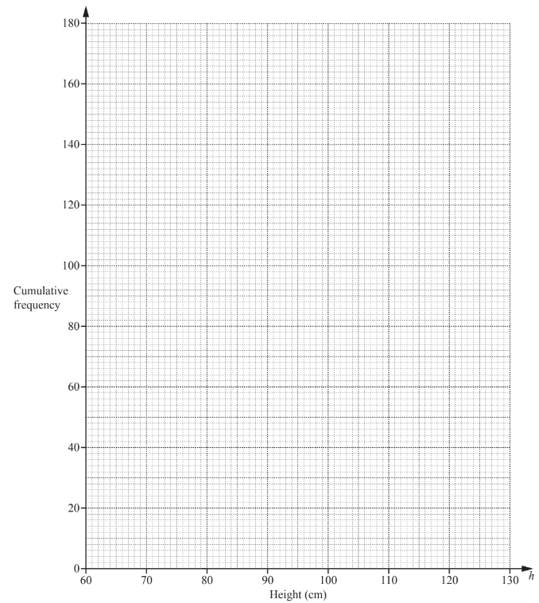

*Source: 2018	Oct/Nov 0580/41 Q4D*

**Q9** [6 marks]

**Extract:**

A school nurse records the height, ![h] cm, of each of 180 children. 

The table shows the information.

| Height (![h] cm) | ![60 less than h less or equal than 70] | ![70 less than h less or equal than 90] | ![90 less than h less or equal than 100] | ![100 less than h less or equal than 110] | ![110 less than h less or equal than 115] | ![115 less than h less or equal than 125] |
| Frequency | 8 | 26 | 35 | 67 | 28 | 16 |
Complete the cumulative frequency table below.

| Height (![h] cm) | ![h less or equal than 70] | ![h less or equal than 90] | ![h less or equal than 100] | ![h less or equal than 110] | ![h less or equal than 115] | ![h less or equal than 125] |
| Cumulative Frequency |   |   |   |   |   | 180 |

Use your cumulative frequency diagram to find an estimate of

i) the interquartile range,

.......................................... cm [2]

ii) the 70th percentile,

.......................................... cm [2]

iii) the number of children with height greater than 106 cm.

[2]

*Source: 2018	Oct/Nov 0580/41 Q4E*

### Q10 — medium — 4 marks

**Q10** [1 mark]

The cumulative frequency graph shows information about the times 80 swimmers take to swim 50 metres.

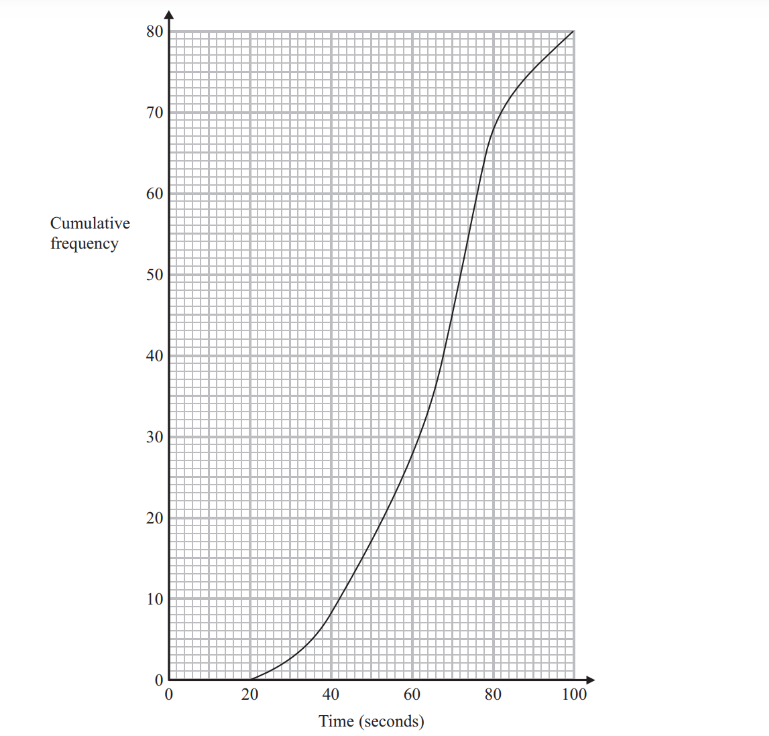

Use the graph to find an estimate for the median time.

*Source: November 2013 1MA0/1H Q18A*

**Q10** [3 marks]

**Extract:**

The cumulative frequency graph shows information about the times 80 swimmers take to swim 50 metres.

A swimmer has to swim 50 metres in 60 seconds or less to qualify for the swimming team.

The team captain says,

"More than 25% of swimmers have qualified for the swimming team."

Is the team captain right? 
You must show how you got your answer.

*Source: November 2013 1MA0/1H Q18B*

### Q11 — easy — 6 marks

**Q11** [1 mark]

The grouped frequency table gives information about the times, in minutes, that $80$ office workers take to get to work.

| **Time (**$t$** minutes)** | **Frequency** |
|---|---|
| `0 less than t less-than or slanted equal to 20` | $5$ |
| `20 less than t less-than or slanted equal to 40` | $30$ |
| `40 less than t less-than or slanted equal to 60` | $20$ |
| `60 less than t less-than or slanted equal to 80` | $15$ |
| `80 less than t less-than or slanted equal to 100` | $8$ |
| `100 less than t less-than or slanted equal to 120` | $2$ |

Complete the cumulative frequency table.

| **Time (**$t$** minutes)** | **Cumulative frequency** |
|---|---|
| `0 less than t less-than or slanted equal to 20` |   |
| `0 less than t less-than or slanted equal to 40` |   |
| `0 less than t less-than or slanted equal to 60` |   |
| `0 less than t less-than or slanted equal to 80` |   |
| `0 less than t less-than or slanted equal to 100` |   |
| `0 less than t less-than or slanted equal to 120` |   |

*Source: June 2019 1MA1/2H Q11A*

**Q11** [2 marks]

**Extract:**

The grouped frequency table gives information about the times, in minutes, that 80 office workers take to get to work. 

| Time (t minutes) | Frequency |
| 0 < t ≤ 20 | 5 |
| 20 < t ≤ 40 | 30 |
| 40 < t ≤ 60 | 20 |
| 60 < t ≤ 80 | 15 |
| 80 < t ≤ 100 | 8 |
| 100 < t ≤ 120 | 2 |

Complete the cumulative frequency table.

| Time (t minutes) | Cumulative frequency |
| 0 < t ≤ 20 |   |
| 0 < t ≤ 40 |   |
| 0 < t ≤ 60 |   |
| 0 < t ≤ 80 |   |
| 0 < t ≤ 100 |   |
| 0 < t ≤ 120 |   |

On the grid, draw the cumulative frequency graph for this information.

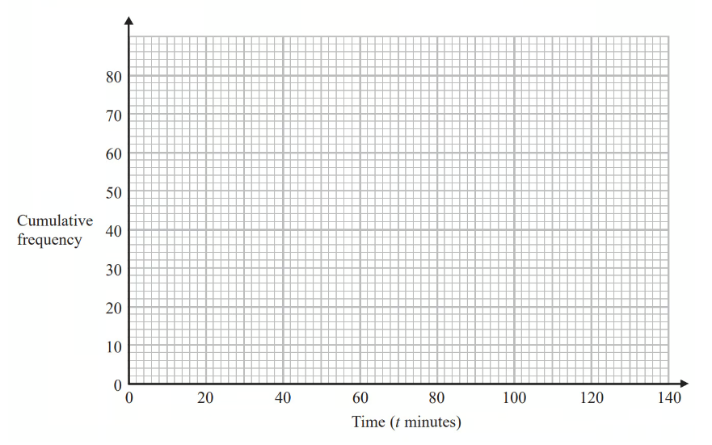

*Source: June 2019 1MA1/2H Q11B*

**Q11** [3 marks]

**Extract:**

The grouped frequency table gives information about the times, in minutes, that 80 office workers take to get to work. 

| **Time (t minutes)** | **Frequency** |
| 0 < t ≤ 20 | 5 |
| 20 < t ≤ 40 | 30 |
| 40 < t ≤ 60 | 20 |
| 60 < t ≤ 80 | 15 |
| 80 < t ≤ 100 | 8 |
| 100 < t ≤ 120 | 2 |

Use your graph to find an estimate for the percentage of these office workers who take more than $90$minutes to get to work.

*Source: June 2019 1MA1/2H Q11C*

### Q12 — easy — 3 marks

**Q12** [3 marks]

The cumulative frequency graph shows the times, in minutes, each of 100 children spent exercising in one week.

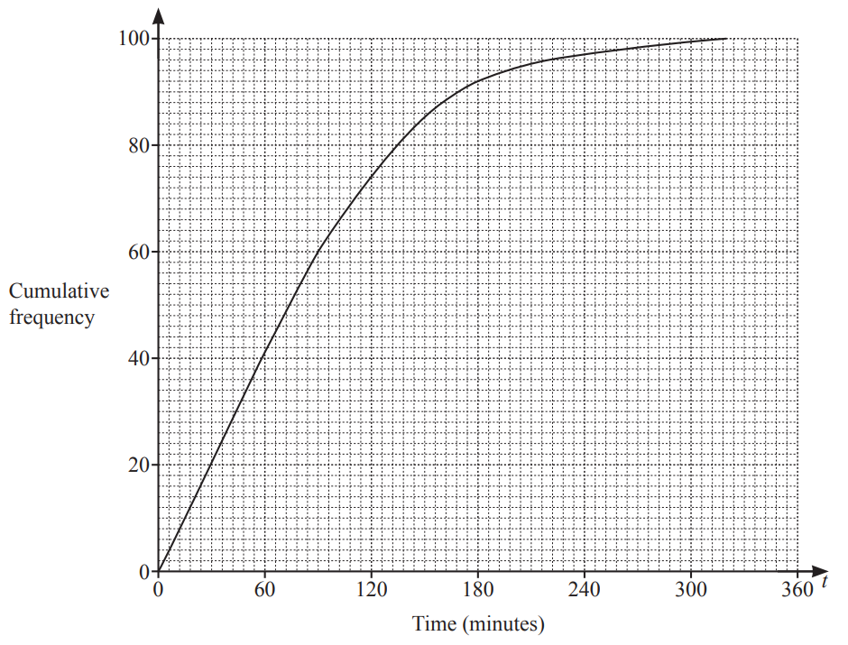

Use the cumulative frequency diagram to find an estimate of

i)  the 60th percentile,

.......................................... min [1]

ii) the number of children who spent more than 3 hours exercising.

[2]

*Source: 2020 Oct/Nov 0580/41 Q3B*

### Q13 — easy — 6 marks

**Q13** [1 mark]

Sue works for a company that delivers parcels.

One day the company delivered $80$parcels. 
The table shows information about the weights, in kg, of these parcels.

| **Weight ( **$w$** kg)** | **Frequency** |
|---|---|
| `0 less than w less-than or slanted equal to 1` | $19$ |
| `1 less than w less-than or slanted equal to 2` | $17$ |
| `2 less than w less-than or slanted equal to 3` | $15$ |
| `3 less than w less-than or slanted equal to 4` | $12$ |
| `4 less than w less-than or slanted equal to 5` | $10$ |
| `5 less than w less-than or slanted equal to 6` | $7$ |

Complete the cumulative frequency table.

| **Weight ( **$w$** kg)** | **Cumulative frequency** |
|---|---|
| `0 less than w less-than or slanted equal to 1` |   |
| `0 less than w less-than or slanted equal to 2` |   |
| `0 less than w less-than or slanted equal to 3` |   |
| `0 less than w less-than or slanted equal to 4` |   |
| `0 less than w less-than or slanted equal to 5` |   |
| `0 less than w less-than or slanted equal to 6` |   |

*Source: November 2015 1MA0/1H Q15A*

**Q13** [2 marks]

**Extract:**

| **Weight ( **w** kg)** | **Frequency** |
| 0 < w ≤ 1 | 19 |
| 1 < w ≤ 2 | 17 |
| 2 < w ≤ 3 | 15 |
| 3 < w ≤ 4 | 12 |
| 4 < w ≤ 5 | 10 |
| 5 < w ≤ 6 | 7 |

Complete the cumulative frequency table.

| **Weight ( **w** kg)** | **Cumulative frequency** |
| 0 < w ≤ 1 |   |
| 0 < w ≤ 2 |   |
| 0 < w ≤ 3 |   |
| 0 < w ≤ 4 |   |
| 0 < w ≤ 5 |   |
| 0 < w ≤ 6 |   |

On the grid opposite, draw a cumulative frequency graph for your table.

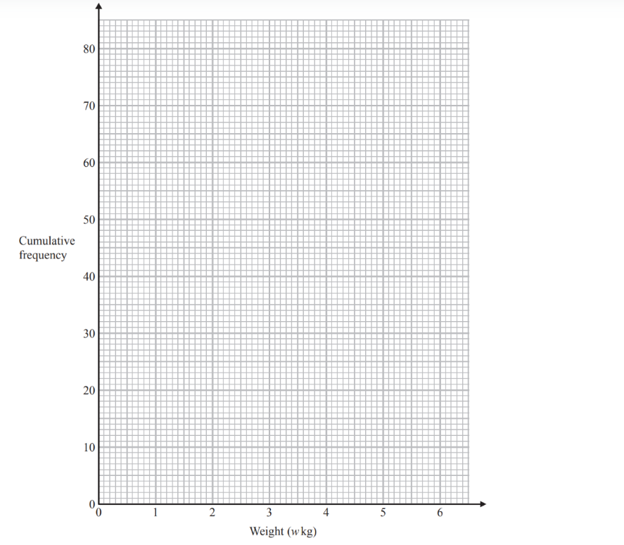

*Source: November 2015 1MA0/1H Q15B*

**Q13** [3 marks]

**Extract:**

The table shows information about the weights, in kg, of these parcels.

| **Weight ( **w** kg)** | **Frequency** |
| 0 < w ≤ 1 | 19 |
| 1 < w ≤ 2 | 17 |
| 2 < w ≤ 3 | 15 |
| 3 < w ≤ 4 | 12 |
| 4 < w ≤ 5 | 10 |
| 5 < w ≤ 6 | 7 |
Complete the cumulative frequency table.

| **Weight ( **w** kg)** | **Cumulative frequency** |
| 0 < w ≤ 1 |   |
| 0 < w ≤ 2 |   |
| 0 < w ≤ 3 |   |
| 0 < w ≤ 4 |   |
| 0 < w ≤ 5 |   |
| 0 < w ≤ 6 |   |

Sue says,

"$75$ % of the parcels weigh less than $3.4$ kg."

Is Sue correct?
 You must show how you get your answer.

*Source: November 2015 1MA0/1H Q15C*

