# Mark Schemes — Histograms
**Statistics** · Cambridge (CIE) IGCSE maths (0580 & 0980)

## Exam Questions (22 questions)

### Q1
$\mathrm{frequency} \mathrm{density}=\frac{\mathrm{frequency}}{\mathrm{class} \mathrm{width}}$

> *Find the frequency densities for each class*

| Heights (cm) | Frequency | *Frequency density* |
|---|---|---|
| $0<h\leq10$ |   |   |
| $10<h\leq25$ | $135$ | $\frac{135}{15}=9$ |
| $25<h\leq30$ | $25$ |   |
| $30<h\leq40$ | $70$ | $\frac{70}{10}=7$ |
| $40<h\leq55$ | $45$ | $\frac{45}{15}=3$ |
| $55<h\leq60$ |   |   |

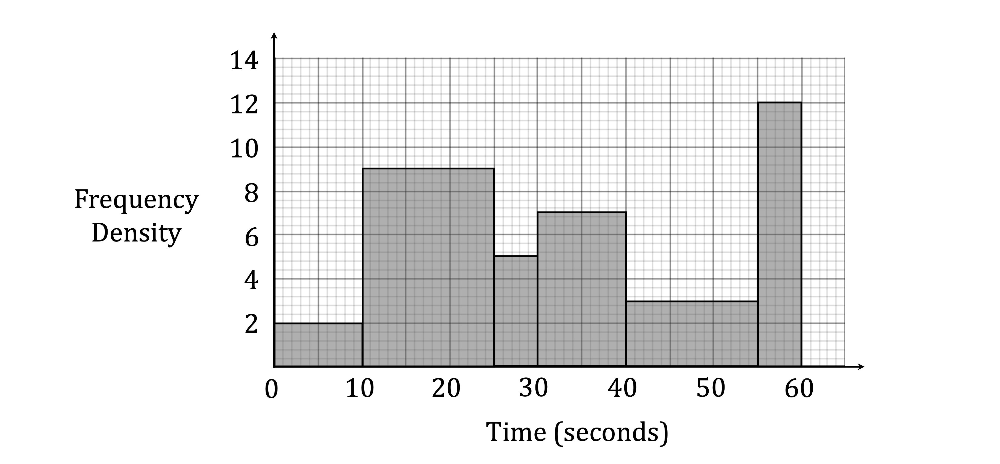

**[B1 B1]**

> **[mark-scheme]**
> **B1**: For at least one correct frequency density.
> 
> **B1**: For fully complete histogram.
> *Since*

$\mathrm{frequency} \mathrm{density}=\frac{\mathrm{frequency}}{\mathrm{class} \mathrm{width}}$

> *Therefore,*

$\mathrm{frequency}=\mathrm{frequency} \mathrm{density}\times\mathrm{class} \mathrm{width}$

> *Find the missing frequencies*

| Heights (cm) | Frequency |
|---|---|
| $0<h\leq10$ | *2 × 10 =* **20** |
| $10<h\leq25$ | $135$ |
| $25<h\leq30$ | $25$ |
| $30<h\leq40$ | $70$ |
| $40<h\leq55$ | $45$ |
| $55<h\leq60$ | *12 × 5 =* **60** |

**[B1 B1]**

> **[mark-scheme]**
> 1 mark for each frequency.

### Q2
> *This histogram has frequency density on the **y**-axis, which is calculated using the formula*

$\mathrm{Frequency} \mathrm{density}=\frac{\mathrm{Frequency}}{\mathrm{Class} \mathrm{width}}$

> *e.g. For the *$20<t\leq30$* class interval, the frequency density would be *$\frac{38}{10}=3.8$*.*

| Time ($t$ seconds) | $20<t\leq30$ | $30<t\leq35$ | $35<t\leq40$ | $40<t\leq60$ | $60<t\leq100$ |
|---|---|---|---|---|---|
| Frequency | 38 | 27 | 21 | 16 | 18 |
| Frequency Density | $\frac{38}{10}=3.8$ | $\frac{27}{5}=5.4$ | $\frac{21}{5}=4.2$ | $\frac{16}{20}=0.8$ | $\frac{18}{40}=0.45$ |

> *The widths of the bars are the class intervals and the heights of the bars are the frequency densities.*

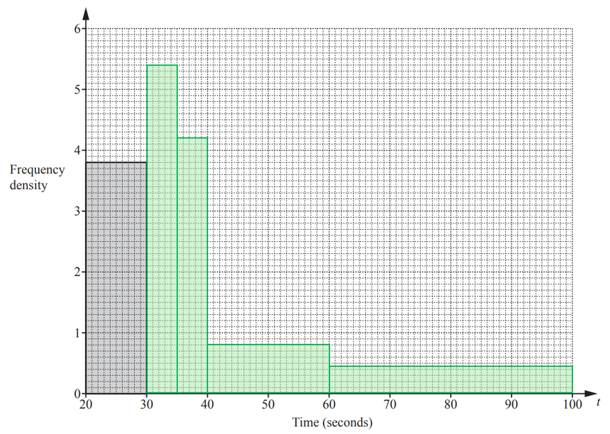

**1 mark for each correct bar ****[4]**

### Q3
> *In a histogram, the area of a bar is determined by the frequency. The height of bar is determined by the frequency density.*

$\mathrm{Frequency} \mathrm{density}=\frac{\mathrm{Frequency}}{\mathrm{Class} \mathrm{width}}$

> *Add two rows to the table - one for class width and one for frequency density. *
*Class width is found by finding the difference between the lower and upper bound of each class.*

| Size | Small | Medium | Large |
|---|---|---|---|
| Mass ( grams) | $46<m\leq52$ | $52<m\leq62$ | $62<m\leq80$ |
| *Class width* | *52 - 46 = 6* | *62 - 52 = 10* | *80 - 62 = 18* |
| Number of eggs sold | $78$ | $180$ | $162$ |
| *Frequency density* | *78 ÷ 6 = 13* | *180 ÷ 10 = 18* | *162 ÷ 18 = 9* |

> *The **y**-axis is labelled Frequency density, there is no given result to see if a scale factor (multiplier, often called **k**) has been used and the **y**-axis scale is large enough to take the frequency densities as they are. *
*So, in this case, the height of the bars will be their frequency densities.*

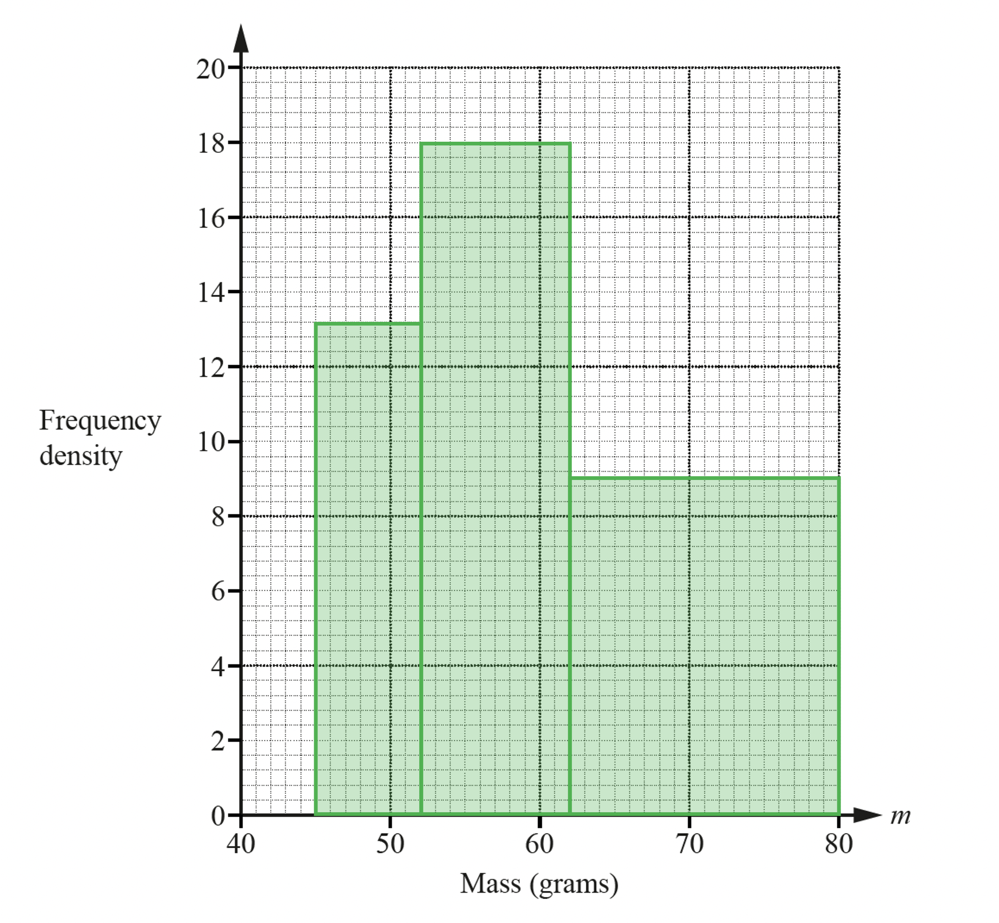

**correct widths in correct positions**** [1] **
**3 correct heights**** [3]**

### Q4
> *The **area** of a bar on a histogram is **proportional** the frequency of that group. *
*Find the area of the bar for the group 0 < **m** ≤ 4 by multiplying its width (4 - 0) by its height.*

*4 × 1.6 = 6.4*

> *Find the scale factor between the area and the frequency by dividing the given frequency by the given area.*

*32 ÷ 6.4 = 5*

**[1]**

> *Therefore we need to multiply the area of a bar by 5 to get the frequency.*

| Mass ($m$ kg) | $0<m\leq4$ | $4<m\leq6$ | $6<m\leq7$ | $7<m\leq10$ |
|---|---|---|---|---|
| Frequency | $32$ | *Area = (6-4) × 2 = 4* *Freq = 4 × 5 =* **20** | *Area = (7-6) × 1.2 = 1.2* *Freq = 1.2 × 5 =* **6** | $42$ |
| Height of bar on histogram (cm) | $1.6$ | $2$ | $1.2$ | $2.8$ |

**[1]**

### Q5
> *Find the frequency densities for each group by dividing the frequencies by the class widths. *
*The class width is the difference between the upper and lower bound for each group.*

| Area ($A$m2) | $20<A\leq60$ | $60<A\leq100$ | $100<A\leq150$ | $150<A\leq250$ |
|---|---|---|---|---|
| Frequency | 32 | 64 | 80 | 24 |
| *Class Width (CW)* | *40* | *40* | *50* | *100* |
| *Frequency Density* | *32 ÷ 40 = 0.8* | *64 ÷ 40 = 1.6* | *80 ÷ 50 = 1.6* | *24 ÷ 100 = 0.24* |

> *Complete the histogram by drawing each bar using the values from the table above.*

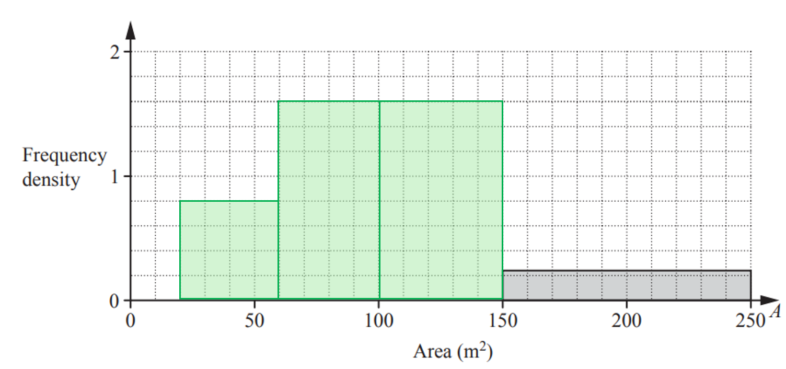

** Every bar is the correct width ****[1]**

** Every bar is the correct height ****[3]**

### Q6
*Pie charts show proportion.* 
*So first find the proportion of onions that are sent to a food processing factory from the histogram.* 
*Area on a histogram represents the frequency, i.e.  *$\mathrm{Frequency}=\mathrm{Frequency} \mathrm{density}\times\mathrm{Class} \mathrm{width}$

`table row cell For space 0 minus 60 colon space space 2 cross times 60 end cell equals 120 end table`

**[1]**

`table row cell For space 60 minus 90 colon space space 5 cross times 30 end cell equals 150 row cell For space 90 minus 120 colon space space 9 cross times 30 end cell equals 270 end table`

`table row cell For space 120 minus 135 colon space space 6 cross times 15 end cell equals 90 row cell For space 135 minus 180 colon space space 2 cross times 45 end cell equals 90 end table`

**The number of onions sent to a food processing factory is 150 + 270 = 420** 
*The number of onions in total is 120 +* **420*** + 90 + 90 = 720*

**[1]**

> *Now write the proportion of onions that are sent to a food processing factory as a fraction out of the total.*

`420 over 720 open parentheses equals 7 over 12 close parentheses`

**[1]**

> *The angle *$x^{\circ}$* on the pie chart will be this fraction of 360°.*

$x^{\circ}=\frac{7}{12}\times360^{\circ}=210^{\circ}$

$x^{\circ}=210^{\circ}$** ****[1]**

### Q7
> *The heights of the bars are determined by the frequency densities.*

$\mathrm{Frequency} \mathrm{density}=\frac{\mathrm{Frequency}}{\mathrm{Class} \mathrm{width}}$

> *Find the class width of the interval *$60<t\leq100$* by subtracting the lower bound from the upper bound.*

*100 - 60 = 40*

> *Find the frequency density by dividing the frequency of this group by the class width.*

*24 ÷ 40 = 0.6*

**[1]**

> *The height of this bar is 10.8 cm so an equation can be formed to find the multiplier (**k**) that determines the heights of the bars from the frequency density.*

> $0.6k=10.8\,k=\frac{10.8}{0.6}\,k=18$*       *

> *Find the class width of the interval *$160<t\leq220$* by subtracting the lower bound from the upper bound.*

*220 - 160 = 60*

> *Find the frequency density by dividing the frequency of this group by the class width.*

*8 ÷ 60 = 0.13333.....*

> *Multiply the frequency density by the multiplier **k** to find the height of the bar.*

*0.13333..... × 18 = 2.4*

**2.4 cm ****[1]**

### Q8
> *Add to columns to the table - one to work out the class widths and one for the frequency densities. *
*Find the class widths by finding the difference between the upper and lower bounds of each class. *
*Find the frequency densities by dividing each frequency by its class width.*

| Time ($t$ minutes) | $0<t\leq10$ | $10<t\leq15$ | $15<t\leq20$ | $20<t\leq40$ |
|---|---|---|---|---|
| Frequency | 7 | 19 | $16$ | $8$ |
| *Class width* | *10 - 0 = 10* | *15 - 10 = 5* | *20 - 15 = 5* | *40 - 20 = 20* |
| *Frequency Density* | $7\div10=0.7$ | $19\div5=3.8$ | $16\div5=3.2$ | $8\div20=0.4$ |

> *(We can see from the first group there is no scaling (**k**) for the heihgt if the bars in this case.) *
*Draw each section on the graph.*

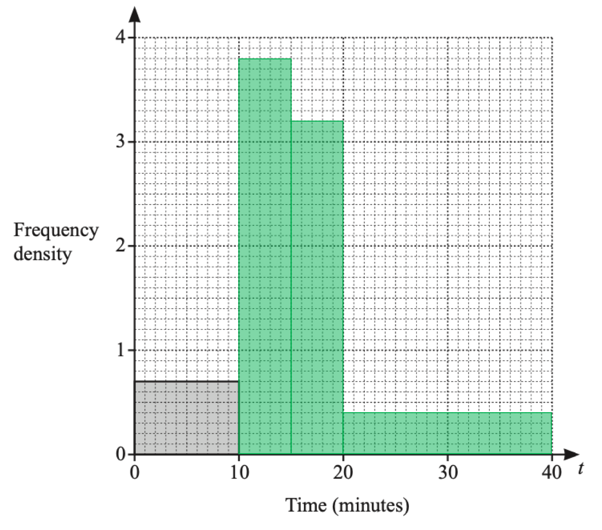

**10 < t ≤ 15 block correct**** [1] **** **
**15 < t ≤ 20 block correct**** [1] **
**20 < t ≤ 40 block correct**** [1]**

### Q9
> *The heights of the bars are determined by the frequency densities.*

$\mathrm{Frequency} \mathrm{density}=\frac{\mathrm{Frequency}}{\mathrm{Class} \mathrm{width}}$

> *Find the class width of the interval *$10<h\leq20$* by subtracting the lower bound from the upper bound.*

*20 - 10 = 10*

> *Find the frequency density by dividing the frequency of this group by the class width.*

*18 ÷ 10 = 1.8*

**[1]**

> *The height of this bar is 7.2 cm so an equation can be formed to find the multiplier (**k**) that determines the heights of the bars from the frequency density.*

> $1.8k=7.2\,k=\frac{7.2}{1.8}\,k=4$*      *

> *Find the class width of the interval *$30<h\leq50$* by subtracting the lower bound from the upper bound.*

*50 - 30 = 20*

> *Find the frequency density by dividing the frequency of this group by the class width.*

*38 ÷ 20 = 1.9*

> *Multiply the frequency density by the multiplier **k** to find the height of the bar.*

*1.9 × 4 = 7.6 *

**7.6 cm ****[1]**

### Q10
> *Add two columns to the table - one for class width, one for frequency density (**fd**).*

$\mathrm{Frequency} \mathrm{density}=\frac{\mathrm{Frequency}}{\mathrm{Class} \mathrm{width}}$

| **Height (*****h***** cm)** | **Frequency** | ***Class width*** | ****fd**** |
|---|---|---|---|
| 140 < *h* ≤ 150 | 15 | *150 - 140 = 10* | *15 ÷ 10 = 1.5* |
| 150 < *h* ≤ 155 | 30 | *5* | *6* |
| 155 < *h* ≤ 160 | 51 | *5* | *10.2* |
| 160 < *h* ≤ 165 | 36 | *5* | *7.2* |
| 165 < *h* ≤ 180 | 18 | *15* | *1.2* |

> *The height axis will need to run from 140 to 180 (cm) so 1 'small square' for 1 cm. *
*The frequency density axis will need to run from 0 to 10.2 (at least) so 10 'small squares' for 2 will give a good sized histogram.*

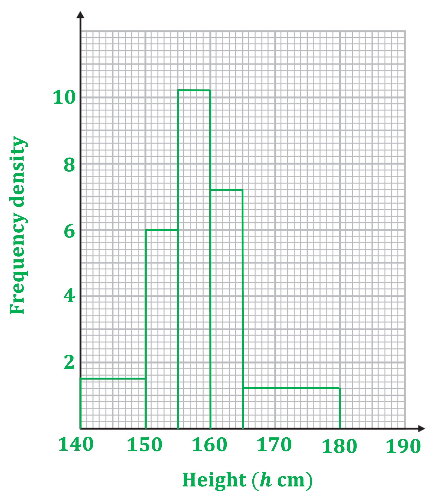

**Two correct bars of different widths ****[1]**** **
**Four correct bars and axes labelled ****[1]**** **
**Fully correct and labelled histogram ****[1]**
> *To estimate the number of students with a height between 150 cm and 170 cm we will need to sum the frequencies for the intervals 150 < h ≤ 155, 155 < h ≤ 160, 160 < h ≤ 165 and an estimate for the interval 165 < h ≤ 170.*

> *To estimate the number of students in the interval 165 < h ≤ 170 we assume the 18 students are evenly distributed across the 165 < h ≤ 180 interval.  *
*Clearly, we need one-third of this interval.*

$\frac{1}{3}\times18=6$

**[1]**

> *The question states there are 150 students in total. So the fraction required is given by*

`fraction numerator 30 plus 51 plus 36 plus 6 over denominator 150 end fraction equals 123 over 150 open parentheses equals 41 over 50 close parentheses`

**An estimate for the fraction of students who have a height between 150 cm and 170 cm is **$\frac{41}{50}$** ****[1]**

### Q11
*i) **First find the scale on the frequency density axis.* 
*The first bar, between 70 and 80 minutes (less than 80 minutes), represents 7 cyclists.*

$\mathrm{Frequency} \mathrm{density}=\frac{\mathrm{Frequency}}{\mathrm{Class} \mathrm{width}}$

$\mathrm{fd}=\frac{7}{80-70}=0.7$

**[1]**

> *Label the frequency density axis to help work out the required area.*

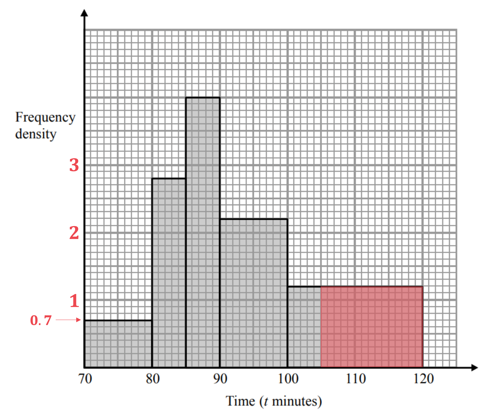

> *The area, and so frequency, of the number of cyclists taking more than 105 minutes is*

$1.2\times15=18$

**[1]**

**An estimate of the number of cyclists taking more than 105 minutes is 18** **[1]**

*ii)*

**The answer is only an estimate as we do not know the exact times the cyclists in the interval 100 < ****t**** ≤ 120 took but we assume that they are evenly distributed throughout the interval** **[1]**

### Q12
> *Find the class width of each interval by subtracting the lower bound from the upper bound.*

> *Find the frequency density for each interval using*

$\mathrm{Frequency} \mathrm{density}=\frac{\mathrm{Frequency}}{\mathrm{Class} \mathrm{width}}$

| Mass ($x$ tonnes) | $100<x\leq200$ | $200<x\leq250$ | $250<x\leq300$ | $300<x\leq500$ |
|---|---|---|---|---|
| Frequency | 8 | 20 | 12 | 12 |
| *Class width* | *200 - 100 = 100* | *250 - 200 = 50* | *300 - 250 = 50* | *500 - 300 = 200* |
| *Frequency density* | *8 ÷ 100 = 0.08* | *20 ÷ 50 = 0.4* | *12 ÷ 50 = 0.24* | *12 ÷ 200 = 0.06* |

> *Draw rectangles for the bars. *
*Be careful with the vertical scale. *
*5 squares represents an increase of 0.1 to the frequency density.*
* sddaTherefore one square up represents 0.02 on the frequency-density axis.*

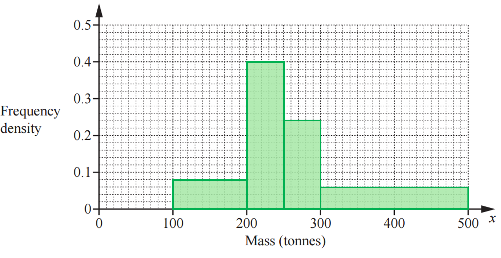

**1 mark for each correct bar**** [4]**

### Q13
*The heights of each **bar** is given by the **frequency density**.* 
*The frequency density is the frequency divided by the class width.*
* If you like, make an extra row in the table and add the frequency densities*

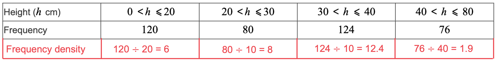

> *Draw the remaining three bars with the correct class width and frequency density.*
* Note that the final bar has a width from 40 to 80*

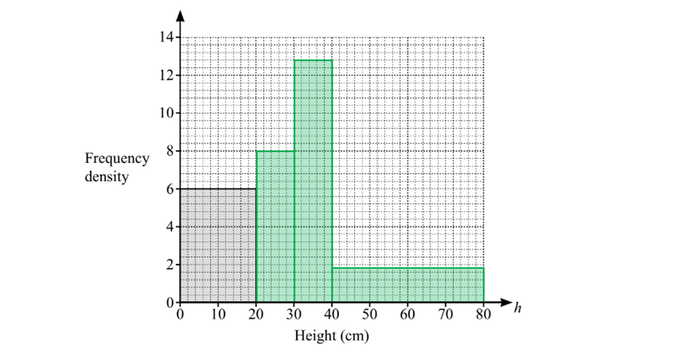

**1 mark for each bar with a correct width (in correct position) and correct height**** [3]**

### Q14
> *A histogram uses frequency density on the **y**-axis, which can be calculated as*

$\mathrm{frequency} \mathrm{density}=\frac{\mathrm{frequency}}{\mathrm{group} \mathrm{width}}$

> *e.g. For the *$0<t\leq10$* group, the frequency density would be *$\frac{50}{10}=5$

| Temperature (*t *°C) | $0<t\leq10$ | $10<t\leq15$ | $15<t\leq20$ | $20<t\leq25$ | $25<t\leq35$ |
|---|---|---|---|---|---|
| Number of days | 50 | 85 | 100 | 120 | 10 |
| *Frequency Density* | *5* | *17* | *20* | *24* | *1* |

> *  Draw the histogram, using the group width as the width of the bar, and the frequency density as the height.*

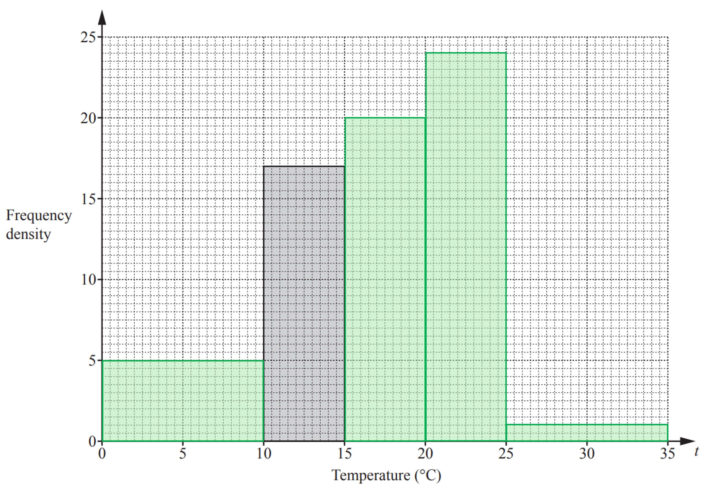

**Mark for each correctly drawn bar**** [4]**

### Q15
> *Find the class width of each interval by subtracting the lower bound from the upper bound.*

> *Find the frequency density for each interval using the formula *$\mathrm{Frequency} \mathrm{density}=\frac{\mathrm{Frequency}}{\mathrm{Class} \mathrm{width}}$

| Speed ($v$ km/h) | $0<v\leq40$ | $40<v\leq50$ | $50<v\leq80$ |
|---|---|---|---|
| Frequency | $50$ | $120$ | $30$ |
| *Class width* | *40 - 0 = 40* | *50 - 40 = 10* | *80 - 50 = 30* |
| *Frequency density* | *50 ÷ 40 = 1.25* | *120 ÷ 10 = 12* | *30 ÷ 30 = 1* |

> *Draw rectangles for the bars. *
*Be careful with the vertical scale. 10 squares represents an increase of 5 to the frequency density. *
*Therefore each square represents 0.5.*

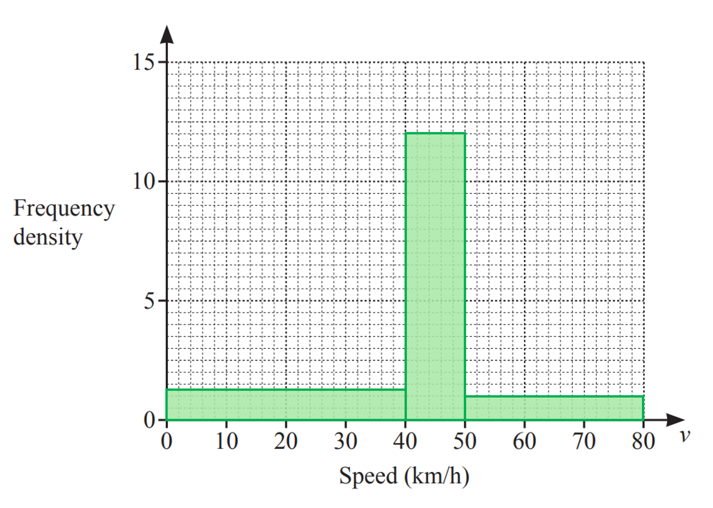

**1 mark for each correct bar**** [3]**

### Q16
> *Use *$\mathrm{Frequency}=\mathrm{Frequency} \mathrm{density}\times\mathrm{Class} \mathrm{width}$* to work out the frequency of each bar on the histogram. *
*The last bar will need splitting at a weight of 100 grams.*

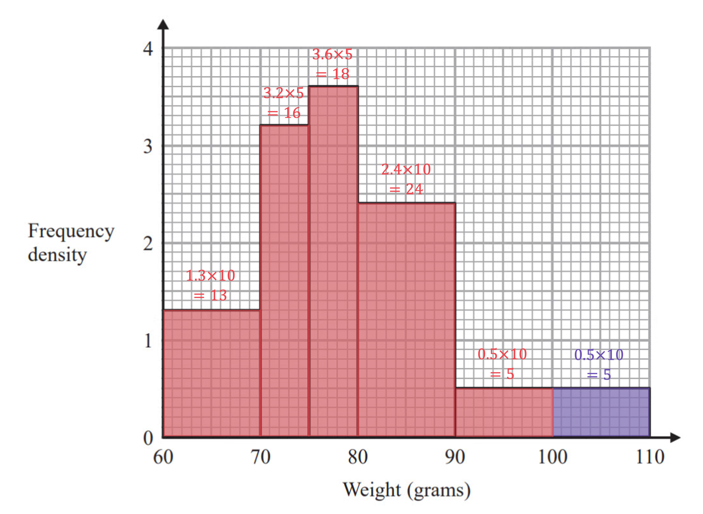

> *Work out the number of plums with a weight less than 100 grams, and the total number of plums.*

$<100:13+16+18+24+5=76\,\mathrm{Total}:76+5=81$

**One mark for each**** [2]**

> *Now write the proportion as a fraction.*

**The proportion of plums with a weight less than 100 grams is**** **$\frac{76}{81}$ **[1]**

**A decimal or percentage answer is also allowed (0.938 or 93.8% (3 s.f.)).**

### Q17
> *Make two new columns - one for class width and one for frequency density. Complete the table using*

$\mathrm{Frequency} \mathrm{density}=\frac{\mathrm{Frequency}}{\mathrm{Class} \mathrm{width}}$

> *where, in this case, frequency is the number of people.*

| **Time (*****T***** minutes)** | ***Class width*** | **Number of people** | ***Frequency density*** |
|---|---|---|---|
| $10<T\leq30$ | *30 - 10 = 20* | 16 | *16*$\div$*20 = 0.8* |
| $30<T\leq40$ | *40 - 30 = 10* | 18 | *18*$\div$*10 = 1.8* |
| $40<T\leq45$ | *45 - 40 =5* | 22 | *22*$\div$*5 = 4.4* |
| $45<T\leq50$ | *50 - 45 = 5* | 40 | *40*$\div$*5 = 8* |
| $50<T\leq60$ | *60 - 50 = 10* | 21 | *21*$\div$*10 = 2.1* |
| $60<T\leq70$ | *70 - 60 = 10* | 3 | *3*$\div$*10 = 0.3* |

> *We can see from the class interval *$10<T\leq30$* and the given histogram, there is no scaling from frequency density to the height of the bars. *
*Plot the missing histogram bars on the grid; the class width is the width of each bar, the height will be the frequency density.*

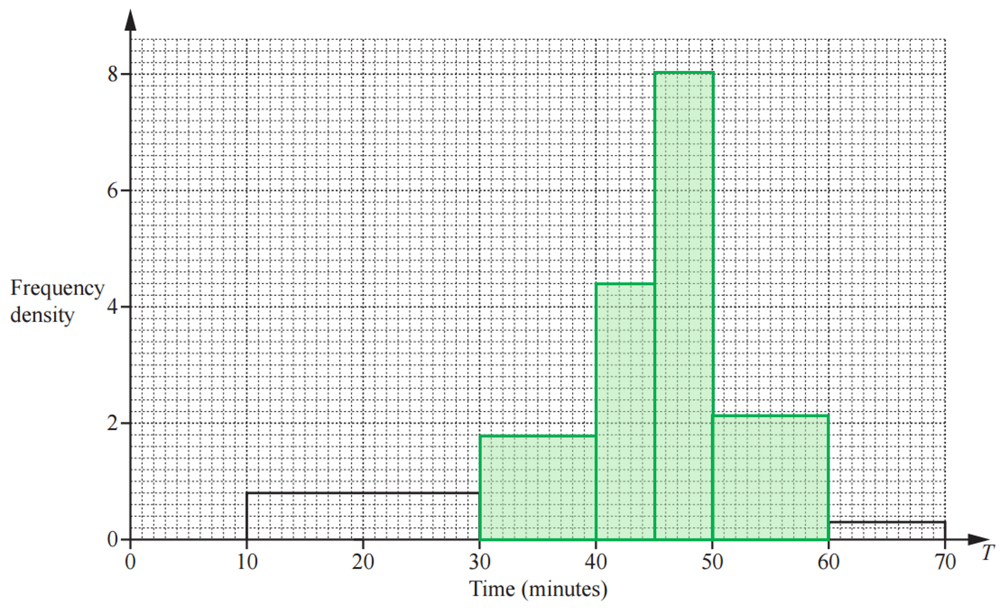

**one mark for each correct bar**** [4]**
*The histogram for Wednesday looks like the histogram for Saturday but moved to the left.*

**The average time spent shopping on Wednesday is less than on Saturday** **[1]** 
**Any valid general comment about the whole distribution (not individual bars) is accepted.**

### Q18
> *In a histogram, the area of a bar is related to the frequency of the class interval. *
*The height of a bar is related to frequency density,*

$\mathrm{Frequency} \mathrm{density}=\frac{\mathrm{Frequency}}{\mathrm{Class} \mathrm{width}}$

> *First calculate the frequency density for each class - add two rows to the table, one for class width and one for frequency density.*

| Age ($y$ years) | $15<y\leq25$ | $25<y\leq30$ | $30<y\leq50$ | $50<y\leq80$ |
|---|---|---|---|---|
| Number of people | 35 | 32 | 44 | 12 |
| *Class width* | *25 - 15 = 10* | *30 - 25 = 5* | *50 - 30 = 20* | *80 - 50 = 30* |
| *Frequency Density* | $\frac{35}{10}=3.5$ | $\frac{32}{5}=6.4$ | $\frac{44}{20}=2.2$ | $\frac{12}{30}=0.4$ |

**  2 correct frequency densities**** [1]** 
**3 correct frequency densities**** [1]**

> *We are given the height of the bar Dexter draws for the group *$15<y\leq25$* - 7 cm. *
*To find the scale factor (aka multiplier or constant of proportionality, often called **k**) divide the (known) height of the bar (7 cm) by its frequency density.*

*7 ÷ 3.5 = 2* *(i.e. ***k*** = 2)*

*This means the height of the bars are found by multiplying the frequency densities by 2.* *So the heights of the other bars can now be found.*

`table row cell 6.4 cross times 2 end cell equals cell 12.8 end cell row cell 2.2 cross times 2 end cell equals cell 4.4 end cell row cell 0.4 cross times 2 end cell equals cell 0.8 end cell end table`

$25<y\leq30$**: 12.8 cm     **** **
$30<y\leq50$**:   4.4 cm  ****  **
$50<y\leq80$**:   0.8 cm** **[1]**

### Q19
*The frequency represented by a histogram bar is **proportional** to its area. *
*So we first need to find the constant of proportionality (often called **k**).* 
*For the  *$60\leqh\leq70$* interval/bar, find the class width (bar width) and frequency density.*

*Class width = 70 - 60 = 10* *Frequency = 8 *$\mathrm{Frequency} \mathrm{density}=\frac{\mathrm{Frequency}}{\mathrm{Class} \mathrm{width}}=\frac{8}{10}=0.8$

> *For *$60\leqh\leq70$* the height of the bar is 0.4 cm.*

$k=\frac{0.4}{0.8}=0.5$

> *i.e. the height of the bars is half the frequency density. *
*Now find the bar heights for the four requried intervals by first finding the frequency density, then mulitplying by 0.5.*

| Height ($h$ cm) | $60<h\leq70$ | $70<h\leq90$ | $110<h\leq115$ | $115<h\leq125$ |
|---|---|---|---|---|
| *Class width* | **70 - 60 = 10** | *90 - 70 = 20* | *115 - 110 = 5* | *125 - 115 = 10* |
| *Frequency* | **8** | *26* | *28* | *16* |
| *Frequency density* | $\frac{8}{10}=0.8$ | $\frac{26}{20}=1.3$ | $\frac{28}{5}=5.6$ | $\frac{16}{10}=1.6$ |
| *Bar height (in cm)* | **0.8 × 0.5 = 0.4** | *1.3 × 0.5 = 0.65* | *5.6 × 0.5 = 2.8* | *1.6 ×0.5 = 0.8* |

$115<h\leq125$** bar height is 0.8 cm** **[1]** 
$110<h\leq115$** bar height is 2.8 cm** **[1]** ** **
$70<h\leq90$** bar height is 0.65 cm ****[1]**

### Q20
> *The heights of the bars are determined by the frequency densities. *

$\mathrm{Frequency} \mathrm{density}=\frac{\mathrm{Freqeuncy}}{\mathrm{Class} \mathrm{width}}$

> *Find the class widths by finding the differences between the upper and lower bound for each class. *
*Find the frequency densities by dividing the frequency by the class width.*

| Time ($t$ seconds) | $0<t\leq10$ | $10<t\leq15$ | $15<t\leq20$ | $20<t\leq40$ | $40<t\leq75$ |
|---|---|---|---|---|---|
| *Class width* | *10 - 0 = 10* | *15 - 10 = 5* | *20 - 15 = 5* | *40 - 20 = 20* | *75 - 40 = 35* |
| Frequency | 9 | 18 | 22 | 30 | 21 |
| *Frequency density* | *9 ÷ 10 = 0.9* | *18 ÷ 5 = 3.6* | *22 ÷ 5 = 4.4* | *30 ÷ 20 = 1.5* | *21 ÷ 35 = 0.6* |

**[1]**

> *The height of the first bar is 3.6 cm so an equation can be formed to find the multiplier (**k**) that determines the heights of the bars.*

> $0.9k=3.6\,k=\frac{3.6}{0.9}\,k=4$*  *

**[1]**

> *This could be checked using the other two given heights.*

$3.6\times4=14.4\,4.4\times4=17.6$

> *Use **k** = 4 to find the heights of the remaining bars.*

$1.5\times4=6\,0.6\times4=2.4$

| Time ($t$ seconds) | $0<t\leq10$ | $10<t\leq15$ | $15<t\leq20$ | $20<t\leq40$ | $40<t\leq75$ |
|---|---|---|---|---|---|
| Height of bar (cm) | $3.6$ | $14.4$ | $17.6$ | **Final answer:** **6** | **Final answer:** **2.4** |

** ****[1]**

### Q21
> *In this case there is no scaling of the height of the bars so the area of a bar on the histogram represents the frequency for that class interval.*

> *Use *$\mathrm{Frequency}=\mathrm{Frequency} \mathrm{density}\times\mathrm{Class} \mathrm{width}$* to find the frequency of each class interval.*

* *`0 less or equal than m less than 10 colon space 3 cross times open parentheses 10 minus 0 close parentheses equals 30
10 space less or equal than space m less than 15 colon space space 8 cross times open parentheses 15 minus 10 close parentheses equals 40
15 less or equal than m less than 30 colon space space 2 cross times open parentheses 30 minus 15 close parentheses equals 30 space`

** ****Two correct frequencies**** [1] **** **
**Third correct frequency**** [1]**

> *We now essentially have a frequency table - each interval with its frequency. *
*This allows us to estimate the mean using the midpoint of each class interval. *
*If you can't 'spot' the midpoint then add the upper and lower bounds of the interval, then divide by 2 (i.e. find their mean).*

`0 less or equal than m less than 10 colon space open parentheses fraction numerator 0 plus 10 over denominator 2 end fraction close parentheses cross times 30 equals 150
10 space less or equal than space m less than 15 colon space space open parentheses fraction numerator 10 plus 15 over denominator 2 end fraction close parentheses cross times 40 equals 500
15 less or equal than m less than 30 colon space space open parentheses fraction numerator 15 plus 30 over denominator 2 end fraction close parentheses cross times 30 equals 675`

**Correct midpoint values ****[1] **
**Multiplication of midpoints values by the frequencies**** [1]**

> *Add these together to find the total mass.*

$150+500+675=1325$

> *Divide the total mass by the total frequency to find the mean.*

$\frac{1325}{100}=13.25$

**[1]**

**13.25 kg** **[1]**

**You could also do this question by breaking the data up into, say, 5 kg class intervals.**

### Q22
> *In this histogram, the area of a bar is the frequency for that interval.*

$\mathrm{Frequency}=\mathrm{Frequency} \mathrm{density}\times\mathrm{Class} \mathrm{width}$

> *For the *$5<t\leq15$* interval, the class width is*

*15 - 5 = 10*

> *From the bar in the histogram we see that the frequency density is 1.5, so*

*Frequency = 10 × 1.5 = 15*

> *For the *$30<t\leq50$* interval, the class width is*

*50 - 30 = 20*

> *From the bar in the histogram we see that the frequency density is 1.1, so*

*Frequency = 20 × 1.1 = 22*

**multiplying a correct class width by a correct frequency**** ****density**** [1]**

> *We can now complete the table.*

| Time ($t$ minutes) | $0<t\leq5$ | $5<t\leq15$ | $15<t\leq30$ | $30<t\leq50$ | $50<t\leq70$ |
|---|---|---|---|---|---|
| Number of people | $6$ | $15$ | $27$ | $22$ | $10$ |

**both values correct ****[1]**
