# Exam Questions — Histograms
**Statistics** · Cambridge (CIE) IGCSE maths (0580 & 0980)
> Source: [https://www.savemyexams.com/igcse/maths/cie/25/extended/topic-questions/](https://www.savemyexams.com/igcse/maths/cie/25/extended/topic-questions/) · 22 questions across 1 sets

## Exam Questions (22 questions)

### Q1 — hard — 4 marks

**Q1** [2 marks]

The table and histogram shows information about the heights of plants in a garden.

| Heights (cm) | Frequency |
|---|---|
| $0<h\leq10$ |   |
| $10<h\leq25$ | $135$ |
| $25<h\leq30$ | $25$ |
| $30<h\leq40$ | $70$ |
| $40<h\leq55$ | $45$ |
| $55<h\leq60$ |   |

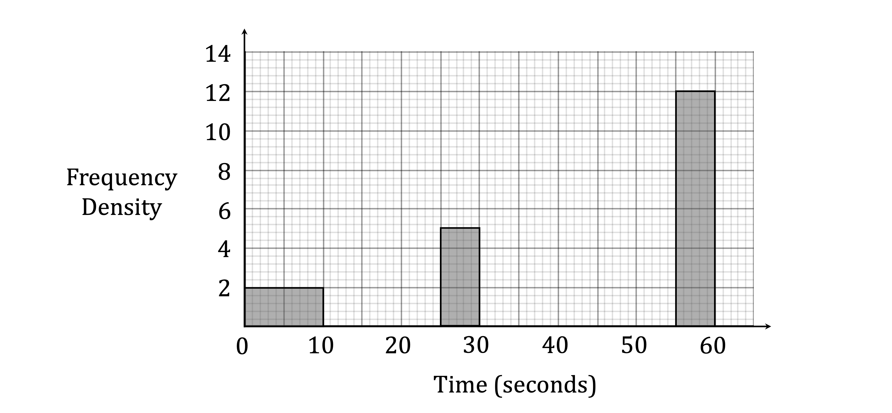

Complete the histogram.

**Q1** [2 marks]

Complete the table using the histogram.

### Q2 — medium — 4 marks

**Q2** [4 marks]

The table shows the time, $t$ seconds, taken by each of 120 boys to solve a puzzle.

| Time ($t$ seconds) | $20<t\leq30$ | $30<t\leq35$ | $35<t\leq40$ | $40<t\leq60$ | $60<t\leq100$ |
|---|---|---|---|---|---|
| Frequency | 38 | 27 | 21 | 16 | 18 |

On the grid, complete the histogram to show the information in the frequency table.

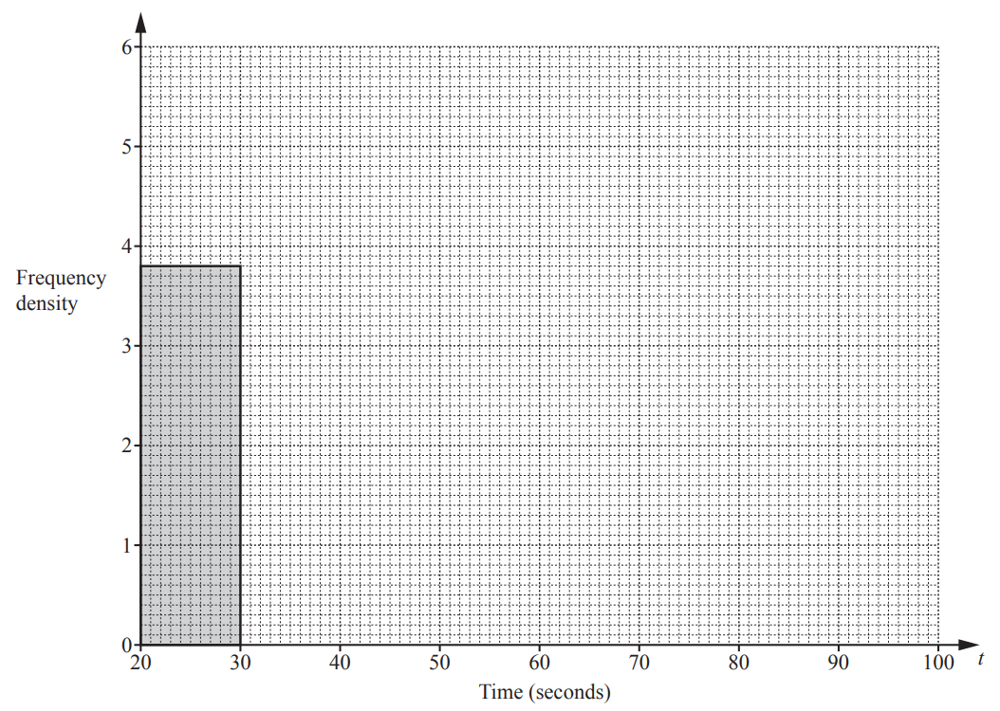

*Source: 2019	May/June 0580/43 Q6B*

### Q3 — hard — 4 marks

**Q3** [4 marks]

Three sizes of eggs are sold in a shop. The table shows the number of eggs of each size sold in one day.

| Size | Small | Medium | Large |
|---|---|---|---|
| Mass ($m$ grams) | $46<m\leq52$ | $52<m\leq62$ | $62<m\leq80$ |
| Number of eggs sold | $78$ | $180$ | $162$ |

On the grid, draw a histogram to show the information in the table.

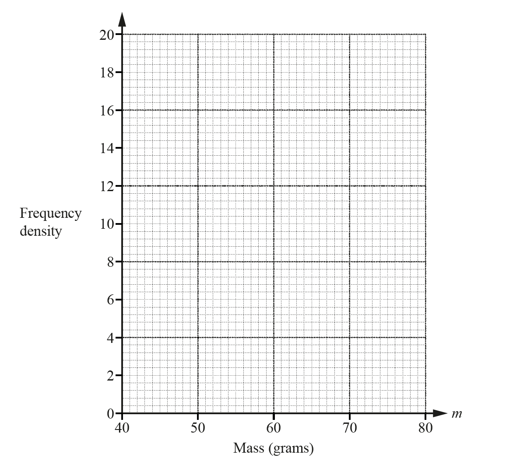

*Source: 2018	May/June 0580/43 Q3C*

### Q4 — medium — 2 marks

**Q4** [2 marks]

Some students each record the mass, $m$ kg, of their school bag. 
Adil wants to draw a histogram to show this information.   Complete the table below.

| Mass ($m$ kg) | $0<m\leq4$ | $4<m\leq6$ | $6<m\leq7$ | $7<m\leq10$ |
|---|---|---|---|---|
| Frequency | $32$ |   |   | $42$ |
| Height of bar on histogram (cm) | $1.6$ | $2$ | $1.2$ | $2.8$ |

*Source: 2019 March 0580/42 Q7B*

### Q5 — medium — 4 marks

**Q5** [4 marks]

200 students estimate the total area, $Am^{2}$, of the windows in a classroom. 
The table shows their results.

| Area ($A$m2) | $20<A\leq60$ | $60<A\leq100$ | $100<A\leq150$ | $150<A\leq250$ |
|---|---|---|---|---|
| Frequency | 32 | 64 | 80 | 24 |

Complete the histogram to show the information in the table.

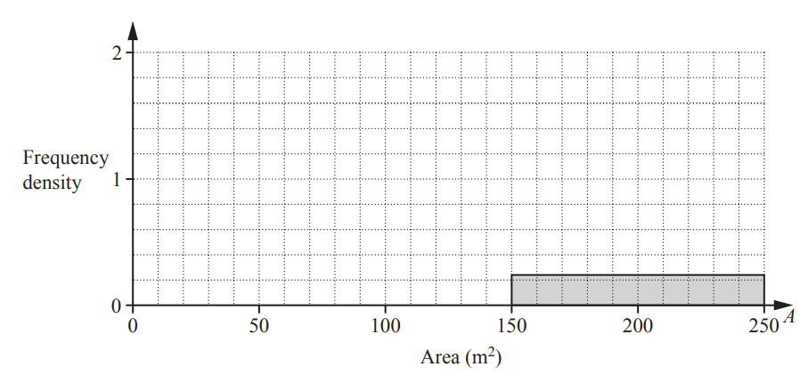

*Source: 2020 Specimen 4 Q2B*

### Q6 — very_hard — 4 marks

**Q6** [4 marks]

The histogram gives information about the distribution of the weights of some onions grown by a farmer.

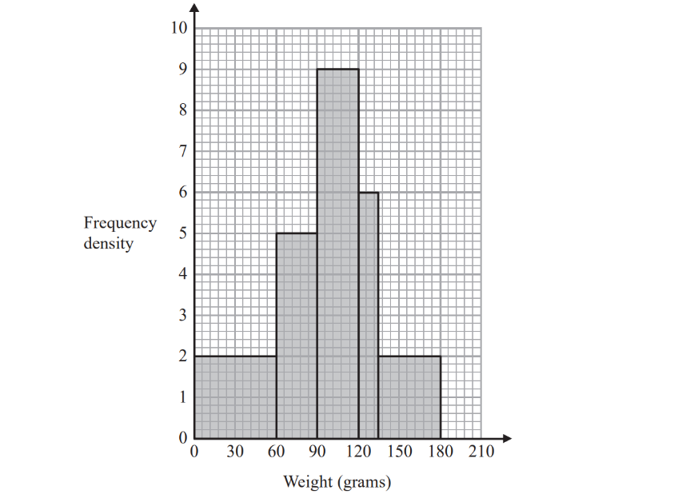

Onions less than 60 grams in weight are used for pickling. Onions greater than 120 grams in weight are sold at the market. The rest of the onions are sent to a food processing factory.

A pie chart is drawn using the information opposite to show what the farmer does with the onions he grows.

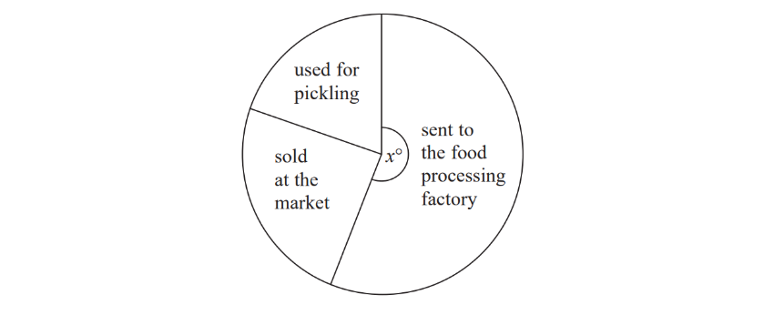

The angle of the sector for the onions sent to the food processing factory is $x^{\circ}$. 
Work out the value of $x$.

*Source: June 2019 1MA1/3H Q21*

### Q7 — medium — 2 marks

**Q7** [2 marks]

The frequency table shows the times, $t$ minutes, each of 100 children spent exercising in one week.

| Time ($t$ minutes) | $0<t\leq60$ | $60<t\leq100$ | $100<t\leq160$ | $160<t\leq220$ | $220<t\leq320$ |
|---|---|---|---|---|---|
| Frequency | 41 | 24 | 23 | 8 | 4 |

A histogram is drawn to show the information in the frequency table. 
The height of the bar for the interval $60<t\leq100$ is 10.8 cm.

Calculate the height of the bar for the interval $160<t\leq220$.

............................................ cm

*Source: 2020 Oct/Nov 0580/41 Q3B*

### Q8 — hard — 3 marks

**Q8** [3 marks]

The time, $t$ minutes, it takes each of 50 students to travel to school is recorded. 
The table shows the results.

| Time ($t$ minutes) | $0<t\leq10$ | $10<t\leq15$ | $15<t\leq20$ | $20<t\leq40$ |
|---|---|---|---|---|
| Frequency | 7 | 19 | $16$ | $8$ |

On the grid, complete the histogram to show the information in the table.

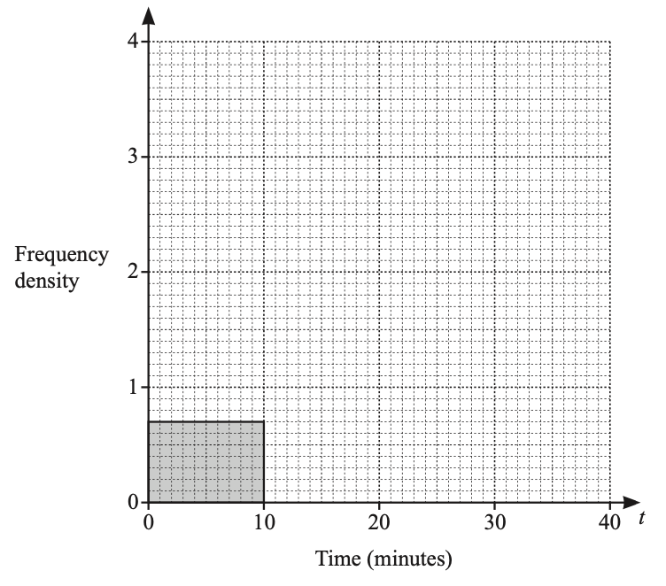

*Source: 2019	Oct/Nov 0580/23 Q23B*

### Q9 — hard — 2 marks

**Q9** [2 marks]

The height, $h$ cm, of each of 120 plants is measured. The frequency table shows this information.

| Height, *h* cm | $0<h\leq10$ | $10<h\leq20$ | $20<h\leq30$ | $30<h\leq50$ |
|---|---|---|---|---|
| Frequency | 2 | 18 | 62 | 38 |

A histogram is drawn to show the information in the frequency table. 
The height of the bar representing the interval $10<h\leq20$ is 7.2 cm. 

Calculate the height of the bar representing the interval $30<h\leq50$.

............................................ cm

*Source: 2020 Oct/Nov 0580/42 Q4B*

### Q10 — very_hard — 5 marks

**Q10** [3 marks]

The table gives information about the heights of $150$students.

| **Height( **$h$** cm)** | **Frequency** |
|---|---|
| `140 less than h less-than or slanted equal to 150` | $15$ |
| `150 less than h less-than or slanted equal to 155` | $30$ |
| `155 less than h less-than or slanted equal to 160` | $51$ |
| `160 less than h less-than or slanted equal to 165` | $36$ |
| `165 less than h less-than or slanted equal to 180` | $18$ |

On the grid, draw a histogram for this information.

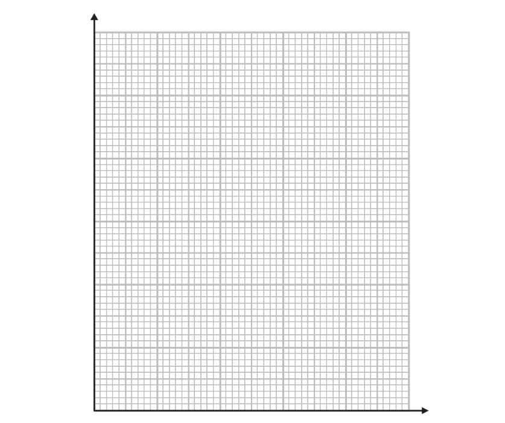

*Source: November 2017 1MA1/2H Q17A*

**Q10** [2 marks]

**Extract:**

| Height(h cm) | Frequency |
| 140 < h ≤ 150 | 15 |
| 150 < h ≤ 155 | 30 |
| 155 < h ≤ 160 | 51 |
| 160 < h ≤ 165 | 36 |
| 165 < h ≤ 180 | 18 |

Work out an estimate for the fraction of the students who have a height between $150$cm and $170$cm.

*Source: November 2017 1MA1/2H Q17B*

### Q11 — very_hard — 4 marks

**Q11** [4 marks]

The histogram shows information about the time taken by cyclists to finish a cycle race.

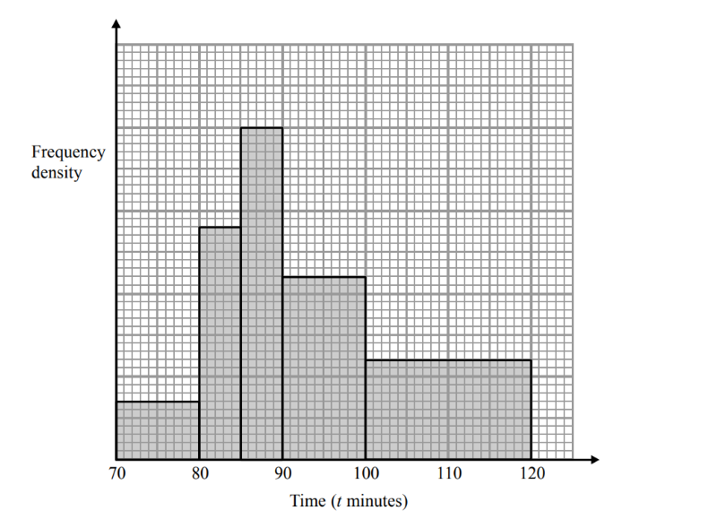

7 cyclists took 80 minutes or less to finish the race.

i) Work out an estimate for the number of cyclists who took more than 105 minutes to finish the race.

[3]

ii) Explain why your answer to part (i) is only an estimate.

[1]

*Source: Spec2 2015 1MA1/1H Q19*

### Q12 — medium — 4 marks

**Q12** [4 marks]

A factory recycles metal. 
The mass, $x$ tonnes, of metal is measured each week. 
The table shows the results for 52 weeks.

| Mass ($x$ tonnes) | $100<x\leq200$ | $200<x\leq250$ | $250<x\leq300$ | $300<x\leq500$ |
|---|---|---|---|---|
| Frequency | 8 | 20 | 12 | 12 |

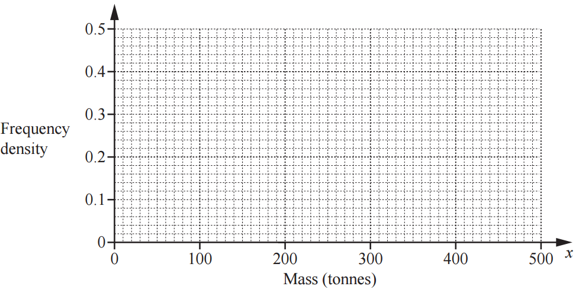

On the grid, draw a histogram to show the information in the table.

*Source: 2018	Oct/Nov 0580/43 Q5A*

### Q13 — medium — 3 marks

**Q13** [3 marks]

The heights are also shown in the frequency table.

| Height ($h$ cm) | `0 space less than h space less-than or slanted equal to 20` | `20 space less than h space less-than or slanted equal to 30` | `30 space less than space h space less-than or slanted equal to space 40` | `40 space less than space h space less-than or slanted equal to space 80` |
|---|---|---|---|---|
| Frequency | $120$ | $80$ | $124$ | $76$ |

Complete the histogram to show this information.

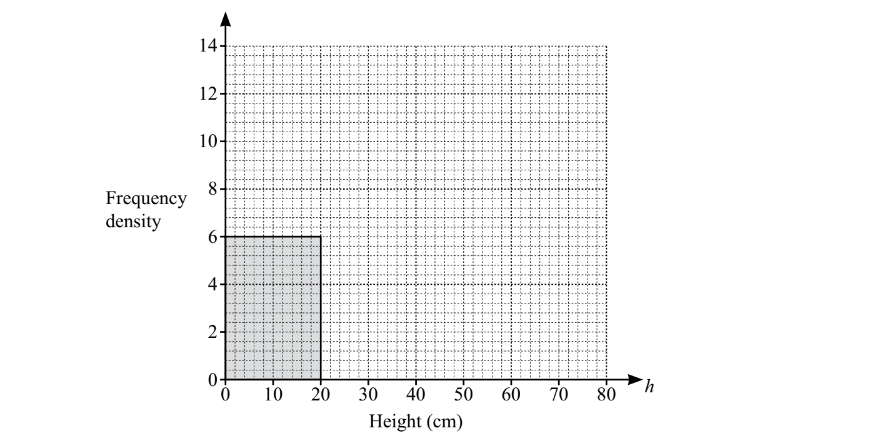

*Source: Specimen 2025 0580/02 Q16B*

### Q14 — medium — 4 marks

**Q14** [4 marks]

During one year the midday temperatures, *t *°C, in Zedford were recorded. 
The table shows the results.

| Temperature (*t *°C) | $0<t\leq10$ | $10<t\leq15$ | $15<t\leq20$ | $20<t\leq25$ | $25<t\leq35$ |
|---|---|---|---|---|---|
| Number of days | 50 | 85 | 100 | 120 | 10 |

Complete the histogram to show the information in the table.

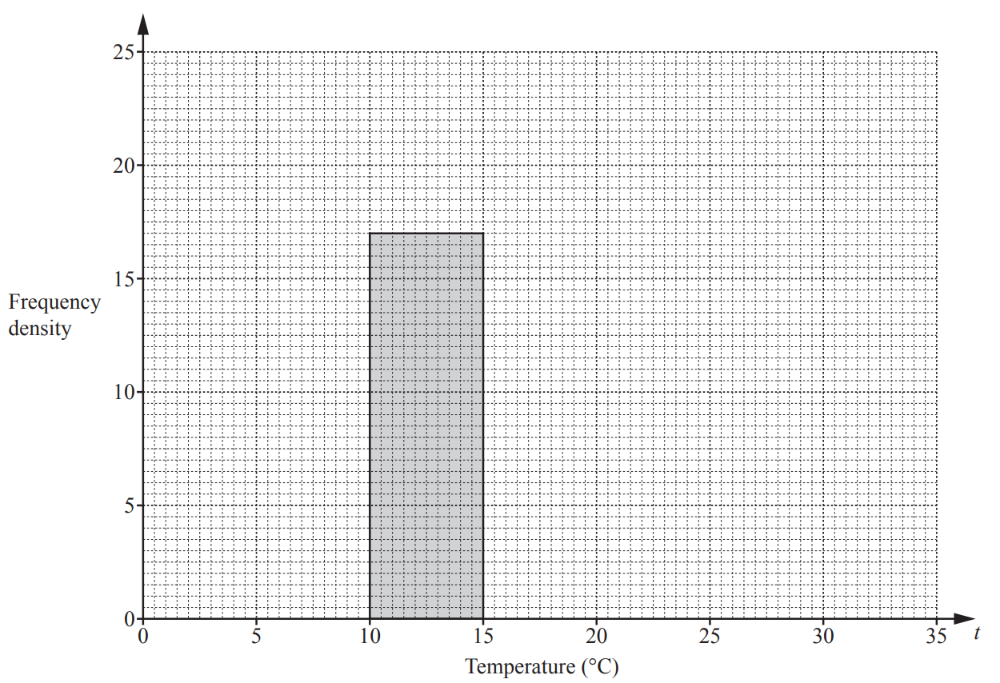

*Source: 2019	May/June 0580/41 Q4C*

### Q15 — medium — 3 marks

**Q15** [3 marks]

The speed, *v* km/h, of each of 200 cars passing a building is measured.  
The frequency table shows the results.

| Speed ($v$ km/h) | $0<v\leq40$ | $40<v\leq50$ | $50<v\leq80$ |
|---|---|---|---|
| Frequency | $50$ | $120$ | $30$ |

On the grid, draw a histogram to show the information in this table.

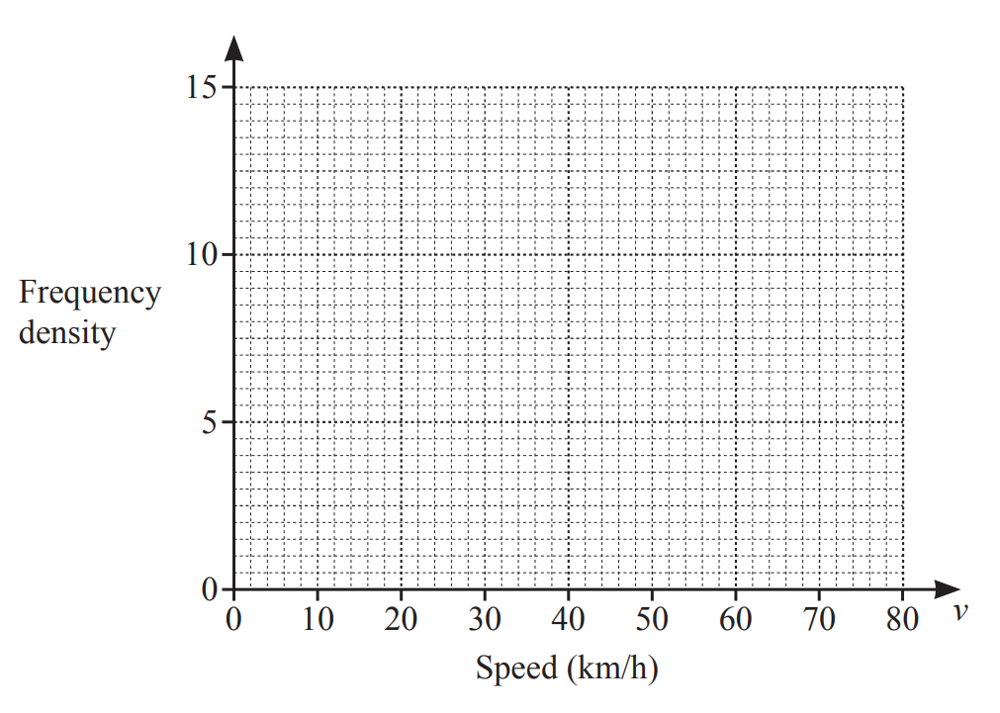

*Source: 2020 May/June 0580/42 Q3D*

### Q16 — very_hard — 3 marks

**Q16** [3 marks]

The histogram shows information about the weights, in grams, of some plums.

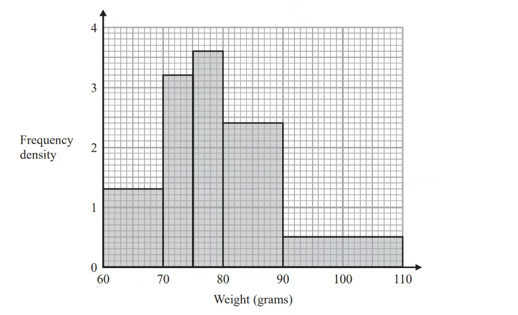

Work out an estimate for the proportion of these plums with a weight of less than 100 grams.

*Source: June 2017 1MA0/2H Q23*

### Q17 — medium — 5 marks

**Q17** [4 marks]

The table shows the amount of time, *T* minutes, 120 people each spend in a supermarket one Saturday.

| **Time (*****T***** minutes)** | **Number of people** |
|---|---|
| $10<T\leq30$ | 16 |
| $30<T\leq40$ | 18 |
| $40<T\leq45$ | 22 |
| $45<T\leq50$ | 40 |
| $50<T\leq60$ | 21 |
| $60<T\leq70$ | 3 |

Complete this histogram to show the information in the table.

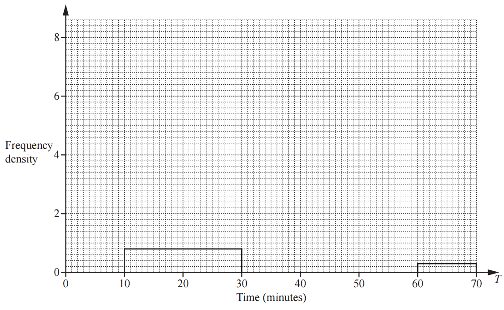

*Source: 2018	Oct/Nov 0580/42 Q9A*

**Q17** [1 mark]

**Extract:**

The table shows the amount of time, T minutes, 120 people each spend in a supermarket one Saturday.
| Time (T minutes) | Number of people |
| 10 < T ≤ 30 | 16 |
| 30 < T ≤ 40 | 18 |
| 40 < T ≤ 45 | 22 |
| 45 < T ≤ 50 | 40 |
| 50 < T ≤ 60 | 21 |
| 60 < T ≤ 70 | 3 |

This histogram shows the amount of time, *T* minutes, 120 people each spend in the supermarket one Wednesday.

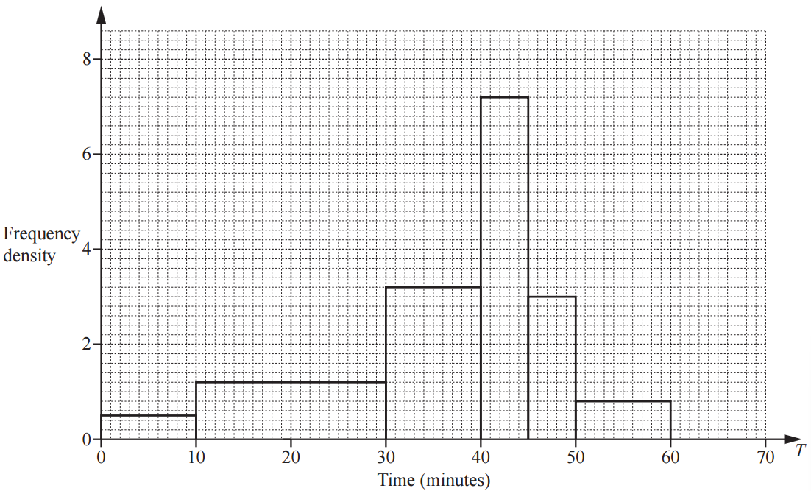

Make a comment comparing the distributions of the times for the two days.

*Source: 2018	Oct/Nov 0580/42 Q9B*

### Q18 — hard — 3 marks

**Q18** [3 marks]

The table shows the number of people in different age groups at a cinema.

| Age ($y$ years) | $15<y\leq25$ | $25<y\leq30$ | $30<y\leq50$ | $50<y\leq80$ |
|---|---|---|---|---|
| Number of people | 35 | 32 | 44 | 12 |

Dexter draws a histogram to show this information.  
The height of the bar he draws for the group $15<y\leq25$ is 7 cm.

Calculate the height of each of the remaining bars.

$25<y\leq30$ ........................................ cm      
$30<y\leq50$ ........................................ cm     
 $50<y\leq80$ ........................................ cm

*Source: 2019	May/June 0580/22 Q18*

### Q19 — medium — 3 marks

**Q19** [3 marks]

A school nurse records the height, $h$ cm, of each of 180 children. The table shows the information.

| Height ($h$ cm) | $60<h\leq70$ | $70<h\leq90$ | $90<h\leq100$ | $100<h\leq110$ | $110<h\leq115$ | $115<h\leq125$ |
|---|---|---|---|---|---|---|
| Frequency | 8 | 26 | 35 | 67 | 28 | 16 |

In a histogram showing the information, the height of the bar for the interval  $60<h\leq70$ is 0.4 cm.

Calculate the height of the bar for each of the following intervals.

$115<h\leq125$ .................................... cm       
$110<h\leq115$ .................................... cm       
$70<h\leq90$ ..................................... cm

*Source: 2018	Oct/Nov 0580/41 Q4B*

### Q20 — hard — 3 marks

**Q20** [3 marks]

The table shows information about the times, $t$ seconds, taken by each of 100 students to solve a puzzle.

| Time ($t$ seconds) | $0<t\leq10$ | $10<t\leq15$ | $15<t\leq20$ | $20<t\leq40$ | $40<t\leq75$ |
|---|---|---|---|---|---|
| Frequency | $9$ | $18$ | $22$ | $30$ | $21$ |

Emmanuel draws a histogram to show this information. 
The table shows the heights, in cm, of some of the bars for this histogram.   
Complete the table.

| Time ($t$ seconds) | $0<t\leq10$ | $10<t\leq15$ | $15<t\leq20$ | $20<t\leq40$ | $40<t\leq75$ |
|---|---|---|---|---|---|
| Height of bar (cm) | $3.6$ | $14.4$ | $17.6$ |   |   |

*Source: 2020 Oct/Nov 0580/23 Q22B*

### Q21 — very_hard — 6 marks

**Q21** [6 marks]

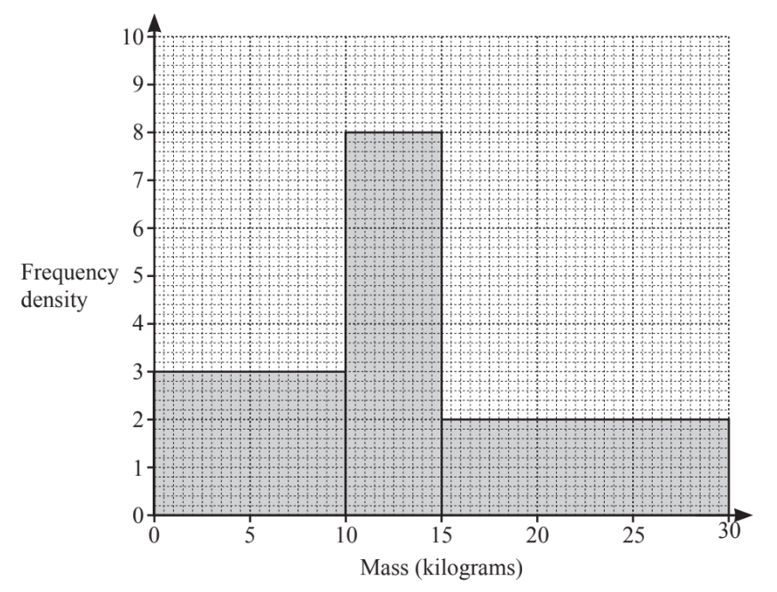

Calculate an estimate of the mean.

............................................... kg

*Source: 2019	Oct/Nov 0580/41 Q6C*

### Q22 — medium — 2 marks

**Q22** [2 marks]

The histogram shows information about the time, $t$ minutes, spent in a shop by each of 80 people.

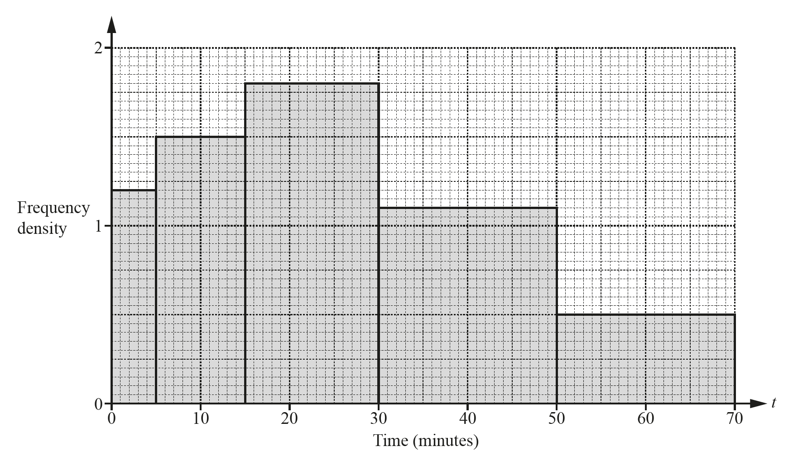

Complete the frequency table.

| Time ($t$ minutes) | $0<t\leq5$ | $5<t\leq15$ | $15<t\leq30$ | $30<t\leq50$ | $50<t\leq70$ |
|---|---|---|---|---|---|
| Number of people | $6$ |   | $27$ |   | $10$ |

*Source: 2018	May/June 0580/22 Q13*

