# Mark Schemes — Scatter Graphs & Correlation
**Statistics** · Cambridge (CIE) IGCSE maths (0580 & 0980)

## Exam Questions (17 questions)

### Q1

**[B1 B1]**

> **[mark-scheme]**
> **B1**: For at least 2 correct points.
> 
> **B1**: All points plotted correctly.
**Final answer:** **Positive**

**[B1]**
**Final answer:** **Using a ruler to draw a line of best fit going through roughly the same points as below **

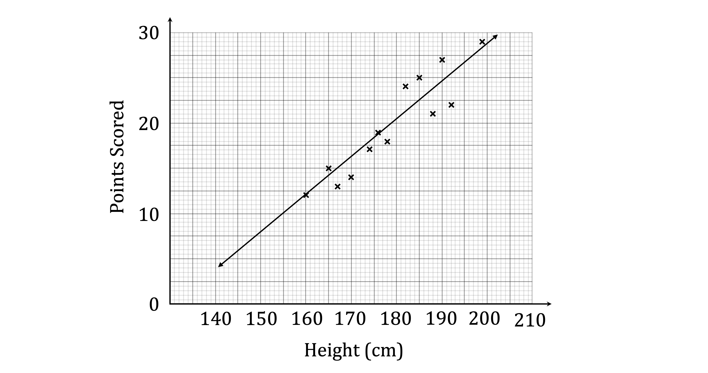

**[B1]**

> **[exam-tip]**
> The line of best fit passes through the mean point on a scatter graph. However, this is not required as part of the core Cambridge IGCSE syllabus.

### Q2
i) *As physics marks increase, chemistry marks tend to increase. So it is positive correlation.*

**Positive**** ****[1] **
**It is not necessary to comment on the strength of the correlation.**

ii) *The line of best fit (LOBF) is drawn by eye so there is some margin of error. *
*It does not have to, but may, pass through any of the plotted points. *
*In this case it does not necesarily have to pass through the origin.*

> *However, the LOBF **must** be drawn with a ruler/ straight edge and must match the correlation of the points. *
*It should have roughly the same number of points above as below it and should extend all the way to the edges of the grid.*

> *The LOBF drawn below is an example of an appropriate answer.*

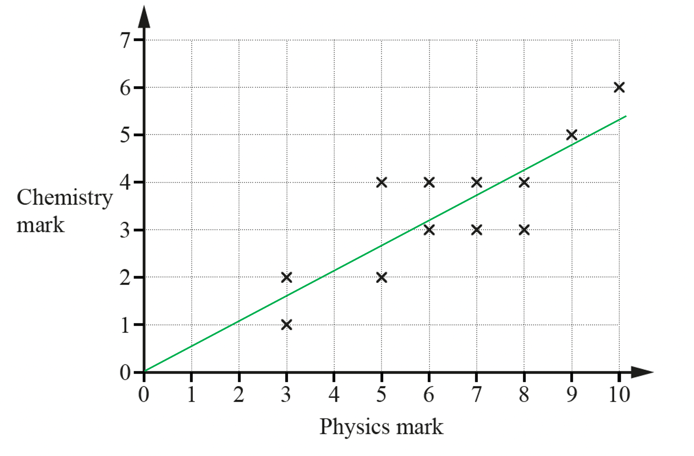

**any appropriate line ****[1]**

iii) *Your answer to this question will depend on your line of best fit (LOBF) drawn in the previous part of the question. But your method should always be the same.*

> *Draw a vertical line up from 4 on the physics axis until it hits your LOBF.*
* Then draw a horizontal line across to the chemistry axis.*

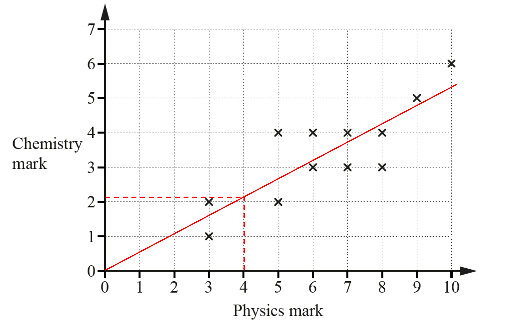

> *Read off the chemistry axis to estimate the mark. *
*Give your answer as a whole number, as we assume the test scores are whole numbers. *
*The nearest whole number according to this LOBF is 2.*

**2**** [1]*** *
**Only "2" is accepted- if you don't get "2" then you should check, and if necessary redraw, your LOBF.**

### Q3
*Correlation can either be positive (loosely speaking the points are going up) or negative (points are going down).* 
*On this scatter graph the points are going down, so the correlation is negative.*

**Negative**** [1] **
**No other words or descriptions are accepted.**

### Q4

**2 points plotted correctly**** [1]** 
**All points plotted corrected**** [1]**
> *As the age increases the value decreases.*

**Strong negative**** correlation **
**Stating "negative"**** [1]** 
**Stating "strong"**** [1]** 
**Medium or moderate are also accepted**
> *Circle the one whose value is lower than suggested by the trend.*

**[1]**
> *Remember the line of best fit should only be drawn within the range of data. *
*It does not need to start at the origin. Draw a vertical line up from 6 on the horizontal axis. *
*When it meets the line of best fit draw a horizontal line to the vertical axis. Read off the value.*

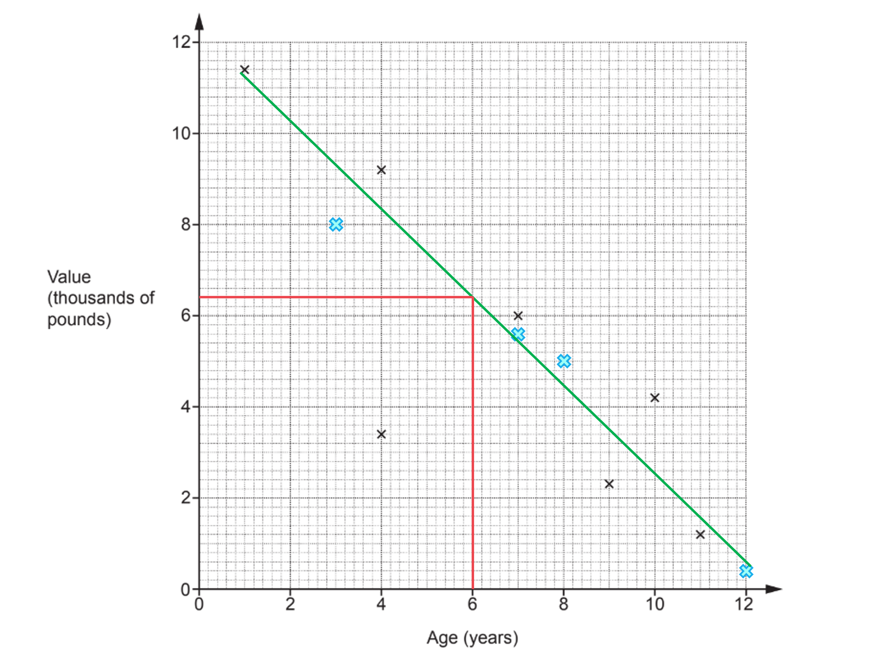

**Drawing a line of best fit ****[1]**

**£6400 ****[1] **
**A range of values will be accepted based on your line of best fit**
**16 years is ****not within the range of data**** so the line of best fit should not be used** **[1]**

### Q5
*Plot the point **(22, 50)**.*

**[1]**
> *The plotted points roughly form a line that would have a positive gradient, so the type of correlation is positive.*

**Positive correlation** **[1]**
*To estimate from a scatter graph we first need to draw a line of best fit.* 
*A line of best fit does not have to go through any points (but may do) and should roughly have as many points on one side as the other.  *
*The line should not extend beyond the first or last of the plotted points. *
*Ignore any outliers when drawing a line of best fit.*

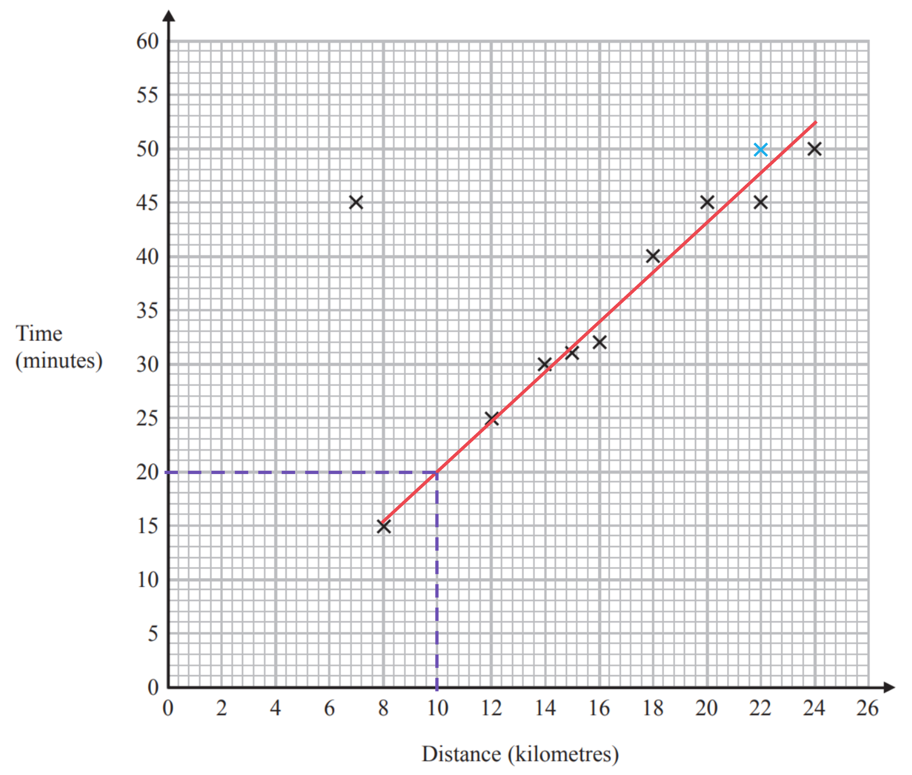

**Line of best fit**** [1]**

> *Take a reading from the line of best fit at a distance of 10 km.  Use a straight edge for accuracy.*

**The time taken for the delivery of 10 km was approximately 20 minutes ****[1]**

**Answers in the range 18 - 22 are accepted. **
*If the driver has been delayed then the time will be unusually high for the distance of the delivery.* 
*We can see from the scatter graph there is such a point (an outlier).*

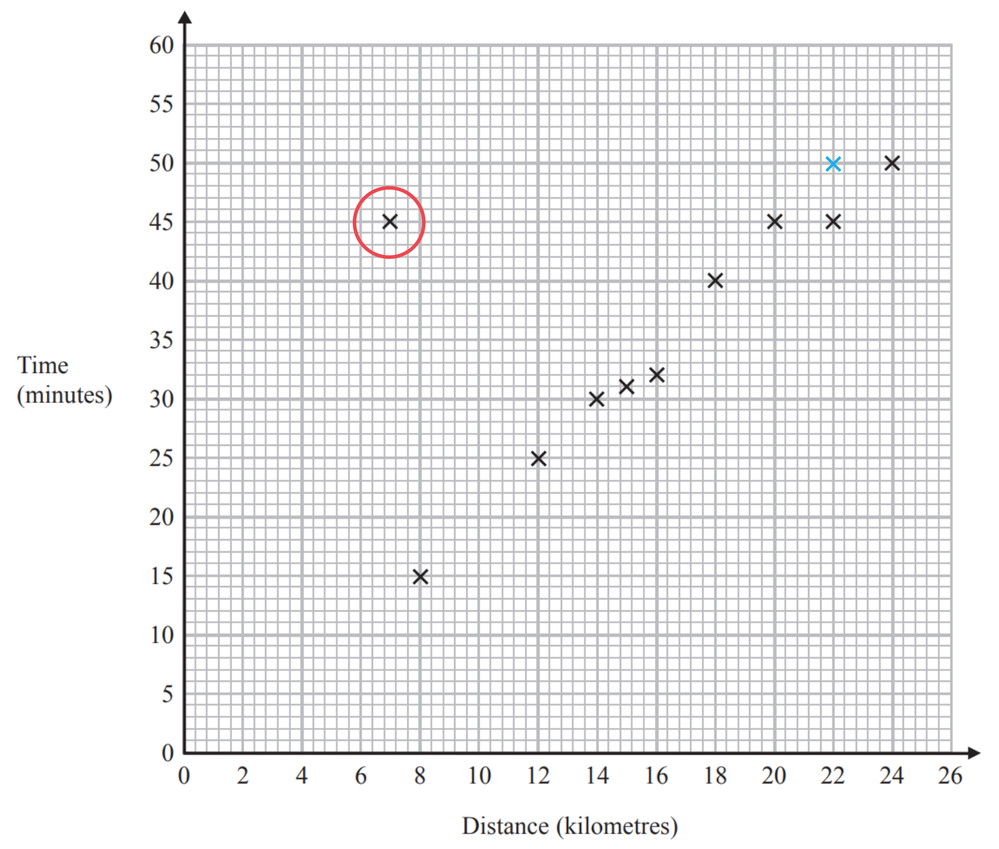

*This point has coordinates **(7, 45)**.*

**The time taken for the delayed delivery was 45 minutes** **[1]**

### Q6
*Plot the point* *(90, 17)**.*

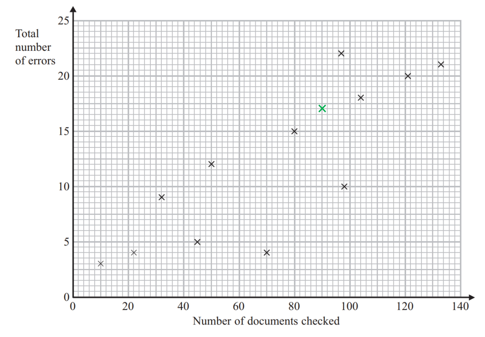

**[1]**
> *The plotted points roughly form a line that would have a positive gradient, so the type of correlation is positive.*

**Positive correlation** **[1]**
*To estimate from a scatter graph we first need to draw a line of best fit.* 
*A line of best fit does not have to go through any points (but may do) and should roughly have as many points on one side as the other.  *
*The line should not extend beyond the first or last of the plotted points.*

**Line of best fit**** [1]**

> *Take a reading from the line of best fit at 110 documents.  Use a straight edge for accuracy.*

**The total number of errors in the 110 documents is approximately 19 ****[1]**

**Answers in the range 16 - 20 are accepted. **

### Q7
> *Plot the points (4.2, 13.4), (5.7, 11.8), (7.1, 9.8) and (8.8, 8.3). Reading the scales carefully on the graph - on both axes each small square represents 0.2 units. *
*Using a ruler may help.*

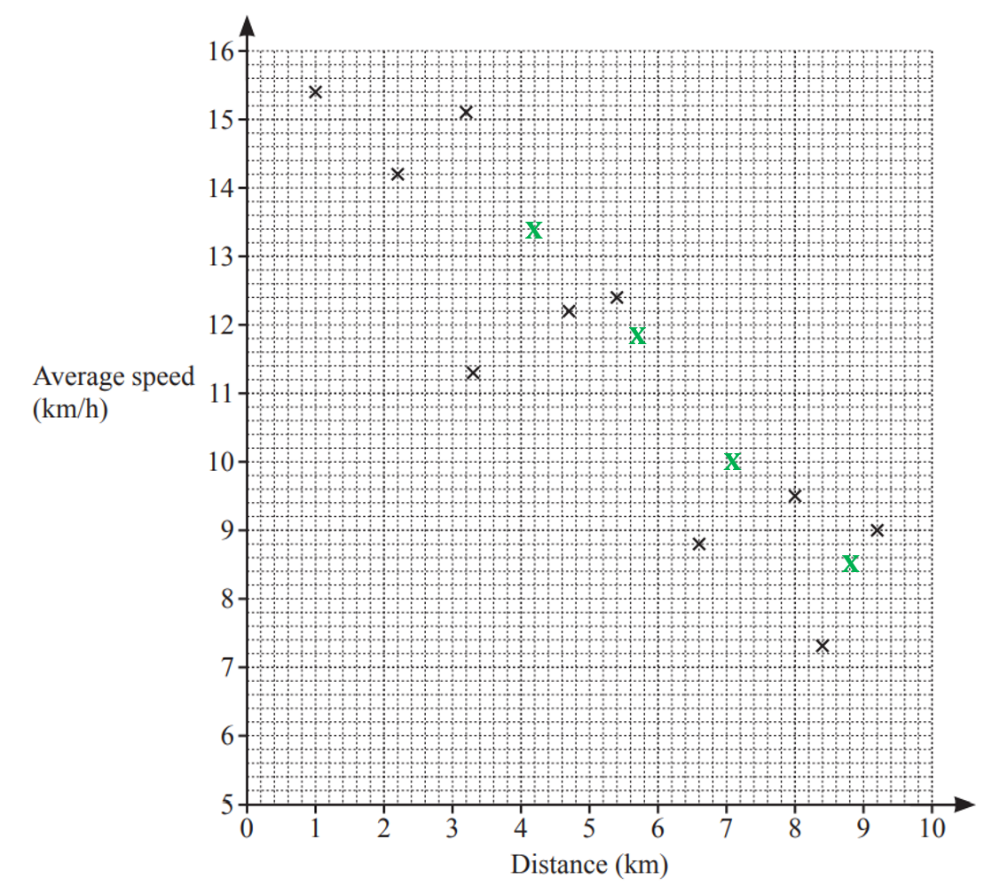

**Two or three points plotted correctly ****[1]** 
**All four points plotted correctly ****[1]**
> *As the distance increases, the average speed decreases.*

**The graph shows negative correlation. ****[1]**

**The type (positive or negative) of correlation must be stated and not just described. **
*The line of best fit should be a straight line, drawn with a ruler and must cover the whole range of the plotted points. It does not have to, but may, pass through any of the plotted points.* 
*Try to have approximately the same amount of points both above and below the line.*

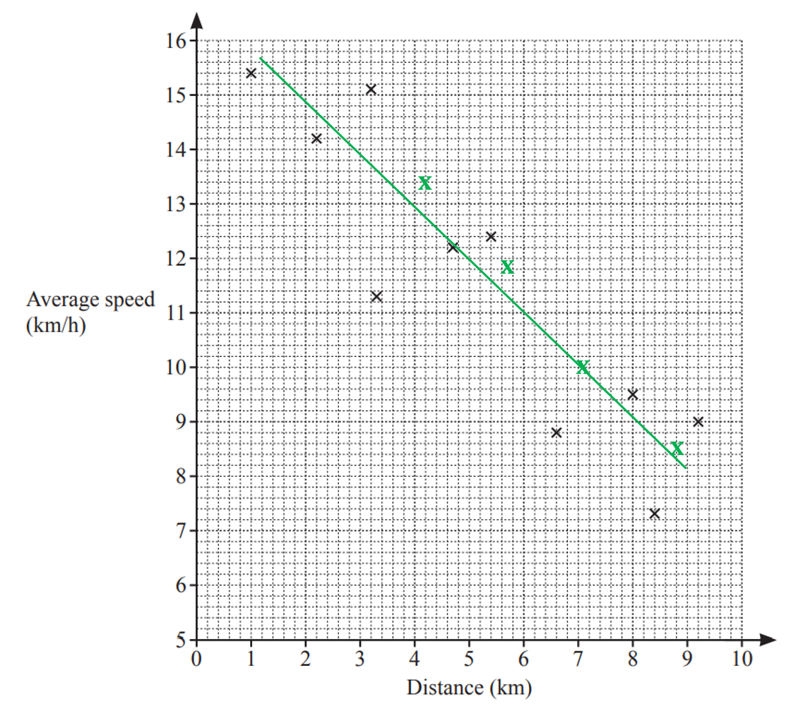

**[1]**
> *Use a ruler to draw a vertical straight line from 6 on the distance** **axis to the line of best fit and then a horizontal straight line to the average speed axis. *

> *Read off the value to estimate the average speed.*

**Approximately 11 km/h** **[1]**

**Answers in the range 10 to 12 km/h are accepted as long as the line of best fit is used correctly.**

### Q8
*To see if Molly is right we need to find the **gradient** of a **line** of **best fit**.* 
*A line of best fit can be drawn by eye, with roughly as many points on one side of the line as the other.*

*To find the gradient of the line of best fit, use* $\mathrm{Gradient}=\frac{\mathrm{Rise}}{\mathrm{Run}}$*.*

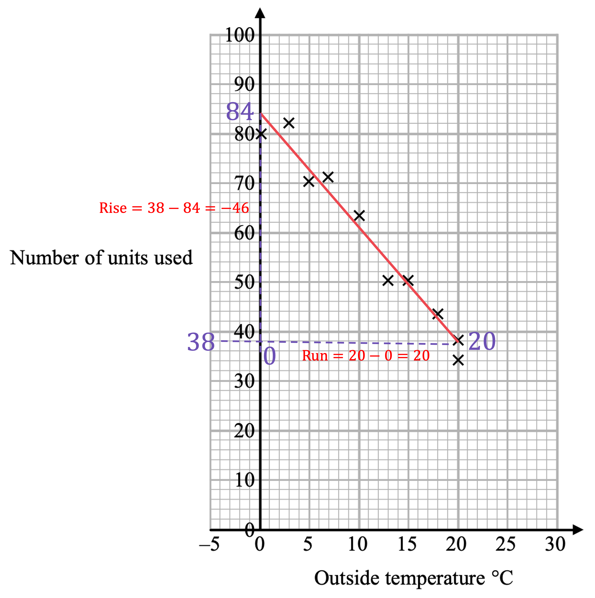

**Line of best fit**** [1]**

$\mathrm{Gradient} \mathrm{of} \mathrm{line} \mathrm{of} \mathrm{best} \mathrm{fit}=\frac{-46}{20}=-2.3$

**[1]**

> *This means for every 1 °C the outside temperature increases by, the number of units of electricity used **decreases** by 2,3. Compare this to Molly's statement and answer the question.*

**Molly is not right, the number of units of electricity used for heating decreases by around 2.3 °C on average, not 4 °C ****[1]**

**Gradients in the range ±(2 - 3) are accepted.**
**30 °C is outside the range of plotted (observed) data points and so we do not know if the pattern of points would continue beyond the highest point plotted of around 20 °C so extending and using the line of best fit would be unreliable**** ****[1]**

### Q9
> *Draw a line up from 70 000 on the Value in 1996 axis to find the correct point. *
*Then draw a line across to the Value in 2016 axis to read the correct value.*

**Final answer:** **\$140 000 ****[1]**

**Pay attention to the scale - the value is in thousands so the correct answer is not "140".**
> *Plot the points (40, 80) and (80, 150) on the scatter diagram, paying attention to the scale.*

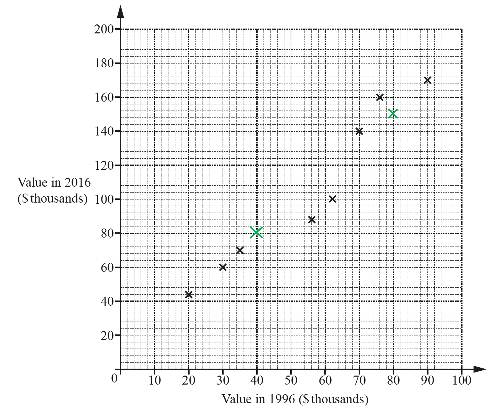

** ****both points plotted correctly ****[1]**
> *The line of best fit (LOBF) is drawn by eye so there is some margin of error. *
*It does not have to, but may, pass through any of the plotted points. In this case it does not necessarily have to pass through the origin.*

> *However, the LOBF **must** be drawn with a ruler/ straight edge and must match the correlation of the points. *
*It should have roughly the same number of points above as below it and should extend all the way to the edges of the grid.*

> *The LOBF drawn below is an example of an appropriate answer.*

** ****any appropriate line ****[1]**
> *Your answer to this question will depend on your line of best fit (LOBF) drawn in the previous part of the question. But the method should always be the same.*

> *Draw a vertical line up from \$50 000 on the Value in 1996 axis until it hits your LOBF.*
* Then draw a horizontal line across to the Value in 2016 axis.*

*Read off the graph to estimate the Value in 2016. *
*Pay attention to the scale on the Value in 2016 axis. *
*Notice that 5 small squares represent \$20 000, so 1 small square represents \$4000. *
*The answer on **this** LOBF would be ***\$96 000***.*

** \$80 000 to**** ****\$110 000**** **
**Any answer between \$80 000 and \$110 000 that matches the LOBF****  [1]**

### Q10
*Plot the points* *(1, 8200)** and **(3.5, 5000)**.*

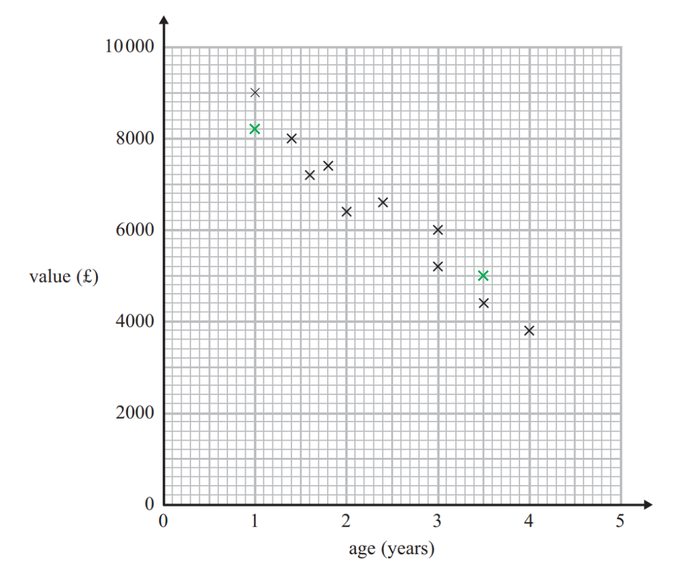

**[1]**
**The older a car is, the lower its value** **[1]**

**Negative correlation is also accepted.**

### Q11
> *There are 60 minutes in an hour. Write 1 hour 40 minutes in minutes.*

*60 + 40 = 100 minutes*

**[1]**

> *Plot the two points (210, 130) and (100, 80).*

**[1]**
> *The price will be lower than what is suggested by the trend.*

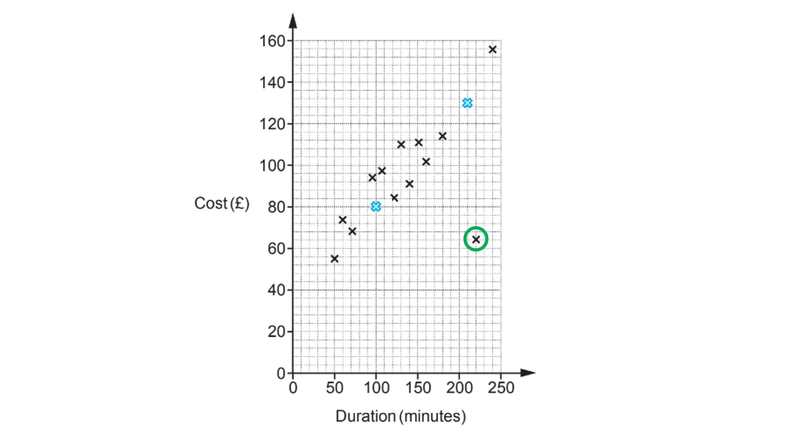

**[1]**
*i) **Remember the line of best fit should only be drawn within the range of data. *
*It does not need to start at the origin.*

**[1]**

*ii) **Draw a horizontal line from 90 until it meets the line of best fit. From that point draw a vertical line down to the axis. Read off the number.*

**115 minutes** **[1] **
**A range of answers are accepted based on your line of best fit**
> *Convert 7 hours to minutes.*

*7 × 60 = 420 minutes*

**420 minutes is ****not within the range of data**** so the line of best fit should not be used** **[1]**

### Q12
> *Find the point which is at 42 on the "number of people" (**x-**) axis, and read off from the "number of phones" (**y**-) axis. *
*Be careful with the scale; on this graph one square horizontally is equal to two people and one square vertically is 2 phones.*

**32** **[1]**
> *As one variable ("number of people") increases, the other variable ("number of phones") also increases.*

**Positive correlation** **[1]**

### Q13
*Draw a vertical line up from 15.12 m on the triple jump (**x**-) axis until it meets the correct point.* 
*Draw horizontal line across to the 100 m (**y**-) axis.*

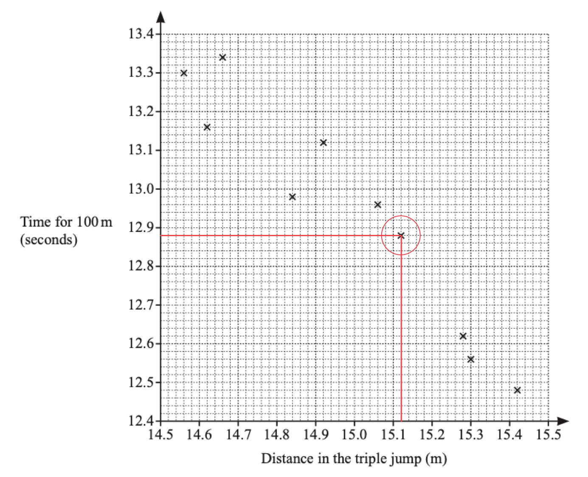

> *Read off the time axis to estimate the time for the 100 m race.*

$12.88$** seconds** **[1]**
> *Plot the points (14.74, 13.2) and (15.2, 12.76). *
*Be careful with the scale - you may find it helpful to draw vertical and horizontal lines from the axes at the given values for each point and mark the points where they intersect.*

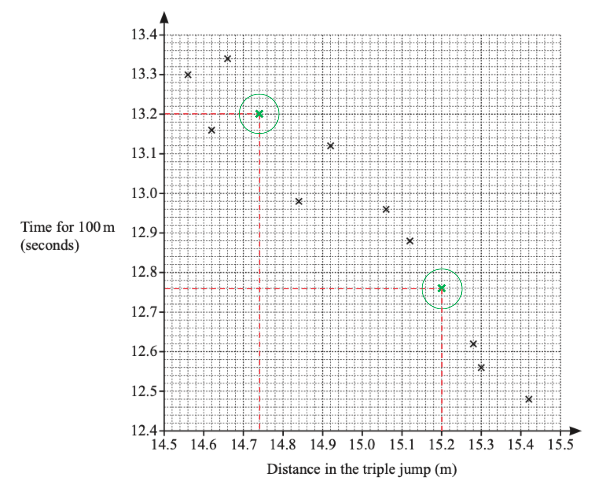

**[1]**
> *The line of best fit (LOBF) does not have to, but may, pass through any of the plotted points.*
*In this case we need to draw a straight line going (roughly) from the top left to the bottom right. *
*Try to keep roughly the same amount of points on either side of the line.*

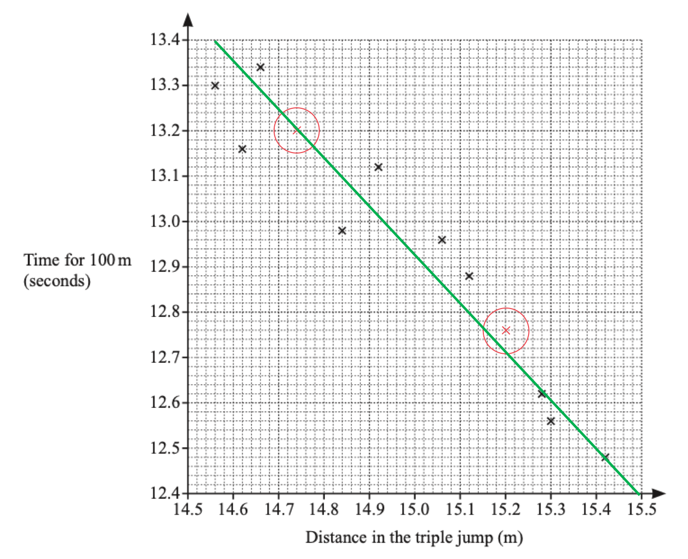

**[1]**

**Make sure you use a ruler to get the mark.**
> *Your line of best fit can help - it has a negative gradient. *
*This, and the plotted points, indicate that as the distance jumped increases, the time taken to run 100 m decreases.*

**Negative correlation**** [1]**

### Q14
*Plot the points* *(2, 250)** and **(3.1, 190)**.*

**[1]**
**The further from the city centre an apartment is, the cheaper the monthly rent is** **[1]**

**Negative correlation is also allowed.**

### Q15
> *On the scatter diagram, identify the furthest point to the right, as this will be the highest on the Test 1 axis.*

**66 marks**** [1]**
> *As Test 1 scores increase, Test 2 scores tend to increase. So we have positive correlation.*

**Positive correlation **
**the word**** ****"positive" ****[1]**
> *The line of best fit (LOBF) is drawn by eye so there is some margin of error. *
*The LOBF does not have to, but may, pass through any of the plotted points. *
*In this case, the LOBF does not necessarily have to pass through the origin.*

> *The LOBF must be drawn with a ruler/ straight edge and its gradient must match the correlation of the points (positive/ negative). It should have roughly the same number of points above as below it and should extend all the way to the edges of the grid.*

> *The LOBF drawn below is an example of an appropriate answer.*

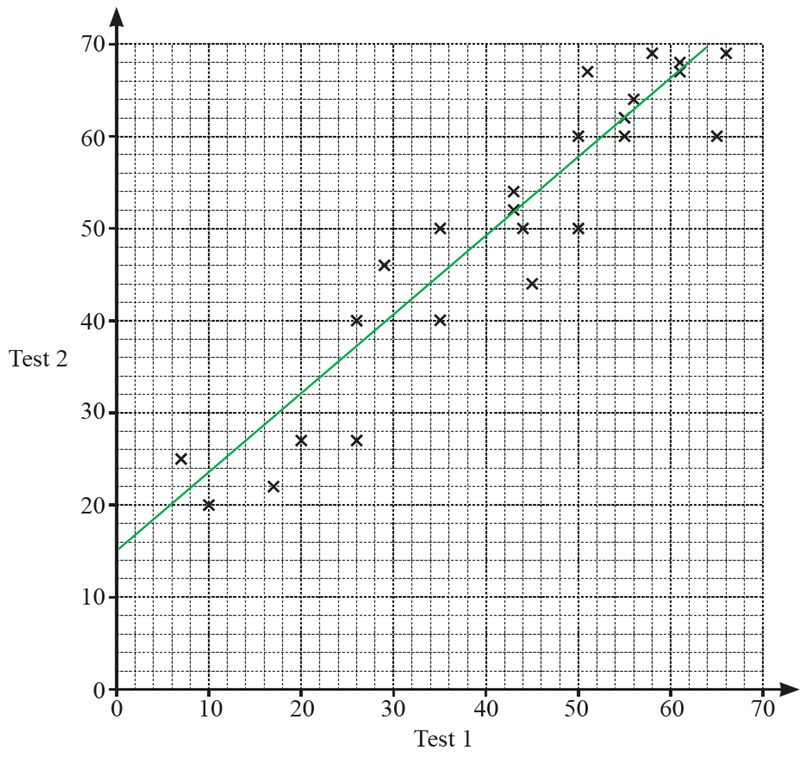

**correct LOBF drawn with a straight edge ****[1]**
> *Your answer to this question will depend on your line of best fit (LOBF) drawn in the previous part of the question. But your method should always be the same.*

> *Draw a vertical line up from 40 on the Test 1 axis to your LOBF. Then draw a horizontal line across to the Test 2 axis.*

*Read off the Test 2 axis to estimate the score. *
*According to **this** LOBF, the answer would be ***49***.*

**46 to 50 **
**any answer between 46 and 50 that's consistent with the LOBF**** [1] **

### Q16
> *As one variable increases (more ice cream), the other variable also increases (temperature rises). *
*If both variables increase the correlation must be positive.*

**Positive correlation** **[1]**
