# Mark Schemes — Statistical Diagrams
**Statistics** · Cambridge (CIE) IGCSE maths (0580 & 0980)

## Exam Questions (18 questions)

### Q1
> *Make an ordered list *

$16,19,21,24,26,27,27,29,30,35,38,42,43,52$

> **[exam-tip]**
> Any alternative method for ordering the numbers is also valid here. For example grouping the numbers based on their tens digit.

> *Write the ordered numbers into the stem and leaf diagram, including a key*

**[B1 B1 B1]**

> **[mark-scheme]**
> **B1**: For at least two rows being correct. Alternatively, it can be awarded for a correct, but unordered, stem and leaf diagram.
> 
> **B1**: For a fully correct stem and leaf diagram.
> 
> **B1**: For a correct key.
> *The total number of scores, *$N$*, is 14*

> *Since it this is even, take the average of the *$\frac{N}{2}$* and *$\frac{N}{2}+1$* scores*

> *In this instance, that would be the 7th and 8th scores*

$7^{th}=\frac{N}{2}=27\,8^{th}=\frac{N}{2}+1=29$

> *Taking the average of these scores*

$\frac{27+29}{2}=28$

**Final answer:** **Median = **$28$

**[B1]**

> **[exam-tip]**
> Any alternative method would have gotten the correct answer. For example, given the low number of elements, a valid approach could be cancelling out the largest number followed by the smallest number until you arrive at one remaining number - which would be the median.
> *Mode means most frequently occurring value in the dataset*

> *27 appears twice, while all other values appear only once*

**Final answer:** **Mode = **$27$

**[B1]**

### Q2
*Start by drawing an **unordered** stem-and-leaf diagram.* 
*Cross each number out as you use it and split each value into a stem and a leaf.  A leaf will always be the final digit only.* 
*e.g.  2.4 will have a stem of 2 and a leaf of 4 *
*As in nature, a stem can have more than one leaf.*

*Unordered stem-and-leaf diagram*

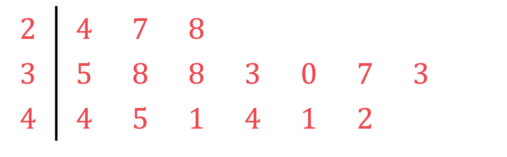

*For the final diagram, the stems are already in order but their corresponding leaves wil need putting into order too.* 
*Keep the leaves in neat columns as this helps to show features of the data such as most frequent group (stem).* 
*Remember to include a **key** with your final answer.*

Ordered stem-and-leaf diagram

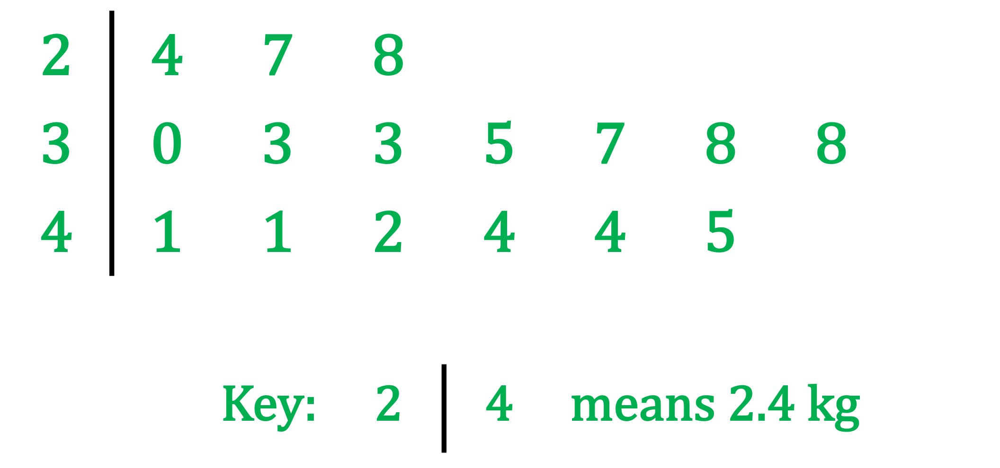

**Correctly ordered diagram with maximum 2 errors ****[1]**** **
**Correct diagram with no errors ****[1]** 
**Key ****[1]**

### Q3
> *Start by drawing an **unordered** stem-and-leaf diagram. Cross each number out as you use it and split each value into a stem and a leaf.  *
*A leaf will always be the final digit only. *
*e.g.  21 will have a stem of 2 and a leaf of 1;  5 (treat as 05) will have a stem of 0 and a leaf of 5. *
*As in nature, a stem can have more than one leaf.*

*Unordered stem-and-leaf diagram*

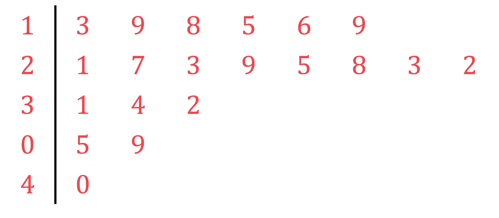

*For the final diagram, the stems will need to be put into order, and then their corresponding leaves put into order too.* 
*Keep the leaves in neat columns as this helps to show features of the data such as most frequent group (stem).* 
*Remember to include a **key** with your final answer.*

Ordered stem-and-leaf diagram

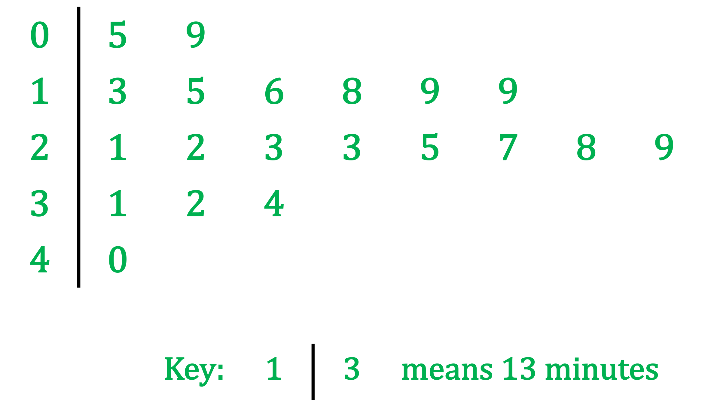

**Correctly ordered diagram with maximum 2 errors ****[1]**** **
**Correct diagram with no errors ****[1]** 
**Key ****[1]**

### Q4
*Start by drawing an **unordered** stem-and-leaf diagram.* 
*Cross each number out as you use it and split each value into a stem and a leaf.  *
*A leaf will always be the final digit only.* 
*e.g.  98 will have a stem of 9 and a leaf of 8;  102 will have a stem of 10 and a leaf of 2. *
*As in nature, a stem can have more than one leaf.*

*Unordered stem-and-leaf diagram*

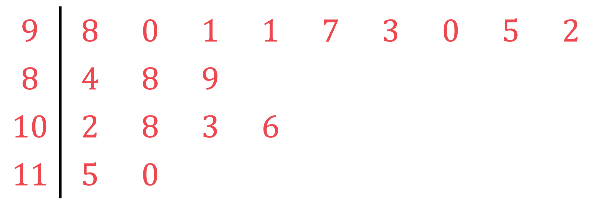

*For the final diagram, the stems will need to be put into order, and then their corresponding leaves put into order too.* 
*Keep the leaves in neat columns as this helps to show features of the data such as most frequent group (stem).* 
*Remember to include a **key** with your final answer.*

Ordered stem-and-leaf diagram

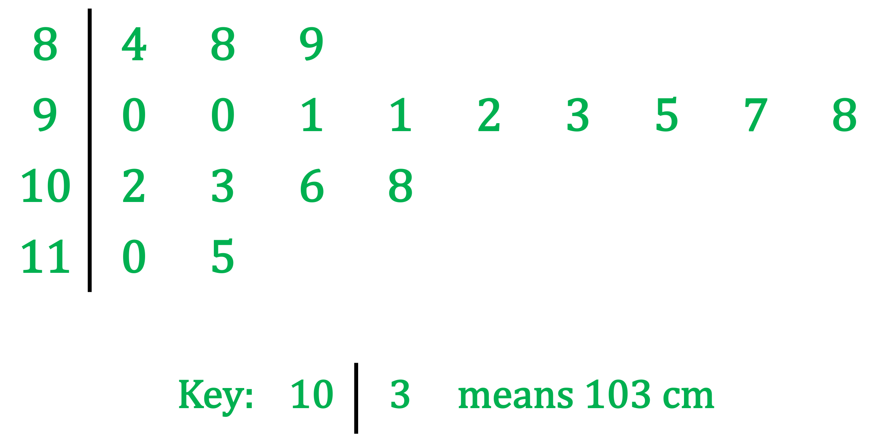

**Correctly ordered diagram with maximum 2 errors ****[1]**** **
**Correct diagram with no errors ****[1]** 
**Key ****[1]**

### Q5
> *The 10, 11, 12 and 13 in the stem are representing the first two digits of each number; put the values representing the units into the respective rows. *
*It may help to draw an unordered stem and leaf diagram first and then order each row separately.*

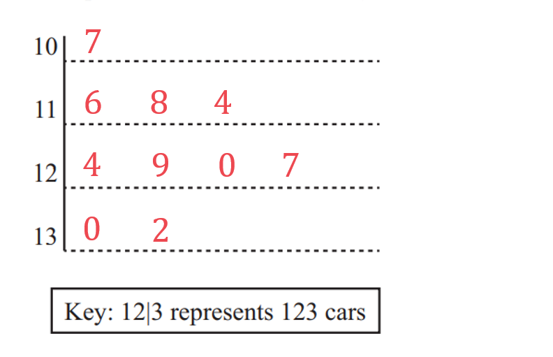

**[1] **

> *Make sure the leaves are ordered correctly.*

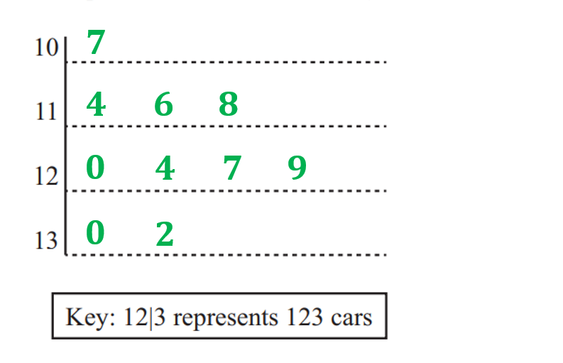

**[1]**

### Q6
*Start by drawing an **unordered** stem-and-leaf diagram.* 
*Cross each number out as you use it and split each value into a stem and a leaf.  A leaf will always be the final digit only.* 
*e.g.  31 will have a stem of 3 and a leaf of 1. *
*As in nature, a stem can have more than one leaf.*

*Unordered stem-and-leaf diagram*

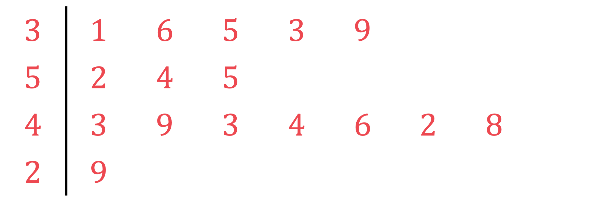

**[1]**

*For the final diagram, the stems will need to be put into order, and then their corresponding leaves put into order too.* 
*Keep the leaves in neat columns as this helps to show features of the data such as most frequent group (stem).* 
*Remember to include a **key** with your final answer.*

**Ordered stem-and-leaf diagram**

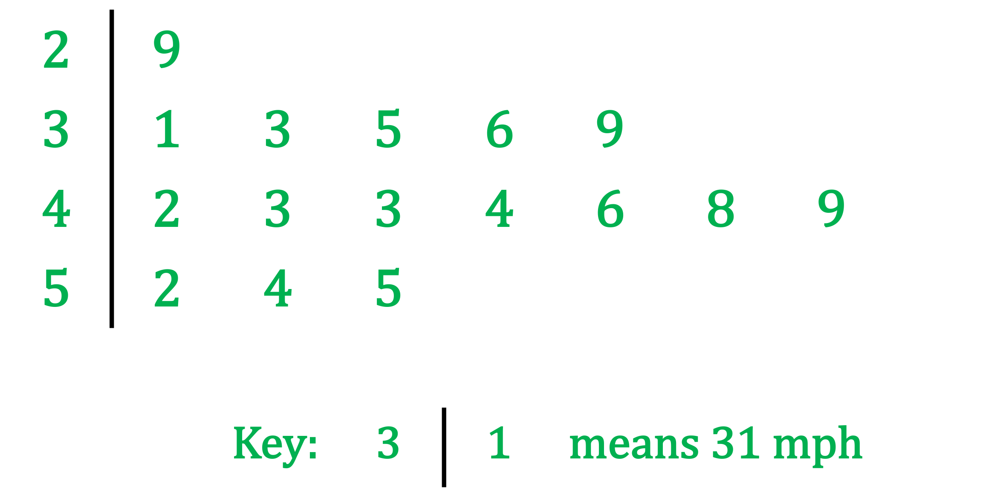

**Ordered diagram with maximum 2 errors ****[1]**** **
**Correct diagram with no errors and key ****[1]**

### Q7
*From the table, we can see that 3 people visited the cinema 5 times.* *40 people were asked in total. The sector angle will be the fraction of people visiting 5 times of a whole circle.*

$\frac{3}{40}\times360^{\circ}=27^{\circ}$

**[1]**

$27^{\circ}$ **[1]**

### Q8
> *Work out how many children are in Ivan's class by adding up the frequencies.*

$12+7+9+4=32$

> *Divide 360**o** by the 32 children to see how many degrees should be used to represent one child.*

$\frac{360^{\circ}}{32}=11.25^{\circ}$

> *Multiply the number of degrees for one child by the number of children who walk to school to find the sector angle.*

$11.25^{\circ}\times12$

**[1]**

$135^{\circ}$** [1]**

### Q9
*Start by drawing an **unordered** stem-and-leaf diagram.* 
*Cross each number out as you use it and split each value into a stem and a leaf.  A leaf will always be the last digit only.* 
*e.g.  37 will have a stem of 3 and a leaf of 7. *
*As in nature, a stem can have more than one leaf.*

*Unordered stem-and-leaf diagram*

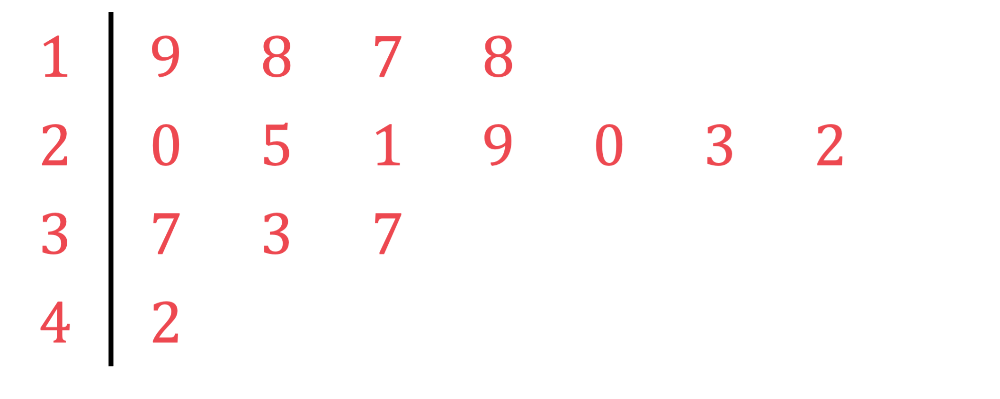

*For the final diagram, the stems are already in order but their corresponding leaves will need putting into order too.* 
*Keep the leaves in neat columns as this helps to show features of the data such as most frequent group (stem).* 
*Remember to include a **key** with your final answer.*

Ordered stem-and-leaf diagram

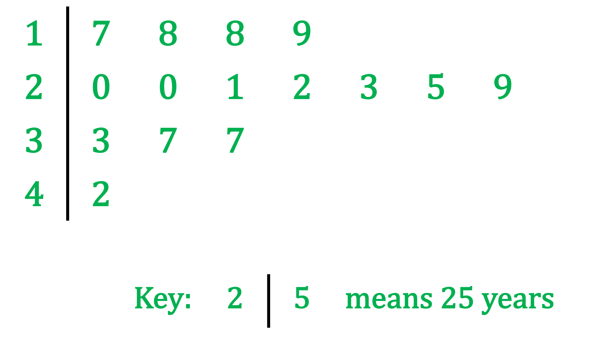

**Correctly ordered diagram with maximum 2 errors ****[1]**** **
**Correct diagram with no errors ****[1]** 
**Key ****[1]**

### Q10
*Start by drawing an **unordered** stem-and-leaf diagram.* 
*Cross each number out as you use it and split each value into a stem and a leaf.  *
*A leaf will always be the final digit only.* 
*e.g.  53 will have a stem of 5 and a leaf of 3. *
*As in nature, a stem can have more than one leaf.*

*Unordered stem-and-leaf diagram*

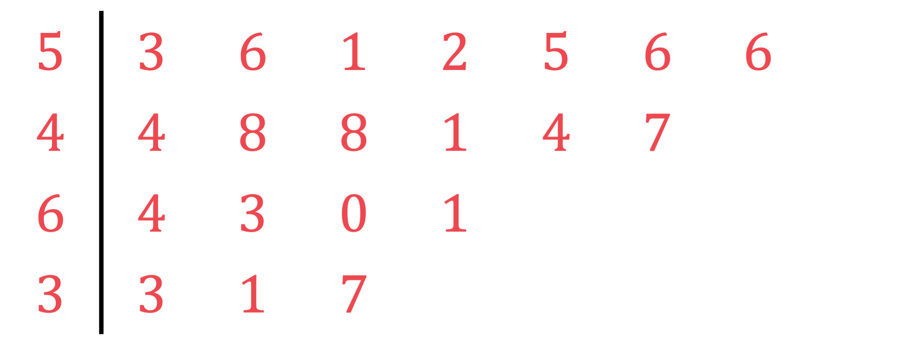

*For the final diagram, the stems will need to be put into order, and then their corresponding leaves put into order too.* 
*Keep the leaves in neat columns as this helps to show features of the data such as most frequent group (stem).* 
*Remember to include a **key** with your final answer.*

Ordered stem-and-leaf diagram

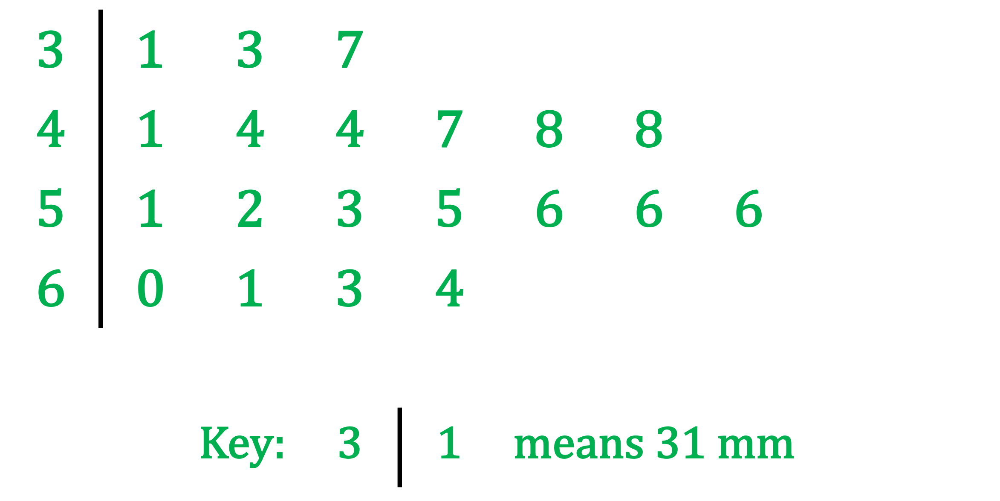

**Correctly ordered diagram with maximum 2 errors ****[1]**** **
**Correct diagram with no errors ****[1]** 
**Key ****[1]**

### Q11
> *Calculate the angles at the centre of the pie chart (by dividing the number of students in each choice by 120 then multiplying by 360°).*

| **Choice** | **Number of students** | ***Angle*** |
|---|---|---|
| University | 57 | $\frac{57}{120}\times360^{\circ}=171^{\circ}$ |
| Training | 45 | $\frac{45}{120}\times360^{\circ}=135^{\circ}$ |
| Work | 18 | $\frac{18}{120}\times360^{\circ}=54^{\circ}$ |

**Correct method for finding angles**** [1]** 
**3 correct angles ****[1]**

> *Use a protractor and ruler to construct the pie chart.*

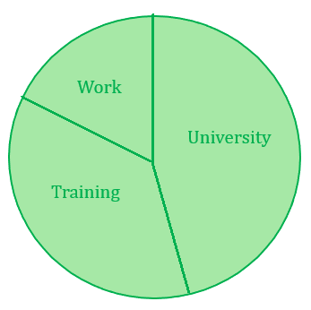

**Correct without labels ****[1]** 
**Correct with labels**** [1]**

### Q12
*Start by drawing an **unordered** stem-and-leaf diagram.* 
*Cross each number out as you use it and split each value into a stem and a leaf.  A leaf will always be the final digit only.* 
*e.g.  43 will have a stem of 4 and a leaf of 3.*
* As in nature, a stem can have more than one leaf.*

*Unordered stem-and-leaf diagram*

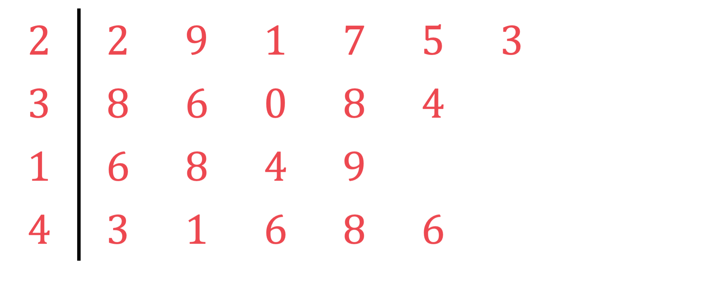

*For the final diagram, the stems will need to be put into order, and then their corresponding leaves put into order too.* 
*Keep the leaves in neat columns as this helps to show features of the data such as most frequent group (stem).* 
*Remember to include a **key** with your final answer.*

**Ordered stem-and-leaf diagram**

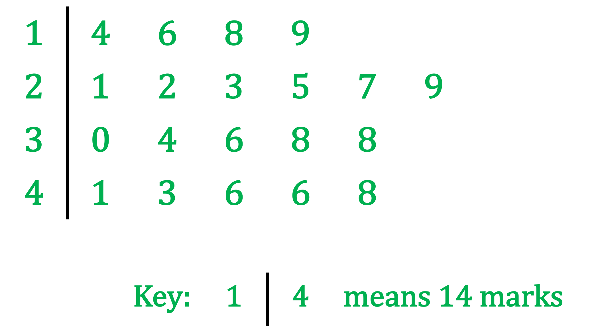

**Ordered diagram with maximum 2 errors ****[1]**** **
**No errors ****[1]** 
**Key ****[1]**
`straight P open parentheses less than 28 space marks close parentheses equals fraction numerator Number space who space scored space less than 28 space marks over denominator Total space number space of space students end fraction`

`P open parentheses less than 28 close parentheses equals 9 over 20`

**The probability a student chosen at random has a test score less than 28 is **$\frac{9}{20}=0.45$ **[1]**

> *It is not essential to convert to a decimal unless asked to do so.*

### Q13
*Start by drawing an **unordered** stem-and-leaf diagram.* 
*Cross each number out as you use it and split each value into a stem and a leaf.  *
*A leaf will always be the final digit only.* 
*e.g.  28 will have a stem of 2 and a leaf of 8. *
*As in nature, a stem can have more than one leaf.*

*Unordered stem-and-leaf diagram*

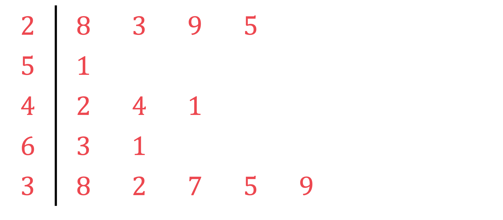

**[1]**

*For the final diagram, the stems will need to be put into order, and then their corresponding leaves put into order too.* 
*Keep the leaves in neat columns as this helps to show features of the data such as most frequent group (stem).* 
*Remember to include a **key** with your final answer.*

Ordered stem-and-leaf diagram

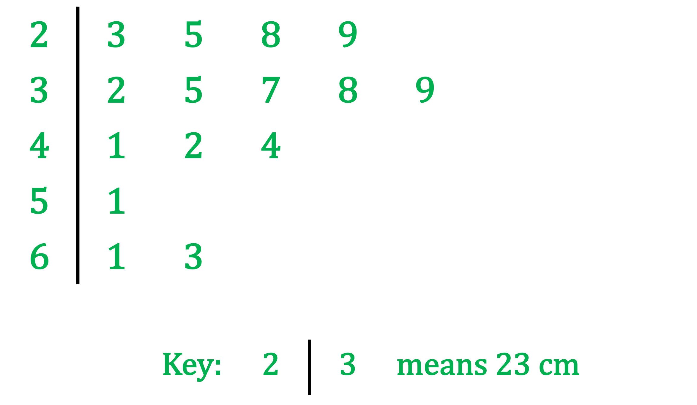

**Ordered diagram with maximum one error  ****[1]**** **
**Key ****[1]**

### Q14
> *Find how many degrees women have in their sector  *

*360° - 110° = 250°*

**[1]**

*Find how many "more" degrees women have in their sector compared to men* * *

*250° - 110° = 140° more* * *

*These extra 140° represent the 3360 more women than men* *Find out how much 1° represents (by dividing 3360 by 140)* * *

*140° is 3360 people so 1° is *$\frac{3360}{140}$* = 24 people*

**[1]** * *

*Use the conversion 1° = 24 people to work out the total number of voters (by multiplying 360 by 24)*

*360 × 24*

**8640 voters** **[1]**

### Q15
> *As the diagrams are drawn accurately we can measure the radius of each pie chart and use these to find the ratio of the areas (and so the populations) of Adley and Bridford.*

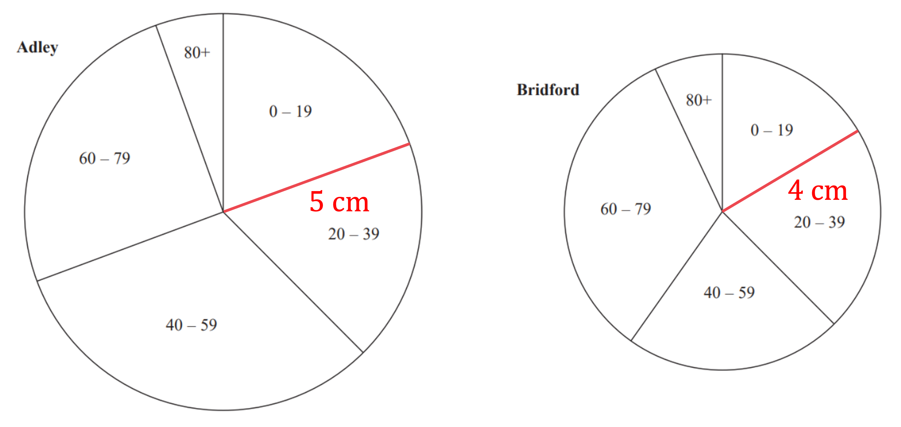

> *The area of a circle is given by the formula *$A=πr^{2}$*.*

*Area of Adley pie chart*`equals straight pi open parentheses 5 close parentheses squared equals 25 straight pi`

**[1]**

*Area of Bridford pie chart*`equals straight pi open parentheses 4 close parentheses squared equals 16 straight pi`

> *So the ratio of the populations of Adley to Bridford (*$A:B$*) is*

$A:B=25π:16π=25:16$

> *and so the fraction of people living in Adley is*

$\frac{25}{25+16}=\frac{25}{41}$

> *Measure the angle of the 0 - 19 category on the Adley pie chart so we can work out the fraction of people living in Adley who are aged 0 - 19.*

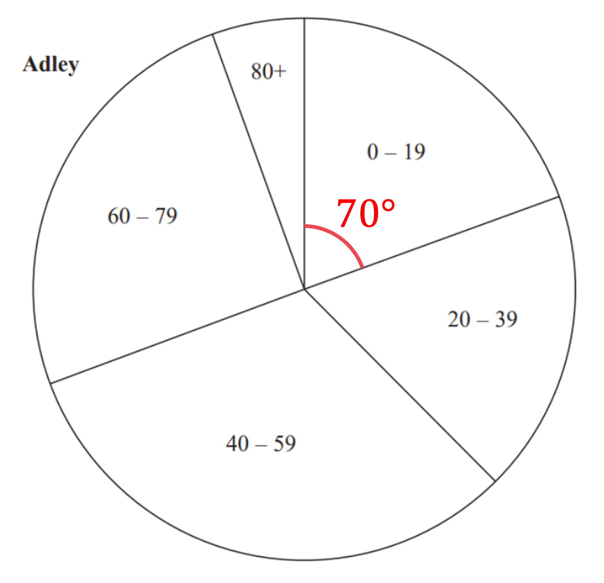

$\frac{70}{360}=\frac{7}{36}$

> *To find the proportion of people (out of the two towns) who live in Adley **AND** are aged 0 - 19 we need to find the product of these two fractions.*

$\frac{25}{41}\times\frac{7}{36}=\frac{175}{1476}$

**[1]**

*This is an awkward fraction so the answer is best given as a percentage.* 
*To change *$\frac{175}{1476}$* to a percentage use your calculator to convert it to a decimal, and then multiply by 100.*

`175 over 1476 cross times 100 percent sign equals 11.856 space...`

> *Round your final answer to a sensible degree of accuracy, three significant figures is often used.*

**Proportion of people living in Adley and aged 0 - 19 years is 11.9% (3 s.f.)** **[1]**

### Q16
> *Take each number in turn, using an unordered stem-and-leaf diagram at first to ensure you do not miss out any numbers. Each number is split into a stem (tens digit) and a leaf (units digit). e.g.  24 will have a stem of 2 and a leaf of 4. Line the leaves up in neat columns.*

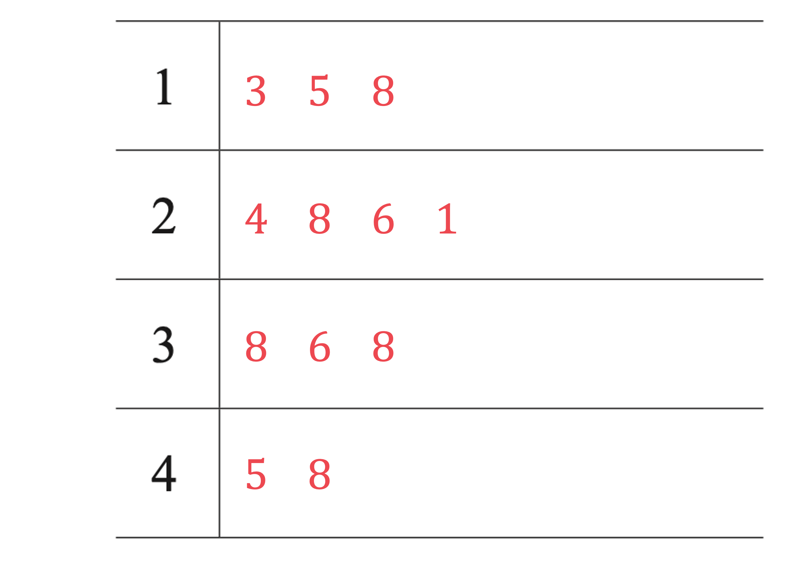

**Unordered but complete** **[1]**

> *Now put the leaves in order for each stem for your final answer.*

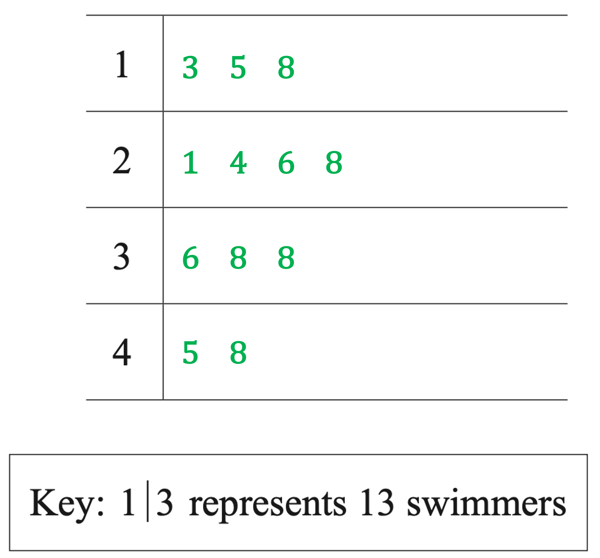

** ****Fully complete and ordered**** [1]**
*The median is the middle value when the values are in order.* *From your stem-and-leaf diagram, cross out values from the start and end until you meet in the middle.*

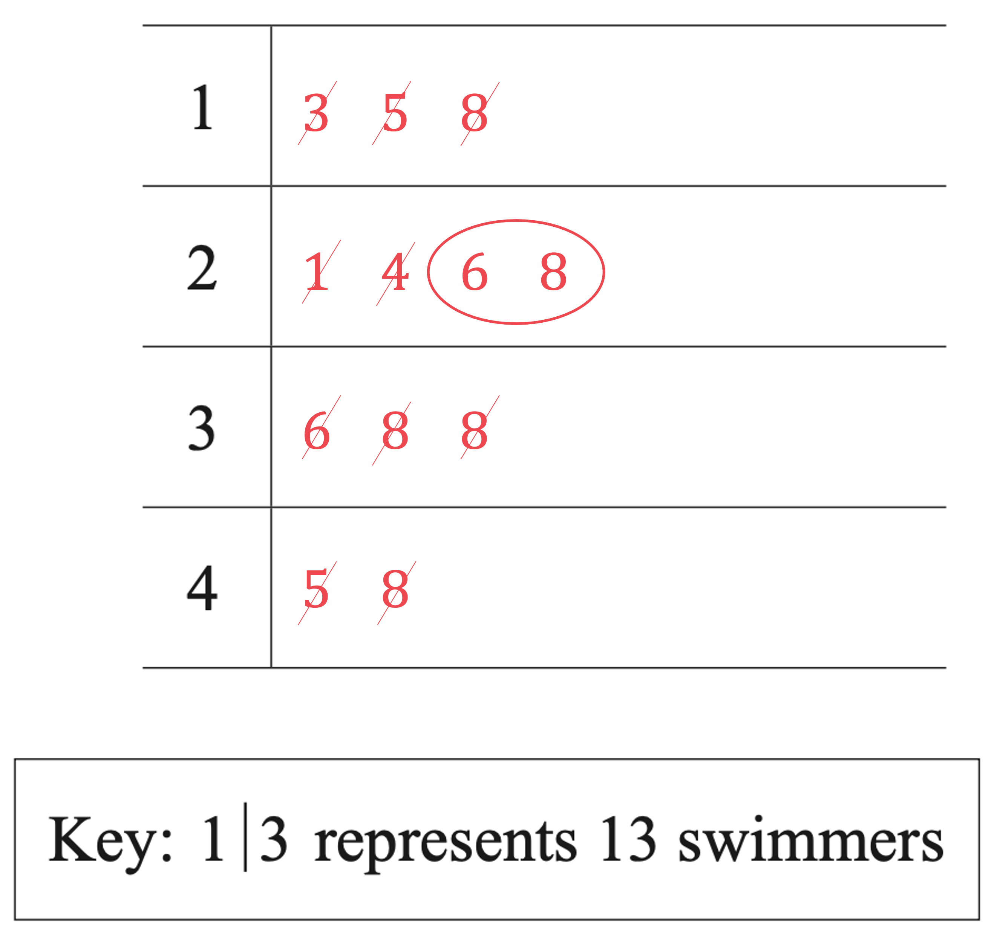

> *There are two numbers in the middle so you need to find the mean of these (the value halfway between them).*

$\frac{26+28}{2}=\frac{54}{2}=27$

**27** **[1]**

### Q17
> *First we need the total frequency so we can work out the angles required for each sector/bird.*

*15 + 10 + 20 + 27 = 72*

> *So 360° will represent 72 birds.  Divide 360° by 72 to find the number of degrees needed for one bird.*

*360° ÷ 72 = 5°*

> *Add another column to the table and find the angle for each bird by multiplying each frequency by 5°.*

| **Bird** | **Frequency** | ***Angle on pie chart*** |
|---|---|---|
| Magpie | 15 | *15 × 5° = 75°* |
| Thrush | 10 | *10 × 5° = 50°* |
| Starling | 20 | *20 × 5° = 100°* |
| Sparrow | 27 | *27 × 5° = 135°* |
| ***Total*** | ***72*** | ***360°*** |

**Correct calculation for one angle**** [1]** 
**One correct angle**** [1]**

> *Use protractor or angle measurer and ruler to carefully construct the pie chart - accuracy is important here.*

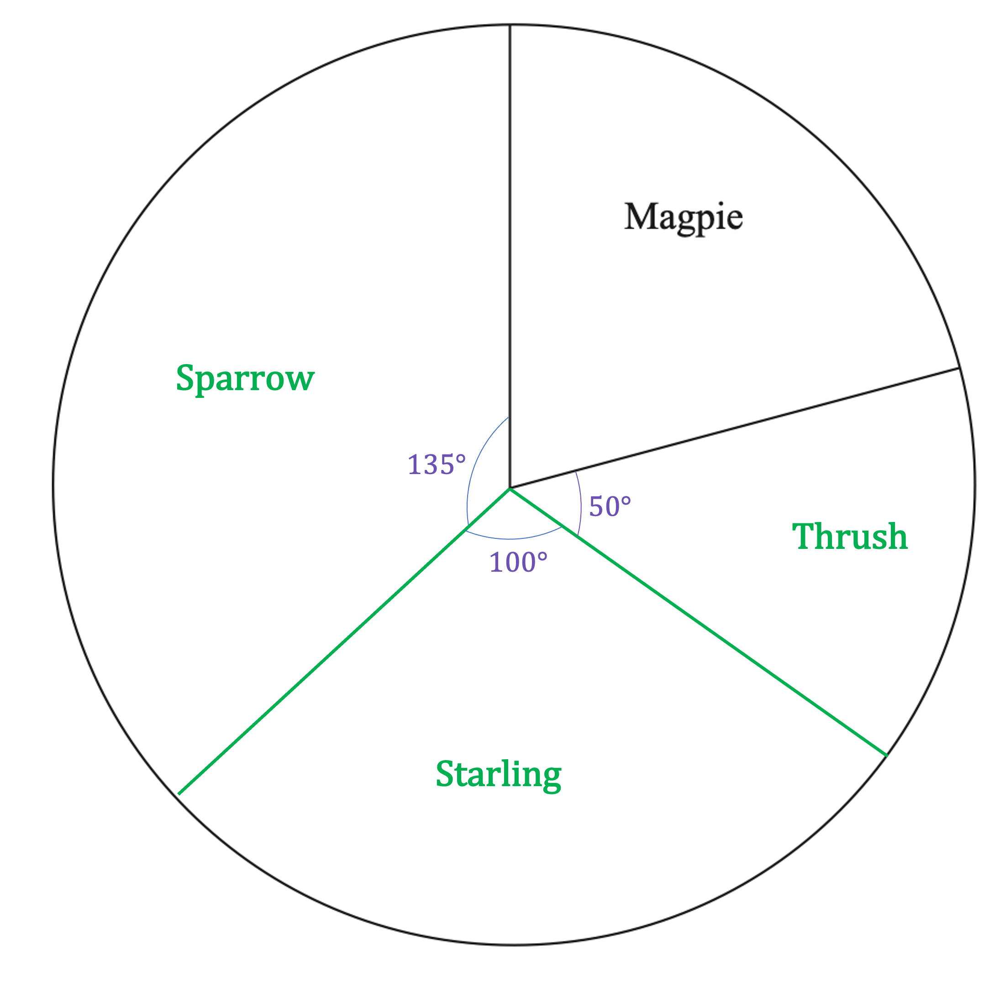

> *(Tip:  If you are using an angle measurer you could sum the angles up after each row and then mark all the angles in one go; these would be (75°), 125°, 225° and (360°) - it's a good way to check your calculations too!)*

**[1]**

### Q18
*Start by drawing an **unordered** stem-and-leaf diagram.* 
*Cross each number out as you use it and split each value into a stem and a leaf.  A leaf will always be the final digit only.* 
*e.g.  165 will have a stem of 16 and a leaf of 5. *
*As in nature, a stem can have more than one leaf.*

*Unordered stem-and-leaf diagram*

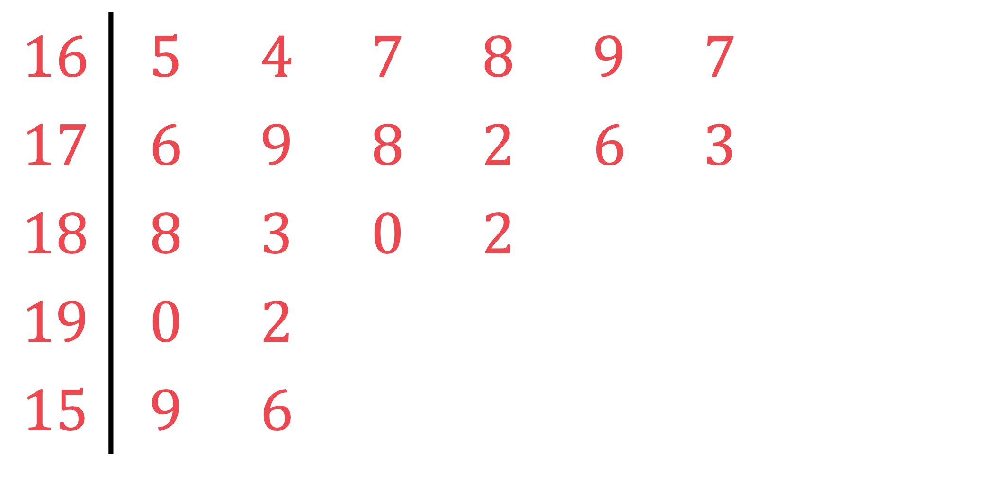

*For the final diagram, the stems will need to be put into order, and then their corresponding leaves put into order too.* 
*Keep the leaves in neat columns as this helps to show features of the data such as most frequent group (stem).* 
*Remember to include a **key** with your final answer.*

Ordered stem-and-leaf diagram

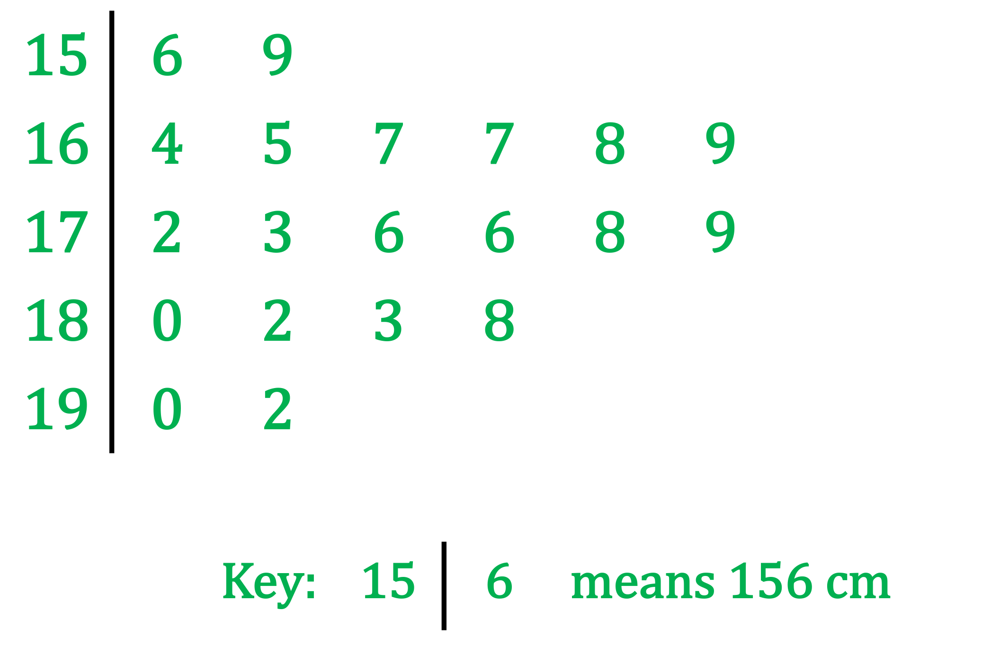

**Ordered diagram with maximum 2 errors ****[1]**** **
**No errors ****[1]** 
**Key ****[1]**
*First find the number of men with a height greater than 184 cm.* *Using the stem-and-leaf diagram is easiest as that has the data in order.*

*3*

> *Write this as a fraction out of the total number of men, and multiply by 100 to convert to a percentage.*

`3 over 20 cross times 100 percent sign equals 15 percent sign`

**[1]**

**15% of the men have a height greater than 184 cm ****[1]**
