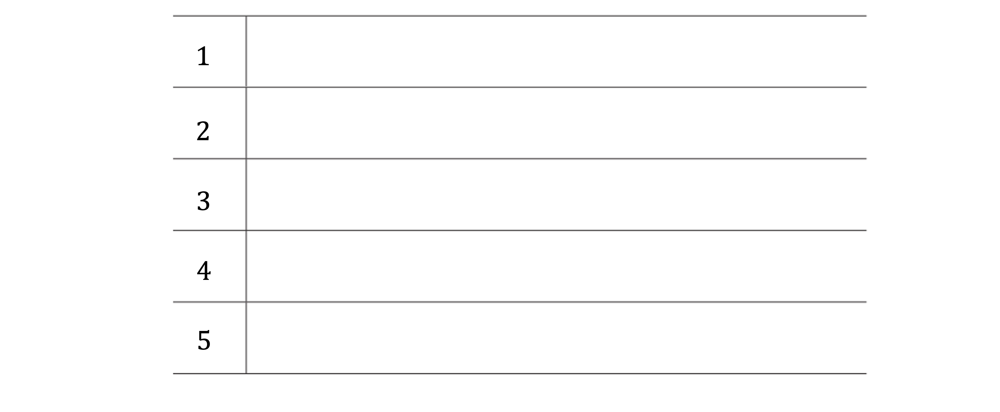
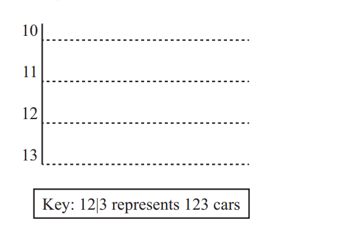
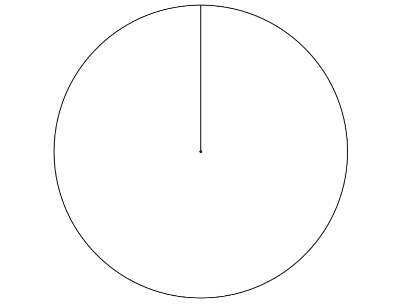
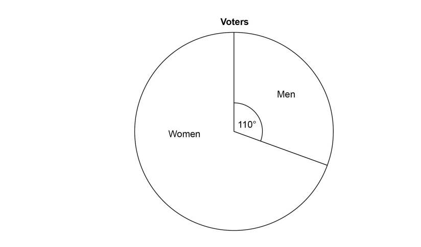
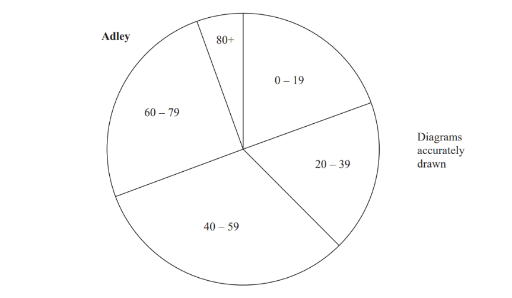
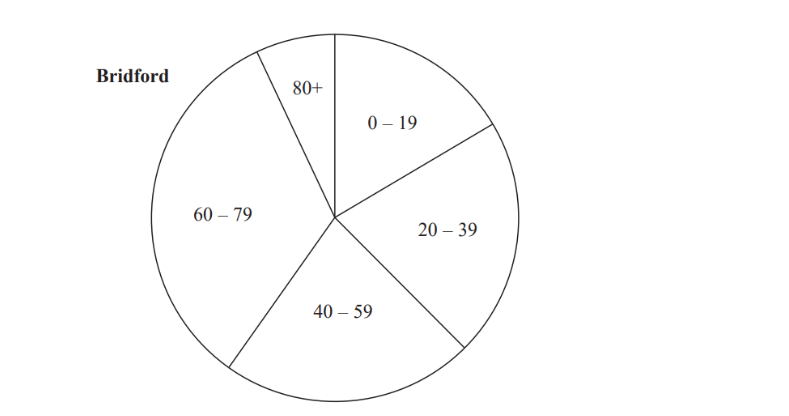
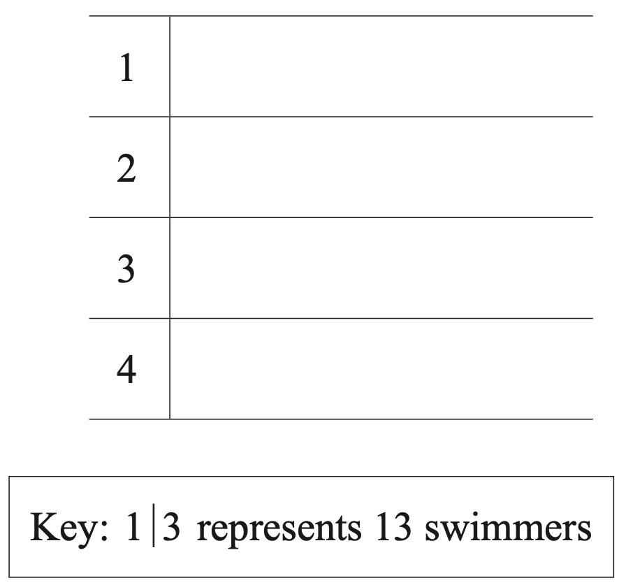
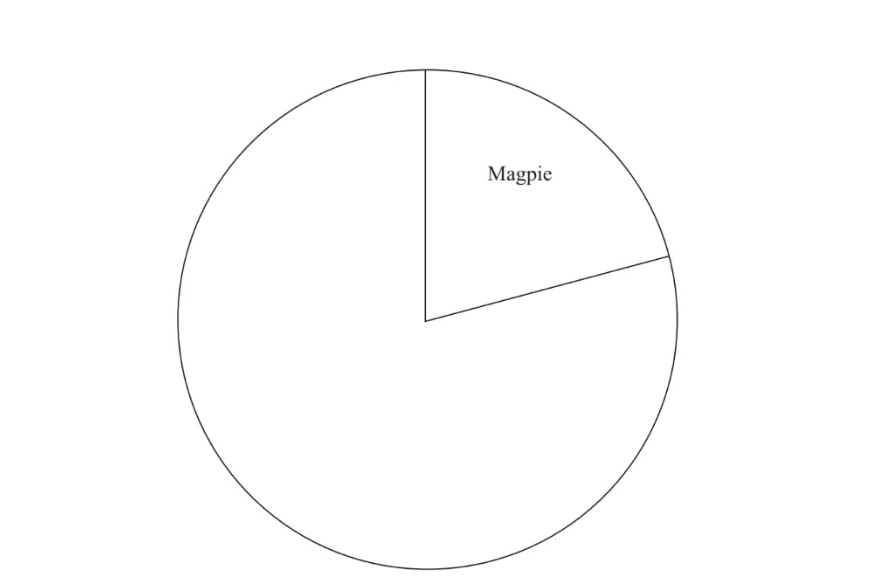

# Exam Questions — Statistical Diagrams
**Statistics** · Cambridge (CIE) IGCSE maths (0580 & 0980)
> Source: [https://www.savemyexams.com/igcse/maths/cie/25/extended/topic-questions/](https://www.savemyexams.com/igcse/maths/cie/25/extended/topic-questions/) · 18 questions across 1 sets

## Exam Questions (18 questions)

### Q1 — medium — 5 marks

**Q1** [3 marks]

Matthew records his scores in a video game he's been playing.

$19272624433821\,52352930271642$

Complete the ordered stem-and-leaf diagram.

**Q1** [1 mark]

Write down Matthew's median score.

**Q1** [1 mark]

Write down the mode of Matthew's scores.

### Q2 — easy — 3 marks

**Q2** [3 marks]

Sixteen babies are born in a hospital. Here are the weights of the babies in kilograms.

2.4    2.7   3.5   4.4   4.5   4.1   4.4   2.8

4.1   3.8   3.8   4.2   3.3   3.0   3.7   3.3

Show this information in an ordered stem and leaf diagram.

*Source: June 2013 1MA0/1H Q3*

### Q3 — medium — 3 marks

**Q3** [3 marks]

Here are the times, in minutes, that 20 children took to walk to school.

13    21    19    27    31       5   23    29    18    25

34    15    28    23    22    40    16    19    32      9

Draw an ordered stem and leaf diagram for these times.

*Source: June 2014 1MA0/1H Q2*

### Q4 — medium — 3 marks

**Q4** [3 marks]

Here are the heights, in cm, of 18 children.

98      90      84       102      115      91

88      91      108     110     97      93

90      89      103      95      92      106

Show this information in an ordered stem and leaf diagram.

*Source: 2014 November 1MA0/1H Q3*

### Q5 — easy — 2 marks

**Q5** [2 marks]

The number of cars parked in a car park at 9 am is recorded for 10 days.

124    130    129    116    132    120    127    107    118    114

Complete the stem-and-leaf diagram.

*Source: 2020 Specimen 0580/02 Q6*

### Q6 — medium — 3 marks

**Q6** [3 marks]

Here are the speeds, in miles per hour, of 16 cars.

31   52   43   49   36   35   33   29

54   43   44          46    42    39   55   48

Draw an ordered stem and leaf diagram for these speeds.

*Source: 2012	June 1MA0/1H Q4*

### Q7 — easy — 2 marks

**Q7** [2 marks]

40 people were asked how many times they visited the cinema in one month. The table shows the results.

| Number of cinema visits | 0 | 1 | 2 | 3 | 4 | 5 | 6 | 7 |
|---|---|---|---|---|---|---|---|---|
| Frequency | 5 | 6 | 6 | 6 | 7 | 3 | 6 | 2 |

Omar wants to show the information from the table in a pie chart.

Calculate the sector angle for the people who visited the cinema 5 times.

*Source: 2018	May/June 0580/21 Q23B*

### Q8 — easy — 2 marks

**Q8** [2 marks]

The table shows how children in Ivan’s class travel to school.

| **Travel to school** | **Number of children** |
|---|---|
| Walk | 12 |
| Car | 7 |
| Bicycle | 9 |
| Bus | 4 |

Ivan wants to draw a pie chart to show this information.

Find the sector angle for children who walk to school.

*Source: 2019	Oct/Nov 0580/22 Q6-*

### Q9 — easy — 3 marks

**Q9** [3 marks]

**You must write down all stages in your working.**

Here are the ages, in years, of 15 students.

19      18         20      25      37

33      21       17      29      20

42      18        23      37      22

Show this information in an ordered stem and leaf diagram.

*Source: March 2013 1MA0/2H Q1*

### Q10 — medium — 3 marks

**Q10** [3 marks]

Here are the heights, in mm, of 20 plants.

53    44    48    56    48    64    51    33    41    44

31    52    55    63    60    56    47    61    37    56

Draw an ordered stem and leaf diagram for these heights.

*Source: November 2016 1MA0/2H Q1*

### Q11 — medium — 4 marks

**Q11** [4 marks]

120 students choose what they want to do when they leave school. Their choices are shown in the table.

| **Choice** | **Number of students** |
|---|---|
| University | 57 |
| Training | 45 |
| Work | 18 |

Complete the pie chart to show this information. Label each sector clearly.

*Source: 2018	Oct/Nov 0580/22 Q18*

### Q12 — hard — 5 marks

**Q12** [3 marks]

Chloe recorded the test marks of 20 students.

| 22 | 29 | 38 | 16 | 36 | 18 | 30 | 21 | 27 | 43 |
|---|---|---|---|---|---|---|---|---|---|
| 14 | 41 | 25 | 39 | 46 | 19 | 48 | 34 | 23 | 46 |

Show this information in an ordered stem and leaf diagram.

*Source: June 2016 1MA0/2H Q*

**Q12** [2 marks]

**Extract:**

Chloe recorded the test marks of 20 students.

| 22 | 29 | 38 | 16 | 36 | 18 | 30 | 21 | 27 | 43 |
| 14 | 41 | 25 | 39 | 46 | 19 | 48 | 34 | 23 | 46 |

One of these students is going to be chosen at random.

Find the probability that this student has a test mark less than 28

*Source: June 2016 1MA0/2H Q1B*

### Q13 — medium — 3 marks

**Q13** [3 marks]

Here are the lengths, in cm, of 15 tables.

28      51      42      23      63

38      44      29      32      37

61      35      39      41      25

Draw an ordered stem and leaf diagram for these lengths.

*Source: 2015	November 1MA0/2H Q1*

### Q14 — hard — 3 marks

**Q14** [3 marks]

The pie chart shows information about voters in an election.

3360 **more **women voted than men. Work out the total number of voters.

*Source: June 2017 8300/2H Q10*

### Q15 — hard — 3 marks

**Q15** [3 marks]

The pie charts give information about the ages, in years, of people living in two towns, Adley and Bridford.

The ratio of the number of people living in Adley to the number of people living in Bridford is given by the ratio of the areas of the pie charts.

What proportion of the total number of people living in these two towns live in Adley **and** are aged 0 -19? 
Give your answer correct to 3 significant figures.

*Source: 2017 Nov 1MA1/2H Q11*

### Q16 — medium — 3 marks

**Q16** [2 marks]

The number of people swimming in a pool is recorded each day for 12 days.

$\begin{gathered} 24 28 & 13 & 38 & 15 & 26 \\ 45 21 & 48 & 36 & 18 & 38 \end{gathered}$

Complete the stem-and-leaf diagram.

*Source: 2020 March 0580/22 Q2A*

**Q16** [1 mark]

**Extract:**

The number of people swimming in a pool is recorded each day for 12 days. [table row 24 cell space 28 end cell cell space 13 end cell cell space 38 end cell cell space 15 end cell cell space 26 end cell row 45 cell space 21 end cell cell space 48 end cell cell space 36 end cell cell space 18 end cell cell space 38 end cell end table]

Find the median number of swimmers.

*Source: 2020 March 0580/22 Q2B*

### Q17 — hard — 3 marks

**Q17** [3 marks]

The table gives some information about the birds Paula sees in her garden one day.

| **Bird** | **Frequency** |
|---|---|
| Magpie | 15 |
| Thrush | 10 |
| Startling | 20 |
| Sparrow | 27 |

Complete the accurate pie chart.

*Source: 2012	November 1MA0/2H Q4*

### Q18 — hard — 5 marks

**Q18** [3 marks]

Here are the heights in centimetres of 20 men.

| 165 | 164 | 176 | 179 | 188 | 178 | 183 | 172 | 180 | 190 |
|---|---|---|---|---|---|---|---|---|---|
| 167 | 159 | 156 | 176 | 173 | 168 | 169 | 182 | 167 | 192 |

Show this information in an ordered stem and leaf diagram.

*Source: June 2015 1MA0/1H Q1A*

**Q18** [2 marks]

**Extract:**

Here are the heights in centimetres of 20 men.

| 165 | 164 | 176 | 179 | 188 | 178 | 183 | 172 | 180 | 190 |
| 167 | 159 | 156 | 176 | 173 | 168 | 169 | 182 | 167 | 192 |

Work out the percentage of these men with a height greater than 184 cm.

*Source: June 2015 1MA0/1H Q1B*

