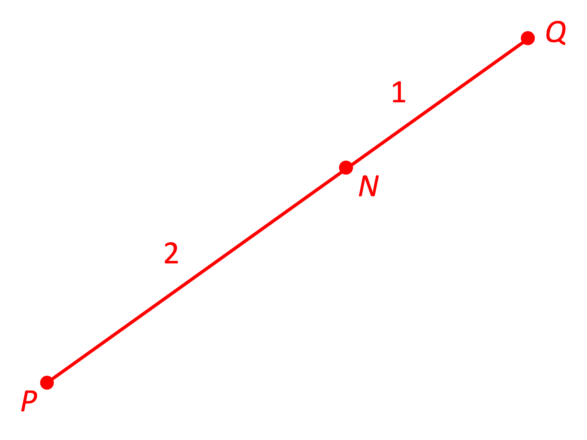
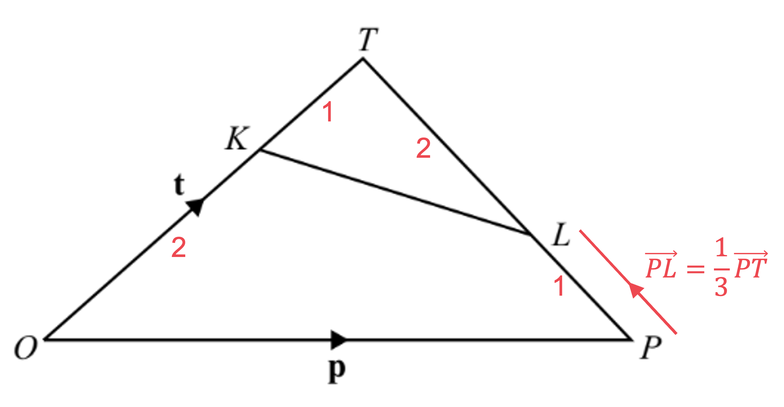
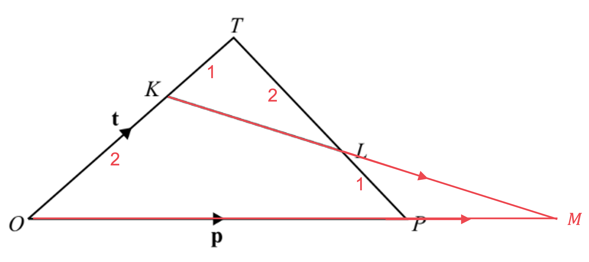

# Mark Schemes — Vectors
**Vectors & Transformations** · Cambridge (CIE) IGCSE maths (0580 & 0980)

## Calculator Questions (17 questions)

### Q1
(i)

$\overset{\rightarrow}{NB}$ is half of $\overset{\rightarrow}{AB}$

- because $N$ is the midpoint of $AB$

To find $\overset{\rightarrow}{AB}$, write it as an alternative vector pathway

$\overset{\rightarrow}{AB}=\overset{\rightarrow}{AO}+\overset{\rightarrow}{OB}$

- $\overset{\rightarrow}{AO}$ is the 'wrong way' down vector $a$, so

$\begin{gathered} \vec{AB} & = - a + b \end{gathered}$

**[M1]**

- and therefore

$\begin{gathered} \vec{NB} & = 1 \frac{1}{2} ( - a + b ) \end{gathered}$

$\vec{NB} = \begin{gathered} - 1 \frac{1}{2} \end{gathered} \begin{gathered} a \end{gathered} \begin{gathered} + \end{gathered} \begin{gathered} 1 \frac{1}{2} \end{gathered} \begin{gathered} b \end{gathered}$

**[A1]**

> **[mark-scheme]**
> **M1**: For $\begin{gathered} \vec{AB} & = - a + b \end{gathered}$ or $\begin{gathered} \vec{BA} & = a - b \end{gathered}$.
> 
> **A1**: For correct answer $\begin{gathered} - 1 \frac{1}{2} a + 1 \frac{1}{2} b \end{gathered}$ or $\begin{gathered} 1 \frac{1}{2} ( - a + b ) \end{gathered}$. Order of $a$ and $b$ terms does not matter.

(ii)

Start by writing $\overset{\rightarrow}{MN}$ using an alternative vector pathway

$\overset{\rightarrow}{MN}=\overset{\rightarrow}{MA}+\overset{\rightarrow}{AN}$

**[M1]**

From the ratio 3:1, $\overset{\rightarrow}{MA}$ is equal to $\frac{1}{3+1}=\frac{1}{4}$ of $\overset{\rightarrow}{OA}$

- And because $N$ is the midpoint of $AB$, $\overset{\rightarrow}{AN}$ is half of $\overset{\rightarrow}{AB}$
- You know $\overset{\rightarrow}{AB}$ from part (i), so

$\vec{MN} = 1 \frac{1}{4} a + 1 \frac{1}{2} ( - a + b )$

Expand the brackets, collect terms and simplify

$\overset{\rightarrow}{MN}=\frac{1}{4}a-\frac{1}{2}a+\frac{1}{2}b$

$\overset{\rightarrow}{MN}=-\frac{1}{4}a+\frac{1}{2}b$

**[A1]**

> **[mark-scheme]**
> **M1**: For a correct pathway for $\overset{\rightarrow}{MN}$.
> 
> **A1**: For correct answer $\begin{gathered} - 1 \frac{1}{4} a + 1 \frac{1}{2} b \end{gathered}$ or $\begin{gathered} 1 \frac{1}{4} ( - a + 2 b ) \end{gathered}$ or $\begin{gathered} - 1 \frac{1}{4} ( a - 2 b ) \end{gathered}$. Order of $a$ and $b$ terms does not matter.
You can show that $P$ lies on $OB$ extended by showing that $\overset{\rightarrow}{OP}$ is a multiple of $\overset{\rightarrow}{OB}$

- i.e. by showing that $\overset{\rightarrow}{OP}$ is a multiple of $b$

Start by writing $\overset{\rightarrow}{OP}$ using an alternative vector pathway

$\overset{\rightarrow}{OP}=\overset{\rightarrow}{OM}+\overset{\rightarrow}{MP}$

From the ratio 3:1, $\overset{\rightarrow}{OM}$ is equal to $\frac{3}{3+1}=\frac{3}{4}$ of $\overset{\rightarrow}{OA}$

- And $\overset{\rightarrow}{MP}$ is given to you in the question, so

$\vec{OP} = \frac{3}{4} a + ( - \frac{3}{4} a + \frac{3}{2} b )$

**[M1]**

Simplify that expression

$\begin{gathered} \vec{OP} & = \frac{3}{4} a - \frac{3}{4} a + \frac{3}{2} b \\ = \frac{3}{2} b \end{gathered}$

State your conclusion

**Final answer:** $\begin{gathered} \vec{OP} & = \frac{3}{2} b \end{gathered}$**, so **$\overset{\rightarrow}{OP}$** is a multiple of **$\overset{\rightarrow}{OB}$**.**

**Final answer:** **Therefore **$P$** lies on **$OB$** extended.**

**[A1]**

> **[mark-scheme]**
> **M1**: For $\begin{gathered} \vec{OP} & = \frac{3}{4} a - \frac{3}{4} a + \frac{3}{2} b \end{gathered}$ or equivalent.
> 
> **A1**: For $\begin{gathered} \vec{OP} & = \frac{3}{2} b \end{gathered}$, and statement "$\overset{\rightarrow}{OP}$ is a multiple of $\overset{\rightarrow}{OB}$" or equivalent.

### Q2
> *The magnitude of a vector can be found using the formula: *$\left| ( \begin{gathered} x \\ y \end{gathered} ) \right| = \sqrt{x^{2} + y^{2}} .$* *
*Use brackets around negatives.*

$\begin{gathered} \left| ( \begin{gathered} - 1 \\ 7 \end{gathered} ) \right| & = \sqrt{( - 1 )^{2} + 7^{2}} \end{gathered}$

**[1]**

> *Simplify the expression and use a calculator to write as a decimal.*

`table columnalign right center left columnspacing 0px end | | ( table columnalign right end | - 1 | | 7 | ) | | = sqrt( 50 | | _ = 5 sqrt( 2 | | _ = 7.071067... | |`

> *Round to 3 significant figures.*

`equation` **[1]**

### Q3
> *To find the magnitude of a vector *$( \begin{gathered} x \\ y \end{gathered} )$* use Pythagoras' theorem, magnitude*$=\sqrt{x^{2}+y^{2}}$

$\vec{VW} = \sqrt{10^{2} + ( - 24 )^{2}}$

**[1]**

> *Evaluate*

$=\sqrt{100+576}\,=\sqrt{676}\,=26$

$26$ **[1]**

### Q4
i) $M$* is the midpoint of *$RQ$* and *$\overset{\rightarrow}{RQ}=\overset{\rightarrow}{OP}$* so *$\overset{\rightarrow}{MQ}$* is equal to half of *$\overset{\rightarrow}{OP}.$

*   *$\overset{\rightarrow}{MQ}=\frac{1}{2}\overset{\rightarrow}{OP}=\frac{1}{2}p$

`M Q -vec = 1 / 2 bottom p` ** [1] **

ii) *Identify the path from *$M$* to *$T$*.*

> *   *$\begin{gathered} \vec{MT} & = \vec{MQ} + \vec{QT} \\ = 1 \frac{1}{2} p + Q \vec{T} \end{gathered}$

*Find *$\overset{\rightarrow}{QT}$* using  *$PT:TQ=2:1$*  so  *$\overset{\rightarrow}{QT}=\frac{1}{3}\overset{\rightarrow}{QP}$* .*

> $\overset{\rightarrow}{QP}=\overset{\rightarrow}{RO}=-r$*.*

$\begin{gathered} \vec{QT} & = 1 \frac{1}{3} \vec{QP} = - 1 \frac{1}{3} r \end{gathered}$

`M T -vec = 1 / 2 bottom p - 1 / 3 bottom r` ** [1] **

iii) *Identify the path from *$O$* to *$T$*.*

$\begin{gathered} \vec{OT} & = \vec{spaceOR} + \vec{RQ} + \vec{QT} \\ = r + p - 1 \frac{1}{3} r \end{gathered}$

*Simplify.*

`O T -vec = bottom p + 2 / 3 bottom r` ** [1] **
> $O$* is the origin so the position vector of *$U$* is *$\overset{\rightarrow}{OU}$

$\overset{\rightarrow}{OU} = \overset{\rightarrow}{OR} + \overset{\rightarrow}{RU}$

> *To find *$\overset{\rightarrow}{RU}$*, first find *$\overset{\rightarrow}{QU}$* using similar triangles*

> $O P$* and *$Q U$* are parallel, so triangles *$O P T$* and *$U Q T$* are similar*

$P T : T Q = 2 : 1$*, so *$Q U$* is half the length of *$O P$

$\overset{\rightarrow}{QU} = \frac{1}{2} \overset{\rightarrow}{OP} = \frac{1}{2} p$

**[1]**

> *Now find *$\overset{\rightarrow}{RU}$*, using *$\overset{\rightarrow}{RQ} = \overset{\rightarrow}{OP} = p$

$\overset{\rightarrow}{RU} = \overset{\rightarrow}{RQ} + \overset{\rightarrow}{QU}$

$\overset{\rightarrow}{RU} = p + \frac{1}{2} p = \frac{3}{2} p$

> *Substitute into *$\overset{\rightarrow}{OU} = \overset{\rightarrow}{OR} + \overset{\rightarrow}{RU}$

`\overset{\rightarrow}{\mathbf{O} \mathbf{U}} = \underline{\mathbf{r}} + \frac{3}{2} \underline{\mathbf{p}}` **[1]**

**Alternatively, write **`\overset{\rightarrow}{O U} = k \left(\mathbf{p} + \frac{2}{3} \mathbf{r}\right)`** as **$U$** lies on **$O T$** extended, and compare the **$r$** terms with **$\overset{\rightarrow}{OR} = r$** to get **$k = \frac{3}{2}$

### Q5
i) *Multiply both components of **p **by 2.*

`2 bottom p = ( | 2 x 4 | | 2 x 5 | | ) = ( | 8 | 10 | )`

> *Add together 2**p** and **q** by adding together corresponding terms.*

`2 bottom p + bottom q = ( | 8 + ( - 2 ) | | 10 + 7 | | )`

`2 bottom p + bottom q = stretchy ( | 6 | 17 | stretchy )`** **
**1 mark for each correct number**** [2]**

ii) *|**p**| means the magnitude of **p**.*

> *The magnitude of a vector can be found using the formula: *$\left| ( \begin{gathered} x \\ y \end{gathered} ) \right| = \sqrt{x^{2} + y^{2}} .$

`| | bottom p | | = sqrt( 4 ^2 + 5 ^2 ) | |`

**[1]**

> *Simplify the expression and use a calculator to write as a decimal.*

`| | bottom p | | = sqrt( 41 | | _ = 6.40312... | |`

> *Round to 3 significant figures.*

`stretchy | bottom p stretchy | = 6 . 40` **[1]**

### Q6
> *First find the position vector of **T** by comparing **OT** to **OD**.*

`O T -vec + T D with rightwards harpoon with barb upwards on top = O D -vec`

> *Use the fact that **OT** = 2**TD **and that the position vector of **D** is **d**.*

`| 2 T D -vec + T D with rightwards harpoon with barb upwards on top | = O D -vec | | 3 T D with rightwards harpoon with barb upwards on top | = O D -vec | | T D with rightwards harpoon with barb upwards on top | = 1 third O D -vec | | therefore O T with rightwards harpoon with barb upwards on top | = 2 / 3 O D -vec = 2 / 3 bottom d | |`

> *Find the vector *`stack T C with rightwards harpoon with barb upwards on top`* by finding a route between them and using *`stack T O with rightwards harpoon with barb upwards on top equals negative stack O T with rightwards harpoon with barb upwards on top.`

`| T C with rightwards harpoon with barb upwards on top | = T O with rightwards harpoon with barb upwards on top + O C -vec | | _ = - O T -vec + O C -vec | | _ = - 2 / 3 bottom d + bottom c | |`

**[1]**

> *Find the vector *`stack T M with rightwards harpoon with barb upwards on top`* by using the fact that **M **is the midpoint of **TC**.*

`| T M with rightwards harpoon with barb upwards on top | = 1 half T C -vec | | _ = 1 half ( - 2 / 3 bottom d + bottom c ) | | _ = - 1 third bottom d + 1 half bottom c | |`

> *Now you can find the position vector of **M **from **O** by finding a route.*

`| O M -vec | = O T -vec + T M -vec | | _ = 2 / 3 bottom d + ( - 1 third bottom d + 1 half bottom c ) | | _ = 2 / 3 bottom d - 1 third bottom d + 1 half bottom c | |`

**[1]**

> *Simplify the **d** terms.*

`O M -vec = 1 / 2 bottom c + 1 / 3 bottom d` **[1]**

### Q7
> *Sketching the information given will help you to visualise the problem. *
*PN** = 2**NQ **can be described as "**N** is between **P** and **Q** and **PN** is twice as long as **NQ**".*

> *We can see that **N** is two thirds of the way from **P** to **Q.*

> *Write the coordinates as position vectors.*

$\vec{OP} = ( \begin{gathered} 16 \\ 9 \end{gathered} )
 \vec{OQ} = ( \begin{gathered} 22 \\ 24 \end{gathered} )$

> *Find the vector from P to Q using *$\overset{\rightarrow}{PQ}=\overset{\rightarrow}{OQ}-\overset{\rightarrow}{OP}$*.*

$\begin{gathered} \vec{PQ} & = ( \begin{gathered} 22 \\ 24 \end{gathered} ) - ( \begin{gathered} 16 \\ 9 \end{gathered} ) = ( \begin{gathered} 6 \\ 15 \end{gathered} ) \end{gathered}$

> *Multiply this by two thirds.*

$\begin{gathered} \vec{PN} & = \frac{2}{3} \vec{PQ} = \frac{2}{3} \times ( \begin{gathered} 6 \\ 15 \end{gathered} ) = ( \begin{gathered} 4 \\ 10 \end{gathered} ) \end{gathered}$

** ****[1]**

> *Add this on to the position vector of P to get the position vector of N using *$\overset{\rightarrow}{ON}=\overset{\rightarrow}{OP}+\overset{\rightarrow}{PN}$*.*

`table columnalign right center left columnspacing 0px end | O N | = ( | 16 | 9 | ) + ( | 4 | 10 | ) = ( | 20 | 19 | ) | |`

> *Rewrite the position vector as coordinates.*

$N=(20,19)$** [1]**

### Q8
i) *Identify the path from *$A$* to *$B$*.*

$\begin{gathered} \vec{AB} & = \vec{spaceAC} + \vec{CB} \\ = a + b \end{gathered}$

`A B -vec = bottom a + bottom b` ** [1] **

ii) *Identify the path from *$O$* to *$E$*.*

$\begin{gathered} \vec{OE} & = \vec{spaceOA} + \vec{AE} \end{gathered}$

**[1] **

> $A$* is the midpoint of *$AB$* so *$\begin{gathered} \vec{OA} & = \vec{AB} = a + b \end{gathered}$*. *$E$* is the midpoint of *$AC$* so  *$\begin{array}{rcl} \vec{AE} & = 1 \frac{1}{2} \vec{ACspace} = 1 \frac{1}{2} a \end{array}$*.*

> *Substitute these into the route for the path. *

$\begin{gathered} \vec{OE} & = \vec{spaceOA} + \vec{AE} = ( a + b ) + 1 \frac{1}{2} a \end{gathered}$

*Simplify.*

`O E -vec = 3 / 2 bottom a + bottom b` ** [1] **

iii) *The position vector of *$D$* is *$OD$*. Identify a path from *$O$* to *$D$* that uses some of the paths you already know vectors for.*

$\begin{gathered} \vec{OD} & = \vec{spaceOE} + \vec{ED} \end{gathered}$

> $E$* is the midpoint of *$AC$* so  *$\begin{gathered} \vec{EC} & = 1 \frac{1}{2} \vec{ACspace} = 1 \frac{1}{2} a \end{gathered}$*. *
*Therefore *$\begin{gathered} \vec{ED} \end{gathered}$* must be equal to *$\begin{gathered} 1 \frac{1}{2} a + x b \end{gathered}$* where*$\begin{gathered} x \end{gathered}$* is a constant to be found. *
$\begin{gathered} \vec{ED} \end{gathered}$*is parallel to *$\begin{gathered} \vec{OE} \end{gathered}$* so *$\begin{gathered} \vec{ED} \end{gathered} = k ( \begin{gathered} \vec{OE} \end{gathered} ) = k ( \frac{3}{2} a + b )$*.   *

$\begin{gathered} 1 \frac{1}{2} a + x b & = k ( \frac{3}{2} a + b ) \end{gathered}$

> *Compare coefficients of **a.*

$\begin{gathered} 1 \frac{1}{2} a & = k ( \frac{3}{2} a ) \\ \frac{3}{2} k & = 1 \frac{1}{2} \\ k & = 1 \frac{1}{3} \end{gathered}$

> *Compare coefficients of **b.*

$xb=kb=\frac{1}{3}b$* **so  *$\begin{gathered} \vec{ED} & = 1 \frac{1}{2} a + 1 \frac{1}{3} b \end{gathered}$*.*

*   ***[1] **

> *Substitute these into the route for the path.  *

$\begin{gathered} \vec{OD} & = \vec{spaceOE} + \vec{ED} = ( \frac{3}{2} a + b ) + ( 1 \frac{1}{2} a + 1 \frac{1}{3} b ) \end{gathered}$

*     ***[1] **

> *Simplify.*

$\begin{array}{rcl} \vec{OD} & = ( \frac{3}{2} a + 1 \frac{1}{2} a ) + ( b + 1 \frac{1}{3} b ) \end{array}$

`O D -vec = 2 bottom a + 4 / 3 bottom b` ** [1] **

### Q9
i) *If you like, mark the ratios on the diagram*

> *We can see that *$\overset{\rightarrow}{PL}=\frac{1}{3}\overset{\rightarrow}{PT}$*. *
*Tracing a route from *$P$* to *$T$* via *$O$*,*

$\overset{\rightarrow}{PT}=-p+t$

**[1]**

> *Therefore *$\frac{1}{3}\overset{\rightarrow}{PT}$* is*

$\frac{1}{3}(-p+t)$ **[1] **
**Equivalent answers such as '**$\frac{1}{3}t-\frac{1}{3}p$**' are accepted**

ii) *Tracing a route from *$K$* to *$L$* via *$O$*,*

$\overset{\rightarrow}{KL}=-\frac{2}{3}t+p+\overset{\rightarrow}{PL}$

**any correct route ****[1]**

> *Replacing *$\overset{\rightarrow}{PL}$* with the answer from part (i) gives*

$= - \frac{2}{3} t + p + 1 \frac{1}{3} ( - p + t )$

> *Expand the brackets and collect like terms*

$=-\frac{2}{3}t+p-\frac{1}{3}p+\frac{1}{3}t\,=-\frac{1}{3}t+\frac{2}{3}p$

$-\frac{1}{3}t+\frac{2}{3}p\mathrm{or}\frac{2}{3}p-\frac{1}{3}t$ **[1]**

**Other equivalent answers such as '**$1 \frac{1}{3} ( 2 p - t )$**' are accepted**
> *Draw the extension of *$KL$* and *$OP$* on the diagram to help you visualise the problem*

$\overset{\rightarrow}{KM}=-\frac{2}{3}t+\frac{4}{3}p=\overset{\rightarrow}{KO}+\frac{4}{3}p$

**[1]**

> *And conclude that*

$\frac{4}{3}p=\overset{\rightarrow}{OM}\mathrm{and}\overset{\rightarrow}{OM}\mathrm{is}a\mathrm{multiple} \mathrm{of}\overset{\rightarrow}{OP}$** [1]**

### Q10
(i) *Find a path from **O** to **T** using known vectors.*

$\overset{\rightarrow}{OT}=\overset{\rightarrow}{OP}+\overset{\rightarrow}{PT}$

`O T -vec = bottom a + bottom b` **[1]**

(ii) *Find a path from **P** to **R** using known vectors.*

$\overset{\rightarrow}{PR}=\overset{\rightarrow}{PO}+\overset{\rightarrow}{OR}$

> *Use the property that reversing the direction of the vector is the same as multiplying it by -1.*

$\begin{gathered} \vec{PR} & = - \vec{OP} + \vec{OR} \end{gathered}$

`P R -vec = - bottom a + 3 bottom b`* ***[1] **
**It is also acceptable to write: **`P R -vec = 3 bottom b - bottom a`
*Use the ratio to write **PS** as a fraction of **PR**.* *PS** : **SR**  = 1 : 3 therefore **PS** is *$\frac{1}{1+3}$* of the length **PR**.*

$\overset{\rightarrow}{PS}=\frac{1}{4}\times\overset{\rightarrow}{PR}$

> *Use the vector for *$\overset{\rightarrow}{PR}.$

`| P S -vec | = 1 fourth x ( 3 bottom b - bottom a ) | | _ = 3 / 4 bottom b - 1 fourth bottom a | |`

> *Find a path starting at **O** and ending at **S**.*

$\overset{\rightarrow}{OS}=\overset{\rightarrow}{OP}+\overset{\rightarrow}{PS}$

**[1]**

> *Substitute the expressions for the vectors.*

`| O S -vec | = bottom a + 3 / 4 bottom b - 1 fourth bottom a | | _ = bottom a - 1 fourth bottom a + 3 / 4 bottom b | |`

> *Simplify.*

`| O S -vec | = 3 / 4 bottom a + 3 / 4 bottom b | |` **[1]**

**Factorising is acceptable:** `| O P -vec | = 3 / 4 ( bottom a + bottom b ) | |`
> *Compare the vectors *`O T -vec = bottom a + bottom b`* and *`O S -vec = 3 / 4 ( bottom a + bottom b ).`

$\overset{\rightarrow}{OS}=\frac{3}{4}\overset{\rightarrow}{OT}$

> *If one vector is a scalar multiple of another then the two vectors are parallel.*

**OT*** and ***OS*** are parallel with a common point ***O***, therefore ***OST*** is a straight line*

**[1]**

**S**** lies on the line ****OT**** and ****OS**** : ****ST**** = 3 : 1 ****[1]**

### Q11
i*)  Find *$3a$* (by multiplying both numbers in *$a$* by 3)* * *

$3 a = ( \begin{gathered} - 9 \\ 6 \end{gathered} )$ * *

*Find *$2b$* (by multiplying both numbers in *$c$* by 2)* * *

$2 b = ( \begin{gathered} 10 \\ 8 \end{gathered} )$

**either correct**** [1]**

*Find *$3a-2b$* (by subtracting the tops and bottoms of the two vectors above)* * *

`table columnalign right center left columnspacing 0px end | 3 a - 2 b | = ( | - 9 | | 6 | ) - ( | 10 | 8 | ) | | _ = ( | - 9 - 10 | | 6 - 8 | | ) | |` * *

> *Give your final answer as a vector*

$( \begin{gathered} - 19 \\ - 2 \end{gathered} )$** [1]**

ii) *The magnitude of a vector is *$\left| ( \begin{gathered} x \\ y \end{gathered} ) \right| = \sqrt{x^{2} + y^{2}}$ 
*Substitute *$x=-3$* and *$y=2$* into this formula* * *

$\vert a \vert = \left| ( \begin{gathered} - 3 \\ 2 \end{gathered} ) \right| = \sqrt{( - 3 )^{2} + 2^{2}}$

**[1]**

> *Use a calculator to work this out, giving your answer to 3 significant figures*

**Final answer:** **3.61 ****[1]**

### Q12
> *Find the vector *$\overset{\rightarrow}{AB}$* by finding a path from **A** to **B**.*

`| A B -vec | = - O A -vec + O B -vec | | _ = - ( 2 bottom a + bottom b ) + 3 bottom a + 2 bottom b | | _ = - 2 bottom a + 3 bottom a - bottom b + 2 bottom b | | _ = bottom a + bottom b | |`

**[1]**

> *AB** : **BC** = 2 : 5 therefore **AB** is *$\frac{2}{2+5}$* of the length of **AC**.*

$\overset{\rightarrow}{AB}=\frac{2}{7}\times\overset{\rightarrow}{AC}$

> *Rearrange to find *$\overset{\rightarrow}{AC}$*.*

`| A C -vec | = 7 / 2 x A B -vec | | _ = 7 / 2 ( bottom a + bottom b ) | | _ = 7 / 2 bottom a + 7 / 2 bottom b | |`

**[1]**

> *Find the vector *$\overset{\rightarrow}{OC}$* by finding a path from **O** to **C**.*

`| O C -vec | = O A -vec + A C -vec | | _ = 2 bottom a + bottom b + 7 / 2 bottom a + 7 / 2 bottom b | |`

**[1]**

> *Simplify.*

`O C -vec = 11 / 2 bottom a + 9 / 2 bottom b` **[1]**

**It is acceptable to write in factorised form: **`O C -vec = 1 half ( 11 bottom a + 9 bottom b )`

### Q13
i)  *The column vector *$\overset{\rightarrow}{AB}$* is *$( \begin{gathered} x \\ y \end{gathered} )$* where **x** is the horizontal distance from **A **to **B** and **y** is the vertical distance from **A **to **B** ** **Find **x** and **y** (by working out the difference in their coordinates)*

**x*** = 5 - 3 = 2* 
**y*** = 6 - 2 = 4*

> *Write your answer as a column vector*

$\text{begin} \text{style} ( \begin{gathered} 2 \\ 4 \end{gathered} )$ **[1]**

ii) *The magnitude of a vector is *$\left| ( \begin{gathered} x \\ y \end{gathered} ) \right| = \sqrt{x^{2} + y^{2}}$ *Find the magnitude of *$\overset{\rightarrow}{AB}$* (by substituting **x** = 2 and **y** = 4 into the formula)   *

$\vert \vec{AB} \vert = \left| ( \begin{gathered} 2 \\ 4 \end{gathered} ) \right| = \sqrt{2^{2} + 4^{2}}$

**2****2****+4****2**** seen ****[1]**

> *Use a calculator to work this out and give your answer to 3 significant figures*

**4.47** **[1]**

### Q14
> *Substitute *$a$*, *$b$* and *$c$* into the formula *

$m ( \begin{gathered} - 3 \\ 2 \end{gathered} ) + n ( \begin{gathered} 5 \\ 4 \end{gathered} ) = ( \begin{gathered} 14 \\ 9 \end{gathered} )$

> *Multiply any letters on the outside of a vector by the two numbers inside *

> $( \begin{gathered} - 3 m \\ 2 m \end{gathered} ) + ( \begin{gathered} 5 n \\ 4 n \end{gathered} ) = ( \begin{gathered} 14 \\ 9 \end{gathered} )$* *

> *Add the two vectors on the left (by adding the tops and bottoms separately) *

> $( \begin{gathered} - 3 m + 5 n \\ 2 m + 4 n \end{gathered} ) = ( \begin{gathered} 14 \\ 9 \end{gathered} )$* *

> *Form simultaneous equations (by reading off the top row and the bottom row) *

$\begin{array}{rcl} - 3 m + 5 n & = 14 \\ 2 m + 4 n & = 9 \end{array}$

**[1]**

*These simultaneous equations can be solved by eliminating *$m$*(or *$n$*)* *Make the *$m$* terms equal in size (by multiplying the first equation by 2 and the second equation by 3) *

$\begin{gathered} - 6 m + 10 n & = 28 \\ 6 m + 12 n & = 27 \end{gathered}$

**[1]**

*Add these two equations by adding "like" (similar) terms* *The *$m$* terms should disappear *

> $22n=55$* *

> *Solve this equation for *$n$* (by dividing both sides by 22) *

$n=\frac{55}{22}=\frac{5}{2}$

**[1]**

> *Substitute *$n=\frac{5}{2}$* back into the first equation (or the second) *

$\begin{gathered} - 3 m + 5 \times \frac{5}{2} & = 14 \\ - 3 m + \frac{25}{2} & = 14 \end{gathered}$

**[1]**

> *Solve this equation for *$m$* (for example, by subtracting *$\frac{25}{2}$* from both sides then dividing by *$-3$*) *

$\begin{array}{ccc} - 3 m & = & 14 - \frac{25}{2} \\ - 3 m & = & \frac{3}{2} \\ m = & \frac{\frac{3}{2}}{ - 3} = - 1 \text{half} \end{array}$

> *Check *$m=-\frac{1}{2}$* and *$n=\frac{5}{2}$* satisfy the other equation (*$2m+4n=9$*) by substituting them into the left-hand side *

> $2 \times ( - 1 \frac{1}{2} ) + 4 \times \frac{5}{2} 
= - 1 + 10
= 9$*  *

> *Give both answers together at the end*

$m=-\frac{1}{2}$** ****and**** **$n=\frac{5}{2}$**[1]**

### Q15
i)$\begin{gathered} \\ \end{gathered}$*We are being asked to find the magnitude of *`stack O B with rightwards harpoon with barb upwards on top`

> *First we need to find determine vector *`stack O B with rightwards harpoon with barb upwards on top`

`| O B with rightwards harpoon with barb upwards on top | = O A with rightwards harpoon with barb upwards on top + A B with rightwards harpoon with barb upwards on top | | _ = ( | 4 | 3 | ) + ( | 8 | - 7 | | ) | | _ = ( | 12 | - 4 | | ) | | _ _ _ |`

**[1]**

> *The magnitude of a vector *$( \begin{gathered} a \\ b \end{gathered} )$* is *$\sqrt{a^{2}+b^{2}}$

`| | O B with rightwards harpoon with barb upwards on top | | = sqrt( 12 ^2 + ( - 4 ) ^2 ) | |`

**[1]**

$\begin{gathered} = \sqrt{160} \\ = 12.64911064... \end{gathered}$

`| stretchy | O B with rightwards harpoon with barb upwards on top stretchy | | = 12 . 6 | |`**  [1]**

**Round your answer to at least 3 significant figures**

ii) *Method 1*

> *We are given *`stack A C with rightwards harpoon with barb upwards on top`* and *`stack A B with rightwards harpoon with barb upwards on top`* and we know that *`stack A C with rightwards harpoon with barb upwards on top equals stack A B with rightwards harpoon with barb upwards on top plus stack B C with rightwards harpoon with barb upwards on top`*.*

> *Rearrange this to *`stack B C with rightwards harpoon with barb upwards on top equals stack A C with rightwards harpoon with barb upwards on top minus stack A B with rightwards harpoon with barb upwards on top`* *

$\begin{gathered} \vec{BC} & = ( \begin{gathered} - 3 \\ 6 \end{gathered} ) - ( \begin{gathered} 8 \\ - 7 \end{gathered} ) \end{gathered}$

**[1]**

$= ( \begin{gathered} - 3 - 8 \\ 6 - ( - 7 ) \end{gathered} )$

`Error converting from MathML to accessible text.`**  [1]**

> *Method 2 *
*We are given *`stack A C with rightwards harpoon with barb upwards on top`* and *`stack A B with rightwards harpoon with barb upwards on top`* and we know that *`stack B C with rightwards harpoon with barb upwards on top equals stack B A with rightwards harpoon with barb upwards on top plus stack A C with rightwards harpoon with barb upwards on top`*.*

> *Also, *`stack B A with rightwards harpoon with barb upwards on top equals negative stack A B with rightwards harpoon with barb upwards on top`* *

$\begin{gathered} \vec{BA} & = - & ( \begin{gathered} 8 \\ - 7 \end{gathered} ) = ( \begin{gathered} - 8 \\ 7 \end{gathered} ) \end{gathered}$

**[1]**

> *Add *`stack B A with rightwards harpoon with barb upwards on top`* and *`stack A C with rightwards harpoon with barb upwards on top`* to find *`stack B C with rightwards harpoon with barb upwards on top`

`| B C with rightwards harpoon with barb upwards on top | = ( | - 8 | | 7 | ) + ( | - 3 | | 6 | ) | | _ = ( | - 8 - 3 | | 7 + 6 | | ) | |`

`Error converting from MathML to accessible text.`**  [1]**

### Q16
i) $\overset{\rightarrow}{AC}=\overset{\rightarrow}{AB}+\overset{\rightarrow}{BC}$*.*

> *Add together *$\overset{\rightarrow}{AB}$* and *$\overset{\rightarrow}{BC}$* by adding together corresponding terms.*

$\vec{ABspace} + \vec{spaceBCspace} = ( \begin{gathered} 6 + ( - 2 ) \\ ( - 1 ) + 5 \end{gathered} )$

`equation`** **
**1 mark for each correct number**** [2]**

ii) $\overset{\rightarrow}{BD}=\overset{\rightarrow}{BC}+\overset{\rightarrow}{CD}=\overset{\rightarrow}{BC}-\overset{\rightarrow}{DC}$*.*

> *Subtract *$\overset{\rightarrow}{DC}$* from *$\overset{\rightarrow}{BC}$* by subtracting corresponding terms.*

$\vec{BCspace} - \vec{DCspace} = ( \begin{gathered} ( - 2 ) - 2 \\ 5 - ( - 3 ) \end{gathered} )$

`equation`** **
**1 mark for each correct number**** [2]**

iii) $\left| \vec{BCspace} \right|$* means the magnitude of *$\overset{\rightarrow}{BC}$*.*

> *The magnitude of a vector can be found using the formula: *$\left| ( \begin{gathered} x \\ y \end{gathered} ) \right| = \sqrt{x^{2} + y^{2}} .$

$\begin{gathered} \left| \vec{BCspace} \right| & = \sqrt{( - 2 )^{2} + 5^{2}} \end{gathered}$

**[1]**

> *Simplify the expression and use a calculator to write as a decimal.*

$\begin{gathered} \left| \vec{BCspace} \right| & = \sqrt{29} \\ = 5.38516... \end{gathered}$

> *Round to 3 significant figures.*

`equation` **[1] **
**Unrounded answer accepted.**

### Q17
i) *Go from **A** to **O** to** B** *

$\overset{\rightarrow}{AB}=\overset{\rightarrow}{AO}+\overset{\rightarrow}{OC}+\overset{\rightarrow}{OC}\,=-a+c+c\,$

$-a+2c$** [1]**

ii) *AD** : **DB** = 3 : 5 so **AD** is *$\frac{3}{3+5}$*of **AB* * *

$\overset{\rightarrow}{AD}=\frac{3}{8}\overset{\rightarrow}{AB}$ * *

*Substitute in *$\overset{\rightarrow}{AB}$* from part (i)* * *

$\vec{AD} = \frac{3}{8} ( - a + 2 c )$ * *

*Expand the brackets (by multiplying everything inside by *$\frac{3}{8}$*)*

$-\frac{3}{8}a+\frac{3}{4}c$ **[1]**

iii) *OA** : **AE** = 2: 3 = 1 : *$\frac{3}{2}$* so   *

$\overset{\rightarrow}{AE}=\frac{3}{2}a$* * * *

* Find *$\overset{\rightarrow}{OE}$* (from **O** to **A** to **E**)* * *

$\begin{gathered} \vec{OE} & = \vec{OA} + \vec{AE} \\ = a + \frac{3}{2} a \\ = \frac{5}{2} a \end{gathered}$ * *

*Find *$\overset{\rightarrow}{CE}$*  ( from **C **to **O** to **E**)*

$\overset{\rightarrow}{CE}=\overset{\rightarrow}{CO}+\overset{\rightarrow}{OE}\,=-c+\frac{5}{2}a$

$\frac{5}{2}a-c$** ****[1]**

iv) $\overset{\rightarrow}{CD}$* is **C** to **O** to **A** to** D** and *$\overset{\rightarrow}{AD}$* is *$-\frac{3}{8}a+\frac{3}{4}c$* from part (ii)* *Find *$\overset{\rightarrow}{CD}$ * *

$\vec{CD} = \vec{CO} + \vec{OA} + \vec{AD} 
= - c + a + ( - \frac{3}{8} a + \frac{3}{4} c )$

**[1]**

*Simplify (by collecting like terms)*

$\overset{\rightarrow}{CD}=\frac{5}{8}a-\frac{1}{4}c$ **[1]**
> *Substitute in *$\overset{\rightarrow}{CE}$* and *$\overset{\rightarrow}{CD}$* from parts (iii) and (iv) *

> $\vec{CE} = k \vec{CD} 
 \frac{5}{2} a - c = k ( \frac{5}{8} a - 1 \frac{1}{4} c )$* *

> *Factorise out *$\frac{1}{4}$* from the right-hand side and cancel the common vectors *

> `| C E -vec | = k C D -vec | | / 5 / 2 a - c | = k / 4 / ( 5 / 2 a - c ) | | 1 = k / 4 | |`* *

*Solve to find *$k$* (by multiplying both sides by 4)*

$k=4$ **[1]**
